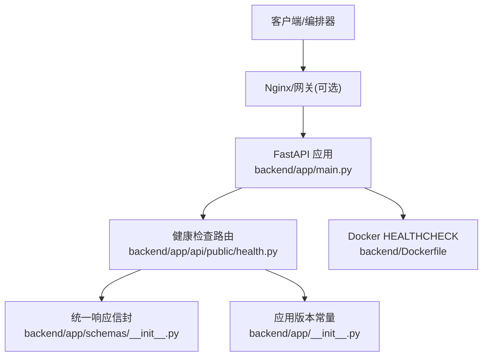
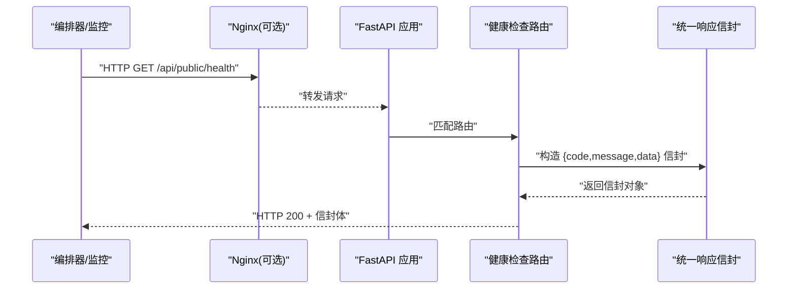
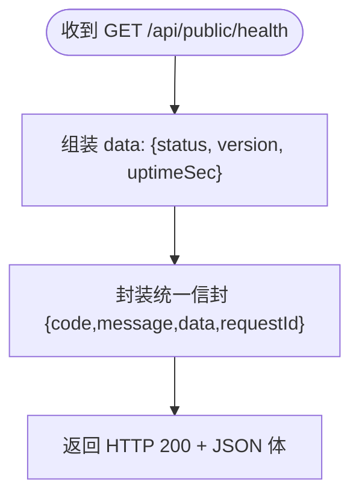
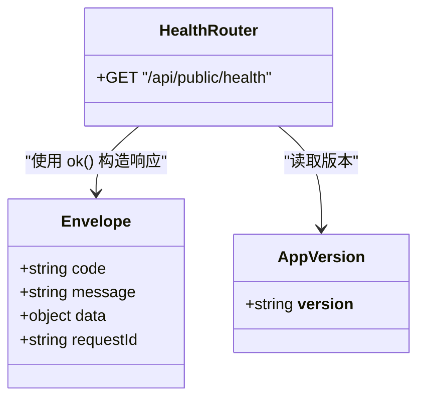

# 健康检查接口

<cite>
**本文引用的文件**
- [backend/app/api/public/health.py](file://backend/app/api/public/health.py)
- [backend/app/main.py](file://backend/app/main.py)
- [backend/app/schemas/__init__.py](file://backend/app/schemas/__init__.py)
- [backend/app/__init__.py](file://backend/app/__init__.py)
- [backend/Dockerfile](file://backend/Dockerfile)
- [deploy/local/docker-compose.yml](file://deploy/local/docker-compose.yml)
- [deploy/ecs/compose.yml](file://deploy/ecs/compose.yml)
- [backend/_dev_check.py](file://backend/_dev_check.py)
</cite>

## 目录
1. [简介](#简介)
2. [项目结构](#项目结构)
3. [核心组件](#核心组件)
4. [架构总览](#架构总览)
5. [详细组件分析](#详细组件分析)
6. [依赖分析](#依赖分析)
7. [性能考虑](#性能考虑)
8. [故障诊断指南](#故障诊断指南)
9. [结论](#结论)
10. [附录](#附录)

## 简介
本文件为“学习中心”后端服务的健康检查接口文档，聚焦于：
- 存活探针（Liveness）端点 /api/public/health 的响应格式与字段含义
- 统一响应信封结构
- 在 Docker/Kubernetes 中的集成方式与健康状态映射
- 扩展建议：就绪探针（Readiness）与依赖服务检测（PostgreSQL、Redis）的实现思路与最佳实践

说明：当前仓库已实现轻量级存活检查；就绪检查与依赖检测尚未在当前代码中实现，本节提供可落地的扩展方案与配置示例。

## 项目结构
与本次文档相关的后端关键位置如下：
- 健康检查路由定义：backend/app/api/public/health.py
- 应用装配与路由注册：backend/app/main.py
- 统一响应信封：backend/app/schemas/__init__.py
- 应用版本常量：backend/app/__init__.py
- 容器健康检查命令：backend/Dockerfile
- 本地编排示例：deploy/local/docker-compose.yml
- ECS 编排示例：deploy/ecs/compose.yml
- 开发环境快速验证脚本：backend/_dev_check.py

图表来源
- [backend/app/main.py:91-102](file://backend/app/main.py#L91-L102)
- [backend/app/api/public/health.py:11-25](file://backend/app/api/public/health.py#L11-L25)
- [backend/app/schemas/__init__.py:24-42](file://backend/app/schemas/__init__.py#L24-L42)
- [backend/app/__init__.py:1-3](file://backend/app/__init__.py#L1-L3)
- [backend/Dockerfile:80-82](file://backend/Dockerfile#L80-L82)

章节来源
- [backend/app/main.py:91-102](file://backend/app/main.py#L91-L102)
- [backend/app/api/public/health.py:11-25](file://backend/app/api/public/health.py#L11-L25)
- [backend/app/schemas/__init__.py:24-42](file://backend/app/schemas/__init__.py#L24-L42)
- [backend/app/__init__.py:1-3](file://backend/app/__init__.py#L1-L3)
- [backend/Dockerfile:80-82](file://backend/Dockerfile#L80-L82)

## 核心组件
- 存活检查端点
  - 路径：GET /api/public/health
  - 用途：为负载均衡器、Kubernetes、Docker 等提供进程存活探测
  - 行为：返回统一成功信封，包含 status、version、uptimeSec 等字段
- 统一响应信封
  - 结构：{ code, message, data, requestId }
  - 成功构造：code="ok", message="ok"
- 应用版本
  - 来源：app.__version__，用于在健康检查中暴露服务版本

章节来源
- [backend/app/api/public/health.py:16-25](file://backend/app/api/public/health.py#L16-L25)
- [backend/app/schemas/__init__.py:24-42](file://backend/app/schemas/__init__.py#L24-L42)
- [backend/app/__init__.py:1-3](file://backend/app/__init__.py#L1-L3)

## 架构总览
请求从外部进入，经反向代理或直连到达 FastAPI，路由到健康检查处理器，使用统一信封返回结果。Docker 内置 HEALTHCHECK 会周期性调用该端点以判定容器健康。

图表来源
- [backend/app/main.py:91-102](file://backend/app/main.py#L91-L102)
- [backend/app/api/public/health.py:16-25](file://backend/app/api/public/health.py#L16-L25)
- [backend/app/schemas/__init__.py:24-42](file://backend/app/schemas/__init__.py#L24-L42)

## 详细组件分析

### 存活检查（Liveness）端点
- 端点：GET /api/public/health
- 功能：返回进程是否存活、服务版本、自启动以来的运行秒数
- 响应体字段
  - code: 固定为 "ok"
  - message: 固定为 "ok"
  - data: 对象，包含
    - status: 固定为 "UP"
    - version: 字符串，来自 app.__version__
    - uptimeSec: 整数，表示自进程启动以来的秒数
- 典型响应示例（JSON）
  - {
      "code": "ok",
      "message": "ok",
      "data": {
        "status": "UP",
        "version": "1.0.0",
        "uptimeSec": 1234
      }
    }

图表来源
- [backend/app/api/public/health.py:16-25](file://backend/app/api/public/health.py#L16-L25)
- [backend/app/schemas/__init__.py:24-42](file://backend/app/schemas/__init__.py#L24-L42)
- [backend/app/__init__.py:1-3](file://backend/app/__init__.py#L1-L3)

章节来源
- [backend/app/api/public/health.py:16-25](file://backend/app/api/public/health.py#L16-L25)
- [backend/app/schemas/__init__.py:24-42](file://backend/app/schemas/__init__.py#L24-L42)
- [backend/app/__init__.py:1-3](file://backend/app/__init__.py#L1-L3)

### 就绪检查（Readiness）与依赖检测（扩展建议）
现状：当前代码未实现就绪检查与依赖检测。以下为推荐实现方案，便于后续落地：
- 新增端点：GET /api/public/ready
- 检查项建议
  - PostgreSQL：执行一条简单查询（如 SELECT 1），记录连接状态
  - Redis：执行 PING，记录可用性
  - 其他依赖：按业务需要扩展（对象存储、消息队列等）
- 响应结构建议
  - data.ready: boolean
  - data.dependencies: 对象，键为依赖名，值为 { status, latencyMs, error? }
  - data.version, data.uptimeSec 可与 liveness 保持一致
- 编排策略
  - Liveness 失败：重启容器
  - Readiness 失败：从负载均衡摘除流量，但不重启

注意：以上为扩展设计建议，非当前仓库已实现逻辑。

[本节为概念性内容，不直接分析具体源码文件]

### 容器编排集成

#### Docker 集成
- 镜像内已配置 HEALTHCHECK，周期调用 /api/public/health
- 健康状态映射
  - 端点返回 2xx：容器标记为 healthy
  - 超时或返回非 2xx：容器标记为 unhealthy
- 参数参考
  - --interval=30s
  - --timeout=5s
  - --start-period=10s
  - --retries=3

章节来源
- [backend/Dockerfile:80-82](file://backend/Dockerfile#L80-L82)

#### Kubernetes 集成
- Liveness Probe
  - httpGet.path: /api/public/health
  - initialDelaySeconds/periodSeconds/failureThreshold 根据部署环境调优
- Readiness Probe（待实现后启用）
  - httpGet.path: /api/public/ready
  - 当依赖不可用时，Pod 被摘除流量，避免错误放大
- Startup Probe（可选）
  - 针对冷启动较慢场景，避免过早触发 Liveness

[本节为通用编排知识，不直接分析具体源码文件]

#### Docker Compose 集成
- 可在 services 中使用 healthcheck 指向同一端点
- 或使用 depends_on + condition: service_healthy 控制启动顺序

章节来源
- [deploy/local/docker-compose.yml](file://deploy/local/docker-compose.yml)
- [deploy/ecs/compose.yml](file://deploy/ecs/compose.yml)

## 依赖分析
- 路由注册
  - main.py 将 public_health.router 注册到 FastAPI 应用
- 健康检查处理器
  - 读取 app.__version__
  - 计算 uptimeSec
  - 通过统一信封 ok() 返回
- 统一信封
  - ok() 生成 {code,message,data,requestId}
  - 健康检查仅设置 data，requestId 由中间件注入时携带

图表来源
- [backend/app/main.py:91-102](file://backend/app/main.py#L91-L102)
- [backend/app/api/public/health.py:16-25](file://backend/app/api/public/health.py#L16-L25)
- [backend/app/schemas/__init__.py:24-42](file://backend/app/schemas/__init__.py#L24-L42)
- [backend/app/__init__.py:1-3](file://backend/app/__init__.py#L1-L3)

章节来源
- [backend/app/main.py:91-102](file://backend/app/main.py#L91-L102)
- [backend/app/api/public/health.py:16-25](file://backend/app/api/public/health.py#L16-L25)
- [backend/app/schemas/__init__.py:24-42](file://backend/app/schemas/__init__.py#L24-L42)
- [backend/app/__init__.py:1-3](file://backend/app/__init__.py#L1-L3)

## 性能考虑
- 健康检查应尽可能轻量，避免引入额外 I/O
- 当前实现无外部依赖访问，开销极低
- 若扩展依赖检测，建议：
  - 使用短超时与重试上限
  - 对依赖进行缓存式探测（例如每 N 秒刷新一次）
  - 将耗时操作异步化，避免阻塞事件循环

[本节为通用指导，不直接分析具体源码文件]

## 故障诊断指南
- 常见问题
  - 端口不通：确认容器端口映射与防火墙规则
  - 路径错误：确保访问 /api/public/health
  - 反向代理拦截：检查 Nginx 是否将 /api 正确转发至后端
  - 健康检查频繁失败：调整 startPeriod/initialDelaySeconds 以适应冷启动
- 定位步骤
  - 容器内 curl 测试：curl -fsS http://localhost:8000/api/public/health
  - 查看容器日志：确认应用正常启动且无异常
  - 检查环境变量与依赖：数据库、缓存等是否可达
- 快速验证脚本
  - 可使用开发脚本发起请求并解析 uptimeSec 字段进行断言

章节来源
- [backend/_dev_check.py:15-18](file://backend/_dev_check.py#L15-L18)
- [backend/Dockerfile:80-82](file://backend/Dockerfile#L80-L82)

## 结论
- 当前后端提供了轻量、稳定的存活检查端点，满足基础运维需求
- 建议在后续迭代中补充就绪检查与依赖检测，以提升编排稳定性与可观测性
- 结合 Docker/Kubernetes 探针配置，可实现自动故障恢复与流量治理

[本节为总结性内容，不直接分析具体源码文件]

## 附录

### API 定义速查
- 方法：GET
- 路径：/api/public/health
- 认证：无需鉴权
- 成功响应码：200
- 响应体结构
  - code: "ok"
  - message: "ok"
  - data:
    - status: "UP"
    - version: 字符串
    - uptimeSec: 整数（秒）
  - requestId: 可选，由中间件注入

章节来源
- [backend/app/api/public/health.py:16-25](file://backend/app/api/public/health.py#L16-L25)
- [backend/app/schemas/__init__.py:24-42](file://backend/app/schemas/__init__.py#L24-L42)