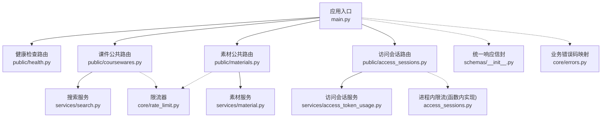
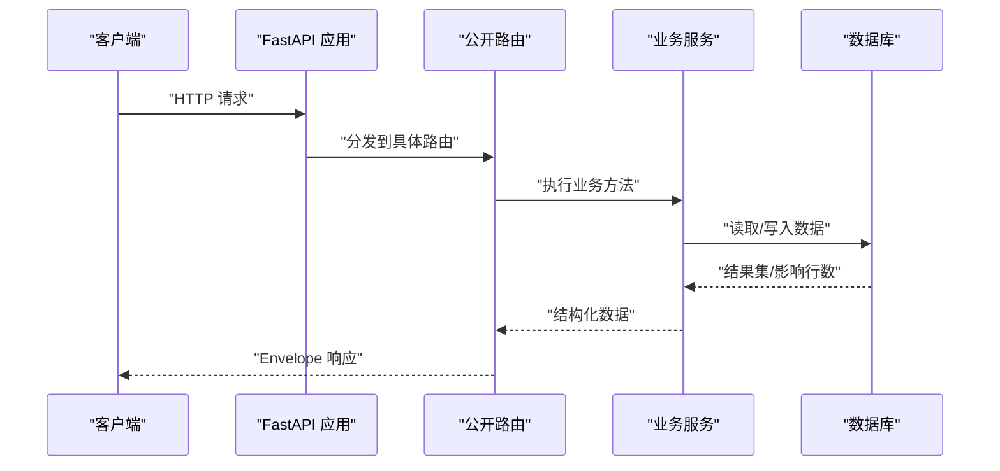
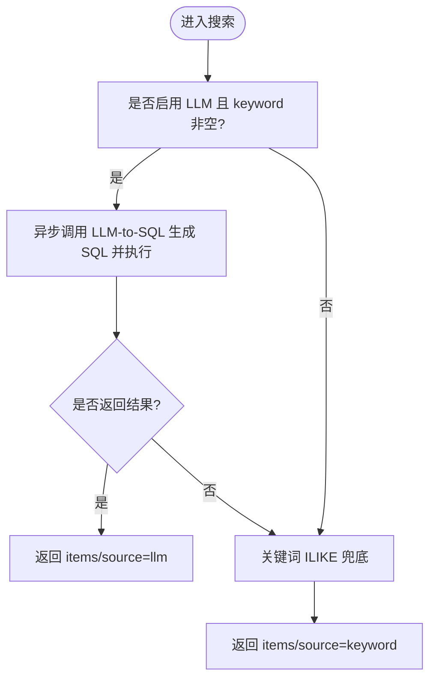
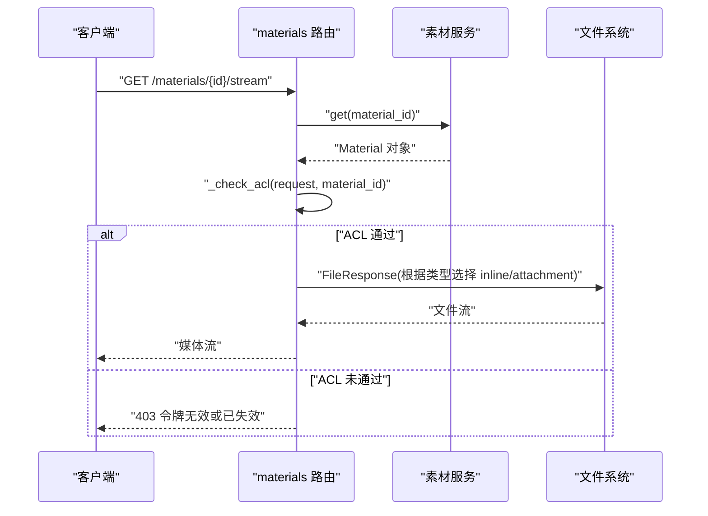
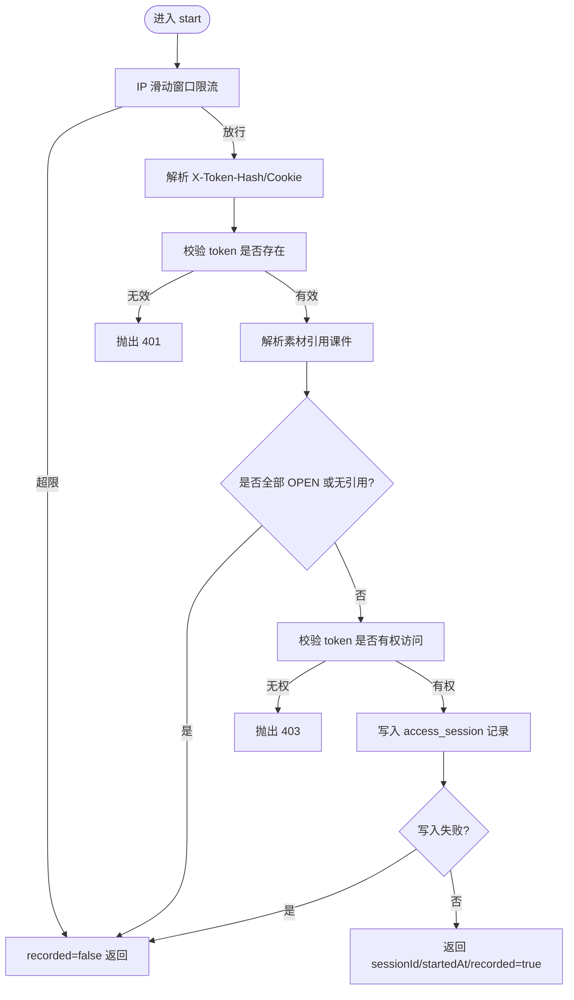
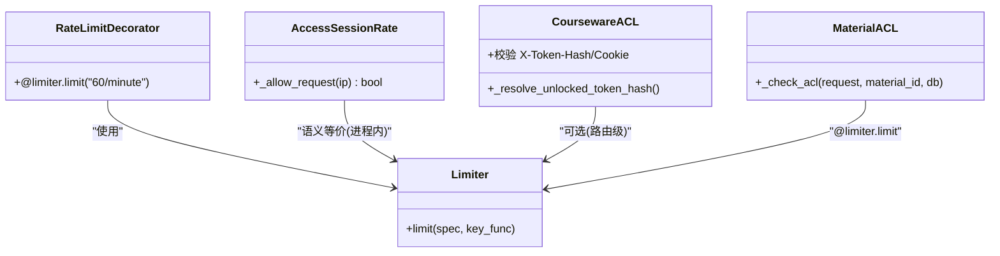
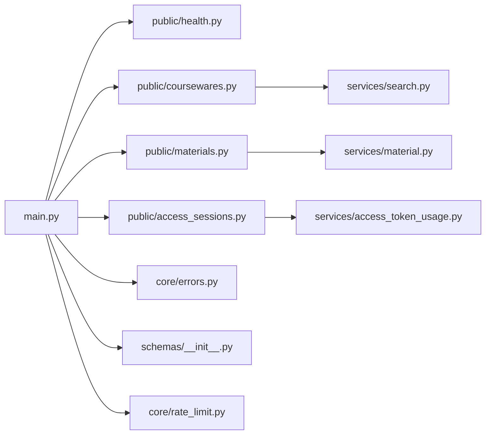

# 公开接口

<cite>
**本文引用的文件**   
- [backend/app/main.py](file://backend/app/main.py)
- [backend/app/api/public/health.py](file://backend/app/api/public/health.py)
- [backend/app/api/public/coursewares.py](file://backend/app/api/public/coursewares.py)
- [backend/app/api/public/materials.py](file://backend/app/api/public/materials.py)
- [backend/app/api/public/access_sessions.py](file://backend/app/api/public/access_sessions.py)
- [backend/app/services/search.py](file://backend/app/services/search.py)
- [backend/app/core/rate_limit.py](file://backend/app/core/rate_limit.py)
- [backend/app/schemas/__init__.py](file://backend/app/schemas/__init__.py)
- [backend/app/core/errors.py](file://backend/app/core/errors.py)
- [backend/app/models/access_session.py](file://backend/app/models/access_session.py)
- [backend/app/services/access_token_usage.py](file://backend/app/services/access_token_usage.py)
</cite>

## 目录
1. [简介](#简介)
2. [项目结构](#项目结构)
3. [核心组件](#核心组件)
4. [架构总览](#架构总览)
5. [详细组件分析](#详细组件分析)
6. [依赖关系分析](#依赖关系分析)
7. [性能与缓存策略](#性能与缓存策略)
8. [故障排查指南](#故障排查指南)
9. [结论](#结论)
10. [附录：接口示例与客户端集成](#附录接口示例与客户端集成)

## 简介
本指南面向需要对接“学习中心”后端公开接口的开发者，覆盖以下能力：
- 课件查询接口：统一搜索（智能召回 + 关键词兜底）、详情、解锁
- 素材访问接口：下载、流式预览、图片分页、单条元数据
- 健康检查接口：服务存活探针
- 访问会话跟踪接口：开始/结束记录、幂等处理、降级策略
- 公开接口访问控制：令牌校验、速率限制
- 性能优化建议与缓存策略配置
- 完整接口示例与客户端集成要点

## 项目结构
公开接口位于 backend/app/api/public 下，按功能模块划分路由；业务逻辑下沉至 services 层；错误码、限流、响应信封在 core 与 schemas 中集中管理。

图表来源
- [backend/app/main.py:40-112](file://backend/app/main.py#L40-L112)
- [backend/app/api/public/health.py:11-26](file://backend/app/api/public/health.py#L11-L26)
- [backend/app/api/public/coursewares.py:19-133](file://backend/app/api/public/coursewares.py#L19-L133)
- [backend/app/api/public/materials.py:20-224](file://backend/app/api/public/materials.py#L20-L224)
- [backend/app/api/public/access_sessions.py:24-137](file://backend/app/api/public/access_sessions.py#L24-L137)
- [backend/app/services/search.py:210-263](file://backend/app/services/search.py#L210-L263)
- [backend/app/services/material.py:122-234](file://backend/app/services/material.py#L122-L234)
- [backend/app/services/access_token_usage.py:64-172](file://backend/app/services/access_token_usage.py#L64-L172)
- [backend/app/core/rate_limit.py:40-55](file://backend/app/core/rate_limit.py#L40-L55)
- [backend/app/schemas/__init__.py:24-42](file://backend/app/schemas/__init__.py#L24-L42)
- [backend/app/core/errors.py:9-144](file://backend/app/core/errors.py#L9-L144)

章节来源
- [backend/app/main.py:40-112](file://backend/app/main.py#L40-L112)

## 核心组件
- 健康检查：返回服务状态、版本、运行时长，供负载均衡或编排系统探测。
- 课件查询：支持统一搜索（LLM-to-SQL 优先，关键词 ILIKE 兜底），详情获取，凭令牌解锁并写入 Cookie。
- 素材访问：提供下载、流式预览（视频/PPT/PDF）、PPT 图片页、单条元数据；内置 ACL 校验与限速。
- 访问会话：开始/结束记录，带 IP 限流、DB 异常吞错降级、客户端时长校正。
- 访问控制：基于 X-Token-Hash/Cookie 的令牌哈希校验；全局 SlowAPI 限流与局部函数内限流。
- 统一响应与错误：Envelope 成功封装；BusinessError 统一错误码到 HTTP 状态码映射。

章节来源
- [backend/app/api/public/health.py:16-26](file://backend/app/api/public/health.py#L16-L26)
- [backend/app/api/public/coursewares.py:32-133](file://backend/app/api/public/coursewares.py#L32-L133)
- [backend/app/api/public/materials.py:64-224](file://backend/app/api/public/materials.py#L64-L224)
- [backend/app/api/public/access_sessions.py:65-137](file://backend/app/api/public/access_sessions.py#L65-L137)
- [backend/app/core/rate_limit.py:40-55](file://backend/app/core/rate_limit.py#L40-L55)
- [backend/app/schemas/__init__.py:24-42](file://backend/app/schemas/__init__.py#L24-L42)
- [backend/app/core/errors.py:73-144](file://backend/app/core/errors.py#L73-L144)

## 架构总览
公开 API 通过 FastAPI 路由注册，统一中间件注入请求 ID、CORS、限流异常处理。各路由调用对应服务层完成业务逻辑，必要时访问数据库模型。

图表来源
- [backend/app/main.py:91-102](file://backend/app/main.py#L91-L102)
- [backend/app/api/public/coursewares.py:32-54](file://backend/app/api/public/coursewares.py#L32-L54)
- [backend/app/api/public/materials.py:84-146](file://backend/app/api/public/materials.py#L84-L146)
- [backend/app/api/public/access_sessions.py:65-106](file://backend/app/api/public/access_sessions.py#L65-L106)

## 详细组件分析

### 健康检查接口
- 路径与方法：GET /api/public/health
- 功能：返回 status/version/uptimeSec，用于 Liveness Probe。
- 响应格式：Envelope.data 包含上述字段。

章节来源
- [backend/app/api/public/health.py:16-26](file://backend/app/api/public/health.py#L16-L26)
- [backend/app/schemas/__init__.py:24-42](file://backend/app/schemas/__init__.py#L24-L42)

### 课件查询接口
- 统一搜索：GET /api/public/coursewares/search
  - 参数：q（可选关键词）、page、size
  - 行为：优先 LLM-to-SQL 召回；失败或禁用时回退 ILIKE 关键词检索；返回 source 标识来源。
  - 超时：可配置 LLM 超时秒数，超时则降级。
- 详情：GET /api/public/coursewares/{courseware_id}
  - OPEN：直接返回
  - RESTRICTED：需携带已解锁令牌哈希（X-Token-Hash 或 Cookie lh_token_hash），否则 403
- 解锁：POST /api/public/coursewares/{courseware_id}/unlock
  - 校验 token 明文，命中后返回 tokenHash 并写入 Cookie（7 天）
  - 返回该 token 关联的所有课件 id 列表

图表来源
- [backend/app/services/search.py:210-263](file://backend/app/services/search.py#L210-L263)
- [backend/app/api/public/coursewares.py:32-54](file://backend/app/api/public/coursewares.py#L32-L54)

章节来源
- [backend/app/api/public/coursewares.py:32-133](file://backend/app/api/public/coursewares.py#L32-L133)
- [backend/app/services/search.py:115-161](file://backend/app/services/search.py#L115-L161)
- [backend/app/services/search.py:196-205](file://backend/app/services/search.py#L196-L205)

### 素材访问接口
- 下载：GET /api/public/materials/{material_id}/file
  - 以 attachment 方式返回原文件
- 流式预览：GET /api/public/materials/{material_id}/stream
  - VIDEO：video/mp4 inline
  - PDF：application/pdf inline
  - PPT/PPTX：优先返回 preview_pdf_path（inline），不存在则降级为 attachment
  - 限速：60/分钟
- 图片页：GET /api/public/materials/{material_id}/image/{page_no}
  - 仅 PPT 且存在预览图片目录时可用，按文件名排序取第 N 张 PNG
  - 限速：60/分钟
- 单条元数据：GET /api/public/materials/{material_id}
  - 返回 streamUrl/downloadUrl/sizeBytes/duration 等
  - PPT 额外返回 imageUrls/imageCount/previewReady
  - 限速：60/分钟
- ACL 校验：若素材仅被 RESTRICTED 课件引用，需携带已解锁令牌哈希，否则 403

图表来源
- [backend/app/api/public/materials.py:84-146](file://backend/app/api/public/materials.py#L84-L146)
- [backend/app/api/public/materials.py:31-62](file://backend/app/api/public/materials.py#L31-L62)
- [backend/app/services/material.py:122-127](file://backend/app/services/material.py#L122-L127)

章节来源
- [backend/app/api/public/materials.py:64-224](file://backend/app/api/public/materials.py#L64-L224)
- [backend/app/services/material.py:122-234](file://backend/app/services/material.py#L122-L234)

### 访问会话跟踪接口
- 开始：POST /api/public/access-sessions
  - 输入：materialId
  - 行为：
    - 缺 token_hash → 400 missing_token
    - token 无效 → 401 invalid_token
    - 命中 IP 限流（60/分钟）→ 200 recorded=false（不阻塞主流程）
    - 素材无引用或全部 OPEN → 200 recorded=false（不写库）
    - 素材被 RESTRICTED 引用但 token 无权 → 403
    - DB 写入失败 → 200 recorded=false（吞错）
- 结束：POST /api/public/access-sessions/{session_id}/leave
  - 幂等：不存在视为 ok
  - 鉴权：token_hash 必须与 session.token_id 对应的 value_hash 一致，否则 403
  - 时长校正：客户端 duration_seconds 与服务端计算偏差超过阈值则采用服务端时间

图表来源
- [backend/app/api/public/access_sessions.py:29-55](file://backend/app/api/public/access_sessions.py#L29-L55)
- [backend/app/api/public/access_sessions.py:65-106](file://backend/app/api/public/access_sessions.py#L65-L106)
- [backend/app/services/access_token_usage.py:64-126](file://backend/app/services/access_token_usage.py#L64-L126)

章节来源
- [backend/app/api/public/access_sessions.py:65-137](file://backend/app/api/public/access_sessions.py#L65-L137)
- [backend/app/services/access_token_usage.py:64-172](file://backend/app/services/access_token_usage.py#L64-L172)
- [backend/app/models/access_session.py:56-129](file://backend/app/models/access_session.py#L56-L129)

### 访问控制机制
- 令牌校验：
  - 从请求头 X-Token-Hash 或 Cookie lh_token_hash 读取已解锁令牌哈希
  - 课件/素材 ACL 校验：RESTRICTED 资源需命中绑定令牌哈希集合
- 速率限制：
  - 全局：SlowAPI Limiter，支持 Redis 存储或内存模式
  - 局部：素材流式/图片/元数据接口使用 @limiter.limit("60/minute")
  - 访问会话：函数内滑动窗口限流（避免装饰器与 Pydantic body 兼容问题）

图表来源
- [backend/app/core/rate_limit.py:40-55](file://backend/app/core/rate_limit.py#L40-L55)
- [backend/app/api/public/materials.py:84-86](file://backend/app/api/public/materials.py#L84-L86)
- [backend/app/api/public/materials.py:149-151](file://backend/app/api/public/materials.py#L149-L151)
- [backend/app/api/public/materials.py:183-185](file://backend/app/api/public/materials.py#L183-L185)
- [backend/app/api/public/access_sessions.py:29-55](file://backend/app/api/public/access_sessions.py#L29-L55)
- [backend/app/api/public/coursewares.py:24-30](file://backend/app/api/public/coursewares.py#L24-L30)
- [backend/app/api/public/materials.py:23-29](file://backend/app/api/public/materials.py#L23-L29)

章节来源
- [backend/app/core/rate_limit.py:1-55](file://backend/app/core/rate_limit.py#L1-L55)
- [backend/app/api/public/access_sessions.py:29-55](file://backend/app/api/public/access_sessions.py#L29-L55)
- [backend/app/api/public/materials.py:84-86](file://backend/app/api/public/materials.py#L84-L86)
- [backend/app/api/public/materials.py:149-151](file://backend/app/api/public/materials.py#L149-L151)
- [backend/app/api/public/materials.py:183-185](file://backend/app/api/public/materials.py#L183-L185)
- [backend/app/api/public/coursewares.py:24-30](file://backend/app/api/public/coursewares.py#L24-L30)
- [backend/app/api/public/materials.py:23-29](file://backend/app/api/public/materials.py#L23-L29)

## 依赖关系分析
- main.py 负责挂载所有公开路由与中间件，包括 CORS、限流异常处理、统一错误处理。
- 公开路由依赖 services 层完成业务逻辑，必要时访问 models。
- 限流器由 core/rate_limit.py 提供，支持 Redis 或内存存储。
- 统一响应信封与错误码在 schemas/__init__.py 与 core/errors.py 中定义。

图表来源
- [backend/app/main.py:91-102](file://backend/app/main.py#L91-L102)
- [backend/app/api/public/coursewares.py:19-133](file://backend/app/api/public/coursewares.py#L19-L133)
- [backend/app/api/public/materials.py:20-224](file://backend/app/api/public/materials.py#L20-L224)
- [backend/app/api/public/access_sessions.py:24-137](file://backend/app/api/public/access_sessions.py#L24-L137)
- [backend/app/services/search.py:210-263](file://backend/app/services/search.py#L210-L263)
- [backend/app/services/material.py:122-234](file://backend/app/services/material.py#L122-L234)
- [backend/app/services/access_token_usage.py:64-172](file://backend/app/services/access_token_usage.py#L64-L172)
- [backend/app/core/errors.py:73-144](file://backend/app/core/errors.py#L73-L144)
- [backend/app/schemas/__init__.py:24-42](file://backend/app/schemas/__init__.py#L24-L42)
- [backend/app/core/rate_limit.py:40-55](file://backend/app/core/rate_limit.py#L40-L55)

章节来源
- [backend/app/main.py:91-102](file://backend/app/main.py#L91-L102)

## 性能与缓存策略
- 搜索性能
  - LLM-to-SQL 路径具备超时保护，失败自动降级关键词检索，保障可用性。
  - 关键词路径对中文查询进行清洗与多候选 ILIKE，减少误匹配与漏检。
- 文件传输
  - 流式预览使用 FileResponse 直接输出，避免内存拷贝。
  - PPT 优先返回预览 PDF，降低浏览器渲染压力。
- 限流与稳定性
  - 全局 SlowAPI 限流结合 Redis 可扩展；访问会话接口使用进程内滑动窗口作为兜底。
  - 访问会话 DB 写入失败吞错，确保前台体验不被阻断。
- 缓存建议
  - 静态资源（如 PPT 预览 PDF、PNG 图片）可由 CDN 或反向代理缓存，设置合理 Cache-Control。
  - 元数据接口（/materials/{id}）可按业务需求增加短 TTL 缓存（例如 1-5 分钟）。
  - 搜索接口可在网关层做热点词缓存（注意 source 标识与降级提示）。

[本节为通用指导，无需代码来源]

## 故障排查指南
- 常见错误码与 HTTP 状态
  - 400 missing_token：缺少令牌
  - 401 invalid_token：令牌无效
  - 403 courseware_acl_locked：令牌无效或已失效/无权访问
  - 404 material_not_found：素材不存在
  - 429 rate_limited：操作过于频繁
  - 500 material_storage_unavailable：素材文件丢失
- 定位步骤
  - 查看响应信封中的 code/message/data 与 requestId
  - 确认是否携带 X-Token-Hash 或 Cookie lh_token_hash
  - 检查限流是否触发（全局或局部）
  - 核对素材是否存在于文件系统以及预览产物是否生成

章节来源
- [backend/app/core/errors.py:73-144](file://backend/app/core/errors.py#L73-L144)
- [backend/app/api/public/materials.py:64-82](file://backend/app/api/public/materials.py#L64-L82)
- [backend/app/api/public/materials.py:84-146](file://backend/app/api/public/materials.py#L84-L146)
- [backend/app/api/public/access_sessions.py:65-106](file://backend/app/api/public/access_sessions.py#L65-L106)

## 结论
公开接口围绕“安全可控、稳定可用、易于集成”的目标设计：
- 通过统一的令牌哈希校验与多级限流保障访问安全与系统稳定
- 搜索链路具备智能召回与关键词兜底，兼顾效果与鲁棒性
- 素材访问提供多种呈现方式，适配不同前端场景
- 访问会话记录具备幂等与降级策略，不影响主流程体验

[本节为总结，无需代码来源]

## 附录：接口示例与客户端集成

### 健康检查
- 请求
  - GET /api/public/health
- 响应
  - data.status = "UP"
  - data.version = 版本号
  - data.uptimeSec = 运行秒数

章节来源
- [backend/app/api/public/health.py:16-26](file://backend/app/api/public/health.py#L16-L26)

### 课件查询
- 搜索
  - GET /api/public/coursewares/search?q=关键词&page=1&size=20
  - 响应 data.items 为课件项列表；data.source 为 llm 或 keyword
- 详情
  - GET /api/public/coursewares/{courseware_id}
  - 若为 RESTRICTED，需在请求头或 Cookie 携带已解锁令牌哈希
- 解锁
  - POST /api/public/coursewares/{courseware_id}/unlock
  - 请求体包含 token 明文；成功后返回 tokenHash 并写入 Cookie

章节来源
- [backend/app/api/public/coursewares.py:32-133](file://backend/app/api/public/coursewares.py#L32-L133)
- [backend/app/services/search.py:210-263](file://backend/app/services/search.py#L210-L263)

### 素材访问
- 下载
  - GET /api/public/materials/{material_id}/file
- 流式预览
  - GET /api/public/materials/{material_id}/stream
  - 受 60/分钟 限流
- 图片页
  - GET /api/public/materials/{material_id}/image/{page_no}
  - 受 60/分钟 限流
- 元数据
  - GET /api/public/materials/{material_id}
  - 受 60/分钟 限流

章节来源
- [backend/app/api/public/materials.py:64-224](file://backend/app/api/public/materials.py#L64-L224)

### 访问会话
- 开始
  - POST /api/public/access-sessions
  - 请求体：{ "materialId": 数字 }
  - 响应：sessionId/startedAt/recorded
- 结束
  - POST /api/public/access-sessions/{session_id}/leave
  - 请求体：{ "durationSeconds": 可选整数 }
  - 响应：ok 布尔值

章节来源
- [backend/app/api/public/access_sessions.py:65-137](file://backend/app/api/public/access_sessions.py#L65-L137)
- [backend/app/services/access_token_usage.py:64-172](file://backend/app/services/access_token_usage.py#L64-L172)

### 客户端集成要点
- 令牌传递
  - 优先在请求头添加 X-Token-Hash；也可依赖 Cookie lh_token_hash
- 错误处理
  - 统一解析信封中的 code/message/data/requestId
  - 针对 403/401/429 给出友好提示与重试策略
- 限流与重试
  - 遇到 429 应退避重试；避免高频轮询
- 缓存策略
  - 对静态资源与元数据接口实施合理的缓存头
  - 搜索接口可结合网关层缓存热点词

[本节为通用指导，无需代码来源]