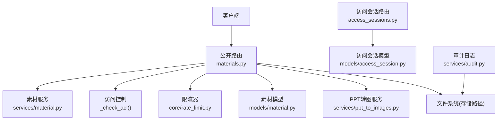
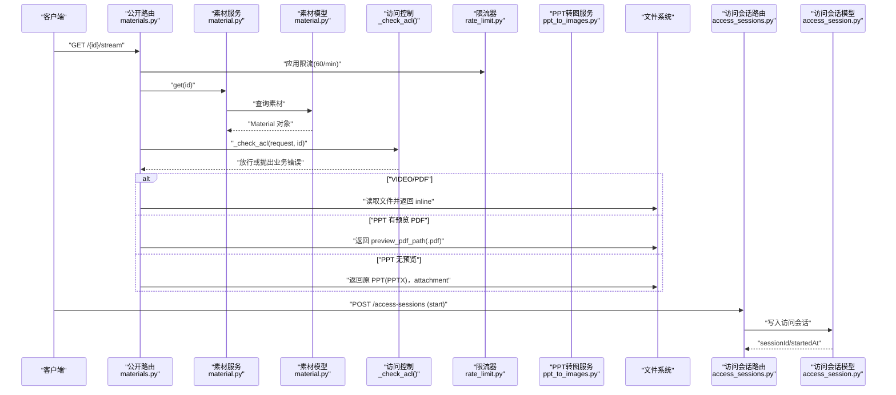
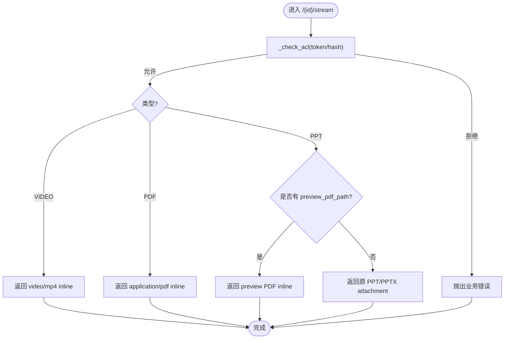
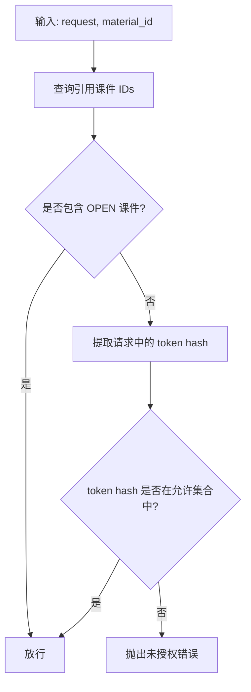
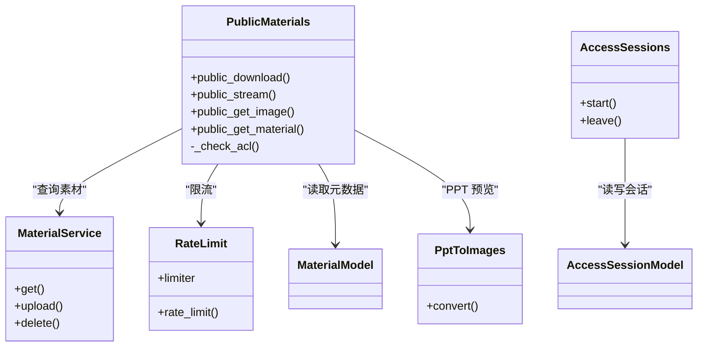

# 素材访问接口

<cite>
**本文引用的文件**   
- [backend/app/api/public/materials.py](file://backend/app/api/public/materials.py)
- [backend/app/services/material.py](file://backend/app/services/material.py)
- [backend/app/models/material.py](file://backend/app/models/material.py)
- [backend/app/services/ppt_to_images.py](file://backend/app/services/ppt_to_images.py)
- [backend/app/core/rate_limit.py](file://backend/app/core/rate_limit.py)
- [backend/app/api/public/access_sessions.py](file://backend/app/api/public/access_sessions.py)
- [backend/app/models/access_session.py](file://backend/app/models/access_session.py)
- [backend/app/services/audit.py](file://backend/app/services/audit.py)
</cite>

## 目录
1. [简介](#简介)
2. [项目结构](#项目结构)
3. [核心组件](#核心组件)
4. [架构总览](#架构总览)
5. [详细组件分析](#详细组件分析)
6. [依赖关系分析](#依赖关系分析)
7. [性能考虑](#性能考虑)
8. [故障排查指南](#故障排查指南)
9. [结论](#结论)
10. [附录：接口规范与示例](#附录接口规范与示例)

## 简介
本文件面向“学习平台”的素材访问能力，聚焦以下目标：
- 提供统一的公开素材访问与下载接口，支持视频、PDF、PPT 三类文件的差异化处理。
- 说明流式预览的实现方式（基于 FastAPI FileResponse 的行内传输）及速率限制策略。
- 解释访问控制机制：基于课件开放/受限模式与令牌哈希校验。
- 阐述路径解析与安全验证，防止路径遍历攻击。
- 介绍访问会话记录与审计日志，用于追踪素材访问行为。
- 给出完整的接口示例（请求参数、响应格式）、错误码与异常处理建议。
- 提供性能优化建议（CDN 集成、缓存策略）。

## 项目结构
与素材访问相关的后端代码主要分布在如下模块：
- API 路由层：public/materials.py 暴露公开访问端点；access_sessions.py 负责访问会话上报。
- 业务服务层：material.py 提供素材查询、上传、删除等能力；ppt_to_images.py 实现 PPT 转图片。
- 数据模型层：material.py 定义素材元数据；access_session.py 定义访问会话表结构。
- 限流与工具：rate_limit.py 提供限流器；audit.py 提供审计日志写入。

图表来源
- [backend/app/api/public/materials.py:1-224](file://backend/app/api/public/materials.py#L1-L224)
- [backend/app/services/material.py:1-234](file://backend/app/services/material.py#L1-L234)
- [backend/app/models/material.py:1-69](file://backend/app/models/material.py#L1-L69)
- [backend/app/services/ppt_to_images.py:1-185](file://backend/app/services/ppt_to_images.py#L1-L185)
- [backend/app/core/rate_limit.py:1-55](file://backend/app/core/rate_limit.py#L1-L55)
- [backend/app/api/public/access_sessions.py:1-137](file://backend/app/api/public/access_sessions.py#L1-L137)
- [backend/app/models/access_session.py:1-129](file://backend/app/models/access_session.py#L1-L129)
- [backend/app/services/audit.py:1-45](file://backend/app/services/audit.py#L1-L45)

章节来源
- [backend/app/api/public/materials.py:1-224](file://backend/app/api/public/materials.py#L1-L224)
- [backend/app/services/material.py:1-234](file://backend/app/services/material.py#L1-L234)
- [backend/app/models/material.py:1-69](file://backend/app/models/material.py#L1-L69)
- [backend/app/services/ppt_to_images.py:1-185](file://backend/app/services/ppt_to_images.py#L1-L185)
- [backend/app/core/rate_limit.py:1-55](file://backend/app/core/rate_limit.py#L1-L55)
- [backend/app/api/public/access_sessions.py:1-137](file://backend/app/api/public/access_sessions.py#L1-L137)
- [backend/app/models/access_session.py:1-129](file://backend/app/models/access_session.py#L1-L129)
- [backend/app/services/audit.py:1-45](file://backend/app/services/audit.py#L1-L45)

## 核心组件
- 公开素材路由
  - GET /api/public/materials/{material_id}/file：以附件形式返回原文件，适合下载。
  - GET /api/public/materials/{material_id}/stream：行内预览，按类型设置媒体类型与内容处置。
  - GET /api/public/materials/{material_id}/image/{page_no}：返回 PPT 第 N 页 PNG 预览图。
  - GET /api/public/materials/{material_id}：返回 streamUrl/downloadUrl 等元信息，供前端播放器加载。
- 访问控制
  - 若素材仅被 RESTRICTED 课件引用，需携带 X-Token-Hash 或 lh_token_hash cookie，且命中至少一个有效令牌哈希。
- 限流
  - /stream、/image、单条查询接口使用每分钟 60 次的限流装饰器。
- 访问会话
  - POST /api/public/access-sessions：开始一次浏览会话（带 IP 限流降级保护）。
  - POST /api/public/access-sessions/{session_id}/leave：结束会话并上报时长。
- 审计日志
  - 管理操作通过 JSON Lines 追加到 storage_path/logs/audit.jsonl。

章节来源
- [backend/app/api/public/materials.py:64-224](file://backend/app/api/public/materials.py#L64-L224)
- [backend/app/core/rate_limit.py:1-55](file://backend/app/core/rate_limit.py#L1-L55)
- [backend/app/api/public/access_sessions.py:1-137](file://backend/app/api/public/access_sessions.py#L1-L137)
- [backend/app/services/audit.py:1-45](file://backend/app/services/audit.py#L1-L45)

## 架构总览
下图展示了从客户端发起请求到最终返回文件或元数据的完整流程，包括访问控制、限流、PPT 预览生成与访问会话记录。

图表来源
- [backend/app/api/public/materials.py:84-146](file://backend/app/api/public/materials.py#L84-L146)
- [backend/app/services/material.py:122-126](file://backend/app/services/material.py#L122-L126)
- [backend/app/models/material.py:44-69](file://backend/app/models/material.py#L44-L69)
- [backend/app/core/rate_limit.py:40-55](file://backend/app/core/rate_limit.py#L40-L55)
- [backend/app/api/public/access_sessions.py:65-106](file://backend/app/api/public/access_sessions.py#L65-L106)
- [backend/app/models/access_session.py:56-129](file://backend/app/models/access_session.py#L56-L129)

## 详细组件分析

### 公开素材路由（materials.py）
- 公共下载接口
  - 路径：GET /api/public/materials/{material_id}/file
  - 行为：根据素材元数据返回原文件，Content-Disposition 为 attachment，适合浏览器直接下载。
  - 安全：先执行 _check_acl，再检查 storage_path 是否存在。
- 公共流式预览接口
  - 路径：GET /api/public/materials/{material_id}/stream
  - 行为：
    - VIDEO：强制 video/mp4 + inline，便于浏览器播放。
    - PDF：application/pdf + inline，并重命名为 .pdf 避免嗅探问题。
    - PPT：优先返回 preview_pdf_path（若有），否则降级返回原 PPT/PPTX（attachment）。
  - 限流：每分钟 60 次。
- PPT 图片接口
  - 路径：GET /api/public/materials/{material_id}/image/{page_no}
  - 行为：仅对 PPT 类型且存在 preview_images_dir 时可用；按 page-*.png 排序后取第 N 张（1-indexed）。
  - 限流：每分钟 60 次。
- 单条查询接口
  - 路径：GET /api/public/materials/{material_id}
  - 行为：返回 id/name/type/sizeBytes/duration/streamUrl/downloadUrl；PPT 额外返回 imageCount/imageUrls/previewReady。
  - 限流：每分钟 60 次。

图表来源
- [backend/app/api/public/materials.py:84-146](file://backend/app/api/public/materials.py#L84-L146)

章节来源
- [backend/app/api/public/materials.py:64-224](file://backend/app/api/public/materials.py#L64-L224)

### 访问控制机制（_check_acl）
- 规则
  - 若素材被任意 OPEN 课件引用 → 直接放行。
  - 若全部为 RESTRICTED 引用 → 必须携带有效的 X-Token-Hash 或 lh_token_hash cookie，且命中该课件任一令牌的 value_hash。
- 实现要点
  - 通过关联表查询素材被哪些课件引用。
  - 获取课件列表并判断 access_mode。
  - 收集所有相关课件的令牌哈希集合，与请求提供的 token hash 比对。

图表来源
- [backend/app/api/public/materials.py:31-62](file://backend/app/api/public/materials.py#L31-L62)

章节来源
- [backend/app/api/public/materials.py:31-62](file://backend/app/api/public/materials.py#L31-L62)

### 文件路径解析与安全验证
- 当前实现
  - 下载与预览均直接使用 Material.storage_path 作为绝对路径，并通过 Path.exists() 校验存在性。
  - 未显式进行路径规范化或白名单校验。
- 风险与建议
  - 风险：storage_path 来自数据库，若被恶意篡改可能引发越权访问。
  - 建议：在路由层增加路径白名单校验（例如限定在配置的安全根目录下），并对 storage_path 做 resolve() 与 relative_to() 校验，确保其位于受控目录内。

章节来源
- [backend/app/api/public/materials.py:70-81](file://backend/app/api/public/materials.py#L70-L81)
- [backend/app/api/public/materials.py:102-146](file://backend/app/api/public/materials.py#L102-L146)

### 流式传输与进度反馈
- 传输方式
  - 使用 FastAPI FileResponse 返回文件，底层由框架进行分块传输；浏览器可直接渲染 inline 内容。
- 进度反馈
  - 当前接口不主动推送进度事件；如需进度，可在前端通过 Range 请求或自定义协议实现。
- 速率限制
  - /stream、/image、单条查询接口使用 @limiter.limit("60/minute") 进行限流。

章节来源
- [backend/app/api/public/materials.py:84-146](file://backend/app/api/public/materials.py#L84-L146)
- [backend/app/core/rate_limit.py:40-55](file://backend/app/core/rate_limit.py#L40-L55)

### 不同文件类型的差异化处理
- 视频（VIDEO）
  - 强制 media_type=video/mp4，inline 显示，便于浏览器原生播放。
- PDF（PDF）
  - media_type=application/pdf，inline 显示，文件名重命名为 .pdf。
- PPT/PPTX（PPT）
  - 若已生成 preview_pdf_path → 返回该 PDF（inline）。
  - 否则降级返回原 PPT/PPTX（attachment），避免浏览器乱触发下载。
  - 同时提供 /image/{page_no} 接口，返回 page-*.png 序列。

章节来源
- [backend/app/api/public/materials.py:102-146](file://backend/app/api/public/materials.py#L102-L146)
- [backend/app/api/public/materials.py:149-180](file://backend/app/api/public/materials.py#L149-L180)

### PPT 转图片服务（ppt_to_images.py）
- 流程
  - 调用 LibreOffice 将 PPT/PPTX 转为 PDF。
  - 调用 pdftoppm 将 PDF 每页拆成 PNG，命名 page-1.png、page-2.png...
  - 失败/超时仅记录日志，不抛异常，避免阻塞上传主流程。
- 输出
  - 返回图片目录绝对路径与页数，供前端构建 imageUrls。

章节来源
- [backend/app/services/ppt_to_images.py:48-181](file://backend/app/services/ppt_to_images.py#L48-L181)

### 访问会话记录与审计
- 访问会话
  - 开始：POST /api/public/access-sessions，记录 token_id、courseware_id、material_id、started_at、ip、ua 等。
  - 结束：POST /api/public/access-sessions/{session_id}/leave，幂等更新 ended_at 与 duration_seconds。
  - 限流：进程内滑动窗口限流（60/分钟），超限则降级不记录但不阻塞前台。
- 审计日志
  - 管理操作通过 audit.write 追加 JSON Lines 到 storage_path/logs/audit.jsonl。

章节来源
- [backend/app/api/public/access_sessions.py:65-133](file://backend/app/api/public/access_sessions.py#L65-L133)
- [backend/app/models/access_session.py:56-129](file://backend/app/models/access_session.py#L56-L129)
- [backend/app/services/audit.py:21-42](file://backend/app/services/audit.py#L21-L42)

## 依赖关系分析
- 路由层依赖
  - materials.py 依赖 material 服务、rate_limit、material 模型、课件服务（用于 ACL）。
  - access_sessions.py 依赖 access_token_usage 服务、access_session 模型。
- 外部依赖
  - PPT 转图依赖系统命令 libreoffice 与 pdftoppm。
  - 限流器可基于 Redis 或内存存储。

图表来源
- [backend/app/api/public/materials.py:1-224](file://backend/app/api/public/materials.py#L1-L224)
- [backend/app/services/material.py:1-234](file://backend/app/services/material.py#L1-L234)
- [backend/app/services/ppt_to_images.py:1-185](file://backend/app/services/ppt_to_images.py#L1-L185)
- [backend/app/core/rate_limit.py:1-55](file://backend/app/core/rate_limit.py#L1-L55)
- [backend/app/api/public/access_sessions.py:1-137](file://backend/app/api/public/access_sessions.py#L1-L137)
- [backend/app/models/material.py:1-69](file://backend/app/models/material.py#L1-L69)
- [backend/app/models/access_session.py:1-129](file://backend/app/models/access_session.py#L1-L129)

## 性能考虑
- CDN 集成
  - 将静态资源（如 PPT 生成的 PNG 预览图、PDF 预览）部署至 CDN，并在网关层设置合适的 Cache-Control。
  - 对于大体积视频，建议结合对象存储（如 MinIO/OSS）+ CDN 分发，减少后端压力。
- 缓存策略
  - 对 PPT 预览图片与 PDF 预览启用长期缓存（immutable），配合版本号或文件名变更实现强缓存。
  - 对 /stream 接口，可根据业务需求开启 Range 支持，提升断点续播体验。
- 限流与降级
  - 访问会话记录采用进程内限流与 DB 异常降级，确保前台不受影响。
- 并发与 I/O
  - 使用 FileResponse 的分块传输降低内存占用；必要时结合操作系统 sendfile 零拷贝。

[本节为通用指导，无需具体文件分析]

## 故障排查指南
- 常见错误
  - 素材不存在：当查询不到对应 material_id 时抛出业务错误。
  - 文件丢失：storage_path 不存在时抛出“素材文件已丢失”。
  - 权限不足：RESTRICTED 课件引用但未提供有效 token hash 时抛出“令牌无效或已失效”。
  - 页码不存在：PPT 图片接口 page_no 越界时抛出“页码不存在”。
  - 无可用预览：非 PPT 或无 preview_images_dir 时抛出“该素材无可用预览”。
- 定位方法
  - 查看后端日志，确认是否命中限流或业务错误。
  - 检查 storage_path 指向的文件是否存在。
  - 核对课件的 access_mode 与令牌哈希集合。
  - 检查 PPT 转换产物目录是否存在 page-*.png。

章节来源
- [backend/app/api/public/materials.py:70-81](file://backend/app/api/public/materials.py#L70-L81)
- [backend/app/api/public/materials.py:102-146](file://backend/app/api/public/materials.py#L102-L146)
- [backend/app/api/public/materials.py:149-180](file://backend/app/api/public/materials.py#L149-L180)
- [backend/app/services/material.py:122-126](file://backend/app/services/material.py#L122-L126)

## 结论
本方案通过公开路由统一暴露素材访问能力，结合访问控制、限流与会话记录，满足多类型素材的在线预览与下载需求。针对 PPT 场景，提供 PDF 与 PNG 双通道预览，兼顾兼容性与用户体验。建议在部署层面引入 CDN 与对象存储，进一步优化大规模访问的性能与稳定性。

[本节为总结，无需具体文件分析]

## 附录：接口规范与示例

### 接口清单
- GET /api/public/materials/{material_id}/file
  - 用途：下载原文件（attachment）。
  - 鉴权：若素材仅被 RESTRICTED 课件引用，需携带 X-Token-Hash 或 lh_token_hash cookie。
  - 成功响应：二进制文件流。
  - 错误：
    - 404/业务错误：素材不存在或文件丢失。
    - 403/业务错误：令牌无效或已失效。
- GET /api/public/materials/{material_id}/stream
  - 用途：行内预览（inline）。
  - 类型处理：
    - VIDEO：video/mp4。
    - PDF：application/pdf。
    - PPT：优先 preview PDF，否则原 PPT/PPTX（attachment）。
  - 限流：60/分钟。
  - 错误：同上。
- GET /api/public/materials/{material_id}/image/{page_no}
  - 用途：返回 PPT 第 N 页 PNG。
  - 条件：仅 PPT 且存在 preview_images_dir。
  - 限流：60/分钟。
  - 错误：页码不存在、无可用预览。
- GET /api/public/materials/{material_id}
  - 用途：返回素材元信息与访问 URL。
  - 字段：id、name、type、sizeBytes、duration、streamUrl、downloadUrl；PPT 额外返回 imageCount、imageUrls、previewReady。
  - 限流：60/分钟。
- POST /api/public/access-sessions
  - 用途：开始一次浏览会话。
  - 参数：materialId、token_hash（X-Token-Hash 或 cookie）。
  - 响应：sessionId、startedAt、recorded（记录是否成功）。
  - 限流：进程内 60/分钟，超限降级不记录。
- POST /api/public/access-sessions/{session_id}/leave
  - 用途：结束会话并上报 durationSeconds。
  - 鉴权：token_hash 需与 session.token_id 对应的 value_hash 一致。
  - 响应：ok（布尔）。

### 请求与响应示例
- 下载接口
  - 请求：GET /api/public/materials/123/file
  - 响应：二进制文件流（Content-Disposition: attachment; filename="xxx.mp4"）
- 流式预览接口
  - 请求：GET /api/public/materials/123/stream
  - 响应：二进制文件流（Content-Disposition: inline; Content-Type: video/mp4 或 application/pdf）
- PPT 图片接口
  - 请求：GET /api/public/materials/123/image/1
  - 响应：PNG 图像流（Content-Type: image/png）
- 单条查询接口
  - 请求：GET /api/public/materials/123
  - 响应：JSON
    - 字段：id、name、type、sizeBytes、duration、streamUrl、downloadUrl
    - PPT 额外：imageCount、imageUrls、previewReady
- 访问会话开始
  - 请求：POST /api/public/access-sessions
    - Body：{ "materialId": 123 }
    - Header：X-Token-Hash: <hash> 或 Cookie: lh_token_hash=<hash>
  - 响应：{ "sessionId": 1001, "startedAt": "2026-01-01T00:00:00Z", "recorded": true }
- 访问会话结束
  - 请求：POST /api/public/access-sessions/1001/leave
    - Body：{ "durationSeconds": 120 }
    - Header/Cookie：同开始
  - 响应：{ "ok": true }

章节来源
- [backend/app/api/public/materials.py:64-224](file://backend/app/api/public/materials.py#L64-L224)
- [backend/app/api/public/access_sessions.py:65-133](file://backend/app/api/public/access_sessions.py#L65-L133)