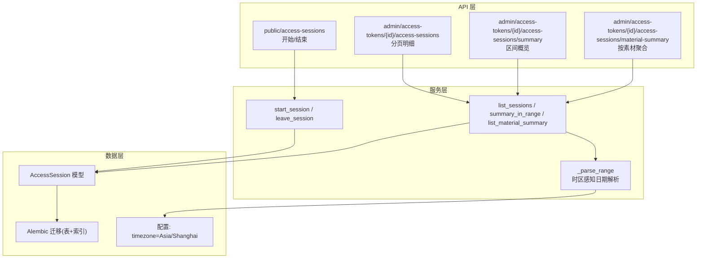
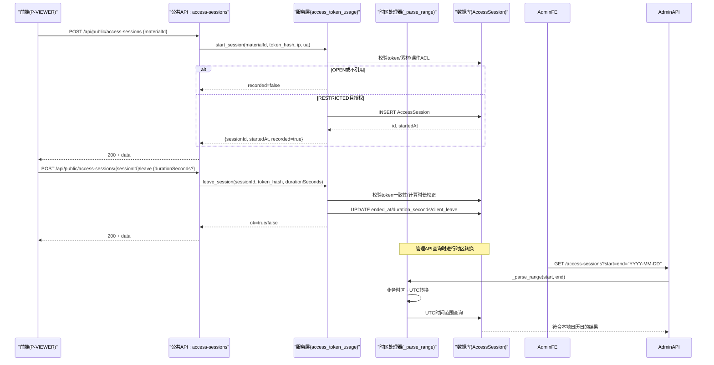
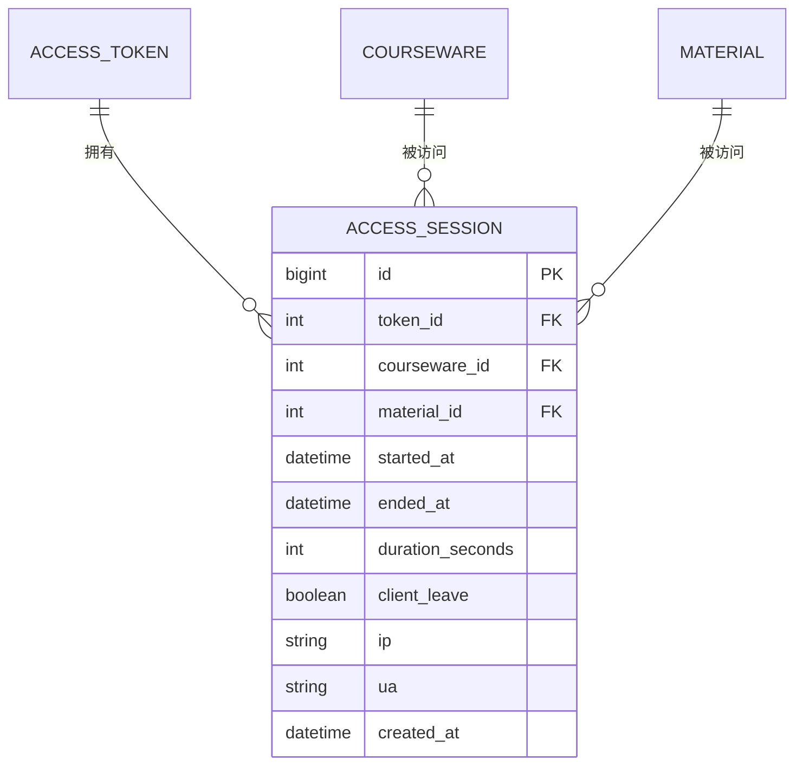
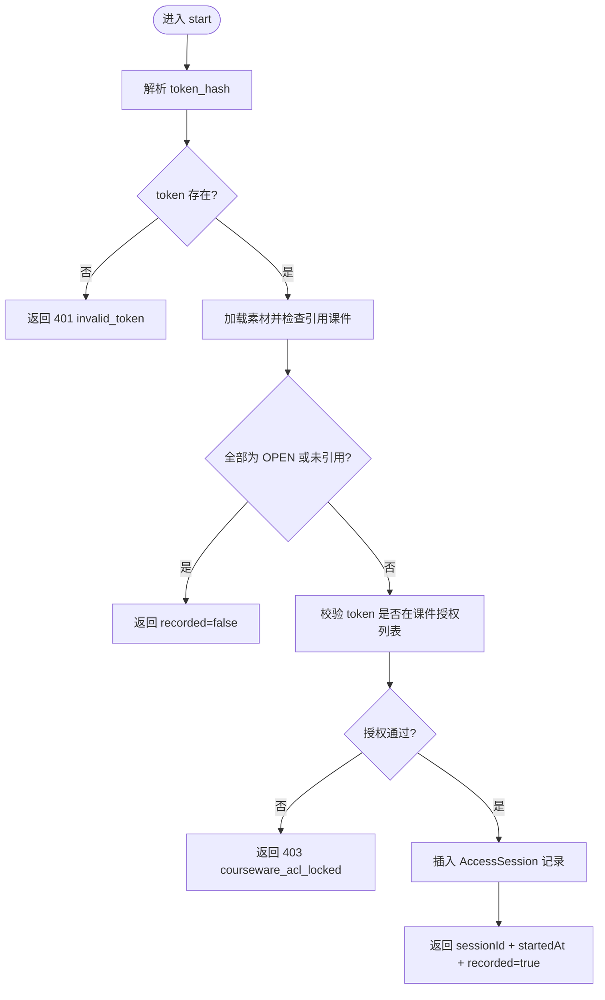
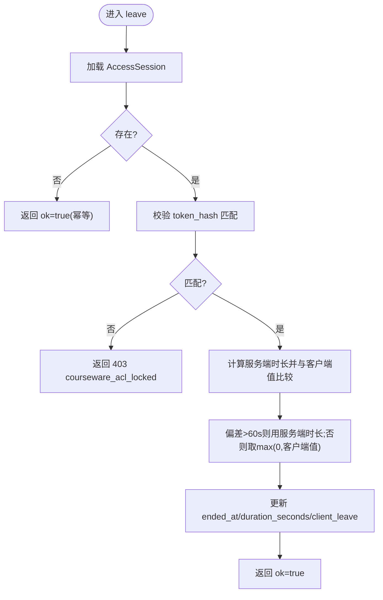
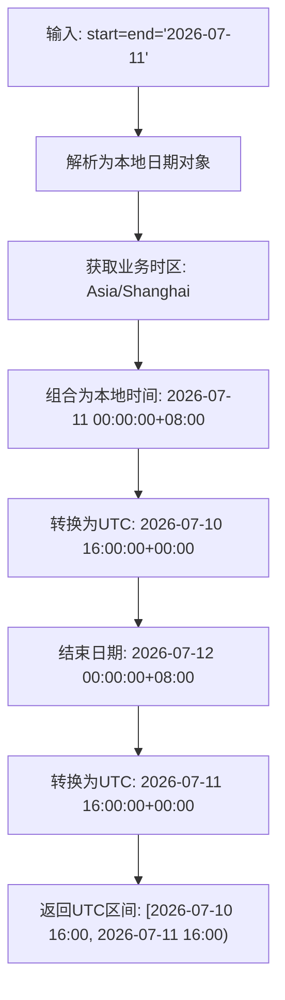
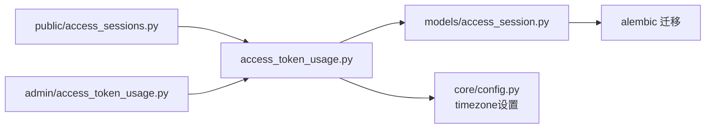

# 访问会话接口

<cite>
**本文引用的文件**   
- [backend/app/api/public/access_sessions.py](file://backend/app/api/public/access_sessions.py)
- [backend/app/models/access_session.py](file://backend/app/models/access_session.py)
- [backend/alembic/versions/2026_07_10_0930-c1d2e3f4a5b6_add_access_session.py](file://backend/alembic/versions/2026_07_10_0930-c1d2e3f4a5b6_add_access_session.py)
- [backend/app/services/access_token_usage.py](file://backend/app/services/access_token_usage.py)
- [backend/app/api/admin/access_token_usage.py](file://backend/app/api/admin/access_token_usage.py)
- [backend/app/schemas/access_token_usage.py](file://backend/app/schemas/access_token_usage.py)
- [backend/tests/test_access_session.py](file://backend/tests/test_access_session.py)
- [backend/app/core/config.py](file://backend/app/core/config.py)
</cite>

## 更新摘要
**变更内容**   
- 增强了时区感知的访问会话查询功能，在 `_parse_range` 函数中实现了业务时区转换
- 确保跨不同时区的准确日期范围查询，特别是 Asia/Shanghai 时区支持
- 添加了全面的时区处理测试覆盖
- 更新了管理 API 的日期区间语义说明

## 目录
1. [简介](#简介)
2. [项目结构](#项目结构)
3. [核心组件](#核心组件)
4. [架构总览](#架构总览)
5. [详细组件分析](#详细组件分析)
6. [依赖关系分析](#依赖关系分析)
7. [性能与扩展性](#性能与扩展性)
8. [故障排查指南](#故障排查指南)
9. [结论](#结论)
10. [附录：接口示例](#附录接口示例)

## 简介
本文件面向"访问会话"功能，提供完整的 API 文档与实现说明。该功能用于记录用户在 P-VIEWER 中对受限课件素材的访问行为，包括会话创建、结束、时长校正、权限校验、按时间范围/用户/资源类型的统计聚合等。**最新更新**：增强了时区感知的查询功能，确保在不同时区环境下（特别是 Asia/Shanghai）的准确日期范围查询。同时给出数据模型、索引策略、限流与降级机制、以及隐私保护建议与性能优化建议。

## 项目结构
访问会话相关代码主要分布在以下模块：
- 公共 API（无需管理员鉴权）：会话开始/结束
- 管理 API（需管理员鉴权）：会话明细分页、区间概览、按素材聚合
- 服务层：业务规则、权限校验、统计聚合、跨方言时间差计算、**时区感知日期解析**
- 数据模型与迁移：数据库表结构与索引定义
- Schema：请求/响应数据结构定义
- 测试：覆盖关键业务规则与边界条件、**时区处理测试**

**图表来源**
- [backend/app/api/public/access_sessions.py:1-137](file://backend/app/api/public/access_sessions.py#L1-L137)
- [backend/app/api/admin/access_token_usage.py:1-101](file://backend/app/api/admin/access_token_usage.py#L1-L101)
- [backend/app/services/access_token_usage.py:1-528](file://backend/app/services/access_token_usage.py#L1-L528)
- [backend/app/models/access_session.py:1-129](file://backend/app/models/access_session.py#L1-L129)
- [backend/alembic/versions/2026_07_10_0930-c1d2e3f4a5b6_add_access_session.py:1-125](file://backend/alembic/versions/2026_07_10_0930-c1d2e3f4a5b6_add_access_session.py#L1-L125)
- [backend/app/core/config.py:51-52](file://backend/app/core/config.py#L51-L52)

章节来源
- [backend/app/api/public/access_sessions.py:1-137](file://backend/app/api/public/access_sessions.py#L1-L137)
- [backend/app/api/admin/access_token_usage.py:1-101](file://backend/app/api/admin/access_token_usage.py#L1-L101)
- [backend/app/services/access_token_usage.py:1-528](file://backend/app/services/access_token_usage.py#L1-L528)
- [backend/app/models/access_session.py:1-129](file://backend/app/models/access_session.py#L1-L129)
- [backend/alembic/versions/2026_07_10_0930-c1d2e3f4a5b6_add_access_session.py:1-125](file://backend/alembic/versions/2026_07_10_0930-c1d2e3f4a5b6_add_access_session.py#L1-L125)

## 核心组件
- 公共 API：提供"开始访问"和"离开访问"两个端点，支持基于 token hash 的轻量鉴权与 IP 限流降级。
- 管理 API：提供会话明细分页、区间概览、按素材聚合等查询能力，供运营与分析使用。
- 服务层：封装业务规则（OPEN 不记录、RESTRICTED 才记录）、权限校验、时长校正、跨方言时间差计算与聚合 SQL、**时区感知的日期范围解析**。
- 数据模型：访问会话表包含 token/courseware/material 关联、起止时间、停留秒数、客户端标记、IP/UA 等元数据，并建立多组复合索引以支撑多维查询。
- Schema：统一描述请求/响应字段，确保前后端契约一致。

**更新** 新增了时区感知功能，确保在不同时区环境下的准确日期范围查询。

章节来源
- [backend/app/api/public/access_sessions.py:1-137](file://backend/app/api/public/access_sessions.py#L1-L137)
- [backend/app/api/admin/access_token_usage.py:1-101](file://backend/app/api/admin/access_token_usage.py#L1-L101)
- [backend/app/services/access_token_usage.py:1-528](file://backend/app/services/access_token_usage.py#L1-L528)
- [backend/app/models/access_session.py:1-129](file://backend/app/models/access_session.py#L1-L129)
- [backend/app/schemas/access_token_usage.py:1-91](file://backend/app/schemas/access_token_usage.py#L1-L91)

## 架构总览
访问会话的整体调用链如下：
- 前端在打开受限素材时调用"开始访问"，服务端校验 token、素材引用课件的访问模式与授权，必要时落库并返回 sessionId。
- 前端在关闭或切换页面时调用"离开访问"，服务端校验 token 一致性并按规则校正时长，更新 ended_at 与 duration_seconds。
- 管理端通过管理 API 查询明细、概览与按素材聚合结果，用于报表与运营分析。**新增**：所有日期范围查询都经过时区感知处理，确保准确的本地日历日语义。

**图表来源**
- [backend/app/api/public/access_sessions.py:65-133](file://backend/app/api/public/access_sessions.py#L65-L133)
- [backend/app/services/access_token_usage.py:64-171](file://backend/app/services/access_token_usage.py#L64-L171)
- [backend/app/services/access_token_usage.py:178-203](file://backend/app/services/access_token_usage.py#L178-L203)
- [backend/app/models/access_session.py:56-129](file://backend/app/models/access_session.py#L56-L129)

## 详细组件分析

### 数据模型与存储结构
- 表名：access_session
- 关键字段：
  - token_id：令牌标识（外键，级联删除）
  - courseware_id：课件标识（外键，级联删除）
  - material_id：素材标识（外键，级联删除）
  - started_at：开始时间（UTC）
  - ended_at：结束时间（可空）
  - duration_seconds：停留秒数（可空，非负约束）
  - client_leave：是否由客户端主动离开
  - ip：客户端 IP（PostgreSQL INET，SQLite 兼容为字符串）
  - ua：User-Agent（截断至 256 字符）
  - created_at：记录创建时间（默认 now()）
- 索引：
  - (token_id, started_at)
  - (token_id, material_id, started_at)
  - (token_id, courseware_id, started_at)
  - 单列索引：courseware_id、material_id、token_id

**图表来源**
- [backend/app/models/access_session.py:56-129](file://backend/app/models/access_session.py#L56-L129)
- [backend/alembic/versions/2026_07_10_0930-c1d2e3f4a5b6_add_access_session.py:21-102](file://backend/alembic/versions/2026_07_10_0930-c1d2e3f4a5b6_add_access_session.py#L21-L102)

章节来源
- [backend/app/models/access_session.py:1-129](file://backend/app/models/access_session.py#L1-L129)
- [backend/alembic/versions/2026_07_10_0930-c1d2e3f4a5b6_add_access_session.py:1-125](file://backend/alembic/versions/2026_07_10_0930-c1d2e3f4a5b6_add_access_session.py#L1-L125)

### 公共 API：开始访问
- 路径与方法：POST /api/public/access-sessions
- 请求体：materialId（必填，大于等于 1）
- 鉴权：从请求头 X-Token-Hash 或 Cookie lh_token_hash 中解析 token hash
- 行为规则：
  - 缺少 token_hash → 400 missing_token
  - token 无效 → 401 invalid_token
  - 素材未被任何课件引用或全部为 OPEN → 200 recorded=false（不写库）
  - 素材被 RESTRICTED 课件引用但 token 未授权 → 403 courseware_acl_locked
  - 写入失败（DB 异常）→ 200 recorded=false（吞错，不阻塞前台）
  - IP 命中进程内限流（60/分钟）→ 200 recorded=false（降级）
- 响应：
  - sessionId：成功落库时为整数，否则为空
  - startedAt：ISO 时间字符串，否则为空
  - recorded：是否已记录

**图表来源**
- [backend/app/api/public/access_sessions.py:65-106](file://backend/app/api/public/access_sessions.py#L65-L106)
- [backend/app/services/access_token_usage.py:64-125](file://backend/app/services/access_token_usage.py#L64-L125)

章节来源
- [backend/app/api/public/access_sessions.py:1-137](file://backend/app/api/public/access_sessions.py#L1-L137)
- [backend/app/services/access_token_usage.py:64-125](file://backend/app/services/access_token_usage.py#L64-L125)

### 公共 API：离开访问
- 路径与方法：POST /api/public/access-sessions/{session_id}/leave
- 请求体：durationSeconds（可选，非负）
- 鉴权：请求 token_hash 必须与会话所属 token 的 value_hash 一致，否则 403
- 行为规则：
  - 幂等：不存在的 session 视为 ok=true
  - 时长校正：若客户端上报与服务端计算的偏差超过阈值（60s），则以服务端时间为准
  - 写入失败：吞错并返回 ok=false
- 响应：ok（布尔）

**图表来源**
- [backend/app/api/public/access_sessions.py:109-133](file://backend/app/api/public/access_sessions.py#L109-L133)
- [backend/app/services/access_token_usage.py:128-171](file://backend/app/services/access_token_usage.py#L128-L171)

章节来源
- [backend/app/api/public/access_sessions.py:109-133](file://backend/app/api/public/access_sessions.py#L109-L133)
- [backend/app/services/access_token_usage.py:128-171](file://backend/app/services/access_token_usage.py#L128-L171)

### 管理 API：会话明细分页
- 路径与方法：GET /api/admin/access-tokens/{token_id}/access-sessions
- 查询参数：
  - start/end：YYYY-MM-DD（默认近 7 天）
  - materialId/coursewareId：可选过滤
  - page/size：分页参数（size 上限 200）
- 响应：
  - total：总数
  - items：明细列表（含课程标题、素材名称/类型、ip/ua 等）
  - summary：区间概览（总停留、次数、课件数、素材数）

**更新** 日期范围查询现在进行时区感知处理，确保本地日历日的准确语义。

章节来源
- [backend/app/api/admin/access_token_usage.py:32-56](file://backend/app/api/admin/access_token_usage.py#L32-L56)
- [backend/app/services/access_token_usage.py:315-400](file://backend/app/services/access_token_usage.py#L315-L400)
- [backend/app/schemas/access_token_usage.py:9-41](file://backend/app/schemas/access_token_usage.py#L9-L41)

### 管理 API：区间概览
- 路径与方法：GET /api/admin/access-tokens/{token_id}/access-sessions/summary
- 查询参数：start/end（默认近 7 天）
- 响应：仅返回四个指标（总停留、次数、课件数、素材数），适合首屏概览卡

**更新** 区间概览查询也进行时区感知处理，确保准确的本地日历日统计。

章节来源
- [backend/app/api/admin/access_token_usage.py:59-77](file://backend/app/api/admin/access_token_usage.py#L59-L77)
- [backend/app/services/access_token_usage.py:297-312](file://backend/app/services/access_token_usage.py#L297-L312)
- [backend/app/schemas/access_token_usage.py:26-33](file://backend/app/schemas/access_token_usage.py#L26-L33)

### 管理 API：按素材聚合
- 路径与方法：GET /api/admin/access-tokens/{token_id}/access-sessions/material-summary
- 查询参数：start/end（默认近 7 天）
- 响应：每个素材的累计停留时长、访问次数、最近访问时间，以及最新课件信息；按 totalDurationSeconds 降序排列

**更新** 按素材聚合查询同样进行时区感知处理，确保准确的本地日历日聚合统计。

章节来源
- [backend/app/api/admin/access_token_usage.py:80-97](file://backend/app/api/admin/access_token_usage.py#L80-L97)
- [backend/app/services/access_token_usage.py:403-506](file://backend/app/services/access_token_usage.py#L403-L506)
- [backend/app/schemas/access_token_usage.py:43-60](file://backend/app/schemas/access_token_usage.py#L43-L60)

### 时区感知日期解析（新增功能）
**_parse_range 函数** 实现了业务时区感知的日期范围解析：

- **业务时区**：使用 `settings.timezone`（默认 Asia/Shanghai）
- **日期转换逻辑**：将用户输入的"本地日历日"转换为 UTC 区间，与数据库中存储的 UTC 时间进行比较
- **转换示例**：当用户传入 start=end="2026-07-11" 时，在 UTC+8 下：
  - 转换为：[2026-07-10 16:00 UTC, 2026-07-11 16:00 UTC)
  - 这样 2026-07-11 07:35（本地时间）的访问 = 2026-07-10 23:35 UTC 可以被正确命中

**图表来源**
- [backend/app/services/access_token_usage.py:178-203](file://backend/app/services/access_token_usage.py#L178-L203)
- [backend/app/core/config.py:51-52](file://backend/app/core/config.py#L51-L52)

**章节来源**
- [backend/app/services/access_token_usage.py:178-203](file://backend/app/services/access_token_usage.py#L178-L203)
- [backend/app/core/config.py:51-52](file://backend/app/core/config.py#L51-L52)

### 业务规则与算法要点
- OPEN 不记录：当素材仅被 OPEN 课件引用或未引用任何课件时，直接返回 recorded=false，不写库。
- RESTRICTED 授权：素材被 RESTRICTED 课件引用时，需校验 token 是否在课件授权列表中。
- 时长校正：客户端上报的 duration_seconds 与服务端计算偏差超过 60s 时，采用服务端时间计算的值。
- 跨方言时间差：通过自定义表达式适配 PostgreSQL 与 SQLite 的时间差计算。
- 进行中估算：ended_at 为空的会话，在服务端聚合时使用 now()-started_at 估算秒数。
- **时区感知查询**：所有管理 API 的日期范围查询都进行时区感知处理，确保本地日历日的准确语义。

**更新** 新增了时区感知查询的业务规则。

章节来源
- [backend/app/services/access_token_usage.py:44-62](file://backend/app/services/access_token_usage.py#L44-L62)
- [backend/app/services/access_token_usage.py:196-259](file://backend/app/services/access_token_usage.py#L196-L259)
- [backend/app/services/access_token_usage.py:128-171](file://backend/app/services/access_token_usage.py#L128-L171)
- [backend/app/services/access_token_usage.py:178-203](file://backend/app/services/access_token_usage.py#L178-L203)

### 限流与降级
- 进程内滑动窗口限流：每 IP 每分钟最多 60 次"开始访问"请求。
- 限流命中：返回 recorded=false，不阻塞前端主流程。
- 部署建议：多进程场景下结合反向代理（如 nginx limit_req）进行全局限流兜底。

章节来源
- [backend/app/api/public/access_sessions.py:29-54](file://backend/app/api/public/access_sessions.py#L29-L54)

### 错误处理与审计
- 业务错误：缺失 token、无效 token、越权访问等抛出 BusinessError，上层统一 envelope 处理。
- 数据库异常：写入失败时吞错并返回降级结果，同时记录审计日志（失败原因摘要）。

章节来源
- [backend/app/api/public/access_sessions.py:92-106](file://backend/app/api/public/access_sessions.py#L92-L106)
- [backend/app/services/access_token_usage.py:110-125](file://backend/app/services/access_token_usage.py#L110-L125)
- [backend/app/services/access_token_usage.py:161-171](file://backend/app/services/access_token_usage.py#L161-L171)

## 依赖关系分析
- API 层依赖服务层完成业务逻辑与数据访问。
- 服务层依赖模型与外部服务（如 token 服务、课件服务）进行权限与上下文校验。
- 数据层通过 Alembic 迁移维护表结构与索引。
- **新增**：服务层依赖配置模块获取业务时区设置。

**图表来源**
- [backend/app/api/public/access_sessions.py:1-137](file://backend/app/api/public/access_sessions.py#L1-L137)
- [backend/app/api/admin/access_token_usage.py:1-101](file://backend/app/api/admin/access_token_usage.py#L1-L101)
- [backend/app/services/access_token_usage.py:1-528](file://backend/app/services/access_token_usage.py#L1-L528)
- [backend/app/models/access_session.py:1-129](file://backend/app/models/access_session.py#L1-L129)
- [backend/alembic/versions/2026_07_10_0930-c1d2e3f4a5b6_add_access_session.py:1-125](file://backend/alembic/versions/2026_07_10_0930-c1d2e3f4a5b6_add_access_session.py#L1-L125)
- [backend/app/core/config.py:51-52](file://backend/app/core/config.py#L51-L52)

章节来源
- [backend/app/api/public/access_sessions.py:1-137](file://backend/app/api/public/access_sessions.py#L1-L137)
- [backend/app/api/admin/access_token_usage.py:1-101](file://backend/app/api/admin/access_token_usage.py#L1-L101)
- [backend/app/services/access_token_usage.py:1-528](file://backend/app/services/access_token_usage.py#L1-L528)
- [backend/app/models/access_session.py:1-129](file://backend/app/models/access_session.py#L1-L129)
- [backend/alembic/versions/2026_07_10_0930-c1d2e3f4a5b6_add_access_session.py:1-125](file://backend/alembic/versions/2026_07_10_0930-c1d2e3f4a5b6_add_access_session.py#L1-L125)

## 性能与扩展性
- 索引优化：
  - 针对 token_id + started_at 的复合索引，提升按用户和时间维度的查询效率。
  - 针对 token_id + material_id/courseware_id + started_at 的复合索引，支撑按资源维度与时间范围的聚合。
  - 单列索引便于按 courseware_id、material_id、token_id 快速过滤。
- 聚合查询：
  - 使用子查询与窗口函数（row_number）实现"按素材聚合"的最新课件关联与排序。
  - 跨方言时间差表达式避免应用层转换开销。
- 限流与降级：
  - 进程内限流降低突发流量对数据库的压力；多进程部署建议配合反向代理限流。
- 归档与冷热分离（建议）：
  - 将历史较久的会话数据迁移到归档表或冷存储，保留必要字段用于统计。
  - 定期清理 UA 等长文本字段以降低存储压力。
- 连接池与事务（建议）：
  - 合理配置 SQLAlchemy 连接池大小，避免高并发下连接耗尽。
  - 对批量写入场景考虑分批提交与重试策略。
- **时区处理优化**：
  - 时区转换在服务层集中处理，避免重复计算。
  - 使用 ZoneInfo 标准库确保时区处理的准确性和性能。

**更新** 新增了时区处理优化的性能考虑。

## 故障排查指南
- 常见问题定位：
  - 400 missing_token：检查请求是否携带 X-Token-Hash 或 Cookie lh_token_hash。
  - 401 invalid_token：确认 token hash 是否正确生成与传递。
  - 403 courseware_acl_locked：确认 token 是否被目标课件授权。
  - recorded=false：可能因 OPEN 课件、未引用素材、限流命中或 DB 异常导致。
  - **时区查询问题**：确认业务时区配置是否正确，检查日期范围查询是否符合本地日历日语义。
- 日志与审计：
  - 服务层在写入失败时会记录审计日志（包含错误摘要），可通过审计系统检索。
- 测试用例参考：
  - 覆盖 OPEN 不记录、时长校正、跨 token 篡改拦截、幂等性、限流降级、聚合排序等关键路径。
  - **新增**：时区处理测试覆盖本地日历日语义验证。

**更新** 新增了时区相关的故障排查指导。

章节来源
- [backend/tests/test_access_session.py:95-640](file://backend/tests/test_access_session.py#L95-L640)
- [backend/tests/test_access_session.py:642-714](file://backend/tests/test_access_session.py#L642-L714)
- [backend/app/services/access_token_usage.py:110-125](file://backend/app/services/access_token_usage.py#L110-L125)
- [backend/app/services/access_token_usage.py:161-171](file://backend/app/services/access_token_usage.py#L161-L171)

## 结论
访问会话接口实现了从"开始/结束"到"多维统计聚合"的完整闭环，具备严格的权限控制、健壮的错误处理与良好的可扩展性。**最新更新**：增强了时区感知功能，确保在不同时区环境下的准确日期范围查询，特别是 Asia/Shanghai 时区的支持。通过合理的索引设计与聚合查询，能够高效支撑运营分析与报表生成。建议在大规模部署中结合反向代理限流、数据归档与连接池调优，进一步提升稳定性与性能。

## 附录：接口示例

### 公共 API 示例
- 开始访问
  - 方法：POST
  - 路径：/api/public/access-sessions
  - 请求体：{"materialId": <int>}
  - 头部：X-Token-Hash: <token_hash>
  - 成功响应：{"code":"ok","data":{"sessionId":<int>,"startedAt":"<ISO>","recorded":true}}
  - 降级响应（限流/OPEN/异常）：{"code":"ok","data":{"sessionId":null,"startedAt":null,"recorded":false}}
  - 错误响应：400/401/403（见错误码说明）

- 离开访问
  - 方法：POST
  - 路径：/api/public/access-sessions/{session_id}/leave
  - 请求体：{"durationSeconds": <int?>}
  - 头部：X-Token-Hash: <token_hash>
  - 成功响应：{"code":"ok","data":{"ok":true}}
  - 错误响应：403（token 不匹配）

章节来源
- [backend/app/api/public/access_sessions.py:65-133](file://backend/app/api/public/access_sessions.py#L65-L133)
- [backend/app/schemas/access_token_usage.py:62-78](file://backend/app/schemas/access_token_usage.py#L62-L78)

### 管理 API 示例
- 会话明细分页
  - 方法：GET
  - 路径：/api/admin/access-tokens/{token_id}/access-sessions
  - 查询参数：start/end、materialId、coursewareId、page、size
  - 成功响应：{"code":"ok","data":{"total":<int>,"items":[...],"summary":{...}}}

- 区间概览
  - 方法：GET
  - 路径：/api/admin/access-tokens/{token_id}/access-sessions/summary
  - 查询参数：start/end
  - 成功响应：{"code":"ok","data":{"totalDurationSeconds":<int>,"sessionCount":<int>,"coursewareCount":<int>,"materialCount":<int>}}

- 按素材聚合
  - 方法：GET
  - 路径：/api/admin/access-tokens/{token_id}/access-sessions/material-summary
  - 查询参数：start/end
  - 成功响应：{"code":"ok","data":{"start":"<date>","end":"<date>","items":[{"materialId":<int>,"materialName":"<str>","materialType":"<str>","coursewareId":<int>,"coursewareTitle":"<str>","totalDurationSeconds":<int>,"viewCount":<int>,"lastViewedAt":"<ISO>?"}]}}

**更新** 所有管理 API 的日期范围查询都进行时区感知处理，确保本地日历日的准确语义。

章节来源
- [backend/app/api/admin/access_token_usage.py:32-97](file://backend/app/api/admin/access_token_usage.py#L32-L97)
- [backend/app/schemas/access_token_usage.py:9-60](file://backend/app/schemas/access_token_usage.py#L9-L60)

### 时区处理示例
**业务时区为 Asia/Shanghai 的查询示例：**

- **场景**：本地 2026-07-11 07:35 的访问 = UTC 2026-07-10 23:35 存库
- **查询 start=end="2026-07-11"**（本地日历日）应命中 1 条
- **查询 start=end="2026-07-10"**（本地日历日）应 0 条

**旧实现**按 UTC 解析会导致本地 7-11 0:00-8:00 间的访问查不到。

**新实现**通过 `_parse_range` 函数进行时区感知转换，确保准确的本地日历日语义。

章节来源
- [backend/tests/test_access_session.py:642-714](file://backend/tests/test_access_session.py#L642-L714)
- [backend/app/services/access_token_usage.py:178-203](file://backend/app/services/access_token_usage.py#L178-L203)

### 隐私保护与数据脱敏建议
- 当前实现会记录 ip 与 ua 字段，建议在对外报表或导出时进行脱敏（例如 ip 掩码、ua 截断或移除）。
- 建议增加数据保留策略与最小化采集原则，仅保留必要的元数据用于分析。
- 对于敏感环境，可在网关层或中间件层对入站请求中的敏感信息进行清洗后再进入业务层。