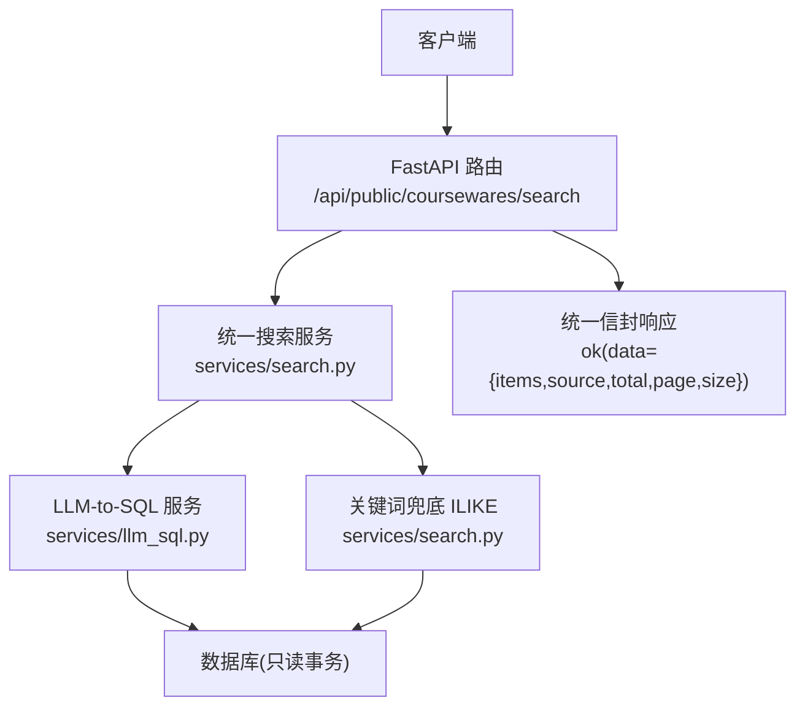
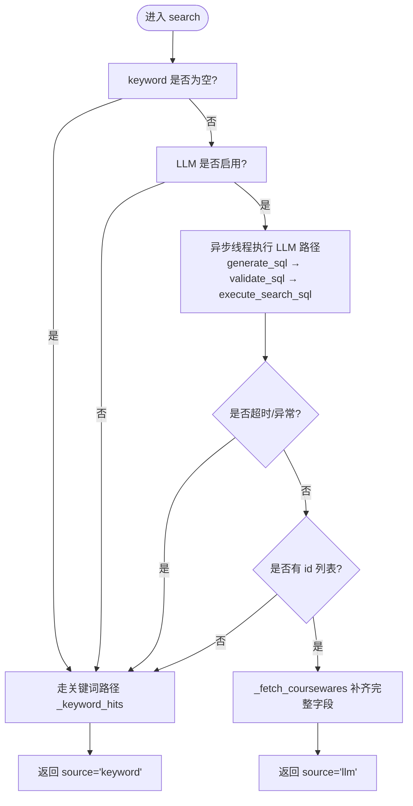
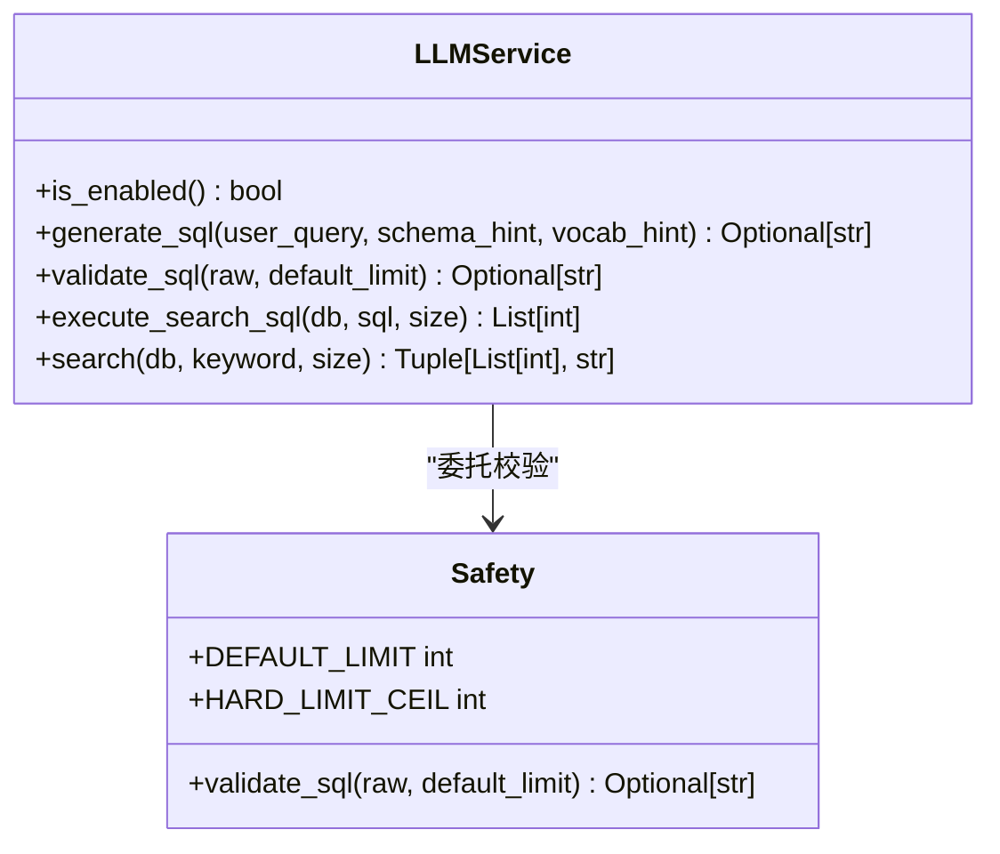
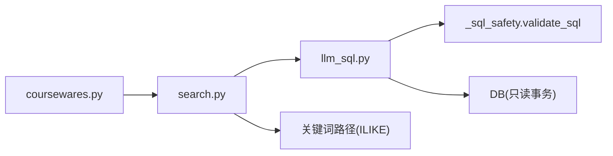

# 课件搜索接口

<cite>
**本文引用的文件**   
- [backend/app/api/public/coursewares.py](file://backend/app/api/public/coursewares.py)
- [backend/app/services/search.py](file://backend/app/services/search.py)
- [backend/app/services/llm_sql.py](file://backend/app/services/llm_sql.py)
- [backend/app/schemas/courseware.py](file://backend/app/schemas/courseware.py)
- [backend/app/core/errors.py](file://backend/app/core/errors.py)
- [backend/tests/test_search_llm.py](file://backend/tests/test_search_llm.py)
</cite>

## 目录
1. [简介](#简介)
2. [项目结构](#项目结构)
3. [核心组件](#核心组件)
4. [架构总览](#架构总览)
5. [详细组件分析](#详细组件分析)
6. [依赖关系分析](#依赖关系分析)
7. [性能与缓存](#性能与缓存)
8. [故障排查指南](#故障排查指南)
9. [结论](#结论)
10. [附录：API 规范与示例](#附录api-规范与示例)

## 简介
本文件面向“课件统一搜索接口”的开发者与使用者，详细说明 search_coursewares 接口的功能、参数校验、返回数据结构、LLM-to-SQL 语义搜索与关键词回退机制、错误处理与超时控制，以及性能优化与缓存策略建议。该接口支持智能语义搜索（基于 LLM 生成 SQL）和关键词检索（ILIKE 兜底）双重模式，并在语义搜索不可用时自动降级为关键词匹配，确保高可用与稳定体验。

## 项目结构
与课件搜索相关的后端代码主要分布在以下模块：
- API 路由层：定义 /api/public/coursewares/search 端点，负责参数解析与响应封装
- 服务层：统一搜索编排（search_service），协调 LLM-to-SQL 与关键词兜底
- LLM-to-SQL 子服务：调用大模型生成 SQL、安全校验、执行并提取 id 列表
- Schema 与错误码：定义数据模型与业务错误码映射



图表来源
- [backend/app/api/public/coursewares.py:32-54](file://backend/app/api/public/coursewares.py#L32-L54)
- [backend/app/services/search.py:210-242](file://backend/app/services/search.py#L210-L242)
- [backend/app/services/llm_sql.py:443-478](file://backend/app/services/llm_sql.py#L443-L478)

章节来源
- [backend/app/api/public/coursewares.py:32-54](file://backend/app/api/public/coursewares.py#L32-L54)
- [backend/app/services/search.py:210-242](file://backend/app/services/search.py#L210-L242)
- [backend/app/services/llm_sql.py:443-478](file://backend/app/services/llm_sql.py#L443-L478)

## 核心组件
- 统一搜索服务：对外暴露 search(db, keyword, size)，内部优先尝试 LLM-to-SQL，失败或无结果时回退到关键词 ILIKE 路径，返回 SearchResult(items, source, total)。
- LLM-to-SQL 服务：根据用户自然语言生成 SELECT，经白名单校验后在只读事务中执行，仅取 id 列，再由上层补齐完整 CoursewareItem。
- 关键词兜底：对中文查询进行清洗与候选抽取，使用 ILIKE 在标题、作者、描述及标签名上匹配；空关键词按更新时间倒序返回最新。
- API 路由：接收 q、page、size 等参数，调用统一搜索服务，并以统一信封格式返回 data.items、data.source、data.total、data.page、data.size。

章节来源
- [backend/app/services/search.py:105-110](file://backend/app/services/search.py#L105-L110)
- [backend/app/services/search.py:115-160](file://backend/app/services/search.py#L115-L160)
- [backend/app/services/llm_sql.py:443-478](file://backend/app/services/llm_sql.py#L443-L478)
- [backend/app/api/public/coursewares.py:32-54](file://backend/app/api/public/coursewares.py#L32-L54)

## 架构总览
下图展示了从请求进入路由到最终返回的统一流程，包括 LLM 路径与关键词回退分支。

```mermaid
sequenceDiagram
participant C as "客户端"
participant R as "路由层<br/>coursewares.py"
participant S as "统一搜索服务<br/>search.py"
participant L as "LLM-to-SQL<br/>llm_sql.py"
participant D as "数据库"
C->>R : GET /api/public/coursewares/search?q=...&page=&size=
R->>S : search(db, keyword=q or "", size=size)
alt LLM 启用且非空关键词
S->>L : generate_sql + validate_sql + execute_search_sql
L->>D : SET TRANSACTION READ ONLY; SELECT ... LIMIT
D-->>L : id 列表
L-->>S : ids, source="llm"
S->>S : _fetch_coursewares(ids[ : size])
S-->>R : SearchResult(items, source="llm", total=len(items))
else 未启用/超时/校验拒绝/无结果
S->>S : _keyword_hits(keyword, size)
S->>D : ILIKE 查询(标题/作者/描述/标签)
D-->>S : 课程项
S-->>R : SearchResult(items, source="keyword", total=len(items))
end
R-->>C : ok(data={items, source, total, page, size})
```

图表来源
- [backend/app/api/public/coursewares.py:32-54](file://backend/app/api/public/coursewares.py#L32-L54)
- [backend/app/services/search.py:210-242](file://backend/app/services/search.py#L210-L242)
- [backend/app/services/llm_sql.py:385-437](file://backend/app/services/llm_sql.py#L385-L437)

## 详细组件分析

### 接口定义与参数校验
- 端点：GET /api/public/coursewares/search
- 参数：
  - q: 可选字符串，为空则返回最新课件
  - page: 整数，默认 1，最小值 1
  - size: 整数，默认 20，取值范围 1..50
- 行为：
  - 将 q 转为 keyword 传入统一搜索服务
  - 返回统一信封 data 中包含 items、source、total、page、size

注意：当前实现中，搜索结果按 size 限制返回，但并未根据 page 做数据库分页偏移。前端可结合 total 与 size 自行计算页码展示。

章节来源
- [backend/app/api/public/coursewares.py:32-54](file://backend/app/api/public/coursewares.py#L32-L54)

### 统一搜索服务（search.py）
- 主入口 search(db, keyword, size)：
  - 若 keyword 非空且 LLM 启用，则异步线程内执行 LLM 路径，设置超时时间（来自配置 llm_sql_timeout_seconds）
  - 任一异常或超时均记录日志并降级至关键词路径
  - 若 LLM 命中，返回 source="llm"，否则返回 source="keyword"
- 关键词路径 _keyword_hits：
  - 对中文查询进行清洗与候选抽取，避免“帮我找一下”等废话影响命中率
  - 在 title、author、description 上使用 ILIKE 匹配，并通过 EXISTS 关联 tag.name 提升召回
  - 空关键词时按 updated_at 倒序返回最新



图表来源
- [backend/app/services/search.py:210-242](file://backend/app/services/search.py#L210-L242)
- [backend/app/services/search.py:115-160](file://backend/app/services/search.py#L115-L160)

章节来源
- [backend/app/services/search.py:210-242](file://backend/app/services/search.py#L210-L242)
- [backend/app/services/search.py:115-160](file://backend/app/services/search.py#L115-L160)

### LLM-to-SQL 服务（llm_sql.py）
- is_enabled：检测 DASHSCOPE_API_KEY 是否配置
- generate_sql：构造 system prompt 与 schema hint，调用 dashscope Generation.call 生成 SELECT
- validate_sql：七道闸白名单校验（禁止 DDL/DML、强制 WHERE/LIMIT、禁敏感列等）
- execute_search_sql：在只读事务中执行，仅取 id 列，去重并按 size 截断
- search：主入口，组合上述步骤，失败或无结果时返回 ([], "keyword")



图表来源
- [backend/app/services/llm_sql.py:267-271](file://backend/app/services/llm_sql.py#L267-L271)
- [backend/app/services/llm_sql.py:276-344](file://backend/app/services/llm_sql.py#L276-L344)
- [backend/app/services/llm_sql.py:350-354](file://backend/app/services/llm_sql.py#L350-L354)
- [backend/app/services/llm_sql.py:385-437](file://backend/app/services/llm_sql.py#L385-L437)
- [backend/app/services/llm_sql.py:443-478](file://backend/app/services/llm_sql.py#L443-L478)

章节来源
- [backend/app/services/llm_sql.py:267-271](file://backend/app/services/llm_sql.py#L267-L271)
- [backend/app/services/llm_sql.py:276-344](file://backend/app/services/llm_sql.py#L276-L344)
- [backend/app/services/llm_sql.py:350-354](file://backend/app/services/llm_sql.py#L350-L354)
- [backend/app/services/llm_sql.py:385-437](file://backend/app/services/llm_sql.py#L385-L437)
- [backend/app/services/llm_sql.py:443-478](file://backend/app/services/llm_sql.py#L443-L478)

### 数据模型与返回结构
- CoursewareItem：包含 id、title、author、categoryId、categoryName、description、accessMode、tagIds、tagNames、materialIds、tokenIds、createdAt、updatedAt，详情场景下还包含 materials 列表
- 搜索响应 data：
  - items: CoursewareItem 数组
  - source: "llm" 或 "keyword"
  - total: 本次返回的 items 数量
  - page: 请求中的 page
  - size: 请求中的 size

章节来源
- [backend/app/schemas/courseware.py:66-89](file://backend/app/schemas/courseware.py#L66-L89)
- [backend/app/api/public/coursewares.py:46-54](file://backend/app/api/public/coursewares.py#L46-L54)

## 依赖关系分析
- 路由层依赖统一搜索服务
- 统一搜索服务依赖 LLM-to-SQL 服务与关键词路径
- LLM-to-SQL 服务依赖安全校验与数据库只读事务
- 测试用例覆盖关键降级路径与 E2E 行为



图表来源
- [backend/app/api/public/coursewares.py:32-54](file://backend/app/api/public/coursewares.py#L32-L54)
- [backend/app/services/search.py:210-242](file://backend/app/services/search.py#L210-L242)
- [backend/app/services/llm_sql.py:350-354](file://backend/app/services/llm_sql.py#L350-L354)

章节来源
- [backend/app/api/public/coursewares.py:32-54](file://backend/app/api/public/coursewares.py#L32-L54)
- [backend/app/services/search.py:210-242](file://backend/app/services/search.py#L210-L242)
- [backend/app/services/llm_sql.py:350-354](file://backend/app/services/llm_sql.py#L350-L354)

## 性能与缓存
- LLM 超时控制：通过配置 llm_sql_timeout_seconds 控制 LLM 路径最大等待时间，超时即降级关键词路径
- 词汇缓存：llm_sql._build_vocab_hint 对 category.name 与 tag.name 构建提示词注入，采用进程级缓存（TTL 约 60s），减少重复查询开销
- 只读事务：execute_search_sql 使用 SET TRANSACTION READ ONLY，避免误写
- 关键词路径优化：
  - 中文查询清洗与候选抽取，提高 ILIKE 命中率
  - 使用 EXISTS 关联 tag.name，避免大表 JOIN 成本
- 建议：
  - 合理设置 size 上限（已限制 50），避免过大返回体
  - 前端可对相同 q+size 做短时缓存，降低重复请求
  - 监控 LLM 成功率与耗时，必要时调整 timeout 或降级策略

章节来源
- [backend/app/services/search.py:210-242](file://backend/app/services/search.py#L210-L242)
- [backend/app/services/llm_sql.py:44-104](file://backend/app/services/llm_sql.py#L44-L104)
- [backend/app/services/llm_sql.py:385-437](file://backend/app/services/llm_sql.py#L385-L437)
- [backend/app/services/search.py:115-160](file://backend/app/services/search.py#L115-L160)

## 故障排查指南
- 常见错误码与 HTTP 状态：
  - SEARCH_QUERY_EMPTY → 400
  - SEARCH_QUERY_TOO_LONG → 400
  - LLM_TIMEOUT → 504
  - LLM_UNAVAILABLE → 503
  - SEARCH_NO_RESULT → 200（空结果仍成功）
- 典型问题定位：
  - 无 DASHSCOPE_API_KEY：LLM 路径禁用，直接走关键词路径
  - LLM 超时：检查 llm_sql_timeout_seconds 配置与网络状况
  - SQL 校验拒绝：查看 LLM 生成的 SQL 是否违反白名单规则
  - 空关键词：走关键词路径返回最新课件
- 验证方式：
  - 单元测试覆盖多种降级路径与 E2E 行为，可参考测试用例快速复现

章节来源
- [backend/app/core/errors.py:65-127](file://backend/app/core/errors.py#L65-L127)
- [backend/tests/test_search_llm.py:181-191](file://backend/tests/test_search_llm.py#L181-L191)

## 结论
该课件搜索接口以“LLM-to-SQL 优先 + 关键词兜底”的双模设计，兼顾智能性与稳定性。通过严格的 SQL 白名单校验与只读事务保障安全，配合超时控制与中文查询清洗提升可用性。建议在部署侧关注 LLM 可用性与超时阈值，并结合前端缓存进一步优化用户体验。

## 附录：API 规范与示例

### 接口定义
- 方法：GET
- 路径：/api/public/coursewares/search
- 查询参数：
  - q: string | null，可选，空表示返回最新
  - page: integer，默认 1，最小 1
  - size: integer，默认 20，范围 1..50

### 请求示例
- 基本搜索
  - GET /api/public/coursewares/search?q=项目管理&page=1&size=20
- 空关键词（返回最新）
  - GET /api/public/coursewares/search?page=1&size=20

### 响应格式
- 统一信封：{ code, message, data }
- data 结构：
  - items: CoursewareItem[]
  - source: "llm" | "keyword"
  - total: number
  - page: number
  - size: number

### 错误处理
- 业务错误：由全局错误处理器包装为统一信封，HTTP 状态码依据 ErrorCode 映射
- 超时：LLM 路径超时触发降级，不抛错，返回 keyword 源
- 无结果：SEARCH_NO_RESULT 对应 200，data.items 为空数组

### 行为说明
- source 字段含义：
  - "llm"：本次结果由 LLM-to-SQL 召回
  - "keyword"：LLM 未启用/失败/校验拒绝/空候选，已降级为 ILIKE 关键词匹配
- 分页：当前实现按 size 限制返回，未根据 page 做数据库偏移；前端可结合 total 与 size 自行计算页码

章节来源
- [backend/app/api/public/coursewares.py:32-54](file://backend/app/api/public/coursewares.py#L32-L54)
- [backend/app/core/errors.py:65-127](file://backend/app/core/errors.py#L65-L127)
- [backend/tests/test_search_llm.py:181-191](file://backend/tests/test_search_llm.py#L181-L191)