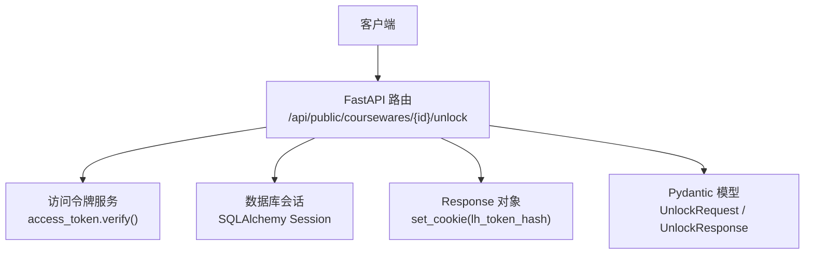
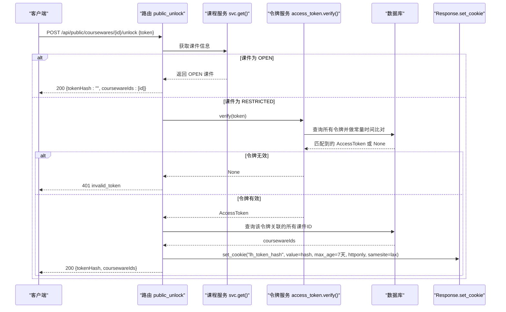
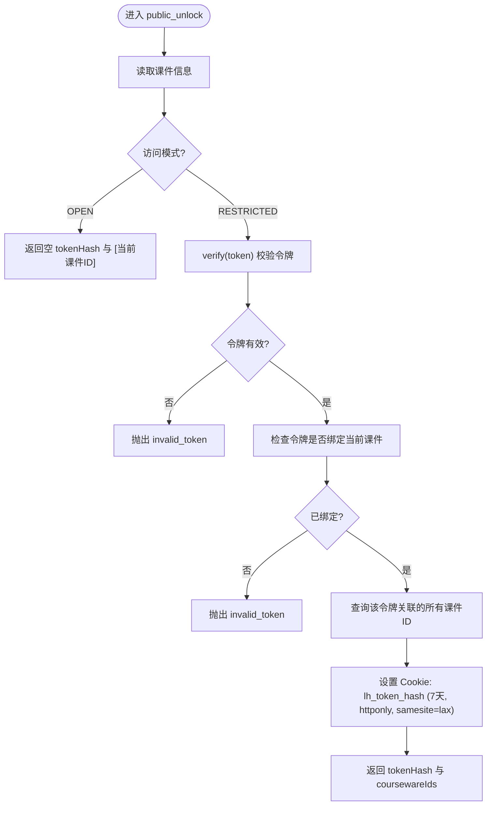
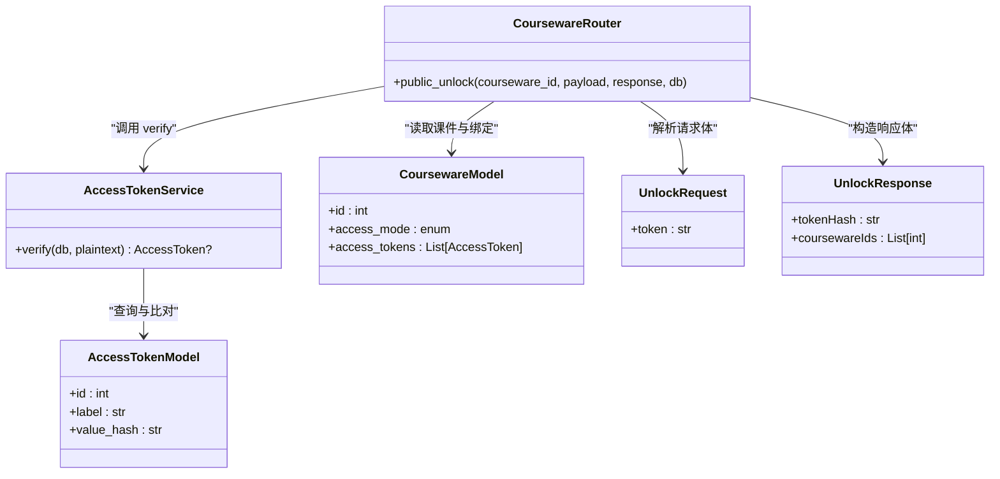

# 课件解锁接口

<cite>
**本文引用的文件**
- [backend/app/api/public/coursewares.py](file://backend/app/api/public/coursewares.py)
- [backend/app/schemas/courseware.py](file://backend/app/schemas/courseware.py)
- [backend/app/models/access_token.py](file://backend/app/models/access_token.py)
- [backend/app/services/access_token.py](file://backend/app/services/access_token.py)
- [backend/app/core/errors.py](file://backend/app/core/errors.py)
- [backend/app/main.py](file://backend/app/main.py)
</cite>

## 目录
1. [简介](#简介)
2. [项目结构](#项目结构)
3. [核心组件](#核心组件)
4. [架构总览](#架构总览)
5. [详细组件分析](#详细组件分析)
6. [依赖关系分析](#依赖关系分析)
7. [性能考虑](#性能考虑)
8. [故障排查指南](#故障排查指南)
9. [结论](#结论)
10. [附录：请求与响应示例](#附录请求与响应示例)

## 简介
本章节面向前端与集成方，提供“课件解锁接口”的完整 API 文档。重点说明 public_unlock 接口的实现细节、令牌验证流程、Cookie 管理机制、OPEN 模式特殊处理、以及安全与生命周期管理建议。

## 项目结构
该接口位于后台 FastAPI 应用的公开路由模块中，负责凭 token 明文解锁单个受限课件，并在成功时设置 Cookie，以便后续 GET 详情自动鉴权。

图表来源
- [backend/app/api/public/coursewares.py:79-130](file://backend/app/api/public/coursewares.py#L79-L130)
- [backend/app/services/access_token.py:193-205](file://backend/app/services/access_token.py#L193-L205)
- [backend/app/schemas/courseware.py:91-98](file://backend/app/schemas/courseware.py#L91-L98)

章节来源
- [backend/app/api/public/coursewares.py:1-133](file://backend/app/api/public/coursewares.py#L1-L133)
- [backend/app/main.py:92-94](file://backend/app/main.py#L92-L94)

## 核心组件
- 路由层：定义 POST /api/public/coursewares/{courseware_id}/unlock，解析请求体并执行业务校验。
- 数据模型：
  - 请求体：UnlockRequest（包含 token 字段）
  - 响应体：UnlockResponse（包含 tokenHash 与 coursewareIds）
- 业务服务：access_token.verify(plaintext) 完成令牌有效性校验（常量时间比对）。
- 错误体系：BusinessError + ErrorCode 统一返回信封格式。
- 中间件与全局异常处理：将 BusinessError 转换为标准 JSON 信封，并注入 requestId。

章节来源
- [backend/app/api/public/coursewares.py:79-130](file://backend/app/api/public/coursewares.py#L79-L130)
- [backend/app/schemas/courseware.py:91-98](file://backend/app/schemas/courseware.py#L91-L98)
- [backend/app/services/access_token.py:193-205](file://backend/app/services/access_token.py#L193-L205)
- [backend/app/core/errors.py:130-141](file://backend/app/core/errors.py#L130-L141)
- [backend/app/main.py:78-82](file://backend/app/main.py#L78-L82)

## 架构总览
下图展示了从客户端发起解锁到服务端返回结果的整体调用链，包括 OPEN 模式分支、RESTRICTED 模式的令牌校验、绑定检查、哈希生成与 Cookie 写入。

图表来源
- [backend/app/api/public/coursewares.py:79-130](file://backend/app/api/public/coursewares.py#L79-L130)
- [backend/app/services/access_token.py:193-205](file://backend/app/services/access_token.py#L193-L205)

## 详细组件分析

### 接口定义与参数
- 路径与方法
  - POST /api/public/coursewares/{courseware_id}/unlock
- 请求头
  - Content-Type: application/json
- 请求体
  - token: 字符串，长度 1..64
- 响应体
  - tokenHash: 字符串（成功时为令牌的 SHA-256 摘要；OPEN 模式为空串）
  - coursewareIds: 整数数组（该令牌可访问的所有课件 ID 列表，按升序排列）

章节来源
- [backend/app/api/public/coursewares.py:79-130](file://backend/app/api/public/coursewares.py#L79-L130)
- [backend/app/schemas/courseware.py:91-98](file://backend/app/schemas/courseware.py#L91-L98)

### 解锁流程详解
- OPEN 模式特殊处理
  - 若课件访问模式为 OPEN，无需真实解锁，直接返回空 tokenHash 与当前课件 ID 列表，便于前端记录已解锁范围。
- RESTRICTED 模式
  - 校验令牌有效性：使用 access_token.verify 对明文 token 进行 SHA-256 后与数据库中存储的 value_hash 进行常量时间比较。
  - 校验绑定关系：确认该令牌是否被当前课件绑定（通过多对多关联表）。
  - 计算并返回令牌哈希：返回 matched.value_hash 作为 tokenHash。
  - 批量关联课件：查询该令牌关联的所有课件 ID，去重并排序后返回。
  - 设置 Cookie：在响应中写入 lh_token_hash，有效期 7 天，httponly=True，samesite="lax"，path="/"，供后续 GET 详情自动鉴权。

图表来源
- [backend/app/api/public/coursewares.py:79-130](file://backend/app/api/public/coursewares.py#L79-L130)
- [backend/app/services/access_token.py:193-205](file://backend/app/services/access_token.py#L193-L205)

章节来源
- [backend/app/api/public/coursewares.py:79-130](file://backend/app/api/public/coursewares.py#L79-L130)
- [backend/app/services/access_token.py:193-205](file://backend/app/services/access_token.py#L193-L205)

### 令牌验证与安全机制
- 令牌存储
  - 数据库仅保存令牌的 SHA-256 摘要（value_hash），明文仅在创建/重新生成时一次性返回。
- 验证过程
  - 将请求中的明文 token 计算 SHA-256，再与数据库中每个令牌的 value_hash 进行常量时间比较，避免时序攻击。
- 绑定关系
  - 通过多对多关联表确认令牌与课件的绑定关系，未绑定的令牌即使有效也不允许访问。

章节来源
- [backend/app/models/access_token.py:1-34](file://backend/app/models/access_token.py#L1-L34)
- [backend/app/services/access_token.py:193-205](file://backend/app/services/access_token.py#L193-L205)

### Cookie 设置机制
- 名称：lh_token_hash
- 值：令牌的 value_hash（SHA-256 摘要）
- 有效期：7 天（max_age=7*24*3600）
- 安全属性：
  - httponly=True：禁止 JavaScript 读取，降低 XSS 窃取风险
  - samesite="lax"：跨站请求限制，缓解 CSRF 风险
  - path="/"：全站可用
- 后续鉴权
  - 后续 GET 详情接口会优先从请求头 X-Token-Hash 或 Cookie lh_token_hash 中读取已解锁令牌哈希，命中则放行。

章节来源
- [backend/app/api/public/coursewares.py:117-124](file://backend/app/api/public/coursewares.py#L117-L124)
- [backend/app/api/public/coursewares.py:24-29](file://backend/app/api/public/coursewares.py#L24-L29)

### 错误码与响应封装
- 失败场景
  - 令牌无效：返回 invalid_token（HTTP 401）
  - 令牌无权访问该课件：返回 invalid_token（HTTP 401）
  - 其他业务异常：由 BusinessError 统一包装为标准信封
- 响应信封
  - 全局异常处理器将 BusinessError 转为 {code, message, data, requestId} 格式，并注入 requestId 用于追踪。

章节来源
- [backend/app/core/errors.py:130-141](file://backend/app/core/errors.py#L130-L141)
- [backend/app/main.py:78-82](file://backend/app/main.py#L78-L82)

## 依赖关系分析
- 路由依赖
  - 依赖 SQLAlchemy Session（get_db）
  - 依赖 Pydantic 模型（UnlockRequest/UnlockResponse）
  - 依赖业务服务（access_token.verify、courseware 服务）
- 外部依赖
  - hashlib、secrets、hmac（用于哈希与常量时间比较）
  - SlowAPI（限流，与本接口无直接耦合）

图表来源
- [backend/app/api/public/coursewares.py:79-130](file://backend/app/api/public/coursewares.py#L79-L130)
- [backend/app/services/access_token.py:193-205](file://backend/app/services/access_token.py#L193-L205)
- [backend/app/models/access_token.py:13-31](file://backend/app/models/access_token.py#L13-L31)
- [backend/app/models/courseware.py:21-67](file://backend/app/models/courseware.py#L21-L67)
- [backend/app/schemas/courseware.py:91-98](file://backend/app/schemas/courseware.py#L91-L98)

章节来源
- [backend/app/api/public/coursewares.py:79-130](file://backend/app/api/public/coursewares.py#L79-L130)
- [backend/app/services/access_token.py:193-205](file://backend/app/services/access_token.py#L193-L205)
- [backend/app/models/access_token.py:13-31](file://backend/app/models/access_token.py#L13-L31)
- [backend/app/models/courseware.py:21-67](file://backend/app/models/courseware.py#L21-L67)
- [backend/app/schemas/courseware.py:91-98](file://backend/app/schemas/courseware.py#L91-L98)

## 性能考虑
- 令牌验证复杂度
  - verify 遍历所有 active 令牌并进行常量时间比较，通常令牌数量较少（1-5 个），开销可控。
- 数据库查询
  - 解锁成功后需查询该令牌关联的所有课件 ID，属于一次简单过滤查询，影响较小。
- 优化建议
  - 若令牌规模增长，可在 verify 中增加索引或缓存策略，减少全表扫描。
  - 对高频解锁场景启用速率限制（已在应用层支持 SlowAPI）。

[本节为通用指导，不直接分析具体文件]

## 故障排查指南
- 常见错误
  - invalid_token：令牌不存在或明文不匹配
  - courseware_acl_locked：GET 详情时未携带有效的 X-Token-Hash 或 Cookie lh_token_hash
- 定位方法
  - 检查请求体 token 是否为管理员创建的明文值
  - 确认该令牌是否与目标课件存在绑定关系
  - 检查浏览器是否接受 Cookie，且 lh_token_hash 未被清除
  - 查看全局异常处理返回的 code/message/data/requestId 进行追踪

章节来源
- [backend/app/core/errors.py:130-141](file://backend/app/core/errors.py#L130-L141)
- [backend/app/main.py:78-82](file://backend/app/main.py#L78-L82)

## 结论
public_unlock 接口以最小权限原则和安全的哈希存储为基础，结合 Cookie 机制实现了便捷且安全的课件解锁体验。OPEN 模式提供了无感解锁能力，RESTRICTED 模式则严格校验令牌与绑定关系，确保访问控制的有效性。

[本节为总结性内容，不直接分析具体文件]

## 附录：请求与响应示例

- 成功解锁（RESTRICTED 课件）
  - 请求
    - 方法：POST
    - 路径：/api/public/coursewares/{courseware_id}/unlock
    - 头部：Content-Type: application/json
    - 主体：{ "token": "<明文令牌>" }
  - 响应
    - 状态码：200
    - 主体：{ "tokenHash": "<SHA-256 摘要>", "coursewareIds": [<id1>, <id2>, ...] }
    - 响应头：Set-Cookie: lh_token_hash=<value>; Max-Age=604800; HttpOnly; SameSite=Lax; Path=/

- 成功解锁（OPEN 课件）
  - 请求同上
  - 响应
    - 状态码：200
    - 主体：{ "tokenHash": "", "coursewareIds": [<当前课件ID>] }

- 失败场景
  - 令牌无效
    - 状态码：401
    - 主体：{ "code": "invalid_token", "message": "令牌无效", "data": null, "requestId": "<追踪ID>" }
  - 令牌无权访问该课件
    - 状态码：401
    - 主体：{ "code": "invalid_token", "message": "此令牌无权访问该课件", "data": null, "requestId": "<追踪ID>" }

章节来源
- [backend/app/api/public/coursewares.py:79-130](file://backend/app/api/public/coursewares.py#L79-L130)
- [backend/app/core/errors.py:130-141](file://backend/app/core/errors.py#L130-L141)
- [backend/app/main.py:78-82](file://backend/app/main.py#L78-L82)