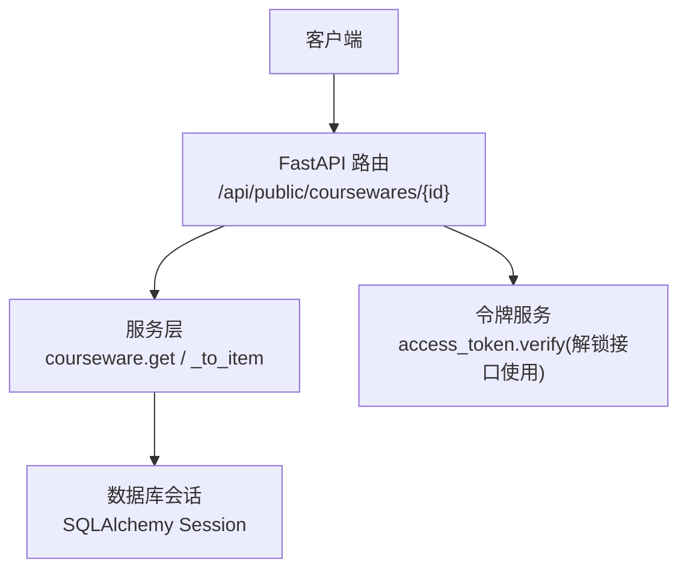
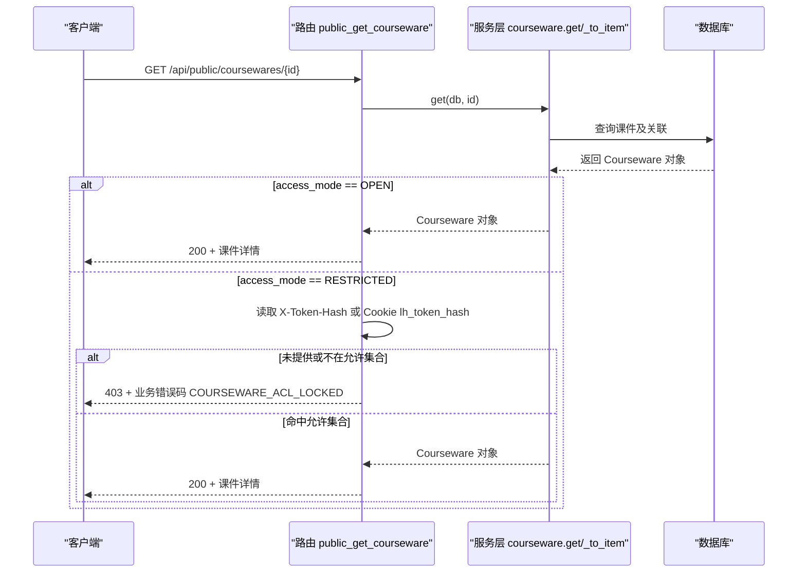
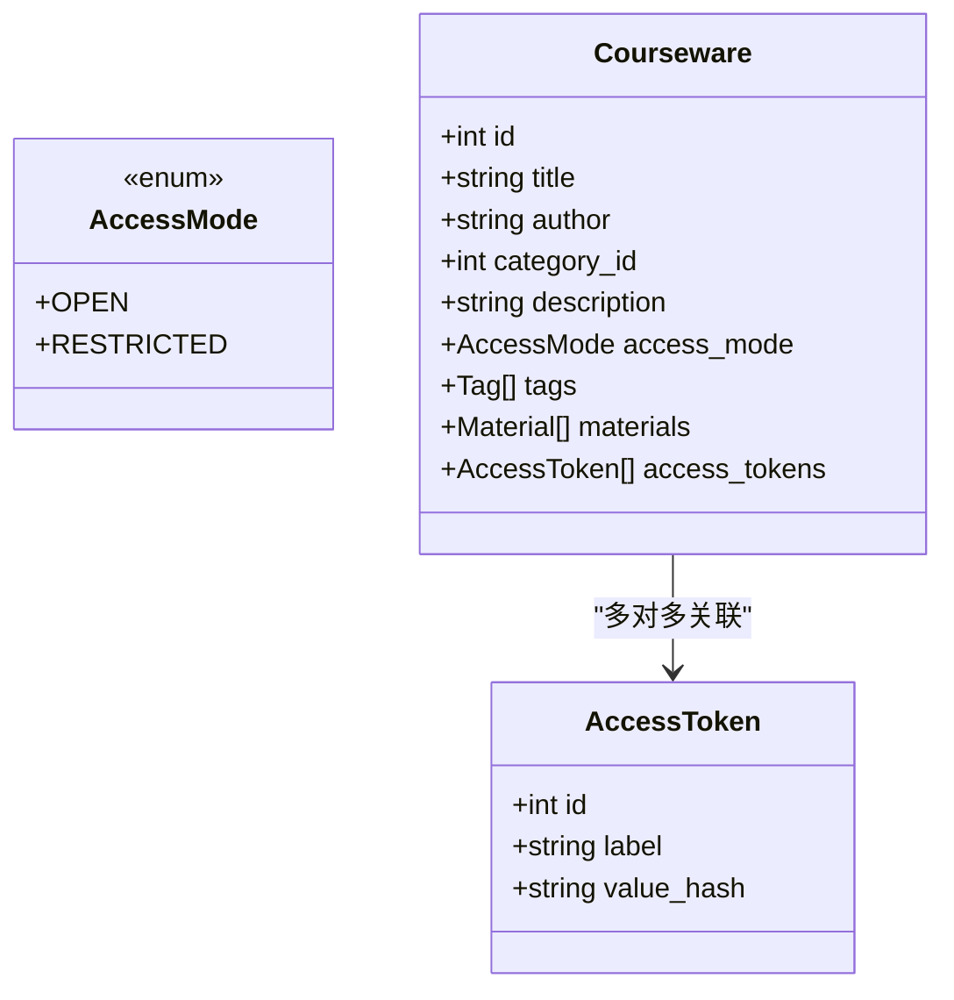
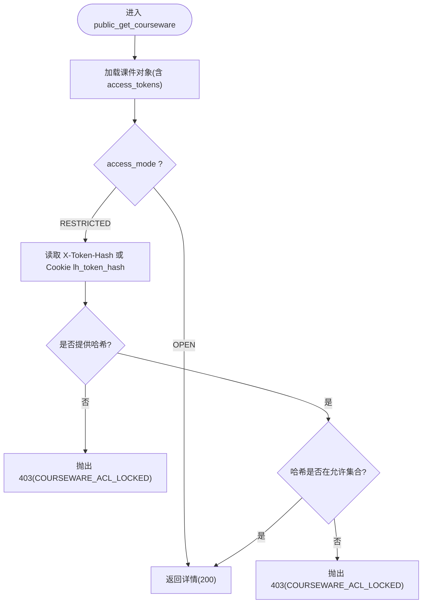
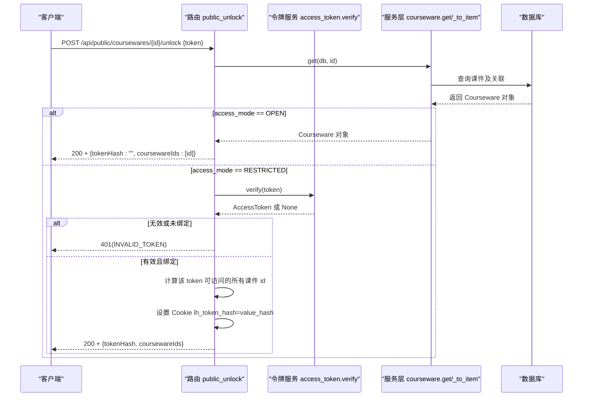
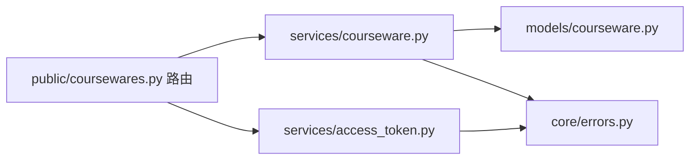

# 课件详情接口

<cite>
**本文引用的文件**   
- [backend/app/api/public/coursewares.py](file://backend/app/api/public/coursewares.py)
- [backend/app/models/courseware.py](file://backend/app/models/courseware.py)
- [backend/app/schemas/courseware.py](file://backend/app/schemas/courseware.py)
- [backend/app/services/courseware.py](file://backend/app/services/courseware.py)
- [backend/app/core/errors.py](file://backend/app/core/errors.py)
- [backend/app/services/access_token.py](file://backend/app/services/access_token.py)
</cite>

## 目录
1. [简介](#简介)
2. [项目结构](#项目结构)
3. [核心组件](#核心组件)
4. [架构总览](#架构总览)
5. [详细组件分析](#详细组件分析)
6. [依赖关系分析](#依赖关系分析)
7. [性能考虑](#性能考虑)
8. [故障排查指南](#故障排查指南)
9. [结论](#结论)
10. [附录：请求与响应示例](#附录请求与响应示例)

## 简介
本章节面向前端与集成方，提供“课件详情”公共接口的完整说明。重点覆盖：
- 接口路径与方法
- 访问模式（OPEN/RESTRICTED）的处理差异
- 令牌验证机制（X-Token-Hash 请求头与 Cookie lh_token_hash）
- 权限校验流程（令牌哈希是否在课件绑定允许列表）
- 错误码与状态码（403、404 等）
- 安全建议与最佳实践

## 项目结构
该接口位于后端 FastAPI 应用的 public 路由中，负责对外暴露课件的公开查询能力，并在受限模式下进行基于令牌的访问控制。

图表来源
- [backend/app/api/public/coursewares.py:57-76](file://backend/app/api/public/coursewares.py#L57-L76)
- [backend/app/services/courseware.py:47-63](file://backend/app/services/courseware.py#L47-L63)
- [backend/app/services/access_token.py:193-205](file://backend/app/services/access_token.py#L193-L205)

章节来源
- [backend/app/api/public/coursewares.py:1-133](file://backend/app/api/public/coursewares.py#L1-133)
- [backend/app/services/courseware.py:1-492](file://backend/app/services/courseware.py#L1-492)

## 核心组件
- 路由定义与鉴权逻辑：在 public 路由模块中实现 GET 详情与 POST 解锁两个端点。
- 数据模型：Courseware 包含访问模式字段 access_mode（OPEN/RESTRICTED），以及与 AccessToken 的多对多关联。
- 业务服务：get 用于按 ID 获取课件并加载必要关联；_to_item 用于构造返回项，含素材下载/流地址与排序信息。
- 错误体系：BusinessError 将业务错误码映射为 HTTP 状态码，统一信封返回。
- 令牌服务：verify 用于明文令牌到持久化哈希的匹配，供解锁接口使用。

章节来源
- [backend/app/api/public/coursewares.py:57-76](file://backend/app/api/public/coursewares.py#L57-L76)
- [backend/app/models/courseware.py:14-67](file://backend/app/models/courseware.py#L14-L67)
- [backend/app/services/courseware.py:47-63](file://backend/app/services/courseware.py#L47-L63)
- [backend/app/services/courseware.py:290-332](file://backend/app/services/courseware.py#L290-L332)
- [backend/app/core/errors.py:9-144](file://backend/app/core/errors.py#L9-L144)
- [backend/app/services/access_token.py:193-205](file://backend/app/services/access_token.py#L193-L205)

## 架构总览
GET 课件详情的处理流程如下：
- 解析路径参数 courseware_id
- 调用服务层 get 获取课件对象（带 tags/materials/access_tokens 关联）
- 根据 access_mode 分支：
  - OPEN：直接返回
  - RESTRICTED：从请求中提取已解锁令牌哈希，若缺失或不在允许集合则拒绝
- 组装 CoursewareItem 返回

图表来源
- [backend/app/api/public/coursewares.py:57-76](file://backend/app/api/public/coursewares.py#L57-L76)
- [backend/app/services/courseware.py:47-63](file://backend/app/services/courseware.py#L47-L63)

## 详细组件分析

### 接口定义与行为
- 方法：GET
- 路径：/api/public/coursewares/{courseware_id}
- 功能：返回课件详情。受访问模式控制：
  - OPEN：无需令牌，直接返回
  - RESTRICTED：需要携带已解锁令牌哈希，否则返回 403

章节来源
- [backend/app/api/public/coursewares.py:57-76](file://backend/app/api/public/coursewares.py#L57-L76)

### 访问模式与数据模型
- 访问模式枚举：AccessMode.OPEN、AccessMode.RESTRICTED
- 课件实体：Courseware，包含 access_mode 字段以及 access_tokens 关联（多对多）

图表来源
- [backend/app/models/courseware.py:14-67](file://backend/app/models/courseware.py#L14-L67)

章节来源
- [backend/app/models/courseware.py:14-67](file://backend/app/models/courseware.py#L14-L67)

### 令牌验证机制
- 令牌哈希来源优先级：
  1) 请求头 X-Token-Hash
  2) Cookie lh_token_hash
- 校验逻辑：
  - 若课件为 RESTRICTED，且未提供令牌哈希 → 403
  - 若提供的令牌哈希不在课件绑定的 access_tokens 的 value_hash 集合中 → 403
- 注意：GET 详情接口仅做“哈希匹配”，不执行明文令牌校验；明文校验由解锁接口完成。

图表来源
- [backend/app/api/public/coursewares.py:24-30](file://backend/app/api/public/coursewares.py#L24-L30)
- [backend/app/api/public/coursewares.py:57-76](file://backend/app/api/public/coursewares.py#L57-L76)

章节来源
- [backend/app/api/public/coursewares.py:24-30](file://backend/app/api/public/coursewares.py#L24-L30)
- [backend/app/api/public/coursewares.py:57-76](file://backend/app/api/public/coursewares.py#L57-L76)

### 解锁接口（配合 GET 使用）
- 方法：POST
- 路径：/api/public/coursewares/{courseware_id}/unlock
- 作用：用明文 token 换取已解锁令牌哈希，并写入 Cookie lh_token_hash，后续 GET 自动鉴权
- 行为要点：
  - OPEN 课件：无需解锁，仍会返回空 tokenHash 与该课件 id 列表
  - RESTRICTED 课件：校验明文 token 有效性，并检查该 token 是否被当前课件绑定
  - 成功后设置 Cookie lh_token_hash（httponly、samesite=lax、path=/、7天）

图表来源
- [backend/app/api/public/coursewares.py:79-130](file://backend/app/api/public/coursewares.py#L79-L130)
- [backend/app/services/access_token.py:193-205](file://backend/app/services/access_token.py#L193-L205)

章节来源
- [backend/app/api/public/coursewares.py:79-130](file://backend/app/api/public/coursewares.py#L79-L130)
- [backend/app/services/access_token.py:193-205](file://backend/app/services/access_token.py#L193-L205)

### 返回数据结构
- 成功时返回信封 data，其中包含 CoursewareItem 结构，包括：
  - 基本信息：id、title、author、categoryId、categoryName、description、accessMode、tagIds、tagNames、materialIds、tokenIds、createdAt、updatedAt
  - 素材列表：materials（含 downloadUrl、streamUrl、sortOrder 等）
- 失败时返回信封 error，包含 code、message、data 字段，HTTP 状态码由错误码映射决定。

章节来源
- [backend/app/schemas/courseware.py:66-98](file://backend/app/schemas/courseware.py#L66-98)
- [backend/app/services/courseware.py:290-332](file://backend/app/services/courseware.py#L290-L332)
- [backend/app/core/errors.py:73-144](file://backend/app/core/errors.py#L73-L144)

## 依赖关系分析
- 路由依赖：
  - 服务层 courseware.get/_to_item：负责数据加载与结果组装
  - 错误体系 BusinessError/ErrorCode：统一错误码与状态码映射
  - 令牌服务 access_token.verify：仅在解锁接口中使用
- 数据模型依赖：
  - Courseware 与 AccessToken 通过中间表建立多对多关系
  - Courseware 与 Material、Tag 也通过中间表管理

图表来源
- [backend/app/api/public/coursewares.py:57-130](file://backend/app/api/public/coursewares.py#L57-L130)
- [backend/app/services/courseware.py:47-63](file://backend/app/services/courseware.py#L47-L63)
- [backend/app/models/courseware.py:14-67](file://backend/app/models/courseware.py#L14-L67)
- [backend/app/core/errors.py:9-144](file://backend/app/core/errors.py#L9-L144)
- [backend/app/services/access_token.py:193-205](file://backend/app/services/access_token.py#L193-L205)

章节来源
- [backend/app/api/public/coursewares.py:57-130](file://backend/app/api/public/coursewares.py#L57-L130)
- [backend/app/services/courseware.py:47-63](file://backend/app/services/courseware.py#L47-L63)
- [backend/app/models/courseware.py:14-67](file://backend/app/models/courseware.py#L14-L67)
- [backend/app/core/errors.py:9-144](file://backend/app/core/errors.py#L9-L144)
- [backend/app/services/access_token.py:193-205](file://backend/app/services/access_token.py#L193-L205)

## 性能考虑
- 详情接口在获取课件时会预加载 tags、materials、access_tokens 关联，避免 N+1 查询。
- 返回材料列表时，服务端会从关联表读取 sort_order，确保顺序正确。
- 解锁接口会遍历所有 active token 进行常量时间比对，通常 token 数量较小，开销可控。

[本节为通用性能建议，不直接分析具体文件]

## 故障排查指南
- 404 课件不存在
  - 触发条件：课程 ID 不存在
  - 错误码：COURSEWARE_NOT_FOUND
  - 状态码：404
- 403 未授权（令牌缺失或无效）
  - 触发条件：RESTRICTED 课件未携带令牌哈希，或哈希不在允许集合
  - 错误码：COURSEWARE_ACL_LOCKED
  - 状态码：403
- 401 令牌无效（解锁接口）
  - 触发条件：明文 token 无效或未绑定到目标课件
  - 错误码：INVALID_TOKEN
  - 状态码：401

章节来源
- [backend/app/services/courseware.py:47-63](file://backend/app/services/courseware.py#L47-L63)
- [backend/app/api/public/coursewares.py:57-76](file://backend/app/api/public/coursewares.py#L57-L76)
- [backend/app/api/public/coursewares.py:79-130](file://backend/app/api/public/coursewares.py#L79-L130)
- [backend/app/core/errors.py:73-144](file://backend/app/core/errors.py#L73-L144)

## 结论
- 课件详情接口以访问模式为核心控制点：OPEN 免鉴权，RESTRICTED 需令牌哈希。
- 令牌哈希优先从请求头 X-Token-Hash 读取，其次回退到 Cookie lh_token_hash。
- 解锁接口负责明文令牌校验并将哈希写入 Cookie，简化后续 GET 的鉴权流程。
- 错误码与状态码映射清晰，便于前端统一处理。

[本节为总结性内容，不直接分析具体文件]

## 附录：请求与响应示例

### 场景一：OPEN 课件（无需令牌）
- 请求
  - 方法：GET
  - 路径：/api/public/coursewares/{courseware_id}
  - 头部：无特殊要求
- 预期响应
  - 状态码：200
  - 响应体：信封 data 中包含 CoursewareItem，含 materials 列表与下载/流地址

章节来源
- [backend/app/api/public/coursewares.py:57-76](file://backend/app/api/public/coursewares.py#L57-L76)
- [backend/app/services/courseware.py:290-332](file://backend/app/services/courseware.py#L290-L332)

### 场景二：RESTRICTED 课件（携带令牌哈希）
- 前置步骤：先调用解锁接口获取令牌哈希并写入 Cookie
  - 方法：POST
  - 路径：/api/public/coursewares/{courseware_id}/unlock
  - 请求体：{ "token": "明文令牌" }
  - 成功响应：设置 Cookie lh_token_hash，返回 { tokenHash, coursewareIds }
- 详情请求
  - 方法：GET
  - 路径：/api/public/coursewares/{courseware_id}
  - 头部：可选 X-Token-Hash（也可依赖 Cookie）
- 预期响应
  - 状态码：200
  - 响应体：信封 data 中包含 CoursewareItem

章节来源
- [backend/app/api/public/coursewares.py:79-130](file://backend/app/api/public/coursewares.py#L79-L130)
- [backend/app/api/public/coursewares.py:57-76](file://backend/app/api/public/coursewares.py#L57-L76)

### 常见错误响应
- 404 课件不存在
  - 错误码：COURSEWARE_NOT_FOUND
  - 状态码：404
- 403 未授权（令牌缺失或无效）
  - 错误码：COURSEWARE_ACL_LOCKED
  - 状态码：403
- 401 令牌无效（解锁接口）
  - 错误码：INVALID_TOKEN
  - 状态码：401

章节来源
- [backend/app/core/errors.py:73-144](file://backend/app/core/errors.py#L73-L144)
- [backend/app/services/courseware.py:47-63](file://backend/app/services/courseware.py#L47-L63)
- [backend/app/api/public/coursewares.py:57-76](file://backend/app/api/public/coursewares.py#L57-L76)
- [backend/app/api/public/coursewares.py:79-130](file://backend/app/api/public/coursewares.py#L79-L130)

### 安全考虑与最佳实践
- 令牌传输
  - 优先使用 HTTPS，避免明文令牌泄露
  - 解锁成功后，服务端设置 httponly、samesite=lax 的 Cookie，降低 XSS 风险
- 令牌存储
  - 服务端仅存储令牌哈希，不保存明文
  - 前端不应缓存明文令牌，尽量通过解锁接口动态获取
- 令牌生命周期
  - 定期轮换令牌，必要时重新生成
  - 限制令牌绑定范围，最小权限原则
- 前端交互
  - 首次访问 RESTRICTED 课件时，先调用解锁接口，再请求详情
  - 若返回 403，提示用户输入令牌或联系管理员

[本节为通用安全建议，不直接分析具体文件]