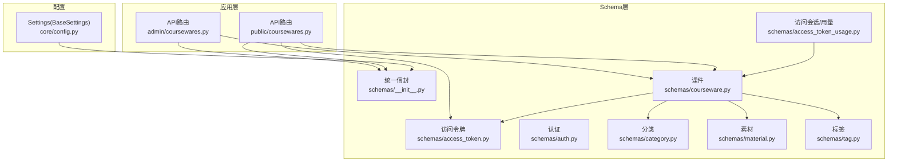
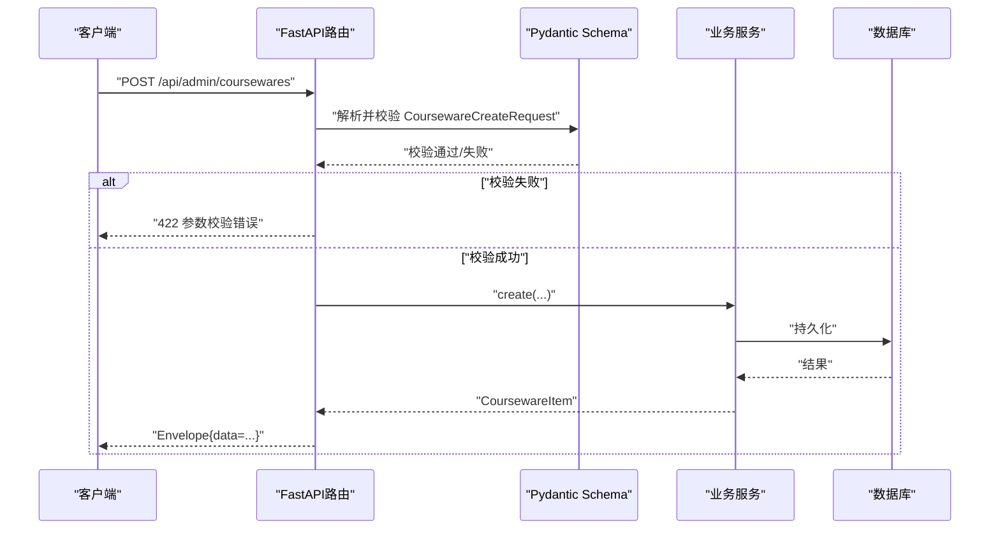
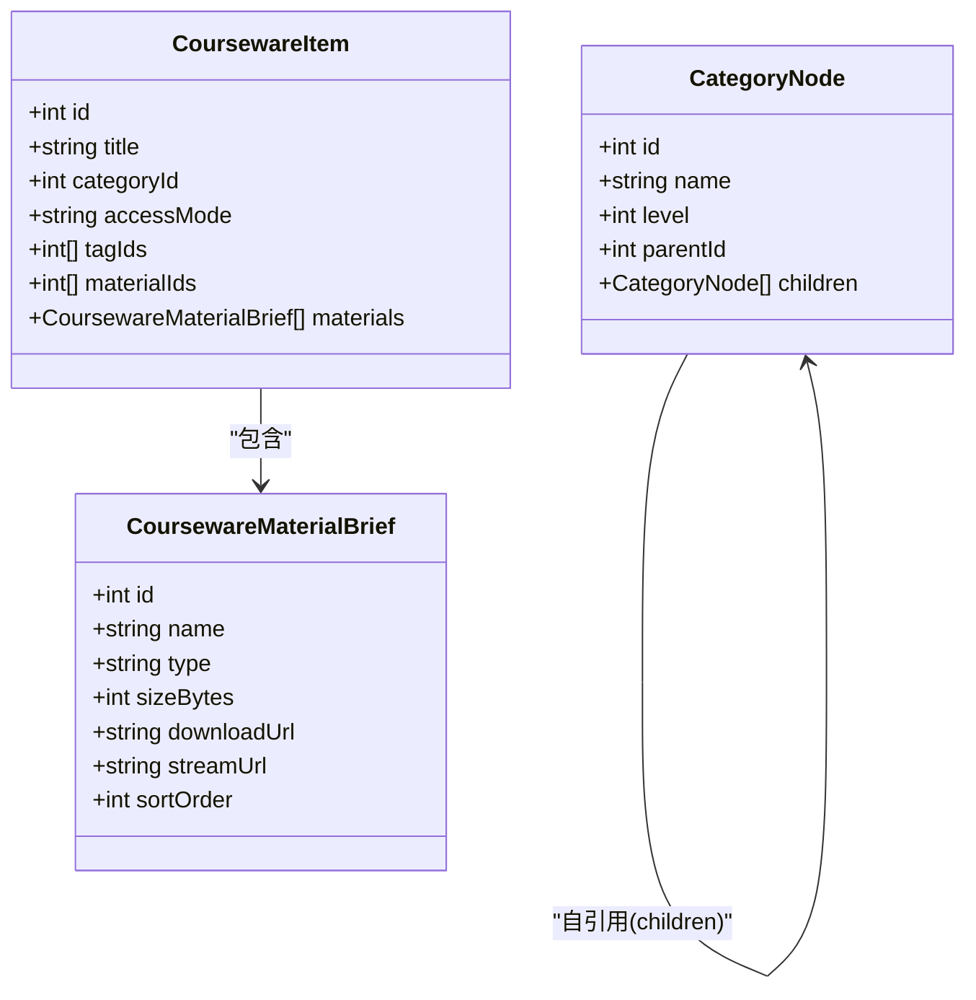
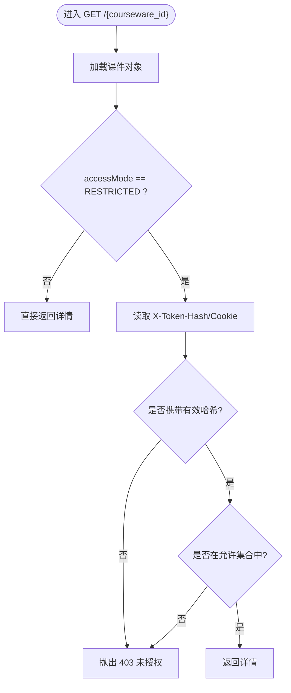
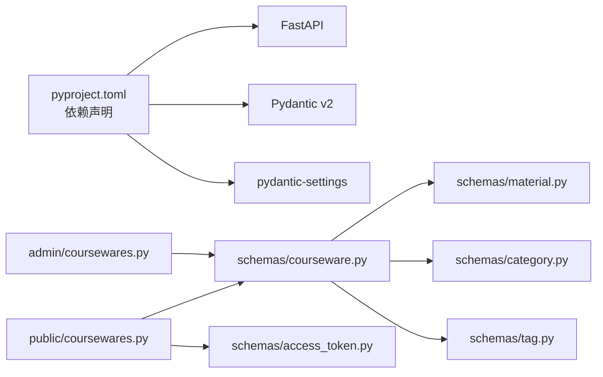

# 数据验证与Schema设计

<cite>
**本文引用的文件**
- [backend/app/schemas/__init__.py](file://backend/app/schemas/__init__.py)
- [backend/app/schemas/access_token.py](file://backend/app/schemas/access_token.py)
- [backend/app/schemas/auth.py](file://backend/app/schemas/auth.py)
- [backend/app/schemas/category.py](file://backend/app/schemas/category.py)
- [backend/app/schemas/courseware.py](file://backend/app/schemas/courseware.py)
- [backend/app/schemas/material.py](file://backend/app/schemas/material.py)
- [backend/app/schemas/tag.py](file://backend/app/schemas/tag.py)
- [backend/app/schemas/access_token_usage.py](file://backend/app/schemas/access_token_usage.py)
- [backend/app/core/config.py](file://backend/app/core/config.py)
- [backend/app/api/admin/coursewares.py](file://backend/app/api/admin/coursewares.py)
- [backend/app/api/public/coursewares.py](file://backend/app/api/public/coursewares.py)
- [backend/pyproject.toml](file://backend/pyproject.toml)
</cite>

## 目录
1. [简介](#简介)
2. [项目结构](#项目结构)
3. [核心组件](#核心组件)
4. [架构总览](#架构总览)
5. [详细组件分析](#详细组件分析)
6. [依赖关系分析](#依赖关系分析)
7. [性能考虑](#性能考虑)
8. [故障排查指南](#故障排查指南)
9. [结论](#结论)
10. [附录](#附录)

## 简介
本指南聚焦于后端数据验证与Pydantic Schema设计，结合仓库中现有实现，系统阐述：
- 基础模型定义、字段约束与自定义验证器
- 嵌套模型与关联关系建模、序列化策略
- 复杂验证场景：条件校验、交叉字段校验、异步验证
- API文档自动生成配置（字段描述、示例、提示）
- Schema复用与继承的最佳实践（抽象基类、通用规则）
- 完整代码示例路径与常见错误处理建议

## 项目结构
本项目采用“按领域/功能组织”的模块划分，Schema集中在 backend/app/schemas 下，API路由在 backend/app/api 下，配置在 backend/app/core/config.py。

图表来源
- [backend/app/api/admin/coursewares.py:1-115](file://backend/app/api/admin/coursewares.py#L1-L115)
- [backend/app/api/public/coursewares.py:1-133](file://backend/app/api/public/coursewares.py#L1-L133)
- [backend/app/schemas/__init__.py:1-65](file://backend/app/schemas/__init__.py#L1-L65)
- [backend/app/schemas/courseware.py:1-120](file://backend/app/schemas/courseware.py#L1-L120)
- [backend/app/schemas/access_token.py:1-53](file://backend/app/schemas/access_token.py#L1-L53)
- [backend/app/schemas/category.py:1-49](file://backend/app/schemas/category.py#L1-L49)
- [backend/app/schemas/material.py:1-28](file://backend/app/schemas/material.py#L1-L28)
- [backend/app/schemas/tag.py:1-34](file://backend/app/schemas/tag.py#L1-L34)
- [backend/app/schemas/access_token_usage.py:1-91](file://backend/app/schemas/access_token_usage.py#L1-L91)
- [backend/app/core/config.py:1-88](file://backend/app/core/config.py#L1-L88)

章节来源
- [backend/app/api/admin/coursewares.py:1-115](file://backend/app/api/admin/coursewares.py#L1-L115)
- [backend/app/api/public/coursewares.py:1-133](file://backend/app/api/public/coursewares.py#L1-L133)
- [backend/app/schemas/__init__.py:1-65](file://backend/app/schemas/__init__.py#L1-L65)
- [backend/app/core/config.py:1-88](file://backend/app/core/config.py#L1-L88)

## 核心组件
- 统一响应信封 Envelope：提供统一的 code/message/data/requestId 结构，并配套 ok/fail 构造器，便于API返回一致化。
- Settings(BaseSettings)：基于 pydantic-settings 的环境配置加载，支持 computed_field 派生值与便捷属性。
- 各业务Schema：围绕课件、素材、分类、标签、访问令牌、访问会话等实体，定义请求/响应结构与字段约束。

章节来源
- [backend/app/schemas/__init__.py:1-65](file://backend/app/schemas/__init__.py#L1-L65)
- [backend/app/core/config.py:1-88](file://backend/app/core/config.py#L1-L88)

## 架构总览
下图展示从HTTP请求到Schema校验再到服务层的典型调用链，以及公共接口解锁流程中的鉴权分支。

图表来源
- [backend/app/api/admin/coursewares.py:52-68](file://backend/app/api/admin/coursewares.py#L52-L68)
- [backend/app/schemas/courseware.py:41-42](file://backend/app/schemas/courseware.py#L41-L42)
- [backend/app/schemas/__init__.py:35-42](file://backend/app/schemas/__init__.py#L35-L42)

## 详细组件分析

### 基础模型与字段验证
- 字符串长度与必填：广泛使用 Field(..., min_length=..., max_length=...) 控制输入边界。
- 数值范围：如 ge=1、ge=0 等约束用于页码、时长等字段。
- 可选字段：Optional[...] 配合默认值，表达可空语义。
- 列表类型：List[int]/list[...] 用于多对多ID集合（如 tagIds、materialIds）。

章节来源
- [backend/app/schemas/auth.py:7-9](file://backend/app/schemas/auth.py#L7-L9)
- [backend/app/schemas/tag.py:9-11](file://backend/app/schemas/tag.py#L9-L11)
- [backend/app/schemas/access_token_usage.py:62-64](file://backend/app/schemas/access_token_usage.py#L62-L64)
- [backend/app/schemas/access_token_usage.py:72-74](file://backend/app/schemas/access_token_usage.py#L72-L74)

### 自定义验证器与清洗逻辑
- 使用 @model_validator(mode="after") 进行后处理，例如去除首尾空白字符，确保入库数据整洁。
- 适用于 name/title/label 等文本字段。

章节来源
- [backend/app/schemas/access_token.py:12-16](file://backend/app/schemas/access_token.py#L12-L16)
- [backend/app/schemas/category.py:15-19](file://backend/app/schemas/category.py#L15-L19)
- [backend/app/schemas/category.py:25-29](file://backend/app/schemas/category.py#L25-L29)
- [backend/app/schemas/courseware.py:32-38](file://backend/app/schemas/courseware.py#L32-L38)
- [backend/app/schemas/courseware.py:57-63](file://backend/app/schemas/courseware.py#L57-L63)
- [backend/app/schemas/tag.py:12-16](file://backend/app/schemas/tag.py#L12-L16)

### 嵌套模型与关联关系建模
- 课件详情包含素材片段列表：CoursewareItem.materials 为 List[CoursewareMaterialBrief]，体现一对多关系。
- 分类树形节点：CategoryNode.children 自引用，使用 model_rebuild() 解决前向引用。
- 分页封装：多处使用 {page,size,total,items} 模式，保持接口一致性。

图表来源
- [backend/app/schemas/courseware.py:66-82](file://backend/app/schemas/courseware.py#L66-L82)
- [backend/app/schemas/courseware.py:9-20](file://backend/app/schemas/courseware.py#L9-L20)
- [backend/app/schemas/category.py:32-40](file://backend/app/schemas/category.py#L32-L40)

章节来源
- [backend/app/schemas/courseware.py:66-82](file://backend/app/schemas/courseware.py#L66-L82)
- [backend/app/schemas/category.py:32-40](file://backend/app/schemas/category.py#L32-L40)

### 复杂验证场景
- 条件验证：根据 accessMode 决定是否需要令牌解锁；公开接口在 RESTRICTED 模式下强制校验令牌哈希。
- 交叉字段验证：当前仓库未出现跨字段的 model_validator(mode="before"/"after") 组合校验案例；可在需要时引入。
- 异步验证：搜索接口使用 async def 并在路由层 await 服务层异步函数，适合耗时IO或外部调用。

图表来源
- [backend/app/api/public/coursewares.py:57-76](file://backend/app/api/public/coursewares.py#L57-L76)

章节来源
- [backend/app/api/public/coursewares.py:57-76](file://backend/app/api/public/coursewares.py#L57-L76)
- [backend/app/api/public/coursewares.py:32-54](file://backend/app/api/public/coursewares.py#L32-L54)

### API文档自动生成的配置
- 字段描述：在 Query(...) 中使用 description 参数，便于 OpenAPI/Swagger 显示说明。
- 示例数据：可通过 Field(examples=[...]) 或 response_model 的示例配置增强文档（当前仓库未显式设置，可按需补充）。
- 验证提示：Field(min_length/max_length/ge/le) 会自动生成校验提示，帮助前端展示友好错误信息。

章节来源
- [backend/app/api/public/coursewares.py:34-36](file://backend/app/api/public/coursewares.py#L34-L36)

### Schema复用与继承最佳实践
- 基类抽象：CategoryBase/CoursewareBase 作为共享字段集合，减少重复定义。
- 请求体扩展：CategoryCreateRequest/CategoryRenameRequest/CoursewareUpdateRequest 在基类基础上增加特定行为（如 strip 清洗）。
- 通用分页：在各资源中复用 {page,size,total,items} 结构，保持一致性。

章节来源
- [backend/app/schemas/category.py:9-19](file://backend/app/schemas/category.py#L9-L19)
- [backend/app/schemas/courseware.py:22-38](file://backend/app/schemas/courseware.py#L22-L38)
- [backend/app/schemas/courseware.py:45-63](file://backend/app/schemas/courseware.py#L45-L63)

### 配置与时间戳
- Settings(BaseSettings) 提供 effective_database_url 计算字段，优先使用 DATABASE_URL，否则拼接独立字段。
- 统一信封 now_iso 使用 get_settings().timezone 获取时区，保证时间输出一致。

章节来源
- [backend/app/core/config.py:28-38](file://backend/app/core/config.py#L28-L38)
- [backend/app/schemas/__init__.py:12-18](file://backend/app/schemas/__init__.py#L12-L18)

## 依赖关系分析
- 运行时依赖：pydantic==2.10.3、fastapi、pydantic-settings 等由 pyproject.toml 声明。
- 模块耦合：API路由依赖对应Schema进行入参校验；部分Schema之间通过嵌套引用形成弱耦合。

图表来源
- [backend/pyproject.toml:8-25](file://backend/pyproject.toml#L8-L25)
- [backend/app/api/admin/coursewares.py:10-15](file://backend/app/api/admin/coursewares.py#L10-L15)
- [backend/app/api/public/coursewares.py:13-16](file://backend/app/api/public/coursewares.py#L13-L16)
- [backend/app/schemas/courseware.py:1-10](file://backend/app/schemas/courseware.py#L1-L10)

章节来源
- [backend/pyproject.toml:8-25](file://backend/pyproject.toml#L8-L25)

## 性能考虑
- 避免在 model_validator 中进行昂贵操作，尽量只做轻量清洗与格式转换。
- 列表字段（如 tagIds/materialIds/tokenIds）应限制最大长度，防止超大负载导致内存压力。
- 异步接口（如搜索）注意超时与降级策略，避免阻塞事件循环。

## 故障排查指南
- 422 参数校验错误：检查字段是否满足 min_length/max_length/ge/le 等约束；确认 Optional 字段是否正确传 null。
- 403 未授权：RESTRICTED 课件需携带有效的 X-Token-Hash 或 Cookie lh_token_hash。
- 令牌无效：解锁接口会校验 token 明文与绑定关系，不匹配将抛出业务错误。
- 时间与时区：统一信封 now_iso 依赖 Settings.timezone，若容器 TZ 未设置可能导致时间偏差。

章节来源
- [backend/app/api/public/coursewares.py:69-76](file://backend/app/api/public/coursewares.py#L69-L76)
- [backend/app/api/public/coursewares.py:98-104](file://backend/app/api/public/coursewares.py#L98-L104)
- [backend/app/schemas/__init__.py:12-18](file://backend/app/schemas/__init__.py#L12-L18)

## 结论
本项目在Pydantic v2上实现了清晰的数据契约与一致的API返回结构。通过基类抽象、自定义验证器与嵌套模型，既保证了输入安全，又提升了可读性与可维护性。建议在后续迭代中补充更丰富的示例数据与跨字段校验，进一步提升开发者体验与健壮性。

## 附录
- 版本与依赖：pydantic==2.10.3、pydantic-settings==2.6.1、fastapi==0.115.5 等见 pyproject.toml。
- 常用Schema清单：
  - 统一信封：Envelope、ok、fail
  - 访问令牌：AccessTokenCreateRequest、AccessTokenCreatedResponse、AccessTokenItem、AccessTokenPaged
  - 认证：AdminLoginRequest、AdminLoginResponse
  - 分类：CategoryBase、CategoryCreateRequest、CategoryRenameRequest、CategoryNode
  - 课件：CoursewareBase、CoursewareCreateRequest、CoursewareUpdateRequest、CoursewareItem、CoursewarePaged、UnlockRequest、UnlockResponse、CoursewareMaterialsReorderRequest
  - 素材：MaterialItem、MaterialPaged
  - 标签：TagNameRequest、TagItem、TagPaged
  - 访问会话/用量：AccessSessionItem、AccessSessionSummary、AccessSessionPaged、MaterialUsageItem、MaterialUsagePaged、AccessSessionStartRequest、AccessSessionLeaveRequest 及其响应

章节来源
- [backend/pyproject.toml:8-25](file://backend/pyproject.toml#L8-L25)
- [backend/app/schemas/__init__.py:24-32](file://backend/app/schemas/__init__.py#L24-L32)
- [backend/app/schemas/access_token.py:9-46](file://backend/app/schemas/access_token.py#L9-L46)
- [backend/app/schemas/auth.py:7-14](file://backend/app/schemas/auth.py#L7-L14)
- [backend/app/schemas/category.py:9-40](file://backend/app/schemas/category.py#L9-L40)
- [backend/app/schemas/courseware.py:22-120](file://backend/app/schemas/courseware.py#L22-L120)
- [backend/app/schemas/material.py:9-24](file://backend/app/schemas/material.py#L9-L24)
- [backend/app/schemas/tag.py:9-30](file://backend/app/schemas/tag.py#L9-L30)
- [backend/app/schemas/access_token_usage.py:9-78](file://backend/app/schemas/access_token_usage.py#L9-L78)