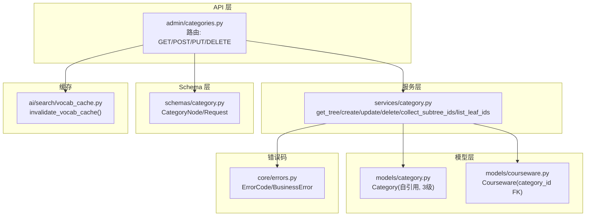
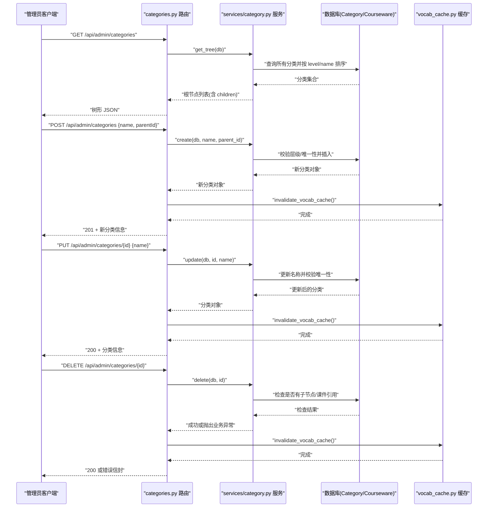
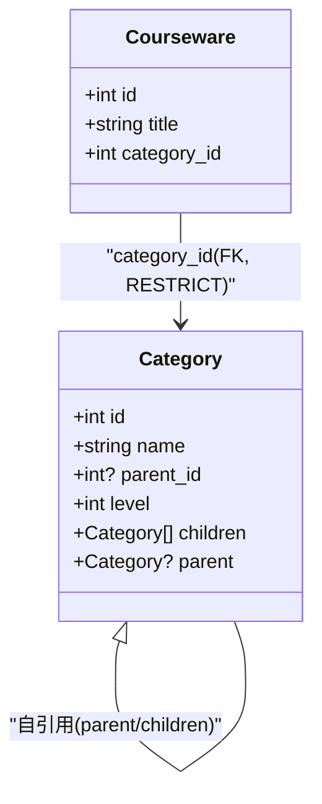
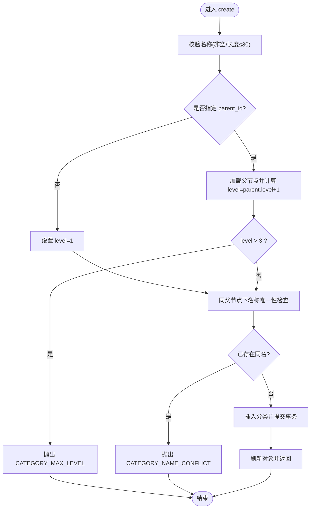
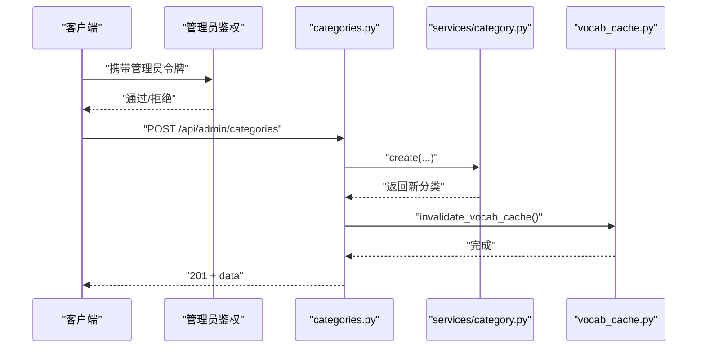
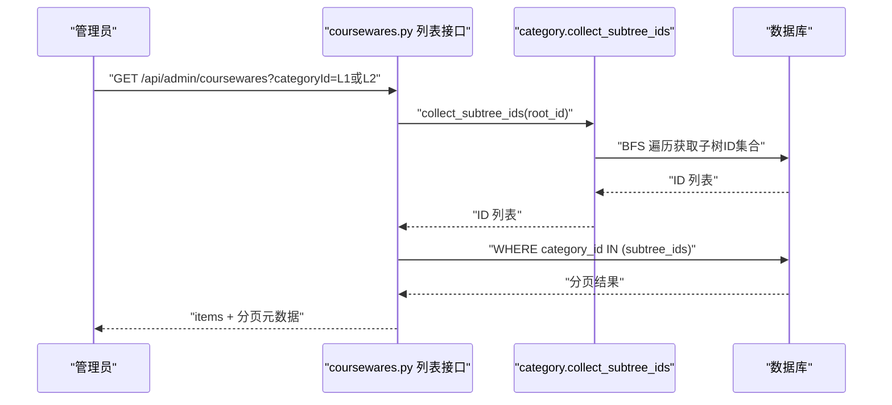
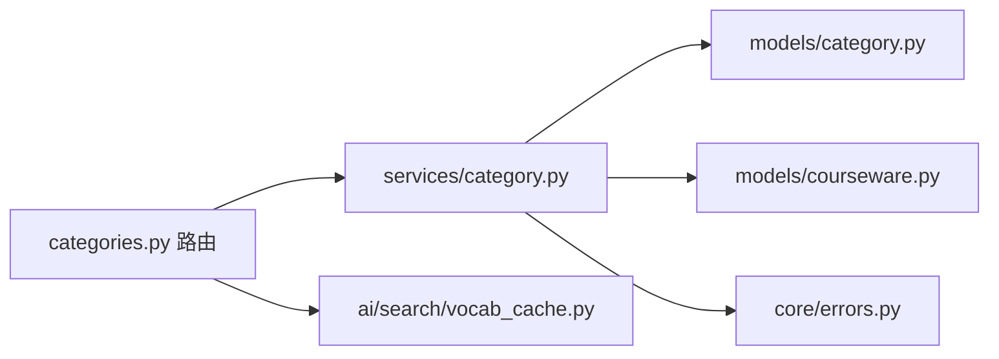

# 分类管理接口

<cite>
**本文引用的文件**   
- [backend/app/api/admin/categories.py](file://backend/app/api/admin/categories.py)
- [backend/app/models/category.py](file://backend/app/models/category.py)
- [backend/app/schemas/category.py](file://backend/app/schemas/category.py)
- [backend/app/services/category.py](file://backend/app/services/category.py)
- [backend/app/core/errors.py](file://backend/app/core/errors.py)
- [backend/app/models/courseware.py](file://backend/app/models/courseware.py)
- [backend/app/ai/search/vocab_cache.py](file://backend/app/ai/search/vocab_cache.py)
</cite>

## 目录
1. [简介](#简介)
2. [项目结构](#项目结构)
3. [核心组件](#核心组件)
4. [架构总览](#架构总览)
5. [详细组件分析](#详细组件分析)
6. [依赖关系分析](#依赖关系分析)
7. [性能与排序](#性能与排序)
8. [故障排查指南](#故障排查指南)
9. [结论](#结论)
10. [附录：API 定义与示例](#附录api-定义与示例)

## 简介
本文件为“分类管理”模块的 API 文档，聚焦三级分类树结构的增删改查、层级关系维护、与课件的关联管理、以及排序与权限控制等实现细节。该能力用于后台管理系统对课程资源进行结构化组织，支持以树形方式浏览和编辑分类，同时保证数据一致性与业务约束（如最大层级、名称唯一性、删除保护等）。

## 项目结构
分类管理相关代码位于后端 FastAPI 应用中，采用分层设计：
- API 层：路由定义与请求/响应封装
- 服务层：业务规则与事务处理
- 模型层：数据库表结构与 ORM 映射
- Schema 层：Pydantic 校验与序列化
- 错误码：统一错误码与 HTTP 状态映射

图表来源
- [backend/app/api/admin/categories.py:1-81](file://backend/app/api/admin/categories.py#L1-L81)
- [backend/app/services/category.py:1-152](file://backend/app/services/category.py#L1-L152)
- [backend/app/models/category.py:1-46](file://backend/app/models/category.py#L1-L46)
- [backend/app/models/courseware.py:1-74](file://backend/app/models/courseware.py#L1-L74)
- [backend/app/schemas/category.py:1-49](file://backend/app/schemas/category.py#L1-L49)
- [backend/app/core/errors.py:1-144](file://backend/app/core/errors.py#L1-L144)
- [backend/app/ai/search/vocab_cache.py](file://backend/app/ai/search/vocab_cache.py)

章节来源
- [backend/app/api/admin/categories.py:1-81](file://backend/app/api/admin/categories.py#L1-L81)
- [backend/app/services/category.py:1-152](file://backend/app/services/category.py#L1-L152)
- [backend/app/models/category.py:1-46](file://backend/app/models/category.py#L1-L46)
- [backend/app/schemas/category.py:1-49](file://backend/app/schemas/category.py#L1-L49)
- [backend/app/core/errors.py:1-144](file://backend/app/core/errors.py#L1-L144)

## 核心组件
- 路由与鉴权
  - 路由前缀：/api/admin/categories
  - 全局依赖：管理员鉴权中间件（仅管理员可访问）
  - 提供接口：列表、新增、重命名、删除
- 服务层
  - 获取完整三级树（按 level、name 排序）
  - 创建/更新/删除分类，包含业务校验与一致性保护
  - 子树 ID 收集（BFS），供课件筛选使用
  - 叶子节点 ID 列表（level=3）
- 数据模型
  - Category：自引用父子关系，限制最大层级为 3；同一父节点下 name 唯一
  - Courseware：通过 category_id 外键关联到分类，删除分类时受 RESTRICT 保护
- Schema
  - 请求体：创建/重命名时的字段校验与去空白
  - 返回体：递归树节点 CategoryNode

章节来源
- [backend/app/api/admin/categories.py:1-81](file://backend/app/api/admin/categories.py#L1-L81)
- [backend/app/services/category.py:1-152](file://backend/app/services/category.py#L1-L152)
- [backend/app/models/category.py:1-46](file://backend/app/models/category.py#L1-L46)
- [backend/app/models/courseware.py:1-74](file://backend/app/models/courseware.py#L1-L74)
- [backend/app/schemas/category.py:1-49](file://backend/app/schemas/category.py#L1-L49)

## 架构总览
分类管理遵循典型的三层架构：API 路由 → 服务逻辑 → 数据模型，配合 Pydantic Schema 做输入输出校验，并通过统一错误码体系对外暴露规范化的错误信息。

图表来源
- [backend/app/api/admin/categories.py:33-77](file://backend/app/api/admin/categories.py#L33-L77)
- [backend/app/services/category.py:27-111](file://backend/app/services/category.py#L27-L111)
- [backend/app/models/category.py:12-40](file://backend/app/models/category.py#L12-L40)
- [backend/app/models/courseware.py:21-38](file://backend/app/models/courseware.py#L21-L38)
- [backend/app/ai/search/vocab_cache.py](file://backend/app/ai/search/vocab_cache.py)

## 详细组件分析

### 数据模型与树形结构
- Category 表
  - 字段：id、name、parent_id、level
  - 约束：同一父节点下 name 唯一；parent_id 外键指向自身（RESTRICT 删除保护）
  - 关系：自引用 parent/children，便于构建多级树
- 层级规则
  - level ∈ {1, 2, 3}，parent_id=NULL 表示根节点
  - 创建时根据 parent_id 计算 level，超过 3 层将拒绝

图表来源
- [backend/app/models/category.py:12-40](file://backend/app/models/category.py#L12-L40)
- [backend/app/models/courseware.py:21-38](file://backend/app/models/courseware.py#L21-L38)

章节来源
- [backend/app/models/category.py:1-46](file://backend/app/models/category.py#L1-L46)
- [backend/app/models/courseware.py:1-74](file://backend/app/models/courseware.py#L1-L74)

### 服务层：树构建与 CRUD
- get_tree
  - 一次性加载所有分类，按 level 与 name 排序后组装成树
  - 时间复杂度近似 O(N)，空间复杂度 O(N)
- create
  - 校验名称非空且长度 ≤ 30
  - 若指定 parent_id，则读取父节点并计算 level，限制最大 3 层
  - 同父节点下名称唯一性校验（SQL 唯一约束兜底）
- update
  - 校验名称并更新，冲突时抛业务异常
- delete
  - 禁止删除有子节点的分类
  - 禁止删除仍被课件引用的分类（courseware.category_id 外键 RESTRICT）
- collect_subtree_ids
  - BFS 遍历，返回 root_id 及其所有后代 id，用于课件列表的子树过滤
- list_leaf_ids
  - 返回所有 level=3 的叶子分类 id，供其他模块校验

图表来源
- [backend/app/services/category.py:52-76](file://backend/app/services/category.py#L52-L76)
- [backend/app/core/errors.py:32-38](file://backend/app/core/errors.py#L32-L38)

章节来源
- [backend/app/services/category.py:27-111](file://backend/app/services/category.py#L27-L111)
- [backend/app/core/errors.py:1-144](file://backend/app/core/errors.py#L1-L144)

### API 路由与鉴权
- 鉴权
  - 路由组挂载管理员鉴权依赖，未认证或无权限直接拒绝
- 接口清单
  - GET /api/admin/categories：返回完整三级树
  - POST /api/admin/categories：创建分类
  - PUT /api/admin/categories/{category_id}：重命名分类
  - DELETE /api/admin/categories/{category_id}：删除分类
- 缓存失效
  - 每次写操作后调用 invalidate_vocab_cache()，使搜索词库缓存失效，确保后续检索结果与最新分类一致

图表来源
- [backend/app/api/admin/categories.py:16-20](file://backend/app/api/admin/categories.py#L16-L20)
- [backend/app/api/admin/categories.py:39-52](file://backend/app/api/admin/categories.py#L39-L52)
- [backend/app/services/category.py:52-76](file://backend/app/services/category.py#L52-L76)
- [backend/app/ai/search/vocab_cache.py](file://backend/app/ai/search/vocab_cache.py)

章节来源
- [backend/app/api/admin/categories.py:1-81](file://backend/app/api/admin/categories.py#L1-L81)

### 分类与课件的关联管理
- 关联关系
  - Courseware.category_id 外键指向 Category.id，删除分类时受 RESTRICT 保护
- 子树过滤
  - 课件列表支持按 category_id 过滤，当选择 L1/L2 节点时，后端会拉出该节点及其所有后代分类下的课件；选择 L3 叶子时等价于精确匹配
- 业务影响
  - 删除分类前需确保其下无课件引用，否则拒绝删除

图表来源
- [backend/app/services/courseware.py:420-447](file://backend/app/services/courseware.py#L420-L447)
- [backend/app/services/category.py:113-130](file://backend/app/services/category.py#L113-L130)
- [backend/app/models/courseware.py:30-32](file://backend/app/models/courseware.py#L30-L32)

章节来源
- [backend/app/models/courseware.py:1-74](file://backend/app/models/courseware.py#L1-L74)
- [backend/app/services/courseware.py:420-447](file://backend/app/services/courseware.py#L420-L447)
- [backend/app/services/category.py:113-130](file://backend/app/services/category.py#L113-L130)

### 数据结构定义与示例
- 请求体
  - 创建分类：{ name, parentId? }
  - 重命名分类：{ name }
- 返回体
  - 树节点：{ id, name, level, parentId?, children[] }
- 示例说明
  - 创建一级分类：parentId 为空或不传
  - 创建二级分类：parentId 指向一级分类 id
  - 创建三级分类：parentId 指向二级分类 id
  - 重命名：保持 level 与 parentId 不变，仅更新 name
  - 删除：确保无子节点且无课件引用

章节来源
- [backend/app/schemas/category.py:9-40](file://backend/app/schemas/category.py#L9-L40)
- [backend/app/api/admin/categories.py:33-77](file://backend/app/api/admin/categories.py#L33-L77)

## 依赖关系分析
- 组件耦合
  - API 路由依赖服务层，服务层依赖模型与错误码
  - 分类与课件通过外键强关联，保障数据一致性
- 外部依赖
  - 搜索词库缓存：在分类变更时主动失效，避免搜索结果陈旧
- 潜在循环
  - 自引用关系由 ORM 管理，不存在运行时循环导入问题

图表来源
- [backend/app/api/admin/categories.py:1-81](file://backend/app/api/admin/categories.py#L1-L81)
- [backend/app/services/category.py:1-152](file://backend/app/services/category.py#L1-L152)
- [backend/app/models/category.py:1-46](file://backend/app/models/category.py#L1-L46)
- [backend/app/models/courseware.py:1-74](file://backend/app/models/courseware.py#L1-L74)
- [backend/app/core/errors.py:1-144](file://backend/app/core/errors.py#L1-L144)
- [backend/app/ai/search/vocab_cache.py](file://backend/app/ai/search/vocab_cache.py)

章节来源
- [backend/app/api/admin/categories.py:1-81](file://backend/app/api/admin/categories.py#L1-L81)
- [backend/app/services/category.py:1-152](file://backend/app/services/category.py#L1-L152)
- [backend/app/models/category.py:1-46](file://backend/app/models/category.py#L1-L46)
- [backend/app/models/courseware.py:1-74](file://backend/app/models/courseware.py#L1-L74)
- [backend/app/core/errors.py:1-144](file://backend/app/core/errors.py#L1-L144)

## 性能与排序
- 树构建
  - 单次全量查询并按 level、name 排序，随后内存中组装树，适合分类规模不大的场景
- 子树过滤
  - 使用 BFS 收集子树 ID，再使用 IN 条件过滤课件，减少多次往返
- 排序
  - 分类树默认按 level 与 name 排序
  - 当前分类表未提供 sort_order 字段；如需自定义顺序，可在未来扩展排序字段并在 get_tree 中应用

[本节为通用性能建议，不直接分析具体文件]

## 故障排查指南
- 常见错误码与含义
  - CATEGORY_NOT_FOUND：分类不存在
  - CATEGORY_NAME_REQUIRED：分类名称为空或无效
  - CATEGORY_NAME_CONFLICT：同一父节点下名称重复
  - CATEGORY_MAX_LEVEL：超过最大层级（3 层）
  - CATEGORY_HAS_CHILDREN：存在子分类，无法删除
  - CATEGORY_HAS_COURSEWARES：分类下仍有课件，无法删除
- 排查步骤
  - 确认请求参数是否符合 Schema 校验（名称长度、必填项）
  - 检查父节点是否存在且层级合法
  - 删除前确认无子节点与课件引用
  - 观察缓存失效是否生效（搜索词库）

章节来源
- [backend/app/core/errors.py:32-38](file://backend/app/core/errors.py#L32-L38)
- [backend/app/core/errors.py:92-98](file://backend/app/core/errors.py#L92-L98)
- [backend/app/services/category.py:79-111](file://backend/app/services/category.py#L79-L111)

## 结论
分类管理接口提供了完整的三级树管理能力，结合严格的业务校验与外键约束，确保了数据的一致性与安全性。通过子树 ID 收集与课件列表的联动，实现了灵活的分类筛选。建议在后续版本中引入分类排序字段以满足更复杂的展示需求。

[本节为总结性内容，不直接分析具体文件]

## 附录：API 定义与示例

### 接口清单
- 获取分类树
  - 方法：GET
  - 路径：/api/admin/categories
  - 鉴权：管理员
  - 响应：树形数组（根节点列表）
- 创建分类
  - 方法：POST
  - 路径：/api/admin/categories
  - 请求体：{ name, parentId? }
  - 响应：新分类基本信息
- 重命名分类
  - 方法：PUT
  - 路径：/api/admin/categories/{category_id}
  - 请求体：{ name }
  - 响应：更新后的分类信息
- 删除分类
  - 方法：DELETE
  - 路径：/api/admin/categories/{category_id}
  - 响应：成功或错误信封

章节来源
- [backend/app/api/admin/categories.py:33-77](file://backend/app/api/admin/categories.py#L33-L77)

### 请求/响应结构
- 创建分类请求
  - 字段：name（必填，1-30字符）、parentId（可选，整数）
- 重命名分类请求
  - 字段：name（必填，1-30字符）
- 树节点响应
  - 字段：id、name、level、parentId、children[]

章节来源
- [backend/app/schemas/category.py:9-40](file://backend/app/schemas/category.py#L9-L40)

### 错误码与状态码映射
- CATEGORY_NOT_FOUND → 404
- CATEGORY_NAME_REQUIRED → 400
- CATEGORY_NAME_CONFLICT → 409
- CATEGORY_MAX_LEVEL → 409
- CATEGORY_HAS_CHILDREN → 422
- CATEGORY_HAS_COURSEWARES → 422

章节来源
- [backend/app/core/errors.py:92-98](file://backend/app/core/errors.py#L92-L98)