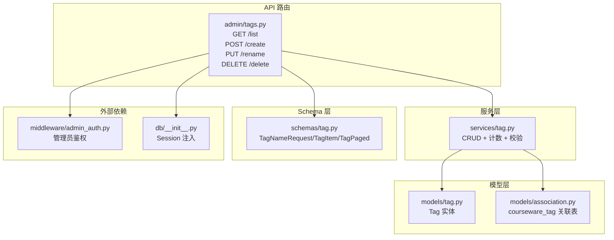
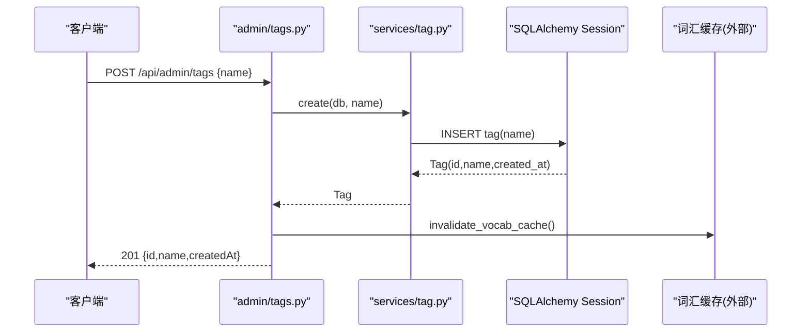
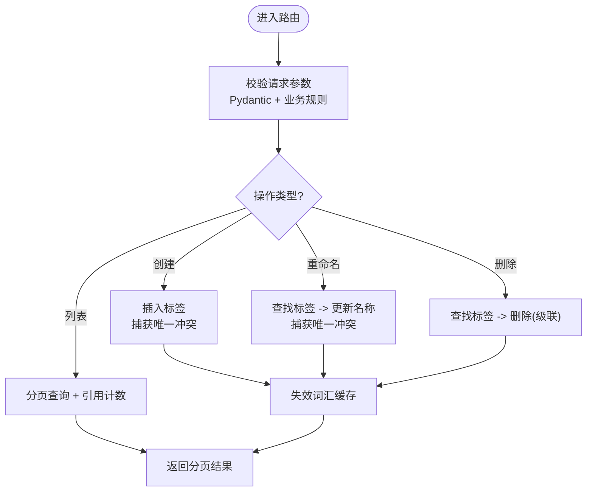
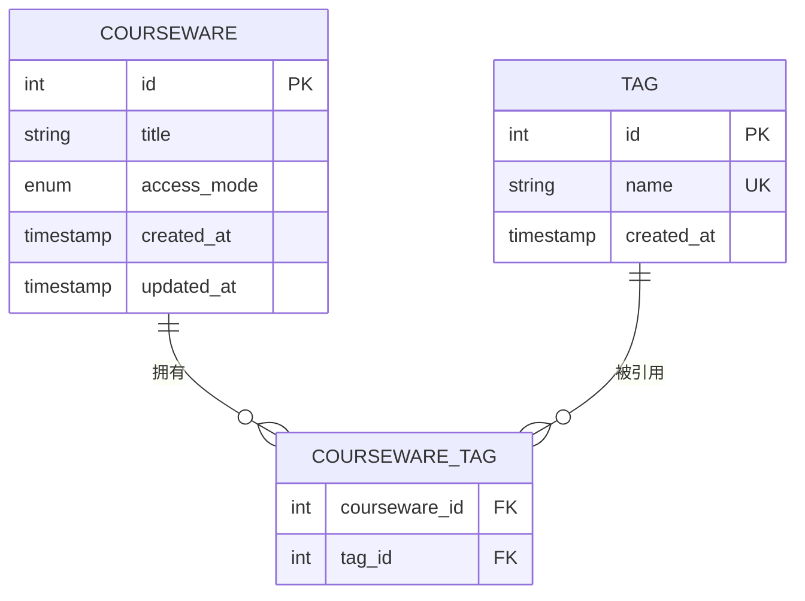
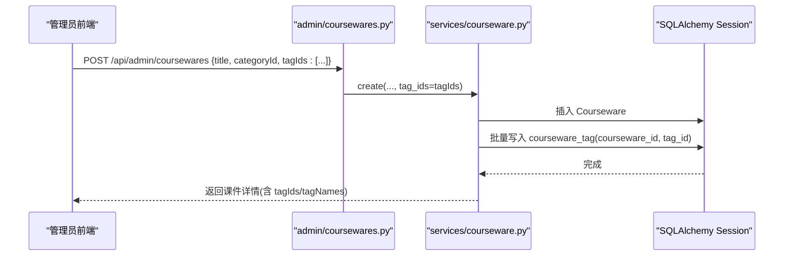
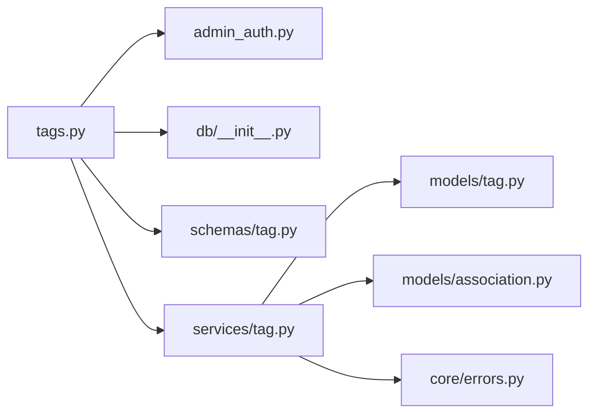

# 标签管理接口

<cite>
**本文引用的文件**   
- [backend/app/api/admin/tags.py](file://backend/app/api/admin/tags.py)
- [backend/app/services/tag.py](file://backend/app/services/tag.py)
- [backend/app/models/tag.py](file://backend/app/models/tag.py)
- [backend/app/models/association.py](file://backend/app/models/association.py)
- [backend/app/schemas/tag.py](file://backend/app/schemas/tag.py)
- [backend/app/core/errors.py](file://backend/app/core/errors.py)
- [backend/app/middleware/admin_auth.py](file://backend/app/middleware/admin_auth.py)
- [backend/app/db/__init__.py](file://backend/app/db/__init__.py)
- [backend/app/api/admin/coursewares.py](file://backend/app/api/admin/coursewares.py)
- [backend/app/services/courseware.py](file://backend/app/services/courseware.py)
- [backend/app/schemas/courseware.py](file://backend/app/schemas/courseware.py)
- [backend/tests/test_tags.py](file://backend/tests/test_tags.py)
</cite>

## 目录
1. [简介](#简介)
2. [项目结构](#项目结构)
3. [核心组件](#核心组件)
4. [架构总览](#架构总览)
5. [详细组件分析](#详细组件分析)
6. [依赖关系分析](#依赖关系分析)
7. [性能与优化](#性能与优化)
8. [故障排查指南](#故障排查指南)
9. [结论](#结论)
10. [附录：API 规范与示例](#附录api-规范与示例)

## 简介
本文件面向“学习枢纽”后台的标签管理能力，提供完整的 API 文档与实现说明。内容覆盖：
- 标签的创建、重命名、删除、分页查询（含关键词搜索）
- 标签与课件的多对多关联管理与批量操作
- 去重策略与错误码约定
- 性能优化建议与最佳实践
- 使用示例与常见问题排查

## 项目结构
标签相关代码位于后端模块中，采用 FastAPI + SQLAlchemy 的分层设计：
- API 路由层：定义 REST 端点与鉴权依赖
- 服务层：封装业务规则、数据访问与异常处理
- 模型层：ORM 实体与 M:N 关联表
- Schema 层：请求/响应校验与序列化
- 测试：Happy path 与边界用例

图表来源
- [backend/app/api/admin/tags.py:1-70](file://backend/app/api/admin/tags.py#L1-L70)
- [backend/app/services/tag.py:1-102](file://backend/app/services/tag.py#L1-L102)
- [backend/app/models/tag.py:1-30](file://backend/app/models/tag.py#L1-L30)
- [backend/app/models/association.py:1-41](file://backend/app/models/association.py#L1-L41)
- [backend/app/schemas/tag.py:1-34](file://backend/app/schemas/tag.py#L1-L34)
- [backend/app/middleware/admin_auth.py](file://backend/app/middleware/admin_auth.py)
- [backend/app/db/__init__.py](file://backend/app/db/__init__.py)

章节来源
- [backend/app/api/admin/tags.py:1-70](file://backend/app/api/admin/tags.py#L1-L70)
- [backend/app/services/tag.py:1-102](file://backend/app/services/tag.py#L1-L102)
- [backend/app/models/tag.py:1-30](file://backend/app/models/tag.py#L1-L30)
- [backend/app/models/association.py:1-41](file://backend/app/models/association.py#L1-L41)
- [backend/app/schemas/tag.py:1-34](file://backend/app/schemas/tag.py#L1-L34)

## 核心组件
- 路由层：提供受管理员鉴权保护的标签管理端点，统一返回信封格式
- 服务层：实现名称校验、唯一性约束、分页查询、引用计数统计、事务提交与回滚
- 模型层：Tag 主表（name 全局唯一），以及 courseware_tag 多对多中间表
- Schema 层：Pydantic 校验与响应结构定义
- 错误体系：BusinessError + ErrorCode 映射到 HTTP 状态码与统一 JSON 信封

章节来源
- [backend/app/api/admin/tags.py:1-70](file://backend/app/api/admin/tags.py#L1-L70)
- [backend/app/services/tag.py:1-102](file://backend/app/services/tag.py#L1-L102)
- [backend/app/models/tag.py:1-30](file://backend/app/models/tag.py#L1-L30)
- [backend/app/models/association.py:1-41](file://backend/app/models/association.py#L1-L41)
- [backend/app/schemas/tag.py:1-34](file://backend/app/schemas/tag.py#L1-L34)
- [backend/app/core/errors.py:1-144](file://backend/app/core/errors.py#L1-L144)

## 架构总览
标签管理的调用链从路由进入服务层，再访问数据库；在创建/更新/删除后触发词表缓存失效，确保检索一致性。

图表来源
- [backend/app/api/admin/tags.py:32-42](file://backend/app/api/admin/tags.py#L32-L42)
- [backend/app/services/tag.py:70-80](file://backend/app/services/tag.py#L70-L80)

## 详细组件分析

### 标签 CRUD 接口
- 列表查询
  - 方法：GET
  - 路径：/api/admin/tags
  - 参数：keyword（可选）、page、size
  - 行为：按 keyword 模糊匹配（不区分大小写），分页返回，并附带每个标签关联的课件数量
  - 成功响应：200，data 为分页对象
- 创建标签
  - 方法：POST
  - 路径：/api/admin/tags
  - 请求体：{ name }
  - 行为：名称去空白、长度校验、唯一性约束；成功后返回 id/name/createdAt
  - 成功响应：201
- 重命名标签
  - 方法：PUT
  - 路径：/api/admin/tags/{tag_id}
  - 请求体：{ name }
  - 行为：先获取标签，再执行名称校验与唯一性检查
  - 成功响应：200
- 删除标签
  - 方法：DELETE
  - 路径：/api/admin/tags/{tag_id}
  - 行为：删除标签记录；由于关联表 ondelete=CASCADE，将级联清理所有绑定
  - 成功响应：200

图表来源
- [backend/app/api/admin/tags.py:21-66](file://backend/app/api/admin/tags.py#L21-L66)
- [backend/app/services/tag.py:24-101](file://backend/app/services/tag.py#L24-L101)

章节来源
- [backend/app/api/admin/tags.py:21-66](file://backend/app/api/admin/tags.py#L21-L66)
- [backend/app/services/tag.py:24-101](file://backend/app/services/tag.py#L24-L101)

### 数据模型与多对多关联
- Tag 实体
  - 字段：id、name（全局唯一）、created_at
- 关联表 courseware_tag
  - 字段：courseware_id、tag_id（复合主键）
  - 外键：ondelete=CASCADE，保证删除标签时自动清理关联
- Courseware 实体
  - 通过 secondary="courseware_tag" 与 Tag 建立多对多关系
  - 支持在创建/更新课件时批量设置 tagIds

图表来源
- [backend/app/models/tag.py:13-26](file://backend/app/models/tag.py#L13-L26)
- [backend/app/models/association.py:9-14](file://backend/app/models/association.py#L9-L14)
- [backend/app/models/courseware.py:51-54](file://backend/app/models/courseware.py#L51-L54)

章节来源
- [backend/app/models/tag.py:13-26](file://backend/app/models/tag.py#L13-L26)
- [backend/app/models/association.py:9-14](file://backend/app/models/association.py#L9-L14)
- [backend/app/models/courseware.py:51-54](file://backend/app/models/courseware.py#L51-L54)

### 标签与课件的批量操作
- 创建课件时批量绑定标签
  - 请求体包含 tagIds 数组
  - 服务端解析并写入多对多关联
- 更新课件时重置标签集合
  - 若传入 tagIds，则以该数组为准完整重写关联
  - 未传则保持原值不变

图表来源
- [backend/app/api/admin/coursewares.py:52-68](file://backend/app/api/admin/coursewares.py#L52-L68)
- [backend/app/services/courseware.py:105-167](file://backend/app/services/courseware.py#L105-L167)
- [backend/app/schemas/courseware.py:22-42](file://backend/app/schemas/courseware.py#L22-L42)

章节来源
- [backend/app/api/admin/coursewares.py:52-68](file://backend/app/api/admin/coursewares.py#L52-L68)
- [backend/app/services/courseware.py:105-167](file://backend/app/services/courseware.py#L105-L167)
- [backend/app/schemas/courseware.py:22-42](file://backend/app/schemas/courseware.py#L22-L42)

### 搜索、去重与性能优化
- 搜索
  - 标签列表支持 keyword 模糊匹配（不区分大小写）
  - 课件列表支持标题/作者/描述模糊匹配，并可按分类子树过滤
- 去重
  - 标签名全局唯一，重复创建或重命名会触发唯一冲突错误
  - 课件 tokenIds 在内部进行去重与无效过滤（参考课件服务）
- 性能
  - 标签列表通过子查询一次性统计引用数，避免 N+1
  - 课件列表使用 selectinload 预加载关联，减少额外查询
  - 删除标签时利用 ondelete=CASCADE 由数据库级联清理，降低应用层负担

章节来源
- [backend/app/services/tag.py:24-60](file://backend/app/services/tag.py#L24-L60)
- [backend/app/services/courseware.py:396-447](file://backend/app/services/courseware.py#L396-L447)
- [backend/app/models/association.py:9-14](file://backend/app/models/association.py#L9-L14)

### 智能推荐（概念性说明）
当前仓库未提供“基于语义的智能标签推荐”接口实现。若需扩展，可考虑：
- 输入：课件标题/描述/素材摘要
- 输出：候选标签列表（按相似度排序）
- 方案：结合向量检索或 LLM 生成候选标签，再由管理员确认入库
- 注意：与现有“词汇缓存失效”机制配合，确保检索一致性

[本节为概念性说明，不涉及具体源码]

## 依赖关系分析
- 路由依赖管理员鉴权中间件
- 路由依赖数据库会话注入
- 服务层依赖模型与错误码
- 关联表依赖外键级联删除

图表来源
- [backend/app/api/admin/tags.py:1-18](file://backend/app/api/admin/tags.py#L1-L18)
- [backend/app/services/tag.py:1-22](file://backend/app/services/tag.py#L1-L22)
- [backend/app/models/tag.py:1-26](file://backend/app/models/tag.py#L1-L26)
- [backend/app/models/association.py:1-14](file://backend/app/models/association.py#L1-L14)
- [backend/app/core/errors.py:1-144](file://backend/app/core/errors.py#L1-L144)

章节来源
- [backend/app/api/admin/tags.py:1-18](file://backend/app/api/admin/tags.py#L1-L18)
- [backend/app/services/tag.py:1-22](file://backend/app/services/tag.py#L1-L22)
- [backend/app/models/tag.py:1-26](file://backend/app/models/tag.py#L1-L26)
- [backend/app/models/association.py:1-14](file://backend/app/models/association.py#L1-L14)
- [backend/app/core/errors.py:1-144](file://backend/app/core/errors.py#L1-L144)

## 性能与优化
- 列表查询
  - 使用子查询聚合引用计数，避免逐条 N+1 查询
  - 分页参数限制 size 上限，防止大页导致内存压力
- 关联写入
  - 批量写入 courseware_tag，减少往返次数
- 删除路径
  - 利用数据库外键 ondelete=CASCADE，简化应用层清理逻辑
- 缓存一致性
  - 标签增删改后主动失效词汇缓存，保障检索结果实时性

章节来源
- [backend/app/services/tag.py:24-60](file://backend/app/services/tag.py#L24-L60)
- [backend/app/models/association.py:9-14](file://backend/app/models/association.py#L9-L14)
- [backend/app/api/admin/tags.py:32-66](file://backend/app/api/admin/tags.py#L32-L66)

## 故障排查指南
- 常见错误码
  - 标签不存在：404
  - 标签名为空或仅空白：400
  - 标签名重复：409
- 定位步骤
  - 检查请求体是否符合 Pydantic 校验（如 name 非空、长度 ≤ 30）
  - 查看是否触发唯一冲突（重复创建或重命名）
  - 确认管理员鉴权是否通过
  - 观察是否触发了词汇缓存失效（影响后续检索）
- 快速验证
  - 使用测试用例流程：创建 → 冲突 → 列表 → 重命名 → 删除 → 再次列表

章节来源
- [backend/app/core/errors.py:40-102](file://backend/app/core/errors.py#L40-L102)
- [backend/tests/test_tags.py:9-52](file://backend/tests/test_tags.py#L9-L52)

## 结论
标签系统以扁平化、全局唯一的名称为核心，提供简洁稳定的 CRUD 能力，并通过多对多中间表与课件解耦。在服务层集中实现业务规则与性能优化，在路由层统一鉴权与响应封装，整体结构清晰、易于扩展。

## 附录：API 规范与示例

### 通用约定
- 鉴权：所有标签接口需要管理员令牌
- 响应信封：统一返回 { code, message, data, requestId } 格式
- 时间字段：ISO 8601 字符串

### 接口清单
- GET /api/admin/tags
  - 查询参数：keyword、page、size
  - 成功：200，data 为分页对象
- POST /api/admin/tags
  - 请求体：{ name }
  - 成功：201，data 包含 id/name/createdAt
- PUT /api/admin/tags/{tag_id}
  - 请求体：{ name }
  - 成功：200，data 包含 id/name/createdAt
- DELETE /api/admin/tags/{tag_id}
  - 成功：200，data 为 null

### 请求/响应数据结构
- 请求体
  - TagNameRequest：name（必填，1..30 字符，自动去除首尾空白）
- 响应体
  - TagItem：id、name、coursewareCount、createdAt
  - TagPaged：page、size、total、items[]

### 使用示例（路径引用）
- 创建标签
  - 参考：[backend/tests/test_tags.py:9-21](file://backend/tests/test_tags.py#L9-L21)
- 列表查询
  - 参考：[backend/tests/test_tags.py:22-28](file://backend/tests/test_tags.py#L22-L28)
- 重命名标签
  - 参考：[backend/tests/test_tags.py:30-33](file://backend/tests/test_tags.py#L30-L33)
- 删除标签
  - 参考：[backend/tests/test_tags.py:35-40](file://backend/tests/test_tags.py#L35-L40)

### 与课件的批量绑定示例（路径引用）
- 创建课件时传入 tagIds
  - 参考：[backend/app/api/admin/coursewares.py:52-68](file://backend/app/api/admin/coursewares.py#L52-L68)
  - 参考：[backend/app/services/courseware.py:105-167](file://backend/app/services/courseware.py#L105-L167)
- 更新课件时重置 tagIds
  - 参考：[backend/app/api/admin/coursewares.py:71-89](file://backend/app/api/admin/coursewares.py#L71-L89)
  - 参考：[backend/app/services/courseware.py:170-210](file://backend/app/services/courseware.py#L170-L210)