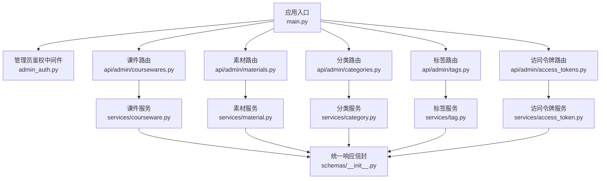
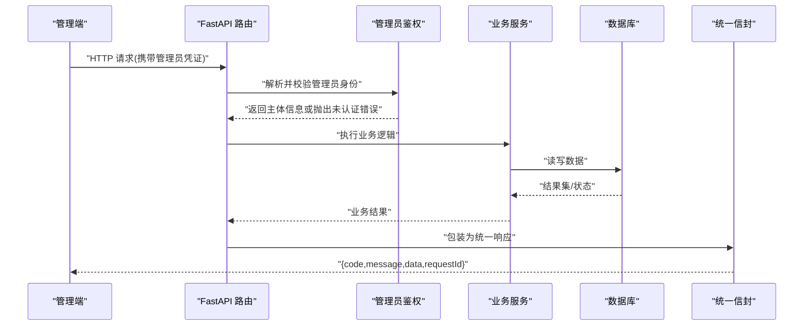
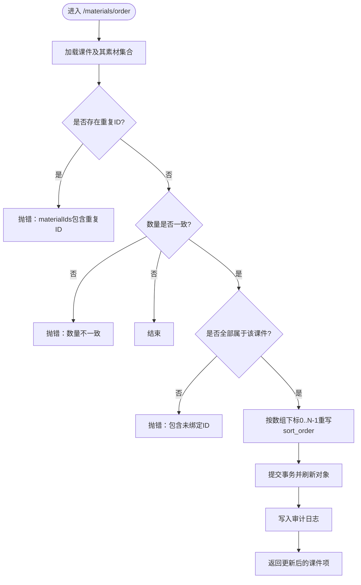
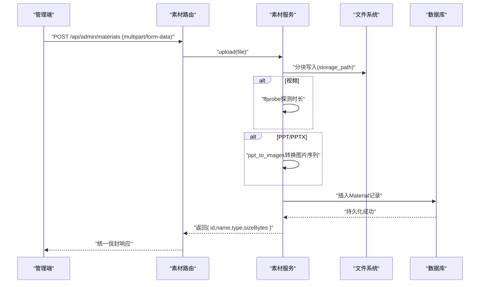
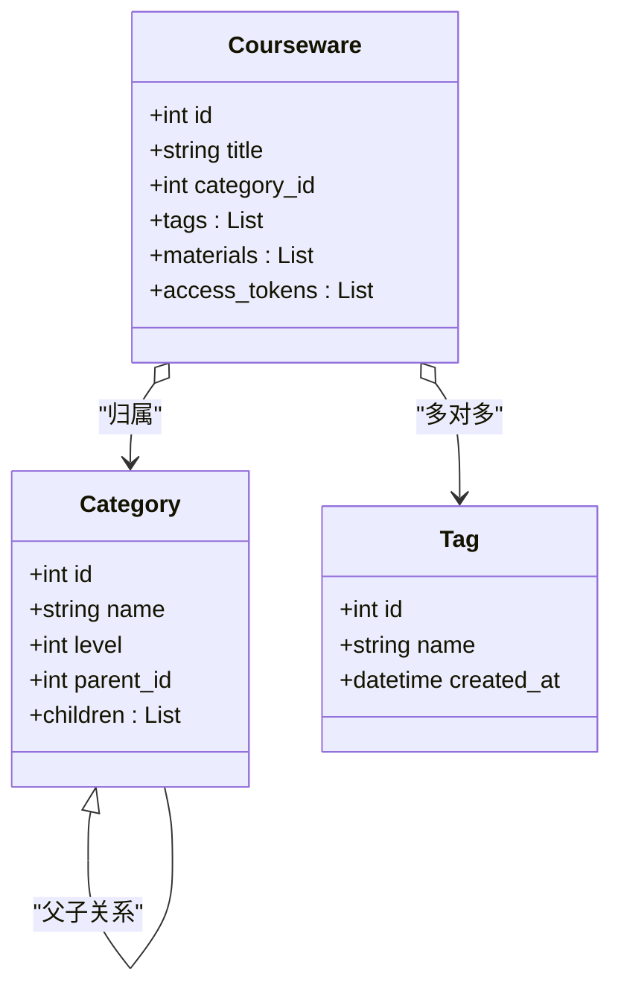
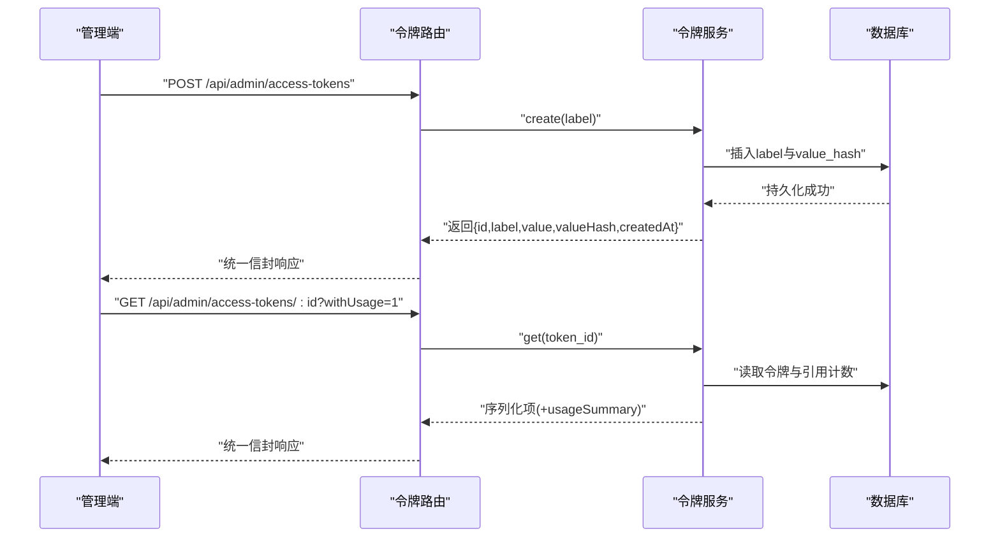
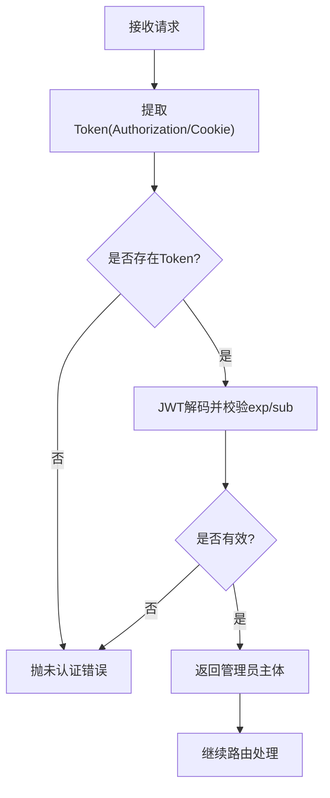
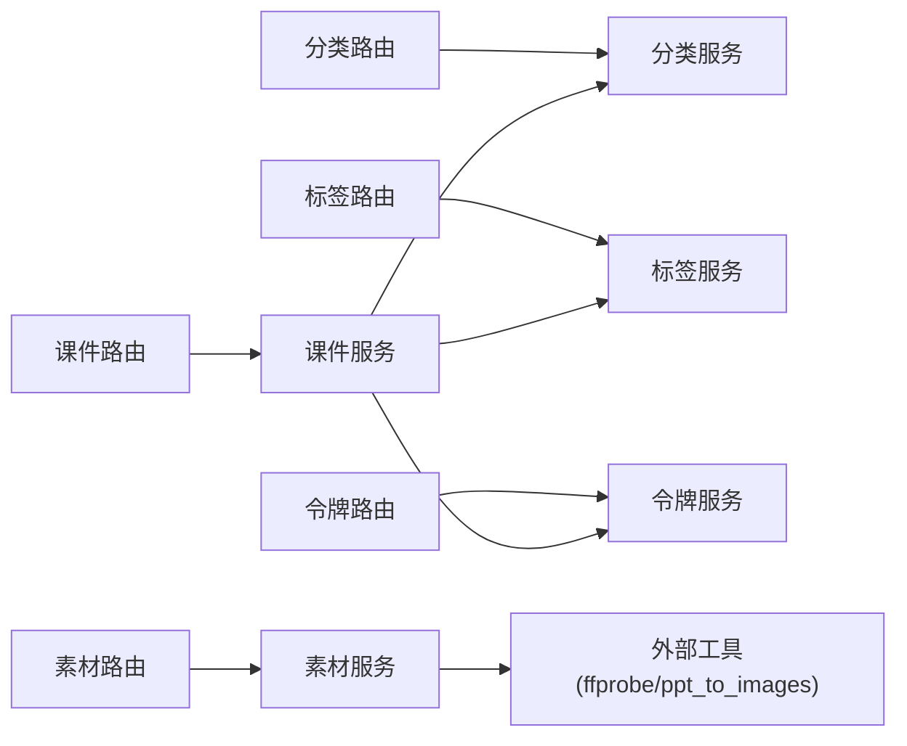

# 管理后台接口

<cite>
**本文引用的文件**
- [backend/app/main.py](file://backend/app/main.py)
- [backend/app/middleware/admin_auth.py](file://backend/app/middleware/admin_auth.py)
- [backend/app/api/admin/coursewares.py](file://backend/app/api/admin/coursewares.py)
- [backend/app/api/admin/materials.py](file://backend/app/api/admin/materials.py)
- [backend/app/api/admin/categories.py](file://backend/app/api/admin/categories.py)
- [backend/app/api/admin/tags.py](file://backend/app/api/admin/tags.py)
- [backend/app/api/admin/access_tokens.py](file://backend/app/api/admin/access_tokens.py)
- [backend/app/services/courseware.py](file://backend/app/services/courseware.py)
- [backend/app/services/material.py](file://backend/app/services/material.py)
- [backend/app/services/category.py](file://backend/app/services/category.py)
- [backend/app/services/tag.py](file://backend/app/services/tag.py)
- [backend/app/services/access_token.py](file://backend/app/services/access_token.py)
- [backend/app/schemas/__init__.py](file://backend/app/schemas/__init__.py)
</cite>

## 目录
1. [简介](#简介)
2. [项目结构](#项目结构)
3. [核心组件](#核心组件)
4. [架构总览](#架构总览)
5. [详细组件分析](#详细组件分析)
6. [依赖关系分析](#依赖关系分析)
7. [性能考虑](#性能考虑)
8. [故障排查指南](#故障排查指南)
9. [结论](#结论)
10. [附录：接口清单与示例](#附录接口清单与示例)

## 简介
本指南面向管理后台接口的开发与集成，覆盖课件、素材、分类、标签、访问令牌等模块的完整实现说明。重点包括：
- 课件管理的 CRUD、批量操作（素材顺序调整）、预览图生成流程
- 素材管理的多格式处理、存储路径策略与下载访问控制
- 分类树形结构与多对多关系（标签）的处理方式
- 访问令牌的生成、校验、使用统计与权限控制机制
- 统一鉴权中间件、错误响应信封与审计记录
- 完整的接口示例、参数验证与错误处理方案

## 项目结构
后端采用 FastAPI 分层架构：路由层（api/admin）→ 服务层（services）→ 数据模型（models）+ 数据库会话（db）。统一响应信封与全局异常处理在入口与应用装配中完成。

图表来源
- [backend/app/main.py:40-112](file://backend/app/main.py#L40-L112)
- [backend/app/middleware/admin_auth.py:1-66](file://backend/app/middleware/admin_auth.py#L1-L66)
- [backend/app/api/admin/coursewares.py:1-115](file://backend/app/api/admin/coursewares.py#L1-L115)
- [backend/app/api/admin/materials.py:1-74](file://backend/app/api/admin/materials.py#L1-L74)
- [backend/app/api/admin/categories.py:1-81](file://backend/app/api/admin/categories.py#L1-L81)
- [backend/app/api/admin/tags.py:1-70](file://backend/app/api/admin/tags.py#L1-L70)
- [backend/app/api/admin/access_tokens.py:1-120](file://backend/app/api/admin/access_tokens.py#L1-L120)
- [backend/app/services/courseware.py:1-492](file://backend/app/services/courseware.py#L1-L492)
- [backend/app/services/material.py:1-234](file://backend/app/services/material.py#L1-L234)
- [backend/app/services/category.py:1-152](file://backend/app/services/category.py#L1-L152)
- [backend/app/services/tag.py:1-102](file://backend/app/services/tag.py#L1-L102)
- [backend/app/services/access_token.py:1-235](file://backend/app/services/access_token.py#L1-L235)
- [backend/app/schemas/__init__.py:1-65](file://backend/app/schemas/__init__.py#L1-L65)

章节来源
- [backend/app/main.py:40-112](file://backend/app/main.py#L40-L112)

## 核心组件
- 统一响应信封：所有成功/失败响应均遵循 {code, message, data, requestId} 结构，便于前端一致处理。
- 管理员鉴权：基于 JWT 或 Cookie 的管理员身份解析；登录签发与管理端点保护。
- 业务服务层：封装各域的业务规则、数据校验、关联关系维护与审计写入。
- 路由层：定义 RESTful 接口，挂载鉴权依赖，调用服务层并返回统一信封。

章节来源
- [backend/app/schemas/__init__.py:1-65](file://backend/app/schemas/__init__.py#L1-L65)
- [backend/app/middleware/admin_auth.py:1-66](file://backend/app/middleware/admin_auth.py#L1-L66)

## 架构总览
管理后台 API 通过统一的中间件进行请求 ID 注入、CORS 配置、限流与全局异常处理；路由按领域划分，全部受管理员鉴权保护；服务层负责业务规则与持久化；统一信封保证前后端契约稳定。

图表来源
- [backend/app/main.py:70-90](file://backend/app/main.py#L70-L90)
- [backend/app/middleware/admin_auth.py:26-42](file://backend/app/middleware/admin_auth.py#L26-L42)
- [backend/app/schemas/__init__.py:24-65](file://backend/app/schemas/__init__.py#L24-L65)

## 详细组件分析

### 课件管理接口（CRUD、批量排序、预览图）
- 列表查询：支持关键词、分类子树过滤、访问模式筛选与分页。
- 详情获取：返回标题、作者、描述、分类、标签、素材、令牌及时间戳。
- 创建/更新：校验标题长度、分类存在性、访问模式合法性；受限模式需至少绑定一个令牌；更新时从受限降级为开放自动清空令牌绑定。
- 删除：级联清理关联表。
- 素材顺序调整：专用接口按传入数组下标重写 sort_order，严格校验重复、数量与归属。
- 预览图生成：上传 PPT/PPTX 后异步转换为图片序列，用于在线浏览。

图表来源
- [backend/app/api/admin/coursewares.py:100-112](file://backend/app/api/admin/coursewares.py#L100-L112)
- [backend/app/services/courseware.py:335-393](file://backend/app/services/courseware.py#L335-L393)

章节来源
- [backend/app/api/admin/coursewares.py:1-115](file://backend/app/api/admin/coursewares.py#L1-L115)
- [backend/app/services/courseware.py:105-278](file://backend/app/services/courseware.py#L105-L278)
- [backend/app/services/courseware.py:335-393](file://backend/app/services/courseware.py#L335-L393)
- [backend/app/services/material.py:174-186](file://backend/app/services/material.py#L174-L186)

### 素材管理接口（多格式、存储路径、访问控制）
- 列表查询：支持关键词与类型过滤，附带引用计数与下载链接。
- 上传：分块写入磁盘，限制最大大小；VIDEO 探测时长；PPT 转换图片序列作为预览。
- 删除：若被课件引用则拒绝；否则物理删除文件与预览目录。
- 下载：根据 MIME 类型返回文件流，缺失文件返回错误。

图表来源
- [backend/app/api/admin/materials.py:35-48](file://backend/app/api/admin/materials.py#L35-L48)
- [backend/app/services/material.py:129-202](file://backend/app/services/material.py#L129-L202)

章节来源
- [backend/app/api/admin/materials.py:1-74](file://backend/app/api/admin/materials.py#L1-L74)
- [backend/app/services/material.py:78-119](file://backend/app/services/material.py#L78-L119)
- [backend/app/services/material.py:129-202](file://backend/app/services/material.py#L129-L202)
- [backend/app/services/material.py:205-231](file://backend/app/services/material.py#L205-L231)

### 分类与标签管理（树形结构、多对多）
- 分类：支持三级树形结构，创建/重命名/删除；删除前检查子节点与课件引用；提供子树 ID 收集用于课件过滤。
- 标签：扁平管理，支持关键词搜索与分页；与课件为多对多关系，列表返回引用计数。

图表来源
- [backend/app/services/category.py:27-42](file://backend/app/services/category.py#L27-L42)
- [backend/app/services/tag.py:24-60](file://backend/app/services/tag.py#L24-L60)
- [backend/app/services/courseware.py:290-332](file://backend/app/services/courseware.py#L290-L332)

章节来源
- [backend/app/api/admin/categories.py:1-81](file://backend/app/api/admin/categories.py#L1-L81)
- [backend/app/services/category.py:52-111](file://backend/app/services/category.py#L52-L111)
- [backend/app/api/admin/tags.py:1-70](file://backend/app/api/admin/tags.py#L1-L70)
- [backend/app/services/tag.py:70-98](file://backend/app/services/tag.py#L70-L98)

### 访问令牌管理（生成、分配、使用统计）
- 创建：标签唯一且非空，返回明文一次；仅存储哈希值。
- 重新生成：替换哈希，旧值立即失效，返回新明文与再生时间。
- 删除：若仍被课件引用或为最后一个 active token 则拒绝。
- 列表/详情：默认不附加使用统计，可选 withUsage 返回总体使用摘要。
- 校验：常量时间比对哈希，防止时序攻击。

图表来源
- [backend/app/api/admin/access_tokens.py:71-102](file://backend/app/api/admin/access_tokens.py#L71-L102)
- [backend/app/services/access_token.py:73-99](file://backend/app/services/access_token.py#L73-L99)
- [backend/app/services/access_token.py:102-119](file://backend/app/services/access_token.py#L102-L119)
- [backend/app/services/access_token.py:122-138](file://backend/app/services/access_token.py#L122-L138)
- [backend/app/services/access_token.py:193-205](file://backend/app/services/access_token.py#L193-L205)

章节来源
- [backend/app/api/admin/access_tokens.py:1-120](file://backend/app/api/admin/access_tokens.py#L1-L120)
- [backend/app/services/access_token.py:1-235](file://backend/app/services/access_token.py#L1-L235)

### 权限控制与审计
- 管理员鉴权：优先 Authorization: Bearer，其次 Cookie LH_ADMIN_SESSION；JWT 解码要求 exp 与 sub；过期或无效返回未认证错误。
- 登录签发：issue_admin_jwt 生成带 TTL 的 JWT；verify_admin_token 用于登录接口的明文 Token 校验。
- 审计：关键写操作（课件创建/更新/删除、素材上传/删除、令牌创建/再生成/删除）均写入审计日志。

图表来源
- [backend/app/middleware/admin_auth.py:16-42](file://backend/app/middleware/admin_auth.py#L16-L42)
- [backend/app/middleware/admin_auth.py:45-62](file://backend/app/middleware/admin_auth.py#L45-L62)

章节来源
- [backend/app/middleware/admin_auth.py:1-66](file://backend/app/middleware/admin_auth.py#L1-L66)
- [backend/app/services/courseware.py:162-167](file://backend/app/services/courseware.py#L162-L167)
- [backend/app/services/courseware.py:273-277](file://backend/app/services/courseware.py#L273-L277)
- [backend/app/services/access_token.py:92-99](file://backend/app/services/access_token.py#L92-99)
- [backend/app/services/access_token.py:110-119](file://backend/app/services/access_token.py#L110-119)

## 依赖关系分析
- 路由与服务解耦：每个领域路由仅依赖对应服务，避免跨域耦合。
- 服务间依赖：课件服务依赖分类、标签、令牌服务以完成关联解析与约束校验。
- 外部工具：素材服务依赖 ffprobe（视频时长）与 ppt_to_images（PPT 转图片），失败不阻断主流程。
- 统一响应与异常：全局异常处理器将 BusinessError 映射到统一信封，限流异常也统一处理。

图表来源
- [backend/app/api/admin/coursewares.py:1-21](file://backend/app/api/admin/coursewares.py#L1-L21)
- [backend/app/api/admin/materials.py:1-20](file://backend/app/api/admin/materials.py#L1-L20)
- [backend/app/api/admin/categories.py:1-20](file://backend/app/api/admin/categories.py#L1-L20)
- [backend/app/api/admin/tags.py:1-18](file://backend/app/api/admin/tags.py#L1-L18)
- [backend/app/api/admin/access_tokens.py:1-25](file://backend/app/api/admin/access_tokens.py#L1-L25)
- [backend/app/services/courseware.py:19-26](file://backend/app/services/courseware.py#L19-L26)
- [backend/app/services/material.py:22-26](file://backend/app/services/material.py#L22-L26)

章节来源
- [backend/app/main.py:91-102](file://backend/app/main.py#L91-L102)

## 性能考虑
- 列表查询优化：使用 selectinload 预加载关联，避免 N+1；子树过滤通过 collect_subtree_ids 一次性计算后代 ID。
- 大文件上传：分块写入与大小限制，避免内存溢出；失败时清理半文件与预览目录。
- 外部工具容错：ffprobe 与 PPT 转换失败不影响上传主流程，仅记录警告。
- 可选统计：令牌详情 withUsage 仅在需要时计算，避免列表页额外开销。

[本节为通用指导，无需源码引用]

## 故障排查指南
- 未认证/会话过期：检查 Authorization 或 Cookie 是否正确传递；确认 JWT 密钥与算法配置。
- 素材文件丢失：下载接口检测到 storage_path 不存在时返回“素材文件已丢失”，请检查存储卷挂载与权限。
- 令牌删除失败：若仍有课件引用或为最后一个 active token，会拒绝删除；请先解除引用或保留至少一个令牌。
- 分类删除失败：存在子分类或被课件引用时无法删除；先迁移或删除相关数据。
- 限流触发：频繁操作会被限流，稍后再试；关注响应码 429 与统一信封中的 code。

章节来源
- [backend/app/middleware/admin_auth.py:26-42](file://backend/app/middleware/admin_auth.py#L26-L42)
- [backend/app/api/admin/materials.py:57-70](file://backend/app/api/admin/materials.py#L57-L70)
- [backend/app/services/access_token.py:122-138](file://backend/app/services/access_token.py#L122-L138)
- [backend/app/services/category.py:91-111](file://backend/app/services/category.py#L91-L111)
- [backend/app/main.py:84-89](file://backend/app/main.py#L84-L89)

## 结论
管理后台接口通过清晰的分层与统一契约，实现了课件、素材、分类、标签与访问令牌的完整管理能力。鉴权、审计与错误处理贯穿全流程，确保安全性与可观测性。建议在生产环境完善存储与外部工具的健壮性监控，并对敏感操作加强审计与告警。

[本节为总结，无需源码引用]

## 附录：接口清单与示例

### 课件管理
- GET /api/admin/coursewares
  - 查询参数：keyword、categoryId、accessMode、page、size
  - 返回：分页元数据与 items
- GET /api/admin/coursewares/{courseware_id}
  - 返回：课件详情（含素材列表与下载/流式地址）
- POST /api/admin/coursewares
  - 请求体：title、categoryId、author、description、accessMode、tagIds、materialIds、tokenIds
  - 返回：新建课件详情
- PUT /api/admin/coursewares/{courseware_id}
  - 请求体：同上字段按需更新
  - 返回：更新后课件详情
- DELETE /api/admin/coursewares/{courseware_id}
  - 返回：成功
- PUT /api/admin/coursewares/{courseware_id}/materials/order
  - 请求体：materialIds（数组，严格校验）
  - 返回：更新后课件详情

章节来源
- [backend/app/api/admin/coursewares.py:24-112](file://backend/app/api/admin/coursewares.py#L24-L112)
- [backend/app/services/courseware.py:290-332](file://backend/app/services/courseware.py#L290-L332)

### 素材管理
- GET /api/admin/materials
  - 查询参数：keyword、type、page、size
  - 返回：分页元数据与 items（含 downloadUrl）
- POST /api/admin/materials
  - 表单字段：file（multipart/form-data）
  - 返回：{ id, name, type, sizeBytes }
- DELETE /api/admin/materials/{material_id}
  - 返回：成功
- GET /api/admin/materials/{material_id}/file
  - 返回：文件流（MIME 类型由文件名推断）

章节来源
- [backend/app/api/admin/materials.py:23-70](file://backend/app/api/admin/materials.py#L23-L70)
- [backend/app/services/material.py:78-119](file://backend/app/services/material.py#L78-L119)
- [backend/app/services/material.py:129-202](file://backend/app/services/material.py#L129-L202)
- [backend/app/services/material.py:205-231](file://backend/app/services/material.py#L205-L231)

### 分类管理
- GET /api/admin/categories
  - 返回：三级树形结构
- POST /api/admin/categories
  - 请求体：name、parentId（可选）
  - 返回：{ id, parentId, level, name }
- PUT /api/admin/categories/{category_id}
  - 请求体：name
  - 返回：{ id, parentId, level, name }
- DELETE /api/admin/categories/{category_id}
  - 返回：成功

章节来源
- [backend/app/api/admin/categories.py:33-77](file://backend/app/api/admin/categories.py#L33-L77)
- [backend/app/services/category.py:27-42](file://backend/app/services/category.py#L27-L42)
- [backend/app/services/category.py:52-111](file://backend/app/services/category.py#L52-L111)

### 标签管理
- GET /api/admin/tags
  - 查询参数：keyword、page、size
  - 返回：分页元数据与 items（含 coursewareCount）
- POST /api/admin/tags
  - 请求体：name
  - 返回：{ id, name, createdAt }
- PUT /api/admin/tags/{tag_id}
  - 请求体：name
  - 返回：{ id, name, createdAt }
- DELETE /api/admin/tags/{tag_id}
  - 返回：成功

章节来源
- [backend/app/api/admin/tags.py:21-66](file://backend/app/api/admin/tags.py#L21-L66)
- [backend/app/services/tag.py:24-60](file://backend/app/services/tag.py#L24-L60)
- [backend/app/services/tag.py:70-98](file://backend/app/services/tag.py#L70-L98)

### 访问令牌管理
- GET /api/admin/access-tokens
  - 查询参数：keyword、page、size
  - 返回：分页元数据与 items（仅 valueHash）
- POST /api/admin/access-tokens
  - 请求体：label
  - 返回：{ id, label, value, valueHash, createdAt }
- GET /api/admin/access-tokens/{token_id}?withUsage=1
  - 返回：令牌详情（可选 usageSummary）
- POST /api/admin/access-tokens/{token_id}/regenerate
  - 返回：{ id, label, value, valueHash, regeneratedAt }
- DELETE /api/admin/access-tokens/{token_id}
  - 返回：成功

章节来源
- [backend/app/api/admin/access_tokens.py:60-116](file://backend/app/api/admin/access_tokens.py#L60-L116)
- [backend/app/services/access_token.py:73-99](file://backend/app/services/access_token.py#L73-L99)
- [backend/app/services/access_token.py:102-119](file://backend/app/services/access_token.py#L102-L119)
- [backend/app/services/access_token.py:122-138](file://backend/app/services/access_token.py#L122-L138)

### 统一响应与错误处理
- 成功响应：{ code:"ok", message:"ok", data, requestId }
- 失败响应：{ code, message, data, requestId }
- 常见错误：未认证、资源不存在、业务规则冲突、文件上传失败、限流等

章节来源
- [backend/app/schemas/__init__.py:24-65](file://backend/app/schemas/__init__.py#L24-L65)
- [backend/app/main.py:78-89](file://backend/app/main.py#L78-L89)