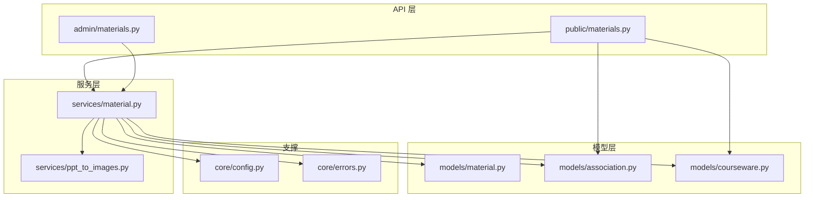
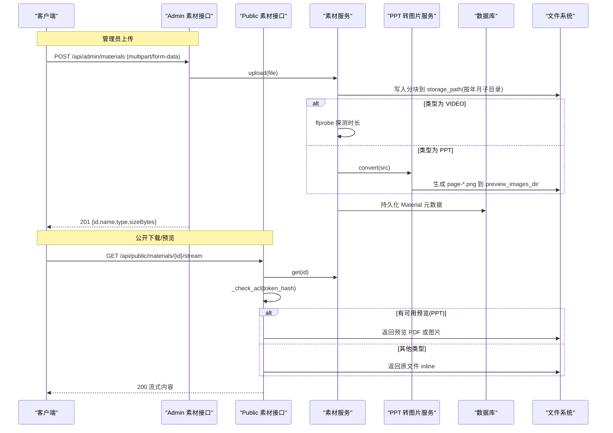
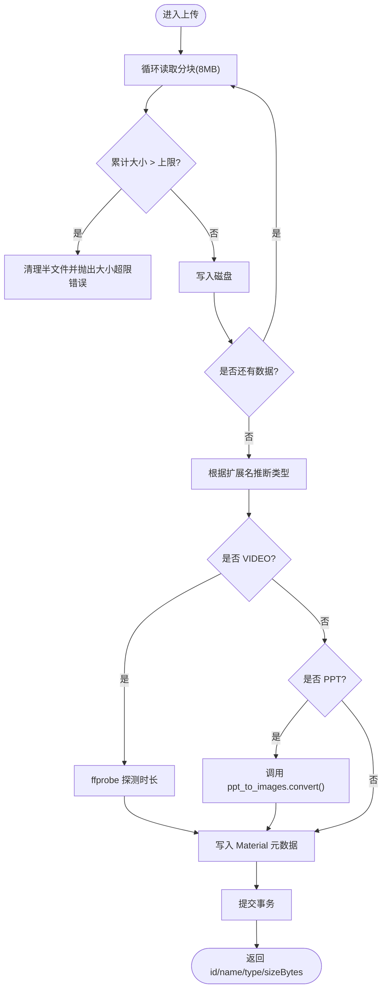
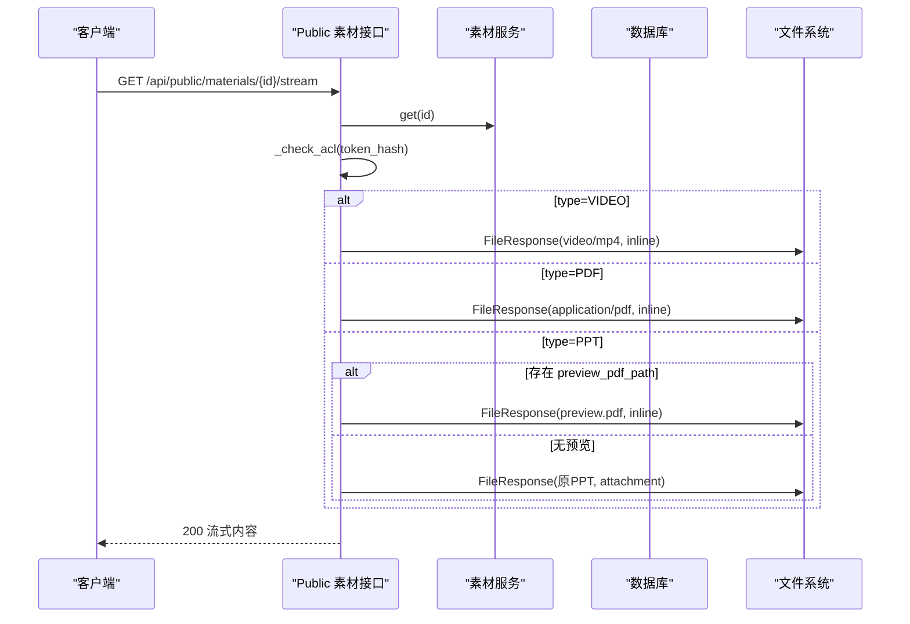
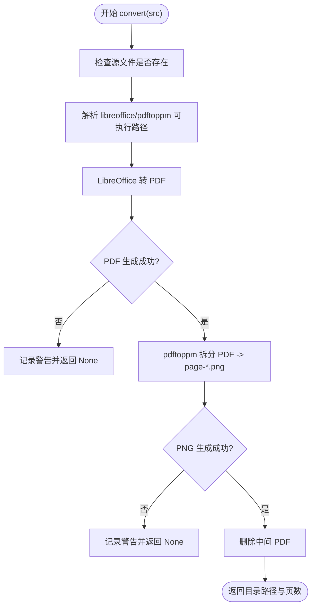
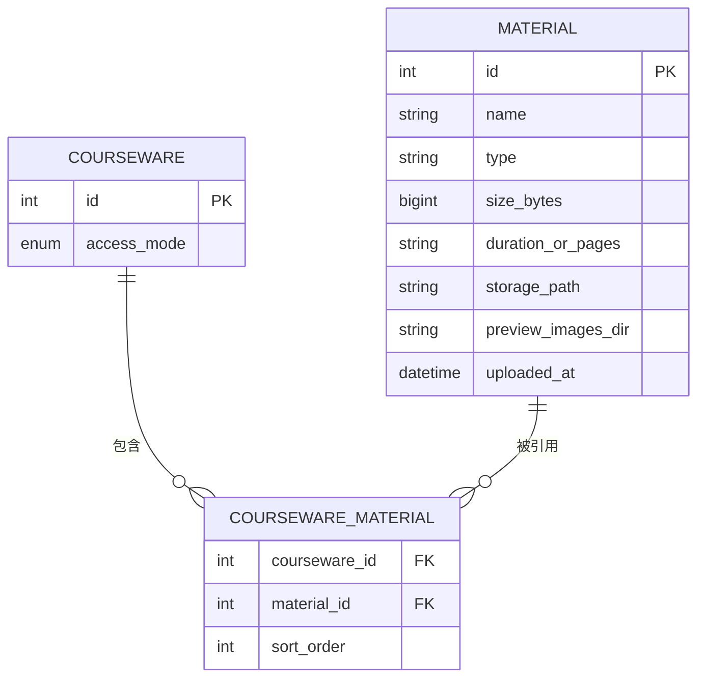
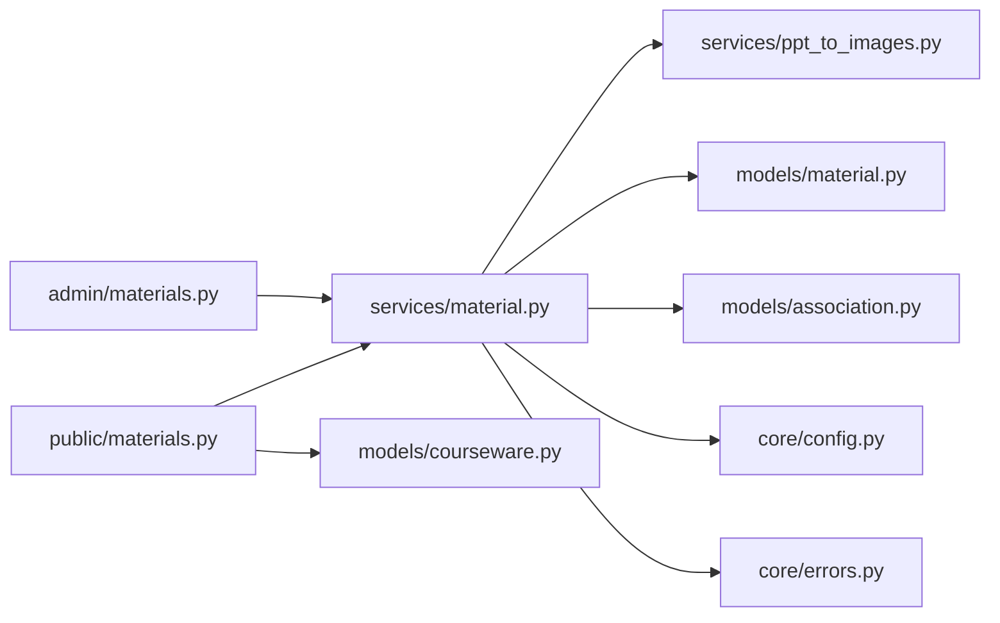

# 素材管理接口

<cite>
**本文引用的文件**   
- [backend/app/api/public/materials.py](file://backend/app/api/public/materials.py)
- [backend/app/api/admin/materials.py](file://backend/app/api/admin/materials.py)
- [backend/app/services/material.py](file://backend/app/services/material.py)
- [backend/app/services/ppt_to_images.py](file://backend/app/services/ppt_to_images.py)
- [backend/app/models/material.py](file://backend/app/models/material.py)
- [backend/app/models/association.py](file://backend/app/models/association.py)
- [backend/app/models/courseware.py](file://backend/app/models/courseware.py)
- [backend/app/core/errors.py](file://backend/app/core/errors.py)
- [backend/app/core/config.py](file://backend/app/core/config.py)
- [backend/tests/test_materials.py](file://backend/tests/test_materials.py)
</cite>

## 目录
1. [简介](#简介)
2. [项目结构](#项目结构)
3. [核心组件](#核心组件)
4. [架构总览](#架构总览)
5. [详细组件分析](#详细组件分析)
6. [依赖关系分析](#依赖关系分析)
7. [性能与优化建议](#性能与优化建议)
8. [故障排查指南](#故障排查指南)
9. [结论](#结论)
10. [附录：API 规范](#附录api-规范)

## 简介
本文件面向“素材管理”相关的前后端开发者，系统化梳理多媒体素材（视频、PDF、PPT/PPTX）的上传、下载、预览与管理能力，覆盖以下要点：
- 文件存储路径管理与命名策略
- 预览图生成机制（PPT→PDF→PNG 多页图片）
- 素材分类关联与元数据管理（类型推断、时长/页数、引用计数）
- 完整的文件上传接口规范（大文件处理、格式校验、错误恢复）
- 公开访问控制（令牌解锁、流式预览、分页图片）
- 实际调用示例与性能优化建议

## 项目结构
与素材管理相关的后端代码主要分布在如下模块：
- API 层：公共接口与管理员接口分别位于 public 与 admin 路由
- 服务层：素材业务逻辑（列表、上传、删除）、PPT 转图片转换服务
- 模型层：素材实体、课件与素材的 M:N 关联表、课件访问模式
- 配置与错误：统一配置加载、业务错误码映射

图表来源
- [backend/app/api/public/materials.py:1-224](file://backend/app/api/public/materials.py#L1-L224)
- [backend/app/api/admin/materials.py:1-74](file://backend/app/api/admin/materials.py#L1-L74)
- [backend/app/services/material.py:1-234](file://backend/app/services/material.py#L1-L234)
- [backend/app/services/ppt_to_images.py:1-185](file://backend/app/services/ppt_to_images.py#L1-L185)
- [backend/app/models/material.py:1-69](file://backend/app/models/material.py#L1-L69)
- [backend/app/models/association.py:1-41](file://backend/app/models/association.py#L1-L41)
- [backend/app/models/courseware.py:1-74](file://backend/app/models/courseware.py#L1-L74)
- [backend/app/core/config.py:1-88](file://backend/app/core/config.py#L1-L88)
- [backend/app/core/errors.py:1-144](file://backend/app/core/errors.py#L1-L144)

章节来源
- [backend/app/main.py:1-116](file://backend/app/main.py#L1-L116)

## 核心组件
- 公共素材接口：提供下载、流式预览、单张预览图、单条查询等能力，并基于课件访问模式进行令牌校验。
- 管理素材接口：提供素材列表、上传、删除、管理端下载等能力，需管理员鉴权。
- 素材服务：实现分页列表、上传流程（含大小限制、类型推断、时长探测、PPT 预览图生成）、删除（含引用检查与物理清理）。
- PPT 转图片服务：通过 LibreOffice 将 PPT/PPTX 转为 PDF，再用 pdftoppm 拆分为多页 PNG，输出到独立目录。
- 数据模型：Material 记录文件名、类型、大小、时长或页数、存储路径、预览图片目录；关联表维护课件与素材的多对多关系及排序。
- 配置与错误：集中读取环境变量（如 storage_path、libreoffice_path、poppler_path、ppt_convert_timeout），并提供统一的业务错误码与 HTTP 状态映射。

章节来源
- [backend/app/api/public/materials.py:1-224](file://backend/app/api/public/materials.py#L1-L224)
- [backend/app/api/admin/materials.py:1-74](file://backend/app/api/admin/materials.py#L1-L74)
- [backend/app/services/material.py:1-234](file://backend/app/services/material.py#L1-L234)
- [backend/app/services/ppt_to_images.py:1-185](file://backend/app/services/ppt_to_images.py#L1-L185)
- [backend/app/models/material.py:1-69](file://backend/app/models/material.py#L1-L69)
- [backend/app/models/association.py:1-41](file://backend/app/models/association.py#L1-L41)
- [backend/app/models/courseware.py:1-74](file://backend/app/models/courseware.py#L1-L74)
- [backend/app/core/config.py:1-88](file://backend/app/core/config.py#L1-L88)
- [backend/app/core/errors.py:1-144](file://backend/app/core/errors.py#L1-L144)

## 架构总览
下图展示了从客户端请求到最终返回的端到端流程，包括鉴权、ACL 校验、文件读写、外部工具调用与数据库操作。

图表来源
- [backend/app/api/admin/materials.py:35-48](file://backend/app/api/admin/materials.py#L35-L48)
- [backend/app/services/material.py:129-202](file://backend/app/services/material.py#L129-L202)
- [backend/app/services/ppt_to_images.py:48-181](file://backend/app/services/ppt_to_images.py#L48-L181)
- [backend/app/api/public/materials.py:84-146](file://backend/app/api/public/materials.py#L84-L146)
- [backend/app/models/material.py:44-62](file://backend/app/models/material.py#L44-L62)

## 详细组件分析

### 管理端素材接口
- 列表查询：支持关键词、类型过滤、分页；返回引用计数标记与下载链接。
- 上传：接收 multipart/form-data 中的 file 字段，自动推断类型、校验大小、落盘、写库；VIDEO 探测时长，PPT 触发预览图生成。
- 删除：若被课件引用则拒绝；否则删除数据库记录并清理物理文件与预览目录。
- 管理端下载：以 attachment 方式返回原文件。

图表来源
- [backend/app/api/admin/materials.py:35-48](file://backend/app/api/admin/materials.py#L35-L48)
- [backend/app/services/material.py:129-202](file://backend/app/services/material.py#L129-L202)
- [backend/app/services/ppt_to_images.py:48-181](file://backend/app/services/ppt_to_images.py#L48-L181)

章节来源
- [backend/app/api/admin/materials.py:23-70](file://backend/app/api/admin/materials.py#L23-L70)
- [backend/app/services/material.py:78-202](file://backend/app/services/material.py#L78-L202)
- [backend/tests/test_materials.py:11-91](file://backend/tests/test_materials.py#L11-L91)

### 公共素材接口
- 下载：attachment 方式返回原文件，先做 ACL 校验。
- 流式预览：inline 方式返回内容；VIDEO/PDF 直接返回原文件；PPT 优先返回已生成的预览 PDF，否则降级为原 PPT 并以 attachment 返回。
- 单张预览图：仅 PPT 且存在预览图片目录时可用，按 page-NN.png 排序后按 1-indexed 取第 N 张。
- 单条查询：返回 streamUrl/downloadUrl/sizeBytes/duration，PPT 额外返回 imageCount/imageUrls/previewReady。

图表来源
- [backend/app/api/public/materials.py:84-146](file://backend/app/api/public/materials.py#L84-L146)
- [backend/app/api/public/materials.py:149-180](file://backend/app/api/public/materials.py#L149-L180)
- [backend/app/api/public/materials.py:183-221](file://backend/app/api/public/materials.py#L183-L221)
- [backend/app/models/material.py:44-62](file://backend/app/models/material.py#L44-L62)

章节来源
- [backend/app/api/public/materials.py:64-221](file://backend/app/api/public/materials.py#L64-L221)
- [backend/app/models/courseware.py:14-18](file://backend/app/models/courseware.py#L14-L18)
- [backend/app/models/association.py:16-26](file://backend/app/models/association.py#L16-L26)

### PPT 预览图生成机制
- 步骤一：使用 LibreOffice 将 PPT/PPTX 转换为 PDF（headless 模式）。
- 步骤二：使用 pdftoppm 将 PDF 每页导出为 PNG（分辨率 150dpi），命名为 page-1.png、page-2.png …
- 输出目录：与源文件同级，目录名为 <stem>；中间产物 slides.pdf 会被清理，只保留 PNG。
- 失败容忍：任一阶段失败均记录日志并返回 None，不阻断上传流程。

图表来源
- [backend/app/services/ppt_to_images.py:48-181](file://backend/app/services/ppt_to_images.py#L48-L181)

章节来源
- [backend/app/services/ppt_to_images.py:1-185](file://backend/app/services/ppt_to_images.py#L1-L185)

### 数据模型与关联
- Material：记录素材名称、类型、大小、时长或页数、存储路径、预览图片目录、上传时间。
- courseware_material：课件与素材的多对多关联，包含 sort_order 用于学习路径顺序。
- AccessMode：课件访问模式 OPEN/RESTRICTED，影响公开接口的令牌校验。

图表来源
- [backend/app/models/material.py:44-62](file://backend/app/models/material.py#L44-L62)
- [backend/app/models/association.py:16-26](file://backend/app/models/association.py#L16-L26)
- [backend/app/models/courseware.py:21-47](file://backend/app/models/courseware.py#L21-L47)

章节来源
- [backend/app/models/material.py:1-69](file://backend/app/models/material.py#L1-L69)
- [backend/app/models/association.py:1-41](file://backend/app/models/association.py#L1-L41)
- [backend/app/models/courseware.py:1-74](file://backend/app/models/courseware.py#L1-L74)

## 依赖关系分析
- API 层依赖服务层完成具体业务；服务层依赖模型层进行数据持久化与查询；PPT 转换服务依赖外部二进制工具。
- 公共接口在返回前会读取课件访问模式与令牌哈希集合，进行细粒度 ACL 校验。
- 错误码集中定义，HTTP 状态由全局异常处理器统一封装。

图表来源
- [backend/app/api/admin/materials.py:1-74](file://backend/app/api/admin/materials.py#L1-L74)
- [backend/app/api/public/materials.py:1-224](file://backend/app/api/public/materials.py#L1-L224)
- [backend/app/services/material.py:1-234](file://backend/app/services/material.py#L1-L234)
- [backend/app/services/ppt_to_images.py:1-185](file://backend/app/services/ppt_to_images.py#L1-L185)
- [backend/app/models/material.py:1-69](file://backend/app/models/material.py#L1-L69)
- [backend/app/models/association.py:1-41](file://backend/app/models/association.py#L1-L41)
- [backend/app/models/courseware.py:1-74](file://backend/app/models/courseware.py#L1-L74)
- [backend/app/core/config.py:1-88](file://backend/app/core/config.py#L1-L88)
- [backend/app/core/errors.py:1-144](file://backend/app/core/errors.py#L1-L144)

章节来源
- [backend/app/core/errors.py:9-127](file://backend/app/core/errors.py#L9-L127)

## 性能与优化建议
- 上传分块写入：采用固定分块大小（8MB）逐块写入，避免一次性读入内存导致 OOM。
- 大小限制：服务端限流与前端/Nginx 的 client_max_body_size 保持一致，防止超大文件占用带宽与磁盘。
- 时长探测：对 VIDEO 使用 ffprobe 异步探测，失败不影响上传主流程。
- PPT 预览图：
  - 合理设置 ppt_convert_timeout，避免长时间阻塞。
  - 建议在部署环境预装 LibreOffice 与 Poppler-utils，并通过环境变量指定绝对路径提升稳定性。
  - 对于大型 PPT，考虑后台任务队列（如 Celery/RQ）异步转换，避免同步等待。
- 流式响应：公共接口使用 FileResponse 流式返回，减少内存占用。
- 缓存与 CDN：静态资源（预览图片、PDF）可通过对象存储与 CDN 加速分发。
- 索引与查询：courseware_material 已建立复合索引，提高按课件有序获取素材的性能。

[本节为通用指导，无需特定文件来源]

## 故障排查指南
- 上传失败（大小超限）：检查 MAX_SIZE_BYTES 与 Nginx client_max_body_size 是否一致；确认磁盘空间与权限。
- 不支持的文件类型：确保扩展名为 mp4/pdf/ppt/pptx；前端应做前置校验。
- PPT 预览图未生成：
  - 检查系统是否安装 LibreOffice 与 pdftoppm，路径是否正确。
  - 查看日志中关于转换失败的警告信息。
  - 确认超时配置 ppt_convert_timeout 是否足够。
- 公开预览被拒（令牌无效）：
  - 确认请求头 X-Token-Hash 或 Cookie lh_token_hash 是否携带有效令牌。
  - 检查课件是否为 RESTRICTED 模式且令牌哈希是否在允许集合中。
- 文件丢失：当 storage_path 指向的文件不存在时，接口返回“素材文件已丢失”，需检查存储卷挂载与备份恢复。

章节来源
- [backend/app/services/material.py:129-202](file://backend/app/services/material.py#L129-L202)
- [backend/app/services/ppt_to_images.py:69-181](file://backend/app/services/ppt_to_images.py#L69-L181)
- [backend/app/api/public/materials.py:31-61](file://backend/app/api/public/materials.py#L31-L61)
- [backend/app/core/errors.py:9-127](file://backend/app/core/errors.py#L9-L127)

## 结论
本素材管理系统围绕“安全可控、可扩展、易维护”的目标设计：
- 通过统一的服务层抽象，屏蔽上传、转换、存储细节，便于后续扩展新格式。
- 公共接口具备完善的 ACL 校验与流式响应，兼顾安全性与性能。
- 对外部工具的调用采用失败容忍策略，保证主流程稳定。
- 通过配置与环境变量灵活调整行为，适配不同部署环境。

[本节为总结性内容，无需特定文件来源]

## 附录：API 规范

### 管理端素材接口
- 列表素材
  - 方法：GET
  - 路径：/api/admin/materials
  - 查询参数：
    - keyword: 可选，模糊匹配文件名
    - type: 可选，枚举值 VIDEO/PDF/PPT
    - page: 页码，默认 1
    - size: 每页数量，默认 20，最大 200
  - 鉴权：管理员令牌
  - 响应体：分页结果，包含 items 数组（每项含 id/name/type/sizeBytes/duration/uploadedAt/referenced/downloadUrl）

- 上传素材
  - 方法：POST
  - 路径：/api/admin/materials
  - 请求体：multipart/form-data，字段 file
  - 支持类型：mp4/pdf/ppt/pptx
  - 大小限制：服务端与 Nginx 共同限制（参见配置与服务端常量）
  - 响应体：{id, name, type, sizeBytes}

- 删除素材
  - 方法：DELETE
  - 路径：/api/admin/materials/{material_id}
  - 约束：未被课件引用方可删除
  - 响应体：空数据

- 管理端下载
  - 方法：GET
  - 路径：/api/admin/materials/{material_id}/file
  - 响应：attachment 形式返回原文件

章节来源
- [backend/app/api/admin/materials.py:23-70](file://backend/app/api/admin/materials.py#L23-L70)
- [backend/app/services/material.py:78-202](file://backend/app/services/material.py#L78-L202)

### 公共素材接口
- 下载素材
  - 方法：GET
  - 路径：/api/public/materials/{material_id}/file
  - 鉴权：若素材仅出现在 RESTRICTED 课件中，需提供 X-Token-Hash 或 lh_token_hash
  - 响应：attachment 形式返回原文件

- 流式预览
  - 方法：GET
  - 路径：/api/public/materials/{material_id}/stream
  - 行为：
    - VIDEO：video/mp4 + inline
    - PDF：application/pdf + inline
    - PPT：优先返回预览 PDF（inline），否则降级返回原 PPT（attachment）
  - 限流：每分钟 60 次

- 单张预览图
  - 方法：GET
  - 路径：/api/public/materials/{material_id}/image/{page_no}
  - 条件：仅 PPT 且存在 preview_images_dir
  - 规则：page_no 从 1 开始，越界返回 404
  - 限流：每分钟 60 次

- 单条查询
  - 方法：GET
  - 路径：/api/public/materials/{material_id}
  - 响应体：
    - 通用字段：id/name/type/sizeBytes/duration/streamUrl/downloadUrl
    - PPT 专属：imageCount/imageUrls/previewReady

章节来源
- [backend/app/api/public/materials.py:64-221](file://backend/app/api/public/materials.py#L64-L221)
- [backend/app/models/courseware.py:14-18](file://backend/app/models/courseware.py#L14-L18)
- [backend/app/models/association.py:16-26](file://backend/app/models/association.py#L16-L26)

### 错误码与状态码
- 素材相关错误码：
  - material_not_found：404
  - material_extension_invalid：400
  - material_size_exceeded：413
  - material_storage_unavailable：500
  - material_referenced：422
  - material_upload_failed：500
- 课件相关错误码（与素材访问控制相关）：
  - courseware_acl_locked：403

章节来源
- [backend/app/core/errors.py:45-127](file://backend/app/core/errors.py#L45-L127)

### 配置项（与素材相关）
- storage_path：文件存储根目录
- libreoffice_path：LibreOffice 可执行路径
- poppler_path：pdftoppm 可执行路径
- ppt_convert_timeout：PPT 转换超时秒数

章节来源
- [backend/app/core/config.py:54-60](file://backend/app/core/config.py#L54-L60)

### 实际调用示例（来自测试）
- 上传 PDF：POST /api/admin/materials，返回 type=PDF，sizeBytes>0
- 上传 PPT：POST /api/admin/materials，返回 type=PPT，sizeBytes>0（转换可能失败但不阻塞）
- 拒绝未知扩展名：返回 code=material_extension_invalid
- 列表与过滤：GET /api/admin/materials?type=PDF，验证返回类型一致
- 删除未引用素材：DELETE /api/admin/materials/{id}，返回 200

章节来源
- [backend/tests/test_materials.py:11-91](file://backend/tests/test_materials.py#L11-L91)