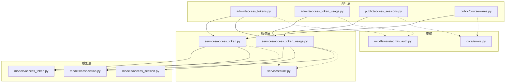
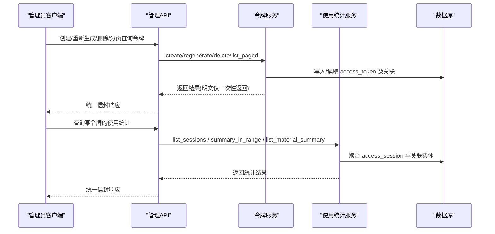
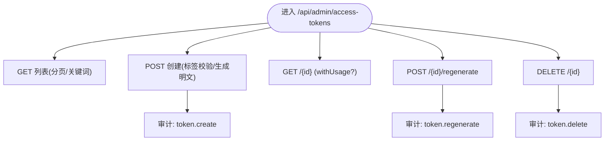
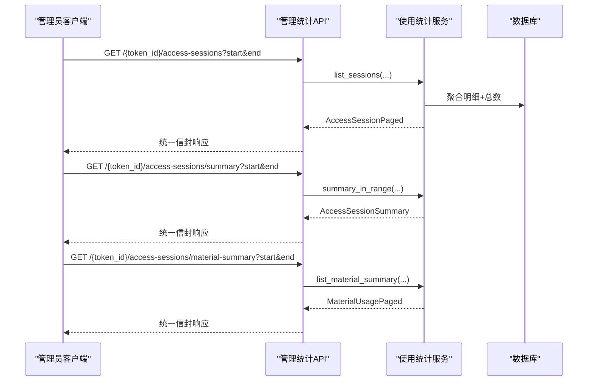
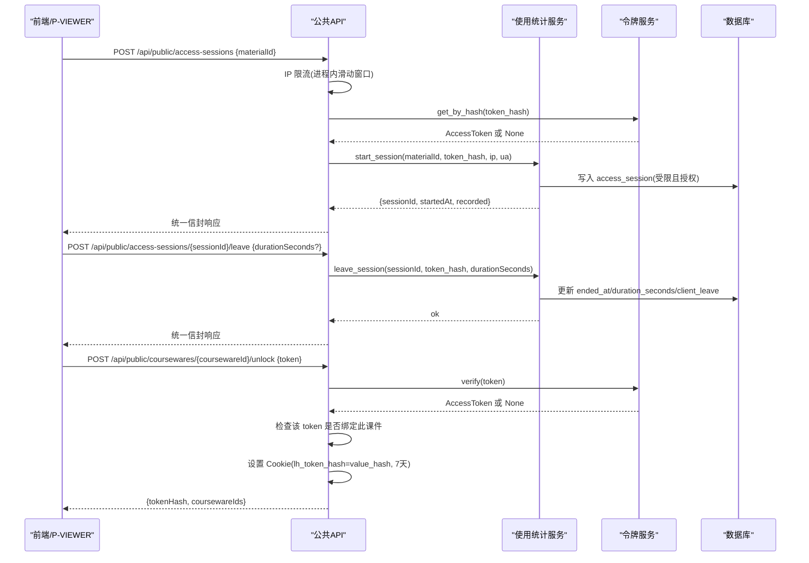
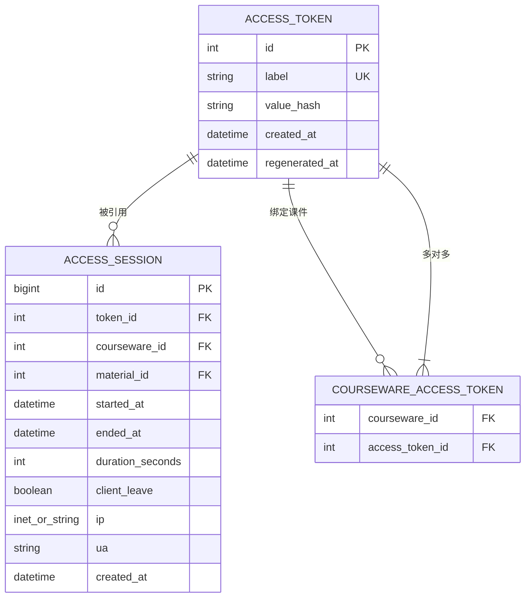
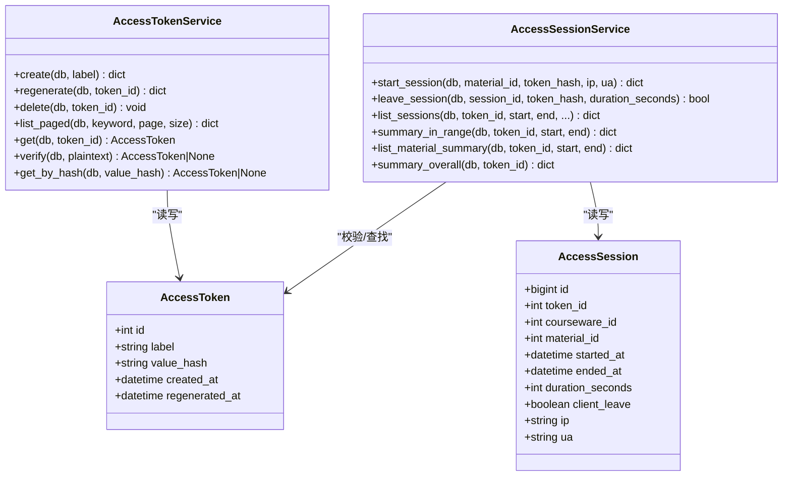
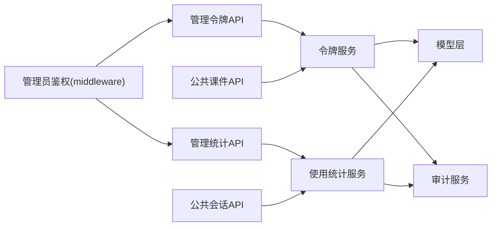

# 访问令牌管理接口

<cite>
**本文引用的文件**   
- [backend/app/api/admin/access_tokens.py](file://backend/app/api/admin/access_tokens.py)
- [backend/app/api/admin/access_token_usage.py](file://backend/app/api/admin/access_token_usage.py)
- [backend/app/api/public/access_sessions.py](file://backend/app/api/public/access_sessions.py)
- [backend/app/api/public/coursewares.py](file://backend/app/api/public/coursewares.py)
- [backend/app/models/access_token.py](file://backend/app/models/access_token.py)
- [backend/app/models/access_session.py](file://backend/app/models/access_session.py)
- [backend/app/models/association.py](file://backend/app/models/association.py)
- [backend/app/schemas/access_token.py](file://backend/app/schemas/access_token.py)
- [backend/app/schemas/access_token_usage.py](file://backend/app/schemas/access_token_usage.py)
- [backend/app/services/access_token.py](file://backend/app/services/access_token.py)
- [backend/app/services/access_token_usage.py](file://backend/app/services/access_token_usage.py)
- [backend/app/middleware/admin_auth.py](file://backend/app/middleware/admin_auth.py)
- [backend/app/core/errors.py](file://backend/app/core/errors.py)
- [backend/app/services/audit.py](file://backend/app/services/audit.py)
</cite>

## 目录
1. [简介](#简介)
2. [项目结构](#项目结构)
3. [核心组件](#核心组件)
4. [架构总览](#架构总览)
5. [详细组件分析](#详细组件分析)
6. [依赖关系分析](#依赖关系分析)
7. [性能与扩展性](#性能与扩展性)
8. [安全策略与防滥用](#安全策略与防滥用)
9. [故障排查指南](#故障排查指南)
10. [结论](#结论)
11. [附录：API 规范](#附录api-规范)

## 简介
本文件面向“访问令牌管理”相关能力，覆盖以下目标：
- 令牌的生成、配置与管理（创建、重新生成、删除、分页查询）
- 令牌生命周期控制与权限分配（绑定课件、解锁流程）
- 使用统计与审计日志（会话明细、按素材聚合、全时段概览）
- 安全策略与防滥用机制（哈希存储、常量时间比对、限流、幂等）
- 使用量监控、过期管理与批量操作实现细节

## 项目结构
后端采用分层设计：
- API 层：FastAPI Router，负责路由、参数校验、统一信封响应
- 服务层：业务规则、数据聚合、跨模型协作
- 模型层：SQLAlchemy ORM 定义与关联表
- 中间件：管理员鉴权（JWT）
- 错误码与审计：统一错误封装与 JSON Lines 审计日志

图示来源
- [backend/app/api/admin/access_tokens.py:1-120](file://backend/app/api/admin/access_tokens.py#L1-L120)
- [backend/app/api/admin/access_token_usage.py:1-101](file://backend/app/api/admin/access_token_usage.py#L1-L101)
- [backend/app/api/public/access_sessions.py:1-137](file://backend/app/api/public/access_sessions.py#L1-L137)
- [backend/app/api/public/coursewares.py:1-133](file://backend/app/api/public/coursewares.py#L1-L133)
- [backend/app/services/access_token.py:1-235](file://backend/app/services/access_token.py#L1-L235)
- [backend/app/services/access_token_usage.py:1-518](file://backend/app/services/access_token_usage.py#L1-L518)
- [backend/app/services/audit.py:1-45](file://backend/app/services/audit.py#L1-L45)
- [backend/app/models/access_token.py:1-34](file://backend/app/models/access_token.py#L1-L34)
- [backend/app/models/access_session.py:1-129](file://backend/app/models/access_session.py#L1-L129)
- [backend/app/models/association.py:1-41](file://backend/app/models/association.py#L1-L41)
- [backend/app/middleware/admin_auth.py:1-66](file://backend/app/middleware/admin_auth.py#L1-L66)
- [backend/app/core/errors.py:1-144](file://backend/app/core/errors.py#L1-L144)

章节来源
- [backend/app/api/admin/access_tokens.py:1-120](file://backend/app/api/admin/access_tokens.py#L1-L120)
- [backend/app/api/admin/access_token_usage.py:1-101](file://backend/app/api/admin/access_token_usage.py#L1-L101)
- [backend/app/api/public/access_sessions.py:1-137](file://backend/app/api/public/access_sessions.py#L1-L137)
- [backend/app/api/public/coursewares.py:1-133](file://backend/app/api/public/coursewares.py#L1-L133)

## 核心组件
- 访问令牌模型：仅存 value_hash(SHA-256)，明文仅在创建/重新生成时返回
- 访问会话模型：记录 token + 课件 + 素材的浏览起止时间与停留时长
- 关联表：课件与令牌的 N:M 绑定
- 管理服务：令牌 CRUD、列表分页、验证、按 hash 查找
- 使用统计服务：会话开始/结束、区间聚合、按素材聚合、全时段概览
- 公共接口：访问会话开始/结束；课件详情与解锁
- 管理员鉴权：基于 JWT 的管理员身份校验
- 审计日志：JSON Lines 格式记录关键管理操作

章节来源
- [backend/app/models/access_token.py:1-34](file://backend/app/models/access_token.py#L1-L34)
- [backend/app/models/access_session.py:1-129](file://backend/app/models/access_session.py#L1-L129)
- [backend/app/models/association.py:1-41](file://backend/app/models/association.py#L1-L41)
- [backend/app/services/access_token.py:1-235](file://backend/app/services/access_token.py#L1-L235)
- [backend/app/services/access_token_usage.py:1-518](file://backend/app/services/access_token_usage.py#L1-L518)
- [backend/app/middleware/admin_auth.py:1-66](file://backend/app/middleware/admin_auth.py#L1-L66)
- [backend/app/services/audit.py:1-45](file://backend/app/services/audit.py#L1-L45)

## 架构总览
访问令牌体系围绕“令牌—课件—素材—会话”展开。管理员通过管理端接口维护令牌并查看使用统计；前端通过公共接口完成课件解锁与会话埋点。

图示来源
- [backend/app/api/admin/access_tokens.py:1-120](file://backend/app/api/admin/access_tokens.py#L1-L120)
- [backend/app/api/admin/access_token_usage.py:1-101](file://backend/app/api/admin/access_token_usage.py#L1-L101)
- [backend/app/services/access_token.py:1-235](file://backend/app/services/access_token.py#L1-L235)
- [backend/app/services/access_token_usage.py:1-518](file://backend/app/services/access_token_usage.py#L1-L518)

## 详细组件分析

### 管理端令牌接口
- 列表：支持关键词过滤、分页
- 创建：标签唯一校验，生成随机明文，返回明文与哈希
- 详情：可选附加 usageSummary（全时段聚合）
- 重新生成：刷新 value_hash，旧值立即失效
- 删除：存在引用或为最后一个 active token 时拒绝

图示来源
- [backend/app/api/admin/access_tokens.py:1-120](file://backend/app/api/admin/access_tokens.py#L1-L120)
- [backend/app/services/access_token.py:1-235](file://backend/app/services/access_token.py#L1-L235)
- [backend/app/services/audit.py:1-45](file://backend/app/services/audit.py#L1-L45)

章节来源
- [backend/app/api/admin/access_tokens.py:1-120](file://backend/app/api/admin/access_tokens.py#L1-L120)
- [backend/app/schemas/access_token.py:1-53](file://backend/app/schemas/access_token.py#L1-L53)
- [backend/app/services/access_token.py:1-235](file://backend/app/services/access_token.py#L1-L235)

### 管理端使用统计接口
- 访问会话明细：按时间段分页，支持按素材/课件过滤
- 区间聚合：总停留、次数、课件数、素材数
- 按素材聚合：累计停留、访问次数、最近访问时间

图示来源
- [backend/app/api/admin/access_token_usage.py:1-101](file://backend/app/api/admin/access_token_usage.py#L1-L101)
- [backend/app/services/access_token_usage.py:1-518](file://backend/app/services/access_token_usage.py#L1-L518)
- [backend/app/schemas/access_token_usage.py:1-91](file://backend/app/schemas/access_token_usage.py#L1-L91)

章节来源
- [backend/app/api/admin/access_token_usage.py:1-101](file://backend/app/api/admin/access_token_usage.py#L1-L101)
- [backend/app/schemas/access_token_usage.py:1-91](file://backend/app/schemas/access_token_usage.py#L1-L91)
- [backend/app/services/access_token_usage.py:1-518](file://backend/app/services/access_token_usage.py#L1-L518)

### 公共端会话与解锁流程
- 会话开始：校验令牌、判断是否受限素材、ACL 授权、落库
- 会话结束：幂等结束，服务端校正时长偏差
- 课件解锁：凭明文校验并绑定 Cookie，后续自动鉴权

图示来源
- [backend/app/api/public/access_sessions.py:1-137](file://backend/app/api/public/access_sessions.py#L1-L137)
- [backend/app/api/public/coursewares.py:1-133](file://backend/app/api/public/coursewares.py#L1-L133)
- [backend/app/services/access_token_usage.py:1-518](file://backend/app/services/access_token_usage.py#L1-L518)
- [backend/app/services/access_token.py:1-235](file://backend/app/services/access_token.py#L1-L235)

章节来源
- [backend/app/api/public/access_sessions.py:1-137](file://backend/app/api/public/access_sessions.py#L1-L137)
- [backend/app/api/public/coursewares.py:1-133](file://backend/app/api/public/coursewares.py#L1-L133)
- [backend/app/services/access_token_usage.py:1-518](file://backend/app/services/access_token_usage.py#L1-L518)

### 数据模型与关系

图示来源
- [backend/app/models/access_token.py:1-34](file://backend/app/models/access_token.py#L1-L34)
- [backend/app/models/access_session.py:1-129](file://backend/app/models/access_session.py#L1-L129)
- [backend/app/models/association.py:1-41](file://backend/app/models/association.py#L1-L41)

章节来源
- [backend/app/models/access_token.py:1-34](file://backend/app/models/access_token.py#L1-L34)
- [backend/app/models/access_session.py:1-129](file://backend/app/models/access_session.py#L1-L129)
- [backend/app/models/association.py:1-41](file://backend/app/models/association.py#L1-L41)

### 类图（服务与模型交互）

图示来源
- [backend/app/services/access_token.py:1-235](file://backend/app/services/access_token.py#L1-L235)
- [backend/app/services/access_token_usage.py:1-518](file://backend/app/services/access_token_usage.py#L1-L518)
- [backend/app/models/access_token.py:1-34](file://backend/app/models/access_token.py#L1-L34)
- [backend/app/models/access_session.py:1-129](file://backend/app/models/access_session.py#L1-L129)

## 依赖关系分析
- 管理端接口受管理员鉴权保护（JWT），调用服务层进行业务处理
- 公共端接口无需管理员鉴权，但需携带 token_hash（Header 或 Cookie）
- 使用统计服务依赖令牌服务进行令牌校验与查找
- 审计服务在关键管理操作后追加 JSON Lines 记录

图示来源
- [backend/app/middleware/admin_auth.py:1-66](file://backend/app/middleware/admin_auth.py#L1-L66)
- [backend/app/api/admin/access_tokens.py:1-120](file://backend/app/api/admin/access_tokens.py#L1-L120)
- [backend/app/api/admin/access_token_usage.py:1-101](file://backend/app/api/admin/access_token_usage.py#L1-L101)
- [backend/app/api/public/access_sessions.py:1-137](file://backend/app/api/public/access_sessions.py#L1-L137)
- [backend/app/api/public/coursewares.py:1-133](file://backend/app/api/public/coursewares.py#L1-L133)
- [backend/app/services/access_token.py:1-235](file://backend/app/services/access_token.py#L1-L235)
- [backend/app/services/access_token_usage.py:1-518](file://backend/app/services/access_token_usage.py#L1-L518)
- [backend/app/services/audit.py:1-45](file://backend/app/services/audit.py#L1-L45)

章节来源
- [backend/app/middleware/admin_auth.py:1-66](file://backend/app/middleware/admin_auth.py#L1-L66)
- [backend/app/api/admin/access_tokens.py:1-120](file://backend/app/api/admin/access_tokens.py#L1-L120)
- [backend/app/api/admin/access_token_usage.py:1-101](file://backend/app/api/admin/access_token_usage.py#L1-L101)
- [backend/app/api/public/access_sessions.py:1-137](file://backend/app/api/public/access_sessions.py#L1-L137)
- [backend/app/api/public/coursewares.py:1-133](file://backend/app/api/public/coursewares.py#L1-L133)

## 性能与扩展性
- 列表与分页：令牌列表与服务端计数一次查询，避免 N+1；详情 withUsage 按需计算
- 统计聚合：使用 SQL 聚合表达式与窗口函数优化，减少应用层计算
- 时长校正：服务端时间校正阈值防止客户端时钟漂移/篡改
- 索引：针对 token_id + started_at、token_id + material_id、token_id + courseware_id 建立索引，提升查询效率
- 限流：公共会话接口进程内滑动窗口限流，多进程部署建议结合网关层限流

章节来源
- [backend/app/api/admin/access_tokens.py:1-120](file://backend/app/api/admin/access_tokens.py#L1-L120)
- [backend/app/services/access_token_usage.py:1-518](file://backend/app/services/access_token_usage.py#L1-L518)
- [backend/app/models/access_session.py:1-129](file://backend/app/models/access_session.py#L1-L129)
- [backend/app/api/public/access_sessions.py:1-137](file://backend/app/api/public/access_sessions.py#L1-L137)

## 安全策略与防滥用
- 令牌安全
  - 数据库仅存储 SHA-256 摘要，明文仅在创建/重新生成时一次性返回
  - 验证使用常量时间比较，避免时序攻击
- 权限控制
  - 管理端接口强制管理员 JWT 鉴权
  - 公共端接口通过 token_hash 校验，并结合课件绑定关系进行 ACL 授权
- 防滥用
  - 公共会话接口进程内滑动窗口限流（每分钟 60 次/IP）
  - 会话结束幂等，服务端校正时长偏差
  - 删除令牌前检查引用与最后令牌约束
- 审计追踪
  - 关键管理操作（创建/重新生成/删除）写入 JSON Lines 审计日志

章节来源
- [backend/app/services/access_token.py:1-235](file://backend/app/services/access_token.py#L1-L235)
- [backend/app/middleware/admin_auth.py:1-66](file://backend/app/middleware/admin_auth.py#L1-L66)
- [backend/app/api/public/access_sessions.py:1-137](file://backend/app/api/public/access_sessions.py#L1-L137)
- [backend/app/services/audit.py:1-45](file://backend/app/services/audit.py#L1-L45)
- [backend/app/core/errors.py:1-144](file://backend/app/core/errors.py#L1-L144)

## 故障排查指南
- 常见错误码
  - 未认证/会话过期：检查管理员 JWT 是否正确传递与有效
  - 令牌无效/缺失：确认请求头或 Cookie 中的 token_hash 是否正确
  - 令牌无权访问：检查课件与令牌的绑定关系
  - 日期格式错误：确保 start/end 为 YYYY-MM-DD 且 start ≤ end
- 定位方法
  - 查看审计日志文件（JSON Lines），检索 action=token.* 的记录
  - 核对数据库索引与聚合查询条件是否符合预期
  - 检查限流命中情况（IP 限流降级不阻塞主流程）

章节来源
- [backend/app/core/errors.py:1-144](file://backend/app/core/errors.py#L1-L144)
- [backend/app/services/audit.py:1-45](file://backend/app/services/audit.py#L1-L45)
- [backend/app/api/public/access_sessions.py:1-137](file://backend/app/api/public/access_sessions.py#L1-L137)

## 结论
访问令牌管理体系以“最小暴露、强校验、可审计”为核心原则，提供从令牌生命周期管理到使用统计的全链路能力。通过严格的权限绑定、安全的哈希存储与审计日志，系统在保证功能完备的同时兼顾了安全性与可观测性。

## 附录：API 规范

### 管理端令牌接口
- 基础路径：/api/admin/access-tokens
- 鉴权：管理员 JWT（Bearer 或 Cookie LH_ADMIN_SESSION）
- 接口清单
  - GET /api/admin/access-tokens
    - 查询参数：keyword?, page?, size?
    - 返回：AccessTokenPaged
  - POST /api/admin/access-tokens
    - 请求体：label
    - 返回：AccessTokenCreatedResponse（包含明文 value）
  - GET /api/admin/access-tokens/{token_id}?withUsage=?
    - 返回：令牌项 + 可选 usageSummary
  - POST /api/admin/access-tokens/{token_id}/regenerate
    - 返回：AccessTokenCreatedResponse（新明文）
  - DELETE /api/admin/access-tokens/{token_id}
    - 无返回体

章节来源
- [backend/app/api/admin/access_tokens.py:1-120](file://backend/app/api/admin/access_tokens.py#L1-L120)
- [backend/app/schemas/access_token.py:1-53](file://backend/app/schemas/access_token.py#L1-L53)

### 管理端使用统计接口
- 基础路径：/api/admin/access-tokens/{token_id}
- 鉴权：管理员 JWT
- 接口清单
  - GET /api/admin/access-tokens/{token_id}/access-sessions
    - 查询参数：start, end, materialId?, coursewareId?, page?, size?
    - 返回：AccessSessionPaged
  - GET /api/admin/access-tokens/{token_id}/access-sessions/summary
    - 查询参数：start, end
    - 返回：AccessSessionSummary
  - GET /api/admin/access-tokens/{token_id}/access-sessions/material-summary
    - 查询参数：start, end
    - 返回：MaterialUsagePaged

章节来源
- [backend/app/api/admin/access_token_usage.py:1-101](file://backend/app/api/admin/access_token_usage.py#L1-L101)
- [backend/app/schemas/access_token_usage.py:1-91](file://backend/app/schemas/access_token_usage.py#L1-L91)

### 公共端会话接口
- 基础路径：/api/public/access-sessions
- 鉴权：无需管理员鉴权，需携带 X-Token-Hash 或 Cookie lh_token_hash
- 接口清单
  - POST /api/public/access-sessions
    - 请求体：materialId
    - 返回：AccessSessionStartResponse
  - POST /api/public/access-sessions/{session_id}/leave
    - 请求体：durationSeconds?
    - 返回：AccessSessionLeaveResponse

章节来源
- [backend/app/api/public/access_sessions.py:1-137](file://backend/app/api/public/access_sessions.py#L1-L137)
- [backend/app/schemas/access_token_usage.py:1-91](file://backend/app/schemas/access_token_usage.py#L1-L91)

### 公共端课件解锁接口
- 基础路径：/api/public/coursewares/{courseware_id}/unlock
- 鉴权：无需管理员鉴权，需携带 X-Token-Hash 或 Cookie lh_token_hash
- 接口清单
  - POST /api/public/coursewares/{courseware_id}/unlock
    - 请求体：token（明文）
    - 返回：UnlockResponse（tokenHash, coursewareIds）
    - 成功会设置 Cookie lh_token_hash=value_hash（7 天）

章节来源
- [backend/app/api/public/coursewares.py:1-133](file://backend/app/api/public/coursewares.py#L1-L133)