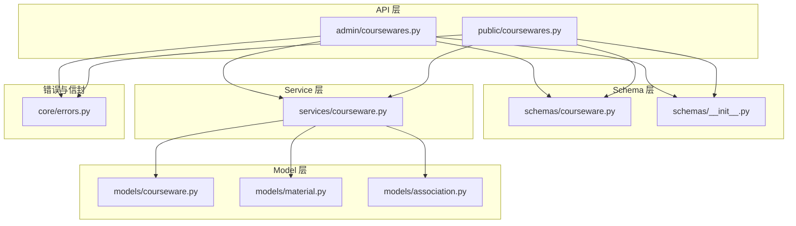
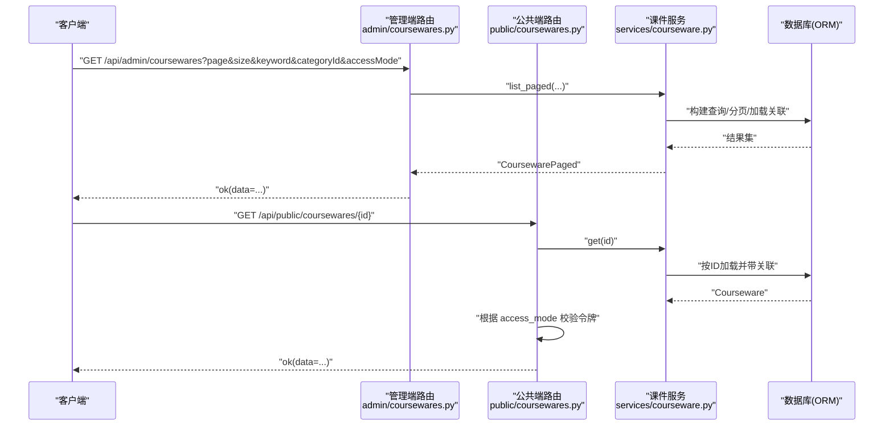
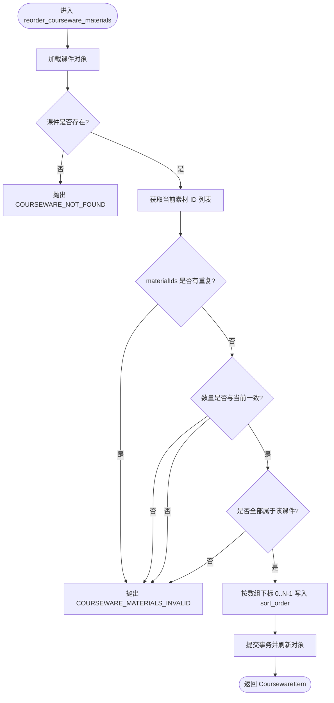
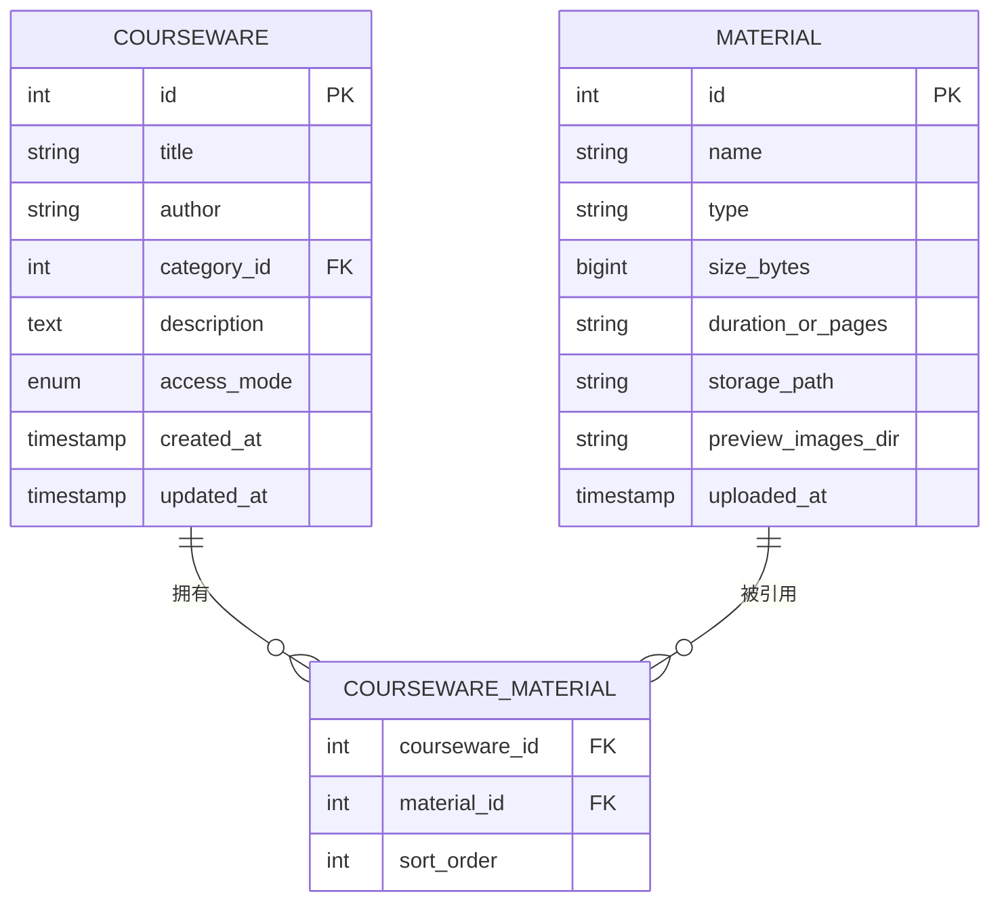
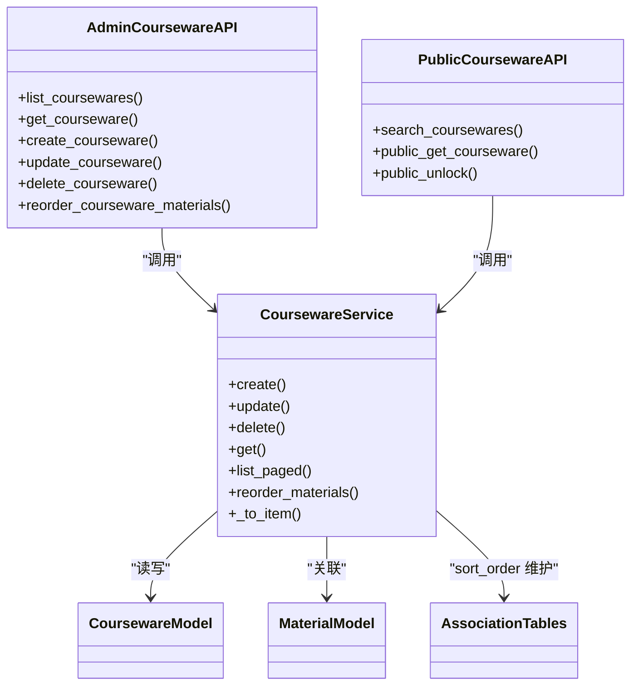

# 课件管理接口

<cite>
**本文引用的文件**
- [backend/app/api/admin/coursewares.py](file://backend/app/api/admin/coursewares.py)
- [backend/app/api/public/coursewares.py](file://backend/app/api/public/coursewares.py)
- [backend/app/schemas/courseware.py](file://backend/app/schemas/courseware.py)
- [backend/app/services/courseware.py](file://backend/app/services/courseware.py)
- [backend/app/models/courseware.py](file://backend/app/models/courseware.py)
- [backend/app/models/material.py](file://backend/app/models/material.py)
- [backend/app/models/association.py](file://backend/app/models/association.py)
- [backend/app/core/errors.py](file://backend/app/core/errors.py)
- [backend/app/schemas/__init__.py](file://backend/app/schemas/__init__.py)
</cite>

## 目录
1. [简介](#简介)
2. [项目结构](#项目结构)
3. [核心组件](#核心组件)
4. [架构总览](#架构总览)
5. [详细组件分析](#详细组件分析)
6. [依赖关系分析](#依赖关系分析)
7. [性能考虑](#性能考虑)
8. [故障排查指南](#故障排查指南)
9. [结论](#结论)
10. [附录：API 规范与示例](#附录api-规范与示例)

## 简介
本文件面向“课件管理”相关接口的开发与使用，覆盖以下能力：
- 课件的完整 CRUD（创建、读取、更新、删除）
- 课件列表查询：关键词搜索、分类筛选、访问模式过滤、分页
- 课件素材顺序调整：专用排序接口与批量排序语义
- 统一请求参数说明、响应格式定义、错误处理机制
- 结合服务层交互的实际调用流程与场景

## 项目结构
后端采用 FastAPI + SQLAlchemy 分层架构：
- API 层：路由定义与入参校验
- Schema 层：Pydantic 数据模型
- Service 层：业务规则与数据库操作
- Model 层：ORM 实体与关联表
- 错误与信封：统一错误码与响应封装

图表来源
- [backend/app/api/admin/coursewares.py:1-115](file://backend/app/api/admin/coursewares.py#L1-L115)
- [backend/app/api/public/coursewares.py:1-133](file://backend/app/api/public/coursewares.py#L1-L133)
- [backend/app/schemas/courseware.py:1-120](file://backend/app/schemas/courseware.py#L1-L120)
- [backend/app/services/courseware.py:1-492](file://backend/app/services/courseware.py#L1-L492)
- [backend/app/models/courseware.py:1-74](file://backend/app/models/courseware.py#L1-L74)
- [backend/app/models/material.py:1-69](file://backend/app/models/material.py#L1-L69)
- [backend/app/models/association.py:1-41](file://backend/app/models/association.py#L1-L41)
- [backend/app/core/errors.py:1-144](file://backend/app/core/errors.py#L1-L144)
- [backend/app/schemas/__init__.py:1-65](file://backend/app/schemas/__init__.py#L1-L65)

章节来源
- [backend/app/api/admin/coursewares.py:1-115](file://backend/app/api/admin/coursewares.py#L1-L115)
- [backend/app/api/public/coursewares.py:1-133](file://backend/app/api/public/coursewares.py#L1-L133)
- [backend/app/schemas/courseware.py:1-120](file://backend/app/schemas/courseware.py#L1-L120)
- [backend/app/services/courseware.py:1-492](file://backend/app/services/courseware.py#L1-L492)
- [backend/app/models/courseware.py:1-74](file://backend/app/models/courseware.py#L1-L74)
- [backend/app/models/material.py:1-69](file://backend/app/models/material.py#L1-L69)
- [backend/app/models/association.py:1-41](file://backend/app/models/association.py#L1-L41)
- [backend/app/core/errors.py:1-144](file://backend/app/core/errors.py#L1-L144)
- [backend/app/schemas/__init__.py:1-65](file://backend/app/schemas/__init__.py#L1-L65)

## 核心组件
- 管理端课件路由：提供课件的列表、详情、创建、更新、删除以及素材顺序调整
- 公共端课件路由：提供公开搜索、详情获取、令牌解锁
- 课件服务：实现业务规则（标题长度、分类存在性、访问模式约束、令牌绑定、素材集合与排序重写等）
- 数据模型：Courseware、Material、关联表（含 sort_order）
- 错误与信封：BusinessError 与 ok/fail 信封

章节来源
- [backend/app/api/admin/coursewares.py:1-115](file://backend/app/api/admin/coursewares.py#L1-L115)
- [backend/app/api/public/coursewares.py:1-133](file://backend/app/api/public/coursewares.py#L1-L133)
- [backend/app/services/courseware.py:1-492](file://backend/app/services/courseware.py#L1-L492)
- [backend/app/models/courseware.py:1-74](file://backend/app/models/courseware.py#L1-L74)
- [backend/app/models/material.py:1-69](file://backend/app/models/material.py#L1-L69)
- [backend/app/models/association.py:1-41](file://backend/app/models/association.py#L1-L41)
- [backend/app/core/errors.py:1-144](file://backend/app/core/errors.py#L1-L144)
- [backend/app/schemas/__init__.py:1-65](file://backend/app/schemas/__init__.py#L1-L65)

## 架构总览
下图展示了从客户端到数据库的关键调用路径，包括管理端与公共端的差异。

图表来源
- [backend/app/api/admin/coursewares.py:24-41](file://backend/app/api/admin/coursewares.py#L24-L41)
- [backend/app/api/public/coursewares.py:57-76](file://backend/app/api/public/coursewares.py#L57-L76)
- [backend/app/services/courseware.py:396-447](file://backend/app/services/courseware.py#L396-L447)
- [backend/app/services/courseware.py:47-63](file://backend/app/services/courseware.py#L47-L63)

## 详细组件分析

### 管理端课件接口
- 列表查询
  - 方法：GET
  - 路径：/api/admin/coursewares
  - 查询参数：
    - keyword: 可选，支持标题、作者、描述模糊匹配
    - categoryId: 可选，支持子树筛选
    - accessMode: 可选，OPEN 或 RESTRICTED
    - page: 页码，默认 1，最小 1
    - size: 每页条数，默认 20，范围 1..200
  - 响应：Envelope.data = CoursewarePaged
- 详情
  - 方法：GET
  - 路径：/api/admin/coursewares/{courseware_id}
  - 响应：Envelope.data = CoursewareItem（包含 materials 列表及 sortOrder）
- 创建
  - 方法：POST
  - 路径：/api/admin/coursewares
  - 请求体：CoursewareCreateRequest
  - 响应：Envelope.data = CoursewareItem
- 更新
  - 方法：PUT
  - 路径：/api/admin/coursewares/{courseware_id}
  - 请求体：CoursewareUpdateRequest（字段均可选，非空即更新）
  - 响应：Envelope.data = CoursewareItem
- 删除
  - 方法：DELETE
  - 路径：/api/admin/coursewares/{courseware_id}
  - 响应：Envelope.data = null
- 素材顺序调整
  - 方法：PUT
  - 路径：/api/admin/coursewares/{courseware_id}/materials/order
  - 请求体：CoursewareMaterialsReorderRequest
  - 行为：按 materialIds 数组下标重写 courseware_material.sort_order（0..N-1），并进行严格校验
  - 响应：Envelope.data = CoursewareItem

章节来源
- [backend/app/api/admin/coursewares.py:24-112](file://backend/app/api/admin/coursewares.py#L24-L112)
- [backend/app/schemas/courseware.py:22-108](file://backend/app/schemas/courseware.py#L22-L108)
- [backend/app/services/courseware.py:396-447](file://backend/app/services/courseware.py#L396-L447)
- [backend/app/services/courseware.py:335-393](file://backend/app/services/courseware.py#L335-L393)

#### 素材顺序调整流程图

图表来源
- [backend/app/services/courseware.py:335-393](file://backend/app/services/courseware.py#L335-L393)

### 公共端课件接口
- 搜索
  - 方法：GET
  - 路径：/api/public/coursewares/search
  - 查询参数：
    - q: 可选，关键词；为空则返回最新
    - page: 页码，默认 1，最小 1
    - size: 每页条数，默认 20，范围 1..50
  - 响应：Envelope.data = {items, source, total, page, size}
- 详情
  - 方法：GET
  - 路径：/api/public/coursewares/{courseware_id}
  - 鉴权：
    - OPEN：直接返回
    - RESTRICTED：需携带 X-Token-Hash 或 Cookie lh_token_hash，且命中该课件绑定的任一令牌哈希
  - 响应：Envelope.data = CoursewareItem
- 解锁
  - 方法：POST
  - 路径：/api/public/coursewares/{courseware_id}/unlock
  - 请求体：UnlockRequest(token)
  - 行为：验证 token 明文，检查是否被该课件绑定；成功后设置 Cookie lh_token_hash（7 天）
  - 响应：Envelope.data = UnlockResponse

章节来源
- [backend/app/api/public/coursewares.py:32-133](file://backend/app/api/public/coursewares.py#L32-L133)
- [backend/app/schemas/courseware.py:91-98](file://backend/app/schemas/courseware.py#L91-L98)

### 数据模型与关联
- Courseware：主表，包含访问模式枚举 AccessMode（OPEN/RESTRICTED）
- Material：素材元数据（类型、大小、时长/页数、存储路径、预览图片目录）
- 关联表：
  - courseware_tag：课件-标签多对多
  - courseware_material：课件-素材多对多，含 sort_order 列与索引
  - courseware_access_token：课件-令牌多对多

图表来源
- [backend/app/models/courseware.py:21-74](file://backend/app/models/courseware.py#L21-L74)
- [backend/app/models/material.py:44-69](file://backend/app/models/material.py#L44-L69)
- [backend/app/models/association.py:16-26](file://backend/app/models/association.py#L16-L26)

### 关键业务规则与实现要点
- 标题校验：非空且长度不超过 100
- 分类校验：必须存在；支持任意层级节点挂载
- 访问模式：
  - RESTRICTED 时至少绑定一个令牌
  - 从 RESTRICTED 降级为 OPEN 时自动清空令牌绑定
- 素材集合更新语义：
  - 传入 materialIds 的顺序即为期望展示顺序，后端按 0..N-1 重写 sort_order
  - 增删逻辑：DB 有但不在传入中 → 删除；传入中有但 DB 没有 → 插入
- 专用排序接口：
  - 严格校验：无重复、数量一致、全部属于该课件
  - 按数组下标重写 sort_order

章节来源
- [backend/app/services/courseware.py:105-167](file://backend/app/services/courseware.py#L105-L167)
- [backend/app/services/courseware.py:170-278](file://backend/app/services/courseware.py#L170-L278)
- [backend/app/services/courseware.py:335-393](file://backend/app/services/courseware.py#L335-L393)
- [backend/app/models/association.py:16-26](file://backend/app/models/association.py#L16-L26)

## 依赖关系分析
- API 层依赖 Schema 进行入参与出参校验
- API 层调用 Service 执行业务逻辑
- Service 层通过 ORM 访问 Model 与关联表
- 错误由 BusinessError 抛出，并由全局处理器包装为统一信封

图表来源
- [backend/app/api/admin/coursewares.py:17-115](file://backend/app/api/admin/coursewares.py#L17-L115)
- [backend/app/api/public/coursewares.py:19-133](file://backend/app/api/public/coursewares.py#L19-L133)
- [backend/app/services/courseware.py:105-492](file://backend/app/services/courseware.py#L105-L492)
- [backend/app/models/courseware.py:21-74](file://backend/app/models/courseware.py#L21-L74)
- [backend/app/models/material.py:44-69](file://backend/app/models/material.py#L44-L69)
- [backend/app/models/association.py:16-26](file://backend/app/models/association.py#L16-L26)

## 性能考虑
- 列表查询使用 selectinload 预加载关联，避免 N+1 问题
- 关联表 courseware_material 上建立 (courseware_id, sort_order) 索引，加速有序素材检索
- 列表分页基于 offset/limit，注意大偏移时的性能退化；可考虑游标分页优化
- 公共搜索接口支持 embedding 召回与关键词回退，具备超时保护与降级策略

[本节为通用建议，不直接分析具体文件]

## 故障排查指南
- 常见错误码与 HTTP 状态映射：
  - 课件不存在：COURSEWARE_NOT_FOUND → 404
  - 标题必填/超长：COURSEWARE_TITLE_REQUIRED → 400
  - 分类必填/不存在：COURSEWARE_CATEGORY_REQUIRED → 400
  - 受限课件未绑定令牌：COURSEWARE_TOKEN_REQUIRED → 400
  - 令牌无效/无权访问：INVALID_TOKEN → 401
  - 课件被锁定：COURSEWARE_ACL_LOCKED → 403
  - 素材排序非法：COURSEWARE_MATERIALS_INVALID → 400
  - 文件大小超限：MATERIAL_SIZE_EXCEEDED → 413
  - 内部错误：INTERNAL_ERROR → 500
- 调试建议：
  - 确认请求参数是否符合 Schema 约束（如 length、枚举值）
  - 检查关联表 sort_order 是否正确写入
  - 查看日志中的 ffprobe/PPT 转换异常（不影响上传，但影响时长/预览）

章节来源
- [backend/app/core/errors.py:9-127](file://backend/app/core/errors.py#L9-L127)
- [backend/app/services/courseware.py:335-393](file://backend/app/services/courseware.py#L335-L393)

## 结论
本课件管理接口在管理端与公共端分别提供了完善的 CRUD、搜索、解锁与素材排序能力。通过严格的 Schema 校验与服务层业务规则，保证了数据一致性与访问安全。配合统一的错误码与信封响应，便于前后端协作与排障。

[本节为总结，不直接分析具体文件]

## 附录：API 规范与示例

### 统一响应信封
- 成功响应：Envelope
  - code: "ok"
  - message: "ok"
  - data: 业务数据
  - requestId: 可选
- 失败响应：由 BusinessError 触发，统一包装为 {code, message, data, requestId}

章节来源
- [backend/app/schemas/__init__.py:24-65](file://backend/app/schemas/__init__.py#L24-L65)
- [backend/app/core/errors.py:130-144](file://backend/app/core/errors.py#L130-L144)

### 管理端课件接口清单
- GET /api/admin/coursewares
  - 查询参数：keyword, categoryId, accessMode, page, size
  - 响应 data：CoursewarePaged
- GET /api/admin/coursewares/{courseware_id}
  - 响应 data：CoursewareItem（含 materials[] 与 sortOrder）
- POST /api/admin/coursewares
  - 请求体：CoursewareCreateRequest
  - 响应 data：CoursewareItem
- PUT /api/admin/coursewares/{courseware_id}
  - 请求体：CoursewareUpdateRequest
  - 响应 data：CoursewareItem
- DELETE /api/admin/coursewares/{courseware_id}
  - 响应 data：null
- PUT /api/admin/coursewares/{courseware_id}/materials/order
  - 请求体：CoursewareMaterialsReorderRequest
  - 响应 data：CoursewareItem

章节来源
- [backend/app/api/admin/coursewares.py:24-112](file://backend/app/api/admin/coursewares.py#L24-L112)
- [backend/app/schemas/courseware.py:22-108](file://backend/app/schemas/courseware.py#L22-L108)

### 公共端课件接口清单
- GET /api/public/coursewares/search
  - 查询参数：q, page, size
  - 响应 data：{items, source, total, page, size}
- GET /api/public/coursewares/{courseware_id}
  - 鉴权头/Cookie：X-Token-Hash 或 lh_token_hash（当 access_mode=RESTRICTED）
  - 响应 data：CoursewareItem
- POST /api/public/coursewares/{courseware_id}/unlock
  - 请求体：UnlockRequest(token)
  - 响应 data：UnlockResponse(tokenHash, coursewareIds)

章节来源
- [backend/app/api/public/coursewares.py:32-133](file://backend/app/api/public/coursewares.py#L32-L133)
- [backend/app/schemas/courseware.py:91-98](file://backend/app/schemas/courseware.py#L91-L98)

### 数据结构定义
- CoursewareBase/CoursewareCreateRequest/CoursewareUpdateRequest
  - 关键字段：title, author, categoryId, description, accessMode, tagIds, materialIds, tokenIds
  - 校验：title 非空且 ≤100；author 去空白；accessMode 枚举
- CoursewareItem
  - 基础字段 + categoryName, tagNames, createdAt, updatedAt
  - 仅详情返回时填充 materials[]（含 sortOrder）
- CoursewarePaged
  - page, size, total, items[]
- CoursewareMaterialsReorderRequest
  - materialIds[]：目标顺序，服务端按数组下标重写 sort_order

章节来源
- [backend/app/schemas/courseware.py:22-108](file://backend/app/schemas/courseware.py#L22-L108)

### 典型使用场景
- 管理员创建课件并绑定素材与标签
  - 调用 POST /api/admin/coursewares，传入 title、categoryId、materialIds、tagIds、tokenIds（若 accessMode=RESTRICTED）
  - 返回的 CoursewareItem 中包含 materials[] 及其 sortOrder
- 管理员调整素材顺序
  - 先 GET 详情获取当前 materialIds 顺序
  - 前端拖拽后，PUT /api/admin/coursewares/{id}/materials/order 提交新顺序
  - 服务端校验通过后，按 0..N-1 写入 sort_order
- 前台用户浏览受限课件
  - 首次访问 GET /api/public/coursewares/{id} 返回 403（需要解锁）
  - 调用 POST /api/public/coursewares/{id}/unlock 传入 token，成功后设置 Cookie
  - 后续 GET 自动携带 Cookie 完成鉴权

章节来源
- [backend/app/api/admin/coursewares.py:52-112](file://backend/app/api/admin/coursewares.py#L52-L112)
- [backend/app/api/public/coursewares.py:57-133](file://backend/app/api/public/coursewares.py#L57-L133)
- [backend/app/services/courseware.py:105-167](file://backend/app/services/courseware.py#L105-L167)
- [backend/app/services/courseware.py:335-393](file://backend/app/services/courseware.py#L335-L393)