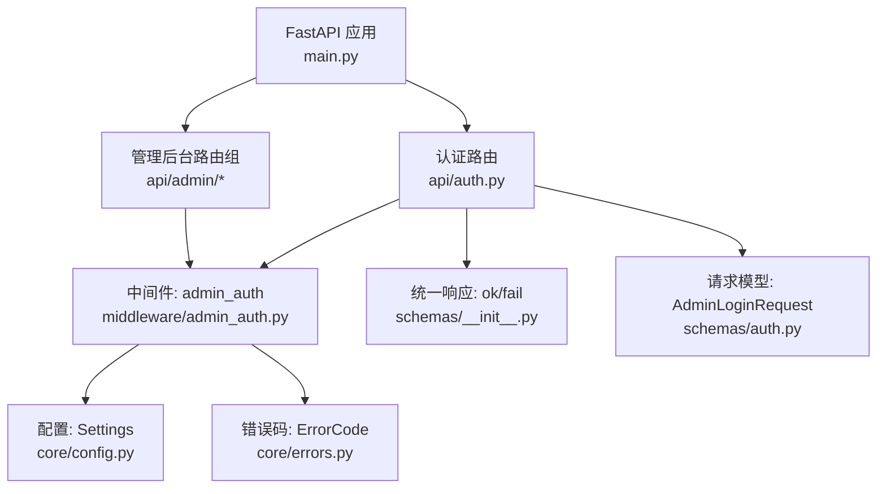
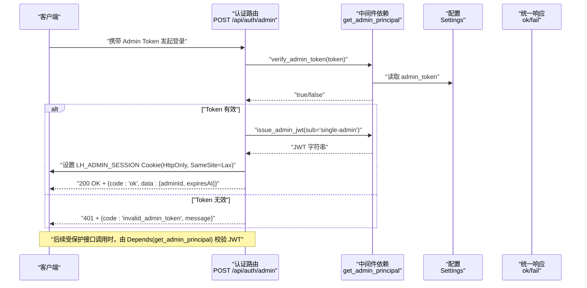
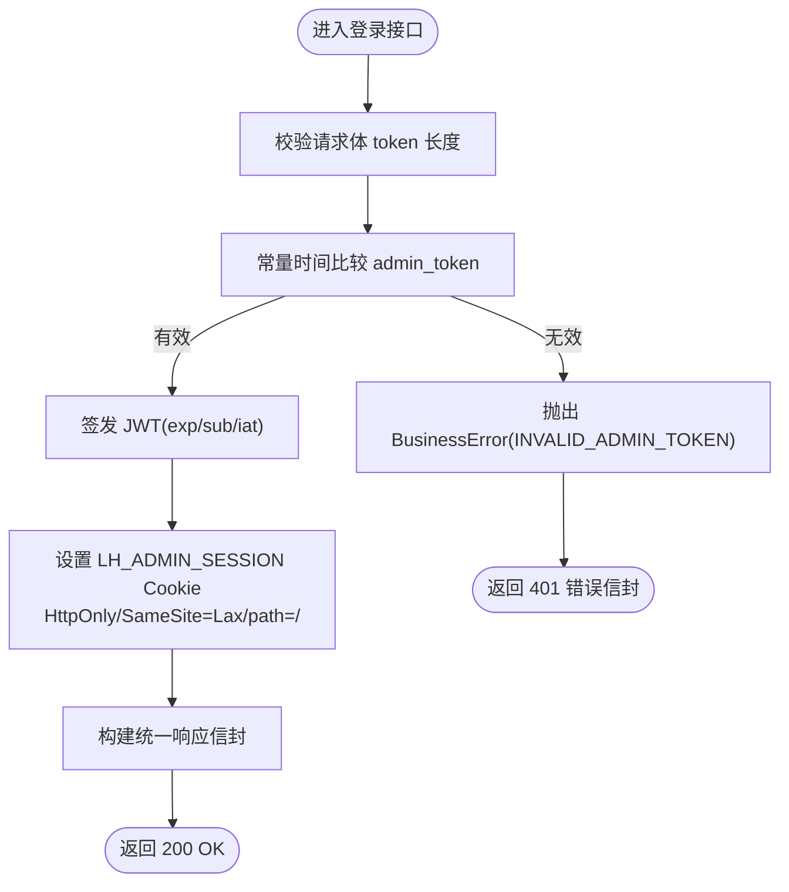
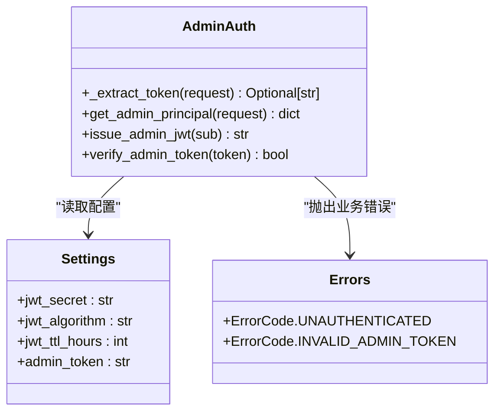
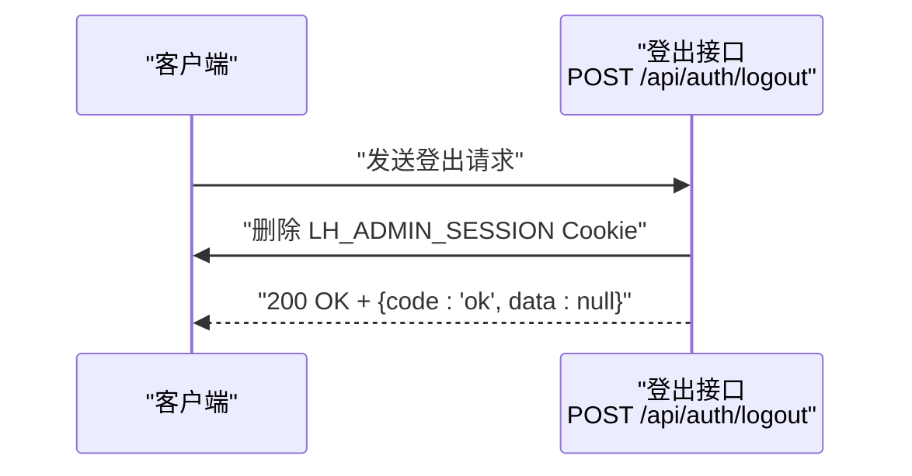
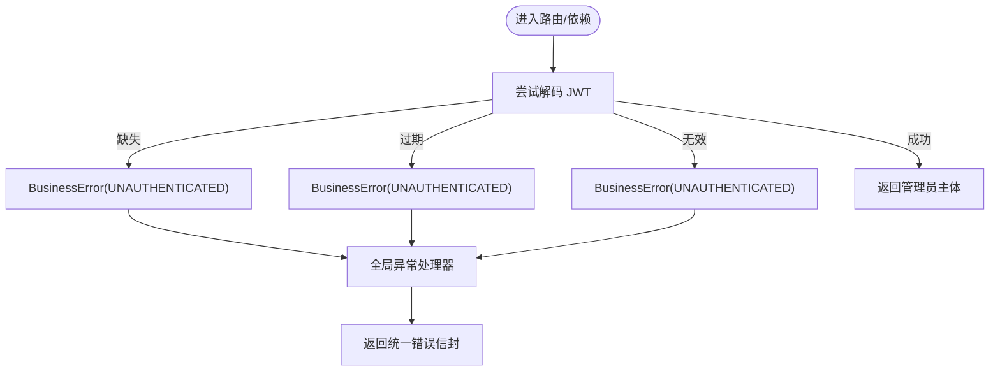
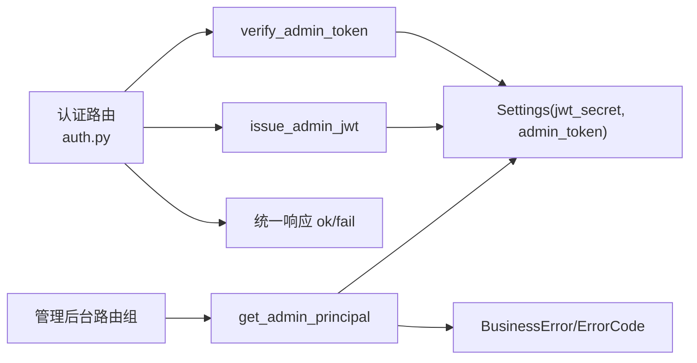

# 认证授权接口

<cite>
**本文引用的文件列表**
- [backend/app/api/auth.py](file://backend/app/api/auth.py)
- [backend/app/middleware/admin_auth.py](file://backend/app/middleware/admin_auth.py)
- [backend/app/schemas/auth.py](file://backend/app/schemas/auth.py)
- [backend/app/core/config.py](file://backend/app/core/config.py)
- [backend/app/core/errors.py](file://backend/app/core/errors.py)
- [backend/app/schemas/__init__.py](file://backend/app/schemas/__init__.py)
- [backend/app/main.py](file://backend/app/main.py)
</cite>

## 目录
1. [简介](#简介)
2. [项目结构](#项目结构)
3. [核心组件](#核心组件)
4. [架构总览](#架构总览)
5. [详细组件分析](#详细组件分析)
6. [依赖关系分析](#依赖关系分析)
7. [性能与安全考量](#性能与安全考量)
8. [故障排查指南](#故障排查指南)
9. [结论](#结论)
10. [附录：请求与响应示例](#附录请求与响应示例)

## 简介
本指南面向后端开发者，系统化说明学习平台管理后台的认证与授权实现。内容覆盖管理员登录流程、Admin Token 校验、JWT 签发与 Cookie 管理、中间件鉴权（token 提取、权限检查、会话管理）、登出流程、安全最佳实践（HttpOnly、SameSite、令牌过期处理）、错误处理与异常管理，并提供完整的请求/响应示例与安全配置建议。

## 项目结构
认证相关代码主要分布在以下模块：
- 路由层：admin 登录/登出接口定义
- 中间件层：Admin 身份解析与 JWT 签发/验证
- 配置层：JWT 算法、密钥、TTL 等
- 错误与响应：统一业务错误码与信封格式
- 应用入口：全局异常处理、CORS、路由装配

图表来源
- [backend/app/main.py:40-112](file://backend/app/main.py#L40-L112)
- [backend/app/api/auth.py:14-48](file://backend/app/api/auth.py#L14-L48)
- [backend/app/middleware/admin_auth.py:16-55](file://backend/app/middleware/admin_auth.py#L16-L55)
- [backend/app/core/config.py:40-46](file://backend/app/core/config.py#L40-L46)
- [backend/app/core/errors.py:9-20](file://backend/app/core/errors.py#L9-L20)
- [backend/app/schemas/__init__.py:35-42](file://backend/app/schemas/__init__.py#L35-L42)
- [backend/app/schemas/auth.py:7-16](file://backend/app/schemas/auth.py#L7-L16)

章节来源
- [backend/app/main.py:40-112](file://backend/app/main.py#L40-L112)
- [backend/app/api/auth.py:14-48](file://backend/app/api/auth.py#L14-L48)
- [backend/app/middleware/admin_auth.py:16-55](file://backend/app/middleware/admin_auth.py#L16-L55)
- [backend/app/core/config.py:40-46](file://backend/app/core/config.py#L40-L46)
- [backend/app/core/errors.py:9-20](file://backend/app/core/errors.py#L9-L20)
- [backend/app/schemas/__init__.py:35-42](file://backend/app/schemas/__init__.py#L35-L42)
- [backend/app/schemas/auth.py:7-16](file://backend/app/schemas/auth.py#L7-L16)

## 核心组件
- 认证路由
  - POST /api/auth/admin：使用 Admin Token 换取会话，签发 JWT 并写入 HttpOnly Cookie
  - POST /api/auth/logout：删除会话 Cookie，完成登出
- 中间件依赖
  - get_admin_principal：从 Authorization 或 Cookie 中提取并校验 JWT，返回管理员主体信息
  - issue_admin_jwt：签发带 exp/sub 的 JWT
  - verify_admin_token：常量时间比较 Admin Token
- 配置项
  - jwt_secret、jwt_algorithm、jwt_ttl_hours、admin_token
- 错误与响应
  - BusinessError + ErrorCode：统一业务错误码映射到 HTTP 状态码
  - ok/fail：统一响应信封 {code, message, data, requestId}

章节来源
- [backend/app/api/auth.py:21-45](file://backend/app/api/auth.py#L21-L45)
- [backend/app/middleware/admin_auth.py:26-62](file://backend/app/middleware/admin_auth.py#L26-L62)
- [backend/app/core/config.py:40-46](file://backend/app/core/config.py#L40-L46)
- [backend/app/core/errors.py:9-20](file://backend/app/core/errors.py#L9-L20)
- [backend/app/schemas/__init__.py:35-42](file://backend/app/schemas/__init__.py#L35-L42)
- [backend/app/schemas/auth.py:7-16](file://backend/app/schemas/auth.py#L7-L16)

## 架构总览
下图展示了管理员登录、受保护资源访问与登出的端到端流程。

图表来源
- [backend/app/api/auth.py:21-39](file://backend/app/api/auth.py#L21-L39)
- [backend/app/middleware/admin_auth.py:44-62](file://backend/app/middleware/admin_auth.py#L44-L62)
- [backend/app/core/config.py:40-46](file://backend/app/core/config.py#L40-L46)
- [backend/app/schemas/__init__.py:35-42](file://backend/app/schemas/__init__.py#L35-L42)

## 详细组件分析

### 管理员登录流程（Admin Token → JWT → Cookie）
- 输入校验
  - 请求体包含 token 字段，长度在 1~255 之间
- 校验逻辑
  - 使用常量时间比较函数对传入 token 与配置的 admin_token 进行比对
- 签发与会话
  - 签发 JWT，包含 sub、iat、exp；默认 TTL 为配置项 jwt_ttl_hours
  - 将 JWT 写入名为 LH_ADMIN_SESSION 的 Cookie，属性包括：
    - httponly=True
    - samesite="lax"
    - path="/"
    - max_age=8*3600（秒）
- 响应
  - 成功返回统一信封，data 中包含 adminId 与 expiresAt（ISO-8601）
  - 失败返回 401，code 为 invalid_admin_token

图表来源
- [backend/app/api/auth.py:21-39](file://backend/app/api/auth.py#L21-L39)
- [backend/app/middleware/admin_auth.py:57-62](file://backend/app/middleware/admin_auth.py#L57-L62)
- [backend/app/schemas/auth.py:7-16](file://backend/app/schemas/auth.py#L7-L16)
- [backend/app/schemas/__init__.py:35-42](file://backend/app/schemas/__init__.py#L35-L42)

章节来源
- [backend/app/api/auth.py:21-39](file://backend/app/api/auth.py#L21-L39)
- [backend/app/middleware/admin_auth.py:57-62](file://backend/app/middleware/admin_auth.py#L57-L62)
- [backend/app/schemas/auth.py:7-16](file://backend/app/schemas/auth.py#L7-L16)
- [backend/app/schemas/__init__.py:35-42](file://backend/app/schemas/__init__.py#L35-L42)

### 中间件认证机制（Depends 注入）
- 令牌提取顺序
  - 优先从 Authorization: Bearer <token> 头中获取
  - 其次从 Cookie LH_ADMIN_SESSION 中获取
- 校验过程
  - 若未提供令牌，直接抛 401 unauthenticated
  - 使用配置的 jwt_secret 与 jwt_algorithm 解码 JWT，要求包含 exp 与 sub
  - 捕获过期与无效令牌异常，均转为 401 unauthenticated
- 返回主体
  - 返回包含 sub、iat、exp 的管理员主体字典，供下游路由使用

图表来源
- [backend/app/middleware/admin_auth.py:16-42](file://backend/app/middleware/admin_auth.py#L16-L42)
- [backend/app/middleware/admin_auth.py:44-62](file://backend/app/middleware/admin_auth.py#L44-L62)
- [backend/app/core/config.py:40-46](file://backend/app/core/config.py#L40-L46)
- [backend/app/core/errors.py:9-20](file://backend/app/core/errors.py#L9-L20)

章节来源
- [backend/app/middleware/admin_auth.py:16-42](file://backend/app/middleware/admin_auth.py#L16-L42)
- [backend/app/middleware/admin_auth.py:44-62](file://backend/app/middleware/admin_auth.py#L44-L62)
- [backend/app/core/config.py:40-46](file://backend/app/core/config.py#L40-L46)
- [backend/app/core/errors.py:9-20](file://backend/app/core/errors.py#L9-L20)

### 登出接口（Cookie 清理与会话销毁）
- 行为
  - 删除名为 LH_ADMIN_SESSION 的 Cookie（path="/"）
- 响应
  - 返回统一成功信封，data 为 null

图表来源
- [backend/app/api/auth.py:42-45](file://backend/app/api/auth.py#L42-L45)
- [backend/app/schemas/__init__.py:35-42](file://backend/app/schemas/__init__.py#L35-L42)

章节来源
- [backend/app/api/auth.py:42-45](file://backend/app/api/auth.py#L42-L45)
- [backend/app/schemas/__init__.py:35-42](file://backend/app/schemas/__init__.py#L35-L42)

### 安全最佳实践
- HttpOnly Cookie
  - 登录成功后设置的 LH_ADMIN_SESSION 启用 httponly=True，避免前端脚本访问
- SameSite 策略
  - 设置为 lax，跨站请求时仅允许顶级导航触发，降低 CSRF 风险
- 令牌过期处理
  - JWT 包含 exp 字段，解码时强制要求 exp 与 sub；过期会抛出 401 unauthenticated
  - 建议前端在收到 401 后引导用户重新登录
- CORS 与凭据
  - 应用启用了 allow_credentials=True，需确保 allow_origins 精确配置为可信域名
- 密钥与算法
  - 生产环境必须更换 jwt_secret，建议使用强随机值；jwt_algorithm 保持 HS256 或更高强度

章节来源
- [backend/app/api/auth.py:27-34](file://backend/app/api/auth.py#L27-L34)
- [backend/app/middleware/admin_auth.py:31-41](file://backend/app/middleware/admin_auth.py#L31-L41)
- [backend/app/core/config.py:40-46](file://backend/app/core/config.py#L40-L46)
- [backend/app/main.py:58-65](file://backend/app/main.py#L58-L65)

### 错误处理与异常管理
- 业务错误
  - 通过 BusinessError 抛出，内部映射到具体 HTTP 状态码
  - 认证相关错误码：unauthenticated、invalid_admin_token
- 全局异常处理
  - 应用注册了 BusinessError 处理器，返回统一信封 {code, message, data, requestId}
  - requestId 来自 X-Request-Id 或由系统生成，便于前后端日志对位
- 限流异常
  - RateLimitExceeded 被转换为 429 与 rate_limited 错误码

图表来源
- [backend/app/middleware/admin_auth.py:26-42](file://backend/app/middleware/admin_auth.py#L26-L42)
- [backend/app/core/errors.py:73-127](file://backend/app/core/errors.py#L73-L127)
- [backend/app/main.py:78-82](file://backend/app/main.py#L78-L82)

章节来源
- [backend/app/middleware/admin_auth.py:26-42](file://backend/app/middleware/admin_auth.py#L26-L42)
- [backend/app/core/errors.py:73-127](file://backend/app/core/errors.py#L73-L127)
- [backend/app/main.py:78-82](file://backend/app/main.py#L78-L82)

## 依赖关系分析
- 路由依赖
  - 认证路由依赖中间件的 verify_admin_token 与 issue_admin_jwt
  - 管理后台路由组普遍通过 Depends(get_admin_principal) 进行权限拦截
- 配置依赖
  - 中间件与路由均从 Settings 读取 jwt_* 与 admin_token
- 错误与响应
  - 路由与中间件通过 BusinessError 与统一信封保持一致的错误输出格式

图表来源
- [backend/app/api/auth.py:21-39](file://backend/app/api/auth.py#L21-L39)
- [backend/app/middleware/admin_auth.py:26-62](file://backend/app/middleware/admin_auth.py#L26-L62)
- [backend/app/core/config.py:40-46](file://backend/app/core/config.py#L40-L46)
- [backend/app/schemas/__init__.py:35-42](file://backend/app/schemas/__init__.py#L35-L42)
- [backend/app/core/errors.py:9-20](file://backend/app/core/errors.py#L9-L20)

章节来源
- [backend/app/api/auth.py:21-39](file://backend/app/api/auth.py#L21-L39)
- [backend/app/middleware/admin_auth.py:26-62](file://backend/app/middleware/admin_auth.py#L26-L62)
- [backend/app/core/config.py:40-46](file://backend/app/core/config.py#L40-L46)
- [backend/app/schemas/__init__.py:35-42](file://backend/app/schemas/__init__.py#L35-L42)
- [backend/app/core/errors.py:9-20](file://backend/app/core/errors.py#L9-L20)

## 性能与安全考量
- 性能
  - JWT 解码开销低，适合高频鉴权场景
  - Admin Token 校验采用常量时间比较，避免时序攻击，代价可忽略
- 安全
  - 生产环境务必替换 jwt_secret 与 admin_token
  - 严格配置 CORS 的 allow_origins，避免使用通配符
  - 建议在前端增加刷新逻辑：当检测到 401 时自动跳转登录页
  - 如需更细粒度权限控制，可在 get_admin_principal 返回的主体中扩展角色/权限字段并在路由层校验

[本节为通用指导，不直接分析具体文件]

## 故障排查指南
- 401 unauthenticated
  - 可能原因：缺少 Authorization 或 Cookie；JWT 过期；签名不匹配
  - 排查要点：确认已正确登录并持有 LH_ADMIN_SESSION；核对 jwt_secret 与算法；检查服务端时间与时区
- 401 invalid_admin_token
  - 可能原因：提交的 Admin Token 与配置不一致
  - 排查要点：核对环境变量 admin_token；确认前端传递的 token 未被截断或编码错误
- 429 rate_limited
  - 可能原因：触发限流
  - 排查要点：查看限流配置与重试间隔
- 跨域问题
  - 可能原因：allow_origins 未包含前端域名或未开启 allow_credentials
  - 排查要点：检查 CORS 配置与浏览器控制台报错

章节来源
- [backend/app/middleware/admin_auth.py:26-42](file://backend/app/middleware/admin_auth.py#L26-L42)
- [backend/app/api/auth.py:21-39](file://backend/app/api/auth.py#L21-L39)
- [backend/app/main.py:84-89](file://backend/app/main.py#L84-L89)
- [backend/app/main.py:58-65](file://backend/app/main.py#L58-L65)

## 结论
该认证授权方案以“一次性 Admin Token 换长期会话”为核心，结合 JWT 与 HttpOnly Cookie 实现无状态鉴权与安全的会话管理。通过统一的错误码与响应信封，前后端交互清晰一致。生产部署时应重点关注密钥管理、CORS 策略与跨站安全策略，并结合前端完善 401 处理与自动重定向。

[本节为总结性内容，不直接分析具体文件]

## 附录：请求与响应示例

- 管理员登录
  - 请求方法：POST
  - 路径：/api/auth/admin
  - 请求体字段：token（必填，长度 1~255）
  - 成功响应：HTTP 200，统一信封 code=ok，data 包含 adminId 与 expiresAt
  - 失败响应：HTTP 401，code=invalid_admin_token

- 管理员登出
  - 请求方法：POST
  - 路径：/api/auth/logout
  - 成功响应：HTTP 200，统一信封 code=ok，data=null

- 受保护接口调用
  - 方式一：Authorization: Bearer <JWT>
  - 方式二：Cookie LH_ADMIN_SESSION=<JWT>
  - 失败响应：HTTP 401，code=unauthenticated

章节来源
- [backend/app/api/auth.py:21-45](file://backend/app/api/auth.py#L21-L45)
- [backend/app/schemas/auth.py:7-16](file://backend/app/schemas/auth.py#L7-L16)
- [backend/app/schemas/__init__.py:35-42](file://backend/app/schemas/__init__.py#L35-L42)
- [backend/app/middleware/admin_auth.py:16-42](file://backend/app/middleware/admin_auth.py#L16-L42)