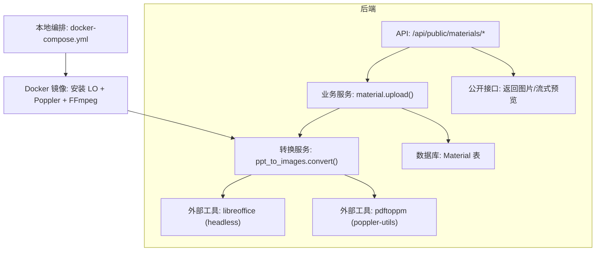
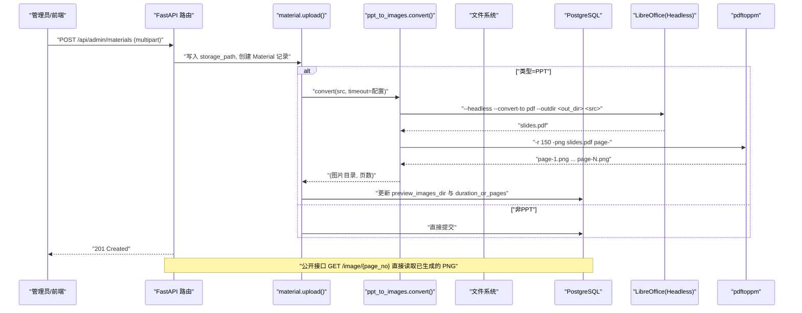
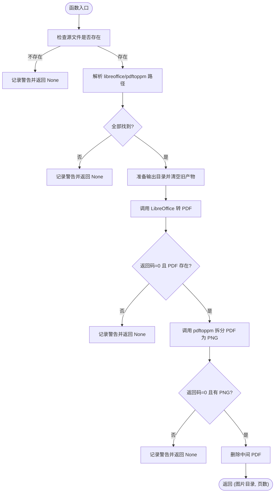
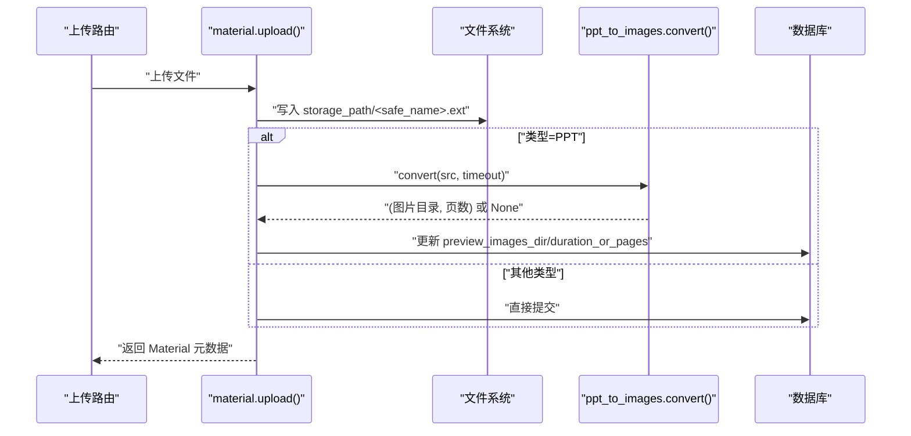
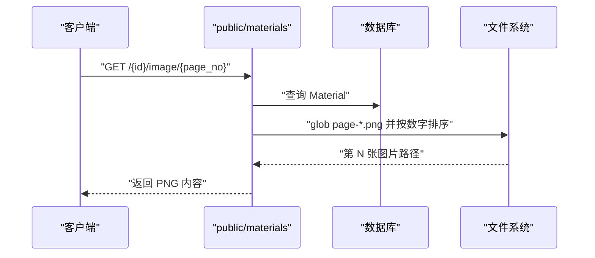
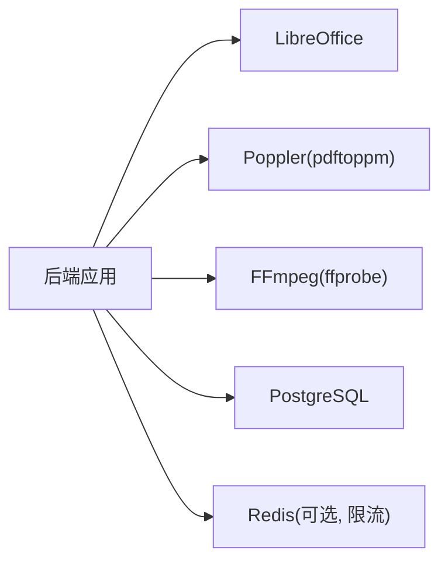

# PPT转图片服务

<cite>
**本文引用的文件**   
- [backend/app/services/ppt_to_images.py](file://backend/app/services/ppt_to_images.py)
- [backend/app/core/config.py](file://backend/app/core/config.py)
- [backend/app/services/material.py](file://backend/app/services/material.py)
- [backend/app/api/public/materials.py](file://backend/app/api/public/materials.py)
- [backend/app/models/material.py](file://backend/app/models/material.py)
- [backend/app/core/errors.py](file://backend/app/core/errors.py)
- [backend/app/core/rate_limit.py](file://backend/app/core/rate_limit.py)
- [backend/Dockerfile](file://backend/Dockerfile)
- [deploy/local/docker-compose.yml](file://deploy/local/docker-compose.yml)
- [doc/spec/07-技术架构.md](file://doc/spec/07-技术架构.md)
- [backend/tests/test_materials.py](file://backend/tests/test_materials.py)
- [deploy/local/regen_ppt_images.py](file://deploy/local/regen_ppt_images.py)
</cite>

## 目录
1. [简介](#简介)
2. [项目结构](#项目结构)
3. [核心组件](#核心组件)
4. [架构总览](#架构总览)
5. [详细组件分析](#详细组件分析)
6. [依赖关系分析](#依赖关系分析)
7. [性能考量](#性能考量)
8. [故障排除指南](#故障排除指南)
9. [结论](#结论)
10. [附录](#附录)

## 简介
本文件面向 Learning Hub 的“PPT/PPTX → 多张 PNG”预览能力，聚焦以下目标：
- LibreOffice 集成方案：进程管理、参数配置与错误处理
- 异步处理架构：任务队列、并发控制与资源管理（现状说明与演进建议）
- 图片生成流程：PPT 解析、页面渲染、格式转换与质量优化
- 错误重试机制：失败检测、指数退避与熔断保护（现状说明与演进建议）
- 文件路径安全管理：路径验证、目录隔离与权限控制
- 性能优化策略：内存管理、缓存机制与批处理优化
- 故障排除：常见错误诊断、日志分析与性能调优建议
- 集成测试用例与部署配置示例

## 项目结构
围绕 PPT 转图片的核心代码位于后端 services 层与 API 层，配合模型与配置模块完成端到端链路。

图示来源
- [backend/app/api/public/materials.py:1-224](file://backend/app/api/public/materials.py#L1-L224)
- [backend/app/services/material.py:1-234](file://backend/app/services/material.py#L1-L234)
- [backend/app/services/ppt_to_images.py:1-185](file://backend/app/services/ppt_to_images.py#L1-L185)
- [backend/Dockerfile:33-41](file://backend/Dockerfile#L33-L41)
- [deploy/local/docker-compose.yml:23-50](file://deploy/local/docker-compose.yml#L23-L50)

章节来源
- [backend/app/api/public/materials.py:1-224](file://backend/app/api/public/materials.py#L1-L224)
- [backend/app/services/material.py:1-234](file://backend/app/services/material.py#L1-L234)
- [backend/app/services/ppt_to_images.py:1-185](file://backend/app/services/ppt_to_images.py#L1-L185)
- [backend/Dockerfile:33-41](file://backend/Dockerfile#L33-L41)
- [deploy/local/docker-compose.yml:23-50](file://deploy/local/docker-compose.yml#L23-L50)

## 核心组件
- 转换服务：负责调用外部二进制进行 PPT→PDF→PNG 的两阶段转换，并输出固定命名规则的图片集合
- 素材服务：在上传流程中触发转换，持久化预览图片目录与页数信息
- 公开 API：提供按页获取 PNG 与流式预览接口，兼容降级策略
- 配置中心：集中管理可执行路径、超时等关键参数
- 数据模型：Material 记录存储路径、预览图片目录与页数

章节来源
- [backend/app/services/ppt_to_images.py:1-185](file://backend/app/services/ppt_to_images.py#L1-L185)
- [backend/app/services/material.py:129-202](file://backend/app/services/material.py#L129-L202)
- [backend/app/api/public/materials.py:149-180](file://backend/app/api/public/materials.py#L149-L180)
- [backend/app/core/config.py:57-61](file://backend/app/core/config.py#L57-L61)
- [backend/app/models/material.py:44-69](file://backend/app/models/material.py#L44-L69)

## 架构总览
下图展示从上传到公开访问的完整链路，以及 LibreOffice 与 Poppler 的外部依赖。

图示来源
- [backend/app/services/material.py:174-202](file://backend/app/services/material.py#L174-L202)
- [backend/app/services/ppt_to_images.py:92-181](file://backend/app/services/ppt_to_images.py#L92-L181)
- [backend/app/api/public/materials.py:149-180](file://backend/app/api/public/materials.py#L149-L180)
- [backend/Dockerfile:33-41](file://backend/Dockerfile#L33-L41)

## 详细组件分析

### 组件A：PPT 转图片服务（ppt_to_images.convert）
职责
- 解析输入源文件路径，校验存在性
- 定位可执行文件：优先 Settings 配置，其次 PATH，最后默认路径兜底
- 两阶段转换：PPT→PDF（LibreOffice headless），PDF→PNG（pdftoppm，分辨率 150dpi）
- 输出目录约定：与源文件同级，目录名为源文件名（不含扩展名），图片命名为 page-1.png … page-N.png
- 失败/超时仅记录日志，不抛异常，避免阻塞上传主流程

关键实现要点
- 可执行路径解析：_resolve_bin(name, env_name, default_path)
- 超时控制：统一使用 settings.ppt_convert_timeout
- 中间产物清理：删除中间 PDF，只保留 PNG
- 返回值：(图片目录绝对路径, 页数)，失败返回 None

图示来源
- [backend/app/services/ppt_to_images.py:26-45](file://backend/app/services/ppt_to_images.py#L26-L45)
- [backend/app/services/ppt_to_images.py:48-181](file://backend/app/services/ppt_to_images.py#L48-L181)

章节来源
- [backend/app/services/ppt_to_images.py:1-185](file://backend/app/services/ppt_to_images.py#L1-L185)

### 组件B：素材服务（material.upload）
职责
- 接收上传文件，按大小限制与安全命名落盘
- 根据扩展名推断类型（VIDEO/PDF/PPT）
- 对 VIDEO 调用 ffprobe 探测时长（可选）
- 对 PPT 调用转换服务，成功则更新 preview_images_dir 与页数；失败仅记录日志，不阻断上传
- 事务回滚时清理物理文件与预览目录

安全与健壮性
- 最大文件大小限制（与前端/网关一致）
- 唯一文件名生成，避免覆盖
- 异常捕获与回滚清理

图示来源
- [backend/app/services/material.py:129-202](file://backend/app/services/material.py#L129-L202)
- [backend/app/services/ppt_to_images.py:48-181](file://backend/app/services/ppt_to_images.py#L48-L181)

章节来源
- [backend/app/services/material.py:1-234](file://backend/app/services/material.py#L1-L234)

### 组件C：公开 API（materials）
职责
- 提供下载、流式预览与按页图片接口
- 针对 PPT：若已生成预览图片，则返回 imageUrls 与 imageCount；否则降级为附件下载
- 限流：对公开接口应用速率限制

图示来源
- [backend/app/api/public/materials.py:149-180](file://backend/app/api/public/materials.py#L149-L180)

章节来源
- [backend/app/api/public/materials.py:1-224](file://backend/app/api/public/materials.py#L1-L224)

### 组件D：配置与错误
- 配置项：libreoffice_path、poppler_path、ppt_convert_timeout、storage_path 等
- 错误码：统一的 ErrorCode 与 BusinessError，便于前端统一处理

章节来源
- [backend/app/core/config.py:57-61](file://backend/app/core/config.py#L57-L61)
- [backend/app/core/errors.py:1-144](file://backend/app/core/errors.py#L1-L144)

### 组件E：数据模型（Material）
- 关键字段：type、size_bytes、duration_or_pages、storage_path、preview_images_dir
- 约束：preview_images_dir 为空表示未转换或失败未重试

章节来源
- [backend/app/models/material.py:44-69](file://backend/app/models/material.py#L44-L69)

## 依赖关系分析
- 外部系统依赖
  - LibreOffice（headless）：用于 PPT→PDF
  - Poppler Utils（pdftoppm）：用于 PDF→PNG
  - FFmpeg（ffprobe）：用于视频时长探测（与 PPT 无关但同属媒体处理）
- 运行时依赖
  - FastAPI、SQLAlchemy、Pydantic Settings、SlowAPI 限流
- 容器化依赖
  - Dockerfile 中安装系统包与 Python 依赖

图示来源
- [backend/Dockerfile:33-41](file://backend/Dockerfile#L33-L41)
- [backend/app/core/rate_limit.py:40-46](file://backend/app/core/rate_limit.py#L40-L46)

章节来源
- [backend/Dockerfile:33-41](file://backend/Dockerfile#L33-L41)
- [backend/app/core/rate_limit.py:1-55](file://backend/app/core/rate_limit.py#L1-L55)

## 性能考量
- 当前实现特征
  - 同步调用外部进程：LibreOffice 与 pdftoppm 均为阻塞式 subprocess.run，受 ppt_convert_timeout 限制
  - 无内置任务队列与并发控制：上传即转换，单请求串行执行
  - 图片质量：固定 150dpi，兼顾体积与清晰度
- 优化建议（概念性）
  - 引入任务队列（如 Celery/RQ）将转换解耦为后台任务，提升吞吐与可观测性
  - 并发控制：基于队列 worker 数量与 CPU 核数设定并行度上限
  - 资源管理：为每个转换任务设置独立工作目录，完成后自动清理中间产物
  - 缓存机制：相同源文件的哈希结果复用，避免重复转换
  - 批处理优化：批量上传场景下合并中间步骤，减少进程启动开销
  - 监控指标：记录转换耗时、失败率、磁盘占用与进程存活状态

[本节为通用指导，不直接分析具体文件]

## 故障排除指南
常见问题与定位方法
- LibreOffice 未安装或不可执行
  - 现象：日志提示找不到或不可执行
  - 排查：确认容器内已安装 libreoffice-core/impress/common；检查环境变量或配置中的路径
  - 参考：[backend/app/services/ppt_to_images.py:69-76](file://backend/app/services/ppt_to_images.py#L69-L76)
- pdftoppm 缺失
  - 现象：日志提示 poppler-utils 未安装
  - 排查：确认容器内安装 poppler-utils；检查配置 poppler_path
  - 参考：[backend/app/services/ppt_to_images.py:73-76](file://backend/app/services/ppt_to_images.py#L73-L76)
- 转换超时
  - 现象：日志包含超时信息
  - 排查：增大 ppt_convert_timeout；检查大文件或复杂模板导致的慢转换
  - 参考：[backend/app/services/ppt_to_images.py:113-115](file://backend/app/services/ppt_to_images.py#L113-L115)
- 未生成 PNG
  - 现象：日志提示未产出 PNG
  - 排查：检查 PDF 是否生成；确认 pdftoppm 输出前缀与 glob 匹配
  - 参考：[backend/app/services/ppt_to_images.py:168-172](file://backend/app/services/ppt_to_images.py#L168-L172)
- 公开接口 404 或越界
  - 现象：请求特定页码返回 404
  - 排查：确认 preview_images_dir 非空且存在对应页码
  - 参考：[backend/app/api/public/materials.py:165-175](file://backend/app/api/public/materials.py#L165-L175)
- 上传被阻断
  - 现象：上传失败
  - 排查：检查文件大小限制、写入权限与磁盘空间
  - 参考：[backend/app/services/material.py:147-159](file://backend/app/services/material.py#L147-L159)

章节来源
- [backend/app/services/ppt_to_images.py:69-172](file://backend/app/services/ppt_to_images.py#L69-L172)
- [backend/app/api/public/materials.py:165-175](file://backend/app/api/public/materials.py#L165-L175)
- [backend/app/services/material.py:147-159](file://backend/app/services/material.py#L147-L159)

## 结论
- 当前实现以“上传即转换”的同步模式为主，通过严格的超时与错误日志保证上传不被阻塞
- 对外暴露稳定的图片访问接口，具备完善的降级策略
- 建议在后续版本引入任务队列与并发控制，以提升吞吐与可维护性
- 通过合理的配置与环境准备，可在生产环境稳定运行

[本节为总结性内容，不直接分析具体文件]

## 附录

### 集成测试用例
- 上传 PPT 后应触发转换，失败不阻断上传
  - 参考：[backend/tests/test_materials.py:41-52](file://backend/tests/test_materials.py#L41-L52)
- 规格文档中的验收用例（INT-V-001）
  - 参考：[doc/spec/07-技术架构.md:135-165](file://doc/spec/07-技术架构.md#L135-L165)

章节来源
- [backend/tests/test_materials.py:41-52](file://backend/tests/test_materials.py#L41-L52)
- [doc/spec/07-技术架构.md:135-165](file://doc/spec/07-技术架构.md#L135-L165)

### 部署配置示例
- Dockerfile 安装系统依赖（LibreOffice、Poppler、FFmpeg、字体）
  - 参考：[backend/Dockerfile:33-41](file://backend/Dockerfile#L33-L41)
- docker-compose 挂载存储卷与端口映射
  - 参考：[deploy/local/docker-compose.yml:23-50](file://deploy/local/docker-compose.yml#L23-L50)

章节来源
- [backend/Dockerfile:33-41](file://backend/Dockerfile#L33-L41)
- [deploy/local/docker-compose.yml:23-50](file://deploy/local/docker-compose.yml#L23-L50)

### 历史数据重跑脚本
- 遍历数据库中 PPT 素材，重新执行转换并更新预览目录与页数
  - 参考：[deploy/local/regen_ppt_images.py:41-57](file://deploy/local/regen_ppt_images.py#L41-L57)

章节来源
- [deploy/local/regen_ppt_images.py:41-57](file://deploy/local/regen_ppt_images.py#L41-L57)