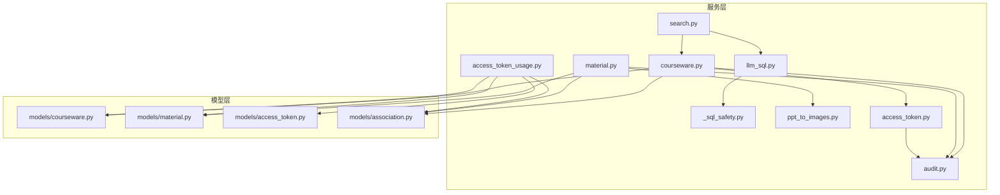
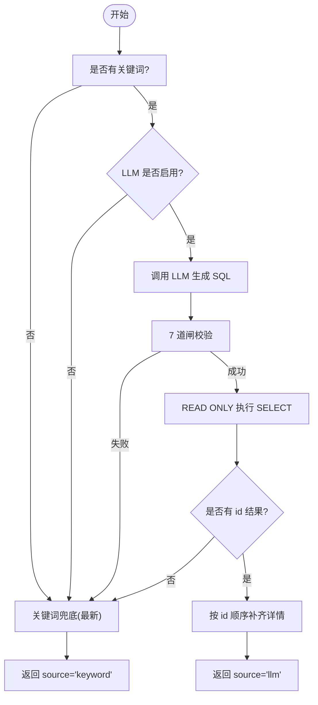
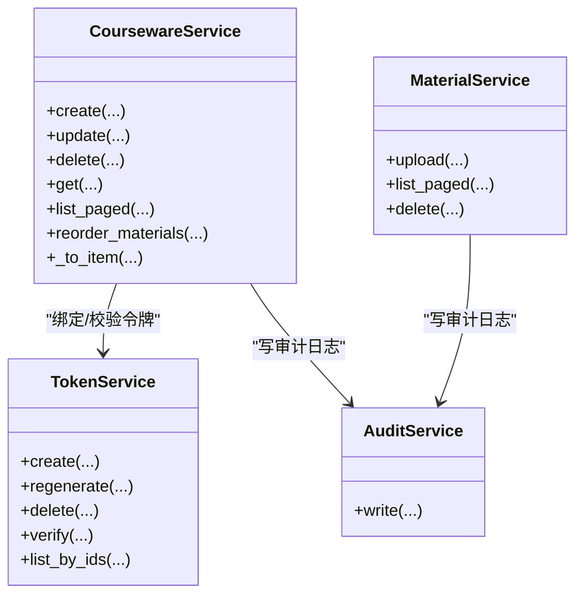
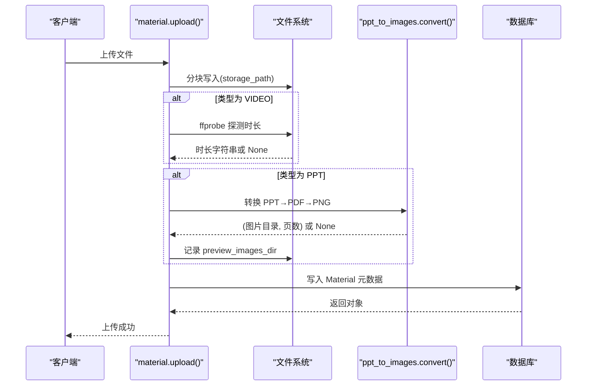
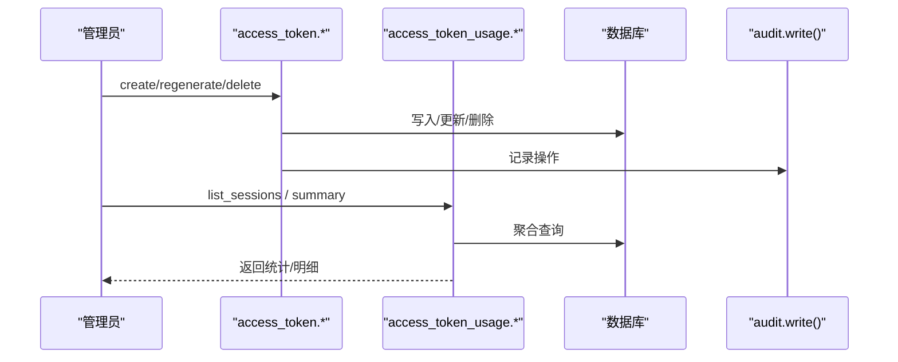
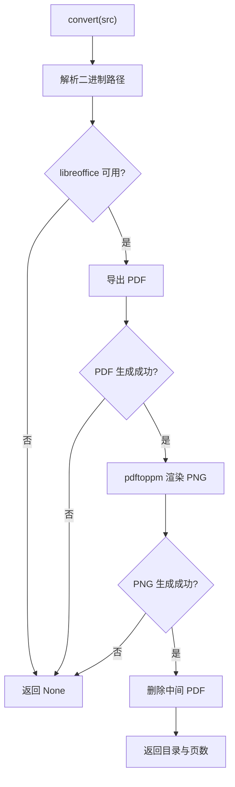
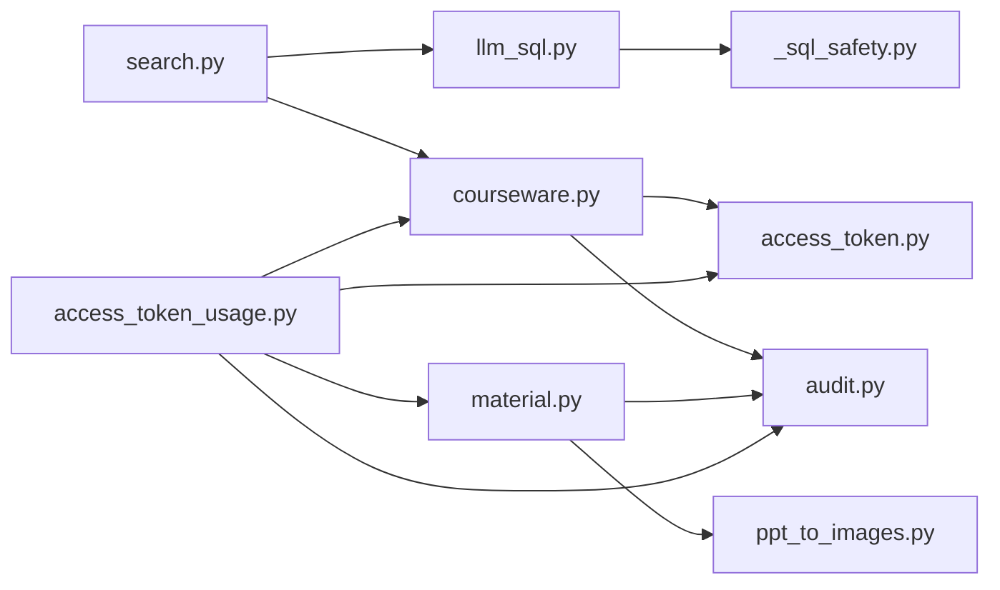

# 业务服务层

<cite>
**本文引用的文件**   
- [search.py](file://backend/app/services/search.py)
- [llm_sql.py](file://backend/app/services/llm_sql.py)
- [_sql_safety.py](file://backend/app/services/_sql_safety.py)
- [courseware.py](file://backend/app/services/courseware.py)
- [material.py](file://backend/app/services/material.py)
- [ppt_to_images.py](file://backend/app/services/ppt_to_images.py)
- [access_token.py](file://backend/app/services/access_token.py)
- [access_token_usage.py](file://backend/app/services/access_token_usage.py)
- [audit.py](file://backend/app/services/audit.py)
- [courseware.py(模型)](file://backend/app/models/courseware.py)
- [material.py(模型)](file://backend/app/models/material.py)
- [access_token.py(模型)](file://backend/app/models/access_token.py)
- [association.py](file://backend/app/models/association.py)
</cite>

## 目录
1. [简介](#简介)
2. [项目结构](#项目结构)
3. [核心组件](#核心组件)
4. [架构总览](#架构总览)
5. [详细组件分析](#详细组件分析)
6. [依赖关系分析](#依赖关系分析)
7. [性能考量](#性能考量)
8. [故障排查指南](#故障排查指南)
9. [结论](#结论)

## 简介
本设计文档聚焦 Learning Hub 后端业务服务层，围绕以下关键能力展开：
- 搜索服务：LLM-to-SQL 召回优先 + 关键词 ILIKE 兜底；包含中文查询清洗、SQL 安全校验与排序策略。
- 课件服务：生命周期管理（创建/更新/删除）、权限控制（OPEN/RESTRICTED）与访问统计联动。
- 素材服务：多格式上传、预览图生成（PPT→PNG）、流式传输优化与时长探测。
- 访问令牌服务：令牌验证、会话管理与审计日志记录。
- PPT 转图片服务：LibreOffice 集成、异步处理与错误重试机制。
- 设计模式：依赖注入、事务管理、异常处理最佳实践。

## 项目结构
业务服务位于 backend/app/services 下，按领域拆分模块；数据模型在 models 下；API 路由在 api 下。本次文档重点覆盖 services 与 models 的交互。



图表来源
- [search.py:1-263](file://backend/app/services/search.py#L1-L263)
- [llm_sql.py:1-490](file://backend/app/services/llm_sql.py#L1-L490)
- [_sql_safety.py:1-220](file://backend/app/services/_sql_safety.py#L1-L220)
- [courseware.py:1-492](file://backend/app/services/courseware.py#L1-L492)
- [material.py:1-234](file://backend/app/services/material.py#L1-L234)
- [ppt_to_images.py:1-185](file://backend/app/services/ppt_to_images.py#L1-L185)
- [access_token.py:1-235](file://backend/app/services/access_token.py#L1-L235)
- [access_token_usage.py:1-518](file://backend/app/services/access_token_usage.py#L1-L518)
- [audit.py:1-45](file://backend/app/services/audit.py#L1-L45)
- [courseware.py(模型):1-74](file://backend/app/models/courseware.py#L1-L74)
- [material.py(模型):1-69](file://backend/app/models/material.py#L1-L69)
- [access_token.py(模型):1-34](file://backend/app/models/access_token.py#L1-L34)
- [association.py:1-41](file://backend/app/models/association.py#L1-L41)

章节来源
- [search.py:1-263](file://backend/app/services/search.py#L1-L263)
- [courseware.py:1-492](file://backend/app/services/courseware.py#L1-L492)
- [material.py:1-234](file://backend/app/services/material.py#L1-L234)
- [access_token.py:1-235](file://backend/app/services/access_token.py#L1-L235)
- [access_token_usage.py:1-518](file://backend/app/services/access_token_usage.py#L1-L518)
- [ppt_to_images.py:1-185](file://backend/app/services/ppt_to_images.py#L1-L185)
- [llm_sql.py:1-490](file://backend/app/services/llm_sql.py#L1-L490)
- [_sql_safety.py:1-220](file://backend/app/services/_sql_safety.py#L1-L220)
- [audit.py:1-45](file://backend/app/services/audit.py#L1-L45)

## 核心组件
- 搜索服务：统一入口 search()，优先走 LLM-to-SQL，失败或禁用时回退到关键词 ILIKE；返回 source 标识来源。
- LLM-to-SQL：generate_sql → validate_sql（7 道闸）→ execute_search_sql（只取 id），再补齐完整 CoursewareItem。
- 课件服务：CRUD、标签/素材/令牌绑定、排序重写、公开列表与前台搜索。
- 素材服务：分块上传、大小限制、类型推断、视频时长探测、PPT 转 PNG 预览。
- 访问令牌服务：创建/重生成/删除、哈希比对验证、引用计数与最后令牌保护。
- 访问会话服务：开/关会话、时长校正、区间聚合与素材维度汇总。
- 审计服务：JSON Lines 追加写入，失败不阻断主流程。

章节来源
- [search.py:1-263](file://backend/app/services/search.py#L1-L263)
- [llm_sql.py:1-490](file://backend/app/services/llm_sql.py#L1-L490)
- [_sql_safety.py:1-220](file://backend/app/services/_sql_safety.py#L1-L220)
- [courseware.py:1-492](file://backend/app/services/courseware.py#L1-L492)
- [material.py:1-234](file://backend/app/services/material.py#L1-L234)
- [access_token.py:1-235](file://backend/app/services/access_token.py#L1-L235)
- [access_token_usage.py:1-518](file://backend/app/services/access_token_usage.py#L1-L518)
- [audit.py:1-45](file://backend/app/services/audit.py#L1-L45)

## 架构总览
搜索链路从 API 进入 search()，根据配置与调用结果选择 LLM 路径或关键词路径；LLM 路径通过 llm_sql.search 产出 id 序列，再由 search._fetch_coursewares 补齐关联字段。课件与素材服务负责资源生命周期与存储；访问令牌与会话服务提供鉴权与审计。

```mermaid
sequenceDiagram
participant Client as "客户端"
participant Search as "search.search()"
participant LLM as "llm_sql.search()"
participant Safety as "_sql_safety.validate_sql()"
participant DB as "数据库"
participant CW as "courseware._to_item()"
Client->>Search : 请求自然语言搜索
alt LLM 可用且启用
Search->>LLM : generate_sql + vocab_hint
LLM-->>Search : 原始 SQL
Search->>Safety : 7 道闸校验
Safety-->>Search : 清洗后 SQL 或拒绝
alt 校验通过
Search->>DB : SET TRANSACTION READ ONLY; 执行 SELECT
DB-->>Search : id 列表(已排序)
Search->>CW : 按 id 顺序补齐详情
CW-->>Search : items
Search-->>Client : {items, source="llm", total}
else 校验拒绝或无结果
Search->>Search : 降级关键词搜索
end
else LLM 不可用/超时/异常
Search->>Search : 关键词 ILIKE 搜索
end
Search-->>Client : {items, source="keyword", total}
```

图表来源
- [search.py:210-242](file://backend/app/services/search.py#L210-L242)
- [llm_sql.py:443-478](file://backend/app/services/llm_sql.py#L443-L478)
- [_sql_safety.py:165-210](file://backend/app/services/_sql_safety.py#L165-L210)
- [courseware.py:290-332](file://backend/app/services/courseware.py#L290-L332)

## 详细组件分析

### 搜索服务（LLM-to-SQL + 关键词兜底）
- 中文查询清洗：对“帮我找一下”“相关”等口语化表达进行正则裁剪，提取候选关键词集合，用于 ILIKE 多候选 OR 匹配。
- LLM-to-SQL：
  - 动态词汇提示：缓存 category.name/tag.name 实际值，提升 LLM 识别分类/标签语义的能力。
  - 安全校验：7 道闸（去 fence、单语句、无注释、首词 SELECT、黑名单、表白名单、强制 LIMIT）。
  - 执行策略：read-only 事务，仅取 id 列，避免 JOIN 大表带来的安全风险与复杂度。
- 排序算法：
  - LLM 路径：以 LLM 生成的 ORDER BY 为准，随后按 id 顺序补齐详情。
  - 关键词路径：默认按 updated_at 倒序，空关键词时返回最新。
- 降级策略：LLM 未启用、超时、校验拒绝、结果为空均回退到关键词搜索，并标记 source="keyword"。



图表来源
- [search.py:115-161](file://backend/app/services/search.py#L115-L161)
- [search.py:196-205](file://backend/app/services/search.py#L196-L205)
- [search.py:210-242](file://backend/app/services/search.py#L210-L242)
- [llm_sql.py:443-478](file://backend/app/services/llm_sql.py#L443-L478)
- [_sql_safety.py:165-210](file://backend/app/services/_sql_safety.py#L165-L210)

章节来源
- [search.py:1-263](file://backend/app/services/search.py#L1-L263)
- [llm_sql.py:1-490](file://backend/app/services/llm_sql.py#L1-L490)
- [_sql_safety.py:1-220](file://backend/app/services/_sql_safety.py#L1-L220)

### 课件服务（生命周期、权限与排序）
- 生命周期：
  - 创建：标题非空且长度限制；支持标签、素材、令牌绑定；受限模式需至少一个令牌；写入 sort_order 并刷新。
  - 更新：支持部分字段更新；RESTRICTED→OPEN 自动清空 token 绑定；material_ids 传入时按数组下标重写 sort_order。
  - 删除：级联清理关联表。
- 权限控制：
  - access_mode=OPEN/RESTRICTED；RESTRICTED 需绑定 AccessToken。
  - 列表接口支持按分类子树过滤、按 access_mode 过滤。
- 排序：
  - 专用 reorder_materials 接口确保 material_ids 数量一致、无重复、全部属于该课件，然后按 0..N-1 重写 sort_order。
  - _to_item 在 downloadable=True 时从关联表读取真实 sort_order，避免 ORM 加载顺序不一致导致的错位。



图表来源
- [courseware.py:105-167](file://backend/app/services/courseware.py#L105-L167)
- [courseware.py:170-278](file://backend/app/services/courseware.py#L170-L278)
- [courseware.py:335-393](file://backend/app/services/courseware.py#L335-L393)
- [courseware.py:290-332](file://backend/app/services/courseware.py#L290-L332)
- [access_token.py:73-99](file://backend/app/services/access_token.py#L73-L99)
- [audit.py:21-42](file://backend/app/services/audit.py#L21-L42)

章节来源
- [courseware.py:1-492](file://backend/app/services/courseware.py#L1-L492)
- [access_token.py:1-235](file://backend/app/services/access_token.py#L1-L235)
- [audit.py:1-45](file://backend/app/services/audit.py#L1-L45)

### 素材服务（上传、预览图、流式传输）
- 上传：
  - 分块读取（8MB 块），累计大小超过上限主动清理半文件并抛错。
  - 基于扩展名推断类型（VIDEO/PDF/PPT），非法类型直接拒绝。
  - 写入 storage_path，持久化元数据。
- 时长探测：
  - VIDEO：调用 ffprobe 解析 duration，失败不阻断上传。
- 预览图生成：
  - PPT：调用 ppt_to_images.convert 将 PPT 转为 PDF 再拆为 page-*.png，记录 preview_images_dir 与页数。
- 删除：
  - 若被课件引用则拒绝删除；否则物理删除文件与预览目录。



图表来源
- [material.py:129-202](file://backend/app/services/material.py#L129-L202)
- [ppt_to_images.py:48-181](file://backend/app/services/ppt_to_images.py#L48-L181)

章节来源
- [material.py:1-234](file://backend/app/services/material.py#L1-L234)
- [ppt_to_images.py:1-185](file://backend/app/services/ppt_to_images.py#L1-L185)

### 访问令牌服务（验证、会话、审计）
- 令牌管理：
  - 创建/重生成：生成随机明文，存 value_hash（SHA-256），仅创建/重生成时返回明文。
  - 删除：检查引用计数与最后令牌保护。
  - 验证：常量时间比较 value_hash。
- 会话管理：
  - start_session：校验令牌、素材存在性、ACL 权限；OPEN 课件跳过记录；写入 AccessSession。
  - leave_session：幂等结束；服务端时间校正；client_leave 标记。
- 审计日志：
  - 所有关键操作（创建/更新/删除/会话失败）写入 audit.jsonl，失败不抛错。



图表来源
- [access_token.py:73-138](file://backend/app/services/access_token.py#L73-L138)
- [access_token_usage.py:64-125](file://backend/app/services/access_token_usage.py#L64-L125)
- [access_token_usage.py:128-171](file://backend/app/services/access_token_usage.py#L128-L171)
- [audit.py:21-42](file://backend/app/services/audit.py#L21-L42)

章节来源
- [access_token.py:1-235](file://backend/app/services/access_token.py#L1-L235)
- [access_token_usage.py:1-518](file://backend/app/services/access_token_usage.py#L1-L518)
- [audit.py:1-45](file://backend/app/services/audit.py#L1-L45)

### PPT 转图片服务（LibreOffice 集成、异步与重试）
- 二进制定位：优先 settings 可执行路径，其次 PATH，最后默认路径。
- 转换流程：
  - LibreOffice headless 导出 PDF。
  - pdftoppm 将 PDF 每页渲染为 PNG（page-1.png 等）。
  - 删除中间 PDF，保留 PNG 目录。
- 错误处理：
  - 任何阶段失败/超时仅记录日志，返回 None，不阻断上传。
- 异步与重试：
  - 当前实现为同步调用；建议在外部队列中异步执行，并在失败时按指数退避重试（建议方案，非现有实现）。



图表来源
- [ppt_to_images.py:48-181](file://backend/app/services/ppt_to_images.py#L48-L181)

章节来源
- [ppt_to_images.py:1-185](file://backend/app/services/ppt_to_images.py#L1-L185)

## 依赖关系分析
- 服务间耦合：
  - search 依赖 llm_sql 与 courseware。
  - courseware 依赖 access_token、audit、category。
  - material 依赖 ppt_to_images、audit。
  - access_token_usage 依赖 access_token、courseware、material、audit。
- 模型依赖：
  - association 表承载 M:N 关系，含 sort_order 索引。
  - courseware.materials 使用 order_by 指定展示顺序。



图表来源
- [search.py:1-263](file://backend/app/services/search.py#L1-L263)
- [llm_sql.py:1-490](file://backend/app/services/llm_sql.py#L1-L490)
- [_sql_safety.py:1-220](file://backend/app/services/_sql_safety.py#L1-L220)
- [courseware.py:1-492](file://backend/app/services/courseware.py#L1-L492)
- [material.py:1-234](file://backend/app/services/material.py#L1-L234)
- [access_token.py:1-235](file://backend/app/services/access_token.py#L1-L235)
- [access_token_usage.py:1-518](file://backend/app/services/access_token_usage.py#L1-L518)
- [audit.py:1-45](file://backend/app/services/audit.py#L1-L45)

章节来源
- [association.py:1-41](file://backend/app/models/association.py#L1-L41)
- [courseware.py(模型):1-74](file://backend/app/models/courseware.py#L1-L74)

## 性能考量
- 搜索：
  - LLM 路径：read-only 事务、仅取 id、后续批量补齐详情，降低 JOIN 开销。
  - 词汇缓存：进程级 TTL 60s，减少频繁查询小表。
  - 关键词路径：EXISTS 联合 tag.name 匹配，避免大表 JOIN。
- 素材：
  - 分块上传避免内存峰值；ffprobe 与 PPT 转换失败不阻塞主流程。
- 会话聚合：
  - 使用窗口函数 row_number 与 case 表达式，减少应用层计算。

[本节为通用指导，无需具体文件分析]

## 故障排查指南
- 搜索失败：
  - 检查 LLM 配置与网络连通性；查看日志中的 timeout/fallback 信息。
  - 确认 SQL 安全校验失败原因（黑名单、表白名单、LIMIT 缺失等）。
- 素材上传：
  - 文件大小超限会主动清理半文件；检查 nginx client_max_body_size 与服务端 MAX_SIZE_BYTES 对齐。
  - PPT 转换失败不影响上传，前端走降级下载。
- 令牌与会话：
  - 令牌无效/不匹配会抛出 ACL 错误；检查 value_hash 与传入 hash 一致性。
  - 会话结束时长偏差超过阈值将被服务端校正。
- 审计日志：
  - 写入失败不抛错，检查 storage_path 父目录 logs 是否存在与可写。

章节来源
- [search.py:210-242](file://backend/app/services/search.py#L210-L242)
- [_sql_safety.py:165-210](file://backend/app/services/_sql_safety.py#L165-L210)
- [material.py:129-202](file://backend/app/services/material.py#L129-L202)
- [access_token_usage.py:128-171](file://backend/app/services/access_token_usage.py#L128-L171)
- [audit.py:21-42](file://backend/app/services/audit.py#L21-L42)

## 结论
本业务服务层以“安全优先、健壮降级、可观测”为核心原则：
- 搜索服务通过 LLM-to-SQL 提升语义召回质量，并以严格的 SQL 白名单与 read-only 执行保障安全，同时提供关键词兜底保证可用性。
- 课件与素材服务完善生命周期管理，结合 sort_order 与关联表索引优化展示顺序与查询性能。
- 访问令牌与会话服务提供细粒度权限控制与审计追踪，满足合规与运营需求。
- PPT 转图片服务采用外部工具链，失败不阻塞主流程，便于后续引入异步与重试增强稳定性。

[本节为总结性内容，无需具体文件分析]