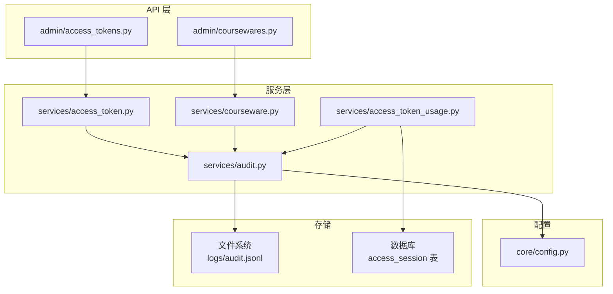
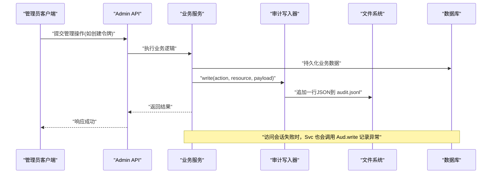
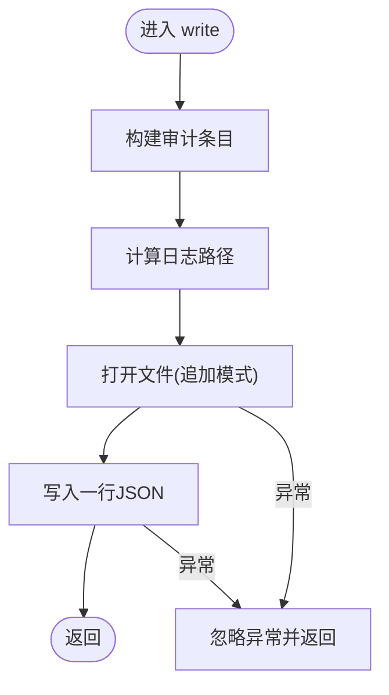
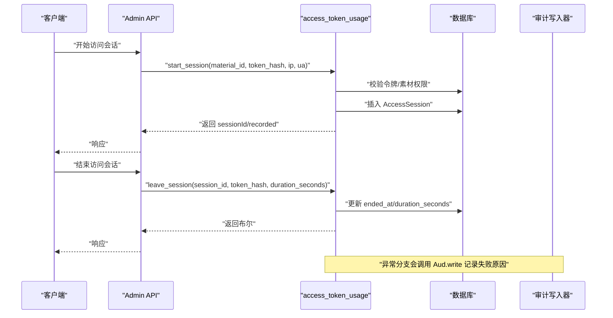
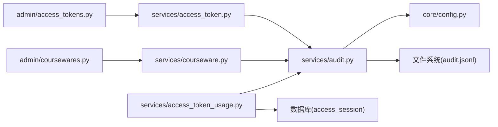
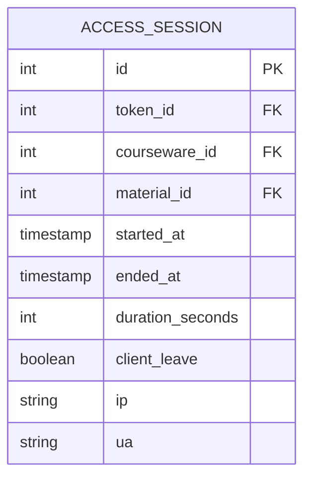

# 审计服务

<cite>
**本文引用的文件**   
- [audit.py](file://backend/app/services/audit.py)
- [config.py](file://backend/app/core/config.py)
- [access_token.py](file://backend/app/services/access_token.py)
- [access_token_usage.py](file://backend/app/services/access_token_usage.py)
- [courseware.py](file://backend/app/services/courseware.py)
- [access_tokens.py](file://backend/app/api/admin/access_tokens.py)
- [coursewares.py](file://backend/app/api/admin/coursewares.py)
- [2026_07_10_0930-c1d2e3f4a5b6_add_access_session.py](file://backend/alembic/versions/2026_07_10_0930-c1d2e3f4a5b6_add_access_session.py)
</cite>

## 目录
1. [引言](#引言)
2. [项目结构](#项目结构)
3. [核心组件](#核心组件)
4. [架构总览](#架构总览)
5. [详细组件分析](#详细组件分析)
6. [依赖关系分析](#依赖关系分析)
7. [性能考量](#性能考量)
8. [故障排查指南](#故障排查指南)
9. [结论](#结论)
10. [附录](#附录)

## 引言
本文件面向 Learning Hub 的“审计服务”设计，聚焦于管理侧关键操作的审计日志体系。当前实现采用 JSON Lines 格式将审计事件追加写入本地磁盘文件；同时结合访问会话（Access Session）数据提供用户行为追踪与操作溯源能力。文档从事件捕获、记录与存储策略、事件定义规范、异步处理扩展点、查询与分析、生命周期管理与合规、告警机制以及最佳实践等维度进行系统化阐述，并给出可落地的演进建议。

## 项目结构
审计相关代码主要位于后端服务的 services 层与 API 层：
- 审计核心：services/audit.py 提供统一的写入口 write(...)
- 配置来源：core/config.py 提供 storage_path，用于推导日志目录
- 业务触发点：
  - access_token.py：令牌创建、重新生成、删除等操作触发审计
  - courseware.py：课件创建、更新、删除、素材重排等操作触发审计
  - access_token_usage.py：访问会话开始/结束失败时记录异常审计
- API 层：admin 路由负责调用上述服务，间接产生审计事件
- 数据库迁移：alembic 版本脚本定义了访问会话表结构与索引，支撑审计数据的持久化与查询

图表来源
- [access_tokens.py:1-120](file://backend/app/api/admin/access_tokens.py#L1-L120)
- [coursewares.py:1-115](file://backend/app/api/admin/coursewares.py#L1-L115)
- [access_token.py:73-138](file://backend/app/services/access_token.py#L73-L138)
- [courseware.py:105-167](file://backend/app/services/courseware.py#L105-L167)
- [access_token_usage.py:64-171](file://backend/app/services/access_token_usage.py#L64-L171)
- [audit.py:13-42](file://backend/app/services/audit.py#L13-L42)
- [config.py:54-56](file://backend/app/core/config.py#L54-L56)

章节来源
- [audit.py:1-45](file://backend/app/services/audit.py#L1-L45)
- [config.py:1-88](file://backend/app/core/config.py#L1-L88)
- [access_token.py:1-235](file://backend/app/services/access_token.py#L1-L235)
- [courseware.py:1-492](file://backend/app/services/courseware.py#L1-L492)
- [access_token_usage.py:1-518](file://backend/app/services/access_token_usage.py#L1-L518)
- [access_tokens.py:1-120](file://backend/app/api/admin/access_tokens.py#L1-L120)
- [coursewares.py:1-115](file://backend/app/api/admin/coursewares.py#L1-L115)
- [2026_07_10_0930-c1d2e3f4a5b6_add_access_session.py:1-123](file://backend/alembic/versions/2026_07_10_0930-c1d2e3f4a5b6_add_access_session.py#L1-L123)

## 核心组件
- 审计写入器（services/audit.py）
  - 职责：构造标准审计条目，按行追加到 logs/audit.jsonl
  - 字段：ts（UTC ISO）、actor、action、resource、payload
  - 容错：写入异常不抛错，避免影响主流程
- 配置中心（core/config.py）
  - 提供 storage_path，审计服务据此计算日志目录
- 业务触发点
  - 访问令牌：创建、重新生成、删除
  - 课件：创建、更新、删除、素材顺序调整
  - 访问会话：开始/结束失败时的异常审计
- 访问会话服务（services/access_token_usage.py）
  - 提供会话开启/关闭、区间聚合、明细分页等能力，为审计分析提供结构化数据源

章节来源
- [audit.py:21-42](file://backend/app/services/audit.py#L21-L42)
- [config.py:54-56](file://backend/app/core/config.py#L54-L56)
- [access_token.py:91-138](file://backend/app/services/access_token.py#L91-L138)
- [courseware.py:161-167](file://backend/app/services/courseware.py#L161-L167)
- [courseware.py:272-285](file://backend/app/services/courseware.py#L272-L285)
- [courseware.py:387-392](file://backend/app/services/courseware.py#L387-L392)
- [access_token_usage.py:113-170](file://backend/app/services/access_token_usage.py#L113-L170)

## 架构总览
审计系统由“事件捕获 → 事件记录 → 持久化存储 → 查询分析”构成闭环。当前阶段以本地 JSONL 为主，辅以数据库中的访问会话明细，形成“管理操作 + 使用行为”的双轨审计视图。

图表来源
- [access_tokens.py:71-76](file://backend/app/api/admin/access_tokens.py#L71-L76)
- [access_token.py:73-99](file://backend/app/services/access_token.py#L73-L99)
- [audit.py:21-42](file://backend/app/services/audit.py#L21-L42)
- [access_token_usage.py:113-125](file://backend/app/services/access_token_usage.py#L113-L125)

## 详细组件分析

### 审计写入器（services/audit.py）
- 功能要点
  - 通过配置获取 storage_path，向上取父目录后拼接 logs 子目录，确保目录存在
  - 构造统一结构的审计条目，包含时间戳、操作者、动作、资源标识与负载
  - 以 UTF-8 编码追加写入 audit.jsonl，每行一条 JSON
  - 异常吞掉，保证主流程不受影响
- 数据结构
  - ts：UTC ISO 字符串
  - actor：默认 single-admin，可由调用方传入
  - action：短命名空间式动作名，如 token.create、courseware.update
  - resource：资源标识，如 token:{id}、courseware:{id}
  - payload：可选字典，承载上下文信息（如 label、title、order 等）
- 复杂度与性能
  - 单条追加 O(1)，I/O 阻塞在磁盘写入
  - 无锁并发下多进程追加可能交错，但 JSONL 行级结构便于外部解析
- 可扩展性
  - 可替换为异步队列或批量落盘策略，保持接口不变

图表来源
- [audit.py:13-42](file://backend/app/services/audit.py#L13-L42)

章节来源
- [audit.py:13-42](file://backend/app/services/audit.py#L13-L42)

### 访问令牌审计（services/access_token.py）
- 触发点
  - 创建令牌：记录 token.create，附带 label
  - 重新生成令牌：记录 token.regenerate，附带 label
  - 删除令牌：记录 token.delete，附带 label
- 安全与合规
  - 明文仅创建/重新生成时返回一次，数据库仅存哈希
  - 审计 payload 不包含敏感明文，仅含必要元信息
- 错误处理
  - 业务校验失败抛出业务异常，不影响审计写入（若已写入则保留）

章节来源
- [access_token.py:73-99](file://backend/app/services/access_token.py#L73-L99)
- [access_token.py:102-119](file://backend/app/services/access_token.py#L102-L119)
- [access_token.py:122-138](file://backend/app/services/access_token.py#L122-L138)

### 课件审计（services/courseware.py）
- 触发点
  - 创建课件：记录 courseware.create，附带 title、accessMode
  - 更新课件：记录 courseware.update，附带 accessMode
  - 删除课件：记录 courseware.delete
  - 素材重排：记录 courseware.reorder_materials，附带 order 列表
- 业务规则联动
  - RESTRICTED 模式需绑定至少一个令牌
  - 从 RESTRICTED 降级为 OPEN 自动清空 token 绑定
- 审计一致性
  - 所有变更均在事务提交后记录，确保审计与数据一致

章节来源
- [courseware.py:105-167](file://backend/app/services/courseware.py#L105-L167)
- [courseware.py:170-278](file://backend/app/services/courseware.py#L170-L278)
- [courseware.py:281-285](file://backend/app/services/courseware.py#L281-L285)
- [courseware.py:335-393](file://backend/app/services/courseware.py#L335-L393)

### 访问会话审计（services/access_token_usage.py）
- 功能要点
  - start_session：校验令牌、素材权限，必要时记录 access_session.start_failed
  - leave_session：幂等结束会话，失败时记录 access_session.leave_failed
  - 聚合与明细：支持按时间范围过滤、按素材聚合、分页明细
- 时间校正
  - 客户端 duration 与服务端差值超过阈值时使用服务端时长，防篡改与时钟漂移
- 查询能力
  - summary_overall：全时段聚合
  - summary_in_range：区间聚合
  - list_sessions：分页明细，支持 material_id、courseware_id 过滤
  - list_material_summary：按素材聚合，展示最近观看课件与累计时长

图表来源
- [access_token_usage.py:64-125](file://backend/app/services/access_token_usage.py#L64-L125)
- [access_token_usage.py:128-171](file://backend/app/services/access_token_usage.py#L128-L171)
- [access_token_usage.py:286-312](file://backend/app/services/access_token_usage.py#L286-L312)
- [access_token_usage.py:315-400](file://backend/app/services/access_token_usage.py#L315-L400)
- [access_token_usage.py:403-506](file://backend/app/services/access_token_usage.py#L403-L506)

章节来源
- [access_token_usage.py:64-171](file://backend/app/services/access_token_usage.py#L64-L171)
- [access_token_usage.py:286-312](file://backend/app/services/access_token_usage.py#L286-L312)
- [access_token_usage.py:315-400](file://backend/app/services/access_token_usage.py#L315-L400)
- [access_token_usage.py:403-506](file://backend/app/services/access_token_usage.py#L403-L506)

### API 层集成（admin 路由）
- admin/access_tokens.py
  - 提供令牌 CRUD 与详情（可选附加 usageSummary）
  - 通过 services/access_token.py 触发审计
- admin/coursewares.py
  - 提供课件 CRUD 与素材排序
  - 通过 services/courseware.py 触发审计

章节来源
- [access_tokens.py:60-116](file://backend/app/api/admin/access_tokens.py#L60-L116)
- [coursewares.py:24-112](file://backend/app/api/admin/coursewares.py#L24-L112)

## 依赖关系分析
- 模块耦合
  - API 层依赖服务层；服务层依赖审计写入器与数据库
  - 审计写入器仅依赖配置与文件系统，低耦合
- 外部依赖
  - 文件系统：audit.jsonl 追加写入
  - 数据库：access_session 表及索引，支撑查询与分析
- 潜在循环依赖
  - 当前未发现循环导入；审计写入器不反向依赖业务服务

图表来源
- [access_tokens.py:1-120](file://backend/app/api/admin/access_tokens.py#L1-L120)
- [coursewares.py:1-115](file://backend/app/api/admin/coursewares.py#L1-L115)
- [access_token.py:1-235](file://backend/app/services/access_token.py#L1-L235)
- [courseware.py:1-492](file://backend/app/services/courseware.py#L1-L492)
- [access_token_usage.py:1-518](file://backend/app/services/access_token_usage.py#L1-L518)
- [audit.py:1-45](file://backend/app/services/audit.py#L1-L45)
- [config.py:1-88](file://backend/app/core/config.py#L1-L88)

章节来源
- [access_tokens.py:1-120](file://backend/app/api/admin/access_tokens.py#L1-L120)
- [coursewares.py:1-115](file://backend/app/api/admin/coursewares.py#L1-L115)
- [access_token.py:1-235](file://backend/app/services/access_token.py#L1-L235)
- [courseware.py:1-492](file://backend/app/services/courseware.py#L1-L492)
- [access_token_usage.py:1-518](file://backend/app/services/access_token_usage.py#L1-L518)
- [audit.py:1-45](file://backend/app/services/audit.py#L1-L45)
- [config.py:1-88](file://backend/app/core/config.py#L1-L88)

## 性能考量
- 写入路径
  - 当前同步追加写入，简单可靠；在高并发场景下可能成为瓶颈
- 建议优化
  - 引入内存缓冲与定时批量落盘，降低 I/O 次数
  - 使用独立线程或进程执行写入，避免阻塞请求线程
  - 对大 payload 进行压缩或裁剪，减少磁盘占用
- 查询路径
  - 访问会话聚合使用 SQL 函数与窗口函数，注意索引覆盖
  - 时间范围过滤基于 started_at，应确保索引有效

[本节为通用指导，无需特定文件引用]

## 故障排查指南
- 常见问题
  - 日志目录不存在：检查 storage_path 配置与运行用户对父目录的写权限
  - 写入失败：当前吞掉异常，可通过外部监控日志目录是否增长判断
  - 审计缺失：确认业务分支是否调用 audit.write，且未提前 return
- 定位方法
  - 查看 logs/audit.jsonl 最新行，核对 action/resource/payload
  - 对照数据库 access_session 明细，验证会话开始/结束是否成功
- 恢复步骤
  - 修复权限后重启服务，观察新写入是否正常
  - 对历史数据进行离线清洗与校验，确保完整性

章节来源
- [audit.py:21-42](file://backend/app/services/audit.py#L21-L42)
- [access_token_usage.py:113-170](file://backend/app/services/access_token_usage.py#L113-L170)

## 结论
当前审计服务以轻量 JSONL 形式记录管理操作，并结合访问会话数据提供使用行为追踪。该方案具备高内聚、低耦合、易扩展的特点。后续可在不改变现有接口的前提下，逐步引入异步队列、批量写入、归档清理与告警通知等能力，以满足更高吞吐与合规要求。

[本节为总结性内容，无需特定文件引用]

## 附录

### 审计事件定义规范
- 事件类型（action）
  - token.create / token.regenerate / token.delete
  - courseware.create / courseware.update / courseware.delete / courseware.reorder_materials
  - access_session.start_failed / access_session.leave_failed
- 字段标准
  - ts：UTC ISO 字符串
  - actor：操作主体标识（默认 single-admin）
  - action：短命名空间式动作名
  - resource：资源标识，遵循 type:id 约定
  - payload：键值对，避免包含敏感明文
- 格式化规则
  - 每行一条 JSON，UTF-8 编码，换行符使用平台默认
  - 字段顺序固定，便于下游解析

章节来源
- [audit.py:21-42](file://backend/app/services/audit.py#L21-L42)
- [access_token.py:91-138](file://backend/app/services/access_token.py#L91-L138)
- [courseware.py:161-167](file://backend/app/services/courseware.py#L161-L167)
- [courseware.py:272-285](file://backend/app/services/courseware.py#L272-L285)
- [courseware.py:387-392](file://backend/app/services/courseware.py#L387-L392)
- [access_token_usage.py:113-170](file://backend/app/services/access_token_usage.py#L113-L170)

### 异步日志处理机制（演进建议）
- 消息队列
  - 引入轻量队列（如 Redis Streams 或内置队列），将 write 改为入队
  - 消费者批量拉取，合并写入，降低 I/O 压力
- 批量写入
  - 设置批次大小与超时阈值，达到任一条件即落盘
- 持久化策略
  - 主备双写或先写 WAL 再落盘，保障可靠性
  - 分片与滚动切割，避免单文件过大

[本节为概念性设计，无需特定文件引用]

### 审计数据查询与分析
- 时间范围过滤
  - 基于 started_at 的区间查询，支持 YYYY-MM-DD 输入
- 用户行为追踪
  - 按 token_id 聚合总停留、次数、课件数、素材数
- 操作溯源
  - 结合 audit.jsonl 与管理操作，还原完整链路

章节来源
- [access_token_usage.py:286-312](file://backend/app/services/access_token_usage.py#L286-L312)
- [access_token_usage.py:315-400](file://backend/app/services/access_token_usage.py#L315-L400)
- [access_token_usage.py:403-506](file://backend/app/services/access_token_usage.py#L403-L506)

### 审计数据生命周期管理
- 归档策略
  - 按月滚动归档，压缩存储
- 清理规则
  - 保留期策略（如 180 天），过期自动清理
- 合规要求
  - 脱敏与最小化原则，避免记录敏感信息
  - 审计不可篡改，建议只追加模式与校验和

[本节为通用指导，无需特定文件引用]

### 审计告警机制（演进建议）
- 异常检测
  - 对失败事件（如 access_session.*_failed）进行实时统计
- 阈值配置
  - 单位时间内失败率超过阈值触发告警
- 通知渠道
  - 邮件、企业微信、钉钉等

[本节为概念性设计，无需特定文件引用]

### 审计最佳实践
- 隐私保护
  - 不在 payload 中记录明文令牌、密码、个人信息
- 性能优化
  - 异步写入、批量落盘、合理索引
- 扩展开发指南
  - 新增审计点优先复用 audit.write，保持字段规范一致
  - 对高频路径增加批处理与限流保护

[本节为通用指导，无需特定文件引用]

### 访问会话数据模型（参考）

图表来源
- [2026_07_10_0930-c1d2e3f4a5b6_add_access_session.py:1-123](file://backend/alembic/versions/2026_07_10_0930-c1d2e3f4a5b6_add_access_session.py#L1-L123)