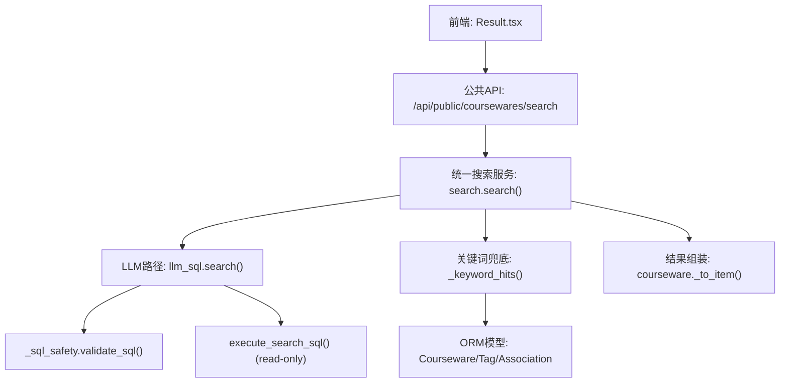
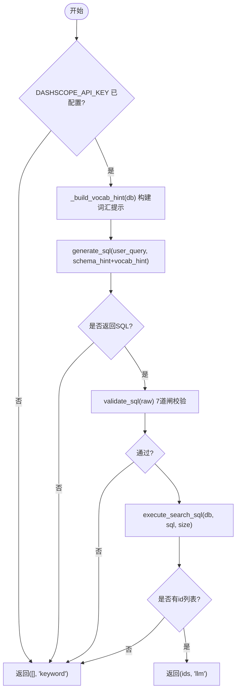
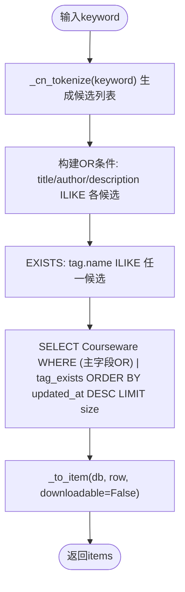
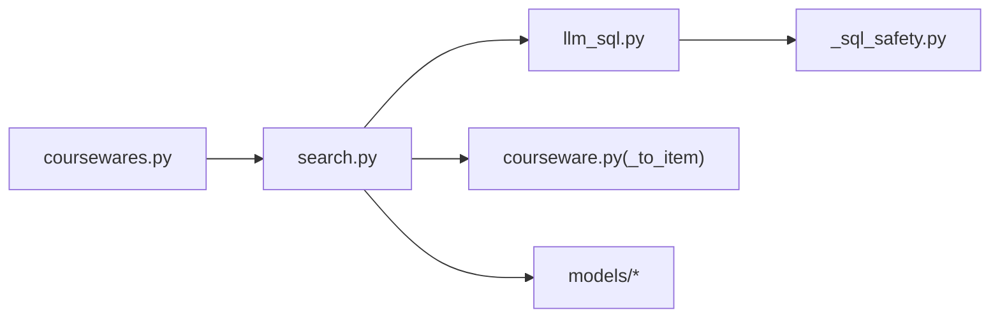

# 搜索服务

<cite>
**本文引用的文件列表**
- [backend/app/services/search.py](file://backend/app/services/search.py)
- [backend/app/services/llm_sql.py](file://backend/app/services/llm_sql.py)
- [backend/app/services/_sql_safety.py](file://backend/app/services/_sql_safety.py)
- [backend/app/api/public/coursewares.py](file://backend/app/api/public/coursewares.py)
- [backend/app/models/courseware.py](file://backend/app/models/courseware.py)
- [backend/app/models/tag.py](file://backend/app/models/tag.py)
- [backend/app/models/association.py](file://backend/app/models/association.py)
- [backend/app/services/courseware.py](file://backend/app/services/courseware.py)
- [frontend/src/pages/public/Result.tsx](file://frontend/src/pages/public/Result.tsx)
- [deploy/local/README.md](file://deploy/local/README.md)
- [doc/test/README.md](file://doc/test/README.md)
</cite>

## 目录
1. [简介](#简介)
2. [项目结构](#项目结构)
3. [核心组件](#核心组件)
4. [架构总览](#架构总览)
5. [详细组件分析](#详细组件分析)
6. [依赖关系分析](#依赖关系分析)
7. [性能与优化](#性能与优化)
8. [故障排查指南](#故障排查指南)
9. [结论](#结论)
10. [附录：扩展与集成](#附录扩展与集成)

## 简介
本技术文档聚焦 Learning Hub 的“LLM-to-SQL 智能搜索”能力，系统性地阐述自然语言查询处理、SQL 生成与安全校验、执行与降级策略、关键词兜底搜索（中文清洗、正则匹配、ILIKE 优化）、结果排序与聚合、以及性能优化与可扩展性设计。读者可据此理解从前端请求到数据库返回的完整链路，并掌握如何扩展新的搜索算法或接入第三方搜索引擎。

## 项目结构
搜索功能主要位于后端 services 层，API 路由在 public 模块暴露；模型定义在 models 层；前端页面 Result.tsx 负责展示搜索结果与来源徽标。



图表来源
- [backend/app/api/public/coursewares.py:32-54](file://backend/app/api/public/coursewares.py#L32-L54)
- [backend/app/services/search.py:210-242](file://backend/app/services/search.py#L210-L242)
- [backend/app/services/llm_sql.py:443-478](file://backend/app/services/llm_sql.py#L443-L478)
- [backend/app/services/_sql_safety.py:165-210](file://backend/app/services/_sql_safety.py#L165-L210)
- [backend/app/services/courseware.py:290-332](file://backend/app/services/courseware.py#L290-L332)

章节来源
- [backend/app/api/public/coursewares.py:32-54](file://backend/app/api/public/coursewares.py#L32-L54)
- [backend/app/services/search.py:1-262](file://backend/app/services/search.py#L1-L262)
- [backend/app/services/llm_sql.py:1-490](file://backend/app/services/llm_sql.py#L1-L490)
- [backend/app/services/_sql_safety.py:1-220](file://backend/app/services/_sql_safety.py#L1-L220)
- [backend/app/services/courseware.py:290-332](file://backend/app/services/courseware.py#L290-L332)
- [frontend/src/pages/public/Result.tsx:1-42](file://frontend/src/pages/public/Result.tsx#L1-L42)

## 核心组件
- 统一搜索服务 search.search(): 优先走 LLM-to-SQL，失败或不可用时自动降级为关键词 ILIKE 兜底，返回 {items, source, total}。
- LLM-to-SQL 服务 llm_sql.search(): 调用 qwen-plus 生成 SELECT，经 7 道闸安全校验后在 read-only 事务中执行，仅取 id 列表。
- SQL 安全校验 _sql_safety.validate_sql(): 纯函数实现 7 道闸白名单校验，拒绝危险语句、强制 LIMIT、限制表名等。
- 关键词兜底 _keyword_hits(): 中文查询清洗 + 多候选 ILIKE + EXISTS 标签匹配，按 updated_at 倒序返回。
- 结果组装 courseware._to_item(): 将 ORM 对象转为前端所需字典，包含分类、标签、素材、令牌等关联信息。

章节来源
- [backend/app/services/search.py:105-242](file://backend/app/services/search.py#L105-L242)
- [backend/app/services/llm_sql.py:267-478](file://backend/app/services/llm_sql.py#L267-L478)
- [backend/app/services/_sql_safety.py:165-210](file://backend/app/services/_sql_safety.py#L165-L210)
- [backend/app/services/courseware.py:290-332](file://backend/app/services/courseware.py#L290-L332)

## 架构总览
下图展示了从前端请求到最终返回的端到端流程，包括 LLM 路径与关键词兜底的分支逻辑。

```mermaid
sequenceDiagram
participant FE as "前端 : Result.tsx"
participant API as "FastAPI : /api/public/coursewares/search"
participant SS as "search.search()"
participant LS as "llm_sql.search()"
participant SAF as "_sql_safety.validate_sql()"
participant DB as "PostgreSQL"
participant KW as "_keyword_hits()"
FE->>API : GET /api/public/coursewares/search?q=...&size=...
API->>SS : 调用异步搜索
alt LLM可用且非空查询
SS->>LS : generate_sql → validate_sql → execute_search_sql
LS->>SAF : 7道闸校验
SAF-->>LS : 通过/拒绝
alt 通过且有结果
LS->>DB : SET TRANSACTION READ ONLY; SELECT ... ORDER BY updated_at DESC LIMIT N
DB-->>LS : id 列表(按LLM排序)
LS-->>SS : ids, source="llm"
SS->>SS : _fetch_coursewares(ids) 补齐详情
SS-->>API : SearchResult(source="llm", items, total)
else 拒绝或无结果
SS->>KW : 关键词兜底
KW->>DB : ILIKE + EXISTS tag.name
DB-->>KW : 命中记录
KW-->>SS : items
SS-->>API : SearchResult(source="keyword", items, total)
end
else LLM不可用或空查询
SS->>KW : 关键词兜底
KW->>DB : ILIKE + EXISTS tag.name
DB-->>KW : 命中记录
KW-->>SS : items
SS-->>API : SearchResult(source="keyword", items, total)
end
API-->>FE : data={items, source, total, page, size}
```

图表来源
- [backend/app/api/public/coursewares.py:32-54](file://backend/app/api/public/coursewares.py#L32-L54)
- [backend/app/services/search.py:210-242](file://backend/app/services/search.py#L210-L242)
- [backend/app/services/llm_sql.py:443-478](file://backend/app/services/llm_sql.py#L443-L478)
- [backend/app/services/_sql_safety.py:165-210](file://backend/app/services/_sql_safety.py#L165-L210)

## 详细组件分析

### LLM-to-SQL 智能搜索
- 启用检测: is_enabled() 基于 DASHSCOPE_API_KEY 配置判断。
- Schema 提示: SCHEMA_HINT 描述搜索主实体与字段，强调 ILIKE 子串匹配、禁止敏感列、默认排序与 LIMIT。
- 动态词汇注入: _build_vocab_hint(db) 拉取 category.name 与 tag.name 实际值，拼接至 schema_hint，提升对“用户问的分类/标签名”识别率；进程级缓存 TTL 60s。
- 生成 SQL: generate_sql(user_query, schema_hint, vocab_hint) 调用 dashscope Generation.call，temperature=0.0，result_format=message。
- 安全校验: validate_sql(raw) 执行 7 道闸（去 markdown fence、单语句、无注释、首词 SELECT、黑名单关键字、表白名单、强制 LIMIT）。
- 执行: execute_search_sql(db, sql, size) 在 read-only 事务中执行，提取 id 列（支持别名），去重并按 capped_size 截断。
- 主入口: search(db, keyword, size) 返回 (ids, source)，source="llm" 表示成功，否则 "keyword"。



图表来源
- [backend/app/services/llm_sql.py:44-113](file://backend/app/services/llm_sql.py#L44-L113)
- [backend/app/services/llm_sql.py:276-344](file://backend/app/services/llm_sql.py#L276-L344)
- [backend/app/services/_sql_safety.py:165-210](file://backend/app/services/_sql_safety.py#L165-L210)
- [backend/app/services/llm_sql.py:385-437](file://backend/app/services/llm_sql.py#L385-L437)
- [backend/app/services/llm_sql.py:443-478](file://backend/app/services/llm_sql.py#L443-L478)

章节来源
- [backend/app/services/llm_sql.py:126-261](file://backend/app/services/llm_sql.py#L126-L261)
- [backend/app/services/llm_sql.py:267-344](file://backend/app/services/llm_sql.py#L267-L344)
- [backend/app/services/_sql_safety.py:23-88](file://backend/app/services/_sql_safety.py#L23-88)
- [backend/app/services/llm_sql.py:385-437](file://backend/app/services/llm_sql.py#L385-L437)
- [backend/app/services/llm_sql.py:443-478](file://backend/app/services/llm_sql.py#L443-L478)

### 关键词兜底搜索（中文清洗与 ILIKE 优化）
- 中文清洗: _cn_tokenize(q) 使用一组正则裁剪礼貌/求助语气、保留中心名词、去除平台术语与停用词，输出多个候选字符串用于 ILIKE。
- ILIKE 匹配: 对 title/author/description 进行 OR 组合的多候选匹配；标签匹配通过 EXISTS 联合 tag.name，避免大表 JOIN 成本。
- 默认排序: 无关键词时按 updated_at 倒序返回最新；有关键词时仍保持该排序。
- 结果组装: 复用 courseware._to_item(db, obj, downloadable=False) 构造前端所需字段。



图表来源
- [backend/app/services/search.py:40-102](file://backend/app/services/search.py#L40-L102)
- [backend/app/services/search.py:115-160](file://backend/app/services/search.py#L115-L160)
- [backend/app/services/courseware.py:290-332](file://backend/app/services/courseware.py#L290-L332)

章节来源
- [backend/app/services/search.py:40-102](file://backend/app/services/search.py#L40-L102)
- [backend/app/services/search.py:115-160](file://backend/app/services/search.py#L115-L160)
- [backend/app/services/courseware.py:290-332](file://backend/app/services/courseware.py#L290-L332)

### 结果排序策略与数据聚合
- LLM 路径: 由生成的 SQL 决定排序（通常 ORDER BY updated_at DESC），search._fetch_coursewares 按 id 顺序补齐完整 CoursewareItem。
- 关键词路径: 固定按 updated_at 倒序，确保一致性。
- 数据聚合: _to_item 聚合分类名称、标签ID/名称、素材ID/类型/大小/时长/流式与下载URL、令牌ID等，供前端直接渲染。

章节来源
- [backend/app/services/search.py:166-190](file://backend/app/services/search.py#L166-L190)
- [backend/app/services/courseware.py:290-332](file://backend/app/services/courseware.py#L290-L332)

### 搜索降级机制
- 触发条件: DASHSCOPE_API_KEY 未配置、dashscope 调用异常/超时、SQL 校验拒绝、执行结果为空、空查询。
- 降级行为: 自动切换至关键词兜底，返回 source="keyword"，前端徽标显示“AI 智能搜索 · 降级中”。
- 超时控制: 通过 asyncio.wait_for 包裹 LLM 同步包装，超时阈值来自配置 llm_sql_timeout_seconds。

章节来源
- [backend/app/services/search.py:210-242](file://backend/app/services/search.py#L210-L242)
- [backend/app/services/llm_sql.py:267-344](file://backend/app/services/llm_sql.py#L267-L344)
- [deploy/local/README.md:311-323](file://deploy/local/README.md#L311-L323)

## 依赖关系分析
- 模块耦合:
  - search.py 依赖 llm_sql.py 与 courseware.py（_to_item）。
  - llm_sql.py 依赖 _sql_safety.py 与 SQLAlchemy text 执行。
  - API 路由依赖 search.py 与 schemas.ok 封装响应。
- 外部依赖:
  - dashscope SDK（可选导入，未安装时优雅降级）。
  - PostgreSQL（read-only 事务、ILIKE、EXISTS）。
- 潜在循环:
  - 局部 import 避免循环引用（如 _keyword_hits 内 from app.models.tag 与 association）。



图表来源
- [backend/app/api/public/coursewares.py:32-54](file://backend/app/api/public/coursewares.py#L32-L54)
- [backend/app/services/search.py:1-262](file://backend/app/services/search.py#L1-L262)
- [backend/app/services/llm_sql.py:1-490](file://backend/app/services/llm_sql.py#L1-L490)
- [backend/app/services/_sql_safety.py:1-220](file://backend/app/services/_sql_safety.py#L1-L220)
- [backend/app/services/courseware.py:290-332](file://backend/app/services/courseware.py#L290-L332)

章节来源
- [backend/app/api/public/coursewares.py:32-54](file://backend/app/api/public/coursewares.py#L32-L54)
- [backend/app/services/search.py:1-262](file://backend/app/services/search.py#L1-L262)
- [backend/app/services/llm_sql.py:1-490](file://backend/app/services/llm_sql.py#L1-L490)
- [backend/app/services/_sql_safety.py:1-220](file://backend/app/services/_sql_safety.py#L1-L220)
- [backend/app/services/courseware.py:290-332](file://backend/app/services/courseware.py#L290-L332)

## 性能与优化
- 异步处理:
  - search.search() 使用 asyncio.to_thread 运行同步 I/O（LLM 调用与 DB 查询），避免阻塞事件循环。
  - 提供 search_sync 兼容 FastAPI 同步路由场景。
- 超时控制:
  - 通过 get_settings().llm_sql_timeout_seconds 控制 LLM 路径最大耗时，超时则降级。
- 缓存策略:
  - 词汇缓存 _VOCAB_CACHE（TTL 60s）减少每次请求对 category/tag 表的重复查询。
  - 后台管理增删分类/标签后可调用 invalidate_vocab_cache() 立即刷新。
- SQL 安全与执行:
  - 7 道闸纯函数校验，不依赖 DB，便于测试与快速失败。
  - read-only 事务 + 硬上限 HARD_LIMIT_CEIL=50，防止全表扫描与大结果集。
- 查询优化:
  - 关键词路径使用 EXISTS 替代 JOIN 匹配 tag.name，降低大表 JOIN 成本。
  - ILIKE 多候选 OR 组合提高命中率。

章节来源
- [backend/app/services/search.py:210-242](file://backend/app/services/search.py#L210-L242)
- [backend/app/services/llm_sql.py:44-113](file://backend/app/services/llm_sql.py#L44-L113)
- [backend/app/services/_sql_safety.py:67-88](file://backend/app/services/_sql_safety.py#L67-88)
- [backend/app/services/search.py:115-160](file://backend/app/services/search.py#L115-L160)

## 故障排查指南
- LLM 路径失败常见原因:
  - DASHSCOPE_API_KEY 未配置或未生效 → is_enabled()=False，直接降级。
  - dashscope SDK 未安装或网络异常 → generate_sql 返回 None。
  - SQL 被 7 道闸拒绝 → validate_sql 返回 None，降级。
  - 执行无结果 → ids 为空，降级。
- 关键词路径命中率低:
  - 检查 _cn_tokenize 的正则规则是否覆盖用户表达习惯。
  - 确认 tag.name 是否存在于候选集合中。
- 前端徽标显示:
  - Result.tsx 根据 data.source 显示不同徽标，若出现“降级中”，请检查后端日志与配置。

章节来源
- [backend/app/services/llm_sql.py:267-344](file://backend/app/services/llm_sql.py#L267-L344)
- [backend/app/services/_sql_safety.py:165-210](file://backend/app/services/_sql_safety.py#L165-L210)
- [backend/app/services/search.py:210-242](file://backend/app/services/search.py#L210-L242)
- [frontend/src/pages/public/Result.tsx:1-42](file://frontend/src/pages/public/Result.tsx#L1-L42)
- [deploy/local/README.md:311-323](file://deploy/local/README.md#L311-L323)

## 结论
Learning Hub 的搜索服务以 LLM-to-SQL 为核心，结合严格的 SQL 安全校验与 read-only 执行，保证语义召回质量与安全性；同时提供健壮的关键词兜底路径，确保高可用与稳定性。通过异步处理、超时控制、词汇缓存与查询优化，系统在性能与体验之间取得良好平衡。前端通过 source 字段直观反馈当前搜索路径，便于运维与用户感知。

## 附录：扩展与集成
- 扩展新搜索算法:
  - 在 search.search() 中增加新的召回分支（例如向量检索），遵循统一的 SearchResult 契约 {items, source, total}。
  - 新增分支需具备超时与降级策略，确保不影响整体可用性。
- 集成第三方搜索引擎:
  - 新增一个独立服务模块（如 third_party_search.py），实现与 ES/OpenSearch 等引擎的交互。
  - 在 search.search() 中并行调用 LLM 与第三方引擎，合并结果并按业务规则排序与去重。
  - 注意跨源调用的超时、重试与熔断策略，避免雪崩。
- 代码示例路径（不含具体代码内容）:
  - LLM 主入口与校验: [backend/app/services/llm_sql.py:443-478](file://backend/app/services/llm_sql.py#L443-L478), [backend/app/services/_sql_safety.py:165-210](file://backend/app/services/_sql_safety.py#L165-L210)
  - 统一搜索主流程: [backend/app/services/search.py:210-242](file://backend/app/services/search.py#L210-L242)
  - 关键词兜底与清洗: [backend/app/services/search.py:40-102](file://backend/app/services/search.py#L40-L102), [backend/app/services/search.py:115-160](file://backend/app/services/search.py#L115-L160)
  - 结果组装: [backend/app/services/courseware.py:290-332](file://backend/app/services/courseware.py#L290-L332)
  - API 路由: [backend/app/api/public/coursewares.py:32-54](file://backend/app/api/public/coursewares.py#L32-L54)
  - 前端展示: [frontend/src/pages/public/Result.tsx:1-42](file://frontend/src/pages/public/Result.tsx#L1-L42)

章节来源
- [backend/app/services/llm_sql.py:443-478](file://backend/app/services/llm_sql.py#L443-L478)
- [backend/app/services/_sql_safety.py:165-210](file://backend/app/services/_sql_safety.py#L165-L210)
- [backend/app/services/search.py:210-242](file://backend/app/services/search.py#L210-L242)
- [backend/app/services/search.py:40-102](file://backend/app/services/search.py#L40-L102)
- [backend/app/services/search.py:115-160](file://backend/app/services/search.py#L115-L160)
- [backend/app/services/courseware.py:290-332](file://backend/app/services/courseware.py#L290-L332)
- [backend/app/api/public/coursewares.py:32-54](file://backend/app/api/public/coursewares.py#L32-L54)
- [frontend/src/pages/public/Result.tsx:1-42](file://frontend/src/pages/public/Result.tsx#L1-L42)