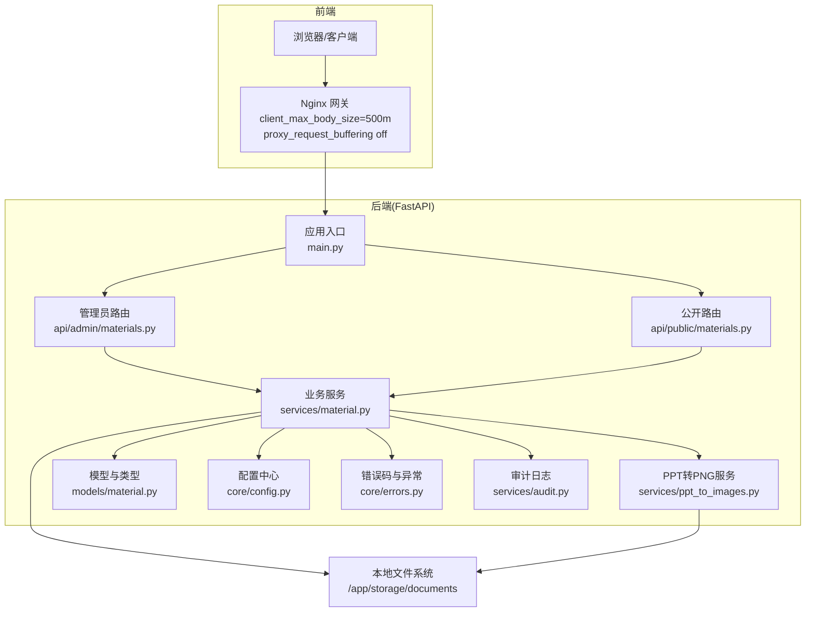
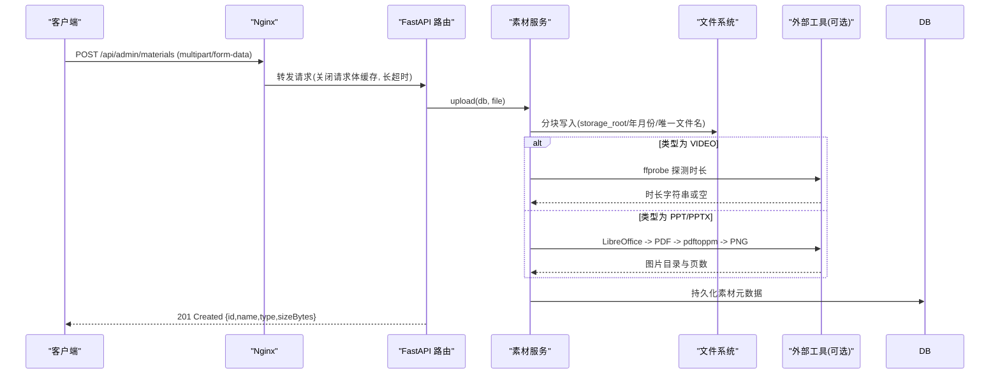
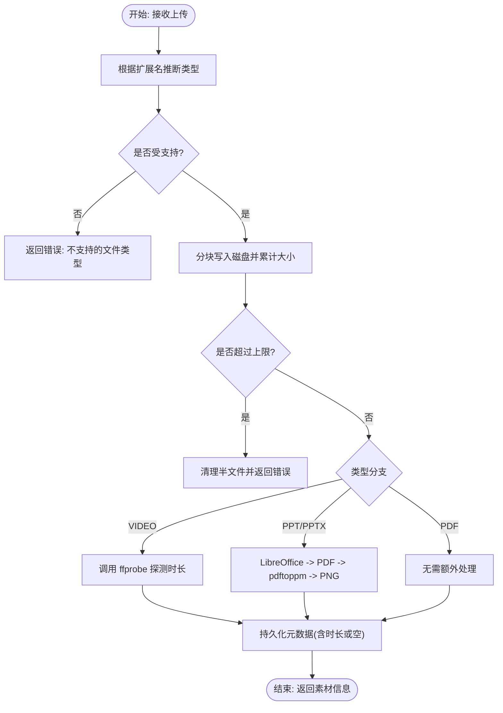
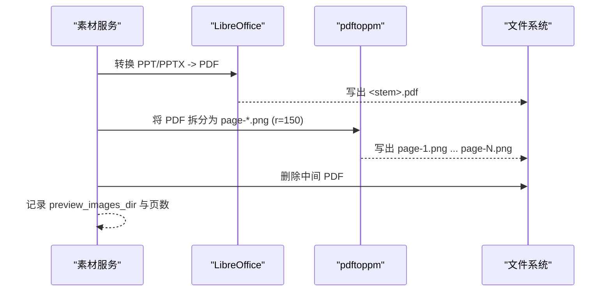
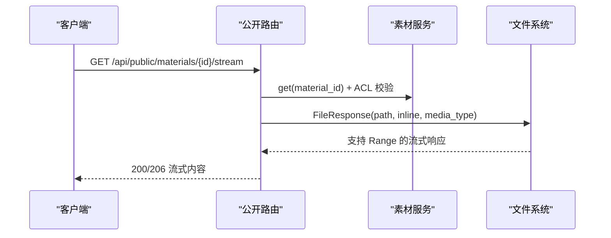
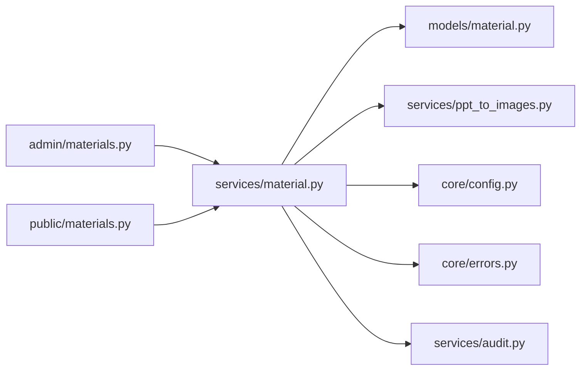

# 素材服务

<cite>
**本文引用的文件**   
- [backend/app/main.py](file://backend/app/main.py)
- [backend/app/api/admin/materials.py](file://backend/app/api/admin/materials.py)
- [backend/app/api/public/materials.py](file://backend/app/api/public/materials.py)
- [backend/app/models/material.py](file://backend/app/models/material.py)
- [backend/app/schemas/material.py](file://backend/app/schemas/material.py)
- [backend/app/services/material.py](file://backend/app/services/material.py)
- [backend/app/services/ppt_to_images.py](file://backend/app/services/ppt_to_images.py)
- [backend/app/core/config.py](file://backend/app/core/config.py)
- [backend/app/core/errors.py](file://backend/app/core/errors.py)
- [backend/app/services/audit.py](file://backend/app/services/audit.py)
- [frontend/nginx.conf](file://frontend/nginx.conf)
- [deploy/local/regen_ppt_images.py](file://deploy/local/regen_ppt_images.py)
</cite>

## 目录
1. [简介](#简介)
2. [项目结构](#项目结构)
3. [核心组件](#核心组件)
4. [架构总览](#架构总览)
5. [详细组件分析](#详细组件分析)
6. [依赖关系分析](#依赖关系分析)
7. [性能与扩展性](#性能与扩展性)
8. [故障排查指南](#故障排查指南)
9. [结论](#结论)
10. [附录：扩展指南](#附录扩展指南)

## 简介
本技术文档聚焦 Learning Hub 的“素材服务”，围绕多格式文件上传处理、存储策略、预览图生成、流式传输、元数据管理、安全机制与扩展能力进行系统化说明。当前实现支持视频（mp4）、PDF、PPT/PPTX 三类素材，提供在线预览与下载能力，并内置访问控制与限流保护。

## 项目结构
后端采用 FastAPI 分层组织：路由层（admin/public）→ 业务服务层（services）→ 模型与配置（models/core）。素材相关的关键路径如下：
- 路由：管理员上传/删除/下载；公开端点用于下载、流式预览与图片分页
- 服务：上传流程、类型推断、时长探测、PPT 转 PNG 预览
- 模型：素材表结构与类型枚举
- 配置：存储根路径、外部工具路径、超时等
- 错误：统一业务异常码映射
- Nginx：大文件上传缓冲与超时设置

图表来源
- [backend/app/main.py:40-112](file://backend/app/main.py#L40-L112)
- [backend/app/api/admin/materials.py:1-74](file://backend/app/api/admin/materials.py#L1-L74)
- [backend/app/api/public/materials.py:1-224](file://backend/app/api/public/materials.py#L1-L224)
- [backend/app/services/material.py:1-234](file://backend/app/services/material.py#L1-L234)
- [backend/app/services/ppt_to_images.py:1-185](file://backend/app/services/ppt_to_images.py#L1-L185)
- [backend/app/models/material.py:1-69](file://backend/app/models/material.py#L1-L69)
- [backend/app/core/config.py:1-88](file://backend/app/core/config.py#L1-L88)
- [backend/app/core/errors.py:1-144](file://backend/app/core/errors.py#L1-L144)
- [backend/app/services/audit.py:1-45](file://backend/app/services/audit.py#L1-L45)
- [frontend/nginx.conf:35-55](file://frontend/nginx.conf#L35-L55)

章节来源
- [backend/app/main.py:40-112](file://backend/app/main.py#L40-L112)
- [frontend/nginx.conf:35-55](file://frontend/nginx.conf#L35-L55)

## 核心组件
- 路由层
  - 管理员接口：列表、上传、删除、下载原文件
  - 公开接口：下载原文件、流式预览（inline）、按页获取 PPT 预览图片、单条查询（返回 streamUrl/downloadUrl/imageUrls 等）
- 业务服务
  - 上传：分块写入磁盘、大小校验、类型推断、时长探测（VIDEO）、PPT 转 PNG 预览
  - 删除：引用检查、物理清理（主文件 + 预览目录）
  - 查询：分页、关联计数、构建下载链接
- 模型与配置
  - Material 表：名称、类型、大小、时长或页数、存储路径、预览图片目录、时间戳
  - 类型推断：基于扩展名映射 VIDEO/PDF/PPT
  - 配置：存储根路径、LibreOffice/Pdftoppm 可执行路径、转换超时、CORS、日志级别等
- 错误与审计
  - 统一业务异常码映射到 HTTP 状态码
  - 审计日志以 JSON Lines 追加写入 storage_path 同级 logs 目录

章节来源
- [backend/app/api/admin/materials.py:1-74](file://backend/app/api/admin/materials.py#L1-L74)
- [backend/app/api/public/materials.py:1-224](file://backend/app/api/public/materials.py#L1-L224)
- [backend/app/services/material.py:1-234](file://backend/app/services/material.py#L1-L234)
- [backend/app/models/material.py:1-69](file://backend/app/models/material.py#L1-L69)
- [backend/app/core/config.py:1-88](file://backend/app/core/config.py#L1-L88)
- [backend/app/core/errors.py:1-144](file://backend/app/core/errors.py#L1-L144)
- [backend/app/services/audit.py:1-45](file://backend/app/services/audit.py#L1-L45)

## 架构总览
素材服务在 FastAPI 中通过中间件完成请求 ID 注入、CORS 与全局错误处理；路由将请求委派至 services 层；services 负责与数据库、文件系统以及外部工具（ffprobe、libreoffice、pdftoppm）交互；Nginx 作为反向代理承担大文件上传缓冲与超时控制。

图表来源
- [backend/app/api/admin/materials.py:35-48](file://backend/app/api/admin/materials.py#L35-L48)
- [backend/app/services/material.py:129-202](file://backend/app/services/material.py#L129-L202)
- [backend/app/services/ppt_to_images.py:48-181](file://backend/app/services/ppt_to_images.py#L48-L181)
- [frontend/nginx.conf:35-55](file://frontend/nginx.conf#L35-L55)

## 详细组件分析

### 多格式文件上传与识别验证
- 类型识别：根据扩展名映射为 VIDEO/PDF/PPT，不支持的类型直接拒绝
- 大小限制：服务端累计读取分块，超过阈值主动清理半文件并返回错误
- 存储布局：按年月创建子目录，使用带时间戳与随机后缀的安全文件名
- 后置处理：
  - VIDEO：调用 ffprobe 解析时长，失败不阻断上传
  - PPT/PPTX：后台异步式地转换为多张 PNG（page-1.png …），记录目录与页数；失败仅记录日志，不阻断上传

图表来源
- [backend/app/models/material.py:22-41](file://backend/app/models/material.py#L22-L41)
- [backend/app/services/material.py:129-202](file://backend/app/services/material.py#L129-L202)
- [backend/app/services/ppt_to_images.py:48-181](file://backend/app/services/ppt_to_images.py#L48-L181)

章节来源
- [backend/app/models/material.py:22-41](file://backend/app/models/material.py#L22-L41)
- [backend/app/services/material.py:129-202](file://backend/app/services/material.py#L129-L202)
- [backend/app/services/ppt_to_images.py:48-181](file://backend/app/services/ppt_to_images.py#L48-L181)

### 文件存储策略与适配层设计
- 当前实现：本地文件系统存储，根路径由配置项指定，默认位于容器内 /app/storage/documents
- 目录组织：按年月份分片，便于归档与清理；每个素材一个唯一文件名
- 适配层现状：未引入对象存储抽象层，所有路径读写均基于 Path 与配置中的绝对路径
- 未来扩展建议：定义 StorageAdapter 接口（put/get/delete/list/stat），通过配置切换本地/对象存储驱动；对外暴露统一的 URL 生成策略（直链/签名链接）

章节来源
- [backend/app/core/config.py:54-56](file://backend/app/core/config.py#L54-L56)
- [backend/app/services/material.py:29-34](file://backend/app/services/material.py#L29-L34)

### 预览图生成流程（缩略图提取、格式转换、质量优化）
- PPT → PDF：通过 LibreOffice headless 模式转换
- PDF → PNG：通过 pdftoppm 以固定分辨率输出每页 PNG，命名 page-N.png
- 输出目录：与源文件同级的 <stem> 目录，同时保留中间 PDF（后续清理）
- 质量参数：分辨率固定为 150dpi；如需更高清晰度可通过配置调整
- 失败降级：转换失败不阻断上传，前端走“下载到本地”或提示“预览生成中”

图表来源
- [backend/app/services/ppt_to_images.py:48-181](file://backend/app/services/ppt_to_images.py#L48-L181)
- [backend/app/services/material.py:174-186](file://backend/app/services/material.py#L174-L186)

章节来源
- [backend/app/services/ppt_to_images.py:48-181](file://backend/app/services/ppt_to_images.py#L48-L181)
- [backend/app/services/material.py:174-186](file://backend/app/services/material.py#L174-L186)

### 流式传输实现（Range 支持、断点续传、进度跟踪）
- 流式接口：/stream 针对 VIDEO/PDF/PPT 返回 inline 内容，供浏览器直接渲染
- Range 支持：FastAPI FileResponse 默认启用 Range，测试覆盖 206 响应
- 断点续传：依赖底层框架对 Range 的支持；前端播放器/阅读器通常自带断点续传逻辑
- 进度跟踪：服务端不维护进度状态，进度由客户端侧计算（已下载字节/总字节）
- 限流保护：/stream 接口具备每分钟 60 次的限流

图表来源
- [backend/app/api/public/materials.py:84-146](file://backend/app/api/public/materials.py#L84-L146)
- [backend/app/api/public/materials.py:130-145](file://backend/app/api/public/materials.py#L130-L145)

章节来源
- [backend/app/api/public/materials.py:84-146](file://backend/app/api/public/materials.py#L84-L146)

### 素材元数据管理（信息提取、版本控制、审计日志）
- 信息提取：
  - 上传时自动填充 name/type/size_bytes/storage_path
  - VIDEO：ffprobe 解析时长，写入 duration_or_pages
  - PPT：转换成功后写入 preview_images_dir 与页数
- 版本控制：当前未实现多版本管理；如需可在 Material 表增加 version 字段与历史快照策略
- 审计日志：关键管理操作可调用审计服务写入 JSON Lines 文件（storage_path 同级 logs/audit.jsonl）

章节来源
- [backend/app/services/material.py:161-202](file://backend/app/services/material.py#L161-L202)
- [backend/app/services/audit.py:21-42](file://backend/app/services/audit.py#L21-L42)

### 文件安全机制（病毒扫描、类型验证、访问控制）
- 类型验证：严格基于扩展名的白名单映射，非法类型直接拒绝
- 大小限制：服务端累计校验，超限即中断并清理半文件
- 访问控制：
  - 公开接口会检查素材是否被 RESTRICTED 课件引用，若需要令牌哈希（X-Token-Hash 或 Cookie）
  - 无令牌或令牌无效则返回锁定错误
- 病毒扫描：当前未集成；建议在上传后、入库前插入异步扫描任务，失败则标记不可用或删除

章节来源
- [backend/app/models/material.py:22-41](file://backend/app/models/material.py#L22-L41)
- [backend/app/api/public/materials.py:31-62](file://backend/app/api/public/materials.py#L31-L62)
- [backend/app/services/material.py:140-159](file://backend/app/services/material.py#L140-L159)

## 依赖关系分析
- 模块耦合
  - 路由层依赖 services 与 models，保持薄控制器职责
  - services 依赖 models、config、errors、ppt_to_images、audit
  - ppt_to_images 依赖 config 与系统外部工具
- 外部依赖
  - ffprobe（视频时长探测）
  - LibreOffice（PPT→PDF）
  - pdftoppm（PDF→PNG）
- 潜在循环依赖：当前未见循环导入；services 与 api 单向依赖

图表来源
- [backend/app/api/admin/materials.py:1-74](file://backend/app/api/admin/materials.py#L1-L74)
- [backend/app/api/public/materials.py:1-224](file://backend/app/api/public/materials.py#L1-L224)
- [backend/app/services/material.py:1-234](file://backend/app/services/material.py#L1-L234)
- [backend/app/services/ppt_to_images.py:1-185](file://backend/app/services/ppt_to_images.py#L1-L185)
- [backend/app/models/material.py:1-69](file://backend/app/models/material.py#L1-L69)
- [backend/app/core/config.py:1-88](file://backend/app/core/config.py#L1-L88)
- [backend/app/core/errors.py:1-144](file://backend/app/core/errors.py#L1-L144)
- [backend/app/services/audit.py:1-45](file://backend/app/services/audit.py#L1-L45)

章节来源
- [backend/app/api/admin/materials.py:1-74](file://backend/app/api/admin/materials.py#L1-L74)
- [backend/app/api/public/materials.py:1-224](file://backend/app/api/public/materials.py#L1-L224)
- [backend/app/services/material.py:1-234](file://backend/app/services/material.py#L1-L234)

## 性能与扩展性
- 上传吞吐
  - Nginx 关闭请求体缓存，边收边转，避免二次落盘
  - 大文件超时与 body 大小上限对齐（500MB）
- 预览性能
  - PPT 预生成 PNG，前端按需加载，避免 PDF.js 渲染开销
  - 图片目录按页编号，排序稳定，便于快速定位
- 可扩展点
  - 新增格式：在类型映射与上传后置处理分支中添加新类型
  - 对象存储：抽象 StorageAdapter，替换本地 Path 为 SDK 调用
  - 并发转换：将 PPT 转换放入消息队列，避免阻塞上传链路

章节来源
- [frontend/nginx.conf:35-55](file://frontend/nginx.conf#L35-L55)
- [backend/app/services/ppt_to_images.py:48-181](file://backend/app/services/ppt_to_images.py#L48-L181)

## 故障排查指南
- 上传失败
  - 检查文件大小是否超过限制（服务端与 Nginx 双重校验）
  - 查看上传日志与 BusinessError 返回码
- PPT 预览不可用
  - 确认 LibreOffice 与 pdftoppm 可执行路径正确且可执行
  - 检查转换超时配置，必要时增大超时
  - 使用一次性脚本重新生成预览图片
- 流式播放问题
  - 确认浏览器支持 Range；检查 206 响应头
  - 核对 Content-Type 与 Content-Disposition 是否正确
- 权限锁定
  - 检查 X-Token-Hash 或 Cookie 是否携带有效令牌
  - 确认素材是否被 RESTRICTED 课件引用

章节来源
- [backend/app/core/errors.py:73-127](file://backend/app/core/errors.py#L73-L127)
- [backend/app/services/ppt_to_images.py:26-46](file://backend/app/services/ppt_to_images.py#L26-L46)
- [deploy/local/regen_ppt_images.py:1-57](file://deploy/local/regen_ppt_images.py#L1-L57)
- [backend/app/api/public/materials.py:31-62](file://backend/app/api/public/materials.py#L31-L62)

## 结论
素材服务在当前阶段提供了稳定的多格式上传、预览与流式传输能力，并通过严格的类型校验、大小限制与访问控制保障安全性。PPT 预览采用离线转换策略，兼顾体验与性能。后续可在对象存储适配、病毒扫描、版本管理与并发转换等方面进一步增强。

## 附录：扩展指南
- 新增文件格式
  - 在类型映射中增加扩展名到类型的映射
  - 在上传后置处理分支添加对应处理器（如压缩、转码、OCR 等）
  - 更新公开接口的 /stream 分支，确保正确的 Content-Type 与 disposition
- 自定义处理器开发
  - 参考 ppt_to_images 的实现模式：外部工具调用、超时控制、失败降级、产物整理
  - 将产物路径与元数据回写至 Material 记录
- 对象存储适配
  - 定义 StorageAdapter 接口（put/get/delete/list/stat）
  - 实现本地与对象存储两种驱动，通过配置切换
  - 对外提供统一的 URL 生成策略（直链/签名链接）

章节来源
- [backend/app/models/material.py:22-41](file://backend/app/models/material.py#L22-L41)
- [backend/app/services/ppt_to_images.py:48-181](file://backend/app/services/ppt_to_images.py#L48-L181)
- [backend/app/api/public/materials.py:84-146](file://backend/app/api/public/materials.py#L84-L146)