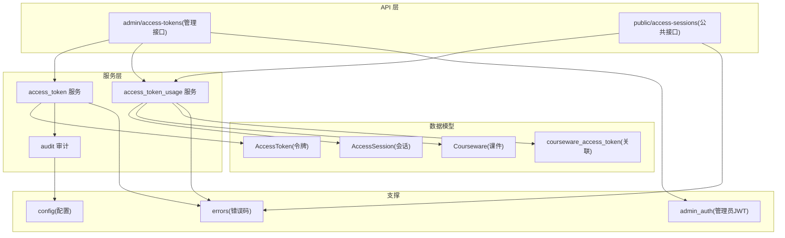
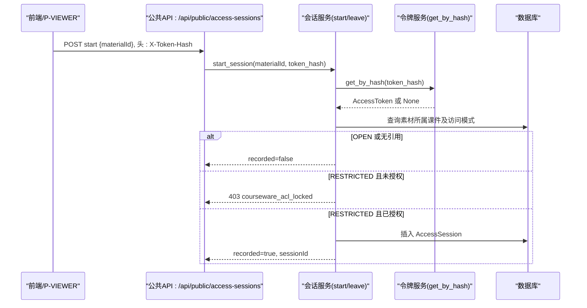
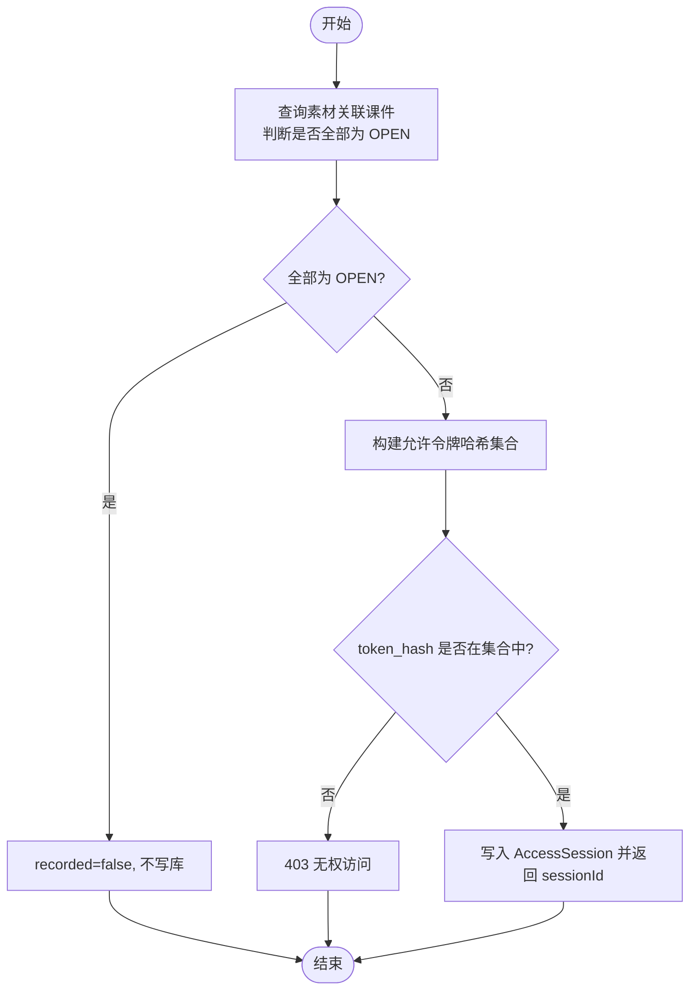
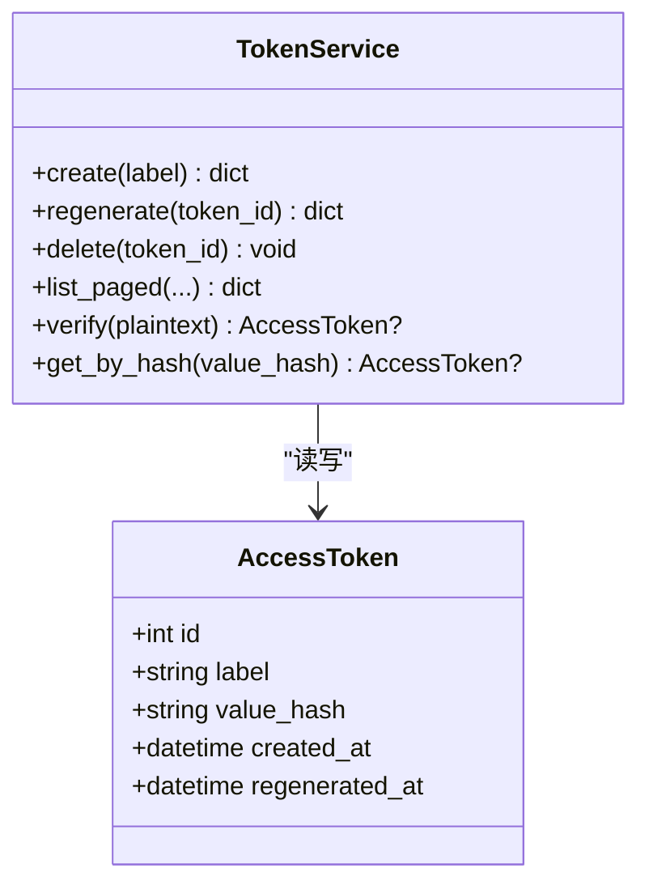
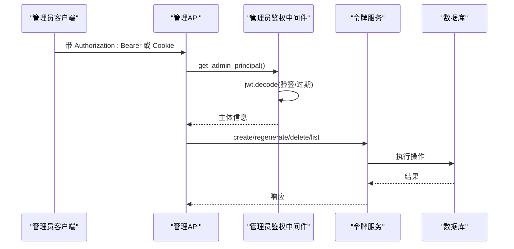
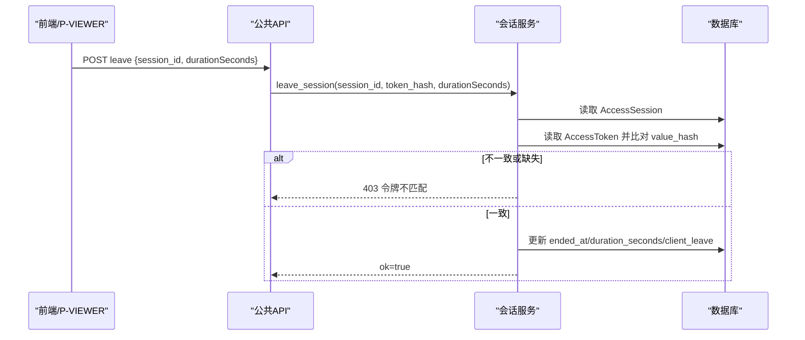
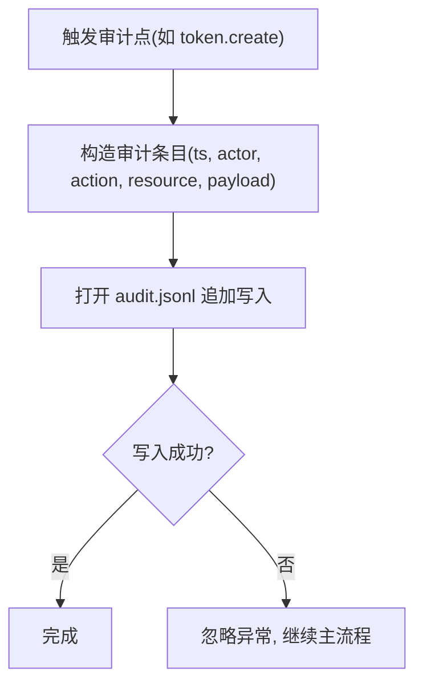
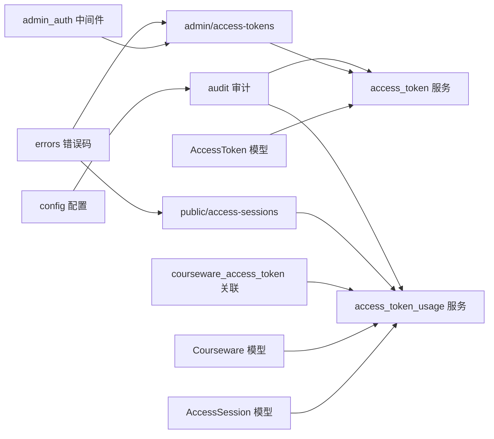

# 访问令牌服务

<cite>
**本文引用的文件**   
- [access_token.py](file://backend/app/models/access_token.py)
- [access_token.py](file://backend/app/services/access_token.py)
- [access_tokens.py](file://backend/app/api/admin/access_tokens.py)
- [access_token.py](file://backend/app/schemas/access_token.py)
- [access_session.py](file://backend/app/models/access_session.py)
- [access_sessions.py](file://backend/app/api/public/access_sessions.py)
- [access_token_usage.py](file://backend/app/services/access_token_usage.py)
- [access_token_usage.py](file://backend/app/schemas/access_token_usage.py)
- [audit.py](file://backend/app/services/audit.py)
- [courseware.py](file://backend/app/models/courseware.py)
- [association.py](file://backend/app/models/association.py)
- [admin_auth.py](file://backend/app/middleware/admin_auth.py)
- [errors.py](file://backend/app/core/errors.py)
- [config.py](file://backend/app/core/config.py)
- [test_access_tokens.py](file://backend/tests/test_access_tokens.py)
- [test_access_session.py](file://backend/tests/test_access_session.py)
</cite>

## 目录
1. [简介](#简介)
2. [项目结构](#项目结构)
3. [核心组件](#核心组件)
4. [架构总览](#架构总览)
5. [详细组件分析](#详细组件分析)
6. [依赖关系分析](#依赖关系分析)
7. [性能与安全考量](#性能与安全考量)
8. [故障排查指南](#故障排查指南)
9. [结论](#结论)
10. [附录](#附录)

## 简介
本文件面向 Learning Hub 的“访问令牌服务”，聚焦安全与鉴权设计，覆盖以下主题：
- 双轨鉴权机制：开放访问（OPEN）与令牌解锁（RESTRICTED）两种模式的设计与实现
- 访问令牌的生成算法：随机数来源、哈希计算与安全强度保证
- 令牌验证流程：签名/哈希校验、过期检查（针对管理员会话）、权限范围确认（课件绑定）
- 会话管理机制：访问记录追踪、会话状态维护、清理策略
- 审计日志系统：关键操作记录、用户行为分析与安全监控
- 令牌撤销与刷新机制：重新生成、引用约束、异常处理
- 安全最佳实践：令牌存储、传输加密、防重放攻击措施

## 项目结构
围绕访问令牌与访问会话的核心代码分布在模型、服务、API 与配置层：
- 数据模型：访问令牌、访问会话、课件与关联表
- 业务服务：令牌生命周期管理、访问会话开闭与聚合统计
- API 层：管理员接口（创建/删除/重新生成/查询）与公共接口（开始/结束访问）
- 中间件与错误码：管理员 JWT 鉴权、统一业务错误码映射
- 审计日志：JSON Lines 格式落盘，失败不阻塞主流程

图表来源
- [access_token.py:1-34](file://backend/app/models/access_token.py#L1-L34)
- [access_session.py:1-129](file://backend/app/models/access_session.py#L1-L129)
- [courseware.py:1-74](file://backend/app/models/courseware.py#L1-L74)
- [association.py:1-41](file://backend/app/models/association.py#L1-L41)
- [access_token.py:1-235](file://backend/app/services/access_token.py#L1-L235)
- [access_token_usage.py:1-518](file://backend/app/services/access_token_usage.py#L1-L518)
- [audit.py:1-45](file://backend/app/services/audit.py#L1-L45)
- [access_tokens.py:1-120](file://backend/app/api/admin/access_tokens.py#L1-L120)
- [access_sessions.py:1-137](file://backend/app/api/public/access_sessions.py#L1-L137)
- [admin_auth.py:1-66](file://backend/app/middleware/admin_auth.py#L1-L66)
- [errors.py:1-144](file://backend/app/core/errors.py#L1-L144)
- [config.py:1-88](file://backend/app/core/config.py#L1-L88)

章节来源
- [access_token.py:1-34](file://backend/app/models/access_token.py#L1-L34)
- [access_session.py:1-129](file://backend/app/models/access_session.py#L1-L129)
- [courseware.py:1-74](file://backend/app/models/courseware.py#L1-L74)
- [association.py:1-41](file://backend/app/models/association.py#L1-L41)
- [access_token.py:1-235](file://backend/app/services/access_token.py#L1-L235)
- [access_token_usage.py:1-518](file://backend/app/services/access_token_usage.py#L1-L518)
- [audit.py:1-45](file://backend/app/services/audit.py#L1-L45)
- [access_tokens.py:1-120](file://backend/app/api/admin/access_tokens.py#L1-L120)
- [access_sessions.py:1-137](file://backend/app/api/public/access_sessions.py#L1-L137)
- [admin_auth.py:1-66](file://backend/app/middleware/admin_auth.py#L1-L66)
- [errors.py:1-144](file://backend/app/core/errors.py#L1-L144)
- [config.py:1-88](file://backend/app/core/config.py#L1-L88)

## 核心组件
- 访问令牌模型：仅持久化 value_hash(SHA-256)，明文仅在创建/重新生成时一次性返回
- 访问会话模型：记录 token + 课件 + 素材 + 起止时间 + 停留秒数；支持客户端上报时长与服务端校正
- 令牌服务：创建、重新生成、删除、分页列表、按哈希查找、常量时间比对验证
- 会话服务：开始/结束会话、区间聚合、按素材聚合、全时段概览
- 管理 API：受管理员 JWT 保护，提供令牌 CRUD 与使用统计
- 公共 API：凭 X-Token-Hash/Cookie 进行资源访问控制与会话记录
- 审计日志：JSON Lines 追加写入，失败不影响主流程
- 错误码体系：统一的业务错误码与 HTTP 状态映射

章节来源
- [access_token.py:1-34](file://backend/app/models/access_token.py#L1-L34)
- [access_session.py:1-129](file://backend/app/models/access_session.py#L1-L129)
- [access_token.py:1-235](file://backend/app/services/access_token.py#L1-L235)
- [access_token_usage.py:1-518](file://backend/app/services/access_token_usage.py#L1-L518)
- [access_tokens.py:1-120](file://backend/app/api/admin/access_tokens.py#L1-L120)
- [access_sessions.py:1-137](file://backend/app/api/public/access_sessions.py#L1-L137)
- [audit.py:1-45](file://backend/app/services/audit.py#L1-L45)
- [errors.py:1-144](file://backend/app/core/errors.py#L1-L144)

## 架构总览
双轨鉴权机制：
- 开放访问（OPEN）：无需令牌，直接可访问；访问记录不写库
- 令牌解锁（RESTRICTED）：需携带有效令牌哈希，且该令牌必须被目标课件授权；访问记录写库并统计

图表来源
- [access_sessions.py:1-137](file://backend/app/api/public/access_sessions.py#L1-L137)
- [access_token_usage.py:1-518](file://backend/app/services/access_token_usage.py#L1-L518)
- [access_token.py:1-235](file://backend/app/services/access_token.py#L1-L235)
- [courseware.py:1-74](file://backend/app/models/courseware.py#L1-L74)
- [access_session.py:1-129](file://backend/app/models/access_session.py#L1-L129)

## 详细组件分析

### 双轨鉴权机制（OPEN vs RESTRICTED）
- 课件访问模式枚举：OPEN、RESTRICTED
- 当素材被至少一个 RESTRICTED 课件引用时，才允许记录访问会话；若全部为 OPEN，则跳过记录
- 对 RESTRICTED 场景，服务端会收集所有引用课件绑定的令牌哈希集合，校验请求中的 token_hash 是否在其中

图表来源
- [access_token_usage.py:44-126](file://backend/app/services/access_token_usage.py#L44-L126)
- [courseware.py:14-38](file://backend/app/models/courseware.py#L14-L38)
- [access_session.py:56-129](file://backend/app/models/access_session.py#L56-L129)

章节来源
- [courseware.py:14-38](file://backend/app/models/courseware.py#L14-L38)
- [access_token_usage.py:44-126](file://backend/app/services/access_token_usage.py#L44-L126)

### 访问令牌生成算法与安全强度
- 随机源：使用密码学安全的随机字节序列作为种子
- 编码方式：将随机字节转换为 base36 小写字母+数字字符串，固定长度
- 存储策略：数据库仅保存 SHA-256 摘要，明文仅在创建/重新生成时一次性返回
- 验证策略：通过常量时间比较避免时序侧信道攻击

图表来源
- [access_token.py:1-34](file://backend/app/models/access_token.py#L1-L34)
- [access_token.py:1-235](file://backend/app/services/access_token.py#L1-L235)

章节来源
- [access_token.py:45-55](file://backend/app/services/access_token.py#L45-L55)
- [access_token.py:193-205](file://backend/app/services/access_token.py#L193-L205)
- [access_token.py:1-34](file://backend/app/models/access_token.py#L1-L34)

### 令牌验证流程（含管理员会话过期检查）
- 公开接口：基于 X-Token-Hash 或 Cookie 获取令牌哈希，查库匹配
- 管理接口：基于管理员 JWT，校验签名与过期时间，提取主体身份
- 权限范围：在 RESTRICTED 模式下，还需校验令牌是否被目标课件授权

图表来源
- [admin_auth.py:1-66](file://backend/app/middleware/admin_auth.py#L1-L66)
- [access_tokens.py:1-120](file://backend/app/api/admin/access_tokens.py#L1-L120)
- [access_token.py:73-139](file://backend/app/services/access_token.py#L73-L139)

章节来源
- [admin_auth.py:26-42](file://backend/app/middleware/admin_auth.py#L26-L42)
- [access_tokens.py:60-116](file://backend/app/api/admin/access_tokens.py#L60-L116)
- [access_token.py:73-139](file://backend/app/services/access_token.py#L73-L139)

### 会话管理机制（开始/结束、状态维护、清理策略）
- 开始会话：校验令牌、素材存在性、课件访问模式与授权；OPEN 不记录，RESTRICTED 记录
- 结束会话：幂等；校验 token_hash 与 session.token_id 对应值一致；时长校正（偏差阈值）
- 清理策略：删除令牌或课件/素材时，通过外键级联自动清理历史会话

图表来源
- [access_sessions.py:109-137](file://backend/app/api/public/access_sessions.py#L109-L137)
- [access_token_usage.py:128-172](file://backend/app/services/access_token_usage.py#L128-L172)
- [access_session.py:56-129](file://backend/app/models/access_session.py#L56-L129)

章节来源
- [access_sessions.py:109-137](file://backend/app/api/public/access_sessions.py#L109-L137)
- [access_token_usage.py:128-172](file://backend/app/services/access_token_usage.py#L128-L172)
- [access_session.py:82-129](file://backend/app/models/access_session.py#L82-L129)

### 审计日志系统（事件记录、行为分析、安全监控）
- 记录内容：动作类型、主体、资源标识、负载信息、时间戳
- 存储格式：JSON Lines 文本文件，按行追加
- 容错策略：写入失败不抛错，不影响主流程

图表来源
- [audit.py:21-42](file://backend/app/services/audit.py#L21-L42)

章节来源
- [audit.py:1-45](file://backend/app/services/audit.py#L1-L45)

### 令牌撤销与刷新机制（批量撤销、自动续期、异常处理）
- 重新生成：立即失效旧令牌，返回新明文与新哈希；历史会话仍归属原 token_id
- 删除限制：若仍有课件引用则禁止删除；至少保留一个 active 令牌
- 批量撤销：可通过重新生成多个令牌或解绑课件引用间接实现；当前未提供一键批量撤销接口
- 自动续期：未实现自动续期逻辑，需管理员手动重新生成
- 异常处理：重复标签、最后令牌保护、引用冲突均抛出统一业务错误码

章节来源
- [access_token.py:102-139](file://backend/app/services/access_token.py#L102-L139)
- [access_token.py:141-191](file://backend/app/services/access_token.py#L141-L191)
- [access_token.py:193-205](file://backend/app/services/access_token.py#L193-L205)
- [errors.py:53-64](file://backend/app/core/errors.py#L53-L64)

### 安全最佳实践（存储、传输、防重放）
- 令牌存储：数据库仅存 SHA-256 摘要，明文仅一次性返回；列表接口不暴露明文
- 传输加密：建议全站启用 HTTPS，确保 X-Token-Hash 与 Cookie 在传输过程中加密
- 防重放攻击：
  - 会话结束时的 token_hash 校验防止跨令牌篡改
  - 管理员 JWT 包含 exp 字段，过期即失效
  - 公开接口具备进程内 IP 限流（60/分钟），降低暴力探测风险
- 其他建议：
  - 定期轮换令牌（重新生成）
  - 最小权限原则：仅将必要课件绑定到令牌
  - 审计日志集中采集与分析，建立告警规则

章节来源
- [access_token.py:73-99](file://backend/app/services/access_token.py#L73-L99)
- [access_token.py:193-205](file://backend/app/services/access_token.py#L193-L205)
- [access_sessions.py:29-55](file://backend/app/api/public/access_sessions.py#L29-L55)
- [admin_auth.py:26-42](file://backend/app/middleware/admin_auth.py#L26-L42)

## 依赖关系分析
- 模型依赖：AccessSession 外键指向 access_token、courseware、material，删除级联清理
- 服务依赖：access_token_usage 依赖 access_token、courseware、material 模型与关联表
- API 依赖：管理接口依赖管理员鉴权中间件；公共接口依赖会话服务与错误码
- 配置依赖：审计日志路径、JWT 参数、CORS、时区等来自配置中心

图表来源
- [access_token.py:1-34](file://backend/app/models/access_token.py#L1-L34)
- [access_session.py:1-129](file://backend/app/models/access_session.py#L1-L129)
- [courseware.py:1-74](file://backend/app/models/courseware.py#L1-L74)
- [association.py:1-41](file://backend/app/models/association.py#L1-L41)
- [access_token.py:1-235](file://backend/app/services/access_token.py#L1-L235)
- [access_token_usage.py:1-518](file://backend/app/services/access_token_usage.py#L1-L518)
- [access_tokens.py:1-120](file://backend/app/api/admin/access_tokens.py#L1-L120)
- [access_sessions.py:1-137](file://backend/app/api/public/access_sessions.py#L1-L137)
- [admin_auth.py:1-66](file://backend/app/middleware/admin_auth.py#L1-L66)
- [errors.py:1-144](file://backend/app/core/errors.py#L1-L144)
- [audit.py:1-45](file://backend/app/services/audit.py#L1-L45)
- [config.py:1-88](file://backend/app/core/config.py#L1-L88)

章节来源
- [access_token.py:1-34](file://backend/app/models/access_token.py#L1-L34)
- [access_session.py:1-129](file://backend/app/models/access_session.py#L1-L129)
- [courseware.py:1-74](file://backend/app/models/courseware.py#L1-L74)
- [association.py:1-41](file://backend/app/models/association.py#L1-L41)
- [access_token.py:1-235](file://backend/app/services/access_token.py#L1-L235)
- [access_token_usage.py:1-518](file://backend/app/services/access_token_usage.py#L1-L518)
- [access_tokens.py:1-120](file://backend/app/api/admin/access_tokens.py#L1-L120)
- [access_sessions.py:1-137](file://backend/app/api/public/access_sessions.py#L1-L137)
- [admin_auth.py:1-66](file://backend/app/middleware/admin_auth.py#L1-L66)
- [errors.py:1-144](file://backend/app/core/errors.py#L1-L144)
- [audit.py:1-45](file://backend/app/services/audit.py#L1-L45)
- [config.py:1-88](file://backend/app/core/config.py#L1-L88)

## 性能与安全考量
- 性能
  - 令牌验证采用常量时间比较，避免时序攻击；令牌数量通常较少，遍历开销可控
  - 会话聚合使用 SQL 窗口函数与分组聚合，减少应用层计算
  - 公开接口进程内限流作为兜底，生产环境建议结合反向代理限流
- 安全
  - 令牌明文不落库，仅哈希；列表接口不暴露明文
  - 管理员 JWT 强制要求 exp 与 sub，过期即失效
  - 会话结束严格校验 token_hash，防止跨令牌篡改
  - 审计日志失败不阻塞主流程，保障可用性

[本节为通用指导，不直接分析具体文件]

## 故障排查指南
- 常见问题
  - 缺少令牌哈希：公共接口返回 missing_token
  - 令牌无效：返回 invalid_token
  - 无权访问：RESTRICTED 课件未绑定该令牌，返回 courseware_acl_locked
  - 令牌不匹配：结束会话时 token_hash 与 session 不匹配，返回 403
  - 最后令牌保护：删除最后一个 active 令牌返回 last_token_required
  - 引用冲突：删除被课件引用的令牌返回 token_referenced
- 定位方法
  - 查看审计日志 audit.jsonl，确认关键操作轨迹
  - 检查数据库外键级联是否生效（删除令牌/课件/素材后，会话应自动清理）
  - 核对管理员 JWT 配置（secret、algorithm、TTL）
  - 检查公开接口限流计数与 IP 来源

章节来源
- [errors.py:53-64](file://backend/app/core/errors.py#L53-L64)
- [access_sessions.py:65-106](file://backend/app/api/public/access_sessions.py#L65-L106)
- [access_token_usage.py:128-172](file://backend/app/services/access_token_usage.py#L128-L172)
- [audit.py:21-42](file://backend/app/services/audit.py#L21-L42)
- [admin_auth.py:26-42](file://backend/app/middleware/admin_auth.py#L26-L42)

## 结论
Learning Hub 的访问令牌服务以“开放访问 + 令牌解锁”的双轨鉴权为核心，结合严格的令牌哈希存储、常量时间验证、会话时长校正与审计日志，构建了兼顾可用性与安全性的访问控制体系。建议在部署中强化传输加密、完善限流与审计告警，并定期轮换令牌以降低泄露风险。

[本节为总结，不直接分析具体文件]

## 附录
- 相关测试用例参考
  - 令牌创建/删除/重新生成与错误码
  - 公开接口开始/结束会话、权限校验、时长校正、幂等性
  - 管理接口聚合统计与 usageSummary 扩展

章节来源
- [test_access_tokens.py:1-111](file://backend/tests/test_access_tokens.py#L1-L111)
- [test_access_session.py:1-640](file://backend/tests/test_access_session.py#L1-L640)