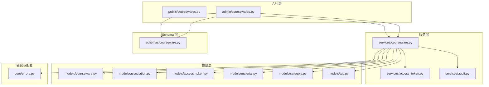
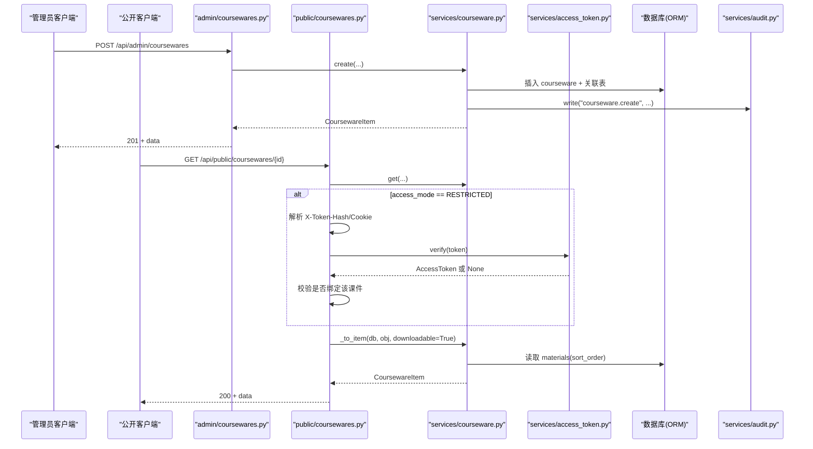
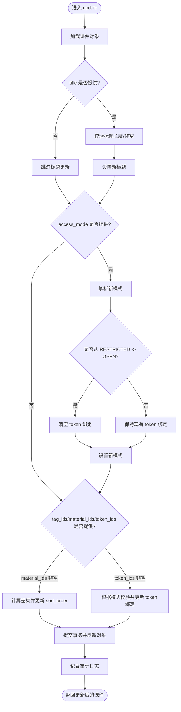
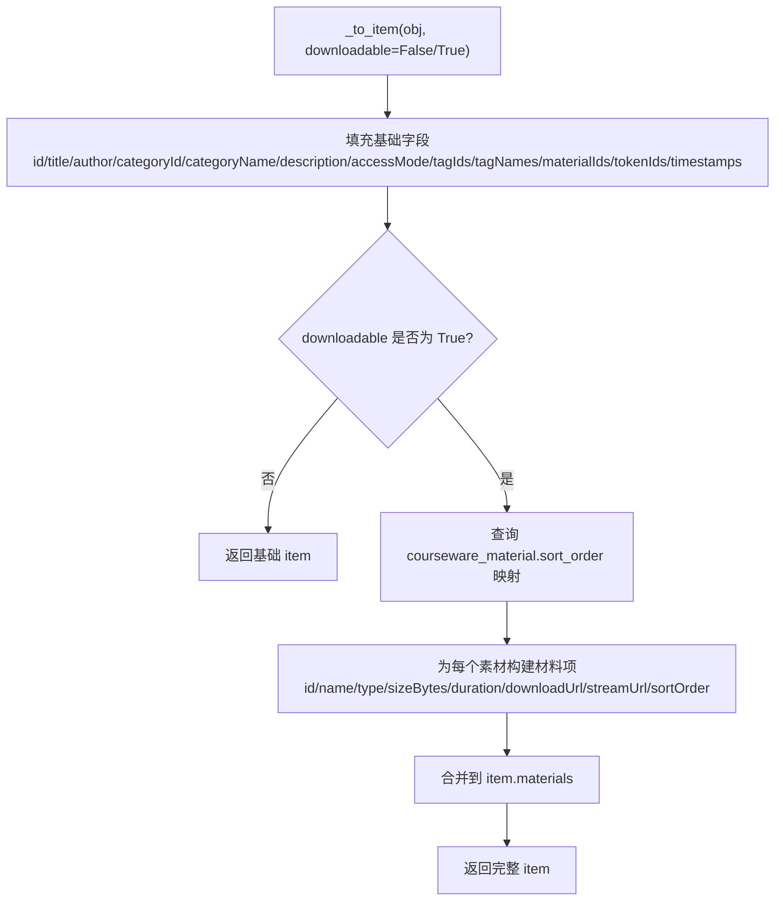
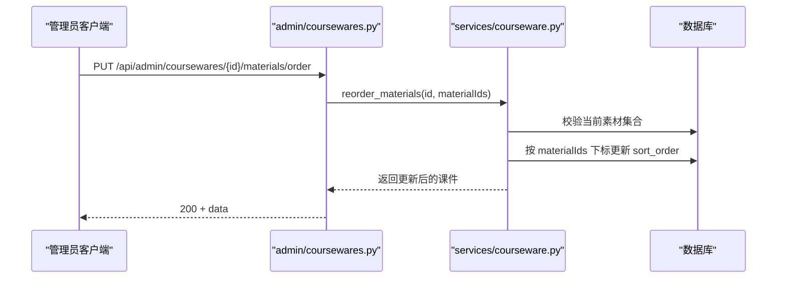
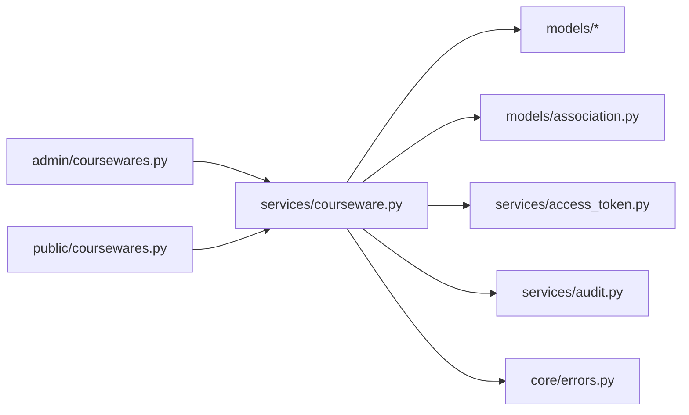

# 课件服务

<cite>
**本文引用的文件**   
- [backend/app/services/courseware.py](file://backend/app/services/courseware.py)
- [backend/app/models/courseware.py](file://backend/app/models/courseware.py)
- [backend/app/schemas/courseware.py](file://backend/app/schemas/courseware.py)
- [backend/app/api/admin/coursewares.py](file://backend/app/api/admin/coursewares.py)
- [backend/app/api/public/coursewares.py](file://backend/app/api/public/coursewares.py)
- [backend/app/models/association.py](file://backend/app/models/association.py)
- [backend/app/services/access_token.py](file://backend/app/services/access_token.py)
- [backend/app/core/errors.py](file://backend/app/core/errors.py)
- [backend/app/models/access_token.py](file://backend/app/models/access_token.py)
- [backend/app/models/material.py](file://backend/app/models/material.py)
- [backend/tests/test_courseware.py](file://backend/tests/test_courseware.py)
- [backend/app/services/audit.py](file://backend/app/services/audit.py)
- [backend/app/models/category.py](file://backend/app/models/category.py)
- [backend/app/models/tag.py](file://backend/app/models/tag.py)
</cite>

## 目录
1. [简介](#简介)
2. [项目结构](#项目结构)
3. [核心组件](#核心组件)
4. [架构总览](#架构总览)
5. [详细组件分析](#详细组件分析)
6. [依赖关系分析](#依赖关系分析)
7. [性能考虑](#性能考虑)
8. [故障排查指南](#故障排查指南)
9. [结论](#结论)
10. [附录：API 使用示例与错误处理模式](#附录api-使用示例与错误处理模式)

## 简介
本设计文档聚焦于 Learning Hub 的“课件服务”，围绕课件生命周期管理、权限控制机制、数据序列化策略、统计与行为记录、以及课件与素材的多对多关联管理进行系统化说明。文档同时提供最佳实践建议，包括事务管理、异常处理与性能优化，并给出完整的 API 使用示例与错误处理模式，帮助开发者快速理解与正确使用该服务。

## 项目结构
课件服务位于后端模块中，采用分层组织：
- API 层：管理端与公共端路由分别定义在 admin 与 public 下
- 业务服务层：封装课件创建、更新、删除、列表、搜索、排序等核心逻辑
- 模型层：定义 Courseware、AccessToken、Material、Tag、Category 及 M:N 关联表
- Schema 层：Pydantic 请求/响应校验与数据结构描述
- 错误与审计：统一错误码映射与审计日志写入



图表来源
- [backend/app/api/admin/coursewares.py:1-115](file://backend/app/api/admin/coursewares.py#L1-L115)
- [backend/app/api/public/coursewares.py:1-133](file://backend/app/api/public/coursewares.py#L1-L133)
- [backend/app/services/courseware.py:1-492](file://backend/app/services/courseware.py#L1-L492)
- [backend/app/models/courseware.py:1-74](file://backend/app/models/courseware.py#L1-L74)
- [backend/app/models/association.py:1-41](file://backend/app/models/association.py#L1-L41)
- [backend/app/models/access_token.py:1-34](file://backend/app/models/access_token.py#L1-L34)
- [backend/app/models/material.py:1-69](file://backend/app/models/material.py#L1-L69)
- [backend/app/models/category.py:1-46](file://backend/app/models/category.py#L1-L46)
- [backend/app/models/tag.py:1-30](file://backend/app/models/tag.py#L1-L30)
- [backend/app/schemas/courseware.py:1-120](file://backend/app/schemas/courseware.py#L1-L120)
- [backend/app/core/errors.py:1-144](file://backend/app/core/errors.py#L1-L144)

章节来源
- [backend/app/api/admin/coursewares.py:1-115](file://backend/app/api/admin/coursewares.py#L1-L115)
- [backend/app/api/public/coursewares.py:1-133](file://backend/app/api/public/coursewares.py#L1-L133)
- [backend/app/services/courseware.py:1-492](file://backend/app/services/courseware.py#L1-L492)
- [backend/app/models/courseware.py:1-74](file://backend/app/models/courseware.py#L1-L74)
- [backend/app/models/association.py:1-41](file://backend/app/models/association.py#L1-L41)
- [backend/app/models/access_token.py:1-34](file://backend/app/models/access_token.py#L1-L34)
- [backend/app/models/material.py:1-69](file://backend/app/models/material.py#L1-L69)
- [backend/app/models/category.py:1-46](file://backend/app/models/category.py#L1-L46)
- [backend/app/models/tag.py:1-30](file://backend/app/models/tag.py#L1-L30)
- [backend/app/schemas/courseware.py:1-120](file://backend/app/schemas/courseware.py#L1-L120)
- [backend/app/core/errors.py:1-144](file://backend/app/core/errors.py#L1-L144)

## 核心组件
- 课件主实体与访问模式
  - Courseware 主表包含标题、作者、分类、描述、访问模式（OPEN/RESTRICTED）、时间戳等字段；通过 ORM 关系与标签、素材、访问令牌建立多对多关联。
  - AccessMode 枚举用于标识开放或受限访问。
- 多对多关联表
  - courseware_tag：课件与标签
  - courseware_material：课件与素材，含 sort_order 字段维护展示顺序，并提供索引加速有序读取
  - courseware_access_token：课件与访问令牌
- 访问令牌服务
  - 生成、验证、重新生成、删除令牌；仅存储 value_hash（SHA-256），明文仅在创建/重新生成时返回
- 错误与审计
  - 统一错误码映射到 HTTP 状态码；关键操作写入 JSON Lines 审计日志

章节来源
- [backend/app/models/courseware.py:1-74](file://backend/app/models/courseware.py#L1-L74)
- [backend/app/models/association.py:1-41](file://backend/app/models/association.py#L1-L41)
- [backend/app/services/access_token.py:1-235](file://backend/app/services/access_token.py#L1-L235)
- [backend/app/core/errors.py:1-144](file://backend/app/core/errors.py#L1-L144)
- [backend/app/services/audit.py:1-45](file://backend/app/services/audit.py#L1-L45)

## 架构总览
课件服务遵循“API 路由 → 业务服务 → 模型/关联表”的分层调用链。管理端接口受管理员鉴权中间件保护，公共端接口支持基于令牌的解锁与自动鉴权。



图表来源
- [backend/app/api/admin/coursewares.py:52-68](file://backend/app/api/admin/coursewares.py#L52-L68)
- [backend/app/api/public/coursewares.py:57-76](file://backend/app/api/public/coursewares.py#L57-L76)
- [backend/app/services/courseware.py:105-167](file://backend/app/services/courseware.py#L105-L167)
- [backend/app/services/courseware.py:290-332](file://backend/app/services/courseware.py#L290-L332)
- [backend/app/services/access_token.py:193-205](file://backend/app/services/access_token.py#L193-L205)
- [backend/app/services/audit.py:21-42](file://backend/app/services/audit.py#L21-L42)

## 详细组件分析

### 课件生命周期管理（创建、更新、删除、状态）
- 创建
  - 校验标题长度与必填；解析分类、标签、素材、令牌；当 access_mode=RESTRICTED 时必须至少绑定一个令牌；写入后刷新对象并记录审计日志。
  - 素材顺序：新建时按传入 material_ids 的顺序写入 sort_order（0..N-1）。
- 更新
  - 支持部分字段更新；从 RESTRICTED 降级为 OPEN 时自动清空 token 绑定；material_ids 非空时将集合完整重写，增删改均按数组下标设置 sort_order。
- 删除
  - 级联删除关联表（ON DELETE CASCADE），并记录审计日志。
- 状态管理
  - access_mode 控制访问策略；OPEN 无需令牌，RESTRICTED 需令牌解锁。



图表来源
- [backend/app/services/courseware.py:170-278](file://backend/app/services/courseware.py#L170-L278)

章节来源
- [backend/app/services/courseware.py:105-167](file://backend/app/services/courseware.py#L105-L167)
- [backend/app/services/courseware.py:170-278](file://backend/app/services/courseware.py#L170-L278)
- [backend/app/services/courseware.py:281-286](file://backend/app/services/courseware.py#L281-L286)

### 权限控制机制（访问令牌验证、分类管理、标签关联）
- 访问令牌验证
  - 公共端详情接口：若课件为 RESTRICTED，则要求请求携带 X-Token-Hash 或 Cookie lh_token_hash；服务端比对已绑定的令牌哈希集合，不匹配则拒绝访问。
  - 解锁接口：凭明文 token 验证，成功后返回 tokenHash 并写入 Cookie（7 天），后续 GET 自动鉴权。
- 分类管理
  - 课件可挂接到分类树任意层级节点（1/2/3 级），不再限制必须为叶子节点；列表查询支持子树过滤。
- 标签关联
  - 通过 courseware_tag 多对多表关联；创建/更新时可批量设置标签 ID 集合。

```mermaid
classDiagram
class Courseware {
+int id
+string title
+string author
+int category_id
+string description
+AccessMode access_mode
+datetime created_at
+datetime updated_at
+Tag[] tags
+Material[] materials
+AccessToken[] access_tokens
}
class Category {
+int id
+string name
+int parent_id
+int level
}
class Tag {
+int id
+string name
}
class Material {
+int id
+string name
+string type
+int size_bytes
+string duration_or_pages
+string storage_path
+string preview_images_dir
}
class AccessToken {
+int id
+string label
+string value_hash
+datetime created_at
+datetime regenerated_at
}
class Association {
<<table>>
+courseware_tag
+courseware_material(sort_order)
+courseware_access_token
}
Courseware --> Category : "外键"
Courseware --> Tag : "M : N(courseware_tag)"
Courseware --> Material : "M : N(courseware_material)"
Courseware --> AccessToken : "M : N(courseware_access_token)"
```

图表来源
- [backend/app/models/courseware.py:21-67](file://backend/app/models/courseware.py#L21-L67)
- [backend/app/models/association.py:9-33](file://backend/app/models/association.py#L9-L33)
- [backend/app/models/category.py:12-42](file://backend/app/models/category.py#L12-L42)
- [backend/app/models/tag.py:13-26](file://backend/app/models/tag.py#L13-L26)
- [backend/app/models/material.py:44-65](file://backend/app/models/material.py#L44-L65)
- [backend/app/models/access_token.py:13-30](file://backend/app/models/access_token.py#L13-L30)

章节来源
- [backend/app/api/public/coursewares.py:57-76](file://backend/app/api/public/coursewares.py#L57-L76)
- [backend/app/api/public/coursewares.py:79-130](file://backend/app/api/public/coursewares.py#L79-L130)
- [backend/app/services/courseware.py:78-86](file://backend/app/services/courseware.py#L78-86)
- [backend/app/services/courseware.py:89-102](file://backend/app/services/courseware.py#L89-L102)

### 数据序列化过程（_to_item 实现细节与数据加载策略）
- _to_item 函数负责将 Courseware ORM 对象序列化为前端可用的字典结构，包含基础信息、分类名称、标签 ID/名称、素材 ID、令牌 ID、时间戳等。
- 当 downloadable=True 时，额外从 courseware_material 关联表读取实际 sort_order，避免依赖 ORM 二次同步导致的下标错位问题；并为每个素材构建下载/流式 URL。
- 列表与搜索接口默认加载 tags、materials、access_tokens、category 等关联，以提升渲染效率。



图表来源
- [backend/app/services/courseware.py:290-332](file://backend/app/services/courseware.py#L290-L332)

章节来源
- [backend/app/services/courseware.py:290-332](file://backend/app/services/courseware.py#L290-L332)

### 课件统计功能（访问计数、下载统计、用户行为分析）
- 当前代码库未实现访问计数、下载统计与用户行为分析的具体逻辑。
- 建议在以下位置扩展：
  - 公共端详情与解锁接口：在成功返回前记录访问事件（如访问次数、IP、UA、时间戳）
  - 素材下载/流式接口：记录下载事件（素材 ID、课件 ID、用户标识）
  - 审计日志：可扩展写入结构化事件，便于离线分析与报表生成

[本节为通用建议，不直接分析具体文件]

### 课件与素材的关联关系管理（多对多与级联操作）
- 多对多关系
  - 通过 courseware_material 表维护课件与素材的关系，sort_order 字段表示展示顺序，并提供索引以加速有序读取。
- 级联操作
  - 删除课件时，关联表行自动级联删除（ON DELETE CASCADE）。
  - 更新 material_ids 时，服务端会计算差集：删除不在目标集合中的关联，新增不在旧集合中的关联，并按数组下标重写所有 sort_order。
- 专用排序接口
  - reorder_materials 提供专用排序入口，严格校验数量一致、无重复、全部属于该课件，然后按传入顺序重写 sort_order。



图表来源
- [backend/app/api/admin/coursewares.py:100-112](file://backend/app/api/admin/coursewares.py#L100-L112)
- [backend/app/services/courseware.py:335-393](file://backend/app/services/courseware.py#L335-L393)
- [backend/app/models/association.py:16-26](file://backend/app/models/association.py#L16-L26)

章节来源
- [backend/app/models/association.py:16-26](file://backend/app/models/association.py#L16-L26)
- [backend/app/services/courseware.py:210-258](file://backend/app/services/courseware.py#L210-L258)
- [backend/app/services/courseware.py:335-393](file://backend/app/services/courseware.py#L335-L393)

### 最佳实践（事务管理、异常处理、性能优化）
- 事务管理
  - 创建/更新/删除均在服务层显式 commit，并在必要时 flush 以确保后续 UPDATE 能定位到正确记录。
  - 建议在复杂批量操作中引入显式事务边界，确保一致性。
- 异常处理
  - 使用 BusinessError 抛出业务异常，配合 ErrorCode 映射到合适的 HTTP 状态码；前端可根据 code 进行差异化提示。
- 性能优化
  - 列表/搜索使用 selectinload 预加载关联，减少 N+1 查询。
  - 素材排序使用索引 ix_courseware_material_courseware_order 提升有序读取性能。
  - 对于高并发场景，可考虑缓存热门课件的序列化结果，注意失效策略。

章节来源
- [backend/app/services/courseware.py:105-167](file://backend/app/services/courseware.py#L105-L167)
- [backend/app/services/courseware.py:170-278](file://backend/app/services/courseware.py#L170-L278)
- [backend/app/core/errors.py:73-127](file://backend/app/core/errors.py#L73-L127)
- [backend/app/models/association.py:24-26](file://backend/app/models/association.py#L24-L26)

## 依赖关系分析
- 组件耦合
  - API 路由依赖服务层；服务层依赖模型与关联表；服务层还依赖访问令牌服务与审计服务。
- 外部依赖
  - 数据库（SQLAlchemy ORM）、文件系统（审计日志）、可选 LLM 搜索（公共搜索接口）。
- 潜在循环依赖
  - 当前未发现循环导入；服务层内部按需 import association 表以避免循环。



图表来源
- [backend/app/api/admin/coursewares.py:1-115](file://backend/app/api/admin/coursewares.py#L1-L115)
- [backend/app/api/public/coursewares.py:1-133](file://backend/app/api/public/coursewares.py#L1-L133)
- [backend/app/services/courseware.py:1-492](file://backend/app/services/courseware.py#L1-L492)
- [backend/app/models/courseware.py:1-74](file://backend/app/models/courseware.py#L1-L74)
- [backend/app/models/association.py:1-41](file://backend/app/models/association.py#L1-L41)
- [backend/app/services/access_token.py:1-235](file://backend/app/services/access_token.py#L1-L235)
- [backend/app/services/audit.py:1-45](file://backend/app/services/audit.py#L1-L45)
- [backend/app/core/errors.py:1-144](file://backend/app/core/errors.py#L1-L144)

章节来源
- [backend/app/api/admin/coursewares.py:1-115](file://backend/app/api/admin/coursewares.py#L1-L115)
- [backend/app/api/public/coursewares.py:1-133](file://backend/app/api/public/coursewares.py#L1-L133)
- [backend/app/services/courseware.py:1-492](file://backend/app/services/courseware.py#L1-L492)
- [backend/app/models/courseware.py:1-74](file://backend/app/models/courseware.py#L1-L74)
- [backend/app/models/association.py:1-41](file://backend/app/models/association.py#L1-L41)
- [backend/app/services/access_token.py:1-235](file://backend/app/services/access_token.py#L1-L235)
- [backend/app/services/audit.py:1-45](file://backend/app/services/audit.py#L1-L45)
- [backend/app/core/errors.py:1-144](file://backend/app/core/errors.py#L1-L144)

## 性能考虑
- 预加载关联：列表与详情接口使用 selectinload 减少多次查询。
- 索引优化：courseware_material 的 (courseware_id, sort_order) 索引提升有序读取性能。
- 批量更新：更新 material_ids 时使用批量 UPDATE 覆盖 sort_order，避免逐条写入带来的开销。
- 缓存建议：对高频访问的课件详情与搜索结果可引入缓存层（如 Redis），注意 TTL 与失效策略。

[本节为通用指导，不直接分析具体文件]

## 故障排查指南
- 常见错误码与含义
  - courseware_not_found：课件不存在
  - courseware_title_required：标题为空或超长
  - courseware_category_required：未选择分类或分类不存在
  - courseware_token_required：受限课件未绑定令牌
  - courseware_acl_locked：令牌无效或未解锁
  - invalid_token：令牌无效
  - courseware_materials_invalid：素材排序参数非法（重复/数量不一致/不属于该课件）
- 排查步骤
  - 检查请求参数是否符合 Schema 校验规则
  - 确认 RESTRICTED 课件是否已通过解锁接口获取 tokenHash 并携带至后续请求
  - 查看审计日志 audit.jsonl 定位关键操作时间与上下文
  - 核对数据库关联表是否存在脏数据（如 sort_order 不一致）

章节来源
- [backend/app/core/errors.py:21-31](file://backend/app/core/errors.py#L21-L31)
- [backend/app/core/errors.py:53-63](file://backend/app/core/errors.py#L53-L63)
- [backend/app/services/audit.py:21-42](file://backend/app/services/audit.py#L21-L42)

## 结论
课件服务实现了完整的生命周期管理与细粒度权限控制，结合多对多关联与有序素材展示，满足教学资源的灵活编排与发布需求。通过统一的错误码与审计日志，系统具备良好的可观测性与可维护性。建议在统计与分析方面进一步扩展，以满足更丰富的运营洞察需求。

[本节为总结，不直接分析具体文件]

## 附录：API 使用示例与错误处理模式

### 管理端 API
- 创建课件
  - 方法：POST /api/admin/coursewares
  - 请求体：CoursewareCreateRequest（包含 title、categoryId、accessMode、tagIds、materialIds、tokenIds 等）
  - 成功：201，返回 CoursewareItem（含 downloadable 材料信息）
  - 失败：400（如 courseware_token_required、courseware_title_required）
- 更新课件
  - 方法：PUT /api/admin/coursewares/{id}
  - 请求体：CoursewareUpdateRequest（所有字段可选）
  - 成功：200，返回更新后的 CoursewareItem
  - 失败：400/403（如 courseware_token_required、不支持的 accessMode）
- 删除课件
  - 方法：DELETE /api/admin/coursewares/{id}
  - 成功：200，data 为 null
- 素材排序
  - 方法：PUT /api/admin/coursewares/{id}/materials/order
  - 请求体：CoursewareMaterialsReorderRequest（materialIds 按目标顺序）
  - 成功：200，返回更新后的 CoursewareItem
  - 失败：400（courseware_materials_invalid）

章节来源
- [backend/app/api/admin/coursewares.py:24-41](file://backend/app/api/admin/coursewares.py#L24-L41)
- [backend/app/api/admin/coursewares.py:44-49](file://backend/app/api/admin/coursewares.py#L44-L49)
- [backend/app/api/admin/coursewares.py:52-68](file://backend/app/api/admin/coursewares.py#L52-L68)
- [backend/app/api/admin/coursewares.py:71-89](file://backend/app/api/admin/coursewares.py#L71-L89)
- [backend/app/api/admin/coursewares.py:92-97](file://backend/app/api/admin/coursewares.py#L92-L97)
- [backend/app/api/admin/coursewares.py:100-112](file://backend/app/api/admin/coursewares.py#L100-L112)
- [backend/app/schemas/courseware.py:41-63](file://backend/app/schemas/courseware.py#L41-L63)
- [backend/app/schemas/courseware.py:100-108](file://backend/app/schemas/courseware.py#L100-L108)

### 公共端 API
- 搜索课件
  - 方法：GET /api/public/coursewares/search?q=&page=&size=
  - 成功：200，data 包含 items、source、total、page、size
- 获取课件详情
  - 方法：GET /api/public/coursewares/{id}
  - 成功：200，返回 CoursewareItem（含 downloadable 材料信息）
  - 失败：403（courseware_acl_locked）
- 解锁课件
  - 方法：POST /api/public/coursewares/{id}/unlock
  - 请求体：UnlockRequest（token 明文）
  - 成功：200，返回 UnlockResponse（tokenHash、coursewareIds），并写入 Cookie lh_token_hash
  - 失败：401（invalid_token）

章节来源
- [backend/app/api/public/coursewares.py:32-54](file://backend/app/api/public/coursewares.py#L32-L54)
- [backend/app/api/public/coursewares.py:57-76](file://backend/app/api/public/coursewares.py#L57-L76)
- [backend/app/api/public/coursewares.py:79-130](file://backend/app/api/public/coursewares.py#L79-L130)
- [backend/app/schemas/courseware.py:91-98](file://backend/app/schemas/courseware.py#L91-L98)

### 错误处理模式
- 统一信封响应：HTTPException detail 中包含 code、message、data，由全局处理器包装为 {code, message, data, requestId}
- 业务异常：BusinessError 构造时指定 ErrorCode 与消息，自动映射到对应 HTTP 状态码
- 前端处理：根据 code 分支处理（如 courseware_acl_locked 提示解锁，invalid_token 提示重新输入）

章节来源
- [backend/app/core/errors.py:130-141](file://backend/app/core/errors.py#L130-L141)
- [backend/app/core/errors.py:73-127](file://backend/app/core/errors.py#L73-L127)

### 测试用例参考
- 创建开放课件、受限课件需令牌、分类任意层级允许、搜索包含受限课件、解锁流程、降级清空令牌等场景均有覆盖。

章节来源
- [backend/tests/test_courseware.py:17-166](file://backend/tests/test_courseware.py#L17-L166)