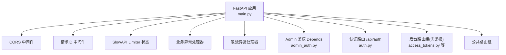
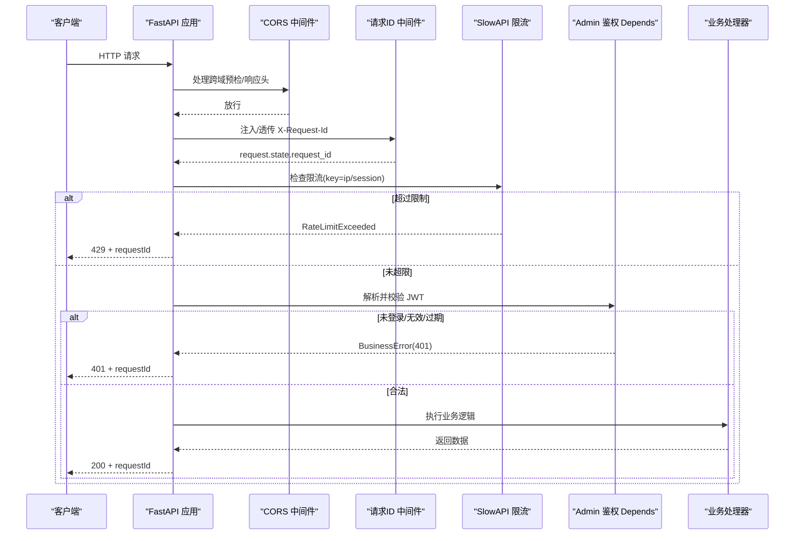
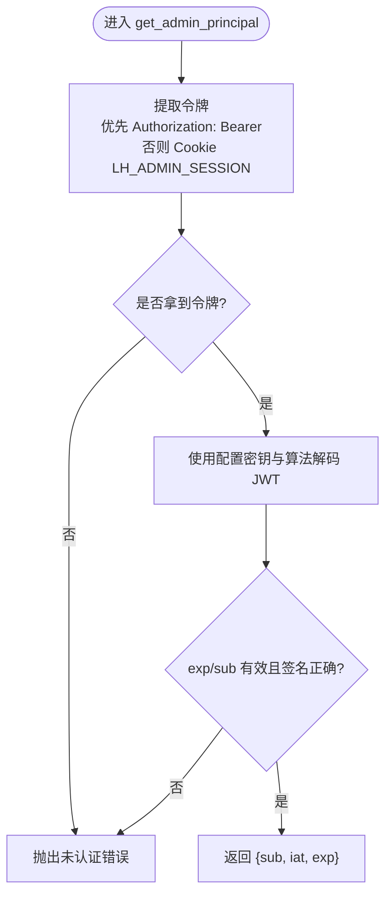
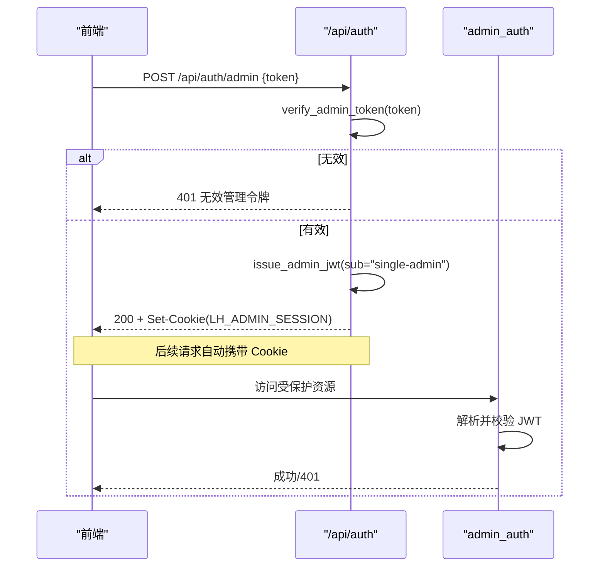
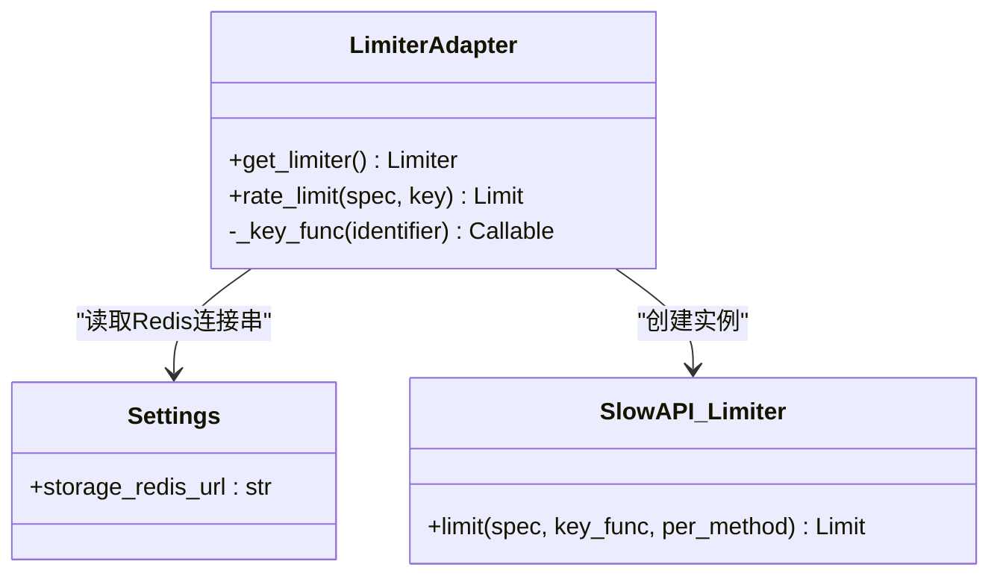
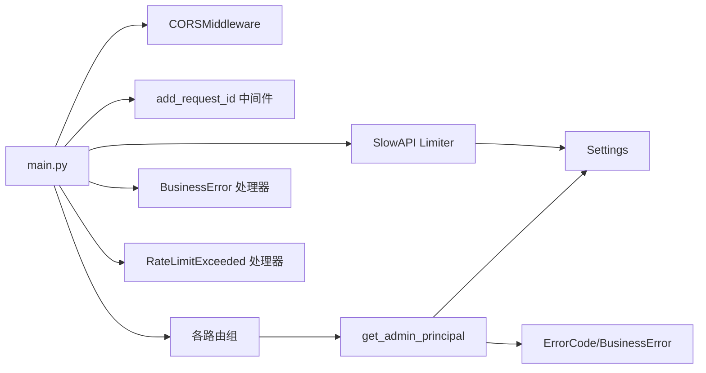

# 中间件与认证

<cite>
**本文引用的文件**   
- [backend/app/main.py](file://backend/app/main.py)
- [backend/app/middleware/admin_auth.py](file://backend/app/middleware/admin_auth.py)
- [backend/app/api/auth.py](file://backend/app/api/auth.py)
- [backend/app/core/rate_limit.py](file://backend/app/core/rate_limit.py)
- [backend/app/core/config.py](file://backend/app/core/config.py)
- [backend/app/core/errors.py](file://backend/app/core/errors.py)
- [backend/app/schemas/auth.py](file://backend/app/schemas/auth.py)
- [backend/app/api/admin/access_tokens.py](file://backend/app/api/admin/access_tokens.py)
</cite>

## 目录
1. [简介](#简介)
2. [项目结构](#项目结构)
3. [核心组件](#核心组件)
4. [架构总览](#架构总览)
5. [详细组件分析](#详细组件分析)
6. [依赖关系分析](#依赖关系分析)
7. [性能考量](#性能考量)
8. [故障排查指南](#故障排查指南)
9. [结论](#结论)
10. [附录](#附录)

## 简介
本文件围绕 Learning Hub 后端的中间件与认证体系进行系统化设计说明，覆盖以下主题：
- 管理员认证中间件：JWT 令牌验证、请求拦截机制与身份提取。
- 限流中间件：基于 SlowAPI 的 IP/会话双键限流策略与 Redis 存储适配。
- CORS 跨域配置：安全策略与开发调试建议。
- 请求 ID 追踪：全局日志关联与响应头透传。
- 认证 API：登录、登出流程与前端 Cookie 交互。
- 自定义中间件开发指南：执行顺序、错误处理最佳实践。

## 项目结构
后端采用 FastAPI 应用装配模式，入口集中管理中间件、路由注册与异常处理器；认证逻辑集中在中间件与认证路由中；限流通过 SlowAPI 集成；CORS 与请求 ID 在应用启动阶段统一注入。

图表来源
- [backend/app/main.py:40-112](file://backend/app/main.py#L40-L112)
- [backend/app/middleware/admin_auth.py:1-66](file://backend/app/middleware/admin_auth.py#L1-L66)
- [backend/app/api/auth.py:1-49](file://backend/app/api/auth.py#L1-L49)
- [backend/app/api/admin/access_tokens.py:1-120](file://backend/app/api/admin/access_tokens.py#L1-L120)

章节来源
- [backend/app/main.py:1-116](file://backend/app/main.py#L1-L116)

## 核心组件
- 管理员认证中间件（Depends）：从请求中提取 JWT（优先 Authorization: Bearer，其次 Cookie），校验签名与过期时间，失败抛出统一业务异常。
- 认证 API：提供管理员登录与登出接口，使用静态 Admin Token 换取短期 JWT，并以 HttpOnly Cookie 下发。
- 限流中间件：基于 SlowAPI，支持按 IP 或会话标识限流，默认内存存储，可切换为 Redis。
- CORS 中间件：根据配置动态设置允许的来源、方法与头部，并暴露 X-Request-Id 响应头。
- 请求 ID 追踪：在每个请求生命周期内生成或透传 X-Request-Id，并在所有异常响应中附带。

章节来源
- [backend/app/middleware/admin_auth.py:1-66](file://backend/app/middleware/admin_auth.py#L1-L66)
- [backend/app/api/auth.py:1-49](file://backend/app/api/auth.py#L1-L49)
- [backend/app/core/rate_limit.py:1-55](file://backend/app/core/rate_limit.py#L1-L55)
- [backend/app/main.py:57-90](file://backend/app/main.py#L57-L90)

## 架构总览
下图展示了请求进入后的关键路径：CORS → 请求ID → 限流 → 路由匹配 → 鉴权 Depends → 业务处理 → 统一异常封装。

图表来源
- [backend/app/main.py:57-90](file://backend/app/main.py#L57-L90)
- [backend/app/core/rate_limit.py:18-55](file://backend/app/core/rate_limit.py#L18-L55)
- [backend/app/middleware/admin_auth.py:16-42](file://backend/app/middleware/admin_auth.py#L16-L42)

## 详细组件分析

### 管理员认证中间件（Depends）
- 令牌来源优先级：Authorization: Bearer > Cookie LH_ADMIN_SESSION。
- 校验规则：要求包含 exp 与 sub 字段，使用配置的算法与密钥解码。
- 错误语义：未携带令牌、令牌过期、令牌无效均映射为“未认证”错误码。
- 辅助能力：签发 JWT（固定 TTL）、常量时间比较验证初始 Admin Token。

图表来源
- [backend/app/middleware/admin_auth.py:16-42](file://backend/app/middleware/admin_auth.py#L16-L42)
- [backend/app/middleware/admin_auth.py:45-62](file://backend/app/middleware/admin_auth.py#L45-L62)

章节来源
- [backend/app/middleware/admin_auth.py:1-66](file://backend/app/middleware/admin_auth.py#L1-L66)
- [backend/app/core/errors.py:9-127](file://backend/app/core/errors.py#L9-L127)

### 认证 API（登录/登出）
- 登录：校验静态 Admin Token，签发短期 JWT，写入 HttpOnly Cookie，并返回到期时间。
- 登出：删除会话 Cookie。
- 前端交互：浏览器自动携带同名 Cookie 发起后续请求，或通过 Authorization 头传递。

图表来源
- [backend/app/api/auth.py:21-45](file://backend/app/api/auth.py#L21-L45)
- [backend/app/middleware/admin_auth.py:16-42](file://backend/app/middleware/admin_auth.py#L16-L42)

章节来源
- [backend/app/api/auth.py:1-49](file://backend/app/api/auth.py#L1-L49)
- [backend/app/schemas/auth.py:1-17](file://backend/app/schemas/auth.py#L1-L17)
- [backend/app/middleware/admin_auth.py:45-62](file://backend/app/middleware/admin_auth.py#L45-L62)

### 限流中间件（SlowAPI 适配）
- Key 函数：支持 ip 与 session 两种维度。session 模式尝试从 Authorization 头解析 JWT sub 片段作为会话标识，失败回退到 IP。
- 存储后端：优先使用 Redis（由配置项决定），否则回退至内存模式。
- 装饰器：rate_limit(spec, key="ip"/"session") 用于路由级限流。
- 异常处理：触发 RateLimitExceeded 时，统一返回 429 并附带 requestId。

图表来源
- [backend/app/core/rate_limit.py:18-55](file://backend/app/core/rate_limit.py#L18-L55)
- [backend/app/core/config.py:62-64](file://backend/app/core/config.py#L62-L64)

章节来源
- [backend/app/core/rate_limit.py:1-55](file://backend/app/core/rate_limit.py#L1-L55)
- [backend/app/core/config.py:62-64](file://backend/app/core/config.py#L62-L64)
- [backend/app/main.py:67-90](file://backend/app/main.py#L67-L90)

### CORS 跨域配置
- 允许来源：从配置项解析逗号分隔列表，空值则允许全部来源。
- 凭据与头：允许携带凭据，允许所有方法与头部，并暴露 X-Request-Id 以便前端调试。
- 生产建议：严格限定 allow_origins，避免在生产环境使用通配符。

章节来源
- [backend/app/main.py:57-65](file://backend/app/main.py#L57-L65)
- [backend/app/core/config.py:48-50](file://backend/app/core/config.py#L48-L50)

### 请求 ID 追踪
- 注入逻辑：若请求头存在 X-Request-Id 则复用，否则生成随机 ID，写入 request.state 并回写到响应头。
- 异常处理：BusinessError 与 RateLimitExceeded 处理器均会附加 requestId，便于端到端追踪。
- 监控集成：可在日志采集系统中以 requestId 为维度聚合耗时与错误率。

章节来源
- [backend/app/main.py:70-89](file://backend/app/main.py#L70-L89)

### 后台路由鉴权接入示例
- 路由组级别挂载 Depends(get_admin_principal)，实现批量保护。
- 典型场景：Access Tokens 管理、分类、标签、素材、课件等后台接口。

章节来源
- [backend/app/api/admin/access_tokens.py:21-25](file://backend/app/api/admin/access_tokens.py#L21-L25)

## 依赖关系分析
- 应用入口 main.py 负责组装中间件、异常处理器与路由注册。
- admin_auth 依赖配置中心获取 JWT 密钥与算法，依赖错误模块抛出统一异常。
- rate_limit 依赖配置中心选择存储后端，依赖 SlowAPI 完成计数与判定。
- 认证路由 auth.py 依赖 admin_auth 的签发与校验工具函数。

图表来源
- [backend/app/main.py:57-112](file://backend/app/main.py#L57-L112)
- [backend/app/middleware/admin_auth.py:1-42](file://backend/app/middleware/admin_auth.py#L1-L42)
- [backend/app/core/rate_limit.py:18-55](file://backend/app/core/rate_limit.py#L18-L55)
- [backend/app/core/config.py:40-64](file://backend/app/core/config.py#L40-L64)
- [backend/app/core/errors.py:9-127](file://backend/app/core/errors.py#L9-L127)

## 性能考量
- 限流存储：生产环境务必启用 Redis 作为 SlowAPI 的存储后端，避免多实例部署下的计数不一致。
- 令牌校验：JWT 解码开销较低，但应避免在热路径中进行额外数据库查询；如需角色权限扩展，建议将角色信息放入 JWT payload 或在网关层做缓存。
- 请求 ID：仅在必要处记录 requestId，避免对高吞吐接口造成额外序列化开销。
- CORS：生产环境严格限定 allow_origins，减少不必要的预检请求。

[本节为通用指导，不直接分析具体文件]

## 故障排查指南
- 401 未认证：
  - 确认是否携带 Authorization: Bearer 或 LH_ADMIN_SESSION Cookie。
  - 检查 JWT 是否过期或签名不正确。
  - 参考：管理员认证中间件的令牌提取与解码逻辑。
- 429 限流：
  - 检查当前限流 key（IP 或会话）是否命中阈值。
  - 确认 Redis 连通性与慢查询。
  - 参考：限流异常处理器与 SlowAPI 适配器。
- 跨域问题：
  - 核对 allow_origins 是否包含前端域名。
  - 确认是否允许凭据与自定义头。
  - 参考：CORS 中间件配置。
- 无法定位请求：
  - 检查请求与响应是否包含一致的 X-Request-Id。
  - 参考：请求 ID 中间件与异常处理器。

章节来源
- [backend/app/middleware/admin_auth.py:16-42](file://backend/app/middleware/admin_auth.py#L16-L42)
- [backend/app/core/rate_limit.py:18-55](file://backend/app/core/rate_limit.py#L18-L55)
- [backend/app/main.py:70-90](file://backend/app/main.py#L70-L90)
- [backend/app/main.py:57-65](file://backend/app/main.py#L57-L65)

## 结论
Learning Hub 的中间件与认证体系以 FastAPI 为中心，通过统一的中间件链与异常处理器实现了清晰的关注点分离：CORS 与请求 ID 贯穿全链路，限流在入口处快速拒绝异常流量，管理员认证以 JWT 为核心保障后台安全。配合配置中心的灵活开关，系统可在开发与生产环境间平滑切换安全策略与存储后端。

[本节为总结性内容，不直接分析具体文件]

## 附录

### 自定义中间件开发指南
- 执行顺序：
  - 先注册的中间件先执行，后注册的中间件后执行；异常处理遵循“就近捕获”原则。
  - 推荐顺序：CORS → 请求ID → 限流 → 业务中间件（如审计/ACL）→ 路由。
- 错误处理：
  - 尽量抛出 BusinessError，交由全局异常处理器统一包装，确保响应体包含 code、message、data 与 requestId。
  - 对于第三方库异常（如 SlowAPI），注册专用异常处理器，保证一致性。
- 性能与安全：
  - 避免在中间件中执行阻塞 IO；必要时异步化。
  - 敏感信息不要写入日志；仅记录必要的上下文与 requestId。
- 测试建议：
  - 针对中间件行为编写单测：非法令牌、过期令牌、限流命中、CORS 预检、requestId 透传等。

[本节为通用指导，不直接分析具体文件]