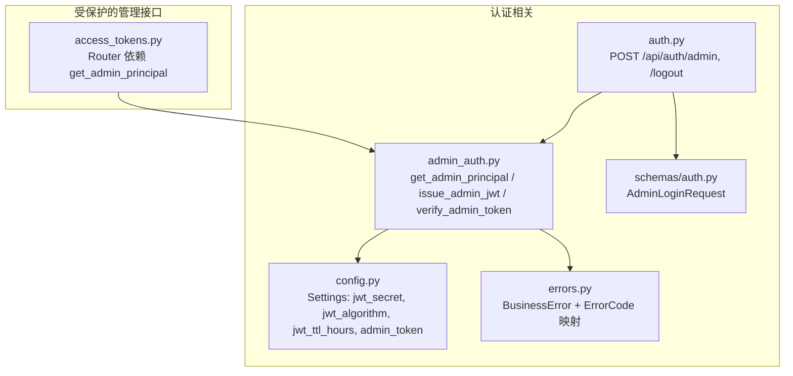
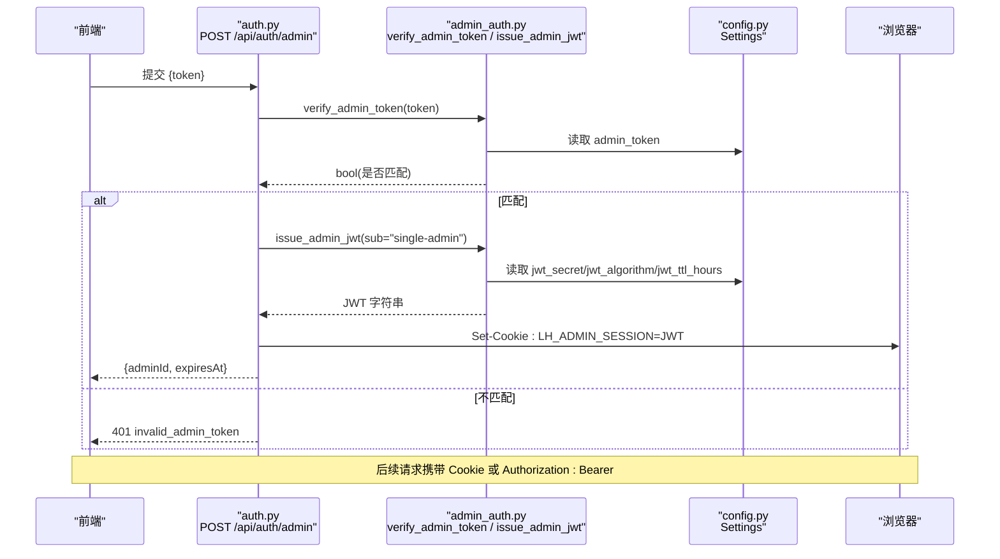
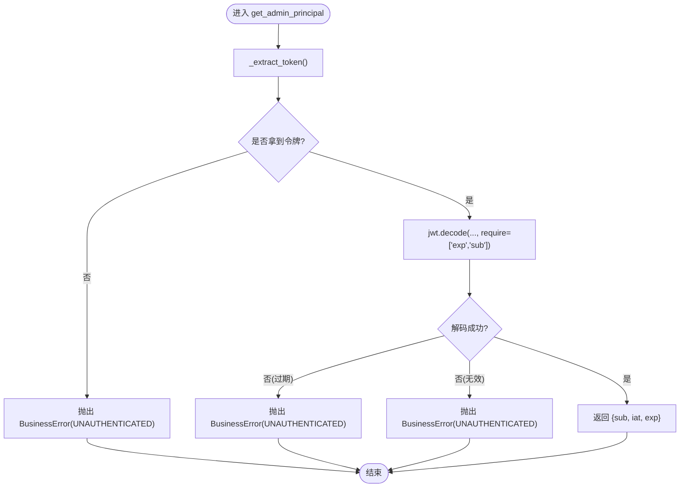
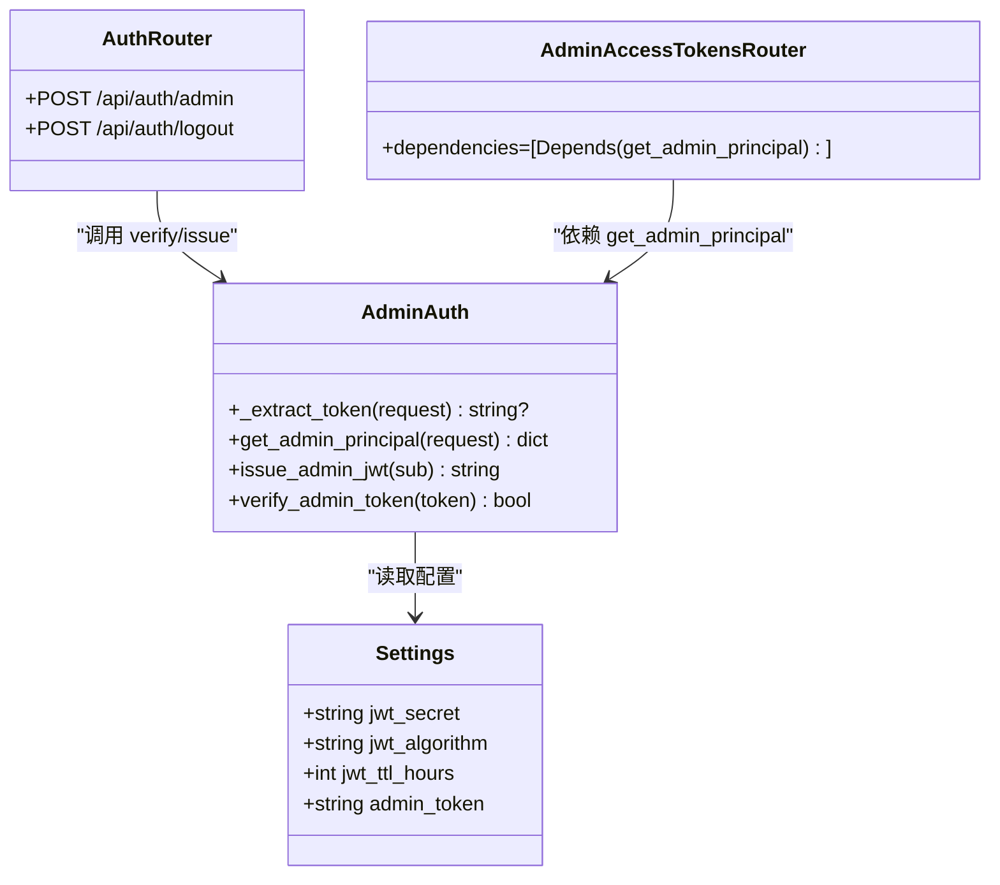

# 管理员认证中间件

<cite>
**本文引用的文件**   
- [backend/app/middleware/admin_auth.py](file://backend/app/middleware/admin_auth.py)
- [backend/app/api/auth.py](file://backend/app/api/auth.py)
- [backend/app/core/config.py](file://backend/app/core/config.py)
- [backend/app/core/errors.py](file://backend/app/core/errors.py)
- [backend/app/schemas/auth.py](file://backend/app/schemas/auth.py)
- [backend/app/api/admin/access_tokens.py](file://backend/app/api/admin/access_tokens.py)
</cite>

## 目录
1. [简介](#简介)
2. [项目结构](#项目结构)
3. [核心组件](#核心组件)
4. [架构总览](#架构总览)
5. [详细组件分析](#详细组件分析)
6. [依赖关系分析](#依赖关系分析)
7. [性能与安全考量](#性能与安全考量)
8. [故障排查指南](#故障排查指南)
9. [结论](#结论)
10. [附录：自定义认证中间件开发指南](#附录自定义认证中间件开发指南)

## 简介
本技术文档聚焦于“管理员认证中间件”的实现与使用，围绕以下目标展开：
- JWT 令牌验证机制：令牌提取（Authorization 头优先、Cookie 备选）、解码与校验流程。
- get_admin_principal 依赖函数：错误处理策略（未登录、会话过期、令牌无效）与用户信息提取。
- issue_admin_jwt 签发机制：JWT 载荷结构、时间戳处理与 TTL 配置。
- verify_admin_token 安全实现：常量时间比较防止时序攻击。
- 自定义认证中间件开发指南：FastAPI Depends 模式与错误响应标准化。

## 项目结构
与管理员认证相关的后端代码主要分布在以下模块：
- 鉴权中间件与工具：backend/app/middleware/admin_auth.py
- 登录/登出路由：backend/app/api/auth.py
- 配置中心（JWT 密钥、算法、TTL、Admin Token）：backend/app/core/config.py
- 统一业务异常与错误码映射：backend/app/core/errors.py
- 登录请求 Schema：backend/app/schemas/auth.py
- 受保护的管理 API 示例（以 Access Tokens 为例）：backend/app/api/admin/access_tokens.py

图表来源
- [backend/app/middleware/admin_auth.py:1-66](file://backend/app/middleware/admin_auth.py#L1-L66)
- [backend/app/api/auth.py:1-49](file://backend/app/api/auth.py#L1-L49)
- [backend/app/core/config.py:40-47](file://backend/app/core/config.py#L40-L47)
- [backend/app/core/errors.py:9-144](file://backend/app/core/errors.py#L9-L144)
- [backend/app/schemas/auth.py:1-17](file://backend/app/schemas/auth.py#L1-L17)
- [backend/app/api/admin/access_tokens.py:1-25](file://backend/app/api/admin/access_tokens.py#L1-L25)

章节来源
- [backend/app/middleware/admin_auth.py:1-66](file://backend/app/middleware/admin_auth.py#L1-L66)
- [backend/app/api/auth.py:1-49](file://backend/app/api/auth.py#L1-L49)
- [backend/app/core/config.py:1-88](file://backend/app/core/config.py#L1-L88)
- [backend/app/core/errors.py:1-144](file://backend/app/core/errors.py#L1-L144)
- [backend/app/schemas/auth.py:1-17](file://backend/app/schemas/auth.py#L1-L17)
- [backend/app/api/admin/access_tokens.py:1-120](file://backend/app/api/admin/access_tokens.py#L1-L120)

## 核心组件
本节对管理员认证的核心函数与路由进行概览式说明，后续章节将深入细节。

- _extract_token(request): 从请求中提取 JWT 字符串。优先级为 Authorization: Bearer，其次为 Cookie LH_ADMIN_SESSION。
- get_admin_principal(request): FastAPI 依赖注入函数。负责解析并校验 JWT，失败时抛出 BusinessError；成功则返回包含 sub/iat/exp 的字典。
- issue_admin_jwt(sub): 签发 Admin JWT，载荷包含 sub、iat、exp，TTL 由配置项控制。
- verify_admin_token(token): 使用 hmac.compare_digest 对明文 Admin Token 进行常量时间比较，避免时序攻击。
- POST /api/auth/admin: 校验 Admin Token，签发 JWT，写入 HttpOnly Cookie，并返回 expiresAt。
- POST /api/auth/logout: 删除会话 Cookie。

章节来源
- [backend/app/middleware/admin_auth.py:16-63](file://backend/app/middleware/admin_auth.py#L16-L63)
- [backend/app/api/auth.py:21-45](file://backend/app/api/auth.py#L21-L45)

## 架构总览
下图展示了管理员认证的端到端流程：前端通过 /api/auth/admin 提交明文 Admin Token，后端校验后签发 JWT 并设置 Cookie；后续访问受保护管理接口时，中间件从请求中按优先级提取 JWT 并校验。

图表来源
- [backend/app/api/auth.py:21-39](file://backend/app/api/auth.py#L21-L39)
- [backend/app/middleware/admin_auth.py:58-63](file://backend/app/middleware/admin_auth.py#L58-L63)
- [backend/app/middleware/admin_auth.py:45-55](file://backend/app/middleware/admin_auth.py#L45-L55)
- [backend/app/core/config.py:40-47](file://backend/app/core/config.py#L40-L47)

## 详细组件分析

### 令牌提取逻辑（Authorization 头优先、Cookie 备选）
_extract_token 实现要点：
- 优先检查 Authorization 头，若以 “Bearer ” 开头则截取空格后的令牌部分。
- 否则回退到 Cookie，键名为 LH_ADMIN_SESSION。
- 两者均不存在时返回 None。

该设计兼顾了两种常见场景：
- 前后端分离且跨域调用时，可通过 Authorization 头传递 JWT。
- 同站或同源场景下，通过 HttpOnly Cookie 自动携带，降低前端负担。

章节来源
- [backend/app/middleware/admin_auth.py:16-24](file://backend/app/middleware/admin_auth.py#L16-L24)

### JWT 解码与验证流程（get_admin_principal）
get_admin_principal 作为 FastAPI 依赖注入函数，职责包括：
- 调用 _extract_token 获取令牌。
- 无令牌时抛出 BusinessError(ErrorCode.UNAUTHENTICATED)。
- 使用 PyJWT 解码，要求载荷必须包含 exp 与 sub，并使用配置的算法与密钥。
- 捕获两类异常：
  - ExpiredSignatureError：会话已过期，抛出 UNAUTHENTICATED。
  - InvalidTokenError：令牌无效，抛出 UNAUTHENTICATED。
- 成功时返回包含 sub、iat、exp 的字典，供上层路由使用。

错误响应标准化：
- BusinessError 基于 ErrorCode 映射到 HTTP 状态码，并通过全局错误处理器包装为标准信封格式。

图表来源
- [backend/app/middleware/admin_auth.py:26-42](file://backend/app/middleware/admin_auth.py#L26-L42)
- [backend/app/core/errors.py:73-144](file://backend/app/core/errors.py#L73-L144)

章节来源
- [backend/app/middleware/admin_auth.py:26-42](file://backend/app/middleware/admin_auth.py#L26-L42)
- [backend/app/core/errors.py:9-144](file://backend/app/core/errors.py#L9-L144)

### 签发 Admin JWT（issue_admin_jwt）
issue_admin_jwt 的工作机制：
- 计算当前时间戳 now = int(time.time())。
- 构造载荷：
  - sub：管理员标识（默认 single-admin）。
  - iat：签发时间。
  - exp：过期时间 = now + jwt_ttl_hours * 3600。
- 使用配置的 jwt_secret 与 jwt_algorithm 编码生成 JWT。

TTL 配置：
- jwt_ttl_hours 来自 Settings，默认 8 小时。
- 登录路由中的 Cookie max_age 也设置为相同时长，保持两端一致。

章节来源
- [backend/app/middleware/admin_auth.py:45-55](file://backend/app/middleware/admin_auth.py#L45-L55)
- [backend/app/core/config.py:44-46](file://backend/app/core/config.py#L44-L46)
- [backend/app/api/auth.py:17-18](file://backend/app/api/auth.py#L17-L18)

### 明文 Admin Token 验证（verify_admin_token）
verify_admin_token 的安全实现：
- 使用 hmac.compare_digest 进行常量时间比较，避免时序攻击。
- 对比输入 token 与配置项 admin_token。

注意：
- 该函数仅用于首次登录时的“一次性凭证”校验，不应直接用于后续请求鉴权。
- 生产环境务必在环境变量中覆盖默认值。

章节来源
- [backend/app/middleware/admin_auth.py:58-63](file://backend/app/middleware/admin_auth.py#L58-L63)
- [backend/app/core/config.py:41](file://backend/app/core/config.py#L41)

### 登录与登出路由（/api/auth）
- POST /api/auth/admin
  - 校验 Admin Token（verify_admin_token），失败返回 401 invalid_admin_token。
  - 签发 JWT（issue_admin_jwt），写入 HttpOnly Cookie（名称 LH_ADMIN_SESSION，max_age 与 TTL 一致）。
  - 返回 adminId 与 expiresAt（ISO-8601）。
- POST /api/auth/logout
  - 删除 Cookie，幂等。

章节来源
- [backend/app/api/auth.py:21-45](file://backend/app/api/auth.py#L21-L45)
- [backend/app/schemas/auth.py:7-14](file://backend/app/schemas/auth.py#L7-L14)

### 受保护的管理 API 示例（Access Tokens）
以 access_tokens 路由为例，展示如何在 Router 级别统一应用认证依赖：
- 在 Router 初始化时声明 dependencies=[Depends(get_admin_principal)]，所有子路由均需通过认证。
- 路由函数无需重复声明依赖，简化样板代码。

章节来源
- [backend/app/api/admin/access_tokens.py:21-25](file://backend/app/api/admin/access_tokens.py#L21-L25)

## 依赖关系分析
- admin_auth.py 依赖：
  - config.get_settings：读取 jwt_secret、jwt_algorithm、jwt_ttl_hours、admin_token。
  - core.errors.BusinessError/ErrorCode：统一错误响应。
  - PyJWT：令牌编解码。
- auth.py 依赖：
  - admin_auth.verify_admin_token / issue_admin_jwt。
  - schemas.auth.AdminLoginRequest。
  - core.errors.BusinessError/ErrorCode。
- 管理 API（如 access_tokens.py）依赖：
  - admin_auth.get_admin_principal（通过 Router 级依赖注入）。

图表来源
- [backend/app/core/config.py:40-47](file://backend/app/core/config.py#L40-L47)
- [backend/app/middleware/admin_auth.py:16-63](file://backend/app/middleware/admin_auth.py#L16-L63)
- [backend/app/api/auth.py:21-45](file://backend/app/api/auth.py#L21-L45)
- [backend/app/api/admin/access_tokens.py:21-25](file://backend/app/api/admin/access_tokens.py#L21-L25)

章节来源
- [backend/app/middleware/admin_auth.py:1-66](file://backend/app/middleware/admin_auth.py#L1-L66)
- [backend/app/api/auth.py:1-49](file://backend/app/api/auth.py#L1-L49)
- [backend/app/api/admin/access_tokens.py:1-120](file://backend/app/api/admin/access_tokens.py#L1-L120)
- [backend/app/core/config.py:1-88](file://backend/app/core/config.py#L1-L88)

## 性能与安全考量
- 性能
  - JWT 解码为轻量操作，开销主要来自加密签名验证；合理选择算法（HS256）与密钥长度可平衡安全与性能。
  - 建议在多进程部署中使用独立的 jwt_secret，避免共享状态。
- 安全
  - 使用 hmac.compare_digest 防止时序攻击（verify_admin_token）。
  - 强制要求 exp 与 sub 字段，避免缺少关键载荷的令牌被接受。
  - Cookie 设置 httponly=True、samesite="lax"，降低 XSS/CSRF 风险。
  - 生产环境务必覆盖默认 secret 与 admin_token。

[本节为通用指导，不直接分析具体文件]

## 故障排查指南
常见问题与定位建议：
- 401 unauthenticated
  - 可能原因：未携带令牌、令牌缺失 exp/sub、令牌签名错误或已过期。
  - 排查步骤：确认 Authorization 头或 Cookie 是否存在；检查服务端 jwt_secret 是否与签发端一致；核对系统时间与服务器时区。
- 401 invalid_admin_token
  - 可能原因：登录接口传入的明文 Admin Token 不正确。
  - 排查步骤：核对环境变量 admin_token 与前端提交的 token 是否一致。
- 会话过期
  - 现象：登录后一段时间无法访问受保护接口。
  - 排查步骤：检查 jwt_ttl_hours 与 Cookie max_age 是否一致；确认客户端是否及时刷新或重新登录。

章节来源
- [backend/app/core/errors.py:73-144](file://backend/app/core/errors.py#L73-L144)
- [backend/app/middleware/admin_auth.py:26-42](file://backend/app/middleware/admin_auth.py#L26-L42)
- [backend/app/api/auth.py:21-39](file://backend/app/api/auth.py#L21-L39)

## 结论
本中间件实现了简洁而健壮的管理员认证方案：
- 灵活的令牌提取策略（Authorization 头优先、Cookie 备选）。
- 严格的 JWT 解码与校验（必需字段、算法与密钥配置化）。
- 安全的明文 Token 验证（常量时间比较）。
- 统一的错误响应与标准化的依赖注入模式，便于扩展与维护。

[本节为总结性内容，不直接分析具体文件]

## 附录：自定义认证中间件开发指南
面向需要扩展或替换认证逻辑的场景，提供如下实践建议：

- 使用 FastAPI Depends 模式
  - 在 Router 或单个路由上声明 dependencies=[Depends(get_admin_principal)]，集中管理鉴权逻辑。
  - 如需区分角色，可在 get_admin_principal 中增加角色判断，或新增专用依赖函数。

- 错误响应标准化
  - 使用 BusinessError 与 ErrorCode 抛出统一错误，确保客户端能稳定解析 code/message/data/requestId。
  - 对于不同错误类型（未登录、过期、无效），应给出明确的用户提示文案。

- 最佳实践
  - 密钥与敏感配置一律通过环境变量注入，禁止硬编码。
  - 严格限定 JWT 算法白名单，避免算法混淆。
  - 对 Cookie 启用 httponly、samesite，必要时配合 secure（HTTPS）。
  - 定期轮换 jwt_secret 与 admin_token，并提供平滑迁移方案。
  - 在日志中记录必要的审计信息（如 sub、exp、请求路径），但避免记录敏感数据。

- 参考路径
  - 依赖注入示例：[backend/app/api/admin/access_tokens.py:21-25](file://backend/app/api/admin/access_tokens.py#L21-L25)
  - 统一错误定义：[backend/app/core/errors.py:9-144](file://backend/app/core/errors.py#L9-L144)
  - 配置项定义：[backend/app/core/config.py:40-47](file://backend/app/core/config.py#L40-L47)

[本节为通用指导，不直接分析具体文件]