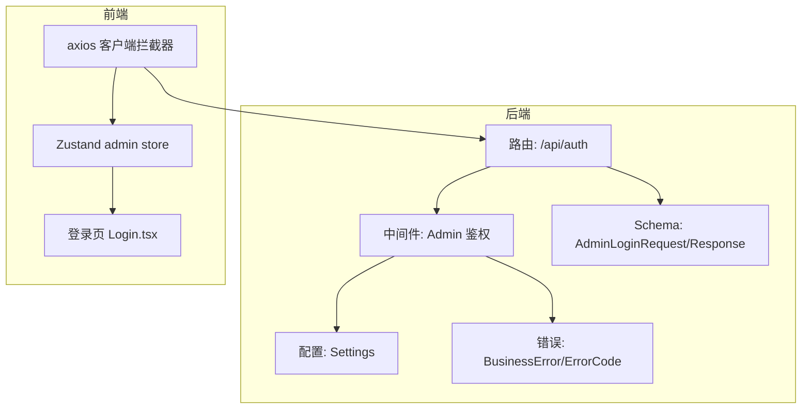
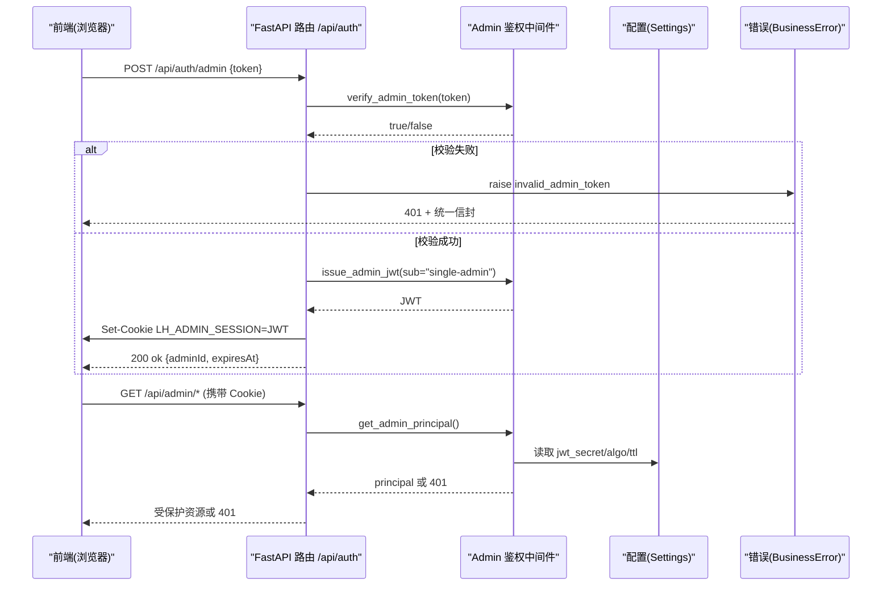
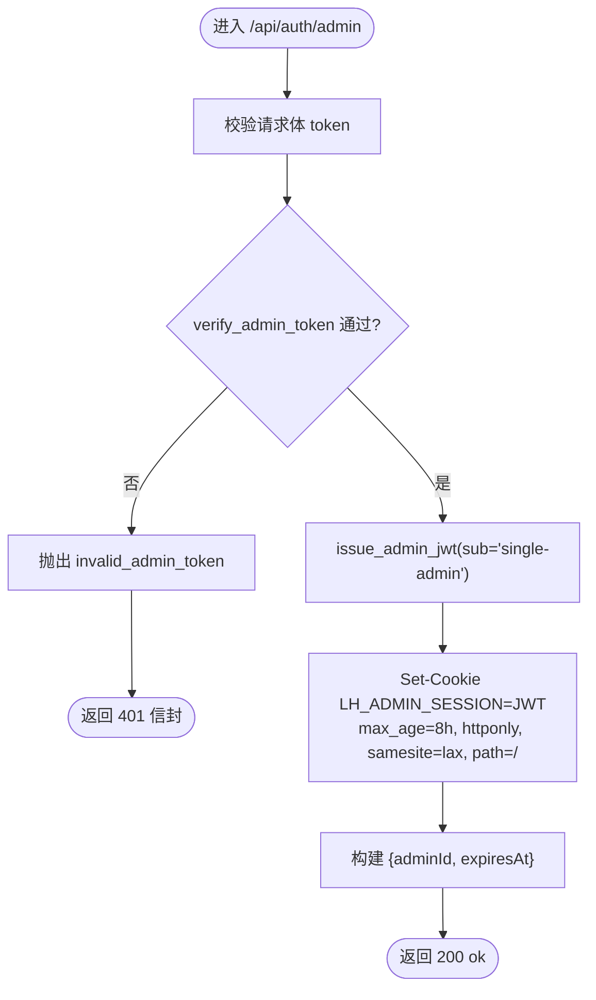
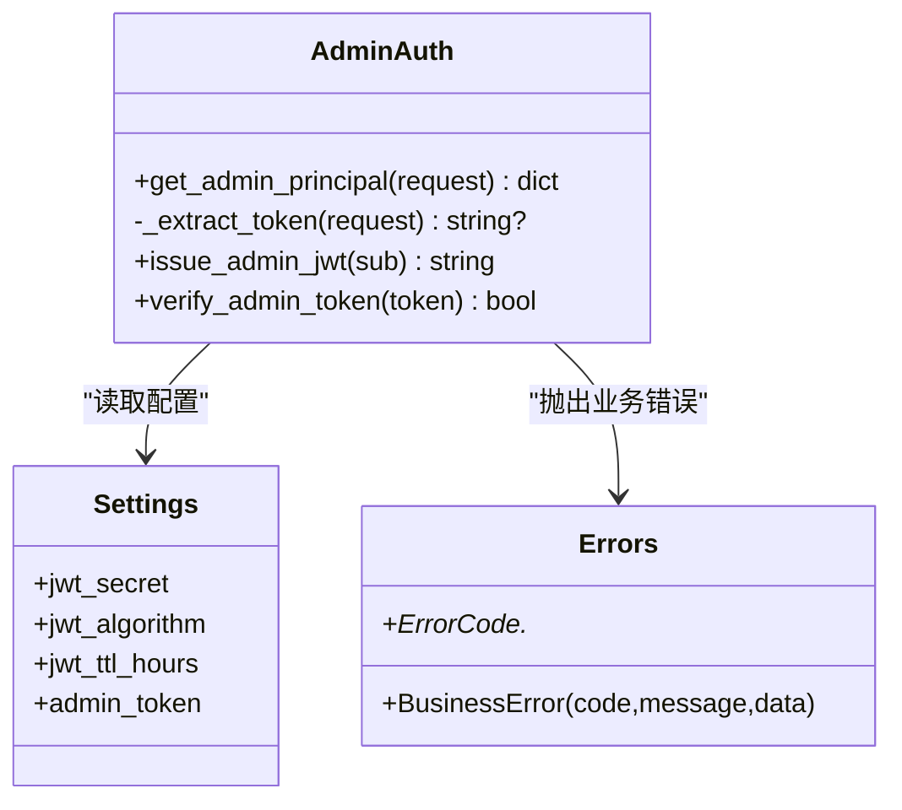
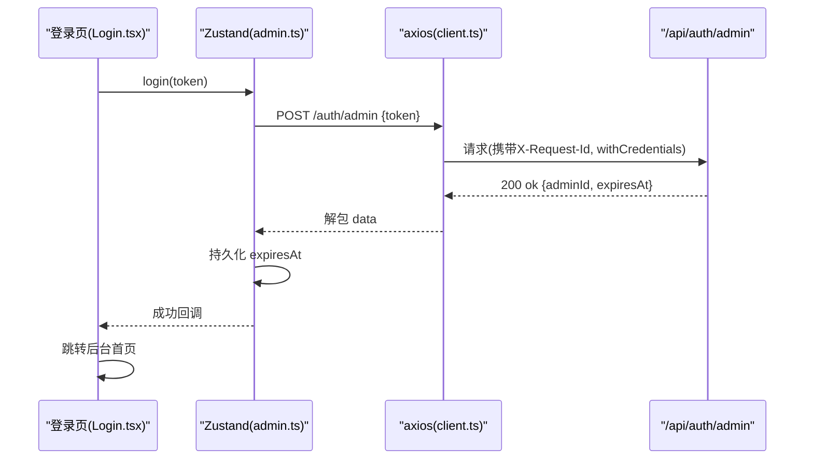
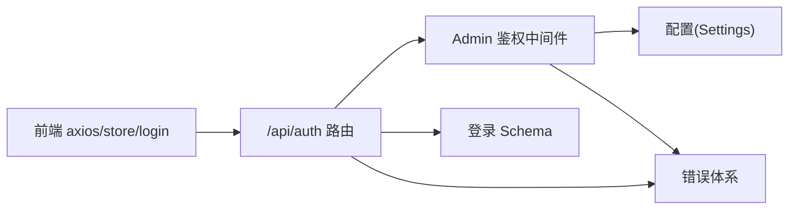

# 认证API接口

<cite>
**本文引用的文件列表**
- [backend/app/api/auth.py](file://backend/app/api/auth.py)
- [backend/app/middleware/admin_auth.py](file://backend/app/middleware/admin_auth.py)
- [backend/app/schemas/auth.py](file://backend/app/schemas/auth.py)
- [backend/app/core/errors.py](file://backend/app/core/errors.py)
- [backend/app/core/config.py](file://backend/app/core/config.py)
- [doc/spec/10-API设计规范.md](file://doc/spec/10-API设计规范.md)
- [frontend/src/api/client.ts](file://frontend/src/api/client.ts)
- [frontend/src/stores/admin.ts](file://frontend/src/stores/admin.ts)
- [frontend/src/pages/admin/Login.tsx](file://frontend/src/pages/admin/Login.tsx)
- [backend/tests/test_auth.py](file://backend/tests/test_auth.py)
</cite>

## 目录
1. [简介](#简介)
2. [项目结构](#项目结构)
3. [核心组件](#核心组件)
4. [架构总览](#架构总览)
5. [详细组件分析](#详细组件分析)
6. [依赖关系分析](#依赖关系分析)
7. [性能与可扩展性](#性能与可扩展性)
8. [故障排查指南](#故障排查指南)
9. [结论](#结论)
10. [附录：完整API规范与安全最佳实践](#附录完整api规范与安全最佳实践)

## 简介
本文件面向后端与前端开发者，系统化梳理学习平台“认证API”的实现与使用方式。重点覆盖管理员登录、登出、会话管理、JWT签发与校验、统一错误处理、客户端集成示例以及安全最佳实践。文档同时提供完整的API规范（请求参数、响应格式、状态码与错误处理），并给出前后端参考实现路径，便于快速对接与排障。

## 项目结构
认证相关代码主要分布在以下模块：
- 路由层：定义 /api/auth/* 的登录与登出接口
- 中间件层：Admin 鉴权依赖（从 Cookie 或 Authorization 头提取 JWT 并校验）
- Schema 层：登录请求/响应的数据模型
- 配置层：Admin Token、JWT 密钥、算法、TTL 等
- 错误层：统一业务错误码与信封包装
- 前端：Axios 客户端拦截器、Zustand 状态管理、登录页面

图表来源
- [backend/app/api/auth.py:1-49](file://backend/app/api/auth.py#L1-L49)
- [backend/app/middleware/admin_auth.py:1-66](file://backend/app/middleware/admin_auth.py#L1-L66)
- [backend/app/schemas/auth.py:1-17](file://backend/app/schemas/auth.py#L1-L17)
- [backend/app/core/errors.py:1-144](file://backend/app/core/errors.py#L1-L144)
- [backend/app/core/config.py:1-88](file://backend/app/core/config.py#L1-L88)
- [frontend/src/api/client.ts:1-52](file://frontend/src/api/client.ts#L1-L52)
- [frontend/src/stores/admin.ts:1-71](file://frontend/src/stores/admin.ts#L1-L71)
- [frontend/src/pages/admin/Login.tsx:1-72](file://frontend/src/pages/admin/Login.tsx#L1-L72)

章节来源
- [backend/app/api/auth.py:1-49](file://backend/app/api/auth.py#L1-L49)
- [backend/app/middleware/admin_auth.py:1-66](file://backend/app/middleware/admin_auth.py#L1-L66)
- [backend/app/schemas/auth.py:1-17](file://backend/app/schemas/auth.py#L1-L17)
- [backend/app/core/errors.py:1-144](file://backend/app/core/errors.py#L1-L144)
- [backend/app/core/config.py:1-88](file://backend/app/core/config.py#L1-L88)
- [frontend/src/api/client.ts:1-52](file://frontend/src/api/client.ts#L1-L52)
- [frontend/src/stores/admin.ts:1-71](file://frontend/src/stores/admin.ts#L1-L71)
- [frontend/src/pages/admin/Login.tsx:1-72](file://frontend/src/pages/admin/Login.tsx#L1-L72)

## 核心组件
- 认证路由
  - POST /api/auth/admin：校验 Admin Token，签发 JWT，写入 HttpOnly Cookie，返回 adminId 与 expiresAt
  - POST /api/auth/logout：删除会话 Cookie，幂等退出
- 中间件鉴权
  - get_admin_principal：从 Authorization: Bearer 或 LH_ADMIN_SESSION Cookie 提取 JWT，解码并校验 exp/sub，失败抛 401
  - issue_admin_jwt：按配置的算法和密钥签发 JWT，默认 TTL 为配置项 jwt_ttl_hours
  - verify_admin_token：常量时间比较验证 Admin Token
- Schema
  - AdminLoginRequest：token 字段，长度限制
  - AdminLoginResponse：adminId、expiresAt（ISO-8601）
- 错误体系
  - ErrorCode：集中定义业务码（如 unauthenticated、invalid_admin_token 等）
  - BusinessError：将 code/message/data 注入 HTTPException.detail，由全局处理器封装成统一信封
- 配置
  - admin_token：演示值可配置
  - jwt_secret/jwt_algorithm/jwt_ttl_hours：JWT 签名与过期策略
- 前端集成
  - axios 客户端：withCredentials=true，自动附加 X-Request-Id，统一解析信封并抛出带 code/status 的错误
  - Zustand store：调用 /auth/admin 与 /auth/logout，持久化 expiresAt，恢复本地会话
  - 登录页：表单输入 token，提交后导航至后台首页

章节来源
- [backend/app/api/auth.py:1-49](file://backend/app/api/auth.py#L1-L49)
- [backend/app/middleware/admin_auth.py:1-66](file://backend/app/middleware/admin_auth.py#L1-L66)
- [backend/app/schemas/auth.py:1-17](file://backend/app/schemas/auth.py#L1-L17)
- [backend/app/core/errors.py:1-144](file://backend/app/core/errors.py#L1-L144)
- [backend/app/core/config.py:1-88](file://backend/app/core/config.py#L1-L88)
- [frontend/src/api/client.ts:1-52](file://frontend/src/api/client.ts#L1-L52)
- [frontend/src/stores/admin.ts:1-71](file://frontend/src/stores/admin.ts#L1-L71)
- [frontend/src/pages/admin/Login.tsx:1-72](file://frontend/src/pages/admin/Login.tsx#L1-L72)

## 架构总览
下图展示了管理员登录到受保护资源访问的整体流程，包括 Cookie/JWT 的双通道鉴权与统一错误信封。

图表来源
- [backend/app/api/auth.py:1-49](file://backend/app/api/auth.py#L1-L49)
- [backend/app/middleware/admin_auth.py:1-66](file://backend/app/middleware/admin_auth.py#L1-L66)
- [backend/app/core/config.py:1-88](file://backend/app/core/config.py#L1-L88)
- [backend/app/core/errors.py:1-144](file://backend/app/core/errors.py#L1-L144)

## 详细组件分析

### 管理员登录接口 POST /api/auth/admin
- 功能要点
  - 校验 Admin Token（常量时间比较，防时序攻击）
  - 签发 JWT（含 sub、iat、exp），写入 HttpOnly Cookie（名称 LH_ADMIN_SESSION，Samesite=Lax，Path=/）
  - 返回 adminId 与 expiresAt（ISO-8601，+08:00）
- 关键流程
  - 参数校验：Pydantic 校验 token 非空且长度在范围内
  - 身份检查：verify_admin_token 对比服务端 admin_token
  - 令牌生成：issue_admin_jwt 使用 jwt_secret 与 jwt_algorithm 编码
  - 会话写入：set_cookie(max_age=8h)，同时计算 expiresAt 字符串返回给前端
- 错误处理
  - 无效 Token：BusinessError(INVALID_ADMIN_TOKEN) → 401
  - 其他异常：由全局错误处理器统一封装信封

图表来源
- [backend/app/api/auth.py:1-49](file://backend/app/api/auth.py#L1-L49)
- [backend/app/middleware/admin_auth.py:1-66](file://backend/app/middleware/admin_auth.py#L1-L66)
- [backend/app/schemas/auth.py:1-17](file://backend/app/schemas/auth.py#L1-L17)
- [backend/app/core/errors.py:1-144](file://backend/app/core/errors.py#L1-L144)

章节来源
- [backend/app/api/auth.py:1-49](file://backend/app/api/auth.py#L1-L49)
- [backend/app/middleware/admin_auth.py:1-66](file://backend/app/middleware/admin_auth.py#L1-L66)
- [backend/app/schemas/auth.py:1-17](file://backend/app/schemas/auth.py#L1-L17)
- [backend/app/core/errors.py:1-144](file://backend/app/core/errors.py#L1-L144)

### 管理员登出接口 POST /api/auth/logout
- 功能要点
  - 删除 LH_ADMIN_SESSION Cookie（path="/"），幂等
  - 返回 200 ok，data=null
- 注意事项
  - 若前端未携带 Cookie，仍会返回成功（幂等）
  - 建议前端在登出成功后清理本地缓存（如 expiresAt）

章节来源
- [backend/app/api/auth.py:1-49](file://backend/app/api/auth.py#L1-L49)

### Admin 鉴权中间件（Depends）
- 入口函数
  - get_admin_principal：从 Authorization: Bearer 或 Cookie LH_ADMIN_SESSION 提取 JWT；解码时要求 exp、sub；失败抛 401
- 辅助函数
  - _extract_token：优先 Bearer，其次 Cookie
  - issue_admin_jwt：根据配置签发 JWT（TTL 来自 jwt_ttl_hours）
  - verify_admin_token：常量时间比较，防止时序侧信道
- 错误映射
  - ExpiredSignatureError → unauthenticated
  - InvalidTokenError → unauthenticated
  - 无 Token → unauthenticated

图表来源
- [backend/app/middleware/admin_auth.py:1-66](file://backend/app/middleware/admin_auth.py#L1-L66)
- [backend/app/core/config.py:1-88](file://backend/app/core/config.py#L1-L88)
- [backend/app/core/errors.py:1-144](file://backend/app/core/errors.py#L1-L144)

章节来源
- [backend/app/middleware/admin_auth.py:1-66](file://backend/app/middleware/admin_auth.py#L1-L66)
- [backend/app/core/config.py:1-88](file://backend/app/core/config.py#L1-L88)
- [backend/app/core/errors.py:1-144](file://backend/app/core/errors.py#L1-L144)

### 前端集成与交互
- Axios 客户端
  - withCredentials=true，确保跨域场景下 Cookie 随请求发送
  - 自动附加 X-Request-Id，用于链路追踪
  - 响应拦截器：当 body.code !== "ok" 时抛出带 code/status 的 Error；成功时将 data 解包
- Zustand Store
  - login：调用 /auth/admin，成功后持久化 expiresAt（实际 JWT 保存在 Cookie）
  - logout：调用 /auth/logout，并清理本地存储与会话状态
  - restore：启动时从 localStorage 恢复 expiresAt，避免重复登录
- 登录页
  - 表单输入 token，提交后导航至后台首页；错误信息直接展示

图表来源
- [frontend/src/pages/admin/Login.tsx:1-72](file://frontend/src/pages/admin/Login.tsx#L1-L72)
- [frontend/src/stores/admin.ts:1-71](file://frontend/src/stores/admin.ts#L1-L71)
- [frontend/src/api/client.ts:1-52](file://frontend/src/api/client.ts#L1-L52)
- [backend/app/api/auth.py:1-49](file://backend/app/api/auth.py#L1-L49)

章节来源
- [frontend/src/api/client.ts:1-52](file://frontend/src/api/client.ts#L1-L52)
- [frontend/src/stores/admin.ts:1-71](file://frontend/src/stores/admin.ts#L1-L71)
- [frontend/src/pages/admin/Login.tsx:1-72](file://frontend/src/pages/admin/Login.tsx#L1-L72)

## 依赖关系分析
- 路由依赖
  - auth.py 依赖 middleware.admin_auth 中的 verify_admin_token、issue_admin_jwt
  - 依赖 schemas.auth.AdminLoginRequest 进行入参校验
  - 依赖 core.errors.BusinessError/ErrorCode 输出统一错误
- 中间件依赖
  - admin_auth.py 依赖 core.config.Settings 获取 JWT 配置与 Admin Token
  - 依赖 core.errors.BusinessError/ErrorCode 输出认证错误
- 前端依赖
  - client.ts 作为统一网络层，被 stores/admin.ts 与页面组件复用
  - stores/admin.ts 负责状态管理与持久化，Login.tsx 仅负责交互

图表来源
- [backend/app/api/auth.py:1-49](file://backend/app/api/auth.py#L1-L49)
- [backend/app/middleware/admin_auth.py:1-66](file://backend/app/middleware/admin_auth.py#L1-L66)
- [backend/app/schemas/auth.py:1-17](file://backend/app/schemas/auth.py#L1-L17)
- [backend/app/core/errors.py:1-144](file://backend/app/core/errors.py#L1-L144)
- [backend/app/core/config.py:1-88](file://backend/app/core/config.py#L1-L88)
- [frontend/src/api/client.ts:1-52](file://frontend/src/api/client.ts#L1-L52)
- [frontend/src/stores/admin.ts:1-71](file://frontend/src/stores/admin.ts#L1-L71)

章节来源
- [backend/app/api/auth.py:1-49](file://backend/app/api/auth.py#L1-L49)
- [backend/app/middleware/admin_auth.py:1-66](file://backend/app/middleware/admin_auth.py#L1-L66)
- [backend/app/schemas/auth.py:1-17](file://backend/app/schemas/auth.py#L1-L17)
- [backend/app/core/errors.py:1-144](file://backend/app/core/errors.py#L1-L144)
- [backend/app/core/config.py:1-88](file://backend/app/core/config.py#L1-L88)
- [frontend/src/api/client.ts:1-52](file://frontend/src/api/client.ts#L1-L52)
- [frontend/src/stores/admin.ts:1-71](file://frontend/src/stores/admin.ts#L1-L71)

## 性能与可扩展性
- 当前实现为无状态 JWT 校验，无需服务端会话存储，具备良好水平扩展能力
- Cookie 采用 HttpOnly+Samesite=Lax，兼顾安全性与跨站请求兼容性
- 如需令牌刷新机制，可在不改变现有登录流程基础上增加独立刷新端点（见附录）

[本节为通用指导，不涉及具体文件分析]

## 故障排查指南
- 常见错误码与定位
  - invalid_admin_token：Admin Token 不正确或为空
  - unauthenticated：未登录、Cookie 缺失、JWT 过期或签名无效
- 前端常见问题
  - 跨域 Cookie 未携带：确认 withCredentials=true 且同源或正确配置 CORS
  - 本地过期判断不一致：以服务端返回的 expiresAt 为准，前端仅做提示
- 日志与追踪
  - 使用 X-Request-Id 关联前后端日志
  - 测试用例可参考后端单元测试，快速复现问题

章节来源
- [backend/app/core/errors.py:1-144](file://backend/app/core/errors.py#L1-L144)
- [backend/tests/test_auth.py:1-35](file://backend/tests/test_auth.py#L1-L35)
- [frontend/src/api/client.ts:1-52](file://frontend/src/api/client.ts#L1-L52)

## 结论
本认证方案采用“Admin Token 一次性校验 + JWT 会话”的双阶段模式，结合 HttpOnly Cookie 与统一的错误信封，实现了简洁、安全、易扩展的管理员认证流程。前端通过 axios 拦截器与 Zustand 状态管理，提供了良好的用户体验与可维护性。后续可按需引入令牌刷新、多管理员角色与审计增强。

[本节为总结，不涉及具体文件分析]

## 附录：完整API规范与安全最佳实践

### API 规范总览
- 基址与前缀
  - 认证端点：/api/auth/*
  - 后台受保护：/api/admin/*（需要 Admin 会话）
  - 前台公开：/api/public/*
- 通用响应信封
  - 字段：code、message、data、requestId
  - 成功：code="ok"；失败：HTTP 4xx/5xx 且 code 为非 "ok" 的业务码
- 通用请求头
  - Content-Type: application/json
  - X-Request-Id：客户端生成 UUID，服务端原样回填
  - Authorization: Bearer <jwt>：备用鉴权头（与 Cookie 任选其一）
  - Idempotency-Key：幂等键（可选）

章节来源
- [doc/spec/10-API设计规范.md:1-200](file://doc/spec/10-API设计规范.md#L1-L200)

### 管理员登录 POST /api/auth/admin
- 请求头
  - Content-Type: application/json
- 请求体
  - token: string（必填，长度限制）
- 成功响应 200
  - data.adminId: string（固定 single-admin）
  - data.expiresAt: ISO-8601（+08:00）
- 错误响应
  - 401 invalid_admin_token：管理令牌无效
  - 400 missing_token：请输入 Token

章节来源
- [backend/app/api/auth.py:1-49](file://backend/app/api/auth.py#L1-L49)
- [backend/app/schemas/auth.py:1-17](file://backend/app/schemas/auth.py#L1-L17)
- [backend/app/core/errors.py:1-144](file://backend/app/core/errors.py#L1-L144)
- [doc/spec/10-API设计规范.md:136-194](file://doc/spec/10-API设计规范.md#L136-L194)

### 管理员登出 POST /api/auth/logout
- 行为
  - 删除 LH_ADMIN_SESSION Cookie（path="/"），幂等
- 成功响应 200
  - data: null

章节来源
- [backend/app/api/auth.py:1-49](file://backend/app/api/auth.py#L1-L49)

### 令牌刷新接口设计（建议）
- 目标
  - 在不重新输入 Admin Token 的前提下续期会话
- 推荐方案
  - 新增 POST /api/auth/refresh：校验当前有效 JWT，签发新 JWT 并更新 Cookie
  - 安全考虑
    - 仅接受已登录会话（必须携带有效 Cookie 或 Authorization）
    - 设置较短的刷新窗口（例如 15 分钟），降低重放风险
    - 记录刷新事件用于审计
- 失败处理
  - 未登录/过期：401 unauthenticated
  - 非法请求：400/403 对应业务码

[本节为概念性设计，不涉及具体文件分析]

### 客户端集成示例（参考）
- 前端 JavaScript（基于 axios）
  - 使用 withCredentials=true 发送请求
  - 自动附加 X-Request-Id
  - 统一解析信封，非 ok 时抛出带 code/status 的错误
- 移动端 SDK（建议）
  - 登录后保存服务端返回的 expiresAt
  - 每次请求附带 Cookie 或 Authorization: Bearer
  - 遇到 401 时引导用户重新登录

章节来源
- [frontend/src/api/client.ts:1-52](file://frontend/src/api/client.ts#L1-L52)
- [frontend/src/stores/admin.ts:1-71](file://frontend/src/stores/admin.ts#L1-L71)
- [frontend/src/pages/admin/Login.tsx:1-72](file://frontend/src/pages/admin/Login.tsx#L1-L72)

### 安全最佳实践
- 生产环境
  - 强制 HTTPS
  - 更换强随机 jwt_secret，禁用默认值
  - 合理设置 jwt_ttl_hours，配合刷新接口控制会话生命周期
  - 严格 CORS 白名单，避免 *
  - 启用 SameSite=Strict/Lax 与 HttpOnly Cookie
- 运维与监控
  - 开启审计日志（登录、登出、刷新）
  - 对登录与刷新接口实施限流
  - 使用 X-Request-Id 贯穿全链路

章节来源
- [backend/app/core/config.py:1-88](file://backend/app/core/config.py#L1-L88)
- [backend/app/middleware/admin_auth.py:1-66](file://backend/app/middleware/admin_auth.py#L1-L66)
- [doc/spec/10-API设计规范.md:1-200](file://doc/spec/10-API设计规范.md#L1-L200)

### 常见问题与解决方案
- 跨域无法携带 Cookie
  - 检查 withCredentials=true 与反向代理/CORS 配置
- 登录成功但后续请求 401
  - 确认 Cookie 是否随请求发送；检查浏览器隐私模式与第三方 Cookie 策略
- 前端显示过期但后端仍可访问
  - 前端应以服务端返回的 expiresAt 为准，必要时主动刷新或引导重新登录

章节来源
- [backend/tests/test_auth.py:1-35](file://backend/tests/test_auth.py#L1-L35)
- [frontend/src/api/client.ts:1-52](file://frontend/src/api/client.ts#L1-L52)
- [frontend/src/stores/admin.ts:1-71](file://frontend/src/stores/admin.ts#L1-L71)