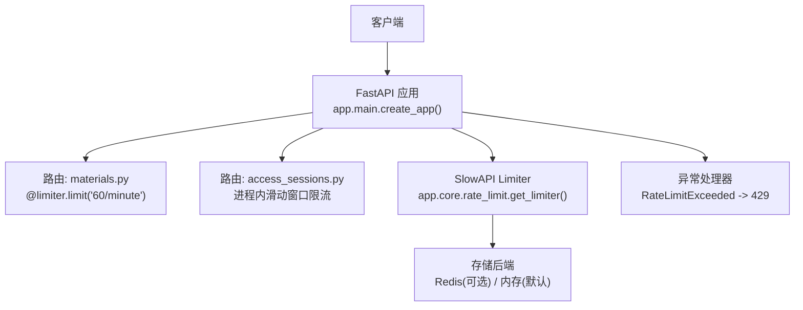
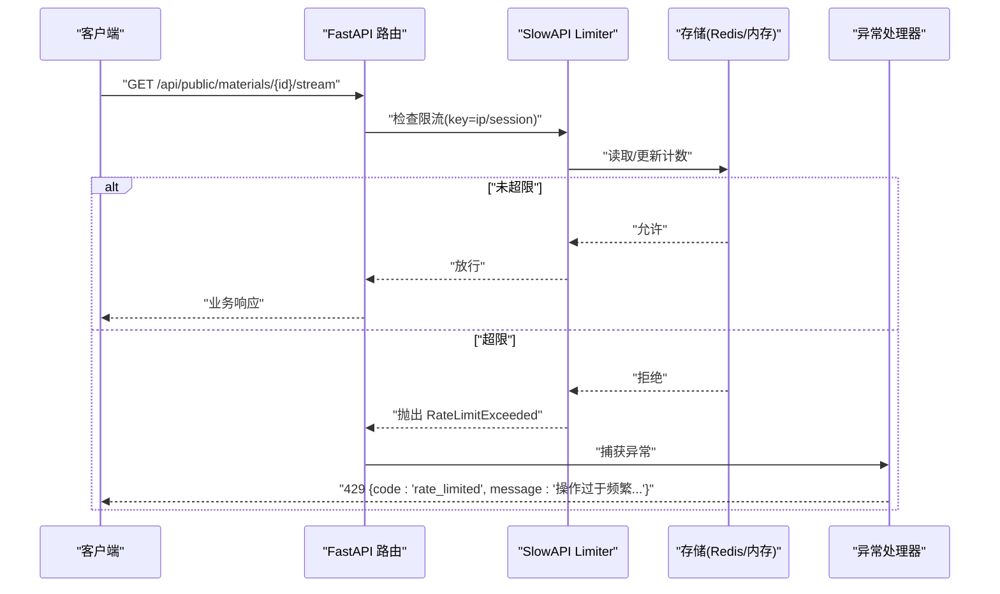
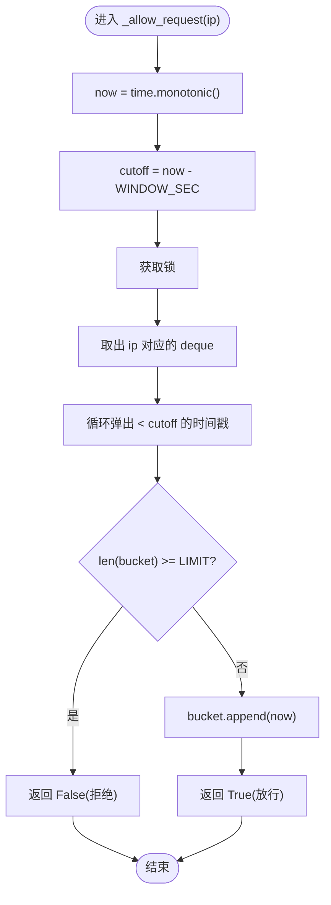
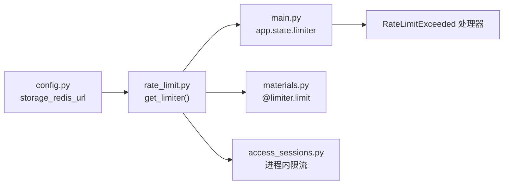

# 限流中间件

<cite>
**本文引用的文件列表**
- [backend/app/core/rate_limit.py](file://backend/app/core/rate_limit.py)
- [backend/app/main.py](file://backend/app/main.py)
- [backend/app/api/public/materials.py](file://backend/app/api/public/materials.py)
- [backend/app/api/public/access_sessions.py](file://backend/app/api/public/access_sessions.py)
- [backend/app/core/config.py](file://backend/app/core/config.py)
- [backend/pyproject.toml](file://backend/pyproject.toml)
- [doc/spec/10-API设计规范.md](file://doc/spec/10-API设计规范.md)
</cite>

## 目录
1. [简介](#简介)
2. [项目结构](#项目结构)
3. [核心组件](#核心组件)
4. [架构总览](#架构总览)
5. [详细组件分析](#详细组件分析)
6. [依赖关系分析](#依赖关系分析)
7. [性能与优化建议](#性能与优化建议)
8. [故障排除指南](#故障排除指南)
9. [结论](#结论)
10. [附录：配置示例](#附录配置示例)

## 简介
本文件围绕“限流中间件”进行系统化技术文档化，重点覆盖以下方面：
- 滑动窗口限流算法的实现原理（时间窗口计算、请求计数、阈值控制）
- Redis 存储层设计（键值结构、过期管理、分布式一致性）
- 不同限流策略的配置方法（全局限流、IP 级限流、用户/会话级限流）
- 与 FastAPI 的集成方式（装饰器模式与 Depends 模式）
- 标准化限流响应格式（HTTP 状态码、错误信息、重试建议）
- 性能优化建议（内存使用、缓存策略）
- 完整配置示例与故障排除指南

## 项目结构
后端采用 FastAPI + SlowAPI 组合实现限流。关键位置如下：
- 限流核心封装：位于 app.core.rate_limit，提供 Limiter 实例、key_func 构造与 rate_limit 包装器
- 应用装配：在 app.main 中注册 limiter 到 app.state，并统一处理 RateLimitExceeded 异常
- 路由集成：在 public/materials.py 等路由中使用 @limiter.limit 或 @rate_limit 装饰器
- 进程内兜底限流：在 access_sessions.py 中实现基于 deque 的滑动窗口限流作为降级保障
- 配置项：storage_redis_url 控制是否启用 Redis 共享计数

图示来源
- [backend/app/main.py:40-116](file://backend/app/main.py#L40-L116)
- [backend/app/api/public/materials.py:84-90](file://backend/app/api/public/materials.py#L84-L90)
- [backend/app/api/public/access_sessions.py:28-55](file://backend/app/api/public/access_sessions.py#L28-L55)
- [backend/app/core/rate_limit.py:40-46](file://backend/app/core/rate_limit.py#L40-L46)

章节来源
- [backend/app/main.py:40-116](file://backend/app/main.py#L40-L116)
- [backend/app/core/rate_limit.py:1-55](file://backend/app/core/rate_limit.py#L1-L55)
- [backend/app/api/public/materials.py:84-90](file://backend/app/api/public/materials.py#L84-L90)
- [backend/app/api/public/access_sessions.py:28-55](file://backend/app/api/public/access_sessions.py#L28-L55)

## 核心组件
- SlowAPI Limiter 初始化与存储选择
  - 通过 get_settings().storage_redis_url 决定使用 Redis 还是内存存储
  - 默认 key_func 为 get_remote_address，便于按 IP 维度限流
- Key 函数扩展
  - _key_func 支持 "ip" 和 "session" 两种标识符
  - session 模式下从 Authorization Bearer Token 中解析 sub 片段作为会话标识；失败回退到 IP
- 装饰器封装
  - rate_limit(spec, key="ip") 返回 Limit 对象，供 Depends 或装饰器使用
- 全局 Limiter 实例
  - 在 main 中挂载至 app.state.limiter，供全局异常处理与路由使用

章节来源
- [backend/app/core/rate_limit.py:18-55](file://backend/app/core/rate_limit.py#L18-L55)
- [backend/app/core/config.py:61-64](file://backend/app/core/config.py#L61-L64)
- [backend/app/main.py:67-69](file://backend/app/main.py#L67-L69)

## 架构总览
整体限流流程：
- 请求进入 FastAPI，匹配路由后执行限流检查
- 若未超过阈值，继续执行业务逻辑；否则抛出 RateLimitExceeded
- 全局异常处理器将 RateLimitExceeded 转换为统一的 429 响应体

图示来源
- [backend/app/api/public/materials.py:84-90](file://backend/app/api/public/materials.py#L84-L90)
- [backend/app/core/rate_limit.py:40-55](file://backend/app/core/rate_limit.py#L40-L55)
- [backend/app/main.py:84-90](file://backend/app/main.py#L84-L90)

## 详细组件分析

### 滑动窗口限流算法（进程内实现）
access_sessions.py 实现了基于 deque 的滑动窗口限流，用于访问会话开始接口的进程内兜底保护。其核心要点：
- 时间窗口：固定长度（例如 60 秒），以单调时钟 time.monotonic() 记录每次请求时间戳
- 请求计数：维护每个 IP 的 deque，弹出窗口外的旧记录，统计剩余数量
- 阈值控制：当窗口内记录数达到上限时拒绝新请求
- 线程安全：使用 threading.Lock 保证并发安全

图示来源
- [backend/app/api/public/access_sessions.py:42-55](file://backend/app/api/public/access_sessions.py#L42-L55)

章节来源
- [backend/app/api/public/access_sessions.py:28-55](file://backend/app/api/public/access_sessions.py#L28-L55)

### SlowAPI 限流与 Redis 存储层
- 存储选择
  - 若 storage_redis_url 为空，则使用内存存储（memory://）
  - 若设置 storage_redis_url，则使用 Redis 作为共享计数后端
- 键值结构与过期管理
  - SlowAPI 内部根据 spec（如 "60/minute"）生成键并按窗口滚动清理
  - Redis 模式下由底层驱动负责过期与原子性计数
- 分布式一致性
  - 多 worker 部署下，Redis 确保跨进程计数一致
  - 单实例开发可走内存模式，无需外部依赖

章节来源
- [backend/app/core/rate_limit.py:40-46](file://backend/app/core/rate_limit.py#L40-L46)
- [backend/app/core/config.py:61-64](file://backend/app/core/config.py#L61-L64)
- [backend/pyproject.toml:20-22](file://backend/pyproject.toml#L20-L22)

### 限流策略与配置方法
- 全局限流
  - 通过 get_limiter 创建 Limiter 实例，并在路由上统一挂载
- IP 级限流
  - 使用 @limiter.limit("60/minute") 或 @rate_limit("30/minute", "ip")
  - key_func 默认基于 get_remote_address，键前缀 "ip:"
- 用户/会话级限流
  - 使用 @rate_limit(..., key="session")，从 Authorization Bearer Token 解析 sub 片段作为会话标识
  - 若无法解析，回退到 IP 维度
- 差异化阈值
  - 不同接口可按需配置不同 spec，如 "30/minute"、"60/minute"、"10/hour" 等

章节来源
- [backend/app/core/rate_limit.py:18-55](file://backend/app/core/rate_limit.py#L18-L55)
- [backend/app/api/public/materials.py:84-90](file://backend/app/api/public/materials.py#L84-L90)
- [doc/spec/10-API设计规范.md:109-123](file://doc/spec/10-API设计规范.md#L109-L123)

### 与 FastAPI 的集成方式
- 装饰器模式
  - 直接在路由函数上使用 @limiter.limit(...) 或 @rate_limit(...)
  - 适用于简单场景，快速生效
- Depends 模式
  - 使用 dependencies=[Depends(rate_limit("30/minute", "ip"))]
  - 适合需要复用限流规则或在多个路由集中应用的场景

章节来源
- [backend/app/api/public/coursewares.py:19-22](file://backend/app/api/public/coursewares.py#L19-L22)
- [backend/app/api/public/materials.py:84-90](file://backend/app/api/public/materials.py#L84-L90)

### 标准化限流响应格式
- HTTP 状态码：429 Too Many Requests
- 响应体字段：
  - code: "rate_limited"
  - message: "操作过于频繁，请稍后再试"
  - requestId: 当前请求 ID（来自 X-Request-Id）
- 重试建议：
  - 前端应遵循指数退避策略，结合 Retry-After 头（若服务端返回）进行重试

章节来源
- [backend/app/main.py:84-90](file://backend/app/main.py#L84-L90)

## 依赖关系分析
- 模块耦合
  - rate_limit.py 依赖 config.py 获取 Redis URL
  - main.py 依赖 rate_limit.py 注入 Limiter 并处理异常
  - 路由模块依赖 rate_limit.py 提供的 limiter 与 rate_limit
- 外部依赖
  - slowapi==0.1.9 提供限流能力
  - redis==5.2.0 提供 Redis 客户端（仅在启用 Redis 时使用）

图示来源
- [backend/app/core/config.py:61-64](file://backend/app/core/config.py#L61-L64)
- [backend/app/core/rate_limit.py:40-46](file://backend/app/core/rate_limit.py#L40-L46)
- [backend/app/main.py:67-90](file://backend/app/main.py#L67-L90)
- [backend/app/api/public/materials.py:84-90](file://backend/app/api/public/materials.py#L84-L90)
- [backend/app/api/public/access_sessions.py:28-55](file://backend/app/api/public/access_sessions.py#L28-L55)

章节来源
- [backend/pyproject.toml:20-22](file://backend/pyproject.toml#L20-L22)
- [backend/app/core/rate_limit.py:40-46](file://backend/app/core/rate_limit.py#L40-L46)
- [backend/app/main.py:67-90](file://backend/app/main.py#L67-L90)

## 性能与优化建议
- 存储层选择
  - 生产环境务必启用 Redis，避免多 worker 下的计数不一致
  - 合理设置 Redis 连接池大小与超时，降低网络抖动影响
- 内存使用优化
  - 进程内滑动窗口使用 deque，避免无界增长；定期清理过期时间戳
  - 对高频 IP 的 bucket 做容量上限保护，防止极端情况导致内存膨胀
- 缓存策略
  - 对于热点资源（如 PPT 预览图片），可在网关层或 CDN 侧增加缓存，减少后端压力
  - 限流计数本身不建议二次缓存，以保证准确性
- 监控与告警
  - 暴露限流命中指标（QPS、命中率、Top IP），便于观察与调优
  - 针对 429 比例设置告警阈值，及时扩容或调整阈值

[本节为通用指导，不直接分析具体文件]

## 故障排除指南
- 现象：大量 429 响应
  - 排查点：确认 Redis 连通性与存储 URI 是否正确；检查各路由的 spec 阈值是否过低
  - 参考：[backend/app/core/rate_limit.py:40-46](file://backend/app/core/rate_limit.py#L40-L46)、[backend/app/core/config.py:61-64](file://backend/app/core/config.py#L61-L64)
- 现象：多 worker 部署下限流失效
  - 排查点：确认 storage_redis_url 已配置；验证 Redis 服务可用
  - 参考：[backend/app/core/rate_limit.py:40-46](file://backend/app/core/rate_limit.py#L40-L46)
- 现象：进程内限流不稳定
  - 排查点：检查多线程锁的使用；确认时间戳使用 monotonic 而非 wall clock
  - 参考：[backend/app/api/public/access_sessions.py:42-55](file://backend/app/api/public/access_sessions.py#L42-L55)
- 现象：前端未收到重试建议
  - 排查点：确认异常处理器返回的响应体包含 requestId；必要时在服务端添加 Retry-After 头
  - 参考：[backend/app/main.py:84-90](file://backend/app/main.py#L84-L90)

章节来源
- [backend/app/core/rate_limit.py:40-46](file://backend/app/core/rate_limit.py#L40-L46)
- [backend/app/core/config.py:61-64](file://backend/app/core/config.py#L61-L64)
- [backend/app/api/public/access_sessions.py:42-55](file://backend/app/api/public/access_sessions.py#L42-L55)
- [backend/app/main.py:84-90](file://backend/app/main.py#L84-L90)

## 结论
本项目通过 SlowAPI 与 FastAPI 深度集成，提供了灵活的限流能力：
- 支持 IP 与会话维度的差异化限流
- 支持 Redis 共享计数，满足多 worker 部署需求
- 提供统一的 429 响应格式，便于前端处理与重试
- 在关键路径提供进程内滑动窗口兜底，增强鲁棒性

建议在上线前完成 Redis 配置与监控接入，并根据实际流量动态调整阈值。

[本节为总结，不直接分析具体文件]

## 附录：配置示例
- 环境变量
  - STORAGE_REDIS_URL: 设置为 redis://host:port/db，启用 Redis 共享计数
  - LOG_LEVEL: 日志级别，便于调试限流问题
- 路由示例
  - 装饰器模式：@limiter.limit("60/minute")
  - Depends 模式：dependencies=[Depends(rate_limit("30/minute", "ip"))]
- 规范参考
  - 前台 AI 搜索按 IP 30/分钟、课件解锁按 IP+Token 哈希 10/分钟、后台写接口按会话 60/分钟等

章节来源
- [backend/app/core/config.py:61-64](file://backend/app/core/config.py#L61-L64)
- [backend/app/api/public/coursewares.py:19-22](file://backend/app/api/public/coursewares.py#L19-L22)
- [backend/app/api/public/materials.py:84-90](file://backend/app/api/public/materials.py#L84-L90)
- [doc/spec/10-API设计规范.md:109-123](file://doc/spec/10-API设计规范.md#L109-L123)