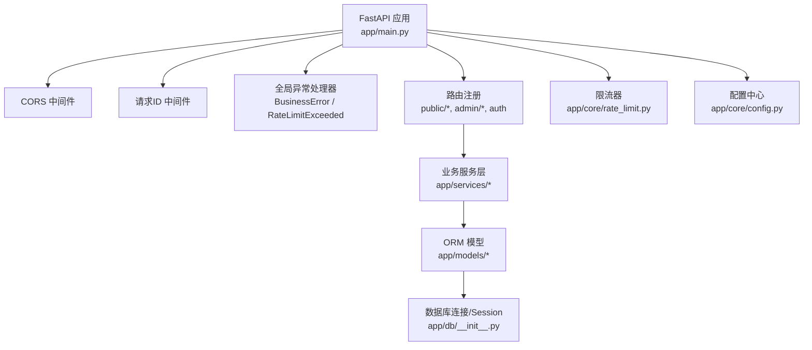
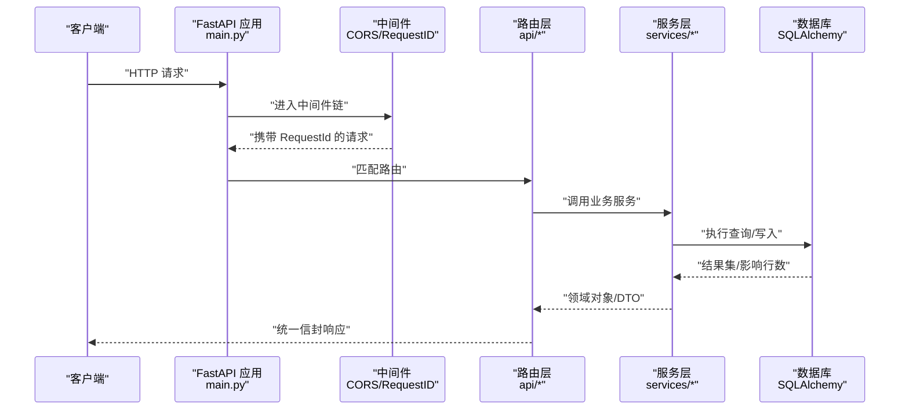
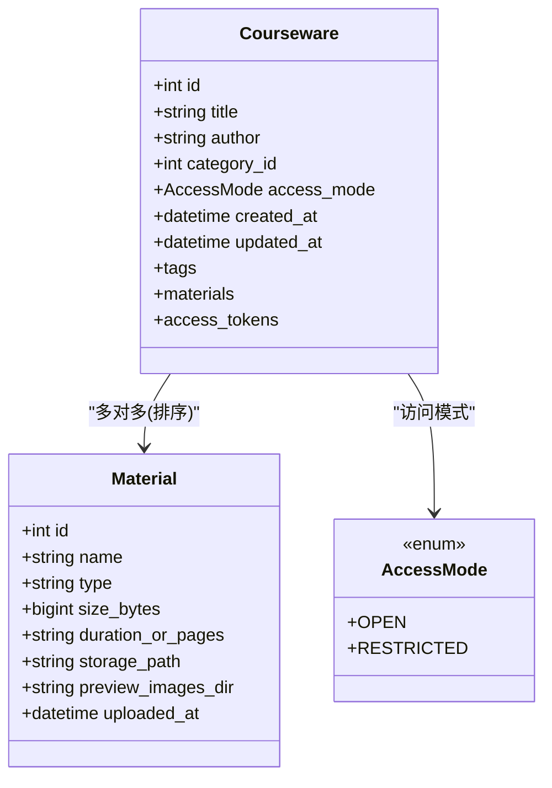
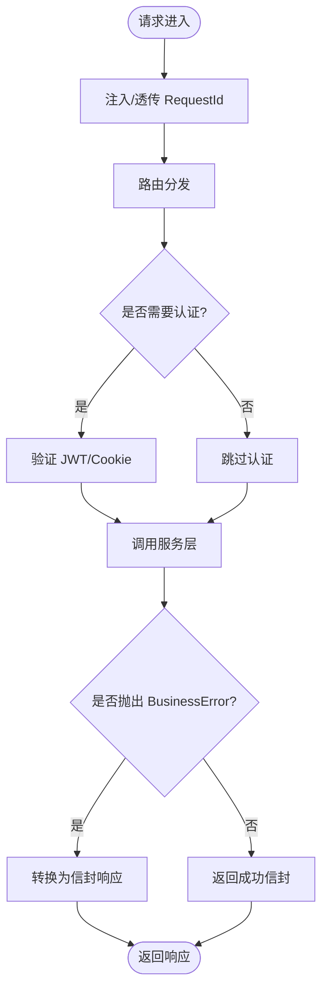
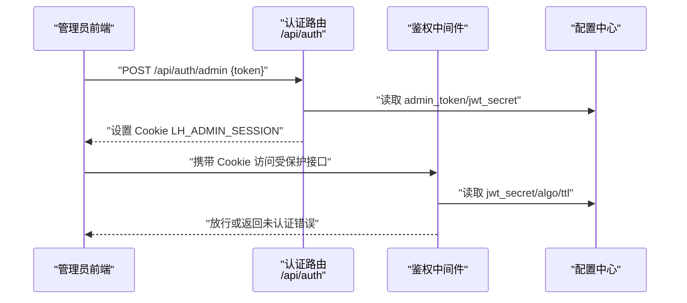
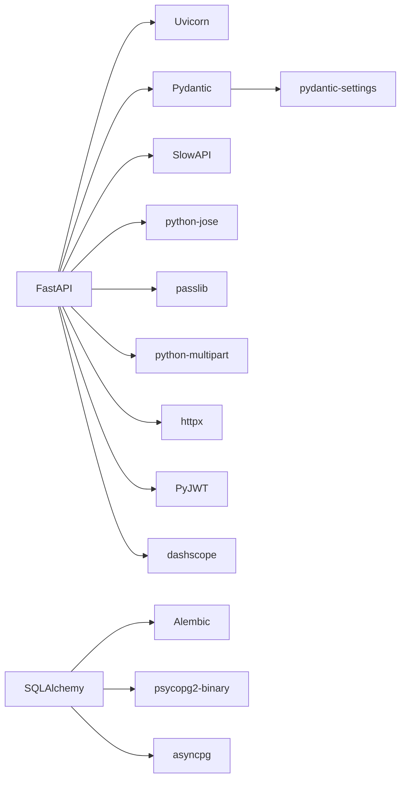

# 后端开发指南

<cite>
**本文引用的文件**   
- [backend/app/main.py](file://backend/app/main.py)
- [backend/app/core/config.py](file://backend/app/core/config.py)
- [backend/app/db/__init__.py](file://backend/app/db/__init__.py)
- [backend/alembic/env.py](file://backend/alembic/env.py)
- [backend/pyproject.toml](file://backend/pyproject.toml)
- [backend/app/models/__init__.py](file://backend/app/models/__init__.py)
- [backend/app/models/courseware.py](file://backend/app/models/courseware.py)
- [backend/app/models/material.py](file://backend/app/models/material.py)
- [backend/app/core/errors.py](file://backend/app/core/errors.py)
- [backend/app/middleware/admin_auth.py](file://backend/app/middleware/admin_auth.py)
- [backend/app/api/auth.py](file://backend/app/api/auth.py)
- [backend/app/schemas/__init__.py](file://backend/app/schemas/__init__.py)
- [backend/app/core/rate_limit.py](file://backend/app/core/rate_limit.py)
- [backend/tests/conftest.py](file://backend/tests/conftest.py)
</cite>

## 目录
1. [简介](#简介)
2. [项目结构](#项目结构)
3. [核心组件](#核心组件)
4. [架构总览](#架构总览)
5. [详细组件分析](#详细组件分析)
6. [依赖关系分析](#依赖关系分析)
7. [性能考虑](#性能考虑)
8. [故障排查指南](#故障排查指南)
9. [结论](#结论)
10. [附录](#附录)

## 简介
本指南面向 Learning Hub 后端的开发与维护人员，系统阐述基于 Python FastAPI 的后端架构、模块职责与依赖关系；覆盖配置管理、环境变量与多环境策略；数据库连接与 ORM 模型设计、SQLAlchemy 最佳实践；API 路由规范、请求处理流程与错误处理机制；中间件（认证、限流、日志）的开发与使用；单元测试编写、测试数据准备与 Mock 策略；以及性能优化与调试方法。读者无需深入源码即可快速上手并高效协作。

## 项目结构
后端采用分层与按功能域组织相结合的结构：
- app/main.py：应用入口，装配中间件、路由、全局异常处理与 CORS。
- app/core：核心横切能力（配置、错误码、限流）。
- app/db：数据库引擎、会话工厂与 Base 基类。
- app/models：ORM 模型定义与关联表。
- app/schemas：统一响应信封与 Pydantic 校验模型。
- app/api：对外 API 路由（公开与管理后台）。
- app/middleware：自定义中间件（如管理员鉴权）。
- app/services：业务服务层（封装领域逻辑）。
- alembic：数据库迁移脚本与环境配置。
- tests：单元测试与集成测试夹具。

图表来源
- [backend/app/main.py:40-112](file://backend/app/main.py#L40-L112)
- [backend/app/core/rate_limit.py:40-52](file://backend/app/core/rate_limit.py#L40-L52)
- [backend/app/core/config.py:9-88](file://backend/app/core/config.py#L9-L88)
- [backend/app/db/__init__.py:15-32](file://backend/app/db/__init__.py#L15-L32)

章节来源
- [backend/app/main.py:1-116](file://backend/app/main.py#L1-L116)
- [backend/pyproject.toml:1-47](file://backend/pyproject.toml#L1-L47)

## 核心组件
- 配置管理：通过 pydantic-settings 从环境变量加载，支持 .env 覆盖，提供 effective_database_url 计算字段与 cors_origins_list 等便捷属性。
- 数据库与 ORM：基于 SQLAlchemy 同步引擎适配 Alembic 与 FastAPI 同步路由；提供 get_db 依赖注入，每个请求一个 Session。
- 错误处理：统一的 BusinessError 与 ErrorCode 常量映射 HTTP 状态码，配合全局异常处理器输出标准信封。
- 限流：SlowAPI 集成，支持内存或 Redis 存储，key_func 可按 IP 或会话标识区分。
- 认证：Admin JWT 签发与校验，支持 Authorization Bearer 与 Cookie 两种提取方式。
- 统一响应：Envelope 信封与 ok/fail 构造器，保证前后端一致的数据格式。

章节来源
- [backend/app/core/config.py:9-88](file://backend/app/core/config.py#L9-L88)
- [backend/app/db/__init__.py:15-51](file://backend/app/db/__init__.py#L15-L51)
- [backend/app/core/errors.py:9-144](file://backend/app/core/errors.py#L9-L144)
- [backend/app/core/rate_limit.py:1-55](file://backend/app/core/rate_limit.py#L1-L55)
- [backend/app/middleware/admin_auth.py:1-66](file://backend/app/middleware/admin_auth.py#L1-L66)
- [backend/app/schemas/__init__.py:1-65](file://backend/app/schemas/__init__.py#L1-L65)

## 架构总览
下图展示请求从进入 FastAPI 到返回响应的关键路径，包括中间件、路由、服务层、ORM 与数据库的交互。

图表来源
- [backend/app/main.py:57-102](file://backend/app/main.py#L57-L102)
- [backend/app/db/__init__.py:41-47](file://backend/app/db/__init__.py#L41-L47)

## 详细组件分析

### 配置管理与多环境策略
- 配置来源优先级：环境变量 > .env 文件 > 默认值。
- 数据库 URL：优先 DATABASE_URL；否则由 host/port/user/password/name 拼接。
- 多环境策略：
  - 本地开发：设置 DATABASE_URL=sqlite:///:memory: 或使用本地 Postgres。
  - 容器化部署：通过 compose 注入环境变量，指定 postgres 主机名与凭据。
  - 生产环境：强制设置 jwt_secret、cors_allow_origins、log_level 等敏感项。

章节来源
- [backend/app/core/config.py:9-88](file://backend/app/core/config.py#L9-L88)

### 数据库连接与 ORM 最佳实践
- 连接池：Postgres/MySQL 使用 pool_size/max_overflow；SQLite 使用 StaticPool 并关闭线程检查。
- 会话生命周期：get_db 作为 FastAPI 依赖，确保请求结束自动 close。
- Alembic 集成：env.py 读取 Settings.effective_database_url，导入所有模型以注册 metadata，支持在线/离线模式。
- 模型设计：
  - Courseware：包含访问模式枚举、时间戳、与 Tag/Material/AccessToken 的多对多关系。
  - Material：文件元数据与预览图片目录字段，类型推断函数 infer_type。

图表来源
- [backend/app/models/courseware.py:14-74](file://backend/app/models/courseware.py#L14-L74)
- [backend/app/models/material.py:14-69](file://backend/app/models/material.py#L14-L69)

章节来源
- [backend/app/db/__init__.py:15-51](file://backend/app/db/__init__.py#L15-L51)
- [backend/alembic/env.py:1-63](file://backend/alembic/env.py#L1-L63)
- [backend/app/models/__init__.py:1-30](file://backend/app/models/__init__.py#L1-L30)
- [backend/app/models/courseware.py:1-74](file://backend/app/models/courseware.py#L1-L74)
- [backend/app/models/material.py:1-69](file://backend/app/models/material.py#L1-L69)

### API 路由设计与请求处理流程
- 路由组织：
  - 公开接口：健康检查、课件、素材、访问会话等。
  - 管理后台：分类、标签、素材、课件、访问令牌及其用量。
  - 认证接口：管理员登录/登出。
- 请求处理：
  - 中间件注入 X-Request-Id。
  - 全局异常处理器将 BusinessError 转换为信封响应。
  - 限流异常统一返回 429 信封。
- 统一响应：
  - ok/fail 构造器生成 {code,message,data,requestId}。
  - envelope_or_business 用于异常转信封。

图表来源
- [backend/app/main.py:70-90](file://backend/app/main.py#L70-L90)
- [backend/app/schemas/__init__.py:35-61](file://backend/app/schemas/__init__.py#L35-L61)
- [backend/app/core/errors.py:130-144](file://backend/app/core/errors.py#L130-L144)

章节来源
- [backend/app/main.py:40-112](file://backend/app/main.py#L40-L112)
- [backend/app/api/auth.py:14-49](file://backend/app/api/auth.py#L14-L49)
- [backend/app/schemas/__init__.py:1-65](file://backend/app/schemas/__init__.py#L1-L65)

### 认证与授权中间件
- Admin 登录：校验明文 admin_token，签发 JWT，写入 HttpOnly Cookie。
- 权限校验：从 Authorization 或 Cookie 提取 token，解码并校验 exp/sub。
- 安全建议：生产环境务必更换 jwt_secret 与 admin_token，启用 HTTPS。

图表来源
- [backend/app/api/auth.py:21-45](file://backend/app/api/auth.py#L21-L45)
- [backend/app/middleware/admin_auth.py:16-62](file://backend/app/middleware/admin_auth.py#L16-L62)
- [backend/app/core/config.py:40-52](file://backend/app/core/config.py#L40-L52)

章节来源
- [backend/app/middleware/admin_auth.py:1-66](file://backend/app/middleware/admin_auth.py#L1-L66)
- [backend/app/api/auth.py:1-49](file://backend/app/api/auth.py#L1-L49)

### 限流与速率控制
- SlowAPI 集成：全局 limiter 实例，支持内存或 Redis 存储。
- Key 策略：支持按 IP 或会话标识（简化自 JWT sub 片段）区分。
- 异常处理：RateLimitExceeded 被全局处理器捕获，返回 429 信封。

章节来源
- [backend/app/core/rate_limit.py:1-55](file://backend/app/core/rate_limit.py#L1-L55)
- [backend/app/main.py:84-90](file://backend/app/main.py#L84-L90)

### 错误处理与统一信封
- BusinessError：集中定义错误码与 HTTP 状态映射，抛出自带 code/message/data。
- 全局处理器：将 BusinessError 转为信封响应，附带 requestId。
- 成功响应：ok(data) 构造标准信封；fail(code,message) 供中间件/限流使用。

章节来源
- [backend/app/core/errors.py:9-144](file://backend/app/core/errors.py#L9-L144)
- [backend/app/schemas/__init__.py:35-61](file://backend/app/schemas/__init__.py#L35-L61)
- [backend/app/main.py:78-90](file://backend/app/main.py#L78-L90)

### 单元测试与测试策略
- 测试夹具：conftest.py 提供 TestClient、内存 SQLite、覆盖 get_db 依赖、自动建表/删表。
- 环境变量：在 import 前设置 DATABASE_URL/JWT_SECRET，避免污染进程。
- 登录辅助：admin_login/login_admin 快捷登录，保持 Cookie。
- Mock 策略：通过 dependency_overrides 替换真实数据库与会话；必要时可替换外部服务（如 LLM/Redis）。

章节来源
- [backend/tests/conftest.py:1-121](file://backend/tests/conftest.py#L1-L121)

## 依赖关系分析
- 运行时依赖：FastAPI、Uvicorn、SQLAlchemy、Alembic、psycopg2-binary、asyncpg、Pydantic、pydantic-settings、python-jose、passlib、slowapi、redis、httpx、PyJWT、dashscope。
- 开发依赖：pytest、pytest-asyncio、pytest-cov、ruff、mypy。
- 构建系统：Poetry（pyproject.toml）。

图表来源
- [backend/pyproject.toml:8-25](file://backend/pyproject.toml#L8-L25)

章节来源
- [backend/pyproject.toml:1-47](file://backend/pyproject.toml#L1-L47)

## 性能考虑
- 数据库连接池：为 Postgres/MySQL 设置合适的 pool_size/max_overflow；SQLite 使用 StaticPool 避免锁竞争。
- 懒加载与预取：Courseware 的 tags/materials/access_tokens 使用 selectin/joined 减少 N+1 查询。
- 限流与缓存：在高并发场景下启用 Redis 作为 SlowAPI 存储；对热点数据引入缓存层（如 Redis）。
- 大文件处理：PPT 转图片异步化与超时控制，避免阻塞请求线程。
- 日志级别：生产环境降低日志级别，仅保留必要信息，减少 IO 开销。

[本节为通用指导，不直接分析具体文件]

## 故障排查指南
- 常见问题定位：
  - 认证失败：检查 Authorization/Cookie 是否正确传递，jwt_secret 与算法是否一致。
  - 限流触发：确认 key 策略是否符合预期，必要时调整限速规格或切换到 Redis。
  - 数据库连接：核对 effective_database_url 与网络连通性，查看连接池参数。
  - 错误信封：根据 code 与 message 快速定位业务异常分支。
- 调试技巧：
  - 开启 SQL echo 临时观察语句（仅开发环境）。
  - 利用 X-Request-Id 追踪跨层日志。
  - 使用 TestClient 复现问题，结合 conftest 的内存库快速隔离。

章节来源
- [backend/app/middleware/admin_auth.py:16-62](file://backend/app/middleware/admin_auth.py#L16-L62)
- [backend/app/core/rate_limit.py:18-52](file://backend/app/core/rate_limit.py#L18-L52)
- [backend/app/db/__init__.py:18-25](file://backend/app/db/__init__.py#L18-L25)
- [backend/app/core/errors.py:73-127](file://backend/app/core/errors.py#L73-L127)

## 结论
Learning Hub 后端以 FastAPI 为核心，结合 SQLAlchemy/Alembic、SlowAPI、Pydantic 等成熟生态，形成清晰的分层架构与一致的响应规范。通过集中配置、统一错误处理与完善的测试夹具，团队可高效迭代并保持稳定性。建议在后续演进中持续完善服务层抽象、引入缓存与异步任务队列，并强化安全与审计能力。

[本节为总结性内容，不直接分析具体文件]

## 附录
- 环境变量清单（示例）：
  - DATABASE_URL：完整数据库连接串（优先于独立字段）。
  - DATABASE_HOST/PORT/USER/PASSWORD/NAME：当 DATABASE_URL 为空时生效。
  - ADMIN_TOKEN：管理员登录令牌。
  - JWT_SECRET/JWT_ALGORITHM/JWT_TTL_HOURS：JWT 相关。
  - CORS_ALLOW_ORIGINS：允许的来源列表（逗号分隔）。
  - STORAGE_PATH：文件存储根路径。
  - LIBREOFFICE_PATH/POPPLER_PATH/PPT_CONVERT_TIMEOUT：PPT 转换工具与超时。
  - STORAGE_REDIS_URL：限流存储（留空则使用内存）。
  - DASHSCOPE_API_KEY/LLM_SEARCH_MODEL/LLM_SQL_TIMEOUT_SECONDS/LLM_SQL_MAX_ROWS：AI 搜索开关与参数。
  - LOG_LEVEL：日志级别。

[本节为通用说明，不直接分析具体文件]