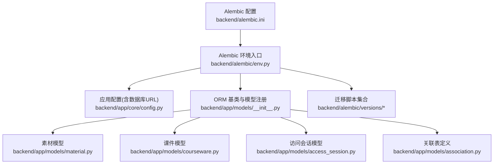
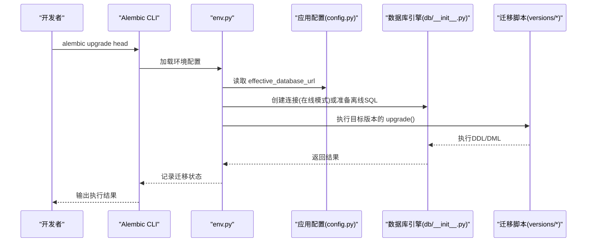
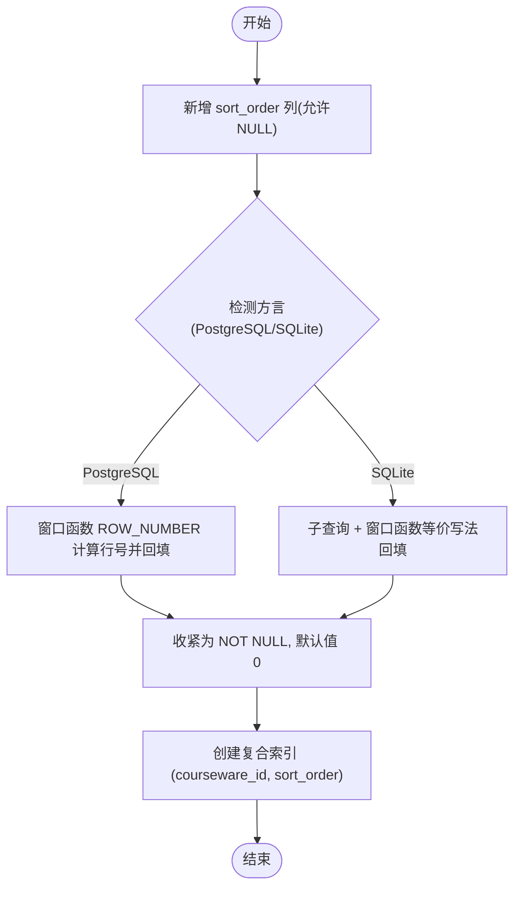
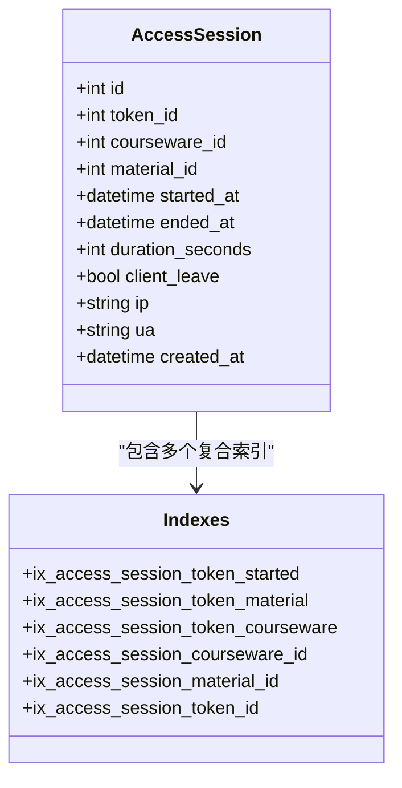
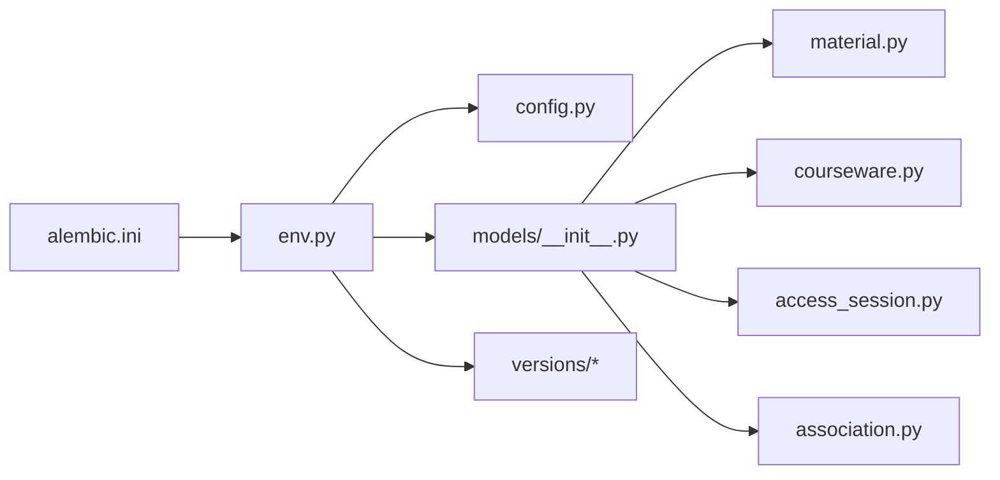

# 数据库迁移管理

<cite>
**本文引用的文件**   
- [backend/alembic.ini](file://backend/alembic.ini)
- [backend/alembic/env.py](file://backend/alembic/env.py)
- [backend/app/core/config.py](file://backend/app/core/config.py)
- [backend/app/db/__init__.py](file://backend/app/db/__init__.py)
- [backend/app/models/__init__.py](file://backend/app/models/__init__.py)
- [backend/app/models/material.py](file://backend/app/models/material.py)
- [backend/app/models/courseware.py](file://backend/app/models/courseware.py)
- [backend/app/models/access_session.py](file://backend/app/models/access_session.py)
- [backend/app/models/association.py](file://backend/app/models/association.py)
- [backend/alembic/versions/2026_07_06_1745-11f9c69846a9_init_schema.py](file://backend/alembic/versions/2026_07_06_1745-11f9c69846a9_init_schema.py)
- [backend/alembic/versions/2026_07_07_0900-a1b2c3d4e5f6_add_material_preview_pdf_path.py](file://backend/alembic/versions/2026_07_07_0900-a1b2c3d4e5f6_add_material_preview_pdf_path.py)
- [backend/alembic/versions/2026_07_07_1230-b2c3d4e5f607_replace_preview_pdf_with_images.py](file://backend/alembic/versions/2026_07_07_1230-b2c3d4e5f607_replace_preview_pdf_with_images.py)
- [backend/alembic/versions/2026_07_10_0930-c1d2e3f4a5b6_add_access_session.py](file://backend/alembic/versions/2026_07_10_0930-c1d2e3f4a5b6_add_access_session.py)
- [backend/alembic/versions/2026_07_10_1800-d2e3f4a5b6c7_add_courseware_material_sort_order.py](file://backend/alembic/versions/2026_07_10_1800-d2e3f4a5b6c7_add_courseware_material_sort_order.py)
</cite>

## 目录
1. [简介](#简介)
2. [项目结构](#项目结构)
3. [核心组件](#核心组件)
4. [架构总览](#架构总览)
5. [详细组件分析](#详细组件分析)
6. [依赖关系分析](#依赖关系分析)
7. [性能考虑](#性能考虑)
8. [故障排查指南](#故障排查指南)
9. [结论](#结论)
10. [附录](#附录)

## 简介
本指南面向 Learning Hub 项目的数据库迁移管理，围绕 Alembic 的配置、版本控制与回滚策略展开，结合现有迁移脚本与 ORM 模型，给出数据变更、索引优化、约束修改的最佳实践；同时提供多环境差异化配置思路、数据备份与恢复机制建议、迁移冲突解决与团队协作规范，以及数据库性能监控与优化建议。文档内容严格基于仓库中实际代码与迁移脚本进行总结与提炼。

## 项目结构
后端使用 Alembic 进行数据库迁移，迁移脚本位于 backend/alembic/versions，运行期通过 env.py 加载应用配置与全部 ORM 模型，确保迁移与当前模型定义一致。

图表来源
- [backend/alembic.ini:1-40](file://backend/alembic.ini#L1-L40)
- [backend/alembic/env.py:1-63](file://backend/alembic/env.py#L1-L63)
- [backend/app/core/config.py:1-88](file://backend/app/core/config.py#L1-L88)
- [backend/app/models/__init__.py:1-30](file://backend/app/models/__init__.py#L1-L30)
- [backend/app/models/material.py:1-69](file://backend/app/models/material.py#L1-L69)
- [backend/app/models/courseware.py:1-74](file://backend/app/models/courseware.py#L1-L74)
- [backend/app/models/access_session.py:1-129](file://backend/app/models/access_session.py#L1-L129)
- [backend/app/models/association.py:1-41](file://backend/app/models/association.py#L1-L41)

章节来源
- [backend/alembic.ini:1-40](file://backend/alembic.ini#L1-L40)
- [backend/alembic/env.py:1-63](file://backend/alembic/env.py#L1-L63)
- [backend/app/core/config.py:1-88](file://backend/app/core/config.py#L1-L88)
- [backend/app/models/__init__.py:1-30](file://backend/app/models/__init__.py#L1-L30)

## 核心组件
- Alembic 配置文件：指定脚本位置、SQLAlchemy URL、日志级别与文件名模板等。
- Alembic 环境入口：从应用配置读取 effective_database_url，注入到 Alembic 上下文，并启用 Online/Offline 两种模式。
- 应用配置：支持环境变量覆盖，优先使用完整 database_url，否则拼接各字段生成连接串。
- ORM 模型与 Base：集中导入所有模型以触发 metadata 注册，供 Alembic 自动对比差异。
- 迁移脚本：按时间戳+修订号命名，包含 upgrade/downgrade 方法，描述数据结构演进。

章节来源
- [backend/alembic.ini:1-40](file://backend/alembic.ini#L1-L40)
- [backend/alembic/env.py:1-63](file://backend/alembic/env.py#L1-L63)
- [backend/app/core/config.py:1-88](file://backend/app/core/config.py#L1-L88)
- [backend/app/models/__init__.py:1-30](file://backend/app/models/__init__.py#L1-L30)

## 架构总览
下图展示从 Alembic 命令到数据库的调用链路与关键依赖。

图表来源
- [backend/alembic/env.py:1-63](file://backend/alembic/env.py#L1-L63)
- [backend/app/core/config.py:1-88](file://backend/app/core/config.py#L1-L88)
- [backend/app/db/__init__.py:1-51](file://backend/app/db/__init__.py#L1-L51)
- [backend/alembic/versions/2026_07_10_1800-d2e3f4a5b6c7_add_courseware_material_sort_order.py:1-118](file://backend/alembic/versions/2026_07_10_1800-d2e3f4a5b6c7_add_courseware_material_sort_order.py#L1-L118)

## 详细组件分析

### Alembic 配置与环境
- 脚本路径与文件名模板：统一采用“年_月_日_时分-修订号_标题”格式，便于排序与可读性。
- 数据库URL：默认指向 Postgres，但 env.py 会覆盖为 settings.effective_database_url，从而支持 .env 或环境变量切换。
- 日志：对 sqlalchemy.engine 与 alembic 分别设置日志级别，便于定位问题。
- 在线/离线模式：env.py 根据 context.is_offline_mode() 选择 run_migrations_online 或 run_migrations_offline，前者直连数据库执行，后者仅生成 SQL。

章节来源
- [backend/alembic.ini:1-40](file://backend/alembic.ini#L1-L40)
- [backend/alembic/env.py:1-63](file://backend/alembic/env.py#L1-L63)
- [backend/app/core/config.py:1-88](file://backend/app/core/config.py#L1-L88)

### 应用配置与数据库连接
- Settings 支持从 .env 加载，extra="ignore" 忽略未知键，大小写不敏感。
- effective_database_url 优先使用 DATABASE_URL，否则拼接 host/port/user/password/name。
- db/__init__.py 根据 URL 前缀区分 SQLite 与非 SQLite，SQLite 使用 StaticPool 并允许跨线程访问，非 SQLite 使用连接池参数。

章节来源
- [backend/app/core/config.py:1-88](file://backend/app/core/config.py#L1-L88)
- [backend/app/db/__init__.py:1-51](file://backend/app/db/__init__.py#L1-L51)

### ORM 模型与元数据注册
- models/__init__.py 集中导入所有模型与关联表，确保 Base.metadata 包含全部表结构，供 Alembic 自动检测差异。
- 关键模型：
  - Material：包含 preview_images_dir 用于 PPT 图片预览目录。
  - Courseware：包含 access_mode 枚举与多对多关系（标签、素材、访问令牌）。
  - AccessSession：记录受限课件素材的访问会话，包含检查约束与复合索引。
  - association：courseware_material 新增 sort_order 列及复合索引，支撑有序学习路径。

章节来源
- [backend/app/models/__init__.py:1-30](file://backend/app/models/__init__.py#L1-L30)
- [backend/app/models/material.py:1-69](file://backend/app/models/material.py#L1-L69)
- [backend/app/models/courseware.py:1-74](file://backend/app/models/courseware.py#L1-L74)
- [backend/app/models/access_session.py:1-129](file://backend/app/models/access_session.py#L1-L129)
- [backend/app/models/association.py:1-41](file://backend/app/models/association.py#L1-L41)

### 初始迁移与后续演进
- 初始迁移：创建访问令牌、分类、素材、标签、课件主表及其多对多关联表，并建立必要索引与注释。
- 预览方案演进：先新增 PDF 预览路径，再替换为图片目录，保留旧列以兼容。
- 访问会话：新建表并添加多个复合索引，提升按 token/素材/课件维度的查询性能。
- 素材顺序：在 courseware_material 上引入 sort_order，回填历史数据并收紧为非空，增加复合索引加速有序读取。

章节来源
- [backend/alembic/versions/2026_07_06_1745-11f9c69846a9_init_schema.py:1-113](file://backend/alembic/versions/2026_07_06_1745-11f9c69846a9_init_schema.py#L1-L113)
- [backend/alembic/versions/2026_07_07_0900-a1b2c3d4e5f6_add_material_preview_pdf_path.py:1-30](file://backend/alembic/versions/2026_07_07_0900-a1b2c3d4e5f6_add_material_preview_pdf_path.py#L1-L30)
- [backend/alembic/versions/2026_07_07_1230-b2c3d4e5f607_replace_preview_pdf_with_images.py:1-39](file://backend/alembic/versions/2026_07_07_1230-b2c3d4e5f607_replace_preview_pdf_with_images.py#L1-L39)
- [backend/alembic/versions/2026_07_10_0930-c1d2e3f4a5b6_add_access_session.py:1-125](file://backend/alembic/versions/2026_07_10_0930-c1d2e3f4a5b6_add_access_session.py#L1-L125)
- [backend/alembic/versions/2026_07_10_1800-d2e3f4a5b6c7_add_courseware_material_sort_order.py:1-118](file://backend/alembic/versions/2026_07_10_1800-d2e3f4a5b6c7_add_courseware_material_sort_order.py#L1-L118)

#### 素材顺序回填流程（sort_order）

图表来源
- [backend/alembic/versions/2026_07_10_1800-d2e3f4a5b6c7_add_courseware_material_sort_order.py:33-104](file://backend/alembic/versions/2026_07_10_1800-d2e3f4a5b6c7_add_courseware_material_sort_order.py#L33-L104)

#### 访问会话模型与索引设计

图表来源
- [backend/app/models/access_session.py:56-129](file://backend/app/models/access_session.py#L56-L129)
- [backend/alembic/versions/2026_07_10_0930-c1d2e3f4a5b6_add_access_session.py:67-102](file://backend/alembic/versions/2026_07_10_0930-c1d2e3f4a5b6_add_access_session.py#L67-L102)

## 依赖关系分析
- Alembic 依赖应用配置获取数据库连接串，并通过 env.py 将 SQLAlchemy 引擎与 Alembic 上下文绑定。
- ORM 模型集中注册后，Alembic 可自动对比 metadata 与数据库现状，生成差异。
- 迁移脚本之间通过 revision 与 down_revision 形成线性版本链。

图表来源
- [backend/alembic.ini:1-40](file://backend/alembic.ini#L1-L40)
- [backend/alembic/env.py:1-63](file://backend/alembic/env.py#L1-L63)
- [backend/app/core/config.py:1-88](file://backend/app/core/config.py#L1-L88)
- [backend/app/models/__init__.py:1-30](file://backend/app/models/__init__.py#L1-L30)
- [backend/app/models/material.py:1-69](file://backend/app/models/material.py#L1-L69)
- [backend/app/models/courseware.py:1-74](file://backend/app/models/courseware.py#L1-L74)
- [backend/app/models/access_session.py:1-129](file://backend/app/models/access_session.py#L1-L129)
- [backend/app/models/association.py:1-41](file://backend/app/models/association.py#L1-L41)

章节来源
- [backend/alembic/versions/2026_07_06_1745-11f9c69846a9_init_schema.py:1-113](file://backend/alembic/versions/2026_07_06_1745-11f9c69846a9_init_schema.py#L1-L113)
- [backend/alembic/versions/2026_07_10_1800-d2e3f4a5b6c7_add_courseware_material_sort_order.py:1-118](file://backend/alembic/versions/2026_07_10_1800-d2e3f4a5b6c7_add_courseware_material_sort_order.py#L1-L118)

## 性能考虑
- 索引设计：
  - 访问会话表针对 token_id、material_id、courseware_id 与时间维度建立复合索引，提升按主体与时间范围查询效率。
  - 素材顺序使用复合索引 (courseware_id, sort_order)，加速按课件取有序素材。
- 数据类型与约束：
  - 使用 CheckConstraint 保证时长非负，避免脏数据影响统计。
  - 大整数主键在 PostgreSQL 使用 BigInteger，SQLite 下降级为 Integer，兼顾跨方言兼容性。
- 连接池与线程安全：
  - 非 SQLite 使用连接池，提高并发能力；SQLite 使用 StaticPool 并允许跨线程访问，适配测试场景。

章节来源
- [backend/app/models/access_session.py:56-129](file://backend/app/models/access_session.py#L56-L129)
- [backend/app/models/association.py:16-26](file://backend/app/models/association.py#L16-L26)
- [backend/app/db/__init__.py:15-32](file://backend/app/db/__init__.py#L15-L32)

## 故障排查指南
- 迁移失败常见原因：
  - 数据库连接串错误：检查 effective_database_url 是否被正确覆盖。
  - 方言差异：涉及原生类型或方言特性时，需确认迁移脚本已做兼容处理。
  - 锁表与长事务：大批量更新（如 sort_order 回填）可能锁表，建议在低峰期执行。
- 回滚策略：
  - 使用 downgrade 撤销最近一次迁移；谨慎评估数据丢失风险。
  - 对于破坏性变更（删除列/索引），建议先在 staging 验证后再在生产执行。
- 日志与诊断：
  - 调整 alembic 与 sqlalchemy.engine 日志级别，捕获详细执行信息。
  - 使用 offline 模式生成 SQL 脚本，人工审查后再上线。

章节来源
- [backend/alembic.ini:16-39](file://backend/alembic.ini#L16-L39)
- [backend/alembic/env.py:29-62](file://backend/alembic/env.py#L29-L62)
- [backend/alembic/versions/2026_07_10_1800-d2e3f4a5b6c7_add_courseware_material_sort_order.py:107-118](file://backend/alembic/versions/2026_07_10_1800-d2e3f4a5b6c7_add_courseware_material_sort_order.py#L107-L118)

## 结论
本项目基于 Alembic 实现了规范的数据库迁移管理，涵盖初始建表、字段扩展、索引优化与约束校验，并在迁移脚本中体现了良好的兼容性设计与性能考量。通过 env.py 与应用配置的解耦，迁移过程具备良好的可移植性与可观测性。建议在此基础上完善多环境差异化配置、数据备份与恢复流程，以及团队迁移协作规范，进一步提升系统稳定性与可维护性。

## 附录

### 迁移脚本编写规范与最佳实践
- 命名与顺序：
  - 使用“年_月_日_时分-修订号_标题”的文件名，保持时间顺序与可读性。
  - 明确 revision 与 down_revision，构建线性版本链。
- 数据变更：
  - 新增列先允许 NULL，回填后再收紧为 NOT NULL，降低锁表风险。
  - 对历史数据进行批量更新时，尽量使用窗口函数或高效子查询，减少全表扫描。
- 索引优化：
  - 针对高频查询条件建立复合索引，如 (token_id, started_at)、(courseware_id, sort_order)。
  - 避免过度索引，关注写入放大与空间占用。
- 约束修改：
  - 使用 CheckConstraint 表达业务规则，如时长非负。
  - 删除列/索引属于破坏性变更，需谨慎评估并充分测试。

章节来源
- [backend/alembic/versions/2026_07_10_1800-d2e3f4a5b6c7_add_courseware_material_sort_order.py:1-118](file://backend/alembic/versions/2026_07_10_1800-d2e3f4a5b6c7_add_courseware_material_sort_order.py#L1-L118)
- [backend/alembic/versions/2026_07_10_0930-c1d2e3f4a5b6_add_access_session.py:45-66](file://backend/alembic/versions/2026_07_10_0930-c1d2e3f4a5b6_add_access_session.py#L45-L66)

### 多环境迁移策略（开发/测试/生产）
- 配置隔离：
  - 通过环境变量或 .env 文件覆盖 effective_database_url，实现不同环境的数据库切换。
  - 在 CI/CD 流水线中为每个环境注入独立配置。
- 数据同步：
  - 使用只读副本或快照进行迁移演练，避免影响线上服务。
  - 对大表变更采用分批次执行与灰度发布策略。

章节来源
- [backend/app/core/config.py:28-38](file://backend/app/core/config.py#L28-L38)
- [backend/alembic/env.py:23-24](file://backend/alembic/env.py#L23-L24)

### 数据备份与恢复机制（建议）
- 增量备份：
  - 利用数据库原生工具（如 pg_basebackup、逻辑备份）定期备份，并结合 WAL 归档实现增量恢复。
- 灾难恢复：
  - 制定 RTO/RPO 目标，演练恢复流程，确保在故障场景下快速恢复。
- 一致性保证：
  - 迁移前后进行数据校验（行数、关键字段分布），必要时使用双写与比对工具保障一致性。

[本节为通用建议，未直接分析具体文件]

### 迁移冲突解决与团队协作最佳实践
- 分支与合并：
  - 每个功能分支生成独立迁移，合并主干时解决冲突，确保 revision 链无环且连续。
- 评审与自动化：
  - 迁移脚本纳入代码评审，CI 中执行离线生成 SQL 与 lint 检查。
- 回滚预案：
  - 每次迁移附带 downgrade 步骤，并在预发环境验证回滚可行性。

[本节为通用建议，未直接分析具体文件]

### 数据库性能监控与优化建议
- 监控指标：
  - 慢查询、锁等待、索引命中率、连接池利用率。
- 优化方向：
  - 基于慢查询日志优化 SQL 与索引。
  - 合理设置连接池大小与超时，避免资源耗尽。
  - 对热点表进行分区或归档，降低单表规模。

[本节为通用建议，未直接分析具体文件]