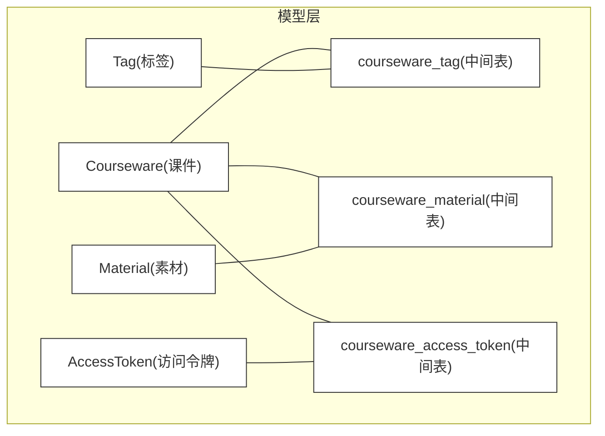
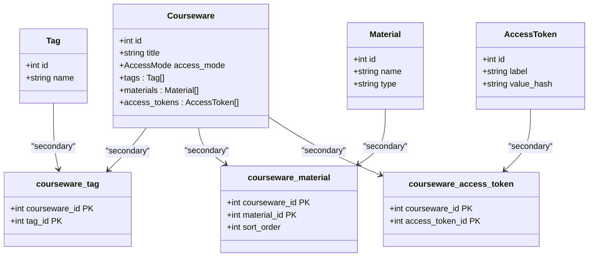
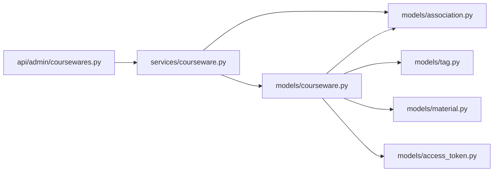
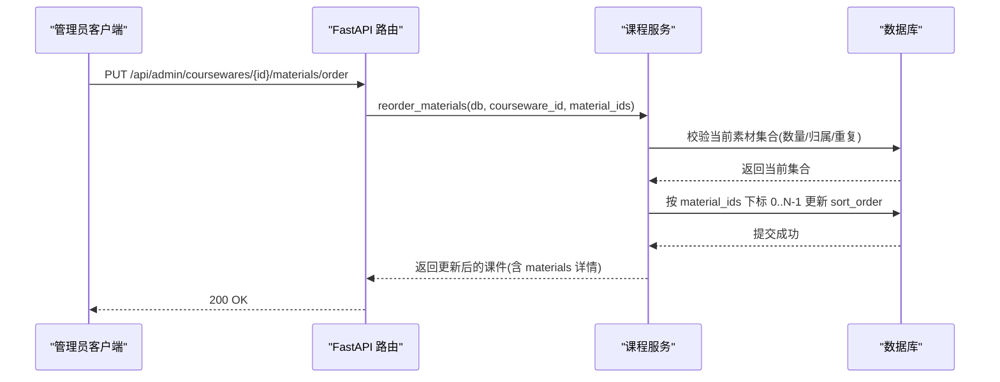
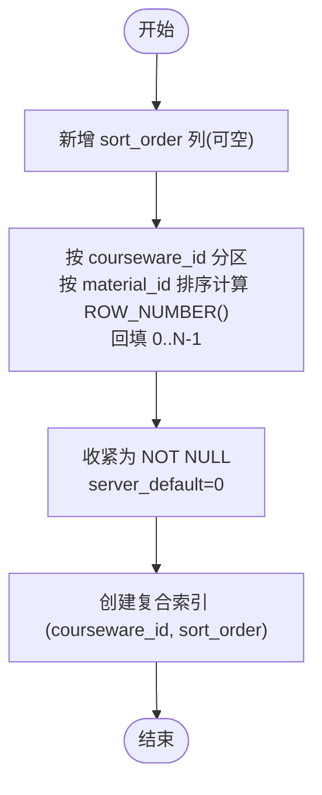

# 关联模型(Association Models)

<cite>
**本文引用的文件**   
- [backend/app/models/association.py](file://backend/app/models/association.py)
- [backend/app/models/courseware.py](file://backend/app/models/courseware.py)
- [backend/app/models/tag.py](file://backend/app/models/tag.py)
- [backend/app/models/material.py](file://backend/app/models/material.py)
- [backend/app/models/access_token.py](file://backend/app/models/access_token.py)
- [backend/app/services/courseware.py](file://backend/app/services/courseware.py)
- [backend/app/api/admin/coursewares.py](file://backend/app/api/admin/coursewares.py)
- [backend/alembic/versions/2026_07_10_1800-d2e3f4a5b6c7_add_courseware_material_sort_order.py](file://backend/alembic/versions/2026_07_10_1800-d2e3f4a5b6c7_add_courseware_material_sort_order.py)
</cite>

## 目录
1. [简介](#简介)
2. [项目结构](#项目结构)
3. [核心组件](#核心组件)
4. [架构总览](#架构总览)
5. [详细组件分析](#详细组件分析)
6. [依赖关系分析](#依赖关系分析)
7. [性能考虑](#性能考虑)
8. [故障排查指南](#故障排查指南)
9. [结论](#结论)
10. [附录](#附录)

## 简介
本设计文档聚焦于课件系统的多对多关联模型，围绕三张核心中间表展开：courseware_tag、courseware_material、courseware_access_token。文档从复合主键与唯一性约束、额外字段（如 sort_order）的业务意义与实现、查询优化策略（索引与 JOIN）、完整性约束与级联操作、CRUD 最佳实践与常见查询模式、迁移策略与版本兼容、ORM 层使用与性能技巧等维度进行系统化说明，帮助读者在理解数据模型的同时掌握工程化落地要点。

## 项目结构
与关联模型直接相关的代码主要分布在以下位置：
- 数据模型定义：models/association.py、models/courseware.py、models/tag.py、models/material.py、models/access_token.py
- 业务服务：services/courseware.py（含排序、更新、删除等逻辑）
- 管理接口：api/admin/coursewares.py（提供素材顺序调整等 API）
- 数据库迁移：alembic/versions/..._add_courseware_material_sort_order.py

图表来源
- [backend/app/models/association.py:9-33](file://backend/app/models/association.py#L9-L33)
- [backend/app/models/courseware.py:51-67](file://backend/app/models/courseware.py#L51-L67)

章节来源
- [backend/app/models/association.py:1-41](file://backend/app/models/association.py#L1-L41)
- [backend/app/models/courseware.py:21-74](file://backend/app/models/courseware.py#L21-L74)
- [backend/app/models/tag.py:13-29](file://backend/app/models/tag.py#L13-L29)
- [backend/app/models/material.py:44-68](file://backend/app/models/material.py#L44-L68)
- [backend/app/models/access_token.py:13-33](file://backend/app/models/access_token.py#L13-L33)

## 核心组件
- 中间表 courseware_tag：建立课件与标签的多对多关系，复合主键(courseware_id, tag_id)，外键均带 ondelete=CASCADE。
- 中间表 courseware_material：建立课件与素材的多对多关系，复合主键(courseware_id, material_id)，并包含 sort_order 字段用于表达“课件内素材的展示顺序”，同时定义了复合索引以加速按课件取有序素材。
- 中间表 courseware_access_token：建立课件与访问令牌的多对多关系，复合主键(courseware_id, access_token_id)，外键均带 ondelete=CASCADE。

上述三张中间表均采用“仅由两个外键组成复合主键”的经典多对多建模方式；其中 courseware_material 扩展了 sort_order 以承载业务语义。

章节来源
- [backend/app/models/association.py:9-33](file://backend/app/models/association.py#L9-L33)

## 架构总览
下图展示了 ORM 层如何通过 relationship 将 Courseware 与 Tag、Material、AccessToken 通过中间表进行多对多关联，并在读取时利用 selectinload 避免 N+1 问题。

图表来源
- [backend/app/models/courseware.py:51-67](file://backend/app/models/courseware.py#L51-L67)
- [backend/app/models/association.py:9-33](file://backend/app/models/association.py#L9-L33)

## 详细组件分析

### 组件一：courseware_tag（课件-标签）
- 复合主键：(courseware_id, tag_id)
- 唯一性约束：复合主键天然保证同一课件不会重复绑定同一标签
- 外键与级联：courseware_id → courseware.id (ondelete=CASCADE)；tag_id → tag.id (ondelete=CASCADE)
- ORM 使用：Courseware.tags 通过 secondary="courseware_tag" 声明多对多关系，默认 lazy="selectin"，批量加载避免 N+1

典型查询模式
- 获取某课件的所有标签：通过 Courseware.tags 或显式 JOIN courseware_tag
- 获取某标签下的所有课件：通过 Tag.coursewares 反向关系

章节来源
- [backend/app/models/association.py:9-14](file://backend/app/models/association.py#L9-L14)
- [backend/app/models/courseware.py:52-54](file://backend/app/models/courseware.py#L52-L54)
- [backend/app/models/tag.py:13-29](file://backend/app/models/tag.py#L13-L29)

### 组件二：courseware_material（课件-素材）
- 复合主键：(courseware_id, material_id)
- 唯一性约束：复合主键保证同一课件不会重复绑定同一素材
- 额外字段 sort_order：
  - 含义：表示该素材在当前课件内的展示顺序（学习路径），由管理员拖拽写入
  - 取值约定：同一课件内 0..N-1 连续递增；新增时默认 0，由业务层维护
  - 业务意义：决定学员浏览素材的顺序，影响前端播放器/幻灯片渲染顺序
- 索引优化：为加速“按课件取有序素材”的查询，定义复合索引 ix_courseware_material_courseware_order(courseware_id, sort_order)
- 外键与级联：courseware_id → courseware.id (ondelete=CASCADE)；material_id → material.id (ondelete=CASCADE)
- ORM 使用：Courseware.materials 通过 secondary="courseware_material" 声明多对多关系，order_by="courseware_material.c.sort_order"，lazy="selectin"

CRUD 最佳实践
- 创建课件时传入 material_ids：
  - 建议保持客户端期望的顺序；后端会按数组下标重写 sort_order（0..N-1）
  - 参考路径：[create 中显式写入 sort_order:147-160](file://backend/app/services/courseware.py#L147-L160)
- 更新课件时传入 material_ids：
  - 统一行为：按传入数组下标完整重写 sort_order（0..N-1）
  - 增删处理：DB 有但不在传入中 → DELETE；传入中有但 DB 没有 → INSERT
  - 参考路径：[update 中的材料集合重写逻辑:210-258](file://backend/app/services/courseware.py#L210-L258)
- 专用排序接口 reorder_materials：
  - 校验：数量一致、无重复、全部属于该课件
  - 动作：按传入数组下标重写 sort_order（0..N-1）
  - 参考路径：[reorder_materials 实现:335-393](file://backend/app/services/courseware.py#L335-L393)
- 列表返回 materials 详情时：
  - 为避免 ORM 二次同步导致的下标错位，直接从中间表读取 sort_order 映射
  - 参考路径：[_to_item 中 sort_order 映射构建:306-332](file://backend/app/services/courseware.py#L306-L332)

迁移策略与版本兼容
- 新增 sort_order 列的策略：
  1) 先新增可空列，避免回填失败锁表
  2) 使用窗口函数 ROW_NUMBER() 按 courseware_id 分区、material_id 排序回填 0..N-1
  3) 收紧为 NOT NULL，设置 server_default=0
  4) 创建复合索引 (courseware_id, sort_order)
- 回滚策略：删除索引、放宽为可空、再删除列
- 参考路径：[迁移脚本 upgrade/downgrade:33-117](file://backend/alembic/versions/2026_07_10_1800-d2e3f4a5b6c7_add_courseware_material_sort_order.py#L33-L117)

章节来源
- [backend/app/models/association.py:16-26](file://backend/app/models/association.py#L16-L26)
- [backend/app/models/courseware.py:55-61](file://backend/app/models/courseware.py#L55-L61)
- [backend/app/services/courseware.py:147-160](file://backend/app/services/courseware.py#L147-L160)
- [backend/app/services/courseware.py:210-258](file://backend/app/services/courseware.py#L210-L258)
- [backend/app/services/courseware.py:335-393](file://backend/app/services/courseware.py#L335-L393)
- [backend/app/services/courseware.py:306-332](file://backend/app/services/courseware.py#L306-L332)
- [backend/alembic/versions/2026_07_10_1800-d2e3f4a5b6c7_add_courseware_material_sort_order.py:33-117](file://backend/alembic/versions/2026_07_10_1800-d2e3f4a5b6c7_add_courseware_material_sort_order.py#L33-L117)

### 组件三：courseware_access_token（课件-访问令牌）
- 复合主键：(courseware_id, access_token_id)
- 唯一性约束：复合主键保证同一课件不会重复绑定同一令牌
- 外键与级联：courseware_id → courseware.id (ondelete=CASCADE)；access_token_id → access_token.id (ondelete=CASCADE)
- ORM 使用：Courseware.access_tokens 通过 secondary="courseware_access_token" 声明多对多关系，lazy="selectin"

业务规则与一致性
- 当课件访问模式为 RESTRICTED 时，必须至少绑定一个 AccessToken
- 当从 RESTRICTED 降级为 OPEN 时，自动清空 token 绑定
- 参考路径：[RESTRICTED 校验与降级清空:129-134](file://backend/app/services/courseware.py#L129-L134), [update 中降级清空:204-207](file://backend/app/services/courseware.py#L204-L207)

章节来源
- [backend/app/models/association.py:28-33](file://backend/app/models/association.py#L28-L33)
- [backend/app/models/courseware.py:62-67](file://backend/app/models/courseware.py#L62-L67)
- [backend/app/services/courseware.py:129-134](file://backend/app/services/courseware.py#L129-L134)
- [backend/app/services/courseware.py:204-207](file://backend/app/services/courseware.py#L204-L207)

## 依赖关系分析
- 模型耦合：
  - Courseware 通过 SQLAlchemy relationship 分别指向 Tag、Material、AccessToken，并通过中间表完成多对多
  - 中间表仅承担“桥接”职责，不承载复杂业务逻辑
- 外部依赖：
  - Alembic 负责 schema 演进（特别是 sort_order 的引入与索引创建）
  - FastAPI 路由暴露管理端点（如 /api/admin/coursewares/{id}/materials/order）

图表来源
- [backend/app/services/courseware.py:1-492](file://backend/app/services/courseware.py#L1-L492)
- [backend/app/api/admin/coursewares.py:1-115](file://backend/app/api/admin/coursewares.py#L1-L115)
- [backend/app/models/courseware.py:21-74](file://backend/app/models/courseware.py#L21-L74)
- [backend/app/models/association.py:1-41](file://backend/app/models/association.py#L1-L41)

章节来源
- [backend/app/services/courseware.py:1-492](file://backend/app/services/courseware.py#L1-L492)
- [backend/app/api/admin/coursewares.py:1-115](file://backend/app/api/admin/coursewares.py#L1-L115)

## 性能考虑
- 索引设计
  - courseware_material 上已定义复合索引 ix_courseware_material_courseware_order(courseware_id, sort_order)，用于加速“按课件取有序素材”的查询
  - 建议在高频查询场景下优先使用该索引，例如分页列表返回 materials 详情时
- JOIN 与 N+1 优化
  - 使用 selectinload 批量加载 tags、materials、access_tokens，避免 N+1 查询
  - 在需要精确 sort_order 的场景，直接从中间表读取 sort_order 映射，避免 ORM 二次同步导致顺序不一致
- 事务与写放大
  - 批量更新 sort_order 时，逐行 UPDATE 可能带来写放大；若数据量较大，可考虑分批提交或使用批量 SQL 语句
- 缓存与一致性
  - 频繁重排后及时刷新 ORM 对象状态（db.refresh/expire），确保后续读取命中最新顺序

章节来源
- [backend/app/models/association.py:24-26](file://backend/app/models/association.py#L24-L26)
- [backend/app/services/courseware.py:54-63](file://backend/app/services/courseware.py#L54-L63)
- [backend/app/services/courseware.py:306-332](file://backend/app/services/courseware.py#L306-L332)

## 故障排查指南
- 现象：修改素材顺序后，前端显示顺序不正确
  - 排查要点：确认是否调用专用排序接口或 update 中传入了正确的 materialIds 顺序；检查 _to_item 是否正确从中间表读取 sort_order
  - 参考路径：[专用排序接口:100-112](file://backend/app/api/admin/coursewares.py#L100-L112), [_to_item 中 sort_order 映射:306-332](file://backend/app/services/courseware.py#L306-L332)
- 现象：删除课件后关联数据未清理
  - 排查要点：确认外键 ondelete=CASCADE 是否生效；检查数据库引擎与约束
  - 参考路径：[外键定义:11-13](file://backend/app/models/association.py#L11-L13), [删除流程:281-286](file://backend/app/services/courseware.py#L281-L286)
- 现象：受限课件未绑定令牌被允许保存
  - 排查要点：检查 create/update 中对 RESTRICTED 模式的校验逻辑
  - 参考路径：[RESTRICTED 校验:129-134](file://backend/app/services/courseware.py#L129-L134), [update 中校验:259-270](file://backend/app/services/courseware.py#L259-L270)

章节来源
- [backend/app/api/admin/coursewares.py:100-112](file://backend/app/api/admin/coursewares.py#L100-L112)
- [backend/app/services/courseware.py:281-286](file://backend/app/services/courseware.py#L281-L286)
- [backend/app/services/courseware.py:129-134](file://backend/app/services/courseware.py#L129-L134)
- [backend/app/services/courseware.py:259-270](file://backend/app/services/courseware.py#L259-L270)

## 结论
本设计通过标准的多对中间表模式实现了课件与标签、素材、访问令牌的灵活关联，并在 courseware_material 上引入 sort_order 以支撑“学习路径”这一关键业务需求。配合合理的索引设计与 ORM 批量加载策略，系统在可读性与性能之间取得良好平衡。迁移脚本采用“先扩后紧”的安全策略，保障了线上演进的稳定性。

## 附录

### 序列图：素材顺序调整（专用接口）

图表来源
- [backend/app/api/admin/coursewares.py:100-112](file://backend/app/api/admin/coursewares.py#L100-L112)
- [backend/app/services/courseware.py:335-393](file://backend/app/services/courseware.py#L335-L393)

### 流程图：sort_order 回填算法（迁移脚本）

图表来源
- [backend/alembic/versions/2026_07_10_1800-d2e3f4a5b6c7_add_courseware_material_sort_order.py:33-117](file://backend/alembic/versions/2026_07_10_1800-d2e3f4a5b6c7_add_courseware_material_sort_order.py#L33-L117)