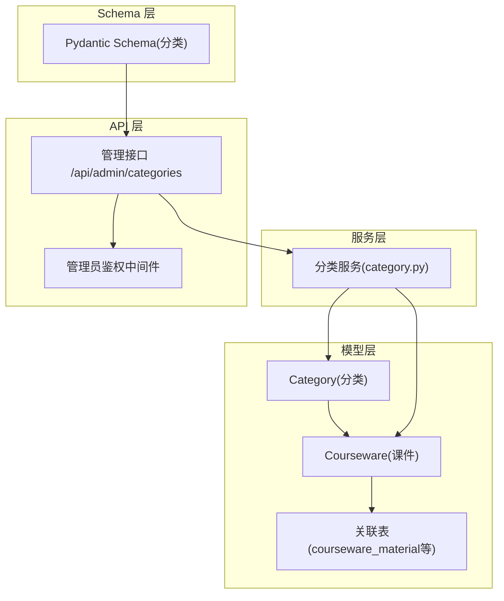
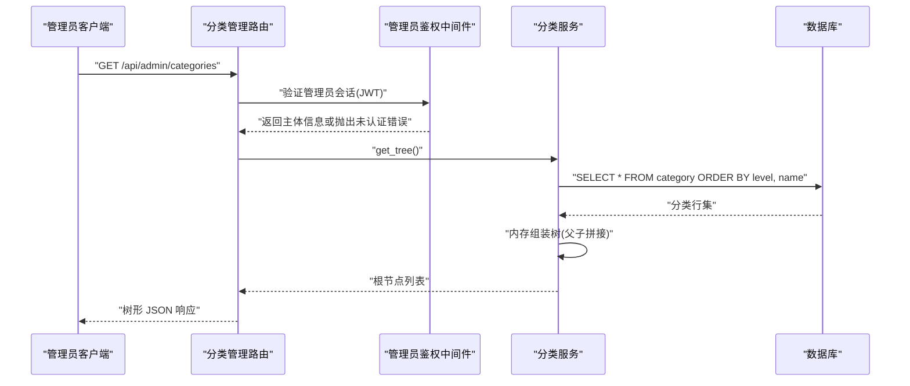
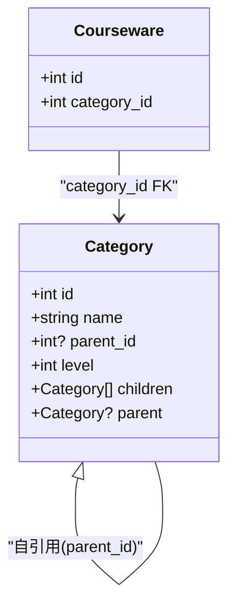
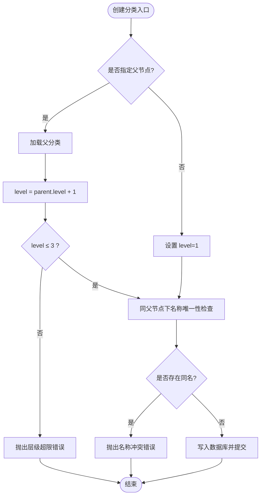
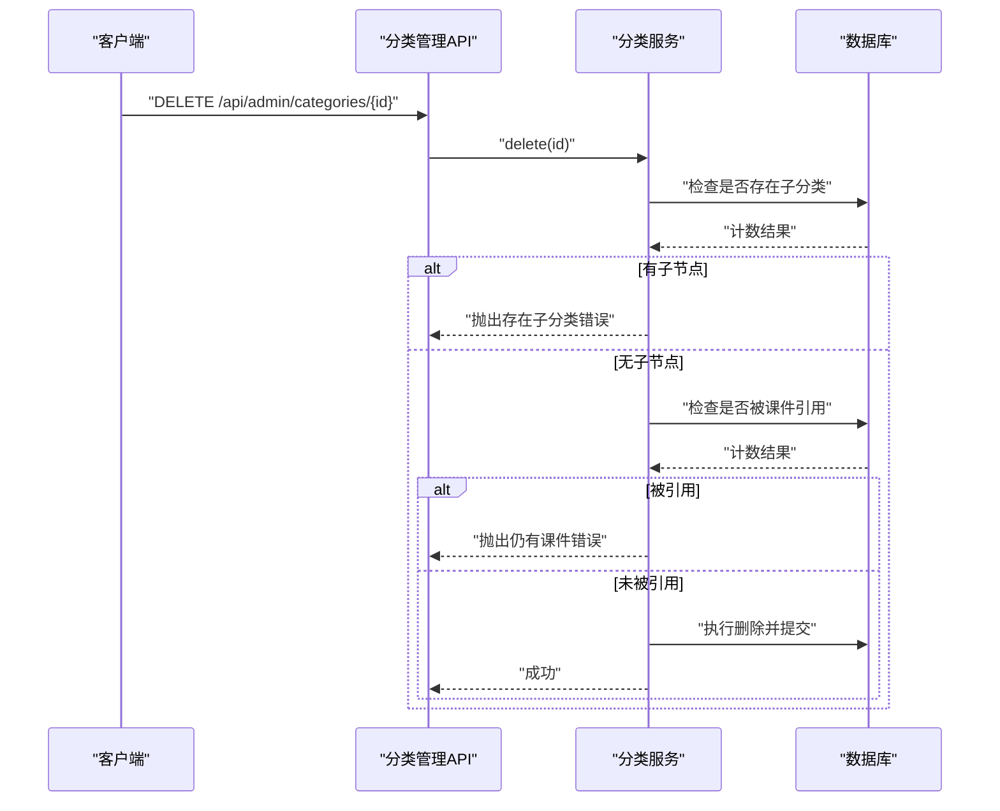
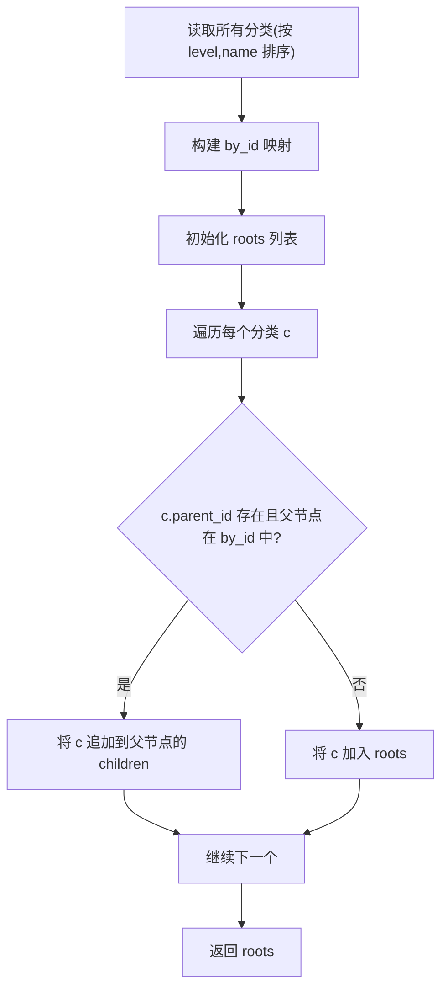
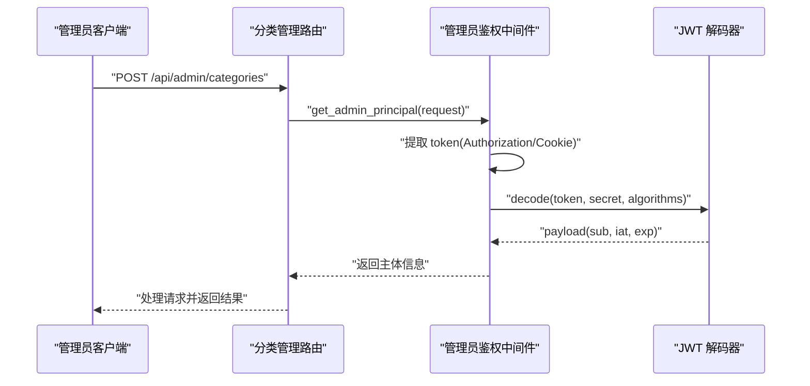
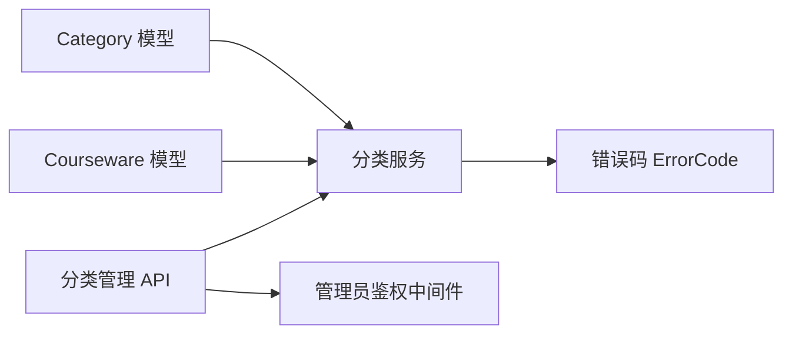

# 分类模型(Category)

<cite>
**本文引用的文件列表**
- [backend/app/models/category.py](file://backend/app/models/category.py)
- [backend/app/schemas/category.py](file://backend/app/schemas/category.py)
- [backend/app/services/category.py](file://backend/app/services/category.py)
- [backend/app/api/admin/categories.py](file://backend/app/api/admin/categories.py)
- [backend/app/middleware/admin_auth.py](file://backend/app/middleware/admin_auth.py)
- [backend/app/core/errors.py](file://backend/app/core/errors.py)
- [backend/app/models/courseware.py](file://backend/app/models/courseware.py)
- [backend/app/models/association.py](file://backend/app/models/association.py)
</cite>

## 目录
1. [简介](#简介)
2. [项目结构](#项目结构)
3. [核心组件](#核心组件)
4. [架构总览](#架构总览)
5. [详细组件分析](#详细组件分析)
6. [依赖关系分析](#依赖关系分析)
7. [性能考量](#性能考量)
8. [故障排查指南](#故障排查指南)
9. [结论](#结论)
10. [附录](#附录)

## 简介
本设计文档聚焦于“分类模型(Category)”的完整设计与实现，涵盖以下关键主题：
- 树形分类结构与自引用外键设计
- 层级深度限制与层级校验逻辑
- 同级排序机制与显示顺序控制（当前实现）
- 启用/禁用状态管理与软删除策略（现状与扩展建议）
- 与课件的一对多关联、级联操作与查询优化
- 分类树的构建算法与递归/迭代查询实现
- 导入导出格式与批量操作支持（现状与扩展建议）
- 权限控制与访问限制的集成设计

## 项目结构
分类相关代码分布在模型层、Schema 层、服务层与管理 API 路由中，并通过中间件进行管理员鉴权。

图表来源
- [backend/app/models/category.py:12-46](file://backend/app/models/category.py#L12-L46)
- [backend/app/models/courseware.py:21-74](file://backend/app/models/courseware.py#L21-L74)
- [backend/app/models/association.py:16-26](file://backend/app/models/association.py#L16-L26)
- [backend/app/schemas/category.py:9-48](file://backend/app/schemas/category.py#L9-L48)
- [backend/app/services/category.py:1-152](file://backend/app/services/category.py#L1-L152)
- [backend/app/api/admin/categories.py:1-81](file://backend/app/api/admin/categories.py#L1-L81)
- [backend/app/middleware/admin_auth.py:1-66](file://backend/app/middleware/admin_auth.py#L1-66)

章节来源
- [backend/app/models/category.py:12-46](file://backend/app/models/category.py#L12-L46)
- [backend/app/schemas/category.py:9-48](file://backend/app/schemas/category.py#L9-L48)
- [backend/app/services/category.py:1-152](file://backend/app/services/category.py#L1-L152)
- [backend/app/api/admin/categories.py:1-81](file://backend/app/api/admin/categories.py#L1-L81)
- [backend/app/middleware/admin_auth.py:1-66](file://backend/app/middleware/admin_auth.py#L1-66)
- [backend/app/models/courseware.py:21-74](file://backend/app/models/courseware.py#L21-L74)
- [backend/app/models/association.py:16-26](file://backend/app/models/association.py#L16-L26)

## 核心组件
- 数据模型 Category：定义分类表的字段、约束与自引用关系，限定最大层级为 3。
- Pydantic Schema：定义创建、重命名请求体与树节点响应结构。
- 业务服务 category.py：提供树构建、CRUD、子树 ID 收集、叶子节点集合等能力，并实现层级与唯一性校验。
- 管理 API：暴露分类的增删改查接口，受管理员鉴权保护。
- 与课件的关联：Courseware.category_id 指向 Category.id，用于按分类筛选课件。

章节来源
- [backend/app/models/category.py:12-46](file://backend/app/models/category.py#L12-L46)
- [backend/app/schemas/category.py:9-48](file://backend/app/schemas/category.py#L9-L48)
- [backend/app/services/category.py:1-152](file://backend/app/services/category.py#L1-L152)
- [backend/app/api/admin/categories.py:1-81](file://backend/app/api/admin/categories.py#L1-L81)
- [backend/app/models/courseware.py:21-74](file://backend/app/models/courseware.py#L21-L74)

## 架构总览
分类模块采用分层架构：API 路由负责参数校验与响应封装；服务层承载业务规则与数据访问；模型层定义持久化结构与关系。

图表来源
- [backend/app/api/admin/categories.py:33-36](file://backend/app/api/admin/categories.py#L33-L36)
- [backend/app/middleware/admin_auth.py:26-42](file://backend/app/middleware/admin_auth.py#L26-L42)
- [backend/app/services/category.py:27-42](file://backend/app/services/category.py#L27-L42)

## 详细组件分析

### 数据模型与自引用外键设计
- 自引用外键：parent_id 引用自身 id，形成父子层级关系。
- 唯一约束：同一父节点下名称唯一，避免重复分支。
- 索引：对 parent_id 建立索引，加速子节点查找。
- ORM 关系：children 与 parent 双向映射，便于在应用层遍历。

图表来源
- [backend/app/models/category.py:12-46](file://backend/app/models/category.py#L12-L46)
- [backend/app/models/courseware.py:21-74](file://backend/app/models/courseware.py#L21-L74)

章节来源
- [backend/app/models/category.py:12-46](file://backend/app/models/category.py#L12-L46)
- [backend/app/models/courseware.py:21-74](file://backend/app/models/courseware.py#L21-L74)

### 层级深度限制与层级验证逻辑
- 最大层级常量：MAX_LEVEL = 3。
- 创建时校验：若指定 parent_id，则计算 level = parent.level + 1，超过 MAX_LEVEL 直接拒绝。
- 根节点：parent_id 为空时，level = 1。
- 更新时不改变层级，仅校验名称长度与唯一性。

图表来源
- [backend/app/services/category.py:52-76](file://backend/app/services/category.py#L52-L76)
- [backend/app/core/errors.py:32-38](file://backend/app/core/errors.py#L32-38)

章节来源
- [backend/app/services/category.py:52-76](file://backend/app/services/category.py#L52-L76)
- [backend/app/core/errors.py:32-38](file://backend/app/core/errors.py#L32-38)

### 同级排序机制与显示顺序控制
- 当前实现：分类树按 level 和 name 排序输出，无显式的 sort_order 字段。
- 影响：同级分类的显示顺序由名称字典序决定。
- 扩展建议：如需自定义顺序，可在 Category 表新增 sort_order 字段，并在 get_tree 中按该字段排序；同时维护插入/移动时的顺序一致性。

章节来源
- [backend/app/services/category.py:27-42](file://backend/app/services/category.py#L27-L42)

### 启用/禁用状态管理与软删除策略
- 现状：Category 模型未包含 is_active 或 deleted_at 字段，删除为硬删除。
- 删除保护：存在子节点或被课件引用时禁止删除。
- 扩展建议：
  - 增加 is_active 布尔字段以支持启用/禁用。
  - 增加 deleted_at 时间戳以实现软删除，并在查询时过滤已删除项。
  - 在 API 层提供启用/禁用与恢复接口。

章节来源
- [backend/app/models/category.py:12-46](file://backend/app/models/category.py#L12-L46)
- [backend/app/services/category.py:91-110](file://backend/app/services/category.py#L91-L110)

### 与课件的一对多关联关系、级联操作与查询优化
- 一对多关系：Courseware.category_id 外键指向 Category.id，ondelete="RESTRICT"，防止误删被引用的分类。
- 查询优化：
  - 获取分类树时一次性拉取所有分类并按内存组装，减少 N+1 查询。
  - 按分类筛选课件时，使用 collect_subtree_ids 收集子树 ID 后以 IN 条件批量过滤。
- 级联操作：
  - 删除分类前检查是否有子节点与被引用课件，阻止不安全删除。
  - 课件删除不影响分类（RESTRICT），但分类删除会受课件引用保护。

图表来源
- [backend/app/services/category.py:91-110](file://backend/app/services/category.py#L91-L110)
- [backend/app/models/courseware.py:30-32](file://backend/app/models/courseware.py#L30-32)

章节来源
- [backend/app/models/courseware.py:30-32](file://backend/app/models/courseware.py#L30-32)
- [backend/app/services/category.py:91-110](file://backend/app/services/category.py#L91-L110)

### 分类树的构建算法与递归查询实现
- 单次全量读取：按 level、name 排序拉取全部分类。
- 内存组装：
  - 构建 by_id 映射。
  - 遍历行集，将每个分类挂入其父节点的 children 列表，否则加入 roots。
- 复杂度：O(N) 时间与 O(N) 空间，N 为分类总数。
- 子树 ID 收集：BFS 遍历，先建 by_parent 索引，再逐层展开，得到 root 及其所有后代 ID 列表。

图表来源
- [backend/app/services/category.py:27-42](file://backend/app/services/category.py#L27-L42)

章节来源
- [backend/app/services/category.py:27-42](file://backend/app/services/category.py#L27-L42)

### 导入导出格式与批量操作支持
- 现状：
  - 未提供分类导入/导出接口。
  - 未提供批量创建/更新/删除接口。
- 建议方案：
  - 导出：调用 get_tree 生成树形 JSON，包含 id、name、parentId、level、children。
  - 导入：接收扁平数组或树形 JSON，服务端按 parentId 解析并校验层级与唯一性，批量插入。
  - 批量操作：提供 POST /bulk-create、PUT /bulk-update、DELETE /bulk-delete 接口，内部事务保证一致性。

[本节为概念性说明，不涉及具体源码]

### 权限控制与访问限制集成设计
- 管理员鉴权：
  - 路由通过 Depends(get_admin_principal) 强制要求管理员登录。
  - 从 Authorization 头或 Cookie 中提取 JWT，校验过期与签名。
- 访问限制：
  - 分类本身无公开/受限模式，但课件可设置为 RESTRICTED，需令牌解锁。
  - 分类删除/修改均受管理员权限保护。

图表来源
- [backend/app/api/admin/categories.py:16-20](file://backend/app/api/admin/categories.py#L16-20)
- [backend/app/middleware/admin_auth.py:26-42](file://backend/app/middleware/admin_auth.py#L26-42)

章节来源
- [backend/app/api/admin/categories.py:16-20](file://backend/app/api/admin/categories.py#L16-20)
- [backend/app/middleware/admin_auth.py:26-42](file://backend/app/middleware/admin_auth.py#L26-42)

## 依赖关系分析
- 模型依赖：
  - Category 自引用外键，支撑树形结构。
  - Courseware.category_id 外键指向 Category，ondelete="RESTRICT"。
- 服务依赖：
  - category.py 依赖 Category 与 Courseware 模型，以及错误码 ErrorCode。
- API 依赖：
  - categories.py 依赖 admin 鉴权中间件与分类服务。

图表来源
- [backend/app/models/category.py:12-46](file://backend/app/models/category.py#L12-L46)
- [backend/app/models/courseware.py:21-74](file://backend/app/models/courseware.py#L21-L74)
- [backend/app/services/category.py:1-152](file://backend/app/services/category.py#L1-L152)
- [backend/app/api/admin/categories.py:1-81](file://backend/app/api/admin/categories.py#L1-L81)
- [backend/app/middleware/admin_auth.py:1-66](file://backend/app/middleware/admin_auth.py#L1-66)
- [backend/app/core/errors.py:1-144](file://backend/app/core/errors.py#L1-144)

章节来源
- [backend/app/models/category.py:12-46](file://backend/app/models/category.py#L12-L46)
- [backend/app/models/courseware.py:21-74](file://backend/app/models/courseware.py#L21-L74)
- [backend/app/services/category.py:1-152](file://backend/app/services/category.py#L1-L152)
- [backend/app/api/admin/categories.py:1-81](file://backend/app/api/admin/categories.py#L1-L81)
- [backend/app/middleware/admin_auth.py:1-66](file://backend/app/middleware/admin_auth.py#L1-66)
- [backend/app/core/errors.py:1-144](file://backend/app/core/errors.py#L1-144)

## 性能考量
- 树构建：一次全量读取 + 内存组装，时间复杂度 O(N)，适合中小规模分类树。
- 子树过滤：collect_subtree_ids 使用 BFS 与 by_parent 索引，避免深层递归导致的栈溢出风险。
- 查询优化：
  - 分类树查询按 level、name 排序，前端可直接渲染。
  - 课件列表按分类筛选时使用 IN 条件批量过滤，减少多次查询。
- 可扩展点：
  - 若分类数量增长显著，可考虑缓存分类树（如 Redis），并提供失效策略（分类变更时清理）。
  - 引入 sort_order 字段后，确保索引覆盖排序列以提升分页与排序性能。

[本节为通用性能讨论，不涉及具体源码片段]

## 故障排查指南
- 常见错误码：
  - CATEGORY_NOT_FOUND：分类不存在。
  - CATEGORY_NAME_REQUIRED：分类名称为空或超长。
  - CATEGORY_NAME_CONFLICT：同父节点下名称重复。
  - CATEGORY_MAX_LEVEL：层级超过 3。
  - CATEGORY_HAS_CHILDREN：存在子分类无法删除。
  - CATEGORY_HAS_COURSEWARES：仍有课件引用无法删除。
- 定位步骤：
  - 查看 API 返回的 code 与 message，对照错误码映射。
  - 检查分类层级与父节点是否正确。
  - 确认是否存在子节点或被课件引用。
  - 检查管理员会话是否有效（JWT 过期或无效）。

章节来源
- [backend/app/core/errors.py:32-38](file://backend/app/core/errors.py#L32-38)
- [backend/app/core/errors.py:92-98](file://backend/app/core/errors.py#L92-98)
- [backend/app/services/category.py:52-76](file://backend/app/services/category.py#L52-L76)
- [backend/app/services/category.py:91-110](file://backend/app/services/category.py#L91-L110)

## 结论
分类模型以简洁的自引用外键与固定最大层级（3 级）实现了稳定的树形结构。服务层提供了健壮的层级校验、唯一性约束与删除保护，API 层通过管理员鉴权保障安全。当前实现未包含启用/禁用与软删除，也未提供导入导出与批量操作接口，但这些均可基于现有架构平滑扩展。对于大规模场景，建议引入缓存与排序字段以进一步优化性能与灵活性。

[本节为总结性内容，不涉及具体源码分析]

## 附录
- 与课件的素材排序：虽然不属于分类模型，但课件内素材的展示顺序通过 courseware_material.sort_order 维护，可作为分类排序设计的参考范式。

章节来源
- [backend/app/models/association.py:16-26](file://backend/app/models/association.py#L16-L26)
- [backend/app/models/courseware.py:55-61](file://backend/app/models/courseware.py#L55-L61)