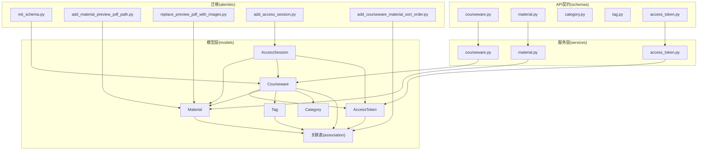
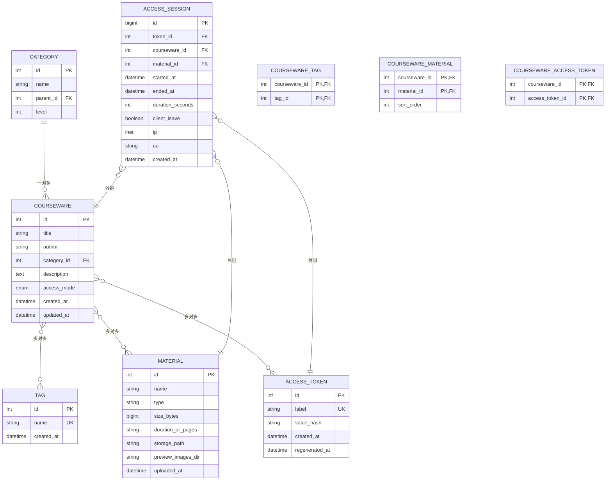
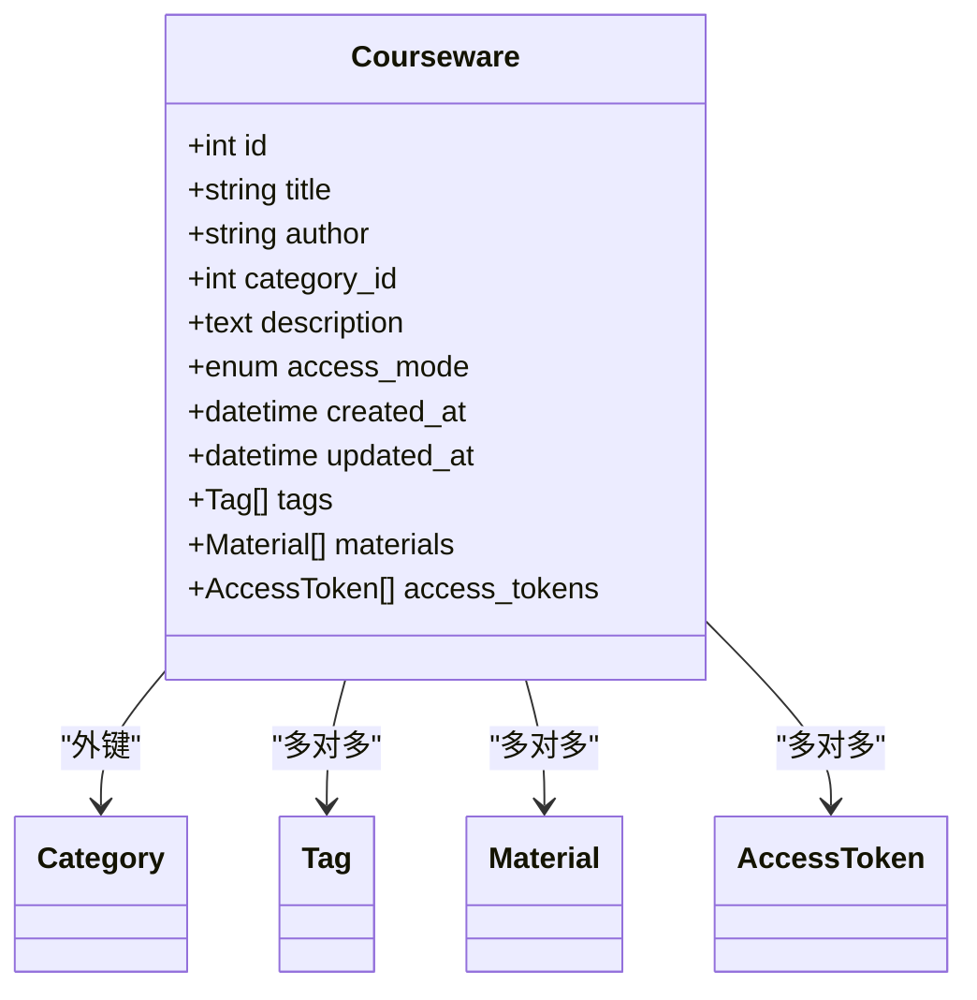
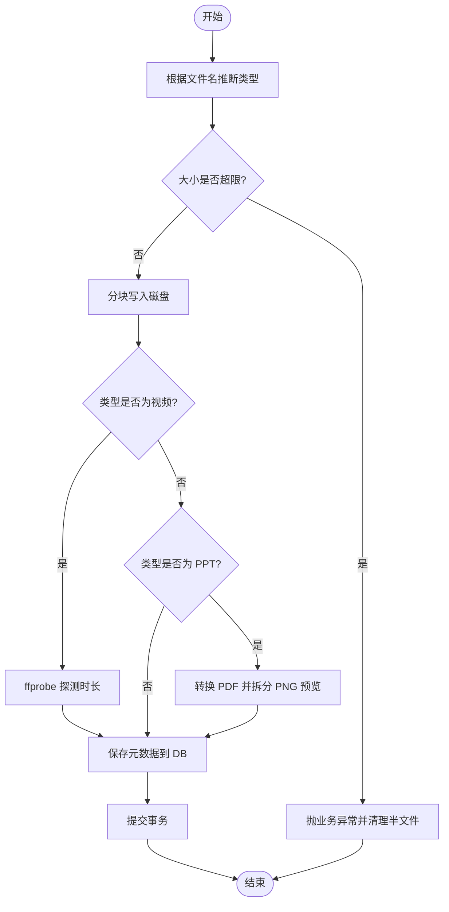
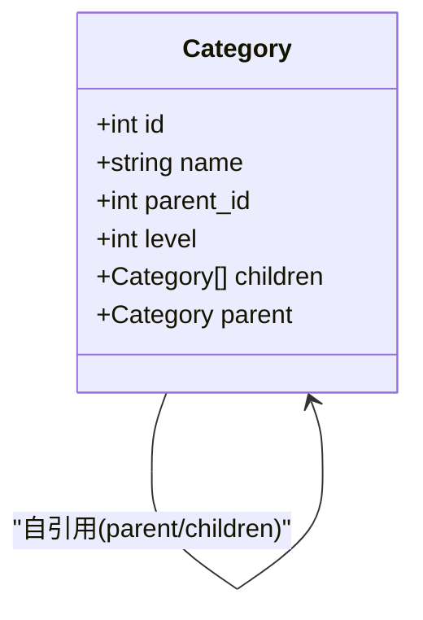
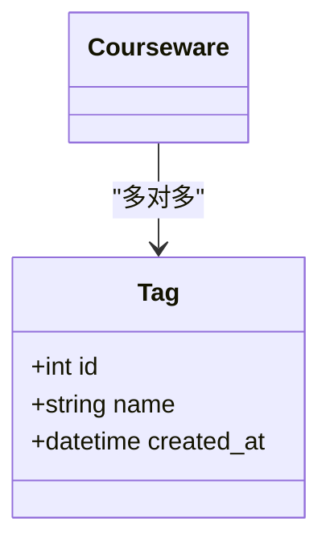
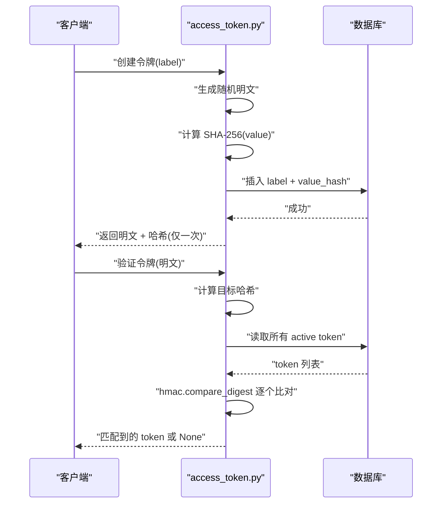
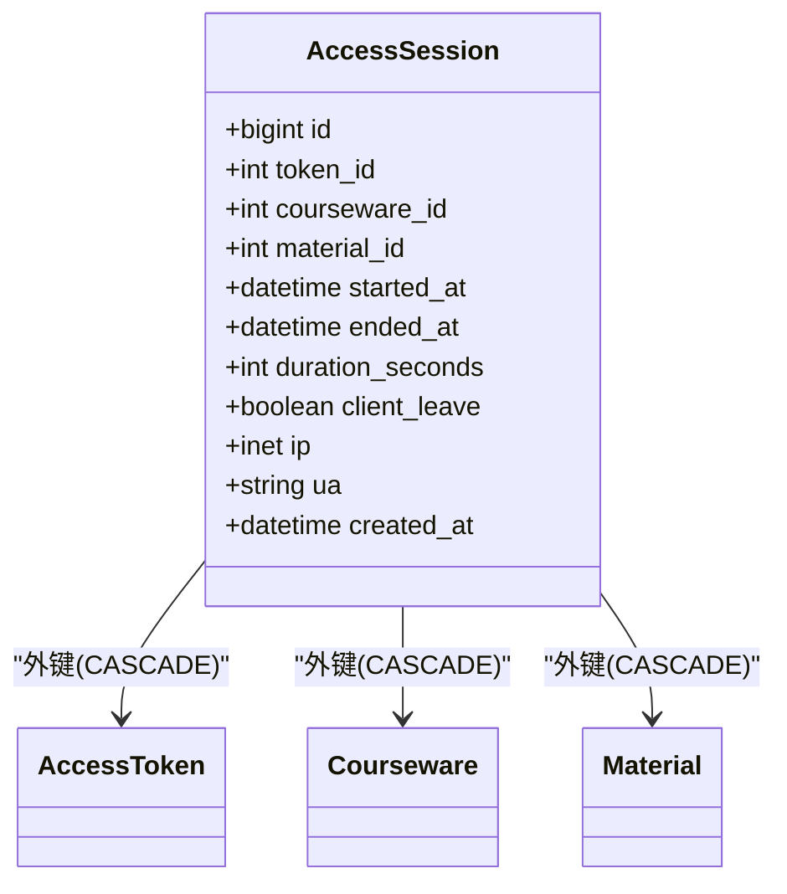
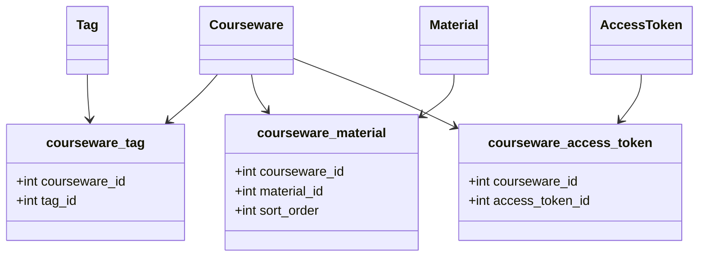
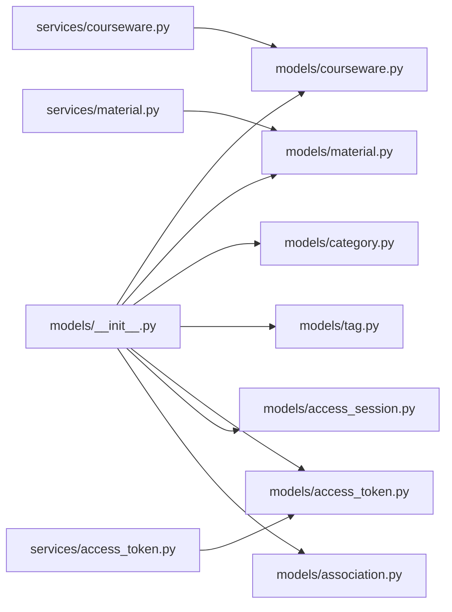

# 数据模型设计

<cite>
**本文引用的文件**
- [backend/app/models/__init__.py](file://backend/app/models/__init__.py)
- [backend/app/models/courseware.py](file://backend/app/models/courseware.py)
- [backend/app/models/material.py](file://backend/app/models/material.py)
- [backend/app/models/category.py](file://backend/app/models/category.py)
- [backend/app/models/tag.py](file://backend/app/models/tag.py)
- [backend/app/models/access_token.py](file://backend/app/models/access_token.py)
- [backend/app/models/association.py](file://backend/app/models/association.py)
- [backend/app/models/access_session.py](file://backend/app/models/access_session.py)
- [backend/app/schemas/courseware.py](file://backend/app/schemas/courseware.py)
- [backend/app/schemas/material.py](file://backend/app/schemas/material.py)
- [backend/app/schemas/category.py](file://backend/app/schemas/category.py)
- [backend/app/schemas/tag.py](file://backend/app/schemas/tag.py)
- [backend/app/schemas/access_token.py](file://backend/app/schemas/access_token.py)
- [backend/app/services/courseware.py](file://backend/app/services/courseware.py)
- [backend/app/services/material.py](file://backend/app/services/material.py)
- [backend/app/services/access_token.py](file://backend/app/services/access_token.py)
- [backend/alembic/versions/2026_07_06_1745-11f9c69846a9_init_schema.py](file://backend/alembic/versions/2026_07_06_1745-11f9c69846a9_init_schema.py)
- [backend/alembic/versions/2026_07_07_0900-a1b2c3d4e5f6_add_material_preview_pdf_path.py](file://backend/alembic/versions/2026_07_07_0900-a1b2c3d4e5f6_add_material_preview_pdf_path.py)
- [backend/alembic/versions/2026_07_07_1230-b2c3d4e5f607_replace_preview_pdf_with_images.py](file://backend/alembic/versions/2026_07_07_1230-b2c3d4e5f607_replace_preview_pdf_with_images.py)
- [backend/alembic/versions/2026_07_10_0930-c1d2e3f4a5b6_add_access_session.py](file://backend/alembic/versions/2026_07_10_0930-c1d2e3f4a5b6_add_access_session.py)
- [backend/alembic/versions/2026_07_10_1800-d2e3f4a5b6c7_add_courseware_material_sort_order.py](file://backend/alembic/versions/2026_07_10_1800-d2e3f4a5b6c7_add_courseware_material_sort_order.py)
</cite>

## 目录
1. [引言](#引言)
2. [项目结构](#项目结构)
3. [核心组件](#核心组件)
4. [架构总览](#架构总览)
5. [详细组件分析](#详细组件分析)
6. [依赖关系分析](#依赖关系分析)
7. [性能考量](#性能考量)
8. [故障排查指南](#故障排查指南)
9. [结论](#结论)
10. [附录](#附录)

## 引言
本文件面向 Learning Hub 的数据模型设计与实现，聚焦基于 SQLAlchemy 的 ORM 建模与业务规则落地。文档覆盖以下要点：
- 主从表关系、多对多关联与复合索引设计
- 课件模型（Courseware）的核心字段与访问模式控制
- 素材模型（Material）的多类型支持与元数据管理、存储路径映射
- 分类模型（Category）的树形结构与排序逻辑
- 标签系统（Tag）的实现与动态查询支持
- 访问令牌模型（AccessToken）的安全设计、验证与审计日志记录
- 访问会话模型（AccessSession）的审计与统计支撑
- 数据迁移策略与版本管理最佳实践

## 项目结构
后端采用分层组织：models 定义持久化实体；schemas 定义 API 输入输出契约；services 承载业务规则与数据访问；alembic 负责数据库迁移。

图表来源
- [backend/app/models/courseware.py:1-74](file://backend/app/models/courseware.py#L1-L74)
- [backend/app/models/material.py:1-69](file://backend/app/models/material.py#L1-L69)
- [backend/app/models/category.py:1-46](file://backend/app/models/category.py#L1-L46)
- [backend/app/models/tag.py:1-30](file://backend/app/models/tag.py#L1-L30)
- [backend/app/models/access_token.py:1-34](file://backend/app/models/access_token.py#L1-L34)
- [backend/app/models/association.py:1-41](file://backend/app/models/association.py#L1-L41)
- [backend/app/models/access_session.py:1-129](file://backend/app/models/access_session.py#L1-L129)
- [backend/app/services/courseware.py:1-492](file://backend/app/services/courseware.py#L1-L492)
- [backend/app/services/material.py:1-234](file://backend/app/services/material.py#L1-L234)
- [backend/app/services/access_token.py:1-235](file://backend/app/services/access_token.py#L1-L235)
- [backend/alembic/versions/2026_07_06_1745-11f9c69846a9_init_schema.py](file://backend/alembic/versions/2026_07_06_1745-11f9c69846a9_init_schema.py)
- [backend/alembic/versions/2026_07_07_0900-a1b2c3d4e5f6_add_material_preview_pdf_path.py](file://backend/alembic/versions/2026_07_07_0900-a1b2c3d4e5f6_add_material_preview_pdf_path.py)
- [backend/alembic/versions/2026_07_07_1230-b2c3d4e5f607_replace_preview_pdf_with_images.py](file://backend/alembic/versions/2026_07_07_1230-b2c3d4e5f607_replace_preview_pdf_with_images.py)
- [backend/alembic/versions/2026_07_10_0930-c1d2e3f4a5b6_add_access_session.py](file://backend/alembic/versions/2026_07_10_0930-c1d2e3f4a5b6_add_access_session.py)
- [backend/alembic/versions/2026_07_10_1800-d2e3f4a5b6c7_add_courseware_material_sort_order.py](file://backend/alembic/versions/2026_07_10_1800-d2e3f4a5b6c7_add_courseware_material_sort_order.py)

章节来源
- [backend/app/models/__init__.py:1-30](file://backend/app/models/__init__.py#L1-L30)

## 核心组件
本节概述各实体的职责与关键约束：
- Courseware：课件主实体，包含标题、作者、分类、描述、访问模式及时间戳；通过多对多关联 Tag、Material、AccessToken。
- Material：素材元数据，支持 VIDEO/PDF/PPT 三类，记录大小、时长或页数、存储路径与预览图片目录。
- Category：三级树形分类，父子自引用，同父节点下名称唯一。
- Tag：全局唯一标签名，扁平结构。
- AccessToken：令牌仅存哈希值，label 全局唯一，提供创建、重新生成、删除与校验能力。
- AccessSession：访问会话审计记录，记录 token、课件、素材、起止时间与停留秒数等。

章节来源
- [backend/app/models/courseware.py:1-74](file://backend/app/models/courseware.py#L1-L74)
- [backend/app/models/material.py:1-69](file://backend/app/models/material.py#L1-L69)
- [backend/app/models/category.py:1-46](file://backend/app/models/category.py#L1-L46)
- [backend/app/models/tag.py:1-30](file://backend/app/models/tag.py#L1-L30)
- [backend/app/models/access_token.py:1-34](file://backend/app/models/access_token.py#L1-L34)
- [backend/app/models/access_session.py:1-129](file://backend/app/models/access_session.py#L1-L129)

## 架构总览
下图展示模型间关系与关键索引/约束位置，体现主从表、多对多与复合索引设计。

图表来源
- [backend/app/models/courseware.py:1-74](file://backend/app/models/courseware.py#L1-L74)
- [backend/app/models/material.py:1-69](file://backend/app/models/material.py#L1-L69)
- [backend/app/models/category.py:1-46](file://backend/app/models/category.py#L1-L46)
- [backend/app/models/tag.py:1-30](file://backend/app/models/tag.py#L1-L30)
- [backend/app/models/access_token.py:1-34](file://backend/app/models/access_token.py#L1-L34)
- [backend/app/models/access_session.py:1-129](file://backend/app/models/access_session.py#L1-L129)
- [backend/app/models/association.py:1-41](file://backend/app/models/association.py#L1-L41)

## 详细组件分析

### 课件模型（Courseware）
- 核心字段
  - 标识与基础信息：id、title、author、description
  - 分类归属：category_id（外键至 category.id，RESTRICT 删除保护）
  - 访问模式：access_mode（OPEN/RESTRICTED），默认 OPEN
  - 时间戳：created_at、updated_at（带时区）
- 关系
  - 与 Category：一对一（joined 加载）
  - 与 Tag：多对多（secondary=courseware_tag）
  - 与 Material：多对多（secondary=courseware_material，按 sort_order 排序）
  - 与 AccessToken：多对多（secondary=courseware_access_token）
- 业务规则（服务层）
  - 标题非空且长度限制
  - RESTRICTED 模式需至少绑定一个 AccessToken
  - 从 RESTRICTED 降级为 OPEN 时自动清空 token 绑定
  - 删除时级联清理关联表
- 查询与展示
  - 列表支持关键词、分类子树过滤、访问模式过滤
  - 详情返回材料顺序来自关联表的 sort_order

图表来源
- [backend/app/models/courseware.py:1-74](file://backend/app/models/courseware.py#L1-L74)
- [backend/app/models/association.py:1-41](file://backend/app/models/association.py#L1-L41)

章节来源
- [backend/app/models/courseware.py:1-74](file://backend/app/models/courseware.py#L1-L74)
- [backend/app/services/courseware.py:1-492](file://backend/app/services/courseware.py#L1-L492)
- [backend/app/schemas/courseware.py:1-120](file://backend/app/schemas/courseware.py#L1-L120)

### 素材模型（Material）
- 核心字段
  - 标识与元数据：id、name、type（VIDEO/PDF/PPT）、size_bytes
  - 时长/页数：duration_or_pages（视频时长字符串或 PPT 页数）
  - 存储路径：storage_path（文件系统绝对路径）
  - 预览图片目录：preview_images_dir（PPT 转 PNG 序列目录）
  - 上传时间：uploaded_at
- 类型推断
  - 根据扩展名推断类型，不支持的类型抛出业务异常
- 上传流程与服务
  - 分块写入磁盘，累计大小并校验上限
  - 视频：调用 ffprobe 探测时长
  - PPT：后台转换为 PDF 再拆分为 PNG 预览图，记录目录与页数
  - 失败回滚：DB 失败则清理已写文件与预览目录
- 删除保护
  - 若被任何课件引用，禁止删除

图表来源
- [backend/app/services/material.py:1-234](file://backend/app/services/material.py#L1-L234)
- [backend/app/models/material.py:1-69](file://backend/app/models/material.py#L1-L69)

章节来源
- [backend/app/models/material.py:1-69](file://backend/app/models/material.py#L1-L69)
- [backend/app/services/material.py:1-234](file://backend/app/services/material.py#L1-L234)
- [backend/app/schemas/material.py:1-28](file://backend/app/schemas/material.py#L1-L28)

### 分类模型（Category）
- 树形结构
  - 自引用 parent_id，level ∈ {1,2,3}，parent_id=NULL 表示根
  - 同一父节点下名称唯一（UniqueConstraint）
  - 建立 parent_id 索引以加速子树遍历
- 关系
  - children/parent 双向关系，便于构建树形视图
- 业务规则
  - 课件可挂载到任意层级节点（服务层不再强制叶子）

图表来源
- [backend/app/models/category.py:1-46](file://backend/app/models/category.py#L1-L46)

章节来源
- [backend/app/models/category.py:1-46](file://backend/app/models/category.py#L1-L46)
- [backend/app/schemas/category.py:1-49](file://backend/app/schemas/category.py#L1-L49)
- [backend/app/services/courseware.py:1-492](file://backend/app/services/courseware.py#L1-L492)

### 标签系统（Tag）
- 扁平结构，name 全局唯一
- 与课件多对多关联，支持按标签筛选课件
- 列表返回关联课件计数

图表来源
- [backend/app/models/tag.py:1-30](file://backend/app/models/tag.py#L1-L30)
- [backend/app/models/association.py:1-41](file://backend/app/models/association.py#L1-L41)

章节来源
- [backend/app/models/tag.py:1-30](file://backend/app/models/tag.py#L1-L30)
- [backend/app/schemas/tag.py:1-34](file://backend/app/schemas/tag.py#L1-L34)

### 访问令牌模型（AccessToken）与安全设计
- 安全存储
  - 仅存储 value_hash（SHA-256），明文仅在创建/重新生成时一次性返回
- 唯一性与校验
  - label 全局唯一；创建前检查冲突
  - 删除前检查是否被课件引用；保证至少保留一个 active token
- 验证流程
  - verify：计算传入明文的 hash，使用常量时间比较逐一比对所有 active token
  - get_by_hash：直接按哈希查找（用于快速匹配）
- 审计
  - 创建、重新生成、删除均记录审计日志

图表来源
- [backend/app/services/access_token.py:1-235](file://backend/app/services/access_token.py#L1-L235)
- [backend/app/models/access_token.py:1-34](file://backend/app/models/access_token.py#L1-L34)

章节来源
- [backend/app/models/access_token.py:1-34](file://backend/app/models/access_token.py#L1-L34)
- [backend/app/services/access_token.py:1-235](file://backend/app/services/access_token.py#L1-L235)
- [backend/app/schemas/access_token.py:1-53](file://backend/app/schemas/access_token.py#L1-L53)

### 访问会话模型（AccessSession）与审计
- 用途
  - 记录某 token 持有者在 P-VIEWER 中对受限课件素材的一次完整浏览（起→止 + 停留秒数）
- 约束与索引
  - 非负时长检查约束
  - 针对 token+started_at、token+material+started_at、token+courseware+started_at 的复合索引
  - IP 字段在 PostgreSQL 使用 INET，SQLite 降级为 VARCHAR(45)
- 生命周期
  - 删除 token/courseware/material 时通过 FK CASCADE 清理历史会话

图表来源
- [backend/app/models/access_session.py:1-129](file://backend/app/models/access_session.py#L1-L129)

章节来源
- [backend/app/models/access_session.py:1-129](file://backend/app/models/access_session.py#L1-L129)

### 多对多关联与复合索引
- 关联表
  - courseware_tag：课件与标签
  - courseware_material：课件与素材，含 sort_order 与复合索引 ix_courseware_material_courseware_order(courseware_id, sort_order)
  - courseware_access_token：课件与令牌
- 设计要点
  - 主键为联合主键，确保唯一性
  - ondelete=CASCADE 保障删除一致性
  - 复合索引优化“按课件有序取素材”的查询

图表来源
- [backend/app/models/association.py:1-41](file://backend/app/models/association.py#L1-L41)

章节来源
- [backend/app/models/association.py:1-41](file://backend/app/models/association.py#L1-L41)

## 依赖关系分析
- 模型集中导入
  - models/__init__.py 统一导出 Base、各实体与关联表，供 Alembic 一次性识别 metadata
- 服务与模型耦合
  - services/courseware.py 依赖 models/courseware、association、category、tag、material、access_token
  - services/material.py 依赖 models/material、association 与外部工具（ffprobe、ppt_to_images）
  - services/access_token.py 依赖 models/access_token、association 与审计模块
- 迁移与模型同步
  - alembic 版本脚本驱动 schema 演进，新增字段与索引需与模型保持一致

图表来源
- [backend/app/models/__init__.py:1-30](file://backend/app/models/__init__.py#L1-L30)
- [backend/app/services/courseware.py:1-492](file://backend/app/services/courseware.py#L1-L492)
- [backend/app/services/material.py:1-234](file://backend/app/services/material.py#L1-L234)
- [backend/app/services/access_token.py:1-235](file://backend/app/services/access_token.py#L1-L235)

章节来源
- [backend/app/models/__init__.py:1-30](file://backend/app/models/__init__.py#L1-L30)

## 性能考量
- 索引与查询
  - category.parent_id 索引加速子树遍历
  - courseware_material.courseware_id + sort_order 复合索引优化有序素材加载
  - access_session 多个复合索引优化按 token 维度的统计与回放
- N+1 问题规避
  - 列表/详情使用 selectinload 预加载 tags、materials、access_tokens、category
- 大对象处理
  - 素材上传分块写入，避免内存峰值
  - 视频时长探测与 PPT 预览图生成异步容错，不阻断主流程
- 常量时间比较
  - 令牌验证使用 hmac.compare_digest 防止时序攻击

[本节为通用性能建议，无需特定文件来源]

## 故障排查指南
- 素材上传失败
  - 检查文件大小是否超过限制；确认磁盘空间与权限；查看 ffprobe 与 ppt_to_images 日志
- 无法删除素材
  - 检查是否被课件引用（referenced 标记）
- 无法删除令牌
  - 检查是否仍有课件引用该令牌；确保至少保留一个 active token
- 课件排序异常
  - 确认 courseware_material.sort_order 是否正确更新；专用排序接口会进行数量与集合一致性校验
- 访问会话缺失
  - 检查 token/courseware/material 是否存在；确认客户端上报的时间偏差与 server 校正逻辑

章节来源
- [backend/app/services/material.py:1-234](file://backend/app/services/material.py#L1-L234)
- [backend/app/services/access_token.py:1-235](file://backend/app/services/access_token.py#L1-L235)
- [backend/app/services/courseware.py:1-492](file://backend/app/services/courseware.py#L1-L492)

## 结论
Learning Hub 的数据模型围绕课件为中心，结合分类树、标签、素材与访问控制，形成清晰的主从与多对多关系。通过严格的业务规则、安全的令牌存储与审计会话记录，系统在可用性与安全性之间取得平衡。配合 Alembic 的版本化管理，模型演进具备可追溯性与稳定性。

[本节为总结性内容，无需特定文件来源]

## 附录

### 数据迁移策略与版本管理最佳实践
- 迁移清单与演进
  - 初始化 schema：创建课程、素材、分类、标签、令牌与会话等基础表
  - 增加素材预览 PDF 路径字段（后替换为图片目录）
  - 将预览 PDF 路径替换为预览图片目录，完善 PPT 预览能力
  - 新增访问会话表，支撑审计与统计
  - 为课件-素材关联表添加 sort_order 与复合索引，优化学习路径排序
- 最佳实践
  - 每次变更对应独立迁移脚本，保持幂等与可回滚
  - 迁移前后核对模型与 schema 一致性，避免遗漏字段或索引
  - 生产环境执行迁移前进行备份与灰度验证
  - 对破坏性变更（如重命名字段）提供 backfill 与兼容期

章节来源
- [backend/alembic/versions/2026_07_06_1745-11f9c69846a9_init_schema.py](file://backend/alembic/versions/2026_07_06_1745-11f9c69846a9_init_schema.py)
- [backend/alembic/versions/2026_07_07_0900-a1b2c3d4e5f6_add_material_preview_pdf_path.py](file://backend/alembic/versions/2026_07_07_0900-a1b2c3d4e5f6_add_material_preview_pdf_path.py)
- [backend/alembic/versions/2026_07_07_1230-b2c3d4e5f607_replace_preview_pdf_with_images.py](file://backend/alembic/versions/2026_07_07_1230-b2c3d4e5f607_replace_preview_pdf_with_images.py)
- [backend/alembic/versions/2026_07_10_0930-c1d2e3f4a5b6_add_access_session.py](file://backend/alembic/versions/2026_07_10_0930-c1d2e3f4a5b6_add_access_session.py)
- [backend/alembic/versions/2026_07_10_1800-d2e3f4a5b6c7_add_courseware_material_sort_order.py](file://backend/alembic/versions/2026_07_10_1800-d2e3f4a5b6c7_add_courseware_material_sort_order.py)