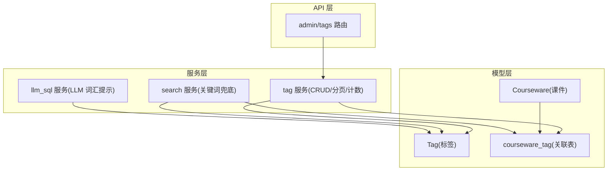
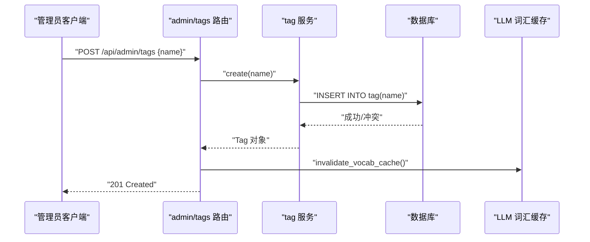
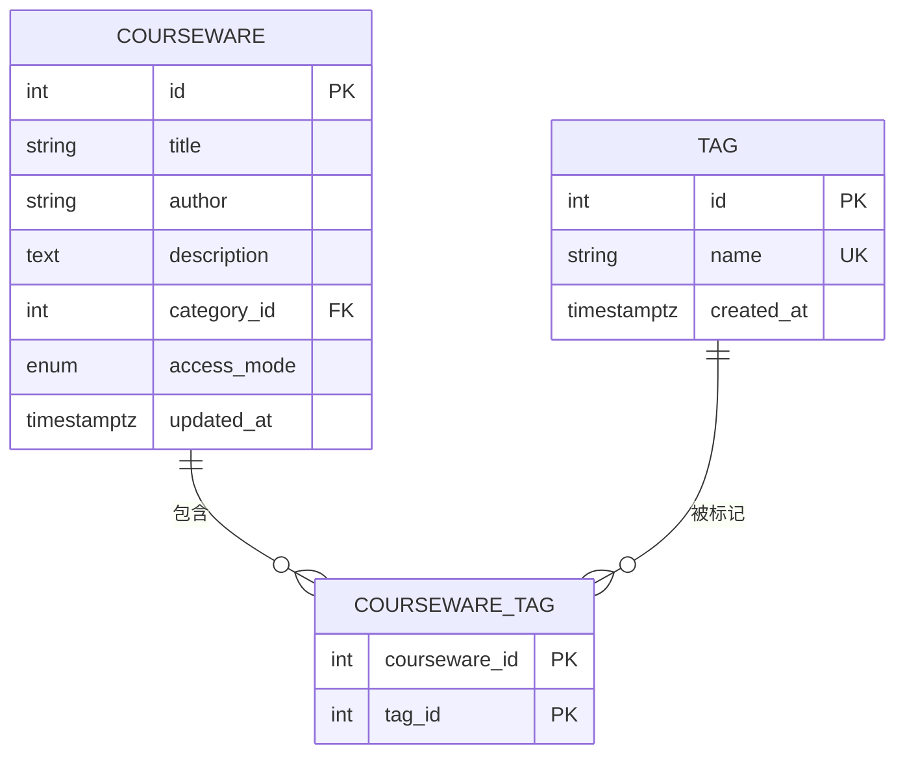
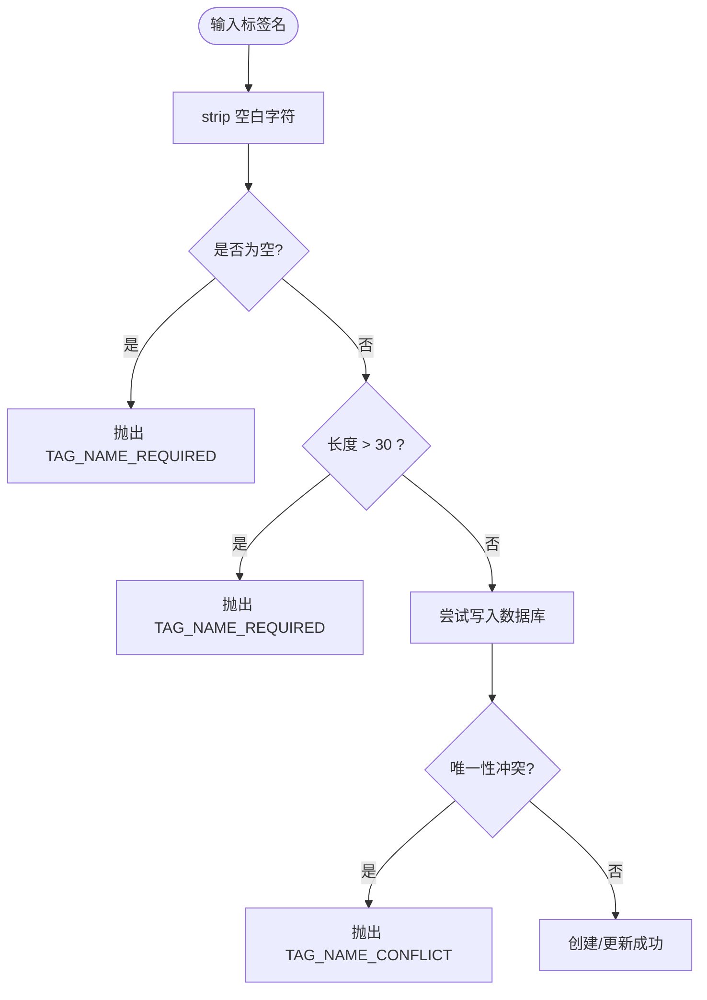
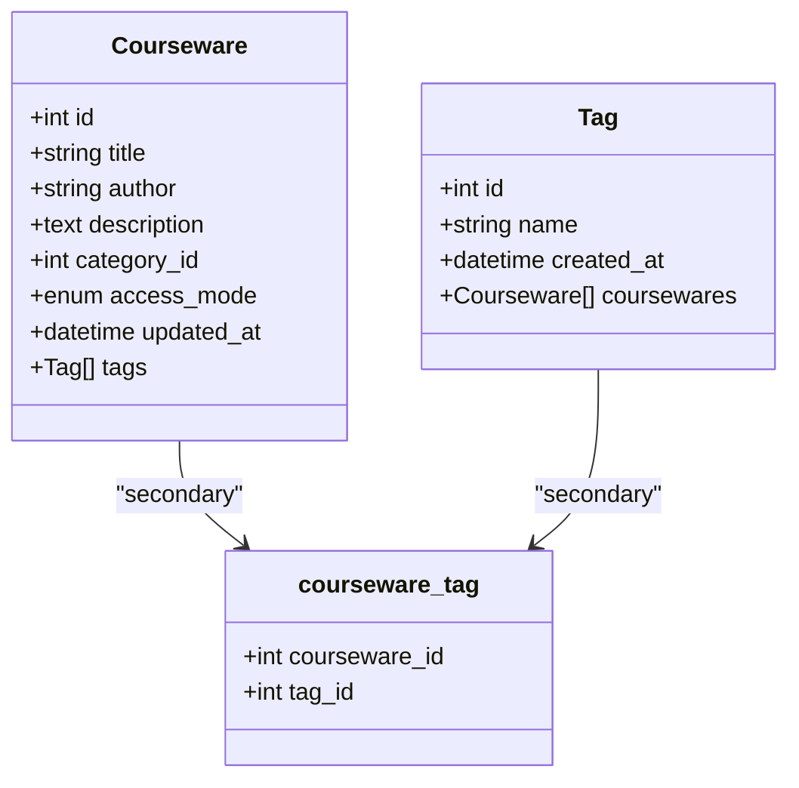
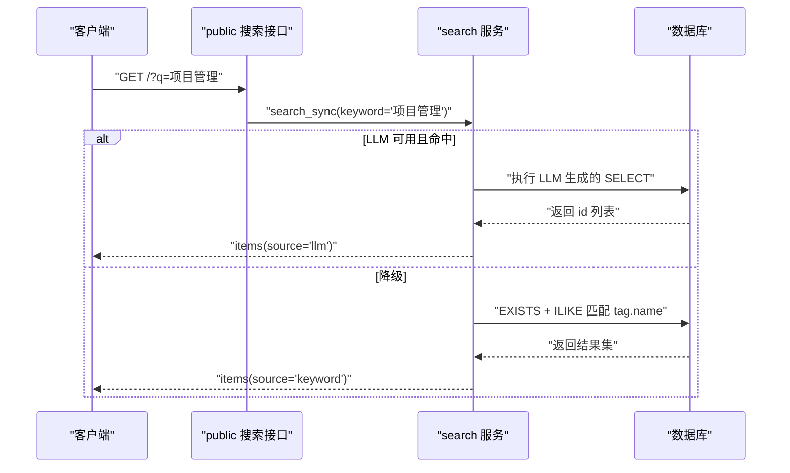
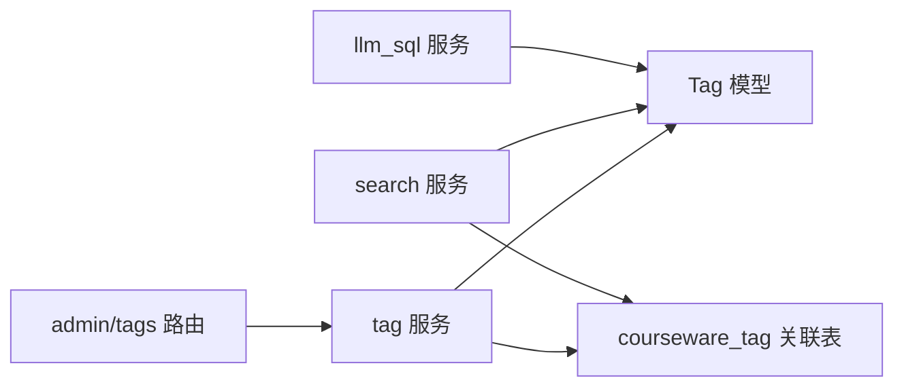

# 标签模型(Tag)

<cite>
**本文引用的文件**   
- [backend/app/models/tag.py](file://backend/app/models/tag.py)
- [backend/app/schemas/tag.py](file://backend/app/schemas/tag.py)
- [backend/app/services/tag.py](file://backend/app/services/tag.py)
- [backend/app/api/admin/tags.py](file://backend/app/api/admin/tags.py)
- [backend/app/models/association.py](file://backend/app/models/association.py)
- [backend/app/models/courseware.py](file://backend/app/models/courseware.py)
- [backend/app/core/errors.py](file://backend/app/core/errors.py)
- [backend/app/services/search.py](file://backend/app/services/search.py)
- [backend/app/services/llm_sql.py](file://backend/app/services/llm_sql.py)
</cite>

## 目录
1. [简介](#简介)
2. [项目结构](#项目结构)
3. [核心组件](#核心组件)
4. [架构总览](#架构总览)
5. [详细组件分析](#详细组件分析)
6. [依赖关系分析](#依赖关系分析)
7. [性能与缓存](#性能与缓存)
8. [故障排查指南](#故障排查指南)
9. [结论](#结论)
10. [附录](#附录)

## 简介
本设计文档围绕“标签模型(Tag)”展开，系统性阐述标签系统的基础设计与实现要点，包括：
- 标签名称的唯一性约束与标准化处理
- 动态创建与管理机制（含重复标签的合并策略说明）
- 标签与课件的多对多关联及中间表设计、查询优化
- 标签搜索与过滤的数据库支持（全文索引现状与模糊匹配）
- 标签统计功能（使用频率统计与热门标签推荐）
- 批量操作接口（批量添加、移除、重命名）
- 性能优化策略与缓存机制设计

## 项目结构
与标签相关的后端代码主要分布在以下模块：
- 数据模型层：Tag 模型定义、M:N 关联表、Courseware 中的 tags 关系
- 校验与响应模式：Pydantic Schema 用于请求参数校验与返回结构
- 业务服务层：标签 CRUD、分页列表、引用计数计算
- API 路由层：管理端标签增删改查接口
- 搜索服务：关键词兜底路径中对 tag.name 的 ILIKE 匹配；LLM-to-SQL 词汇提示中包含 tag.name 集合
- 错误码：标签相关错误码映射

图表来源
- [backend/app/models/tag.py:13-26](file://backend/app/models/tag.py#L13-L26)
- [backend/app/models/association.py:9-14](file://backend/app/models/association.py#L9-L14)
- [backend/app/models/courseware.py:52-54](file://backend/app/models/courseware.py#L52-L54)
- [backend/app/services/tag.py:24-60](file://backend/app/services/tag.py#L24-L60)
- [backend/app/services/search.py:129-155](file://backend/app/services/search.py#L129-L155)
- [backend/app/services/llm_sql.py:44-104](file://backend/app/services/llm_sql.py#L44-L104)
- [backend/app/api/admin/tags.py:21-66](file://backend/app/api/admin/tags.py#L21-L66)

章节来源
- [backend/app/models/tag.py:1-30](file://backend/app/models/tag.py#L1-L30)
- [backend/app/models/association.py:1-41](file://backend/app/models/association.py#L1-L41)
- [backend/app/models/courseware.py:21-74](file://backend/app/models/courseware.py#L21-L74)
- [backend/app/services/tag.py:1-102](file://backend/app/services/tag.py#L1-L102)
- [backend/app/services/search.py:1-263](file://backend/app/services/search.py#L1-L263)
- [backend/app/services/llm_sql.py:1-490](file://backend/app/services/llm_sql.py#L1-L490)
- [backend/app/api/admin/tags.py:1-70](file://backend/app/api/admin/tags.py#L1-L70)

## 核心组件
- 标签模型 Tag
  - 字段：id、name、created_at
  - 约束：name 全局唯一且非空，长度限制由应用层校验
- 关联表 courseware_tag
  - 复合主键 (courseware_id, tag_id)，外键级联删除
- 课件模型 Courseware
  - 通过 secondary="courseware_tag" 与 Tag 建立 M:N 关系，lazy="selectin"
- 标签服务 tag
  - 提供 list_paged、get、create、update、delete
  - 列表接口返回每个标签的 coursewareCount 引用计数
- 管理端 API admin/tags
  - GET /api/admin/tags（分页+关键词过滤）
  - POST /api/admin/tags（创建）
  - PUT /api/admin/tags/{tag_id}（重命名）
  - DELETE /api/admin/tags/{tag_id}（删除）
- 搜索服务 search
  - 关键词兜底路径中，使用 EXISTS + ILIKE 匹配 tag.name
- LLM 词汇提示 llm_sql
  - 构建 category.name 与 tag.name 的已知词表，注入到 LLM 提示词中，辅助生成更准确的 SQL

章节来源
- [backend/app/models/tag.py:13-26](file://backend/app/models/tag.py#L13-L26)
- [backend/app/models/association.py:9-14](file://backend/app/models/association.py#L9-L14)
- [backend/app/models/courseware.py:52-54](file://backend/app/models/courseware.py#L52-L54)
- [backend/app/services/tag.py:24-60](file://backend/app/services/tag.py#L24-L60)
- [backend/app/api/admin/tags.py:21-66](file://backend/app/api/admin/tags.py#L21-L66)
- [backend/app/services/search.py:129-155](file://backend/app/services/search.py#L129-L155)
- [backend/app/services/llm_sql.py:44-104](file://backend/app/services/llm_sql.py#L44-L104)

## 架构总览
标签系统在系统中的位置与交互如下：
- 管理端通过 admin/tags 路由调用 tag 服务完成标签的增删改查
- 标签与课件通过 courseware_tag 中间表建立多对多关系
- 前台搜索在关键词兜底路径中使用 EXISTS + ILIKE 匹配 tag.name
- LLM-to-SQL 路径会读取 tag.name 作为“已知标签名”注入提示词，提升自然语言理解能力

图表来源
- [backend/app/api/admin/tags.py:32-42](file://backend/app/api/admin/tags.py#L32-L42)
- [backend/app/services/tag.py:70-80](file://backend/app/services/tag.py#L70-L80)
- [backend/app/services/llm_sql.py:107-113](file://backend/app/services/llm_sql.py#L107-L113)

## 详细组件分析

### 数据模型与约束
- Tag 表
  - name 字段为全局唯一，确保标签名称不重复
  - created_at 记录创建时间
- courseware_tag 关联表
  - 复合主键 (courseware_id, tag_id)
  - 外键 ondelete=CASCADE，删除课件或标签时自动清理关联
- Courseware.tags 关系
  - 使用 secondary="courseware_tag" 与 Tag 建立多对多
  - lazy="selectin" 避免 N+1 查询

图表来源
- [backend/app/models/tag.py:13-26](file://backend/app/models/tag.py#L13-L26)
- [backend/app/models/association.py:9-14](file://backend/app/models/association.py#L9-L14)
- [backend/app/models/courseware.py:52-54](file://backend/app/models/courseware.py#L52-L54)

章节来源
- [backend/app/models/tag.py:13-26](file://backend/app/models/tag.py#L13-L26)
- [backend/app/models/association.py:9-14](file://backend/app/models/association.py#L9-L14)
- [backend/app/models/courseware.py:52-54](file://backend/app/models/courseware.py#L52-L54)

### 标签名称唯一性与标准化
- 唯一性约束
  - 数据库层：Tag.name 设置 unique=True
  - 应用层：创建/更新时捕获 IntegrityError，抛出业务错误码 TAG_NAME_CONFLICT
- 标准化处理
  - Pydantic Schema 在 model_validator 中对 name 执行 strip()
  - 服务层 _ensure_name 再次 strip 并校验长度 ≤ 30，否则抛出 TAG_NAME_REQUIRED

图表来源
- [backend/app/schemas/tag.py:9-16](file://backend/app/schemas/tag.py#L9-L16)
- [backend/app/services/tag.py:15-21](file://backend/app/services/tag.py#L15-L21)
- [backend/app/services/tag.py:70-80](file://backend/app/services/tag.py#L70-L80)
- [backend/app/core/errors.py:40-43](file://backend/app/core/errors.py#L40-43)

章节来源
- [backend/app/schemas/tag.py:9-16](file://backend/app/schemas/tag.py#L9-L16)
- [backend/app/services/tag.py:15-21](file://backend/app/services/tag.py#L15-L21)
- [backend/app/services/tag.py:70-80](file://backend/app/services/tag.py#L70-L80)
- [backend/app/core/errors.py:40-43](file://backend/app/core/errors.py#L40-43)

### 动态创建与管理机制（含重复标签合并策略）
- 创建流程
  - 路由接收 TagNameRequest，调用 tag.create
  - 服务层进行名称标准化与唯一性检查，提交事务
  - 成功后刷新对象并返回
- 更新（重命名）流程
  - 路由接收 tag_id 与新的 name，调用 tag.update
  - 同样进行标准化与唯一性检查
- 删除流程
  - 路由接收 tag_id，调用 tag.delete
  - 由于外键 ondelete=CASCADE，关联的 courseware_tag 会被自动清理
- 重复标签合并策略
  - 当前实现未提供“合并重复标签”的专用接口
  - 若需合并：建议先按名称去重，将旧标签的 courseware_tag 迁移到新标签，再删除旧标签
  - 注意：该策略不在现有代码中实现，属于扩展建议

章节来源
- [backend/app/api/admin/tags.py:32-66](file://backend/app/api/admin/tags.py#L32-L66)
- [backend/app/services/tag.py:70-99](file://backend/app/services/tag.py#L70-L99)
- [backend/app/models/association.py:9-14](file://backend/app/models/association.py#L9-L14)

### 标签与课件的多对多关联与查询优化
- 关联表 design
  - courseware_tag 以 (courseware_id, tag_id) 为复合主键
  - 外键 ondelete=CASCADE，保证一致性
- ORM 关系
  - Courseware.tags 使用 secondary="courseware_tag"，lazy="selectin"
- 查询优化
  - 标签列表分页接口通过子查询一次性统计每个标签的引用数，避免 N+1
  - 搜索兜底路径使用 EXISTS + ILIKE 匹配 tag.name，避免大表 JOIN 成本

图表来源
- [backend/app/models/courseware.py:52-54](file://backend/app/models/courseware.py#L52-L54)
- [backend/app/models/association.py:9-14](file://backend/app/models/association.py#L9-L14)
- [backend/app/services/tag.py:36-46](file://backend/app/services/tag.py#L36-L46)
- [backend/app/services/search.py:147-155](file://backend/app/services/search.py#L147-L155)

章节来源
- [backend/app/models/association.py:9-14](file://backend/app/models/association.py#L9-L14)
- [backend/app/models/courseware.py:52-54](file://backend/app/models/courseware.py#L52-L54)
- [backend/app/services/tag.py:36-46](file://backend/app/services/tag.py#L36-L46)
- [backend/app/services/search.py:147-155](file://backend/app/services/search.py#L147-L155)

### 标签搜索与过滤的数据库支持
- 全文索引现状
  - 当前未对 tag.name 配置 PostgreSQL 全文索引
- 模糊匹配
  - 标签列表接口使用 ILIKE '%keyword%' 进行模糊匹配
  - 搜索兜底路径使用 EXISTS + ILIKE 匹配 tag.name，避免大表 JOIN
- LLM 词汇提示
  - 从 tag.name 表中读取实际值，拼接至 schema hint，帮助 LLM 识别用户问句中的标签名

图表来源
- [backend/app/services/search.py:210-242](file://backend/app/services/search.py#L210-L242)
- [backend/app/services/search.py:129-155](file://backend/app/services/search.py#L129-L155)
- [backend/app/services/llm_sql.py:44-104](file://backend/app/services/llm_sql.py#L44-L104)

章节来源
- [backend/app/services/search.py:129-155](file://backend/app/services/search.py#L129-L155)
- [backend/app/services/llm_sql.py:44-104](file://backend/app/services/llm_sql.py#L44-L104)

### 标签统计功能（使用频率与热门标签）
- 使用频率统计
  - 标签列表接口返回每个标签的 coursewareCount，通过子查询一次性统计
- 热门标签推荐
  - 当前未提供专门的“热门标签”接口
  - 可基于 coursewareCount 排序取 TopN 实现，属于扩展建议

章节来源
- [backend/app/services/tag.py:36-60](file://backend/app/services/tag.py#L36-L60)

### 批量操作接口（批量添加、移除、重命名）
- 当前实现
  - 仅支持单条标签的创建、重命名、删除
- 扩展建议
  - 批量添加：遍历请求体，逐个调用 create，或使用事务批量插入
  - 批量移除：根据 tag_ids 批量删除，利用 CASCADE 清理关联
  - 批量重命名：根据 tag_ids 批量更新 name，注意唯一性冲突处理

章节来源
- [backend/app/api/admin/tags.py:32-66](file://backend/app/api/admin/tags.py#L32-L66)
- [backend/app/services/tag.py:70-99](file://backend/app/services/tag.py#L70-L99)

## 依赖关系分析
- 组件耦合
  - API 路由依赖 tag 服务
  - tag 服务依赖 Tag 模型与 association 表
  - 搜索服务依赖 Tag 模型与 association 表
  - LLM 服务依赖 Tag 模型以构建词汇提示
- 外部依赖
  - FastAPI、SQLAlchemy、Pydantic
  - dashscope SDK（可选，受环境变量控制）

图表来源
- [backend/app/api/admin/tags.py:21-66](file://backend/app/api/admin/tags.py#L21-L66)
- [backend/app/services/tag.py:24-60](file://backend/app/services/tag.py#L24-L60)
- [backend/app/services/search.py:129-155](file://backend/app/services/search.py#L129-L155)
- [backend/app/services/llm_sql.py:44-104](file://backend/app/services/llm_sql.py#L44-L104)

章节来源
- [backend/app/api/admin/tags.py:21-66](file://backend/app/api/admin/tags.py#L21-L66)
- [backend/app/services/tag.py:24-60](file://backend/app/services/tag.py#L24-L60)
- [backend/app/services/search.py:129-155](file://backend/app/services/search.py#L129-L155)
- [backend/app/services/llm_sql.py:44-104](file://backend/app/services/llm_sql.py#L44-L104)

## 性能与缓存
- 查询优化
  - 标签列表引用计数使用子查询一次性统计，避免 N+1
  - 搜索兜底路径使用 EXISTS + ILIKE 匹配 tag.name，避免大表 JOIN
- 缓存机制
  - LLM 词汇提示采用进程级缓存（TTL 60s），后台管理增删标签后调用 invalidate_vocab_cache 立即失效
- 索引建议（扩展）
  - 可为 tag.name 添加 B-tree 索引以提升 ILIKE 前缀匹配性能（注意：ILIKE '%...%' 无法有效利用普通索引，可考虑 pg_trgm 扩展）
  - 可为 courseware_tag 添加覆盖索引以加速引用计数统计

章节来源
- [backend/app/services/tag.py:36-46](file://backend/app/services/tag.py#L36-L46)
- [backend/app/services/search.py:147-155](file://backend/app/services/search.py#L147-L155)
- [backend/app/services/llm_sql.py:39-41](file://backend/app/services/llm_sql.py#L39-L41)
- [backend/app/services/llm_sql.py:107-113](file://backend/app/services/llm_sql.py#L107-L113)

## 故障排查指南
- 常见错误码
  - TAG_NOT_FOUND：标签不存在
  - TAG_NAME_REQUIRED：标签名为空或过长
  - TAG_NAME_CONFLICT：标签名已存在
- 排查步骤
  - 确认请求参数是否经过 strip 与长度校验
  - 检查数据库唯一性约束是否触发
  - 查看 LLM 词汇缓存是否及时失效

章节来源
- [backend/app/core/errors.py:40-43](file://backend/app/core/errors.py#L40-43)
- [backend/app/services/tag.py:15-21](file://backend/app/services/tag.py#L15-L21)
- [backend/app/services/tag.py:70-80](file://backend/app/services/tag.py#L70-L80)
- [backend/app/services/llm_sql.py:107-113](file://backend/app/services/llm_sql.py#L107-L113)

## 结论
标签系统在当前实现中具备清晰的模型定义、严格的唯一性约束与标准化处理、完善的 CRUD 接口以及与课件的多对多关联。搜索与 LLM 路径均能识别并利用 tag.name，提升了检索体验。未来可在全文索引、热门标签推荐与批量操作上进一步扩展，以满足更大规模与更高性能的需求。

## 附录
- 相关规范参考
  - 数据模型规范：doc/spec/05-数据模型.md
  - API 设计规范：doc/spec/10-API设计规范.md
- 前端页面
  - 管理端标签页面：frontend/src/pages/admin/Tags.tsx