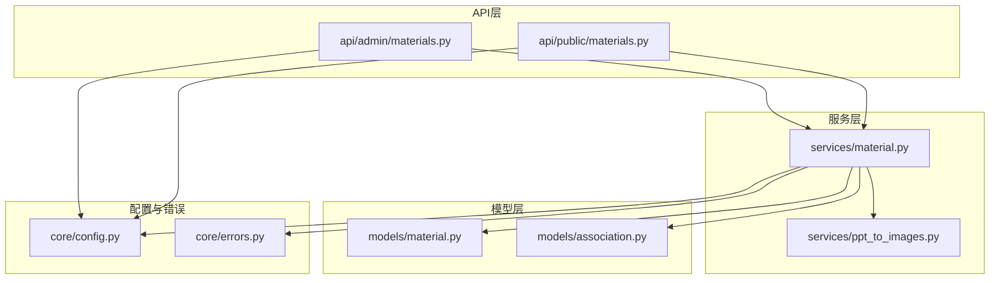
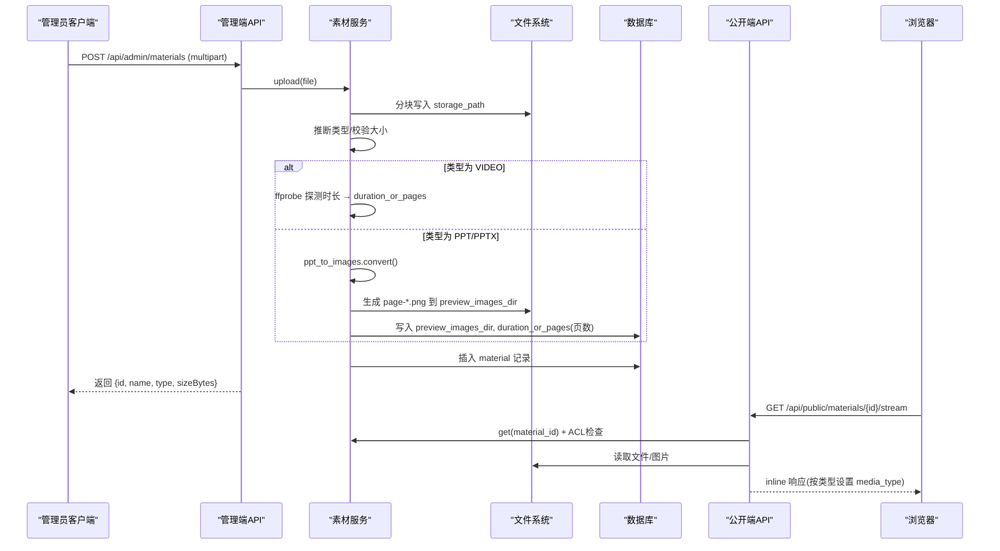
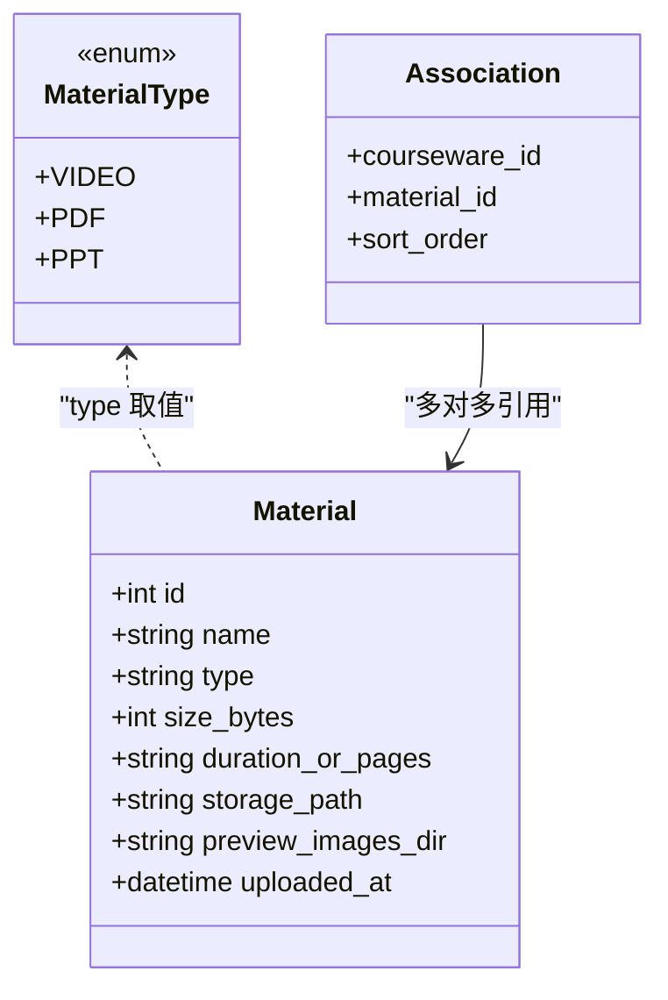
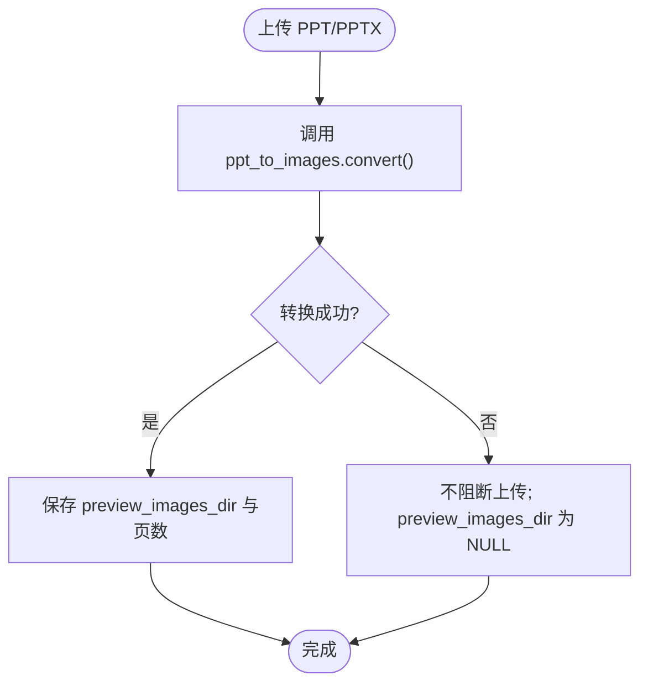
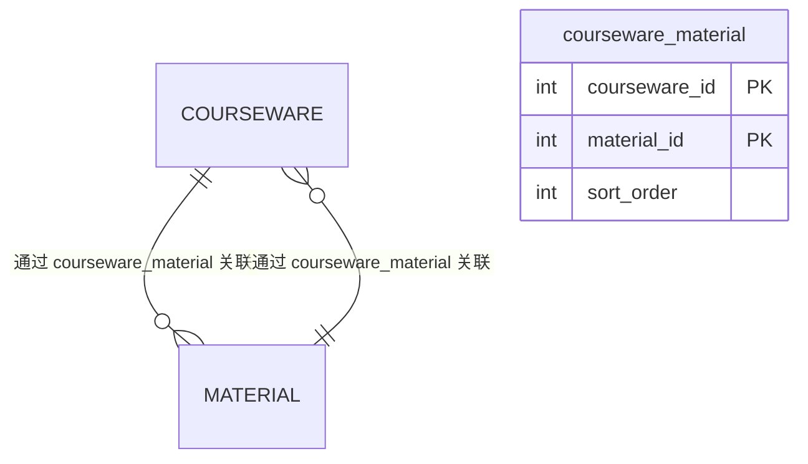
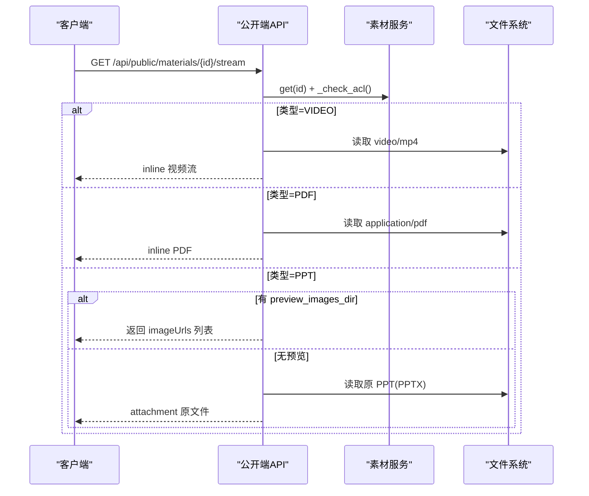
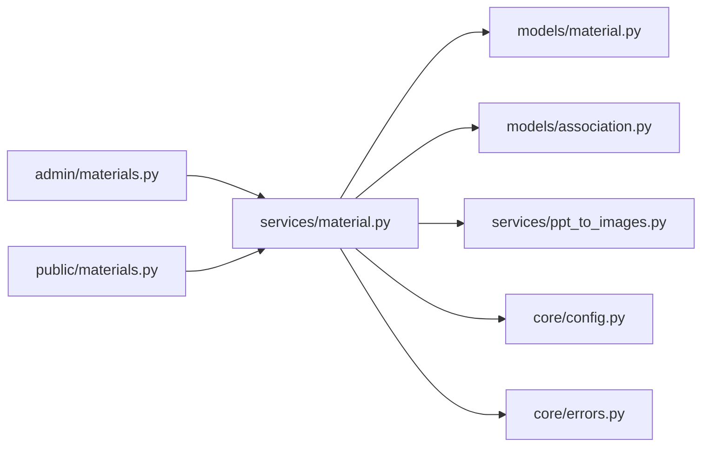

# 素材模型(Material)

<cite>
**本文引用的文件列表**
- [backend/app/models/material.py](file://backend/app/models/material.py)
- [backend/app/schemas/material.py](file://backend/app/schemas/material.py)
- [backend/app/services/material.py](file://backend/app/services/material.py)
- [backend/app/api/admin/materials.py](file://backend/app/api/admin/materials.py)
- [backend/app/api/public/materials.py](file://backend/app/api/public/materials.py)
- [backend/app/models/association.py](file://backend/app/models/association.py)
- [backend/app/services/ppt_to_images.py](file://backend/app/services/ppt_to_images.py)
- [backend/app/core/config.py](file://backend/app/core/config.py)
- [backend/app/core/errors.py](file://backend/app/core/errors.py)
- [backend/alembic/versions/2026_07_10_1800-d2e3f4a5b6c7_add_courseware_material_sort_order.py](file://backend/alembic/versions/2026_07_10_1800-d2e3f4a5b6c7_add_courseware_material_sort_order.py)
- [backend/alembic/versions/2026_07_07_1230-b2c3d4e5f607_replace_preview_pdf_with_images.py](file://backend/alembic/versions/2026_07_07_1230-b2c3d4e5f607_replace_preview_pdf_with_images.py)
</cite>

## 目录
1. [简介](#简介)
2. [项目结构](#项目结构)
3. [核心组件](#核心组件)
4. [架构总览](#架构总览)
5. [详细组件分析](#详细组件分析)
6. [依赖关系分析](#依赖关系分析)
7. [性能与扩展性](#性能与扩展性)
8. [故障排查指南](#故障排查指南)
9. [结论](#结论)

## 简介
本设计文档围绕“素材模型(Material)”展开，系统支持视频(video)、PDF、PPT/PPTX三种文件类型的统一建模。文档覆盖：
- 多类型统一建模与类型推断
- 文件元数据字段（原始文件名、存储路径、大小、时长/页数等）
- 预览图管理字段（缩略图/封面图相关字段与实现现状）
- 与课件的多对多关联及排序字段 sort_order 的语义与实现
- 生命周期管理（创建时间、更新时间戳）
- 上传、下载、预览的业务逻辑支撑
- 不同类型素材的特殊处理与扩展性考虑

## 项目结构
与素材模型相关的后端代码主要分布在以下模块：
- 模型层：material.py、association.py
- 服务层：material.py、ppt_to_images.py
- API 层：admin/materials.py、public/materials.py
- 配置与错误：config.py、errors.py
- 数据库迁移：sort_order 与 preview_images_dir 相关版本脚本

图表来源
- [backend/app/models/material.py:1-69](file://backend/app/models/material.py#L1-L69)
- [backend/app/models/association.py:1-41](file://backend/app/models/association.py#L1-L41)
- [backend/app/services/material.py:1-234](file://backend/app/services/material.py#L1-L234)
- [backend/app/services/ppt_to_images.py:1-185](file://backend/app/services/ppt_to_images.py#L1-L185)
- [backend/app/api/admin/materials.py:1-74](file://backend/app/api/admin/materials.py#L1-L74)
- [backend/app/api/public/materials.py:1-224](file://backend/app/api/public/materials.py#L1-L224)
- [backend/app/core/config.py:1-88](file://backend/app/core/config.py#L1-L88)
- [backend/app/core/errors.py:103-143](file://backend/app/core/errors.py#L103-L143)

章节来源
- [backend/app/models/material.py:1-69](file://backend/app/models/material.py#L1-L69)
- [backend/app/models/association.py:1-41](file://backend/app/models/association.py#L1-L41)
- [backend/app/services/material.py:1-234](file://backend/app/services/material.py#L1-L234)
- [backend/app/services/ppt_to_images.py:1-185](file://backend/app/services/ppt_to_images.py#L1-L185)
- [backend/app/api/admin/materials.py:1-74](file://backend/app/api/admin/materials.py#L1-L74)
- [backend/app/api/public/materials.py:1-224](file://backend/app/api/public/materials.py#L1-L224)
- [backend/app/core/config.py:1-88](file://backend/app/core/config.py#L1-L88)
- [backend/app/core/errors.py:103-143](file://backend/app/core/errors.py#L103-L143)

## 核心组件
- 素材模型 Material：定义素材表结构与类型枚举，提供从文件名推断类型的工具函数。
- 关联表 courseware_material：记录课件与素材的多对多关系，并维护课件内展示顺序 sort_order。
- 素材服务 material service：封装素材的列表、上传、删除、获取等业务逻辑；包含视频时长探测与 PPT 转图片流程。
- PPT 转图片服务：调用外部工具链将 PPT/PPTX 转换为 PDF，再拆分为 PNG 序列，供前端在线浏览。
- 管理端与公开端 API：分别提供受控的上传/下载与公开的流式预览、下载、单条查询接口。

章节来源
- [backend/app/models/material.py:14-69](file://backend/app/models/material.py#L14-L69)
- [backend/app/models/association.py:16-26](file://backend/app/models/association.py#L16-L26)
- [backend/app/services/material.py:78-234](file://backend/app/services/material.py#L78-L234)
- [backend/app/services/ppt_to_images.py:48-181](file://backend/app/services/ppt_to_images.py#L48-L181)
- [backend/app/api/admin/materials.py:23-74](file://backend/app/api/admin/materials.py#L23-L74)
- [backend/app/api/public/materials.py:64-224](file://backend/app/api/public/materials.py#L64-L224)

## 架构总览
素材模型在系统中的交互如下：
- 管理员通过管理端 API 上传素材，服务层写入文件系统与数据库，并对视频/ PPT 进行特殊处理。
- 前台通过公开端 API 以流式方式预览或下载素材，并根据类型返回合适的媒体类型与内容处置策略。
- 课件与素材通过关联表建立多对多关系，并在该表中维护 sort_order 以实现学习路径的顺序控制。

图表来源
- [backend/app/api/admin/materials.py:35-48](file://backend/app/api/admin/materials.py#L35-L48)
- [backend/app/services/material.py:129-202](file://backend/app/services/material.py#L129-L202)
- [backend/app/services/ppt_to_images.py:48-181](file://backend/app/services/ppt_to_images.py#L48-L181)
- [backend/app/api/public/materials.py:84-146](file://backend/app/api/public/materials.py#L84-L146)

## 详细组件分析

### 素材模型 Material 与类型系统
- 类型枚举：VIDEO、PDF、PPT，用于统一建模三类文件。
- 类型推断：基于文件扩展名映射 mp4→VIDEO、pdf→PDF、ppt/pptx→PPT；不支持的类型抛出业务异常。
- 字段说明：
  - id：自增主键
  - name：原始文件名
  - type：素材类型字符串（与枚举值一致）
  - size_bytes：文件大小（字节）
  - duration_or_pages：视频时长或 PPT 页数（字符串，便于前端统一处理）
  - storage_path：二进制文件在文件系统的绝对路径
  - preview_images_dir：PPT 转换后的图片目录（page-1.png, page-2.png...），未转换时为 NULL
  - uploaded_at：上传时间（由数据库默认值维护）

图表来源
- [backend/app/models/material.py:14-69](file://backend/app/models/material.py#L14-L69)
- [backend/app/models/association.py:16-26](file://backend/app/models/association.py#L16-L26)

章节来源
- [backend/app/models/material.py:14-69](file://backend/app/models/material.py#L14-L69)

### 文件元数据与技术属性
- 原始文件名：name，保留用户上传时的名称，用于下载时回传 filename。
- 存储路径：storage_path，指向实际二进制文件位置，服务层负责读写与清理。
- 文件大小：size_bytes，上传过程中累计字节数。
- MIME 类型：未在模型中持久化，下载/预览时通过文件名使用系统库推断 media_type。
- 时长/页数：duration_or_pages，视频为时长字符串（MM:SS 或 HH:MM:SS），PPT 为页数字符串。

章节来源
- [backend/app/models/material.py:50-62](file://backend/app/models/material.py#L50-L62)
- [backend/app/services/material.py:36-76](file://backend/app/services/material.py#L36-L76)
- [backend/app/api/admin/materials.py:65-70](file://backend/app/api/admin/materials.py#L65-L70)
- [backend/app/api/public/materials.py:76-81](file://backend/app/api/public/materials.py#L76-L81)

### 预览图管理字段与实现现状
- 当前模型字段：preview_images_dir 指向 PPT 生成的图片目录（page-1.png, page-2.png...）。
- 历史兼容：存在旧列 preview_pdf_path（迁移脚本保留但不读写），新代码不再使用该列。
- 缩略图/封面图：当前未定义专用缩略图或封面图字段；PPT 的“首帧”可通过 imageUrls[0] 作为封面使用。
- 前端消费：公开接口返回 imageUrls 与 imageCount，用于幻灯片查看器直接渲染图片。

图表来源
- [backend/app/services/material.py:174-202](file://backend/app/services/material.py#L174-L202)
- [backend/app/services/ppt_to_images.py:48-181](file://backend/app/services/ppt_to_images.py#L48-L181)
- [backend/alembic/versions/2026_07_07_1230-b2c3d4e5f607_replace_preview_pdf_with_images.py:30-34](file://backend/alembic/versions/2026_07_07_1230-b2c3d4e5f607_replace_preview_pdf_with_images.py#L30-L34)

章节来源
- [backend/app/models/material.py:56-59](file://backend/app/models/material.py#L56-L59)
- [backend/app/api/public/materials.py:207-221](file://backend/app/api/public/materials.py#L207-L221)
- [backend/alembic/versions/2026_07_07_1230-b2c3d4e5f607_replace_preview_pdf_with_images.py:1-39](file://backend/alembic/versions/2026_07_07_1230-b2c3d4e5f607_replace_preview_pdf_with_images.py#L1-L39)

### 与课件的多对多关联与排序字段 sort_order
- 关联表：courseware_material，包含 courseware_id、material_id、sort_order。
- 排序语义：同一课件内 0..N-1 连续递增，表示学习路径顺序；跨课件不共享。
- 索引优化：复合索引 ix_courseware_material_courseware_order(courseware_id, sort_order)，加速按课件取有序素材。
- 更新策略：
  - 新建课件时，按传入 materialIds 数组下标重写所有 sort_order。
  - 专用排序接口 PUT /api/admin/coursewares/{id}/materials/order 接受完整 materialIds 数组，服务端按数组下标重写 sort_order，并进行完整性校验。
  - 删除/新增素材时，同样按数组下标重写，确保 0..N-1 连续。

图表来源
- [backend/app/models/association.py:16-26](file://backend/app/models/association.py#L16-L26)
- [backend/alembic/versions/2026_07_10_1800-d2e3f4a5b6c7_add_courseware_material_sort_order.py:33-104](file://backend/alembic/versions/2026_07_10_1800-d2e3f4a5b6c7_add_courseware_material_sort_order.py#L33-L104)

章节来源
- [backend/app/models/association.py:16-26](file://backend/app/models/association.py#L16-L26)
- [backend/alembic/versions/2026_07_10_1800-d2e3f4a5b6c7_add_courseware_material_sort_order.py:33-104](file://backend/alembic/versions/2026_07_10_1800-d2e3f4a5b6c7_add_courseware_material_sort_order.py#L33-L104)

### 文件生命周期管理与时间戳
- 创建时间：uploaded_at 使用数据库默认值 func.now() 自动维护。
- 更新时间戳：当前模型未定义 updated_at 字段；如需审计可在后续扩展。
- 删除流程：先检查是否被课件引用，若未被引用则物理删除 storage_path 与 preview_images_dir 目录。

章节来源
- [backend/app/models/material.py:60-62](file://backend/app/models/material.py#L60-L62)
- [backend/app/services/material.py:205-231](file://backend/app/services/material.py#L205-L231)

### 上传、下载、预览的业务逻辑支撑
- 上传（管理端）：
  - 接收 multipart 文件，限制最大大小（MAX_SIZE_BYTES），分块写入 storage_path。
  - 根据扩展名推断类型；失败抛业务异常。
  - 视频：调用 ffprobe 探测时长，写入 duration_or_pages。
  - PPT：调用 ppt_to_images.convert() 生成图片目录，写入 preview_images_dir 与页数。
  - 入库失败时回滚并清理已写文件。
- 下载（管理端/公开端）：
  - 管理端：GET /api/admin/materials/{id}/file，返回原文件 attachment。
  - 公开端：GET /api/public/materials/{id}/file，始终返回 attachment，并执行 ACL 校验。
- 预览（公开端）：
  - GET /api/public/materials/{id}/stream：
    - VIDEO：video/mp4 + inline
    - PDF：application/pdf + inline
    - PPT：优先返回 preview_images_dir 对应的图片序列（imageUrls），或降级返回原 PPT（attachment）
  - GET /api/public/materials/{id}/image/{page_no}：返回第 N 张 PNG（1-indexed），越界返回错误。
  - GET /api/public/materials/{id}：返回 streamUrl、downloadUrl、sizeBytes、duration、imageUrls、imageCount、previewReady 等。

图表来源
- [backend/app/api/public/materials.py:84-146](file://backend/app/api/public/materials.py#L84-L146)
- [backend/app/api/public/materials.py:149-180](file://backend/app/api/public/materials.py#L149-L180)
- [backend/app/api/public/materials.py:183-221](file://backend/app/api/public/materials.py#L183-L221)
- [backend/app/services/material.py:129-202](file://backend/app/services/material.py#L129-L202)

章节来源
- [backend/app/api/admin/materials.py:57-70](file://backend/app/api/admin/materials.py#L57-L70)
- [backend/app/api/public/materials.py:64-81](file://backend/app/api/public/materials.py#L64-L81)
- [backend/app/api/public/materials.py:84-146](file://backend/app/api/public/materials.py#L84-L146)
- [backend/app/api/public/materials.py:149-180](file://backend/app/api/public/materials.py#L149-L180)
- [backend/app/api/public/materials.py:183-221](file://backend/app/api/public/materials.py#L183-L221)

### 不同类型素材的特殊处理与扩展性
- 视频（VIDEO）：
  - 上传后通过 ffprobe 探测时长，格式化为 MM:SS 或 HH:MM:SS，写入 duration_or_pages。
  - 失败不阻断上传，仅记录日志。
- PDF：
  - 无需额外转换；公开端以 application/pdf 返回 inline。
- PPT/PPTX：
  - 上传后调用 LibreOffice 转 PDF，再用 pdftoppm 拆成 PNG 序列，存放于 preview_images_dir。
  - 失败不阻断上传；前端走降级“下载到本地”。
  - 对外暴露 imageUrls 与 imageCount，支持幻灯片查看器直接渲染。
- 扩展性考虑：
  - 类型推断基于扩展名映射，新增类型需在 _EXT_MAP 中添加映射，并在上传/预览分支增加处理逻辑。
  - 预览能力可继续扩展（如新增封面图字段 thumbnail_path），但当前未定义。

章节来源
- [backend/app/models/material.py:22-41](file://backend/app/models/material.py#L22-L41)
- [backend/app/services/material.py:36-76](file://backend/app/services/material.py#L36-L76)
- [backend/app/services/material.py:168-186](file://backend/app/services/material.py#L168-L186)
- [backend/app/services/ppt_to_images.py:48-181](file://backend/app/services/ppt_to_images.py#L48-L181)
- [backend/app/api/public/materials.py:102-146](file://backend/app/api/public/materials.py#L102-L146)

## 依赖关系分析
- 模型依赖：Material 与 association.courseware_material 通过外键建立多对多关系。
- 服务依赖：material service 依赖 config（存储路径、外部工具路径）、errors（业务异常）、ppt_to_images（PPT 转图片）。
- API 依赖：管理端与公开端 API 均依赖 material service 与 db session；公开端还依赖 rate limiter 与 ACL 校验。

图表来源
- [backend/app/api/admin/materials.py:1-74](file://backend/app/api/admin/materials.py#L1-L74)
- [backend/app/api/public/materials.py:1-224](file://backend/app/api/public/materials.py#L1-L224)
- [backend/app/services/material.py:1-234](file://backend/app/services/material.py#L1-L234)
- [backend/app/models/material.py:1-69](file://backend/app/models/material.py#L1-L69)
- [backend/app/models/association.py:1-41](file://backend/app/models/association.py#L1-L41)
- [backend/app/services/ppt_to_images.py:1-185](file://backend/app/services/ppt_to_images.py#L1-L185)
- [backend/app/core/config.py:1-88](file://backend/app/core/config.py#L1-L88)
- [backend/app/core/errors.py:103-143](file://backend/app/core/errors.py#L103-L143)

章节来源
- [backend/app/api/admin/materials.py:1-74](file://backend/app/api/admin/materials.py#L1-L74)
- [backend/app/api/public/materials.py:1-224](file://backend/app/api/public/materials.py#L1-L224)
- [backend/app/services/material.py:1-234](file://backend/app/services/material.py#L1-L234)
- [backend/app/models/material.py:1-69](file://backend/app/models/material.py#L1-L69)
- [backend/app/models/association.py:1-41](file://backend/app/models/association.py#L1-L41)
- [backend/app/services/ppt_to_images.py:1-185](file://backend/app/services/ppt_to_images.py#L1-L185)
- [backend/app/core/config.py:1-88](file://backend/app/core/config.py#L1-L88)
- [backend/app/core/errors.py:103-143](file://backend/app/core/errors.py#L103-L143)

## 性能与扩展性
- 上传性能：分块写入避免内存峰值；大小限制与超时保护防止资源耗尽。
- 预览性能：PPT 转为 PNG 序列，前端直接渲染图片，减少 PDF.js 开销；图片目录按页编号，随机访问 O(1)。
- 查询性能：关联表复合索引加速按课件取有序素材。
- 扩展性：
  - 新增素材类型需扩展类型映射与上传/预览分支。
  - 预览能力可扩展（如封面图字段 thumbnail_path），但当前未定义。
  - 外部工具路径与超时可通过配置项调整。

章节来源
- [backend/app/services/material.py:129-202](file://backend/app/services/material.py#L129-L202)
- [backend/app/services/ppt_to_images.py:48-181](file://backend/app/services/ppt_to_images.py#L48-L181)
- [backend/app/models/association.py:22-26](file://backend/app/models/association.py#L22-L26)
- [backend/app/core/config.py:54-60](file://backend/app/core/config.py#L54-L60)

## 故障排查指南
- 上传失败：
  - 检查文件大小是否超过 MAX_SIZE_BYTES。
  - 检查扩展名是否在 _EXT_MAP 中。
  - 检查 storage_path 所在磁盘空间与权限。
- 预览失败：
  - VIDEO：确认 ffprobe 可用且文件未损坏。
  - PPT：确认 LibreOffice 与 pdftoppm 安装路径正确，转换是否超时。
  - 文件丢失：检查 storage_path 是否存在，公开端会返回“素材文件已丢失”。
- 排序异常：
  - 检查关联表 sort_order 是否正确按数组下标重写。
  - 检查复合索引是否存在。

章节来源
- [backend/app/services/material.py:129-202](file://backend/app/services/material.py#L129-L202)
- [backend/app/api/public/materials.py:71-81](file://backend/app/api/public/materials.py#L71-L81)
- [backend/app/core/errors.py:103-143](file://backend/app/core/errors.py#L103-L143)
- [backend/alembic/versions/2026_07_10_1800-d2e3f4a5b6c7_add_courseware_material_sort_order.py:98-104](file://backend/alembic/versions/2026_07_10_1800-d2e3f4a5b6c7_add_courseware_material_sort_order.py#L98-L104)

## 结论
素材模型通过统一的类型系统与灵活的预览机制，有效支撑了视频、PDF、PPT 三类文件的上传、下载与在线预览。与课件的多对多关联通过 sort_order 实现了学习路径的顺序控制，配合复合索引提升查询性能。未来可根据业务需求扩展封面图字段与更多预览能力，同时保持现有健壮的错误处理与回滚机制。