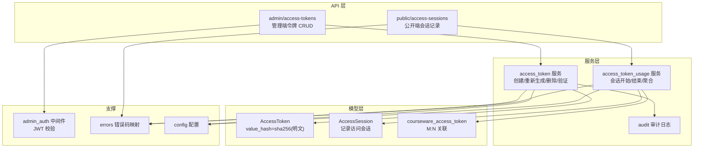
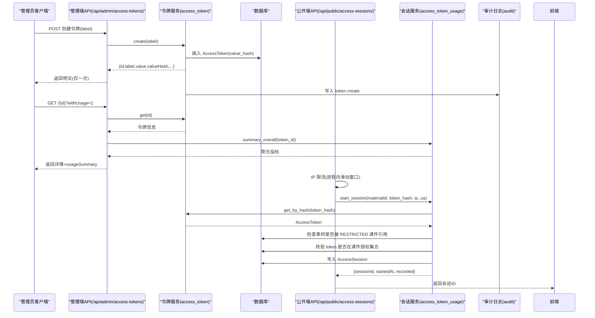
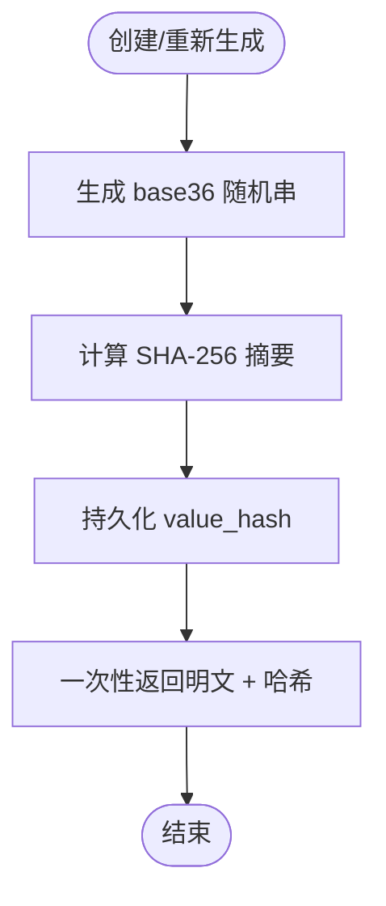
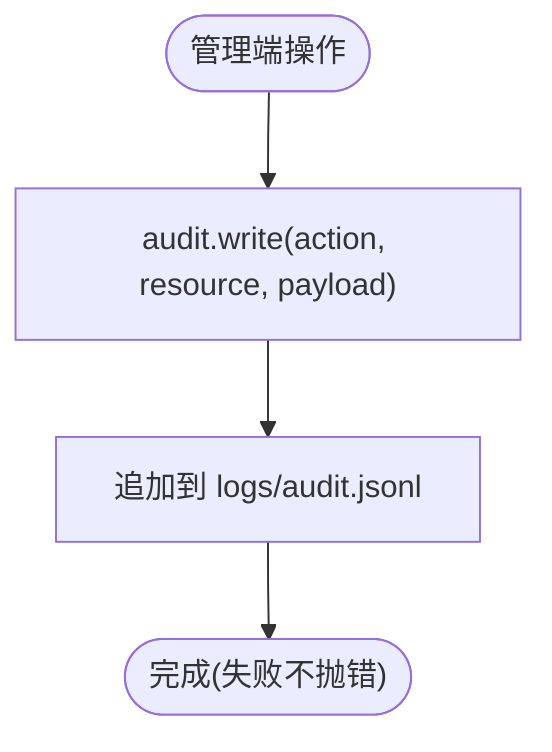
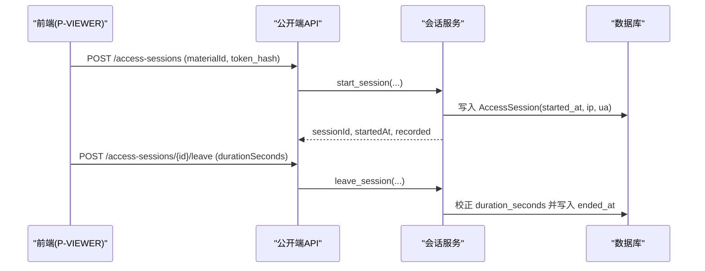
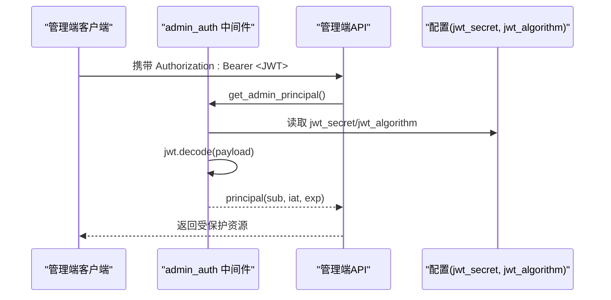
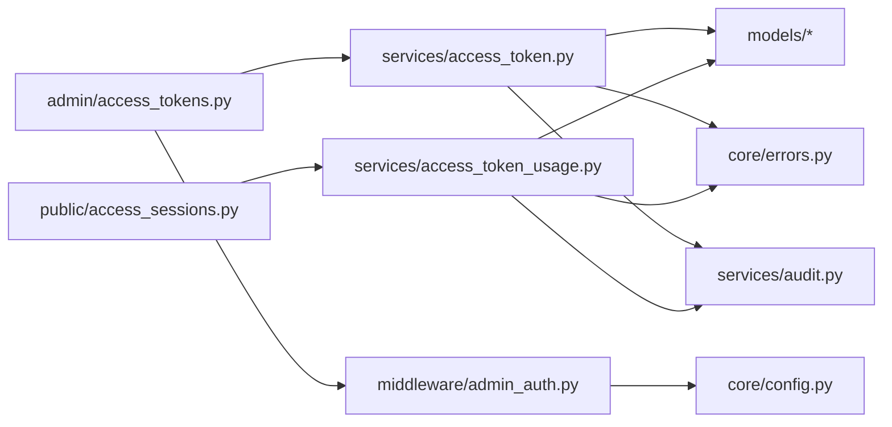

# 访问令牌模型(AccessToken)

<cite>
**本文引用的文件**   
- [backend/app/models/access_token.py](file://backend/app/models/access_token.py)
- [backend/app/schemas/access_token.py](file://backend/app/schemas/access_token.py)
- [backend/app/services/access_token.py](file://backend/app/services/access_token.py)
- [backend/app/api/admin/access_tokens.py](file://backend/app/api/admin/access_tokens.py)
- [backend/app/models/association.py](file://backend/app/models/association.py)
- [backend/app/api/public/access_sessions.py](file://backend/app/api/public/access_sessions.py)
- [backend/app/services/access_token_usage.py](file://backend/app/services/access_token_usage.py)
- [backend/app/models/access_session.py](file://backend/app/models/access_session.py)
- [backend/app/middleware/admin_auth.py](file://backend/app/middleware/admin_auth.py)
- [backend/app/core/errors.py](file://backend/app/core/errors.py)
- [backend/app/services/audit.py](file://backend/app/services/audit.py)
- [backend/app/core/config.py](file://backend/app/core/config.py)
</cite>

## 目录
1. [引言](#引言)
2. [项目结构](#项目结构)
3. [核心组件](#核心组件)
4. [架构总览](#架构总览)
5. [详细组件分析](#详细组件分析)
6. [依赖关系分析](#依赖关系分析)
7. [性能与安全考量](#性能与安全考量)
8. [故障排查指南](#故障排查指南)
9. [结论](#结论)
10. [附录](#附录)

## 引言
本文件围绕“访问令牌模型(AccessToken)”的安全设计进行系统化说明，覆盖令牌的生成算法、加密存储、有效期与清理策略、与课件的多对多关联与细粒度访问控制、激活/停用状态管理与批量操作、访问审计日志、撤销与刷新机制、防重放与暴力破解防护，以及与权限中间件的集成设计与认证流程。文档面向技术与非技术读者，力求在保持严谨的同时易于理解。

## 项目结构
本项目采用分层架构：
- 模型层：定义数据表结构与约束（如 AccessToken、AccessSession、关联表）。
- 服务层：封装业务规则与算法（如令牌创建/验证、会话开启/结束、聚合统计）。
- API 层：暴露管理端与公共端接口（FastAPI Router），负责参数校验、鉴权与响应包装。
- 中间件与配置：提供管理员鉴权、错误码映射、审计日志与全局配置。



图表来源
- [backend/app/models/access_token.py:1-34](file://backend/app/models/access_token.py#L1-L34)
- [backend/app/models/access_session.py:1-129](file://backend/app/models/access_session.py#L1-L129)
- [backend/app/models/association.py:1-41](file://backend/app/models/association.py#L1-L41)
- [backend/app/services/access_token.py:1-235](file://backend/app/services/access_token.py#L1-L235)
- [backend/app/services/access_token_usage.py:1-518](file://backend/app/services/access_token_usage.py#L1-L518)
- [backend/app/api/admin/access_tokens.py:1-120](file://backend/app/api/admin/access_tokens.py#L1-L120)
- [backend/app/api/public/access_sessions.py:1-137](file://backend/app/api/public/access_sessions.py#L1-L137)
- [backend/app/middleware/admin_auth.py:1-66](file://backend/app/middleware/admin_auth.py#L1-L66)
- [backend/app/core/errors.py:1-144](file://backend/app/core/errors.py#L1-L144)
- [backend/app/services/audit.py:1-45](file://backend/app/services/audit.py#L1-L45)
- [backend/app/core/config.py:1-88](file://backend/app/core/config.py#L1-L88)

章节来源
- [backend/app/models/access_token.py:1-34](file://backend/app/models/access_token.py#L1-L34)
- [backend/app/models/access_session.py:1-129](file://backend/app/models/access_session.py#L1-L129)
- [backend/app/models/association.py:1-41](file://backend/app/models/association.py#L1-L41)
- [backend/app/services/access_token.py:1-235](file://backend/app/services/access_token.py#L1-L235)
- [backend/app/services/access_token_usage.py:1-518](file://backend/app/services/access_token_usage.py#L1-L518)
- [backend/app/api/admin/access_tokens.py:1-120](file://backend/app/api/admin/access_tokens.py#L1-L120)
- [backend/app/api/public/access_sessions.py:1-137](file://backend/app/api/public/access_sessions.py#L1-L137)
- [backend/app/middleware/admin_auth.py:1-66](file://backend/app/middleware/admin_auth.py#L1-L66)
- [backend/app/core/errors.py:1-144](file://backend/app/core/errors.py#L1-L144)
- [backend/app/services/audit.py:1-45](file://backend/app/services/audit.py#L1-L45)
- [backend/app/core/config.py:1-88](file://backend/app/core/config.py#L1-L88)

## 核心组件
- 访问令牌模型(AccessToken)
  - 字段：id、label(唯一)、value_hash(仅存 SHA-256 摘要)、created_at、regenerated_at。
  - 安全要点：数据库不保存明文；明文仅在创建或重新生成时一次性返回。
- 访问会话模型(AccessSession)
  - 字段：token_id、courseware_id、material_id、started_at、ended_at、duration_seconds、client_leave、ip、ua、created_at。
  - 索引：按 token+时间、token+素材、token+课件建立索引，优化查询。
- 关联表(courseware_access_token)
  - 实现课件与令牌的 M:N 关系，用于细粒度访问控制。
- 服务层
  - access_token：创建、重新生成、删除、分页列表、验证、按哈希查找等。
  - access_token_usage：会话开始/结束、区间聚合、按素材聚合、全时段汇总。
- API 层
  - admin/access-tokens：管理端令牌 CRUD、详情(可选附带 usageSummary)。
  - public/access-sessions：公开端会话开始/结束，支持 IP 限流降级。
- 支撑模块
  - admin_auth：管理员 JWT 校验与签发。
  - errors：统一错误码与 HTTP 状态映射。
  - audit：JSON Lines 审计日志。
  - config：全局配置(含 JWT、存储路径等)。

章节来源
- [backend/app/models/access_token.py:1-34](file://backend/app/models/access_token.py#L1-L34)
- [backend/app/models/access_session.py:1-129](file://backend/app/models/access_session.py#L1-L129)
- [backend/app/models/association.py:1-41](file://backend/app/models/association.py#L1-L41)
- [backend/app/services/access_token.py:1-235](file://backend/app/services/access_token.py#L1-L235)
- [backend/app/services/access_token_usage.py:1-518](file://backend/app/services/access_token_usage.py#L1-L518)
- [backend/app/api/admin/access_tokens.py:1-120](file://backend/app/api/admin/access_tokens.py#L1-L120)
- [backend/app/api/public/access_sessions.py:1-137](file://backend/app/api/public/access_sessions.py#L1-L137)
- [backend/app/middleware/admin_auth.py:1-66](file://backend/app/middleware/admin_auth.py#L1-L66)
- [backend/app/core/errors.py:1-144](file://backend/app/core/errors.py#L1-L144)
- [backend/app/services/audit.py:1-45](file://backend/app/services/audit.py#L1-L45)
- [backend/app/core/config.py:1-88](file://backend/app/core/config.py#L1-L88)

## 架构总览
下图展示了从管理端创建令牌到公开端使用令牌访问受限素材的端到端流程，以及关键安全点。



图表来源
- [backend/app/api/admin/access_tokens.py:1-120](file://backend/app/api/admin/access_tokens.py#L1-L120)
- [backend/app/services/access_token.py:1-235](file://backend/app/services/access_token.py#L1-L235)
- [backend/app/api/public/access_sessions.py:1-137](file://backend/app/api/public/access_sessions.py#L1-L137)
- [backend/app/services/access_token_usage.py:1-518](file://backend/app/services/access_token_usage.py#L1-L518)
- [backend/app/services/audit.py:1-45](file://backend/app/services/audit.py#L1-L45)

## 详细组件分析

### 令牌生成算法与安全存储
- 随机字符串生成
  - 使用密码学安全的随机源生成固定长度(base36)字符串，确保不可预测性与足够熵值。
- 加密存储
  - 数据库仅存储 value_hash = sha256(明文)，避免明文落库风险。
  - 明文仅在创建/重新生成时一次性返回，后续不再持久化。
- 常量时间比对
  - 验证时使用 hmac.compare_digest 进行常量时间比较，降低时序攻击风险。



图表来源
- [backend/app/services/access_token.py:45-55](file://backend/app/services/access_token.py#L45-L55)
- [backend/app/services/access_token.py:32-34](file://backend/app/services/access_token.py#L32-L34)
- [backend/app/services/access_token.py:193-205](file://backend/app/services/access_token.py#L193-L205)

章节来源
- [backend/app/services/access_token.py:45-55](file://backend/app/services/access_token.py#L45-L55)
- [backend/app/services/access_token.py:32-34](file://backend/app/services/access_token.py#L32-L34)
- [backend/app/services/access_token.py:193-205](file://backend/app/services/access_token.py#L193-L205)

### 有效期管理与自动清理策略
- 当前实现未内置过期时间与自动清理逻辑。
- 建议方案
  - 在 AccessToken 增加 expires_at 字段，并在访问校验前检查过期。
  - 引入定时任务定期清理过期令牌，并级联清理其历史会话(通过 FK CASCADE 已具备基础能力)。
  - 对外暴露“到期提醒”与“续期”接口，便于运营侧管理。

[本节为通用建议，不直接分析具体文件]

### 令牌与课件的多对多关联与细粒度访问控制
- 关联表 courseware_access_token 维护课件与令牌的 M:N 关系。
- 访问控制流程
  - 当素材被至少一个 RESTRICTED 课件引用时，才允许记录访问会话。
  - 校验请求 token_hash 是否属于该素材所关联课件的授权令牌集合。
  - 若不在授权集合中，拒绝访问(403)。

```mermaid
classDiagram
class AccessToken {
+int id
+string label
+string value_hash
+datetime created_at
+datetime regenerated_at
}
class Courseware {
+int id
+string title
+enum access_mode
}
class Material {
+int id
+string name
+string type
}
class AccessSession {
+int id
+int token_id
+int courseware_id
+int material_id
+datetime started_at
+datetime ended_at
+int duration_seconds
+bool client_leave
+string ip
+string ua
}
class courseware_access_token {
+int courseware_id
+int access_token_id
}
AccessToken ||--o{ courseware_access_token : "被多个课件引用"
Courseware ||--o{ courseware_access_token : "引用多个令牌"
AccessSession --> AccessToken : "token_id"
AccessSession --> Courseware : "courseware_id"
AccessSession --> Material : "material_id"
```

图表来源
- [backend/app/models/access_token.py:1-34](file://backend/app/models/access_token.py#L1-L34)
- [backend/app/models/association.py:28-33](file://backend/app/models/association.py#L28-L33)
- [backend/app/models/access_session.py:56-129](file://backend/app/models/access_session.py#L56-L129)
- [backend/app/services/access_token_usage.py:44-96](file://backend/app/services/access_token_usage.py#L44-L96)

章节来源
- [backend/app/models/association.py:28-33](file://backend/app/models/association.py#L28-L33)
- [backend/app/services/access_token_usage.py:44-96](file://backend/app/services/access_token_usage.py#L44-L96)

### 激活/停用状态管理与批量操作
- 当前模型未包含 active/inactive 状态字段。
- 建议方案
  - 增加 is_active 布尔字段，默认 true。
  - 在 verify 与访问校验中同时检查 is_active。
  - 提供批量启用/停用接口，结合事务与审计日志记录。
  - 与删除保护联动：禁止停用最后一个 active 令牌(沿用现有“至少保留 1 个”的业务规则)。

[本节为通用建议，不直接分析具体文件]

### 访问审计日志记录
- 管理端操作审计
  - 令牌创建、重新生成、删除均调用 audit.write 记录 action、resource、payload。
- 访问会话审计
  - 会话开始/结束失败时，将错误信息写入审计日志，不影响主流程。
- 审计格式
  - JSON Lines，包含时间戳、操作者、动作、资源标识与负载。



图表来源
- [backend/app/services/access_token.py:92-112](file://backend/app/services/access_token.py#L92-L112)
- [backend/app/services/access_token.py:138](file://backend/app/services/access_token.py#L138)
- [backend/app/services/access_token_usage.py:114-119](file://backend/app/services/access_token_usage.py#L114-L119)
- [backend/app/services/access_token_usage.py:165-170](file://backend/app/services/access_token_usage.py#L165-L170)
- [backend/app/services/audit.py:21-42](file://backend/app/services/audit.py#L21-L42)

章节来源
- [backend/app/services/access_token.py:92-112](file://backend/app/services/access_token.py#L92-L112)
- [backend/app/services/access_token.py:138](file://backend/app/services/access_token.py#L138)
- [backend/app/services/access_token_usage.py:114-119](file://backend/app/services/access_token_usage.py#L114-L119)
- [backend/app/services/access_token_usage.py:165-170](file://backend/app/services/access_token_usage.py#L165-L170)
- [backend/app/services/audit.py:21-42](file://backend/app/services/audit.py#L21-L42)

### 撤销与刷新机制设计
- 撤销
  - 当前无显式“撤销”字段。可通过“重新生成”使旧令牌即刻失效(更新 value_hash)。
  - 建议增加 revoked_at 字段，配合 is_active 形成更清晰的撤销语义。
- 刷新
  - 提供 regenerate 接口，返回新明文与新哈希，旧哈希立即失效。
  - 建议在调用方缓存中同步更新，避免并发使用旧令牌导致误判。

章节来源
- [backend/app/services/access_token.py:102-119](file://backend/app/services/access_token.py#L102-L119)

### 访问审计与追踪(使用时间、IP、UA)
- 访问会话记录
  - 记录 started_at、ended_at、duration_seconds、ip、ua 等字段。
  - 支持按时间段、素材、课件维度查询与聚合。
- 时长校正
  - 客户端上报 duration_seconds 与服务端计算偏差超过阈值时，以服务端为准，防止篡改与时钟漂移。



图表来源
- [backend/app/api/public/access_sessions.py:65-106](file://backend/app/api/public/access_sessions.py#L65-L106)
- [backend/app/services/access_token_usage.py:64-125](file://backend/app/services/access_token_usage.py#L64-L125)
- [backend/app/services/access_token_usage.py:128-171](file://backend/app/services/access_token_usage.py#L128-L171)
- [backend/app/models/access_session.py:56-129](file://backend/app/models/access_session.py#L56-L129)

章节来源
- [backend/app/api/public/access_sessions.py:65-106](file://backend/app/api/public/access_sessions.py#L65-L106)
- [backend/app/services/access_token_usage.py:64-125](file://backend/app/services/access_token_usage.py#L64-L125)
- [backend/app/services/access_token_usage.py:128-171](file://backend/app/services/access_token_usage.py#L128-L171)
- [backend/app/models/access_session.py:56-129](file://backend/app/models/access_session.py#L56-L129)

### 防重放攻击与暴力破解防护
- 防重放
  - 建议为每次会话请求附加一次性 nonce 或时间戳签名，服务端校验去重与时效。
  - 对敏感操作(如重新生成)要求二次确认或额外凭据。
- 暴力破解防护
  - 公开端会话接口已实现进程内 IP 限流(60次/分钟)，作为应用层兜底。
  - 建议结合网关层(如 nginx limit_req)实现跨进程限流。
  - 对管理端接口启用速率限制与登录失败锁定策略。

章节来源
- [backend/app/api/public/access_sessions.py:29-54](file://backend/app/api/public/access_sessions.py#L29-L54)

### 与权限中间件的集成设计与认证流程
- 管理端鉴权
  - 通过 admin_auth 中间件校验 JWT，提取 sub/iat/exp 等载荷。
  - 未携带或无效/过期则返回 401。
- 公开端鉴权
  - 基于 token_hash 进行资源访问控制，无需管理员身份。
  - 优先从请求头 X-Token-Hash 获取，其次回退 cookie lh_token_hash。



图表来源
- [backend/app/middleware/admin_auth.py:26-42](file://backend/app/middleware/admin_auth.py#L26-L42)
- [backend/app/core/config.py:44-46](file://backend/app/core/config.py#L44-L46)
- [backend/app/api/admin/access_tokens.py:21-25](file://backend/app/api/admin/access_tokens.py#L21-L25)

章节来源
- [backend/app/middleware/admin_auth.py:26-42](file://backend/app/middleware/admin_auth.py#L26-L42)
- [backend/app/core/config.py:44-46](file://backend/app/core/config.py#L44-L46)
- [backend/app/api/admin/access_tokens.py:21-25](file://backend/app/api/admin/access_tokens.py#L21-L25)

## 依赖关系分析
- 组件耦合
  - API 层依赖服务层；服务层依赖模型层与审计/错误码/配置。
  - 公开端与会话服务强耦合，管理端与令牌服务强耦合。
- 外部依赖
  - FastAPI、SQLAlchemy、Pydantic、JWT、hashlib/secrets。
- 潜在循环依赖
  - 当前未发现明显循环导入；服务层之间通过函数调用解耦。



图表来源
- [backend/app/api/admin/access_tokens.py:1-120](file://backend/app/api/admin/access_tokens.py#L1-L120)
- [backend/app/api/public/access_sessions.py:1-137](file://backend/app/api/public/access_sessions.py#L1-L137)
- [backend/app/services/access_token.py:1-235](file://backend/app/services/access_token.py#L1-L235)
- [backend/app/services/access_token_usage.py:1-518](file://backend/app/services/access_token_usage.py#L1-L518)
- [backend/app/middleware/admin_auth.py:1-66](file://backend/app/middleware/admin_auth.py#L1-L66)
- [backend/app/core/errors.py:1-144](file://backend/app/core/errors.py#L1-L144)
- [backend/app/services/audit.py:1-45](file://backend/app/services/audit.py#L1-L45)
- [backend/app/core/config.py:1-88](file://backend/app/core/config.py#L1-L88)

章节来源
- [backend/app/api/admin/access_tokens.py:1-120](file://backend/app/api/admin/access_tokens.py#L1-L120)
- [backend/app/api/public/access_sessions.py:1-137](file://backend/app/api/public/access_sessions.py#L1-L137)
- [backend/app/services/access_token.py:1-235](file://backend/app/services/access_token.py#L1-L235)
- [backend/app/services/access_token_usage.py:1-518](file://backend/app/services/access_token_usage.py#L1-L518)
- [backend/app/middleware/admin_auth.py:1-66](file://backend/app/middleware/admin_auth.py#L1-L66)
- [backend/app/core/errors.py:1-144](file://backend/app/core/errors.py#L1-L144)
- [backend/app/services/audit.py:1-45](file://backend/app/services/audit.py#L1-L45)
- [backend/app/core/config.py:1-88](file://backend/app/core/config.py#L1-L88)

## 性能与安全考量
- 性能
  - 访问会话查询使用复合索引优化 token+时间、token+素材、token+课件维度。
  - 列表页默认不加载 usageSummary，按需 withUsage 参数触发聚合，避免 N+1。
  - 公开端会话接口在 DB 异常时降级为不记录，保证前台体验。
- 安全
  - 令牌值仅存摘要，明文一次性返回。
  - 常量时间比对防止时序攻击。
  - 公开端进程内限流，建议叠加网关层限流。
  - 审计日志记录关键管理操作与失败事件，便于追溯。

[本节为通用指导，不直接分析具体文件]

## 故障排查指南
- 常见问题
  - 令牌不存在/无效：检查 token_hash 是否正确传递(X-Token-Hash 或 cookie)。
  - 无权访问：确认令牌是否被授权至对应课件。
  - 会话记录失败：查看审计日志中的失败原因(如 DB 异常)。
- 定位步骤
  - 核对管理端令牌列表与哈希值。
  - 检查公开端请求头/cookie 是否携带 token_hash。
  - 查看审计日志 logs/audit.jsonl 与管理端错误码。

章节来源
- [backend/app/api/public/access_sessions.py:57-63](file://backend/app/api/public/access_sessions.py#L57-L63)
- [backend/app/services/access_token_usage.py:73-95](file://backend/app/services/access_token_usage.py#L73-L95)
- [backend/app/services/audit.py:21-42](file://backend/app/services/audit.py#L21-L42)
- [backend/app/core/errors.py:1-144](file://backend/app/core/errors.py#L1-L144)

## 结论
本设计通过“只存摘要、明文一次性返回、常量时间比对、M:N 细粒度授权、会话审计与限流”的组合策略，构建了较为完善的访问令牌安全体系。未来可在有效期管理、激活/停用状态、撤销语义与防重放方面进一步增强，以满足更高安全等级与合规需求。

[本节为总结性内容，不直接分析具体文件]

## 附录
- 相关接口
  - 管理端：/api/admin/access-tokens (CRUD、详情 withUsage)
  - 公开端：/api/public/access-sessions (start/leave)
- 关键配置
  - JWT 密钥与算法、TTL、存储路径等由配置中心注入。

章节来源
- [backend/app/api/admin/access_tokens.py:1-120](file://backend/app/api/admin/access_tokens.py#L1-L120)
- [backend/app/api/public/access_sessions.py:1-137](file://backend/app/api/public/access_sessions.py#L1-L137)
- [backend/app/core/config.py:44-56](file://backend/app/core/config.py#L44-L56)