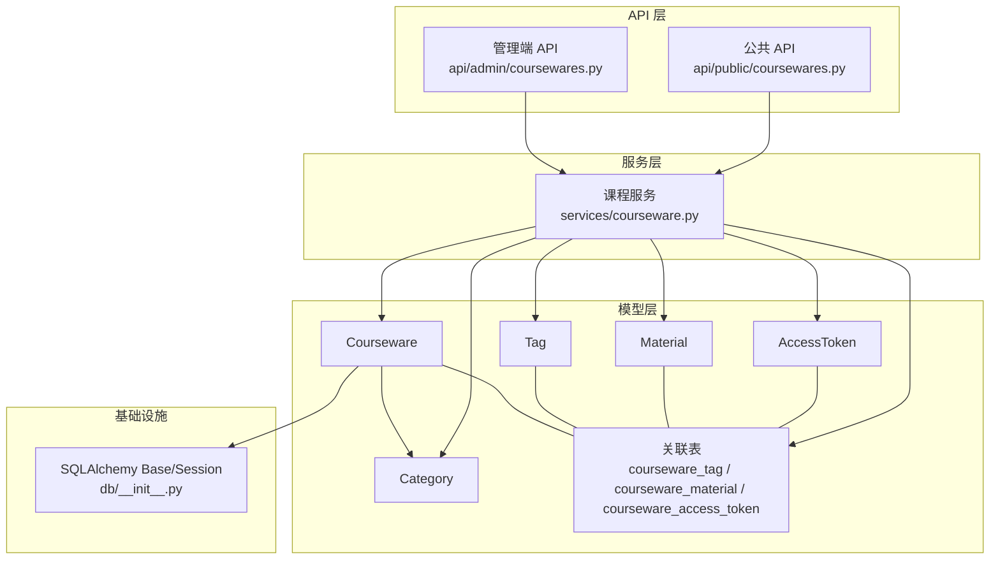
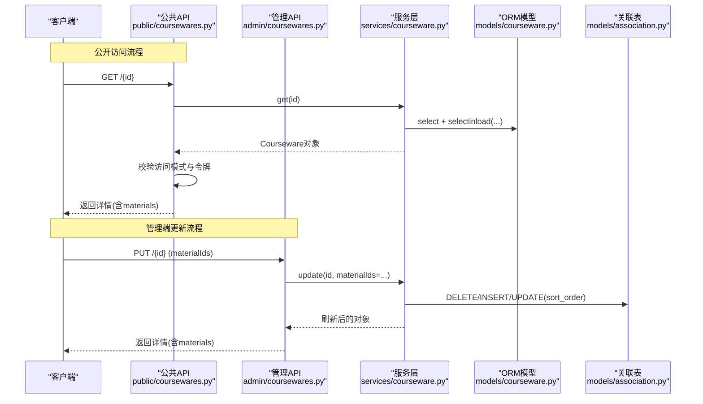
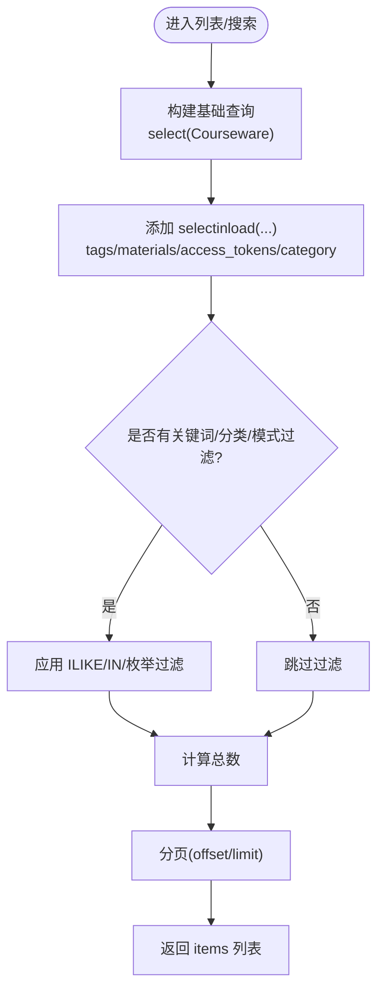
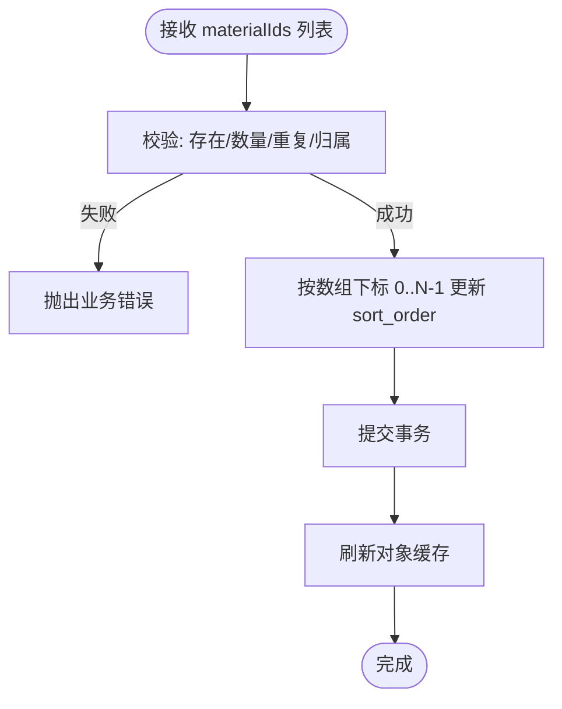
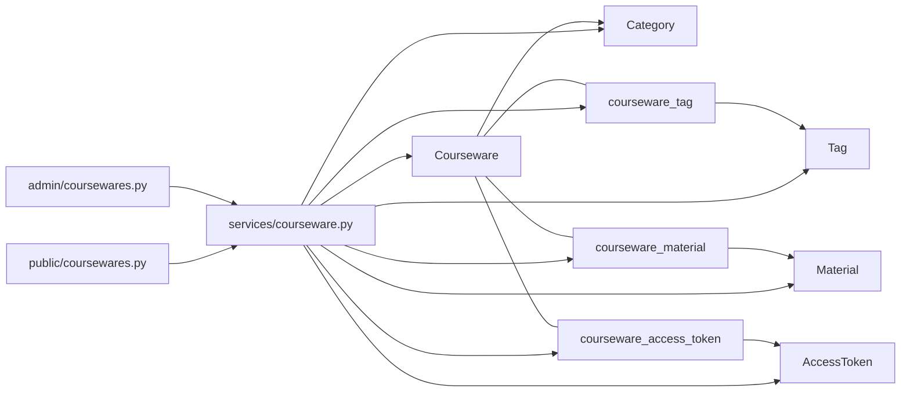

# 课件模型(Courseware)

<cite>
**本文引用的文件**   
- [backend/app/models/courseware.py](file://backend/app/models/courseware.py)
- [backend/app/models/association.py](file://backend/app/models/association.py)
- [backend/app/models/category.py](file://backend/app/models/category.py)
- [backend/app/models/tag.py](file://backend/app/models/tag.py)
- [backend/app/models/material.py](file://backend/app/models/material.py)
- [backend/app/models/access_token.py](file://backend/app/models/access_token.py)
- [backend/app/schemas/courseware.py](file://backend/app/schemas/courseware.py)
- [backend/app/services/courseware.py](file://backend/app/services/courseware.py)
- [backend/app/api/admin/coursewares.py](file://backend/app/api/admin/coursewares.py)
- [backend/app/api/public/coursewares.py](file://backend/app/api/public/coursewares.py)
- [backend/app/db/__init__.py](file://backend/app/db/__init__.py)
</cite>

## 目录
1. [简介](#简介)
2. [项目结构](#项目结构)
3. [核心组件](#核心组件)
4. [架构总览](#架构总览)
5. [详细组件分析](#详细组件分析)
6. [依赖关系分析](#依赖关系分析)
7. [性能与查询优化](#性能与查询优化)
8. [故障排查指南](#故障排查指南)
9. [结论](#结论)
10. [附录：字段定义与约束](#附录字段定义与约束)

## 简介
本设计文档聚焦于“课件(Courseware)”数据模型及其在系统中的使用方式，覆盖主表字段、访问模式枚举、分类关联与级联策略、多对多关联（标签、素材、访问令牌）、懒加载策略选择(selectin vs joined)、排序规则实现，并提供完整的字段类型、约束与默认值说明，以及实际使用示例和查询优化建议。

## 项目结构
围绕课件模型的代码分布在以下位置：
- 模型定义：models/courseware.py、models/association.py、models/category.py、models/tag.py、models/material.py、models/access_token.py
- 业务服务：services/courseware.py
- API 层：api/admin/coursewares.py、api/public/coursewares.py
- Schema 校验：schemas/courseware.py
- 数据库会话与基类：db/__init__.py

图表来源
- [backend/app/models/courseware.py:21-67](file://backend/app/models/courseware.py#L21-L67)
- [backend/app/models/association.py:9-33](file://backend/app/models/association.py#L9-L33)
- [backend/app/services/courseware.py:47-167](file://backend/app/services/courseware.py#L47-L167)
- [backend/app/api/admin/coursewares.py:24-112](file://backend/app/api/admin/coursewares.py#L24-L112)
- [backend/app/api/public/coursewares.py:57-130](file://backend/app/api/public/coursewares.py#L57-L130)
- [backend/app/db/__init__.py:35-47](file://backend/app/db/__init__.py#L35-L47)

章节来源
- [backend/app/models/courseware.py:1-74](file://backend/app/models/courseware.py#L1-L74)
- [backend/app/models/association.py:1-41](file://backend/app/models/association.py#L1-L41)
- [backend/app/models/category.py:1-46](file://backend/app/models/category.py#L1-L46)
- [backend/app/models/tag.py:1-30](file://backend/app/models/tag.py#L1-L30)
- [backend/app/models/material.py:1-69](file://backend/app/models/material.py#L1-L69)
- [backend/app/models/access_token.py:1-34](file://backend/app/models/access_token.py#L1-L34)
- [backend/app/services/courseware.py:1-492](file://backend/app/services/courseware.py#L1-L492)
- [backend/app/api/admin/coursewares.py:1-115](file://backend/app/api/admin/coursewares.py#L1-L115)
- [backend/app/api/public/coursewares.py:1-133](file://backend/app/api/public/coursewares.py#L1-L133)
- [backend/app/db/__init__.py:1-51](file://backend/app/db/__init__.py#L1-L51)

## 核心组件
- 课件主表 Courseware：承载标题、作者、描述、访问模式、分类外键、时间戳等基础信息；通过 ORM relationship 与 Tag、Material、AccessToken 建立多对多关联；与 Category 为多对一关联。
- 访问模式 AccessMode：OPEN(开放) 与 RESTRICTED(受限)。RESTRICTED 模式下需绑定至少一个 AccessToken。
- 关联表 association：
  - courseware_tag：课件与标签的多对多
  - courseware_material：课件与素材的多对多，并维护 sort_order 展示顺序
  - courseware_access_token：课件与访问令牌的多对多
- 分类 Category：支持三级树形结构，课件 category_id 外键采用 RESTRICT 删除保护。
- 标签 Tag：全局唯一名称。
- 素材 Material：文件元数据与存储路径，包含类型推断工具。
- 访问令牌 AccessToken：label 全局唯一，value_hash 存储 SHA-256 摘要。

章节来源
- [backend/app/models/courseware.py:14-67](file://backend/app/models/courseware.py#L14-L67)
- [backend/app/models/association.py:9-33](file://backend/app/models/association.py#L9-L33)
- [backend/app/models/category.py:12-42](file://backend/app/models/category.py#L12-L42)
- [backend/app/models/tag.py:13-26](file://backend/app/models/tag.py#L13-L26)
- [backend/app/models/material.py:44-65](file://backend/app/models/material.py#L44-L65)
- [backend/app/models/access_token.py:13-30](file://backend/app/models/access_token.py#L13-L30)

## 架构总览
下图展示了从 API 到模型与服务的关键调用链，包括公开解锁流程与管理端更新流程。

图表来源
- [backend/app/api/public/coursewares.py:57-76](file://backend/app/api/public/coursewares.py#L57-L76)
- [backend/app/api/admin/coursewares.py:71-89](file://backend/app/api/admin/coursewares.py#L71-L89)
- [backend/app/services/courseware.py:170-278](file://backend/app/services/courseware.py#L170-L278)
- [backend/app/models/association.py:16-26](file://backend/app/models/association.py#L16-L26)

## 详细组件分析

### 课件主表字段设计与约束
- id：自增主键
- title：非空，最大长度限制由 Schema 校验
- author：可选，最大长度限制由 Schema 校验
- description：可选文本
- access_mode：枚举 OPEN/RESTRICTED，默认 OPEN
- category_id：非空，外键指向 category.id，删除策略 RESTRICT
- created_at/updated_at：带时区的时间戳，创建/更新时间由服务器默认函数维护

这些字段在模型中声明了类型、可空性、默认值与外键约束；Schema 层进一步提供输入校验与清洗逻辑。

章节来源
- [backend/app/models/courseware.py:27-47](file://backend/app/models/courseware.py#L27-L47)
- [backend/app/schemas/courseware.py:22-38](file://backend/app/schemas/courseware.py#L22-L38)

### 访问模式(AccessMode)与业务逻辑
- 枚举值：OPEN、RESTRICTED
- 业务规则：
  - 创建或更新时，若 access_mode=RESTRICTED，则必须绑定至少一个 AccessToken
  - 当从 RESTRICTED 降级为 OPEN 时，自动清空已绑定的 AccessToken
- 公开接口鉴权：
  - OPEN：直接返回详情
  - RESTRICTED：校验请求头或 Cookie 中的 token hash，且该 token 必须被当前课件绑定

章节来源
- [backend/app/models/courseware.py:14-18](file://backend/app/models/courseware.py#L14-L18)
- [backend/app/services/courseware.py:129-134](file://backend/app/services/courseware.py#L129-L134)
- [backend/app/services/courseware.py:204-207](file://backend/app/services/courseware.py#L204-L207)
- [backend/app/api/public/coursewares.py:68-76](file://backend/app/api/public/coursewares.py#L68-L76)

### 分类关联(category_id)与级联删除策略
- 关系：多对一，Courseware.category_id → Category.id
- 删除策略：RESTRICT，防止误删仍在使用的分类
- 列表/搜索支持按分类子树过滤：传入 L1/L2 节点时，后端会拉出该节点及其所有后代分类下的课件

章节来源
- [backend/app/models/courseware.py:30-32](file://backend/app/models/courseware.py#L30-L32)
- [backend/app/models/category.py:22-27](file://backend/app/models/category.py#L22-L27)
- [backend/app/services/courseware.py:420-426](file://backend/app/services/courseware.py#L420-L426)

### 多对多关联设计与实现
- 标签(Tag)：通过 courseware_tag 关联表，双向 backref 为 coursewares
- 素材(Material)：通过 courseware_material 关联表，维护 sort_order 展示顺序，并在索引上加速按课件有序取素材的查询
- 访问令牌(AccessToken)：通过 courseware_access_token 关联表，用于受限课件的授权

```mermaid
erDiagram
COURSEWARE {
int id PK
string title
string author
text description
enum access_mode
int category_id FK
timestamp created_at
timestamp updated_at
}
CATEGORY {
int id PK
string name
int parent_id FK
int level
}
TAG {
int id PK
string name UK
timestamp created_at
}
MATERIAL {
int id PK
string name
string type
bigint size_bytes
string duration_or_pages
string storage_path
string preview_images_dir
timestamp uploaded_at
}
ACCESS_TOKEN {
int id PK
string label UK
string value_hash
timestamp created_at
timestamp regenerated_at
}
COURSEWARE ||--o{ CATEGORY : "category_id"
COURSEWARE }o--o{ TAG : "courseware_tag"
COURSEWARE }o--o{ MATERIAL : "courseware_material"
COURSEWARE }o--o{ ACCESS_TOKEN : "courseware_access_token"
```

图表来源
- [backend/app/models/courseware.py:27-67](file://backend/app/models/courseware.py#L27-L67)
- [backend/app/models/association.py:9-33](file://backend/app/models/association.py#L9-L33)
- [backend/app/models/category.py:22-27](file://backend/app/models/category.py#L22-L27)
- [backend/app/models/tag.py:19-23](file://backend/app/models/tag.py#L19-L23)
- [backend/app/models/material.py:50-62](file://backend/app/models/material.py#L50-L62)
- [backend/app/models/access_token.py:19-27](file://backend/app/models/access_token.py#L19-L27)

章节来源
- [backend/app/models/association.py:9-33](file://backend/app/models/association.py#L9-L33)

### 懒加载策略选择(selectin vs joined)
- 分类关系：lazy="joined"，在获取单个课件时直接 JOIN 分类，避免 N+1 查询
- 多对多关系：tags、materials、access_tokens 均 lazy="selectin"，批量加载关联集合，减少多次往返
- 列表/搜索场景：服务层显式使用 selectinload 预加载 tags、materials、access_tokens、category，确保分页列表的性能

图表来源
- [backend/app/services/courseware.py:405-447](file://backend/app/services/courseware.py#L405-L447)
- [backend/app/models/courseware.py:49-67](file://backend/app/models/courseware.py#L49-L67)

章节来源
- [backend/app/models/courseware.py:49-67](file://backend/app/models/courseware.py#L49-L67)
- [backend/app/services/courseware.py:405-447](file://backend/app/services/courseware.py#L405-L447)

### 排序规则的实现
- 素材排序字段：courseware_material.sort_order，整数，默认 0
- 索引：ix_courseware_material_courseware_order(courseware_id, sort_order)，加速按课件有序取素材
- 写入时机：
  - 创建新课件：按传入 material_ids 的顺序，逐一 UPDATE sort_order 为 0..N-1
  - 更新素材集合：先 DELETE 移除项，再 INSERT 新增项，最后按数组下标重写所有 sort_order
  - 专用排序接口：校验数量一致、无重复、全部属于该课件后，按数组下标重写 sort_order
- 读取顺序：
  - 返回详情时，_to_item 会从关联表读取 sort_order 映射，确保前端渲染顺序正确

图表来源
- [backend/app/services/courseware.py:335-393](file://backend/app/services/courseware.py#L335-L393)
- [backend/app/models/association.py:16-26](file://backend/app/models/association.py#L16-L26)

章节来源
- [backend/app/services/courseware.py:148-160](file://backend/app/services/courseware.py#L148-L160)
- [backend/app/services/courseware.py:210-258](file://backend/app/services/courseware.py#L210-L258)
- [backend/app/services/courseware.py:335-393](file://backend/app/services/courseware.py#L335-L393)
- [backend/app/models/association.py:16-26](file://backend/app/models/association.py#L16-L26)

### 完整字段类型定义、约束与默认值
- Courseware
  - id: Integer, 主键, 自增
  - title: String(100), NOT NULL
  - author: String(50), 可为空
  - category_id: Integer, NOT NULL, 外键→category.id, ondelete=RESTRICT
  - description: Text, 可为空
  - access_mode: Enum(AccessMode), NOT NULL, 默认 OPEN
  - created_at: DateTime(timezone=True), server_default=now()
  - updated_at: DateTime(timezone=True), server_default=now(), onupdate=now()
- 关联表
  - courseware_tag: (courseware_id, tag_id) 复合主键, ondelete=CASCADE
  - courseware_material: (courseware_id, material_id) 复合主键, sort_order Integer NOT NULL DEFAULT 0, 索引(courseware_id, sort_order), ondelete=CASCADE
  - courseware_access_token: (courseware_id, access_token_id) 复合主键, ondelete=CASCADE
- Category
  - id: Integer, 主键, 自增
  - name: String(30), NOT NULL
  - parent_id: Integer, 可为空, 外键→category.id, ondelete=RESTRICT
  - level: Integer, NOT NULL
- Tag
  - id: Integer, 主键, 自增
  - name: String(30), NOT NULL, unique
- Material
  - id: Integer, 主键, 自增
  - name: String(255), NOT NULL
  - type: String(16), NOT NULL
  - size_bytes: BigInteger, NOT NULL, default=0
  - duration_or_pages: String(32), 可为空
  - storage_path: String(512), NOT NULL
  - preview_images_dir: String(512), 可为空
  - uploaded_at: DateTime(timezone=True), server_default=now()
- AccessToken
  - id: Integer, 主键, 自增
  - label: String(50), NOT NULL, unique
  - value_hash: String(64), NOT NULL, index
  - created_at: DateTime(timezone=True), server_default=now()
  - regenerated_at: DateTime(timezone=True), 可为空

章节来源
- [backend/app/models/courseware.py:27-47](file://backend/app/models/courseware.py#L27-L47)
- [backend/app/models/association.py:9-33](file://backend/app/models/association.py#L9-L33)
- [backend/app/models/category.py:22-27](file://backend/app/models/category.py#L22-L27)
- [backend/app/models/tag.py:19-23](file://backend/app/models/tag.py#L19-L23)
- [backend/app/models/material.py:50-62](file://backend/app/models/material.py#L50-L62)
- [backend/app/models/access_token.py:19-27](file://backend/app/models/access_token.py#L19-L27)

### 实际使用示例与最佳实践
- 创建课件
  - 管理端 POST /api/admin/coursewares，携带 title、categoryId、author、description、accessMode、tagIds、materialIds、tokenIds
  - 若 accessMode=RESTRICTED，必须提供至少一个 tokenIds
- 更新课件
  - 管理端 PUT /api/admin/coursewares/{id}，仅传需要修改的字段
  - 更新 materialIds 将触发 sort_order 重写
- 调整素材顺序
  - 管理端 PUT /api/admin/coursewares/{id}/materials/order，传入 materialIds 数组即为目标顺序
- 公开访问
  - GET /api/public/coursewares/{id}：OPEN 直接返回；RESTRICTED 需携带 X-Token-Hash 或 lh_token_hash Cookie
  - POST /api/public/coursewares/{id}/unlock：凭明文 token 解锁，成功后设置 Cookie 并返回关联课件 ID 列表
- 列表与搜索
  - 管理端 GET /api/admin/coursewares：支持 keyword、categoryId、accessMode、page、size
  - 公共搜索 GET /api/public/coursewares/search：语义召回 + 关键词回退

章节来源
- [backend/app/api/admin/coursewares.py:24-112](file://backend/app/api/admin/coursewares.py#L24-L112)
- [backend/app/api/public/coursewares.py:32-54](file://backend/app/api/public/coursewares.py#L32-54)
- [backend/app/api/public/coursewares.py:57-130](file://backend/app/api/public/coursewares.py#L57-130)
- [backend/app/services/courseware.py:105-167](file://backend/app/services/courseware.py#L105-L167)
- [backend/app/services/courseware.py:170-278](file://backend/app/services/courseware.py#L170-L278)
- [backend/app/services/courseware.py:335-393](file://backend/app/services/courseware.py#L335-L393)

## 依赖关系分析
- 模型耦合
  - Courseware 强依赖 Category(外键 RESTRICT)
  - Courseware 与 Tag/Material/AccessToken 通过中间表弱耦合，删除 Courseware 时 CASCADE 清理关联行
- 服务层依赖
  - services/courseware.py 依赖 models 与 services/access_token、services/category
- API 层依赖
  - admin/coursewares.py 与 public/coursewares.py 分别依赖 services/courseware.py 与相关安全/限流模块

图表来源
- [backend/app/models/courseware.py:27-67](file://backend/app/models/courseware.py#L27-L67)
- [backend/app/models/association.py:9-33](file://backend/app/models/association.py#L9-L33)
- [backend/app/services/courseware.py:1-492](file://backend/app/services/courseware.py#L1-L492)
- [backend/app/api/admin/coursewares.py:1-115](file://backend/app/api/admin/coursewares.py#L1-L115)
- [backend/app/api/public/coursewares.py:1-133](file://backend/app/api/public/coursewares.py#L1-L133)

章节来源
- [backend/app/models/courseware.py:27-67](file://backend/app/models/courseware.py#L27-L67)
- [backend/app/models/association.py:9-33](file://backend/app/models/association.py#L9-L33)
- [backend/app/services/courseware.py:1-492](file://backend/app/services/courseware.py#L1-L492)

## 性能与查询优化
- 懒加载策略
  - 分类使用 joined 预加载，避免额外查询
  - 多对多使用 selectin 批量加载，减少 N+1
- 列表/搜索预加载
  - 服务层统一使用 selectinload(tags/materials/access_tokens/category)，保证分页列表一次性加载
- 索引优化
  - courseware_material 上的 (courseware_id, sort_order) 索引加速按课件有序取素材
- 排序一致性
  - 返回详情时使用 _to_item 从关联表读取 sort_order 映射，避免 ORM 二次同步导致的顺序错位
- 连接池配置
  - db/__init__.py 根据数据库类型配置连接池参数，提升并发能力

章节来源
- [backend/app/services/courseware.py:405-447](file://backend/app/services/courseware.py#L405-L447)
- [backend/app/models/association.py:25](file://backend/app/models/association.py#L25)
- [backend/app/services/courseware.py:310-332](file://backend/app/services/courseware.py#L310-L332)
- [backend/app/db/__init__.py:18-25](file://backend/app/db/__init__.py#L18-L25)

## 故障排查指南
- 受限课件无法访问
  - 检查请求是否携带 X-Token-Hash 或 lh_token_hash Cookie
  - 确认 token 已被该课件绑定
- 更新素材顺序无效
  - 确认传入 materialIds 数量与当前一致、无重复、全部属于该课件
  - 查看 _to_item 是否正确从关联表读取 sort_order
- 创建受限课件报错
  - 确认至少绑定一个 AccessToken
- 分类删除失败
  - 由于 category_id 外键为 RESTRICT，存在课件引用时将阻止删除

章节来源
- [backend/app/api/public/coursewares.py:68-76](file://backend/app/api/public/coursewares.py#L68-L76)
- [backend/app/services/courseware.py:335-393](file://backend/app/services/courseware.py#L335-L393)
- [backend/app/services/courseware.py:129-134](file://backend/app/services/courseware.py#L129-L134)
- [backend/app/models/courseware.py:30-32](file://backend/app/models/courseware.py#L30-L32)

## 结论
Courseware 模型以清晰的字段定义、严格的约束与合理的懒加载策略为基础，结合关联表的索引与排序字段，实现了高性能的课件管理与公开访问体验。AccessMode 的业务规则在服务层得到严格校验，配合公开接口的令牌校验机制，确保了受限资源的安全访问。整体架构分层清晰，便于扩展与维护。

## 附录：字段定义与约束
- Courseware 主表字段
  - id: Integer, PK, autoincrement
  - title: String(100), NOT NULL
  - author: String(50), nullable
  - category_id: Integer, NOT NULL, FK→category.id, ondelete=RESTRICT
  - description: Text, nullable
  - access_mode: Enum(AccessMode), NOT NULL, default=OPEN
  - created_at: DateTime(timezone=True), server_default=now()
  - updated_at: DateTime(timezone=True), server_default=now(), onupdate=now()
- 关联表
  - courseware_tag: (courseware_id, tag_id) PK, ondelete=CASCADE
  - courseware_material: (courseware_id, material_id) PK, sort_order Integer NOT NULL DEFAULT 0, Index(courseware_id, sort_order), ondelete=CASCADE
  - courseware_access_token: (courseware_id, access_token_id) PK, ondelete=CASCADE
- Category
  - id: Integer, PK, autoincrement
  - name: String(30), NOT NULL
  - parent_id: Integer, nullable, FK→category.id, ondelete=RESTRICT
  - level: Integer, NOT NULL
- Tag
  - id: Integer, PK, autoincrement
  - name: String(30), NOT NULL, unique
- Material
  - id: Integer, PK, autoincrement
  - name: String(255), NOT NULL
  - type: String(16), NOT NULL
  - size_bytes: BigInteger, NOT NULL, default=0
  - duration_or_pages: String(32), nullable
  - storage_path: String(512), NOT NULL
  - preview_images_dir: String(512), nullable
  - uploaded_at: DateTime(timezone=True), server_default=now()
- AccessToken
  - id: Integer, PK, autoincrement
  - label: String(50), NOT NULL, unique
  - value_hash: String(64), NOT NULL, index
  - created_at: DateTime(timezone=True), server_default=now()
  - regenerated_at: DateTime(timezone=True), nullable

章节来源
- [backend/app/models/courseware.py:27-47](file://backend/app/models/courseware.py#L27-L47)
- [backend/app/models/association.py:9-33](file://backend/app/models/association.py#L9-L33)
- [backend/app/models/category.py:22-27](file://backend/app/models/category.py#L22-L27)
- [backend/app/models/tag.py:19-23](file://backend/app/models/tag.py#L19-L23)
- [backend/app/models/material.py:50-62](file://backend/app/models/material.py#L50-L62)
- [backend/app/models/access_token.py:19-27](file://backend/app/models/access_token.py#L19-L27)