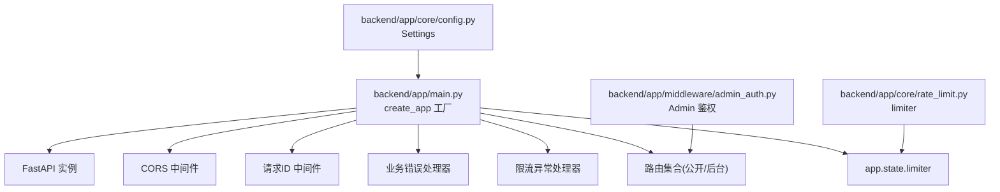
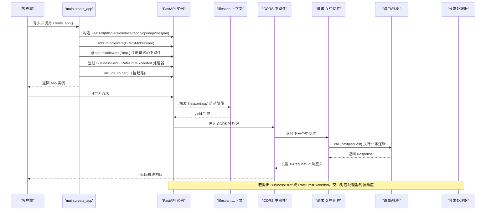
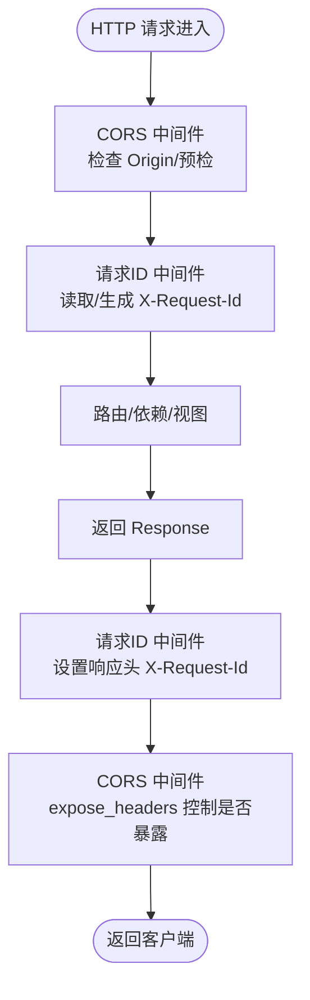
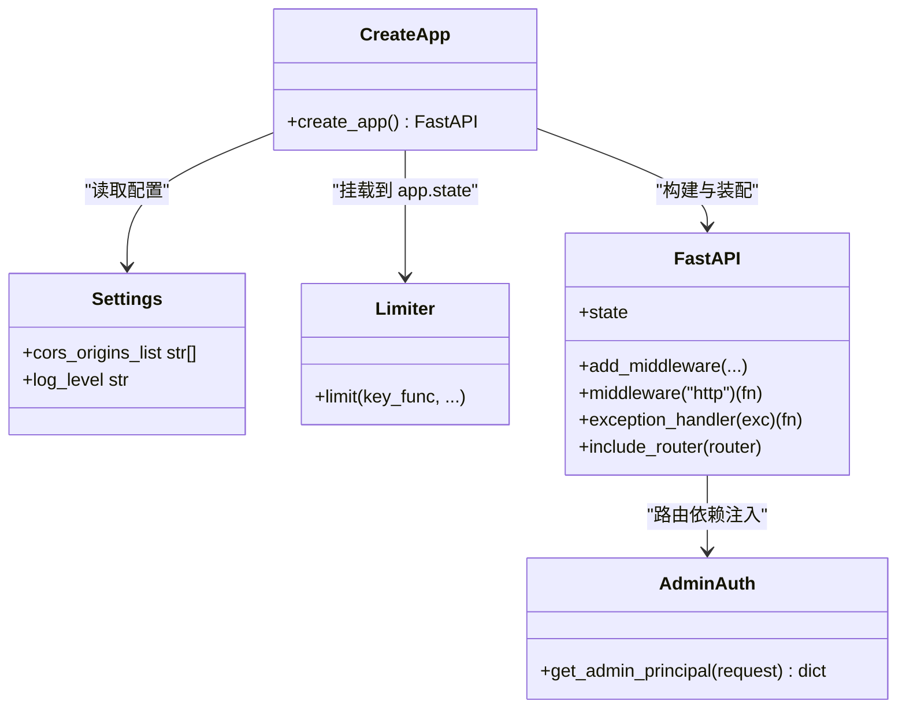

# 应用生命周期管理

<cite>
**本文引用的文件**
- [backend/app/main.py](file://backend/app/main.py)
- [backend/app/core/config.py](file://backend/app/core/config.py)
- [backend/app/middleware/admin_auth.py](file://backend/app/middleware/admin_auth.py)
- [backend/app/core/rate_limit.py](file://backend/app/core/rate_limit.py)
- [doc/spec/10-API设计规范.md](file://doc/spec/10-API设计规范.md)
</cite>

## 目录
1. [简介](#简介)
2. [项目结构](#项目结构)
3. [核心组件](#核心组件)
4. [架构总览](#架构总览)
5. [详细组件分析](#详细组件分析)
6. [依赖关系分析](#依赖关系分析)
7. [性能考量](#性能考量)
8. [故障排查指南](#故障排查指南)
9. [结论](#结论)
10. [附录](#附录)

## 简介
本文件聚焦于 FastAPI 应用的生命周期管理与中间件体系，围绕以下目标展开：
- 深入解析 create_app 工厂函数的设计模式与装配流程
- 详解 lifespan 上下文管理器的实现原理与资源初始化/清理机制
- 解释中间件的注册顺序与执行流程（CORS、请求 ID 追踪等）
- 提供自定义中间件开发指南（函数签名、Request/Response 操作最佳实践）

## 项目结构
后端入口位于 backend/app/main.py，负责创建 FastAPI 实例、注册中间件、异常处理器与路由。配置通过 app.core.config.Settings 从环境变量加载，限流能力由 app.core.rate_limit 提供，管理员鉴权逻辑位于 app.middleware.admin_auth。

图表来源
- [backend/app/main.py:40-112](file://backend/app/main.py#L40-L112)
- [backend/app/core/config.py:9-88](file://backend/app/core/config.py#L9-L88)
- [backend/app/core/rate_limit.py:1-40](file://backend/app/core/rate_limit.py#L1-L40)
- [backend/app/middleware/admin_auth.py:1-66](file://backend/app/middleware/admin_auth.py#L1-L66)

章节来源
- [backend/app/main.py:1-116](file://backend/app/main.py#L1-L116)
- [backend/app/core/config.py:1-88](file://backend/app/core/config.py#L1-L88)

## 核心组件
- create_app 工厂函数：集中完成应用实例化、lifespan 注入、中间件与异常处理器注册、路由挂载与根路径定义，返回可复用的 FastAPI 实例。
- lifespan 上下文管理器：基于 asynccontextmanager 的启动/关闭钩子，当前为占位实现，预留扩展点用于全局资源初始化与清理。
- CORS 中间件：统一跨域策略，暴露 X-Request-Id 响应头以便前端对账。
- 请求 ID 中间件：读取或生成请求级唯一标识，写入 request.state 并回写至响应头，贯穿后续日志与错误处理。
- 异常处理器：BusinessError 与 SlowAPI RateLimitExceeded 的统一包装，附带 requestId 字段。
- 配置中心：pydantic-settings 驱动的配置类，提供 cors_origins_list 等派生属性供应用装配使用。
- 限流器：SlowAPI Limiter 实例，挂载到 app.state 供依赖注入使用。
- Admin 鉴权：基于 JWT 的 Depends 依赖，拦截后台接口校验身份。

章节来源
- [backend/app/main.py:40-112](file://backend/app/main.py#L40-L112)
- [backend/app/core/config.py:75-88](file://backend/app/core/config.py#L75-L88)
- [backend/app/core/rate_limit.py:1-40](file://backend/app/core/rate_limit.py#L1-L40)
- [backend/app/middleware/admin_auth.py:26-42](file://backend/app/middleware/admin_auth.py#L26-L42)

## 架构总览
下图展示了应用启动时关键装配步骤与请求进入时的中间件执行链路。

图表来源
- [backend/app/main.py:40-112](file://backend/app/main.py#L40-L112)

## 详细组件分析

### create_app 工厂函数
- 职责边界
  - 构建 FastAPI 实例并注入 lifespan
  - 注册 CORS 与请求 ID 中间件
  - 挂载 SlowAPI limiter 到 app.state
  - 注册全局异常处理器
  - 挂载各模块路由与根路径
  - 返回可复用实例，便于测试与多进程部署
- 设计要点
  - 将“应用装配”与“运行期行为”解耦，避免模块级副作用
  - 通过 Settings 派生属性动态决定 CORS 白名单
  - 将限流器作为共享状态挂载，供依赖注入使用

章节来源
- [backend/app/main.py:40-112](file://backend/app/main.py#L40-L112)
- [backend/app/core/config.py:75-88](file://backend/app/core/config.py#L75-L88)

### lifespan 上下文管理器
- 作用时机
  - 应用启动后、接收首个请求前执行 try 块之前的初始化代码
  - 应用关闭时执行 finally 块中的清理逻辑
- 当前实现
  - 采用空占位，仅保留 try/finally 骨架，便于后续接入数据库连接池、缓存客户端、外部服务连接等资源的初始化与释放
- 扩展建议
  - 在 try 之前进行只读型预热（如加载字典、建立连接池）
  - 在 finally 中确保所有非守护线程退出、连接关闭、临时文件清理
  - 注意异常传播：若初始化失败应向上抛出，阻止应用进入就绪态

章节来源
- [backend/app/main.py:40-55](file://backend/app/main.py#L40-L55)

### 中间件注册顺序与执行流程
- 注册顺序
  - 先注册 CORSMiddleware
  - 再注册请求 ID 中间件（@app.middleware("http")）
- 执行顺序（入站）
  - 请求进入 → CORSMiddleware 预处理（允许源、方法、头部、预检）→ 请求 ID 中间件（读取/生成 X-Request-Id，写入 request.state）→ 路由/依赖链 → 响应回传
- 执行顺序（出站）
  - 响应从内向外逐层返回：请求 ID 中间件设置响应头 X-Request-Id → CORS 中间件根据 expose_headers 决定是否向客户端暴露该头 → 返回给客户端
- 作用域说明
  - CORS 的 allow_origins 来自 Settings.cors_origins_list；当为空时使用通配符
  - 请求 ID 中间件优先使用请求头 X-Request-Id，否则生成短 UUID 并写入 request.state.request_id
  - 异常处理器会从 request.state 读取 requestId 并回填到响应体与响应头

图表来源
- [backend/app/main.py:57-76](file://backend/app/main.py#L57-L76)

章节来源
- [backend/app/main.py:57-76](file://backend/app/main.py#L57-L76)
- [backend/app/core/config.py:75-88](file://backend/app/core/config.py#L75-L88)

### 异常处理与限流集成
- BusinessError 处理器
  - 从 request.state 读取 requestId
  - 使用统一信封包装业务错误，并在响应体与响应头中携带 requestId
- RateLimitExceeded 处理器
  - 返回 429 状态码与标准化错误体，同时附加 requestId
- SlowAPI 集成
  - limiter 实例挂载到 app.state.limiter，供路由依赖注入使用
  - 文档规范定义了不同场景下的阈值与 key 构造方式

章节来源
- [backend/app/main.py:78-89](file://backend/app/main.py#L78-L89)
- [backend/app/core/rate_limit.py:1-40](file://backend/app/core/rate_limit.py#L1-L40)
- [doc/spec/10-API设计规范.md:109-122](file://doc/spec/10-API设计规范.md#L109-L122)

### 管理员鉴权（Depends 依赖）
- 位置与职责
  - admin_auth.get_admin_principal 作为 Depends 注入，校验 Authorization 或 Cookie 中的会话令牌，解码 JWT 并提取主体信息
- 与中间件的关系
  - 以依赖注入形式作用于路由层，不改变全局中间件栈，适合细粒度权限控制

章节来源
- [backend/app/middleware/admin_auth.py:26-42](file://backend/app/middleware/admin_auth.py#L26-L42)

## 依赖关系分析
- main.create_app 依赖
  - Settings 提供 CORS 白名单与日志级别
  - SlowAPI Limiter 提供限流能力
  - 各路由模块提供 API 端点
  - 异常类型与统一响应封装
- 运行时依赖
  - Request/Response 对象贯穿中间件链
  - app.state 作为全局共享容器（例如 limiter）

图表来源
- [backend/app/main.py:40-112](file://backend/app/main.py#L40-L112)
- [backend/app/core/config.py:9-88](file://backend/app/core/config.py#L9-L88)
- [backend/app/core/rate_limit.py:1-40](file://backend/app/core/rate_limit.py#L1-L40)
- [backend/app/middleware/admin_auth.py:1-66](file://backend/app/middleware/admin_auth.py#L1-L66)

章节来源
- [backend/app/main.py:40-112](file://backend/app/main.py#L40-L112)
- [backend/app/core/config.py:9-88](file://backend/app/core/config.py#L9-L88)
- [backend/app/core/rate_limit.py:1-40](file://backend/app/core/rate_limit.py#L1-L40)
- [backend/app/middleware/admin_auth.py:1-66](file://backend/app/middleware/admin_auth.py#L1-L66)

## 性能考量
- 中间件开销
  - CORS 预检请求会额外增加一次往返，生产环境建议精确配置 allow_origins 以减少不必要预检
  - 请求 ID 中间件仅在内存中读写，开销极低
- 限流策略
  - 单进程内存模式延迟低但不可跨 worker 共享；多 worker 部署需切换 Redis 存储
  - 合理选择 key 维度（IP/会话），避免过细导致计数膨胀
- 日志与追踪
  - 利用 requestId 关联全链路日志，有助于定位慢请求与异常

[本节为通用指导，无需特定文件引用]

## 故障排查指南
- 现象：跨域失败
  - 检查 Settings.cors_allow_origins 是否正确列出前端域名
  - 确认响应头是否包含 X-Request-Id（CORS expose_headers 已配置）
- 现象：缺少 requestId
  - 确认请求是否携带 X-Request-Id 头；未携带时会生成新值
  - 检查中间件注册顺序，确保请求 ID 中间件在路由之前执行
- 现象：频繁 429
  - 核对 SlowAPI 规则与 key 构造是否符合预期
  - 多 worker 部署下确认 storage_uri 指向共享 Redis
- 现象：管理员鉴权失败
  - 检查 Authorization 或 LH_ADMIN_SESSION Cookie 是否存在且有效
  - 确认 JWT 密钥与算法配置一致

章节来源
- [backend/app/main.py:57-89](file://backend/app/main.py#L57-L89)
- [backend/app/core/config.py:75-88](file://backend/app/core/config.py#L75-L88)
- [backend/app/core/rate_limit.py:1-40](file://backend/app/core/rate_limit.py#L1-L40)
- [backend/app/middleware/admin_auth.py:26-42](file://backend/app/middleware/admin_auth.py#L26-L42)

## 结论
- create_app 工厂函数实现了“应用装配”与“运行期行为”的清晰分离，便于测试与部署
- lifespan 上下文管理器提供了统一的启动/关闭钩子，是接入全局资源管理的最佳位置
- 中间件栈遵循“外层先行、内层后置”的执行模型，CORS 与请求 ID 中间件配合良好
- 通过 app.state 与 Depends 的组合，可将限流、鉴权等横切关注点灵活注入到路由层

[本节为总结性内容，无需特定文件引用]

## 附录

### 自定义中间件开发指南
- 函数签名
  - 使用 @app.middleware("http") 装饰的异步函数，参数为 (request, call_next)，返回 Response
- 典型职责
  - 入站：读取/生成请求级上下文（如 requestId）、记录访问日志、解析认证信息
  - 出站：追加响应头、统计耗时、统一错误包装
- 最佳实践
  - 尽量轻量，避免阻塞 I/O；耗时操作放入依赖或后台任务
  - 使用 request.state 传递请求级数据，避免全局变量
  - 明确中间件顺序：需要前置处理的逻辑（如鉴权、限流）应靠前注册
  - 保持幂等与健壮性：对缺失头、异常路径做防御性处理
- 参考实现
  - 请求 ID 中间件可作为模板，参考其读取/生成 ID、写入 state、回写响应头的做法

章节来源
- [backend/app/main.py:70-76](file://backend/app/main.py#L70-L76)