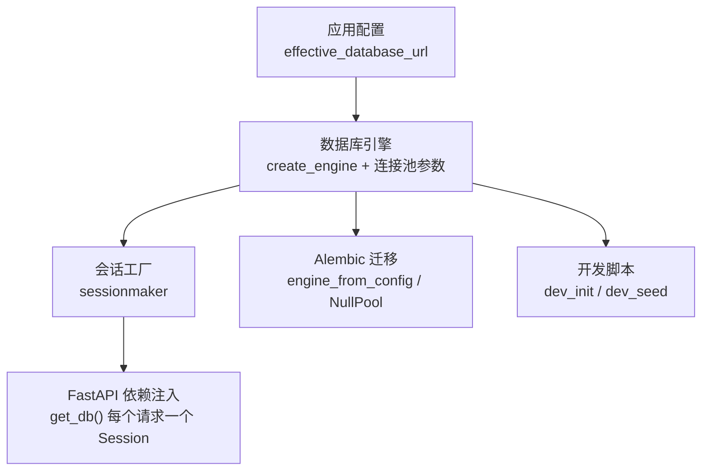
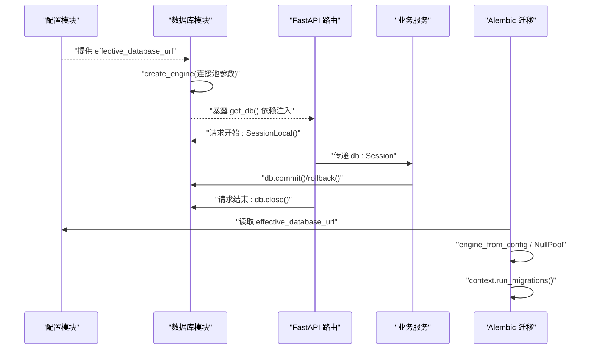
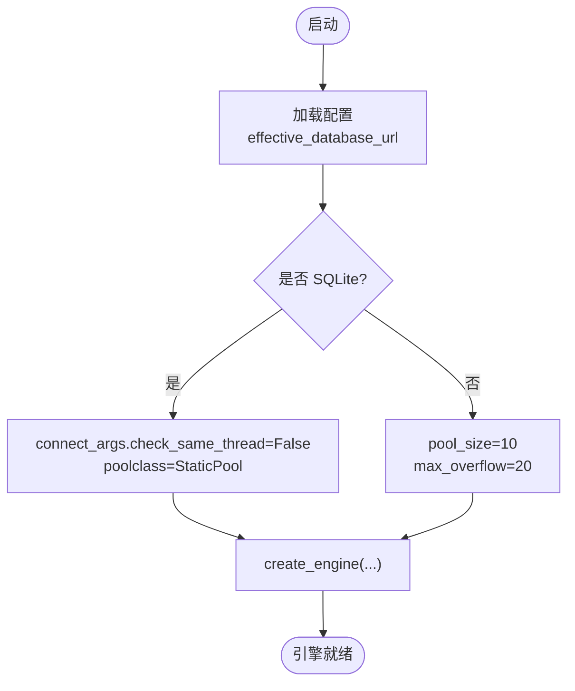
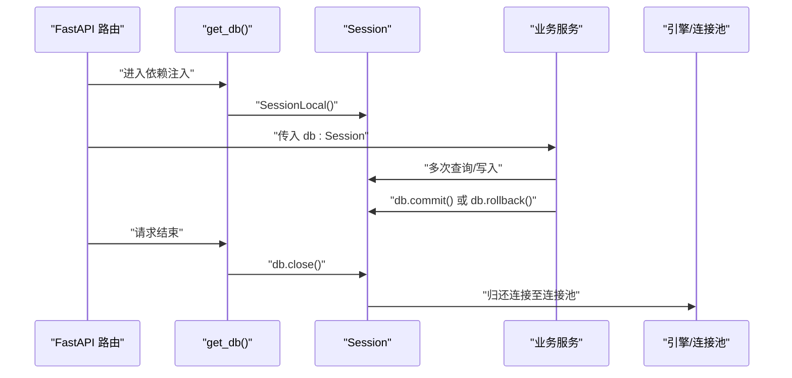
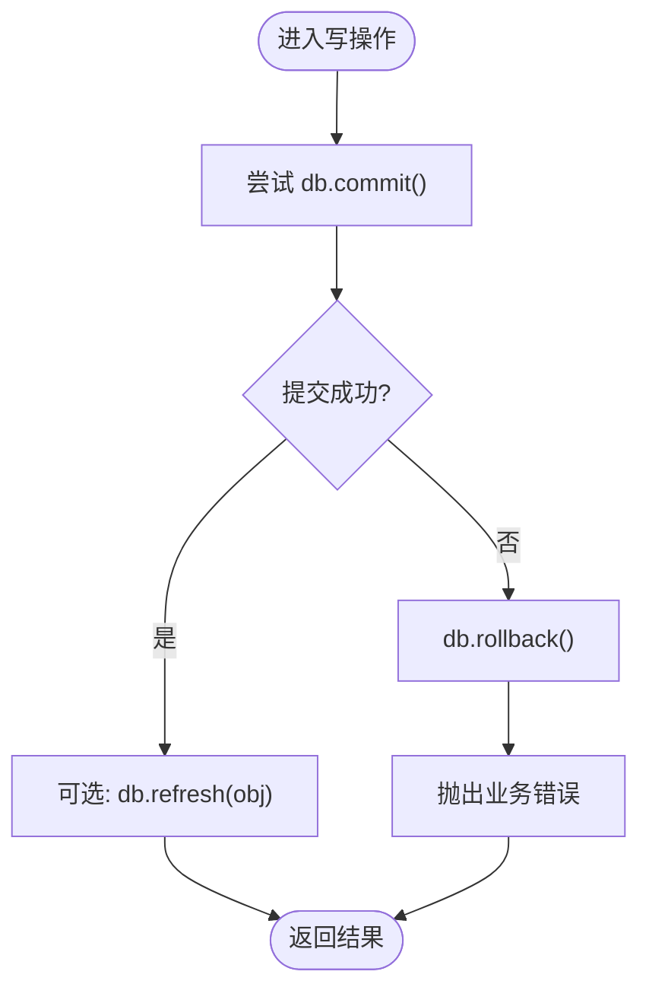
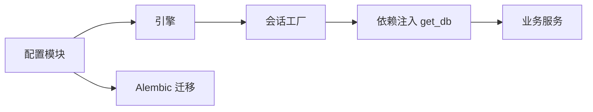

# 数据库连接管理

<cite>
**本文引用的文件**
- [backend/app/db/__init__.py](file://backend/app/db/__init__.py)
- [backend/app/core/config.py](file://backend/app/core/config.py)
- [backend/alembic/env.py](file://backend/alembic/env.py)
- [backend/dev_init.py](file://backend/dev_init.py)
- [backend/dev_seed.py](file://backend/dev_seed.py)
- [backend/app/services/access_token_usage.py](file://backend/app/services/access_token_usage.py)
- [backend/app/services/category.py](file://backend/app/services/category.py)
- [backend/app/services/tag.py](file://backend/app/services/tag.py)
- [backend/app/services/courseware.py](file://backend/app/services/courseware.py)
</cite>

## 目录
1. [引言](#引言)
2. [项目结构](#项目结构)
3. [核心组件](#核心组件)
4. [架构总览](#架构总览)
5. [详细组件分析](#详细组件分析)
6. [依赖关系分析](#依赖关系分析)
7. [性能与调优建议](#性能与调优建议)
8. [故障排查指南](#故障排查指南)
9. [结论](#结论)

## 引言
本文件聚焦 Learning Hub 后端的数据库连接管理设计，围绕 SQLAlchemy 同步引擎的配置、连接池参数、会话生命周期、事务处理最佳实践以及连接监控与故障恢复策略展开。文档基于仓库现有实现进行梳理，并给出可操作的优化建议与可视化图示，帮助读者快速理解与扩展。

## 项目结构
后端数据库相关代码主要分布在以下位置：
- 应用配置：从环境变量加载数据库连接串
- 数据库初始化：创建引擎与会话工厂，提供 FastAPI 依赖注入
- 迁移工具：Alembic 在线/离线模式下的连接与执行
- 开发脚本：一次性建表与种子数据填充（含 SQLite 特殊处理）
- 业务服务层：在各服务中显式提交/回滚事务，体现事务边界

图表来源
- [backend/app/core/config.py:28-38](file://backend/app/core/config.py#L28-L38)
- [backend/app/db/__init__.py:13-32](file://backend/app/db/__init__.py#L13-L32)
- [backend/alembic/env.py:42-56](file://backend/alembic/env.py#L42-L56)
- [backend/dev_init.py:14-40](file://backend/dev_init.py#L14-L40)
- [backend/dev_seed.py:43-49](file://backend/dev_seed.py#L43-L49)

章节来源
- [backend/app/core/config.py:1-88](file://backend/app/core/config.py#L1-L88)
- [backend/app/db/__init__.py:1-51](file://backend/app/db/__init__.py#L1-L51)
- [backend/alembic/env.py:1-62](file://backend/alembic/env.py#L1-L62)
- [backend/dev_init.py:1-44](file://backend/dev_init.py#L1-L44)
- [backend/dev_seed.py:43-84](file://backend/dev_seed.py#L43-L84)

## 核心组件
- 配置中心：集中读取数据库连接串，支持覆盖与环境变量拼接
- 引擎与连接池：根据数据库类型选择不同连接池策略与参数
- 会话工厂与依赖注入：为每个请求提供独立 Session，并在请求结束后释放
- 迁移环境：在线/离线两种模式，分别使用合适的连接方式
- 开发脚本：针对 SQLite 的特殊连接参数与静态池

章节来源
- [backend/app/core/config.py:19-38](file://backend/app/core/config.py#L19-L38)
- [backend/app/db/__init__.py:15-32](file://backend/app/db/__init__.py#L15-L32)
- [backend/alembic/env.py:29-56](file://backend/alembic/env.py#L29-L56)
- [backend/dev_init.py:18-25](file://backend/dev_init.py#L18-L25)
- [backend/dev_seed.py:43-49](file://backend/dev_seed.py#L43-L49)

## 架构总览
下图展示了从配置到引擎、会话、迁移与业务服务的整体交互关系。

图表来源
- [backend/app/core/config.py:28-38](file://backend/app/core/config.py#L28-L38)
- [backend/app/db/__init__.py:13-32](file://backend/app/db/__init__.py#L13-L32)
- [backend/alembic/env.py:23-56](file://backend/alembic/env.py#L23-L56)

## 详细组件分析

### 引擎与连接池配置
- 统一入口：通过配置模块的 computed_field 生成 effective_database_url，优先使用完整连接串，否则按字段拼接 Postgres 连接串
- 引擎参数：
  - 通用：启用 pool_pre_ping 以检测死连接；关闭 echo 避免生产日志噪音
  - SQLite：设置 connect_args.check_same_thread=False，并使用 StaticPool 适配多线程测试场景
  - 非 SQLite：启用连接池，默认 pool_size=10，max_overflow=20
- 注意：当前实现为同步引擎，未使用异步引擎或异步会话

图表来源
- [backend/app/core/config.py:28-38](file://backend/app/core/config.py#L28-L38)
- [backend/app/db/__init__.py:18-25](file://backend/app/db/__init__.py#L18-L25)

章节来源
- [backend/app/core/config.py:19-38](file://backend/app/core/config.py#L19-L38)
- [backend/app/db/__init__.py:15-25](file://backend/app/db/__init__.py#L15-L25)

### 会话生命周期管理
- 工厂：SessionLocal 绑定引擎，禁用自动刷新与自动提交，提交后不过期对象属性
- 依赖注入：get_db() 在每个请求开始时创建 Session，在 finally 中确保 close()
- 事务边界：由业务服务显式调用 commit()/rollback()，不在框架层自动提交

图表来源
- [backend/app/db/__init__.py:27-47](file://backend/app/db/__init__.py#L27-L47)

章节来源
- [backend/app/db/__init__.py:27-47](file://backend/app/db/__init__.py#L27-L47)

### 事务处理最佳实践
- 显式提交：各服务在关键写操作后调用 db.commit()，保证原子性
- 异常回滚：捕获完整性约束等异常时立即 db.rollback()，并抛出业务错误
- 嵌套事务：当前未使用显式嵌套事务；若需要，可在服务内使用 savepoint 模式（示例路径见下）
- 参考实现：
  - 分类更新失败回滚：[category.py:82-86](file://backend/app/services/category.py#L82-L86)
  - 标签更新失败回滚：[tag.py:86-90](file://backend/app/services/tag.py#L86-L90)
  - 访问令牌创建失败回滚：[access_token.py:86-90](file://backend/app/services/access_token.py#L86-L90)
  - 素材上传入库失败清理并回滚：[material.py:188-200](file://backend/app/services/material.py#L188-L200)
  - 访问会话离开失败记录审计并回滚：[access_token_usage.py:161-170](file://backend/app/services/access_token_usage.py#L161-L170)

图表来源
- [backend/app/services/category.py:82-86](file://backend/app/services/category.py#L82-L86)
- [backend/app/services/tag.py:86-90](file://backend/app/services/tag.py#L86-L90)
- [backend/app/services/access_token.py:86-90](file://backend/app/services/access_token.py#L86-L90)
- [backend/app/services/material.py:188-200](file://backend/app/services/material.py#L188-L200)
- [backend/app/services/access_token_usage.py:161-170](file://backend/app/services/access_token_usage.py#L161-L170)

章节来源
- [backend/app/services/category.py:79-88](file://backend/app/services/category.py#L79-L88)
- [backend/app/services/tag.py:83-92](file://backend/app/services/tag.py#L83-L92)
- [backend/app/services/access_token.py:73-99](file://backend/app/services/access_token.py#L73-L99)
- [backend/app/services/material.py:188-200](file://backend/app/services/material.py#L188-L200)
- [backend/app/services/access_token_usage.py:161-170](file://backend/app/services/access_token_usage.py#L161-L170)

### 迁移与开发脚本的连接策略
- Alembic 在线模式：使用 engine_from_config 与 NullPool，适合一次性迁移任务
- Alembic 离线模式：仅生成 SQL，无需真实连接
- 开发建表：dev_init 对 SQLite 使用 StaticPool 与 check_same_thread=False
- 种子数据：dev_seed 复用相同策略，便于本地初始化

章节来源
- [backend/alembic/env.py:29-56](file://backend/alembic/env.py#L29-L56)
- [backend/dev_init.py:18-25](file://backend/dev_init.py#L18-L25)
- [backend/dev_seed.py:43-49](file://backend/dev_seed.py#L43-L49)

## 依赖关系分析
- 配置依赖：数据库模块依赖配置模块提供的 effective_database_url
- 引擎依赖：引擎创建依赖数据库 URL 与连接池参数
- 会话依赖：会话工厂绑定引擎，依赖注入函数依赖会话工厂
- 迁移依赖：Alembic 依赖配置与模型元数据
- 业务服务依赖：服务依赖注入的 Session，并在内部管理事务

图表来源
- [backend/app/core/config.py:28-38](file://backend/app/core/config.py#L28-L38)
- [backend/app/db/__init__.py:13-32](file://backend/app/db/__init__.py#L13-L32)
- [backend/alembic/env.py:23-56](file://backend/alembic/env.py#L23-L56)

章节来源
- [backend/app/core/config.py:19-38](file://backend/app/core/config.py#L19-L38)
- [backend/app/db/__init__.py:13-32](file://backend/app/db/__init__.py#L13-L32)
- [backend/alembic/env.py:23-56](file://backend/alembic/env.py#L23-L56)

## 性能与调优建议
- 连接池参数
  - 当前默认：pool_size=10，max_overflow=20；可根据并发与数据库最大连接数调整
  - 建议：在高并发场景适当增大 pool_size，并结合 max_overflow 控制突发流量
- 超时设置
  - 当前未显式设置 connect_timeout、statement_timeout 等；建议在连接串或驱动参数中配置
  - 建议：为长查询设置 statement_timeout，防止慢查询占用连接
- 连接健康检查
  - 已启用 pool_pre_ping=True，可有效检测死连接并重建
  - 建议：结合数据库侧 keepalive 与连接回收策略，减少空闲连接被服务端回收的风险
- 连接复用策略
  - 当前为同步引擎，连接复用由连接池负责
  - 若引入异步：建议使用 asyncpg 或 aiomysql 的异步引擎与 AsyncSession，配合事件循环与连接池参数
- 监控指标
  - 建议采集：活跃连接数、等待队列长度、连接获取耗时、SQL 执行时长分布
  - 建议告警：连接泄漏（长时间未归还）、高等待时间、频繁重连

[本节为通用指导，不直接分析具体文件]

## 故障排查指南
- 常见问题定位
  - 连接失败：检查 effective_database_url 是否正确，网络连通性与认证信息
  - 连接泄漏：确认 get_db() 的 finally 分支是否执行，是否存在提前 return 导致未关闭
  - 事务不一致：检查业务服务是否在异常路径执行了 rollback，避免脏数据
  - 迁移失败：确认 Alembic 在线模式下使用的连接可用，NullPool 适合一次性任务
- 参考实现中的错误处理
  - 分类/标签唯一性冲突回滚：[category.py:82-86](file://backend/app/services/category.py#L82-L86)、[tag.py:86-90](file://backend/app/services/tag.py#L86-L90)
  - 令牌创建冲突回滚：[access_token.py:86-90](file://backend/app/services/access_token.py#L86-L90)
  - 素材上传入库失败清理：[material.py:188-200](file://backend/app/services/material.py#L188-L200)
  - 访问会话离开失败审计与回滚：[access_token_usage.py:161-170](file://backend/app/services/access_token_usage.py#L161-L170)

章节来源
- [backend/app/services/category.py:82-86](file://backend/app/services/category.py#L82-L86)
- [backend/app/services/tag.py:86-90](file://backend/app/services/tag.py#L86-L90)
- [backend/app/services/access_token.py:86-90](file://backend/app/services/access_token.py#L86-L90)
- [backend/app/services/material.py:188-200](file://backend/app/services/material.py#L188-L200)
- [backend/app/services/access_token_usage.py:161-170](file://backend/app/services/access_token_usage.py#L161-L170)

## 结论
当前 Learning Hub 后端采用同步 SQLAlchemy 引擎与显式事务管理，具备基础的健康检查与连接池能力。建议在后续迭代中补充连接超时与语句超时配置、完善连接监控指标，并根据业务负载调优连接池参数。若引入异步 I/O，应评估异步引擎与异步会话的迁移方案，以确保一致的事务与资源管理策略。