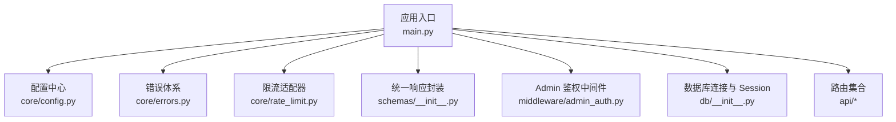
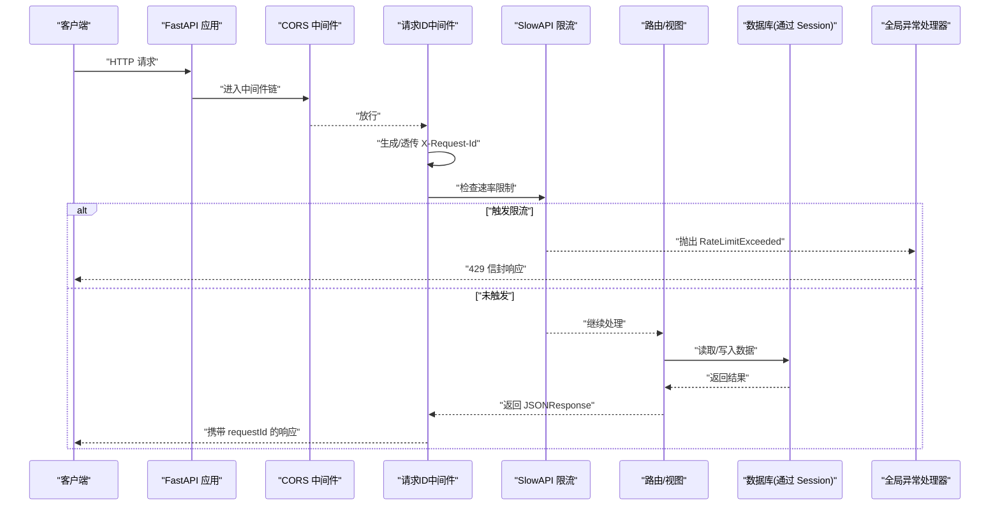
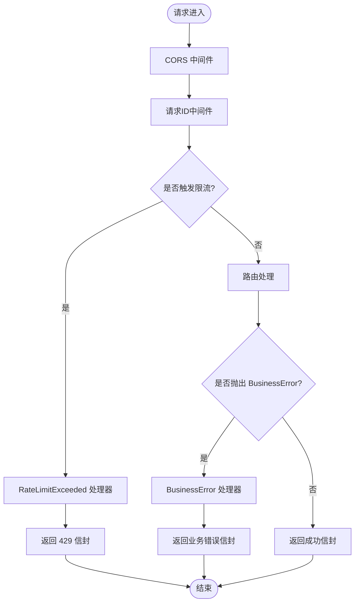
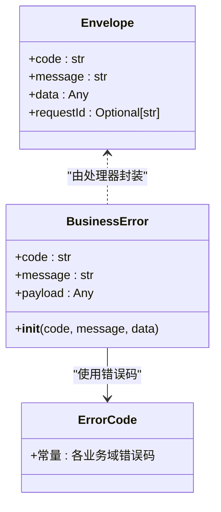
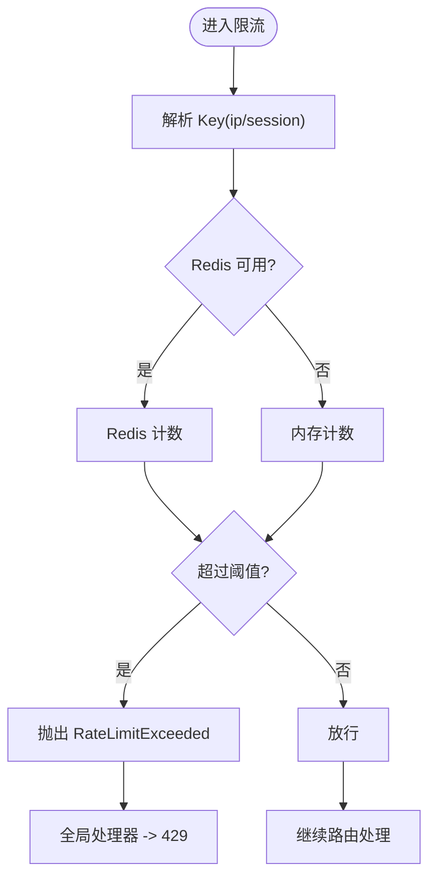
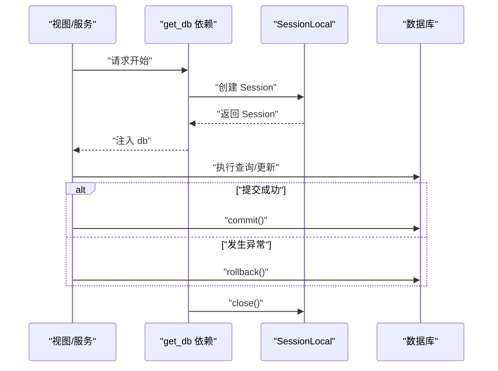
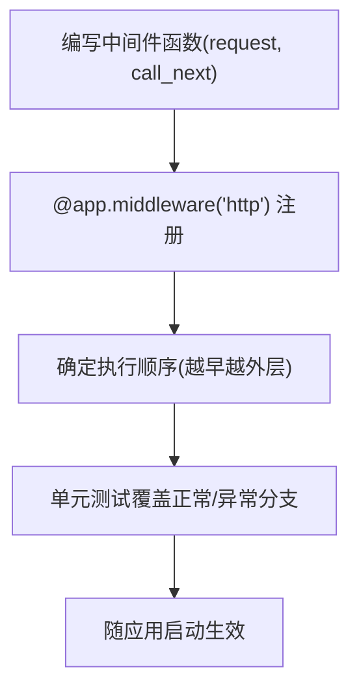
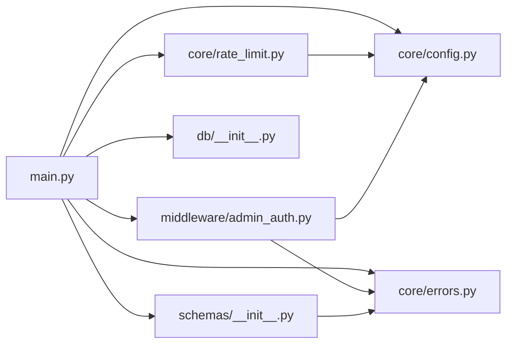

# 核心模块设计

<cite>
**本文引用的文件**   
- [backend/app/main.py](file://backend/app/main.py)
- [backend/app/core/config.py](file://backend/app/core/config.py)
- [backend/app/core/errors.py](file://backend/app/core/errors.py)
- [backend/app/core/rate_limit.py](file://backend/app/core/rate_limit.py)
- [backend/app/middleware/admin_auth.py](file://backend/app/middleware/admin_auth.py)
- [backend/app/db/__init__.py](file://backend/app/db/__init__.py)
- [backend/app/schemas/__init__.py](file://backend/app/schemas/__init__.py)
- [doc/spec/10-API设计规范.md](file://doc/spec/10-API设计规范.md)
</cite>

## 目录
1. [引言](#引言)
2. [项目结构](#项目结构)
3. [核心组件](#核心组件)
4. [架构总览](#架构总览)
5. [详细组件分析](#详细组件分析)
6. [依赖关系分析](#依赖关系分析)
7. [性能考量](#性能考量)
8. [故障排查指南](#故障排查指南)
9. [结论](#结论)
10. [附录](#附录)

## 引言
本设计文档聚焦 Learning Hub 后端核心模块，围绕 FastAPI 应用生命周期与中间件体系、统一错误处理与响应信封、限流策略（SlowAPI）、数据库连接池与会话管理、事务最佳实践以及自定义中间件开发规范展开。目标是帮助读者快速理解系统如何组织请求链路、如何保证一致的错误与追踪信息、如何在生产环境进行安全与性能控制。

## 项目结构
后端采用按领域分层与横切关注点分离的组织方式：
- 应用入口与装配：FastAPI 应用创建、CORS、中间件、异常处理器、路由注册
- 配置中心：环境变量加载、计算字段、缓存实例
- 错误体系：业务错误码、HTTP 状态映射、BusinessError 异常
- 限流：SlowAPI 适配、IP/会话双键 key 函数、存储后端选择
- 鉴权中间件：Admin JWT 校验、令牌签发与验证
- 数据访问：SQLAlchemy 引擎、SessionLocal、get_db 依赖注入
- 统一响应：Envelope 模型与 ok/fail 构造器

图表来源
- [backend/app/main.py:40-112](file://backend/app/main.py#L40-L112)
- [backend/app/core/config.py:9-87](file://backend/app/core/config.py#L9-L87)
- [backend/app/core/errors.py:9-143](file://backend/app/core/errors.py#L9-L143)
- [backend/app/core/rate_limit.py:1-55](file://backend/app/core/rate_limit.py#L1-L55)
- [backend/app/middleware/admin_auth.py:1-66](file://backend/app/middleware/admin_auth.py#L1-L66)
- [backend/app/db/__init__.py:1-51](file://backend/app/db/__init__.py#L1-L51)
- [backend/app/schemas/__init__.py:1-65](file://backend/app/schemas/__init__.py#L1-L65)

章节来源
- [backend/app/main.py:40-112](file://backend/app/main.py#L40-L112)
- [backend/app/core/config.py:9-87](file://backend/app/core/config.py#L9-L87)

## 核心组件
- 应用生命周期与中间件
  - 使用 lifespan 钩子预留启动/关闭扩展点
  - 注册 CORS 中间件，暴露 X-Request-Id 头
  - 注册请求 ID 中间件，贯穿请求上下文
  - 注册全局异常处理器：BusinessError、RateLimitExceeded
  - 挂载 SlowAPI Limiter 到 app.state
- 配置中心
  - 基于 pydantic-settings 从环境变量加载
  - effective_database_url 支持覆盖或拼接
  - cors_origins_list 解析逗号分隔白名单
  - llm_enabled 开关 LLM 能力
- 错误体系
  - ErrorCode 集中定义业务错误码
  - _HTTP_BY_CODE 将业务码映射为 HTTP 状态
  - BusinessError 作为统一抛错类型，由全局处理器包装为信封
- 限流
  - get_limiter 优先 Redis，否则内存
  - rate_limit 装饰器支持 ip/session 两种 key 策略
- 统一响应
  - Envelope 模型与 ok/fail 工具函数
  - envelope_or_business 将 BusinessError 转为信封
- 数据库
  - engine 根据方言选择连接池参数
  - SessionLocal 工厂 + get_db 依赖注入
- Admin 鉴权
  - get_admin_principal 解析 Bearer/Cookie，校验 JWT
  - issue_admin_jwt / verify_admin_token 辅助方法

章节来源
- [backend/app/main.py:40-112](file://backend/app/main.py#L40-L112)
- [backend/app/core/config.py:9-87](file://backend/app/core/config.py#L9-L87)
- [backend/app/core/errors.py:9-143](file://backend/app/core/errors.py#L9-L143)
- [backend/app/core/rate_limit.py:1-55](file://backend/app/core/rate_limit.py#L1-L55)
- [backend/app/schemas/__init__.py:1-65](file://backend/app/schemas/__init__.py#L1-L65)
- [backend/app/db/__init__.py:1-51](file://backend/app/db/__init__.py#L1-L51)
- [backend/app/middleware/admin_auth.py:1-66](file://backend/app/middleware/admin_auth.py#L1-L66)

## 架构总览
下图展示一次典型请求在核心模块中的流转路径，包括中间件链、异常处理与响应封装。

图表来源
- [backend/app/main.py:57-90](file://backend/app/main.py#L57-L90)
- [backend/app/core/rate_limit.py:40-55](file://backend/app/core/rate_limit.py#L40-L55)
- [backend/app/schemas/__init__.py:35-61](file://backend/app/schemas/__init__.py#L35-L61)
- [backend/app/db/__init__.py:41-47](file://backend/app/db/__init__.py#L41-L47)

## 详细组件分析

### 应用生命周期与中间件架构
- 生命周期
  - lifespan 提供异步上下文，便于扩展启动/关闭逻辑（如初始化资源、优雅关停）
- CORS
  - 允许来源来自配置；credentials 开启；方法/头通配；显式暴露 X-Request-Id
- 请求 ID 追踪
  - 若请求头存在 X-Request-Id 则复用，否则生成并写入 request.state
  - 响应头回写 X-Request-Id，便于日志关联
- 限流集成
  - 将 limiter 挂至 app.state.limiter，供后续装饰器或依赖使用
- 全局异常处理
  - BusinessError → 统一信封响应
  - RateLimitExceeded → 429 信封响应

图表来源
- [backend/app/main.py:57-90](file://backend/app/main.py#L57-L90)
- [backend/app/core/errors.py:130-143](file://backend/app/core/errors.py#L130-L143)
- [backend/app/schemas/__init__.py:35-61](file://backend/app/schemas/__init__.py#L35-L61)

章节来源
- [backend/app/main.py:40-112](file://backend/app/main.py#L40-L112)

### 错误处理体系
- 错误码规范
  - ErrorCode 集中定义，涵盖通用、课件、分类、标签、素材、令牌、搜索/LLM 等域
  - _HTTP_BY_CODE 将业务码映射为标准 HTTP 状态码
- BusinessError
  - 继承自 HTTPException，内部 detail 包含 code/message/data
  - 全局处理器将其转换为 {code, message, data, requestId} 信封
- 限流异常
  - RateLimitExceeded 被单独捕获，返回 429 与固定错误码

图表来源
- [backend/app/core/errors.py:9-143](file://backend/app/core/errors.py#L9-L143)
- [backend/app/schemas/__init__.py:24-61](file://backend/app/schemas/__init__.py#L24-L61)

章节来源
- [backend/app/core/errors.py:9-143](file://backend/app/core/errors.py#L9-L143)
- [backend/app/schemas/__init__.py:1-65](file://backend/app/schemas/__init__.py#L1-L65)
- [backend/app/main.py:78-89](file://backend/app/main.py#L78-L89)

### 限流中间件实现原理
- 存储后端
  - 优先使用 storage_redis_url；为空时回退到 memory://
- Key 策略
  - ip：基于远端地址
  - session：尝试从 Authorization Bearer 中解析 sub 片段，失败回退到 IP
- 装饰器
  - rate_limit(spec, key="ip") 返回 Limit，per_method=False 表示跨方法共享配额
- 全局异常
  - RateLimitExceeded 被主应用捕获，返回 429 信封

图表来源
- [backend/app/core/rate_limit.py:18-55](file://backend/app/core/rate_limit.py#L18-L55)
- [backend/app/main.py:84-89](file://backend/app/main.py#L84-L89)

章节来源
- [backend/app/core/rate_limit.py:1-55](file://backend/app/core/rate_limit.py#L1-L55)
- [backend/app/main.py:84-89](file://backend/app/main.py#L84-L89)
- [doc/spec/10-API设计规范.md:109-123](file://doc/spec/10-API设计规范.md#L109-L123)

### 数据库连接池、会话管理与事务处理
- 连接池
  - SQLite：StaticPool + check_same_thread=False
  - 其他：pool_size=10, max_overflow=20, pool_pre_ping=True
- 会话工厂
  - SessionLocal：autoflush=False, autocommit=False, expire_on_commit=False
- 依赖注入
  - get_db() 每个请求一个 Session，finally 中 close
- 事务最佳实践
  - 服务层显式 try/commit/except/rollback
  - 只读场景可显式 SET TRANSACTION READ ONLY（参考 LLM SQL 执行流程）

图表来源
- [backend/app/db/__init__.py:15-47](file://backend/app/db/__init__.py#L15-L47)

章节来源
- [backend/app/db/__init__.py:1-51](file://backend/app/db/__init__.py#L1-L51)

### 中间件开发指南
- 编写模式
  - 使用 @app.middleware("http") 装饰器，接收 Request 与 call_next
  - 在 call_next 前后插入横切逻辑（如日志、审计、追踪）
  - 确保最终返回 Response，必要时设置响应头
- 注册方法
  - 在 create_app 中尽早注册，确保在路由之前生效
  - 如需访问全局配置，建议通过 get_settings() 获取
- 示例要点
  - 请求 ID 中间件展示了如何读写 request.state 与 response.headers
  - Admin 鉴权可作为 Depends 或中间件形式接入，结合 BusinessError 输出统一错误

[本节为通用指导，不直接分析具体文件]

## 依赖关系分析
- 低耦合高内聚
  - main.py 仅负责装配，业务逻辑下沉至 api/services
  - core 模块提供横切能力（配置、错误、限流），被多处复用
- 外部依赖
  - SlowAPI：限流算法与异常
  - SQLAlchemy：连接池与会话
  - Pydantic Settings：配置加载
  - JWT：Admin 鉴权

图表来源
- [backend/app/main.py:40-112](file://backend/app/main.py#L40-L112)
- [backend/app/core/config.py:9-87](file://backend/app/core/config.py#L9-L87)
- [backend/app/core/errors.py:9-143](file://backend/app/core/errors.py#L9-L143)
- [backend/app/core/rate_limit.py:1-55](file://backend/app/core/rate_limit.py#L1-L55)
- [backend/app/schemas/__init__.py:1-65](file://backend/app/schemas/__init__.py#L1-L65)
- [backend/app/db/__init__.py:1-51](file://backend/app/db/__init__.py#L1-L51)
- [backend/app/middleware/admin_auth.py:1-66](file://backend/app/middleware/admin_auth.py#L1-L66)

章节来源
- [backend/app/main.py:40-112](file://backend/app/main.py#L40-L112)

## 性能考量
- 连接池
  - 合理设置 pool_size/max_overflow，避免连接耗尽
  - 启用 pool_pre_ping 提升健壮性
- 限流
  - 生产环境建议使用 Redis 作为共享计数后端，多 worker 一致性
  - 针对热点接口细化 key 策略（IP/会话）
- 响应信封
  - 减少序列化开销，尽量传递必要字段
- 日志
  - 全链路包含 X-Request-Id，便于定位慢请求与异常

[本节为通用指导，不直接分析具体文件]

## 故障排查指南
- 常见问题
  - 429 频繁出现：检查 SlowAPI 配置与 key 策略，确认 Redis 连通性
  - 跨域失败：核对 CORS 白名单与 credentials 配置
  - 认证失败：检查 JWT 密钥、算法与 TTL，确认 Bearer/Cookie 格式
  - 数据库连接异常：检查有效 URL、连接池参数与网络可达
- 定位手段
  - 通过 X-Request-Id 关联请求日志
  - 查看全局异常处理器输出的信封内容
  - 对关键路径增加结构化日志（含 requestId）

章节来源
- [backend/app/main.py:70-89](file://backend/app/main.py#L70-L89)
- [backend/app/core/rate_limit.py:40-55](file://backend/app/core/rate_limit.py#L40-L55)
- [backend/app/middleware/admin_auth.py:26-42](file://backend/app/middleware/admin_auth.py#L26-L42)
- [backend/app/db/__init__.py:15-25](file://backend/app/db/__init__.py#L15-L25)

## 结论
Learning Hub 后端以 FastAPI 为核心，通过清晰的生命周期与中间件体系，实现了统一的跨域、追踪、限流与错误处理。配合集中化的错误码与统一响应信封，提升了可观测性与可维护性。数据库连接与会话管理遵循最佳实践，事务边界明确。限流方案兼顾开发与生产差异，具备良好扩展性。

## 附录
- 配置项速览（节选）
  - database_host/port/user/password/name/url
  - cors_allow_origins
  - jwt_secret/jwt_algorithm/jwt_ttl_hours
  - storage_redis_url
  - log_level
- 限流策略参考
  - 前台 AI 搜索：按 IP，30/分钟
  - 后台写接口：按会话，60/分钟
  - 素材上传：按会话，10/小时

章节来源
- [backend/app/core/config.py:19-87](file://backend/app/core/config.py#L19-L87)
- [doc/spec/10-API设计规范.md:109-123](file://doc/spec/10-API设计规范.md#L109-L123)