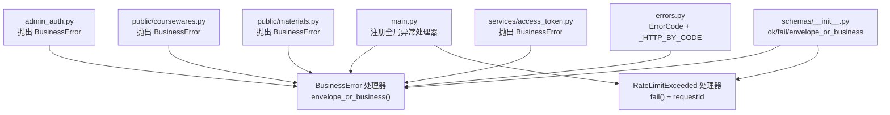
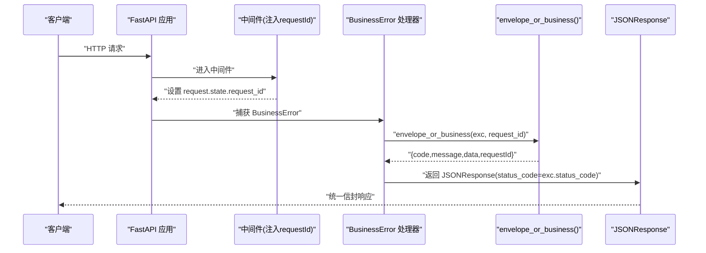
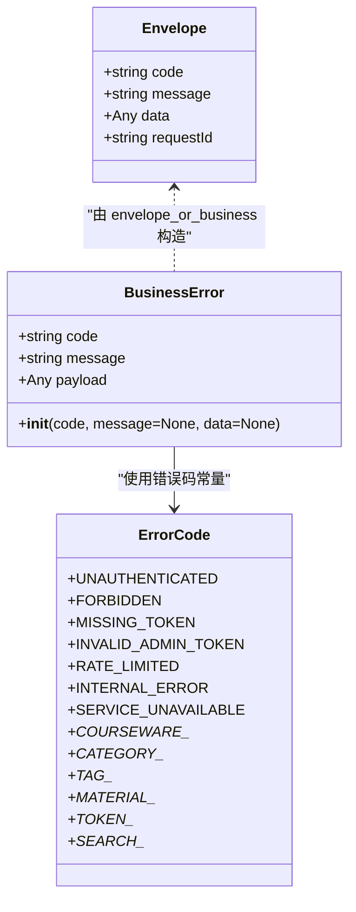
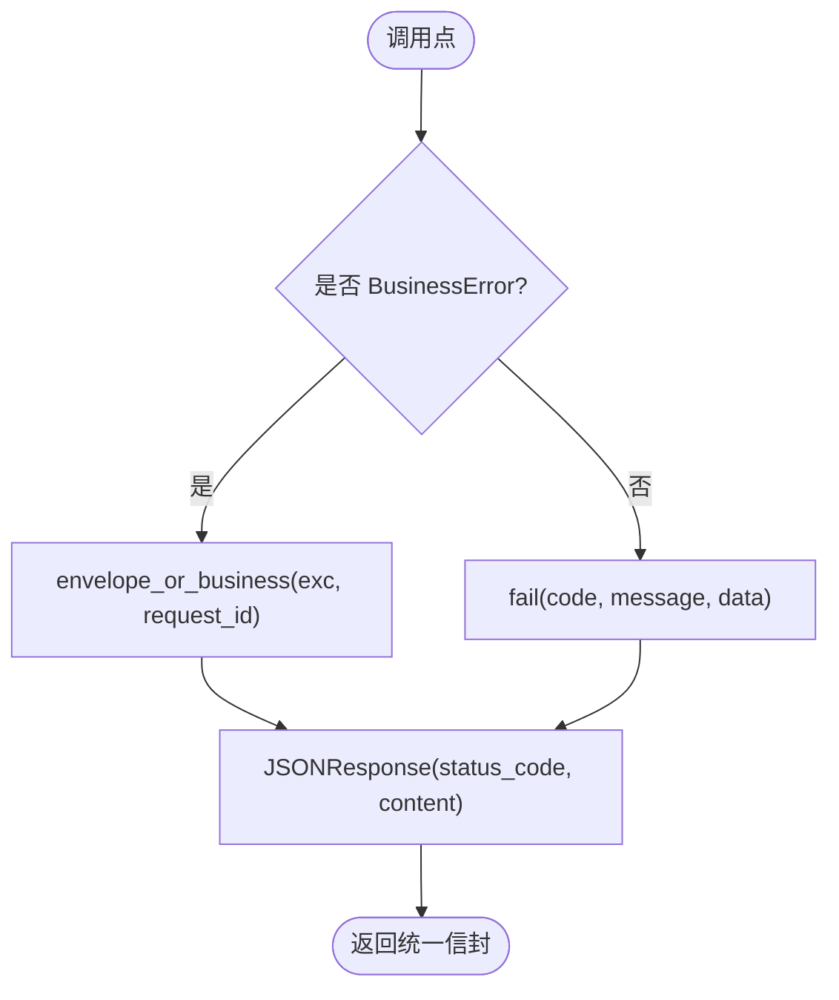
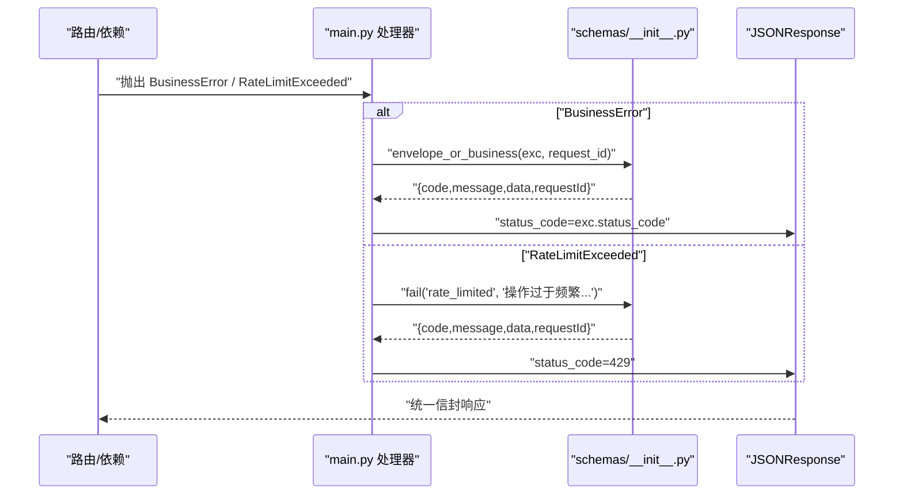
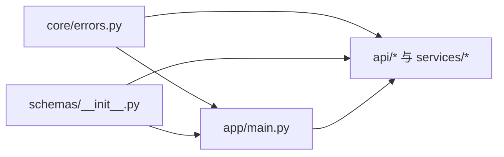

# 错误处理体系

<cite>
**本文引用的文件**   
- [backend/app/core/errors.py](file://backend/app/core/errors.py)
- [backend/app/schemas/__init__.py](file://backend/app/schemas/__init__.py)
- [backend/app/main.py](file://backend/app/main.py)
- [backend/app/middleware/admin_auth.py](file://backend/app/middleware/admin_auth.py)
- [backend/app/api/public/coursewares.py](file://backend/app/api/public/coursewares.py)
- [backend/app/api/public/materials.py](file://backend/app/api/public/materials.py)
- [backend/app/services/access_token.py](file://backend/app/services/access_token.py)
</cite>

## 目录
1. [引言](#引言)
2. [项目结构](#项目结构)
3. [核心组件](#核心组件)
4. [架构总览](#架构总览)
5. [详细组件分析](#详细组件分析)
6. [依赖关系分析](#依赖关系分析)
7. [性能与可观测性](#性能与可观测性)
8. [故障排查指南](#故障排查指南)
9. [结论](#结论)
10. [附录：最佳实践](#附录最佳实践)

## 引言
本文件系统性梳理 Learning Hub 后端的错误处理体系，围绕 BusinessError 自定义异常、统一响应信封、全局异常处理器以及限流异常处理展开。文档面向开发者与测试人员，既提供代码级实现细节，也给出使用规范与排障建议，帮助团队在业务层以一致的方式表达错误、记录日志并对外返回标准化响应。

## 项目结构
错误处理相关的关键位置如下：
- 业务错误码与异常定义：backend/app/core/errors.py
- 统一响应信封与构造函数：backend/app/schemas/__init__.py
- 应用入口与全局异常处理器注册：backend/app/main.py
- 鉴权中间件中的业务异常抛出示例：backend/app/middleware/admin_auth.py
- 公共 API 中业务异常的典型用法：backend/app/api/public/coursewares.py、backend/app/api/public/materials.py
- 服务层对业务规则的校验与异常抛出：backend/app/services/access_token.py

图表来源
- [backend/app/main.py:70-89](file://backend/app/main.py#L70-L89)
- [backend/app/core/errors.py:9-127](file://backend/app/core/errors.py#L9-L127)
- [backend/app/schemas/__init__.py:24-62](file://backend/app/schemas/__init__.py#L24-L62)
- [backend/app/middleware/admin_auth.py:26-42](file://backend/app/middleware/admin_auth.py#L26-L42)
- [backend/app/api/public/coursewares.py:68-104](file://backend/app/api/public/coursewares.py#L68-L104)
- [backend/app/api/public/materials.py:53-75](file://backend/app/api/public/materials.py#L53-L75)
- [backend/app/services/access_token.py:36-41](file://backend/app/services/access_token.py#L36-L41)

章节来源
- [backend/app/main.py:40-116](file://backend/app/main.py#L40-L116)
- [backend/app/core/errors.py:1-144](file://backend/app/core/errors.py#L1-L144)
- [backend/app/schemas/__init__.py:1-65](file://backend/app/schemas/__init__.py#L1-L65)

## 核心组件
- 业务错误码集中管理：ErrorCode 常量类，覆盖通用/认证、课件、分类、标签、素材、访问令牌、AI 搜索等域；同时维护 code 到 HTTP 状态码的映射表，确保语义清晰且稳定。
- 业务异常类型：BusinessError 继承自 FastAPI 的 HTTPException，内部携带 code、message、data（payload），并在构造时根据映射表设置 HTTP 状态码。
- 统一响应信封：Envelope 模型与 ok/fail/envelope_or_business 工具函数，保证所有成功与失败响应具备一致的 JSON 结构 {code, message, data, requestId}。
- 全局异常处理器：
  - BusinessError 处理器：将异常转换为信封响应，并注入 requestId。
  - RateLimitExceeded 处理器：针对限流异常，使用 fail 构造信封并返回 429。

章节来源
- [backend/app/core/errors.py:9-140](file://backend/app/core/errors.py#L9-L140)
- [backend/app/schemas/__init__.py:24-62](file://backend/app/schemas/__init__.py#L24-L62)
- [backend/app/main.py:78-89](file://backend/app/main.py#L78-L89)

## 架构总览
下图展示了请求进入后的错误处理路径：中间件注入 requestId，路由或依赖中抛出的 BusinessError 被全局处理器捕获，最终通过 envelope_or_business 生成统一信封；限流异常由专用处理器处理。

图表来源
- [backend/app/main.py:70-82](file://backend/app/main.py#L70-L82)
- [backend/app/schemas/__init__.py:55-61](file://backend/app/schemas/__init__.py#L55-L61)

## 详细组件分析

### BusinessError 与 ErrorCode 设计
- ErrorCode 集中定义所有业务错误码，并与 API 设计规范保持一致。
- _HTTP_BY_CODE 将业务码映射为 HTTP 状态码，例如未登录 401、参数错误 400、资源冲突 409、限流 429、服务不可用 503 等。
- BusinessError 构造时将 code/message/data 放入 detail，并设置 status_code；随后由全局处理器读取 exc.code/exc.message/exc.payload 组装信封。

图表来源
- [backend/app/core/errors.py:9-140](file://backend/app/core/errors.py#L9-L140)
- [backend/app/schemas/__init__.py:24-31](file://backend/app/schemas/__init__.py#L24-L31)

章节来源
- [backend/app/core/errors.py:9-140](file://backend/app/core/errors.py#L9-L140)

### 统一响应封装机制：envelope_or_business 与 fail
- envelope_or_business：从 BusinessError 实例中提取 code、message、payload，并附加 requestId，形成标准信封。
- fail：用于非 BusinessError 场景（如限流）直接构造失败信封，便于在处理器中快速返回。
- ok：用于正常成功响应的信封构造。

图表来源
- [backend/app/schemas/__init__.py:35-61](file://backend/app/schemas/__init__.py#L35-L61)
- [backend/app/main.py:78-89](file://backend/app/main.py#L78-L89)

章节来源
- [backend/app/schemas/__init__.py:35-61](file://backend/app/schemas/__init__.py#L35-L61)
- [backend/app/main.py:78-89](file://backend/app/main.py#L78-L89)

### 全局异常处理器注册与调用流程
- BusinessError 处理器：
  - 从 request.state 获取 requestId（若存在）。
  - 调用 envelope_or_business 生成信封。
  - 返回 JSONResponse，状态码取自 exc.status_code。
- RateLimitExceeded 处理器：
  - 同样注入 requestId。
  - 使用 fail("rate_limited", ...) 构造信封。
  - 固定返回 429。

图表来源
- [backend/app/main.py:78-89](file://backend/app/main.py#L78-L89)
- [backend/app/schemas/__init__.py:45-61](file://backend/app/schemas/__init__.py#L45-L61)

章节来源
- [backend/app/main.py:78-89](file://backend/app/main.py#L78-L89)

### 业务异常抛出规范与使用场景
- 鉴权中间件：当缺少令牌、令牌过期或无效时，抛出 UNAUTHENTICATED。
- 公开课件接口：RESTRICTED 课件未解锁或令牌不匹配时，抛出 COURSEWARE_ACL_LOCKED；解锁失败时抛出 INVALID_TOKEN。
- 公开素材接口：ACL 校验失败或存储文件丢失时，分别抛出 COURSEWARE_ACL_LOCKED 与 MATERIAL_STORAGE_UNAVAILABLE；预览不存在或页码越界时抛出 MATERIAL_NOT_FOUND。
- 服务层：令牌标签为空或过长、重复、被引用、最后令牌保护等规则均通过 BusinessError 表达。

章节来源
- [backend/app/middleware/admin_auth.py:26-42](file://backend/app/middleware/admin_auth.py#L26-L42)
- [backend/app/api/public/coursewares.py:68-104](file://backend/app/api/public/coursewares.py#L68-L104)
- [backend/app/api/public/materials.py:53-75](file://backend/app/api/public/materials.py#L53-L75)
- [backend/app/services/access_token.py:36-41](file://backend/app/services/access_token.py#L36-L41)

## 依赖关系分析
- errors.py 被 main.py、各 API 与服务层导入，作为错误码与异常的统一来源。
- schemas/__init__.py 被 main.py 与 API 层使用，提供 ok/fail/envelope_or_business。
- main.py 作为应用装配中心，注册中间件与异常处理器，串联整个错误处理链路。

图表来源
- [backend/app/core/errors.py:1-144](file://backend/app/core/errors.py#L1-L144)
- [backend/app/schemas/__init__.py:1-65](file://backend/app/schemas/__init__.py#L1-L65)
- [backend/app/main.py:1-116](file://backend/app/main.py#L1-L116)

章节来源
- [backend/app/core/errors.py:1-144](file://backend/app/core/errors.py#L1-L144)
- [backend/app/schemas/__init__.py:1-65](file://backend/app/schemas/__init__.py#L1-L65)
- [backend/app/main.py:1-116](file://backend/app/main.py#L1-L116)

## 性能与可观测性
- 错误处理路径轻量：BusinessError 仅携带必要字段，处理器直接构造字典并返回 JSONResponse，避免额外序列化开销。
- requestId 贯穿请求生命周期：中间件注入并在响应头回显，便于前端与后端日志关联定位问题。
- 限流异常独立处理：RateLimitExceeded 处理器固定返回 429，避免与业务错误混淆，有利于监控告警区分。

[本节为通用指导，无需特定文件来源]

## 故障排查指南
- 确认错误码与 HTTP 状态码映射是否符合预期：检查 ErrorCode 与 _HTTP_BY_CODE 的定义。
- 核对 BusinessError 的 code/message/data 是否正确传入：确保在抛出时附带可读 message 与可选 data。
- 验证 requestId 是否存在：检查中间件是否执行、请求头是否包含 X-Request-Id。
- 限流相关问题：确认 SlowAPI 配置与 rate_limit 装饰器使用是否正确，查看 RateLimitExceeded 处理器返回体。

章节来源
- [backend/app/core/errors.py:73-127](file://backend/app/core/errors.py#L73-L127)
- [backend/app/main.py:70-89](file://backend/app/main.py#L70-L89)

## 结论
Learning Hub 的错误处理体系以 BusinessError 为核心，结合 ErrorCode 与 HTTP 状态码映射，配合统一信封与全局异常处理器，实现了跨模块的一致错误表达与响应格式。限流异常采用独立处理器，进一步提升了可观测性与运维友好度。遵循本文的最佳实践，可在业务层高效、安全地传递错误信息，并为前端与日志系统提供稳定的契约。

[本节为总结，无需特定文件来源]

## 附录：最佳实践
- 业务异常抛出规范
  - 优先使用 ErrorCode 常量，避免硬编码字符串。
  - 明确设置 message，必要时附带 data（如缺失字段名、限制值等），便于前端提示与调试。
  - 仅在业务规则不满足时抛出 BusinessError；框架级参数校验错误交由 Pydantic/FastAPI 处理。
- 错误日志记录与调试信息收集
  - 利用 requestId 进行全链路追踪，在关键路径记录上下文（用户标识、资源 ID、操作类型）。
  - 对限流、外部依赖超时等异常单独埋点，便于监控与告警。
- 响应一致性
  - 成功路径使用 ok，失败路径使用 fail 或 BusinessError，确保前端统一解析。
  - 保持 code/message/data/requestId 四字段完整，避免遗漏。
- 限流与幂等
  - 对高频接口使用 @limiter.limit，避免滥用导致雪崩。
  - 对写操作增加幂等键或唯一约束，减少并发导致的冲突错误。

[本节为通用指导，无需特定文件来源]