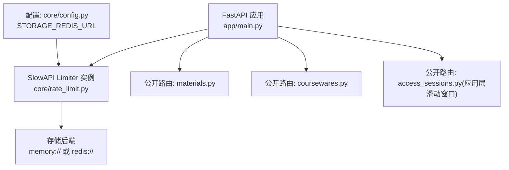
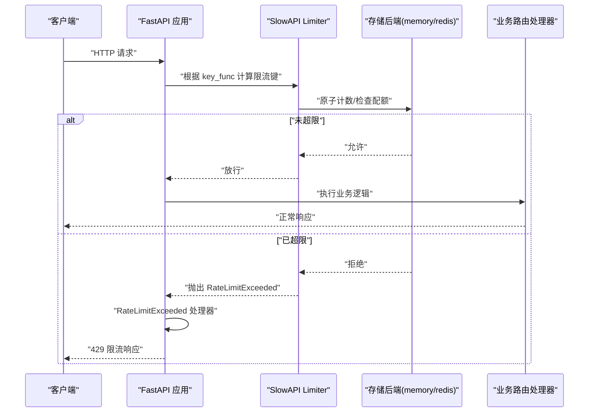
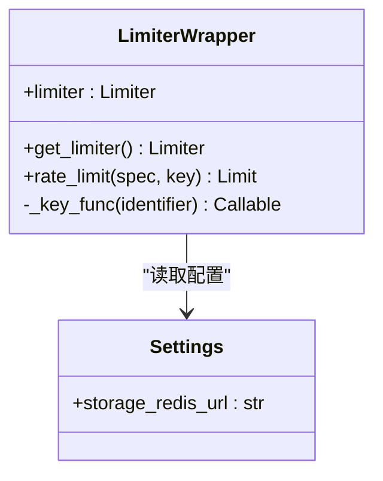
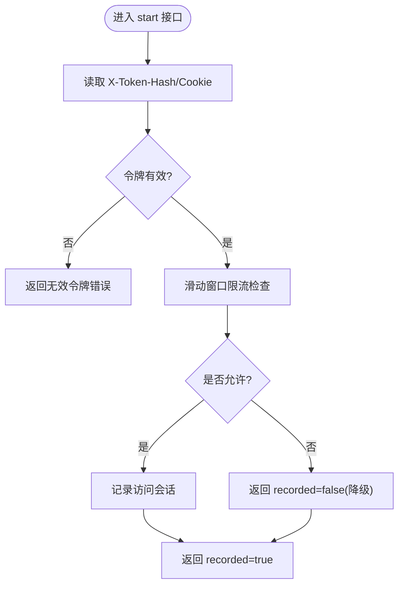
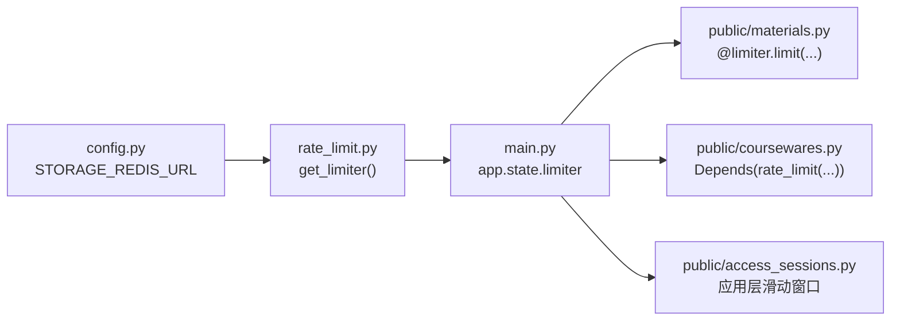

# 限流中间件

<cite>
**本文引用的文件**   
- [backend/app/core/rate_limit.py](file://backend/app/core/rate_limit.py)
- [backend/app/main.py](file://backend/app/main.py)
- [backend/app/api/public/materials.py](file://backend/app/api/public/materials.py)
- [backend/app/api/public/coursewares.py](file://backend/app/api/public/coursewares.py)
- [backend/app/api/public/access_sessions.py](file://backend/app/api/public/access_sessions.py)
- [backend/app/core/config.py](file://backend/app/core/config.py)
- [doc/spec/10-API设计规范.md](file://doc/spec/10-API设计规范.md)
- [deploy/local/tests/test_stream.py](file://deploy/local/tests/test_stream.py)
</cite>

## 目录
1. [简介](#简介)
2. [项目结构](#项目结构)
3. [核心组件](#核心组件)
4. [架构总览](#架构总览)
5. [详细组件分析](#详细组件分析)
6. [依赖关系分析](#依赖关系分析)
7. [性能与执行时机](#性能与执行时机)
8. [配置策略与最佳实践](#配置策略与最佳实践)
9. [故障排查指南](#故障排查指南)
10. [结论](#结论)

## 简介
本文件围绕 Learning Hub 的限流中间件实现，系统性梳理基于 SlowAPI 的限流能力：包括算法选择、存储后端（内存/Redis）切换、不同接口的差异化限流策略（IP/会话）、异常处理与响应格式、以及在生产环境下的性能与可观测性建议。文档同时给出架构图、时序图与流程图，帮助读者快速理解并落地优化。

## 项目结构
限流相关代码主要分布在以下位置：
- 限流核心封装：backend/app/core/rate_limit.py
- 应用装配与异常处理：backend/app/main.py
- 公开接口限流示例：backend/app/api/public/materials.py、backend/app/api/public/coursewares.py
- 应用层滑动窗口兜底限流：backend/app/api/public/access_sessions.py
- 配置项（含 Redis 连接串）：backend/app/core/config.py
- 规范说明（限流策略表）：doc/spec/10-API设计规范.md
- 限流测试用例：deploy/local/tests/test_stream.py

图表来源
- [backend/app/main.py:40-112](file://backend/app/main.py#L40-L112)
- [backend/app/core/rate_limit.py:40-51](file://backend/app/core/rate_limit.py#L40-L51)
- [backend/app/api/public/materials.py:84-90](file://backend/app/api/public/materials.py#L84-L90)
- [backend/app/api/public/coursewares.py:19-22](file://backend/app/api/public/coursewares.py#L19-L22)
- [backend/app/api/public/access_sessions.py:35-54](file://backend/app/api/public/access_sessions.py#L35-L54)
- [backend/app/core/config.py:62-64](file://backend/app/core/config.py#L62-L64)

章节来源
- [backend/app/core/rate_limit.py:1-55](file://backend/app/core/rate_limit.py#L1-L55)
- [backend/app/main.py:1-116](file://backend/app/main.py#L1-L116)
- [backend/app/api/public/materials.py:1-224](file://backend/app/api/public/materials.py#L1-L224)
- [backend/app/api/public/coursewares.py:1-133](file://backend/app/api/public/coursewares.py#L1-L133)
- [backend/app/api/public/access_sessions.py:1-120](file://backend/app/api/public/access_sessions.py#L1-L120)
- [backend/app/core/config.py:1-88](file://backend/app/core/config.py#L1-L88)
- [doc/spec/10-API设计规范.md:109-123](file://doc/spec/10-API设计规范.md#L109-L123)
- [deploy/local/tests/test_stream.py:147-165](file://deploy/local/tests/test_stream.py#L147-L165)

## 核心组件
- SlowAPI Limiter 实例化与全局注入
  - 通过 get_limiter() 创建 Limiter，默认 key_func 为获取远端 IP；storage_uri 优先使用配置的 Redis URL，否则回退到 memory://。
  - 在 FastAPI 应用中通过 app.state.limiter = limiter 完成注入，供后续装饰器与依赖解析使用。
- 自定义 Key 函数
  - _key_func 支持按 "ip" 或 "session" 两种维度生成限流键：
    - ip：以远端地址作为键前缀
    - session：从 Authorization 头中尝试提取 JWT 片段作为会话标识，失败时回退到 IP
- 装饰器封装 rate_limit(spec, key="ip")
  - 返回 Limit 对象，便于在路由上声明式限流；per_method=False 表示不区分 HTTP 方法。
- 统一异常处理
  - 注册 RateLimitExceeded 处理器，返回 429 及统一错误体，包含 requestId。

章节来源
- [backend/app/core/rate_limit.py:17-54](file://backend/app/core/rate_limit.py#L17-L54)
- [backend/app/main.py:67-89](file://backend/app/main.py#L67-L89)

## 架构总览
下图展示了请求进入 FastAPI 后，限流中间件的执行路径与关键交互点。

图表来源
- [backend/app/main.py:67-89](file://backend/app/main.py#L67-L89)
- [backend/app/core/rate_limit.py:40-51](file://backend/app/core/rate_limit.py#L40-L51)

## 详细组件分析

### 限流核心模块（rate_limit.py）
- 目标
  - 提供统一的 SlowAPI 适配层，屏蔽底层存储差异，暴露简洁的路由装饰器。
- 关键点
  - storage_uri 来自配置项 storage_redis_url；为空则使用 memory://。
  - key_func 支持 "ip"/"session" 两种模式，session 模式下从 Authorization 头取 JWT 片段作为会话标识，失败回退到 IP。
  - 暴露 limiter 单例与 rate_limit 装饰器，方便在各路由按需启用。
- 复杂度与性能
  - key 解析为 O(1)，仅涉及字符串拼接与头部读取。
  - 存储后端为 memory 时为进程内计数器；为 redis 时为网络 I/O，需关注延迟与连接池。

图表来源
- [backend/app/core/rate_limit.py:17-54](file://backend/app/core/rate_limit.py#L17-L54)
- [backend/app/core/config.py:62-64](file://backend/app/core/config.py#L62-L64)

章节来源
- [backend/app/core/rate_limit.py:1-55](file://backend/app/core/rate_limit.py#L1-L55)
- [backend/app/core/config.py:62-64](file://backend/app/core/config.py#L62-L64)

### 应用装配与异常处理（main.py）
- 将 limiter 注入到 app.state.limiter，以便 SlowAPI 在运行时访问。
- 注册 RateLimitExceeded 异常处理器，返回 429 与统一错误体，并携带 requestId 用于追踪。

章节来源
- [backend/app/main.py:67-89](file://backend/app/main.py#L67-L89)

### 公开素材接口限流（materials.py）
- 对 /stream、/image/{page_no}、/{material_id} 等接口使用 @limiter.limit("60/minute") 进行 IP 维度的限流。
- 这些接口属于高吞吐场景，采用固定窗口分钟级限制，避免资源被滥用。

章节来源
- [backend/app/api/public/materials.py:84-90](file://backend/app/api/public/materials.py#L84-L90)
- [backend/app/api/public/materials.py:149-151](file://backend/app/api/public/materials.py#L149-L151)
- [backend/app/api/public/materials.py:183-185](file://backend/app/api/public/materials.py#L183-L185)

### 公开课件接口限流（coursewares.py）
- 提供 rate_limit 装饰器用法注释，展示如何以 Depends(rate_limit(...)) 的方式挂载限流。
- 结合规范文档中的策略表，可按需为搜索、详情、解锁等接口设置差异化阈值。

章节来源
- [backend/app/api/public/coursewares.py:19-22](file://backend/app/api/public/coursewares.py#L19-L22)
- [doc/spec/10-API设计规范.md:109-123](file://doc/spec/10-API设计规范.md#L109-L123)

### 访问会话接口与应用层滑动窗口（access_sessions.py）
- 针对 /api/public/access-sessions 接口，实现了应用层滑动窗口限流：
  - 每 IP 每分钟最多 N 次（默认 60），超过后仍返回 200，但 recorded=false，即降级记录但不阻塞调用。
  - 使用线程锁保护内存队列，保证并发安全。
- 该策略与 SlowAPI 的固定窗口形成互补，适用于“尽量不阻断用户”的场景。

图表来源
- [backend/app/api/public/access_sessions.py:35-54](file://backend/app/api/public/access_sessions.py#L35-L54)

章节来源
- [backend/app/api/public/access_sessions.py:35-54](file://backend/app/api/public/access_sessions.py#L35-L54)

### 限流规则与策略（规范参考）
- 规范文档定义了多类接口的限流范围、阈值与 Key 构造方式，例如：
  - 前台 AI 搜索（按 IP）：30 req/min
  - 前台课件解锁（按 IP+Token 哈希）：10 req/min
  - 前台课件详情（按 IP）：120 req/min
  - 后台通用写接口（按会话）：60 req/min
  - 素材上传（按会话）：10 req/h
- 生产部署多 worker 时，SlowAPI storage_uri 切换到 redis://，共享计数；开发环境可直接走内存模式。

章节来源
- [doc/spec/10-API设计规范.md:109-123](file://doc/spec/10-API设计规范.md#L109-L123)

## 依赖关系分析
- 模块耦合
  - rate_limit.py 依赖 config.py 获取 Redis 连接串；main.py 注入 limiter 并处理异常；各路由模块通过装饰器或 Depends 使用限流。
- 外部依赖
  - SlowAPI 负责速率限制算法与存储后端抽象；Redis 作为分布式共享存储（可选）。
- 潜在循环依赖
  - 当前结构无直接循环导入；注意在路由中引入 limiter 时需避免与初始化顺序冲突。

图表来源
- [backend/app/core/config.py:62-64](file://backend/app/core/config.py#L62-L64)
- [backend/app/core/rate_limit.py:40-51](file://backend/app/core/rate_limit.py#L40-L51)
- [backend/app/main.py:67-89](file://backend/app/main.py#L67-L89)
- [backend/app/api/public/materials.py:84-90](file://backend/app/api/public/materials.py#L84-L90)
- [backend/app/api/public/coursewares.py:19-22](file://backend/app/api/public/coursewares.py#L19-L22)
- [backend/app/api/public/access_sessions.py:35-54](file://backend/app/api/public/access_sessions.py#L35-L54)

章节来源
- [backend/app/core/rate_limit.py:1-55](file://backend/app/core/rate_limit.py#L1-L55)
- [backend/app/main.py:1-116](file://backend/app/main.py#L1-L116)
- [backend/app/api/public/materials.py:1-224](file://backend/app/api/public/materials.py#L1-L224)
- [backend/app/api/public/coursewares.py:1-133](file://backend/app/api/public/coursewares.py#L1-L133)
- [backend/app/api/public/access_sessions.py:1-120](file://backend/app/api/public/access_sessions.py#L1-L120)
- [backend/app/core/config.py:1-88](file://backend/app/core/config.py#L1-L88)

## 性能与执行时机
- 执行时机
  - SlowAPI 在路由匹配后、业务处理器之前执行限流判断；若超限，立即抛出异常并由主应用的异常处理器统一返回 429。
- 存储后端影响
  - memory：零网络开销，适合单进程/单实例；多实例下计数不共享。
  - redis：跨实例共享计数，增加网络延迟；需合理配置连接池与超时。
- 原子操作
  - SlowAPI 内部对计数进行原子更新；Redis 模式下依赖 Redis 原子命令（如 INCR/EXPIRE 组合），确保在高并发下一致性。
- 连接池管理
  - 建议在部署环境中为 Redis 配置合理的连接池大小与空闲回收策略，避免连接耗尽导致限流服务抖动。
- 监控与指标
  - 建议采集 429 比率、各 Key 维度命中率、Redis 延迟分布，并结合告警阈值进行容量规划。

[本节为通用指导，无需特定文件引用]

## 配置策略与最佳实践
- 算法选择
  - 固定窗口（SlowAPI 默认）：实现简单、成本低，适合大多数场景；存在边界突刺问题。
  - 滑动窗口（应用层）：更平滑，适合“尽量不阻断”的业务（如访问会话记录），但实现复杂且占用内存。
- 存储后端
  - 开发/单实例：memory//
  - 生产/多实例：redis://，并通过 STORAGE_REDIS_URL 配置。
- 阈值设置
  - 参考规范文档中的策略表，结合压测结果逐步上调阈值；对热点接口（如 /stream）单独评估。
- 统计分析与告警
  - 统计 429 比例、Top Key 列表、分接口 QPS；当 429 比率超过阈值或某 Key 频繁命中时触发告警。
- 限流粒度
  - IP 维度：防刷基础防护
  - 会话维度：精细化控制，避免单个账号滥用
  - 接口维度：按业务敏感度差异化配置
- 降级策略
  - 对于非关键路径（如访问会话记录），可采用“记录=false”的降级方案，保障用户体验。

章节来源
- [doc/spec/10-API设计规范.md:109-123](file://doc/spec/10-API设计规范.md#L109-L123)
- [backend/app/core/config.py:62-64](file://backend/app/core/config.py#L62-L64)
- [backend/app/api/public/access_sessions.py:35-54](file://backend/app/api/public/access_sessions.py#L35-L54)

## 故障排查指南
- 现象：大量 429 响应
  - 检查对应接口的限流阈值与 Key 维度是否符合预期
  - 确认 Redis 连通性与延迟；必要时临时切换至 memory 验证是否为存储瓶颈
- 现象：多实例计数不一致
  - 确认 storage_redis_url 是否正确配置；确保所有实例指向同一 Redis DB
- 现象：本地测试无法复现限流
  - TestClient 默认 key_func 为 get_remote_address；可通过连续请求构造触发条件（参见测试用例）
- 现象：会话维度限流失效
  - 检查 Authorization 头格式与 JWT 片段截取逻辑；确认 fallback 到 IP 的行为是否符合预期

章节来源
- [backend/app/main.py:84-89](file://backend/app/main.py#L84-L89)
- [backend/app/core/rate_limit.py:17-37](file://backend/app/core/rate_limit.py#L17-L37)
- [deploy/local/tests/test_stream.py:147-165](file://deploy/local/tests/test_stream.py#L147-L165)

## 结论
Learning Hub 的限流中间件以 SlowAPI 为核心，结合配置化的存储后端与灵活的 Key 函数，实现了 IP/会话双维度的差异化限流。通过统一异常处理与规范化的策略定义，既保证了系统稳定性，又兼顾了用户体验。生产环境下建议启用 Redis 共享计数、完善监控告警，并根据实际流量特征持续优化阈值与粒度。