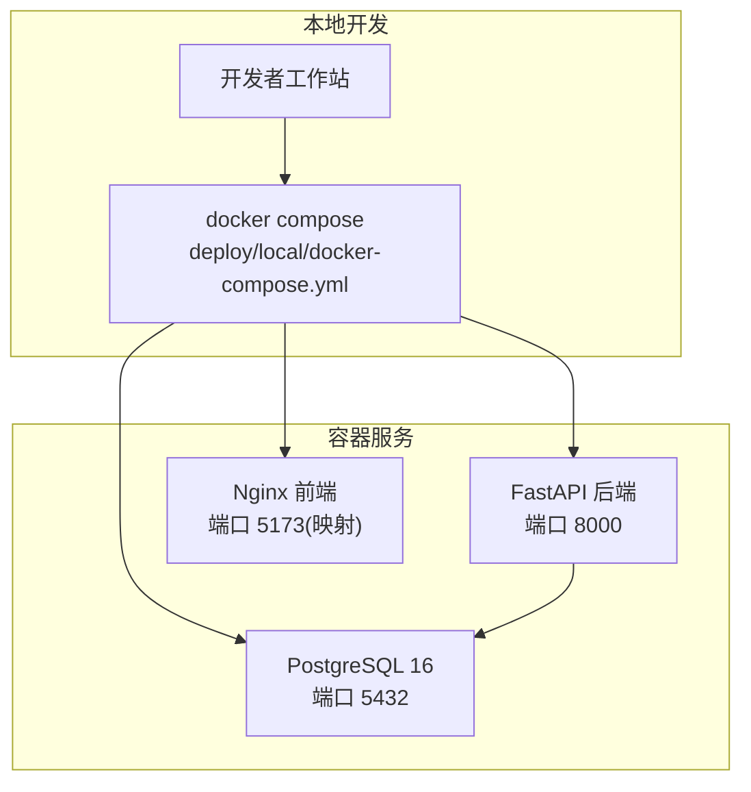
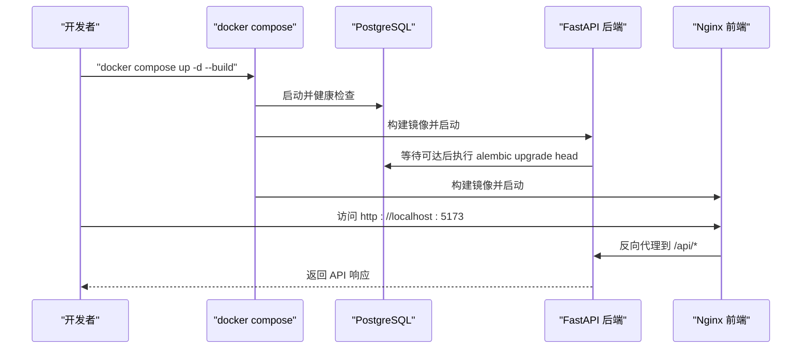
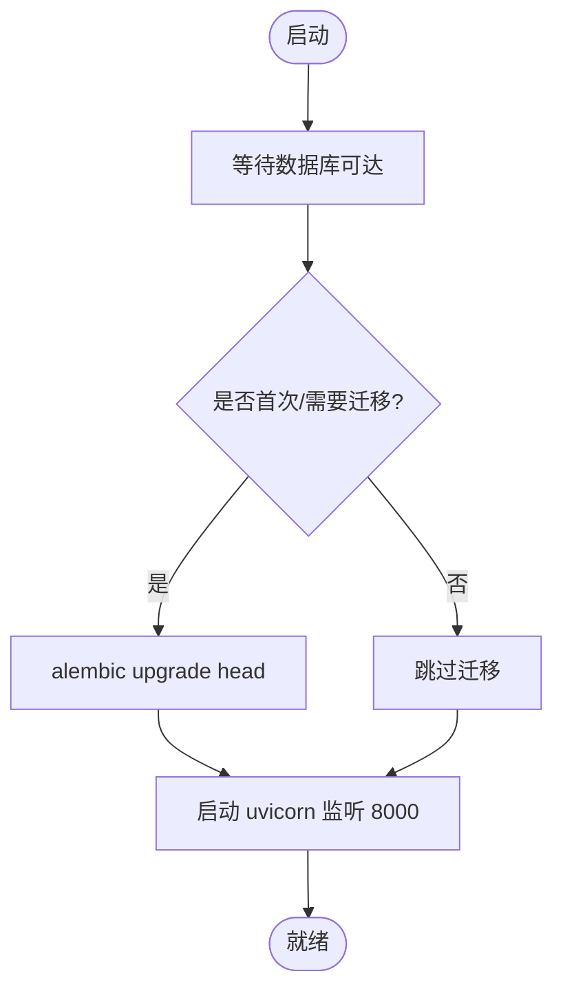
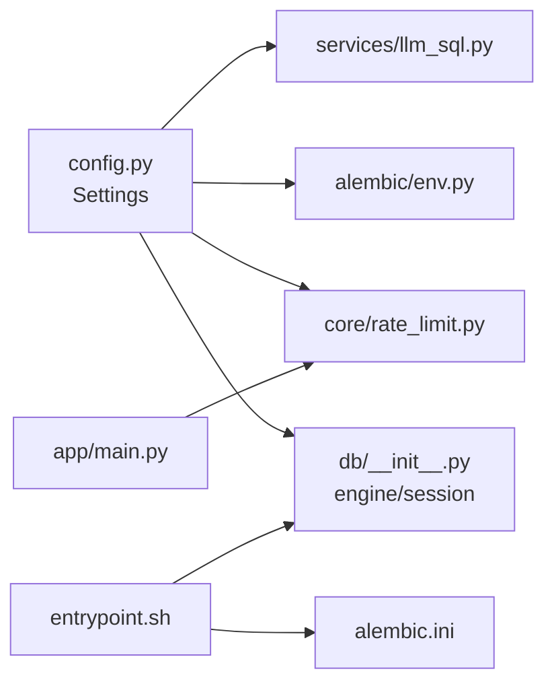

# 环境搭建与配置

<cite>
**本文引用的文件**   
- [backend/pyproject.toml](file://backend/pyproject.toml)
- [backend/app/core/config.py](file://backend/app/core/config.py)
- [backend/app/db/__init__.py](file://backend/app/db/__init__.py)
- [backend/alembic.ini](file://backend/alembic.ini)
- [backend/alembic/env.py](file://backend/alembic/env.py)
- [backend/Dockerfile](file://backend/Dockerfile)
- [backend/entrypoint.sh](file://backend/entrypoint.sh)
- [deploy/local/docker-compose.yml](file://deploy/local/docker-compose.yml)
- [backend/app/main.py](file://backend/app/main.py)
- [backend/app/core/rate_limit.py](file://backend/app/core/rate_limit.py)
- [backend/app/services/llm_sql.py](file://backend/app/services/llm_sql.py)
- [doc/spec/10-API设计规范.md](file://doc/spec/10-API设计规范.md)
- [doc/spec/06-非功能需求.md](file://doc/spec/06-非功能需求.md)
- [frontend/playwright.config.ts](file://frontend/playwright.config.ts)
- [deploy/local/README.md](file://deploy/local/README.md)
- [deploy/local/scripts/verify-llm-search.ps1](file://deploy/local/scripts/verify-llm-search.ps1)
- [.gitignore](file://.gitignore)
</cite>

## 目录
1. [简介](#简介)
2. [项目结构](#项目结构)
3. [核心组件](#核心组件)
4. [架构总览](#架构总览)
5. [详细组件分析](#详细组件分析)
6. [依赖关系分析](#依赖关系分析)
7. [性能考虑](#性能考虑)
8. [故障排查指南](#故障排查指南)
9. [结论](#结论)
10. [附录](#附录)

## 简介
本指南面向 Learning Hub 后端开发环境的本地搭建与配置，覆盖 Python 环境与依赖、环境变量管理、数据库与缓存连接、外部服务集成、Docker 容器化开发与调试、日志与监控指标、以及常见问题排查。目标是让开发者在最短时间获得可运行的本地环境，并理解各配置项的作用与差异。

## 项目结构
后端采用 FastAPI + SQLAlchemy + Alembic，使用 PostgreSQL 作为主数据库，Redis 可选用于限流存储；通过 Docker Compose 一键拉起 Postgres、后端与前端（Nginx）。关键路径：
- 应用入口与中间件装配：backend/app/main.py
- 配置加载与环境变量：backend/app/core/config.py
- 数据库引擎与会话：backend/app/db/__init__.py
- 迁移脚本与配置：backend/alembic.ini、backend/alembic/env.py
- 容器镜像构建与启动：backend/Dockerfile、backend/entrypoint.sh
- 本地编排：deploy/local/docker-compose.yml
- 限流实现：backend/app/core/rate_limit.py
- LLM 搜索能力：backend/app/services/llm_sql.py



图表来源
- [deploy/local/docker-compose.yml:1-74](file://deploy/local/docker-compose.yml#L1-L74)
- [backend/Dockerfile:1-85](file://backend/Dockerfile#L1-L85)
- [backend/entrypoint.sh:1-23](file://backend/entrypoint.sh#L1-L23)

章节来源
- [deploy/local/docker-compose.yml:1-74](file://deploy/local/docker-compose.yml#L1-L74)
- [backend/Dockerfile:1-85](file://backend/Dockerfile#L1-L85)
- [backend/entrypoint.sh:1-23](file://backend/entrypoint.sh#L1-L23)

## 核心组件
- 配置中心：基于 pydantic-settings 从环境变量与 .env 加载，提供 effective_database_url、CORS、时区、LLM 开关等。
- 数据库层：SQLAlchemy 同步引擎，适配 SQLite 与 Postgres；Alembic 在线/离线迁移。
- 限流：SlowAPI，支持内存或 Redis 存储，按 IP/会话键控。
- LLM 搜索：dashscope SDK 调用 qwen-plus，失败自动降级为关键词检索。
- 应用入口：注册路由、中间件、异常处理、请求 ID 透传。

章节来源
- [backend/app/core/config.py:1-88](file://backend/app/core/config.py#L1-L88)
- [backend/app/db/__init__.py:1-50](file://backend/app/db/__init__.py#L1-L50)
- [backend/alembic.ini:1-40](file://backend/alembic.ini#L1-L40)
- [backend/alembic/env.py:1-62](file://backend/alembic/env.py#L1-L62)
- [backend/app/core/rate_limit.py:1-55](file://backend/app/core/rate_limit.py#L1-L55)
- [backend/app/services/llm_sql.py:1-490](file://backend/app/services/llm_sql.py#L1-L490)
- [backend/app/main.py:1-116](file://backend/app/main.py#L1-L116)

## 架构总览
下图展示本地开发环境下，容器编排、服务间依赖与数据流向。



图表来源
- [deploy/local/docker-compose.yml:1-74](file://deploy/local/docker-compose.yml#L1-L74)
- [backend/entrypoint.sh:1-23](file://backend/entrypoint.sh#L1-L23)
- [backend/Dockerfile:1-85](file://backend/Dockerfile#L1-L85)

## 详细组件分析

### 环境变量与配置管理
- 读取顺序：进程环境变量优先，其次 .env 文件；大小写不敏感，忽略未知字段。
- 数据库 URL：若 DATABASE_URL 为空，则根据 host/port/user/password/name 拼接 postgresql+psycopg2://...；测试环境可通过设置 DATABASE_URL 切换至 SQLite 内存库。
- CORS：支持逗号分隔的白名单列表。
- LLM：DASHSCOPE_API_KEY 留空即禁用，搜索走 ILIKE 降级。
- 日志级别：由 LOG_LEVEL 控制。
- 安全建议：.env 已被 .gitignore 忽略，切勿提交包含凭据的文件。

章节来源
- [backend/app/core/config.py:1-88](file://backend/app/core/config.py#L1-L88)
- [backend/tests/conftest.py:1-32](file://backend/tests/conftest.py#L1-L32)
- [.gitignore:1-39](file://.gitignore#L1-L39)

### 数据库连接与迁移
- 连接参数：DATABASE_HOST/PORT/USER/PASSWORD/NAME 或 DATABASE_URL 整体串。
- 引擎与池：Postgres 使用连接池；SQLite 使用 StaticPool 并允许跨线程访问（测试场景）。
- Alembic：默认指向 Postgres；env.py 会注入 Settings.effective_database_url，支持在线/离线模式。
- 迁移执行：容器启动时 entrypoint.sh 等待 DB 可达后执行 alembic upgrade head。



图表来源
- [backend/entrypoint.sh:1-23](file://backend/entrypoint.sh#L1-L23)
- [backend/alembic/env.py:1-62](file://backend/alembic/env.py#L1-L62)
- [backend/app/db/__init__.py:1-50](file://backend/app/db/__init__.py#L1-L50)

章节来源
- [backend/app/db/__init__.py:1-50](file://backend/app/db/__init__.py#L1-L50)
- [backend/alembic.ini:1-40](file://backend/alembic.ini#L1-L40)
- [backend/alembic/env.py:1-62](file://backend/alembic/env.py#L1-L62)
- [backend/entrypoint.sh:1-23](file://backend/entrypoint.sh#L1-L23)

### Redis 限流与缓存
- SlowAPI 限流：默认内存存储；当 STORAGE_REDIS_URL 非空时切换到 Redis，适合多 worker 共享计数。
- Key 构造：支持按 IP 或会话（Bearer Token 中 sub 片段）区分。
- 生产建议：开启 Redis 以保障分布式一致性；同时结合业务接口设置合理阈值。

章节来源
- [backend/app/core/rate_limit.py:1-55](file://backend/app/core/rate_limit.py#L1-L55)
- [doc/spec/10-API设计规范.md:109-140](file://doc/spec/10-API设计规范.md#L109-L140)

### 外部服务集成（LLM 搜索）
- 启用条件：DASHSCOPE_API_KEY 已配置且非空。
- 模型与超时：qwen-plus，默认超时 8s，可配置；最大返回行数可配。
- 安全策略：生成的 SQL 经过白名单校验，失败则降级为关键词检索。
- 降级行为：无 key、网络超时、校验拒绝均回退到 ILIKE，前端不可感知差异。

```mermaid
sequenceDiagram
participant Client as "客户端"
participant API as "FastAPI 路由"
participant LLM as "llm_sql.search"
participant DB as "PostgreSQL"
Client->>API : "GET /api/public/coursewares/search?q=..."
API->>LLM : "is_enabled() ?"
alt 未配置 DASHSCOPE_API_KEY
LLM-->>API : "禁用 → 关键词兜底"
API->>DB : "ILIKE 查询"
DB-->>API : "结果集"
else 已配置
LLM->>LLM : "generate_sql()"
LLM->>LLM : "validate_sql() 白名单"
alt 校验通过
LLM->>DB : "SET TRANSACTION READ ONLY; SELECT ..."
DB-->>LLM : "id 列表"
LLM-->>API : "ids, source='llm'"
else 校验失败/超时/空
LLM-->>API : "source='keyword' 降级"
API->>DB : "ILIKE 查询"
DB-->>API : "结果集"
end
end
API-->>Client : "统一响应格式"
```

图表来源
- [backend/app/services/llm_sql.py:1-490](file://backend/app/services/llm_sql.py#L1-L490)
- [doc/spec/10-API设计规范.md:1009-1076](file://doc/spec/10-API设计规范.md#L1009-L1076)

章节来源
- [backend/app/services/llm_sql.py:1-490](file://backend/app/services/llm_sql.py#L1-L490)
- [doc/spec/10-API设计规范.md:1009-1076](file://doc/spec/10-API设计规范.md#L1009-L1076)

### 应用入口与中间件
- 生命周期：创建 FastAPI 实例，注册 CORS、SlowAPI、请求 ID 中间件、全局异常处理器。
- 路由：公开接口、认证、后台管理等模块路由集中注册。
- 文档：OpenAPI/Swagger/ReDoc 暴露于 /api/docs、/api/redoc、/api/openapi.json。

章节来源
- [backend/app/main.py:1-116](file://backend/app/main.py#L1-L116)

### 依赖包与工具链
- Python 版本要求：>=3.11。
- 运行时依赖：FastAPI、Uvicorn、SQLAlchemy、Alembic、psycopg2-binary、asyncpg、Pydantic、python-jose、passlib、slowapi、redis、httpx、PyJWT、dashscope。
- 开发依赖：pytest、pytest-asyncio、pytest-cov、ruff、mypy。
- 构建系统：poetry-core（但镜像内使用 pip 安装以简化流程）。

章节来源
- [backend/pyproject.toml:1-47](file://backend/pyproject.toml#L1-L47)

### Docker 容器化与本地调试
- 镜像构建：基础镜像 python:3.11-slim，安装系统依赖（LibreOffice、poppler、ffmpeg、字体），使用清华源加速。
- 健康检查：/api/public/health。
- 启动脚本：entrypoint.sh 等待 DB 可达、执行迁移、启动 uvicorn。
- 本地编排：postgres/backend/frontend 三服务，持久化 pgdata 与 storage 卷。
- 前端 E2E：Playwright 默认 baseURL 为 http://localhost:5173，与 docker-compose 一致。

章节来源
- [backend/Dockerfile:1-85](file://backend/Dockerfile#L1-L85)
- [backend/entrypoint.sh:1-23](file://backend/entrypoint.sh#L1-L23)
- [deploy/local/docker-compose.yml:1-74](file://deploy/local/docker-compose.yml#L1-L74)
- [frontend/playwright.config.ts:1-34](file://frontend/playwright.config.ts#L1-L34)
- [deploy/local/README.md:1-72](file://deploy/local/README.md#L1-L72)

## 依赖关系分析
- 配置依赖：app.core.config.Settings 被 app.db、alembic.env、rate_limit、llm_sql 等多处引用。
- 运行期依赖：main.py 聚合路由与中间件；entrypoint.sh 驱动迁移与启动。
- 外部依赖：PostgreSQL（必需）、Redis（可选）、阿里云百炼 dashscope（可选）。



图表来源
- [backend/app/core/config.py:1-88](file://backend/app/core/config.py#L1-L88)
- [backend/app/db/__init__.py:1-50](file://backend/app/db/__init__.py#L1-L50)
- [backend/alembic/env.py:1-62](file://backend/alembic/env.py#L1-L62)
- [backend/app/core/rate_limit.py:1-55](file://backend/app/core/rate_limit.py#L1-L55)
- [backend/app/services/llm_sql.py:1-490](file://backend/app/services/llm_sql.py#L1-L490)
- [backend/app/main.py:1-116](file://backend/app/main.py#L1-L116)
- [backend/entrypoint.sh:1-23](file://backend/entrypoint.sh#L1-L23)
- [backend/alembic.ini:1-40](file://backend/alembic.ini#L1-L40)

## 性能考虑
- 指标基线：HTTP 请求 P95、搜索接口 P95、DB 查询 P95、LLM 调用 P95、错误率等均有明确目标。
- 限流策略：不同接口按 IP/会话维度限制，防止滥用。
- LLM 超时：默认 8s，失败自动降级，避免拖慢整体响应。
- 连接池：Postgres 使用连接池，提升并发处理能力。

章节来源
- [doc/spec/06-非功能需求.md:125-136](file://doc/spec/06-非功能需求.md#L125-L136)
- [doc/spec/10-API设计规范.md:109-140](file://doc/spec/10-API设计规范.md#L109-L140)
- [backend/app/db/__init__.py:1-50](file://backend/app/db/__init__.py#L1-L50)

## 故障排查指南
- 数据库不可达
  - 现象：容器启动后无法连接数据库或迁移失败。
  - 排查：确认 POSTGRES_* 环境变量与端口映射；查看 entrypoint.sh 等待逻辑与 alembic 输出。
  - 参考：[backend/entrypoint.sh:1-23](file://backend/entrypoint.sh#L1-L23)、[backend/alembic.ini:1-40](file://backend/alembic.ini#L1-L40)

- LLM 搜索超时或不可用
  - 现象：搜索耗时较长或直接降级为关键词检索。
  - 排查：检查 DASHSCOPE_API_KEY 是否配置；确认网络可达；必要时调高 LLM_SQL_TIMEOUT_SECONDS。
  - 参考：[backend/app/services/llm_sql.py:1-490](file://backend/app/services/llm_sql.py#L1-L490)、[deploy/local/README.md:337-344](file://deploy/local/README.md#L337-L344)

- 限流触发 429
  - 现象：短时间内频繁请求返回 429。
  - 排查：确认 STORAGE_REDIS_URL 是否配置；核对各接口的限流阈值与 key 构造。
  - 参考：[backend/app/core/rate_limit.py:1-55](file://backend/app/core/rate_limit.py#L1-L55)、[doc/spec/10-API设计规范.md:109-140](file://doc/spec/10-API设计规范.md#L109-L140)

- 前端 E2E 无法访问
  - 现象：Playwright 用例失败或页面不可达。
  - 排查：确认 LH_BASE_URL 与 docker-compose 端口映射；验证 nginx 与后端健康检查。
  - 参考：[frontend/playwright.config.ts:1-34](file://frontend/playwright.config.ts#L1-L34)、[deploy/local/docker-compose.yml:1-74](file://deploy/local/docker-compose.yml#L1-L74)

- 凭据泄露风险
  - 现象：.env 被提交到仓库。
  - 排查：确保 .gitignore 生效，移除历史提交中的敏感信息。
  - 参考：[.gitignore:1-39](file://.gitignore#L1-L39)

## 结论
通过上述步骤，你可以在本地快速搭建 Learning Hub 后端开发环境，并使用 Docker Compose 一键拉起完整栈。配置集中在环境变量与 .env 文件中，遵循“最小权限、按需启用”的原则；数据库与限流、LLM 等外部依赖可按需切换。遇到问题时，依据本指南的定位与参考路径进行定位与修复。

## 附录

### 环境变量清单与说明
- 数据库
  - DATABASE_HOST、DATABASE_PORT、DATABASE_USER、DATABASE_PASSWORD、DATABASE_NAME、DATABASE_URL（整体串优先）
- 应用与安全
  - ADMIN_TOKEN、JWT_SECRET、JWT_ALGORITHM、JWT_TTL_HOURS、CORS_ALLOW_ORIGINS、TIMEZONE、LOG_LEVEL
- 存储与转换
  - STORAGE_PATH、LIBREOFFICE_PATH、POPPLER_PATH、PPT_CONVERT_TIMEOUT
- 限流与缓存
  - STORAGE_REDIS_URL（留空则使用内存）
- LLM 搜索
  - DASHSCOPE_API_KEY、LLM_SEARCH_MODEL、LLM_SQL_TIMEOUT_SECONDS、LLM_SQL_MAX_ROWS

章节来源
- [backend/app/core/config.py:1-88](file://backend/app/core/config.py#L1-L88)
- [backend/app/core/rate_limit.py:1-55](file://backend/app/core/rate_limit.py#L1-L55)
- [backend/app/services/llm_sql.py:1-490](file://backend/app/services/llm_sql.py#L1-L490)

### 本地启动与验证
- 启动：在 deploy 目录下执行 docker compose up -d --build
- 健康检查：curl http://localhost:8000/api/public/health；浏览器访问 http://localhost:5173
- 初始化迁移：docker compose exec backend alembic upgrade head
- 运行测试：docker compose exec backend pytest

章节来源
- [deploy/local/README.md:1-72](file://deploy/local/README.md#L1-L72)
- [backend/entrypoint.sh:1-23](file://backend/entrypoint.sh#L1-L23)

### 远程部署要点（ECS）
- 通过脚本校验必要环境变量（SSH、镜像标签、域名、数据库凭据等）
- 将 .env 与证书等敏感文件排除在版本控制之外
- 使用 HTTPS 与 HSTS 强制加密访问

章节来源
- [deploy/ecs/publish.ps1:64-96](file://deploy/ecs/publish.ps1#L64-L96)
- [deploy/ecs/.gitignore:1-3](file://deploy/ecs/.gitignore#L1-L3)