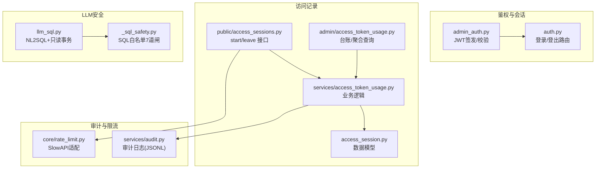
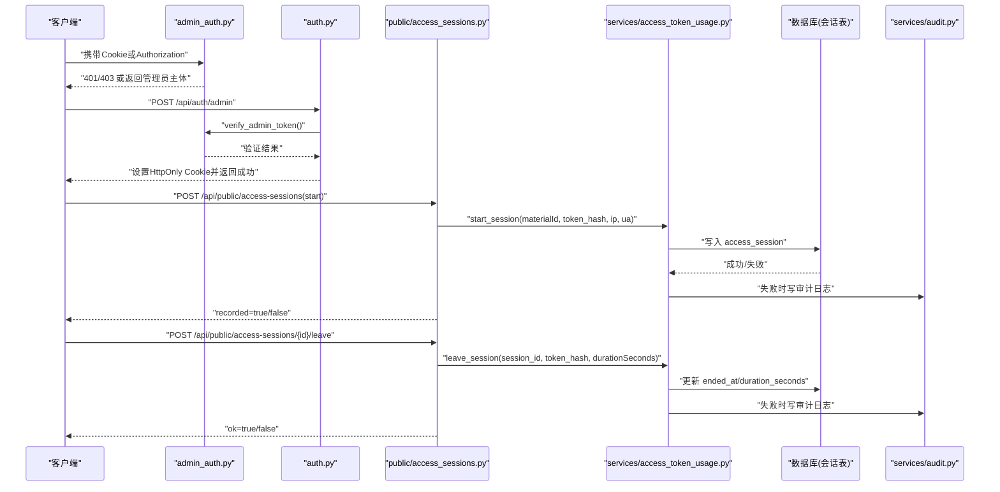
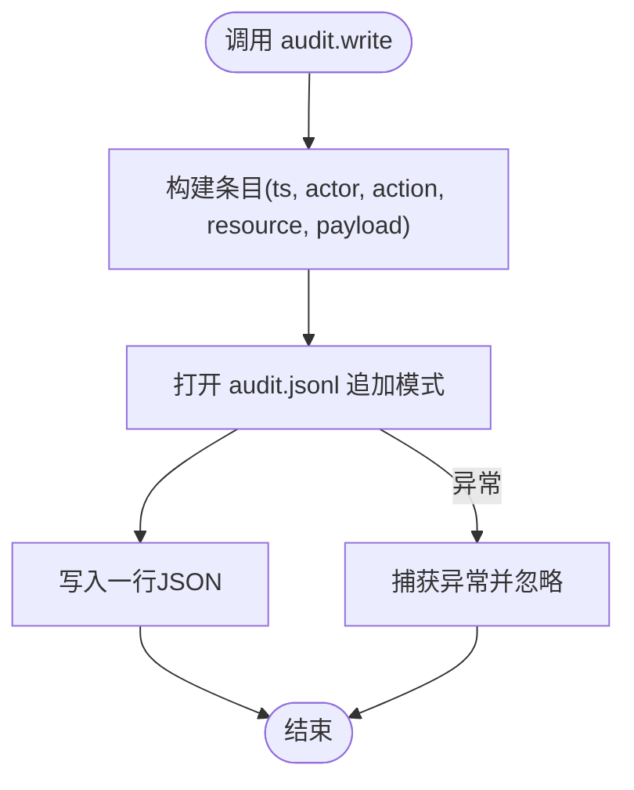
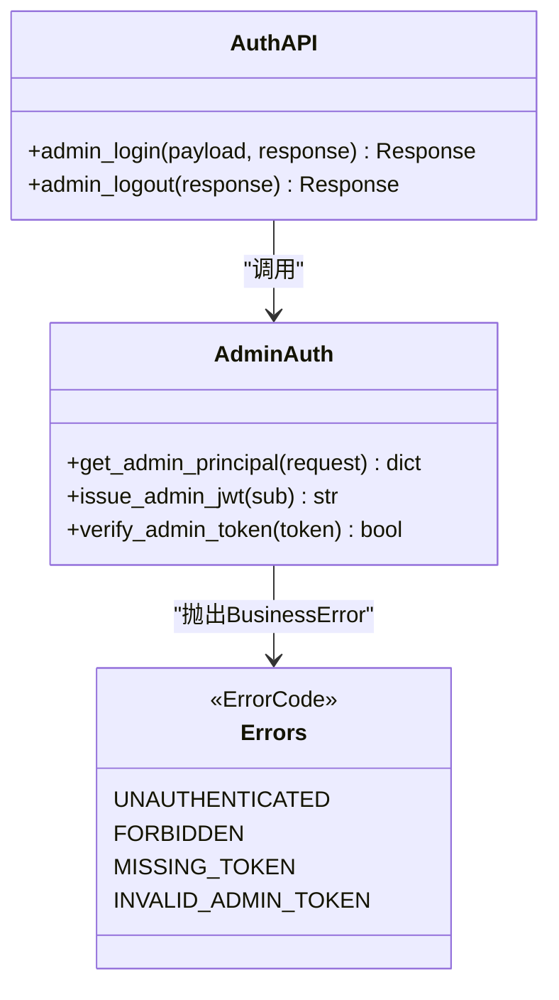
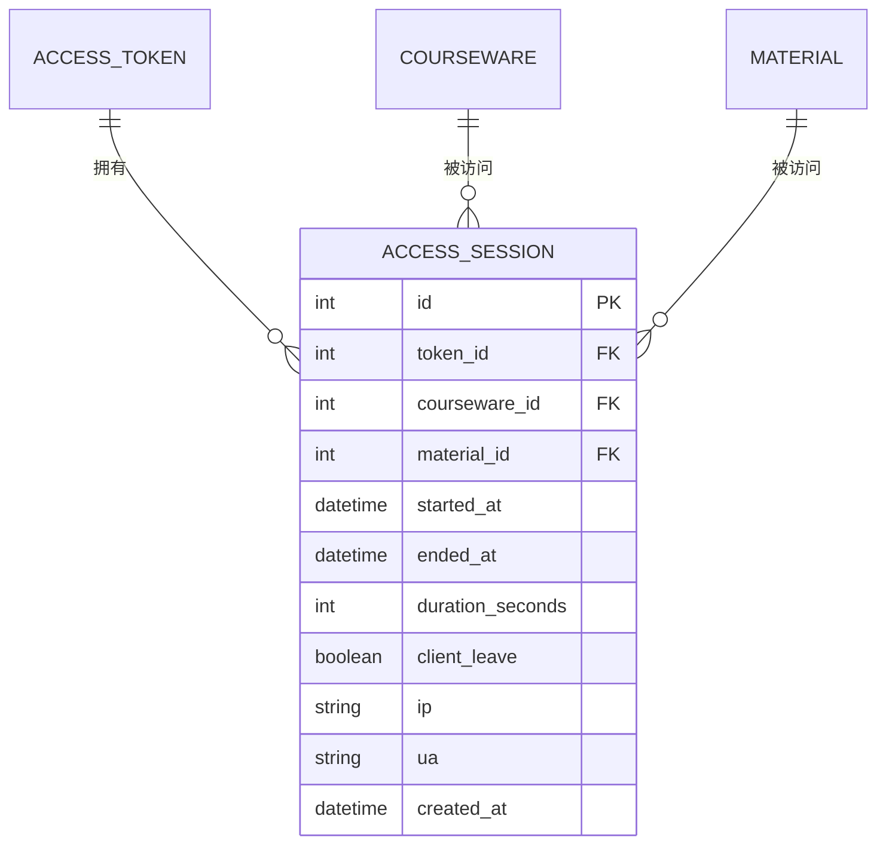
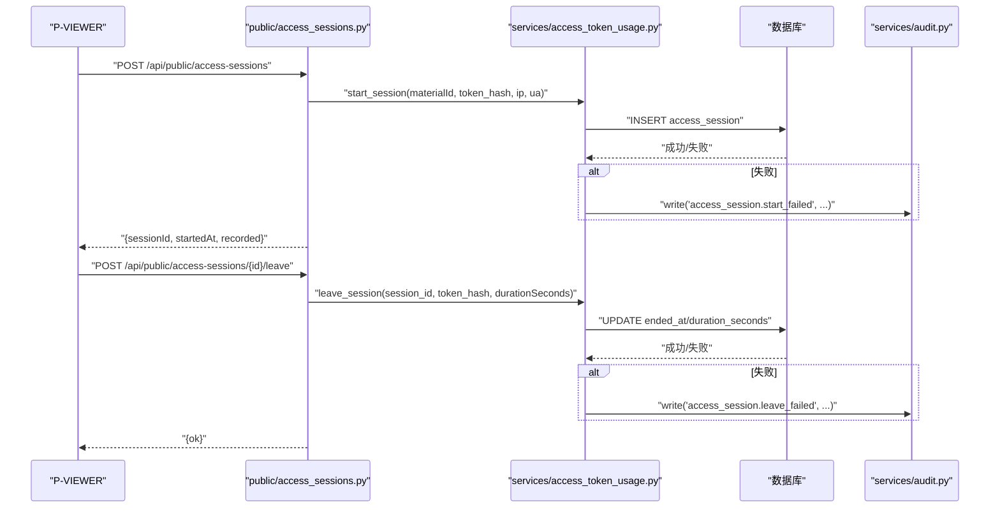
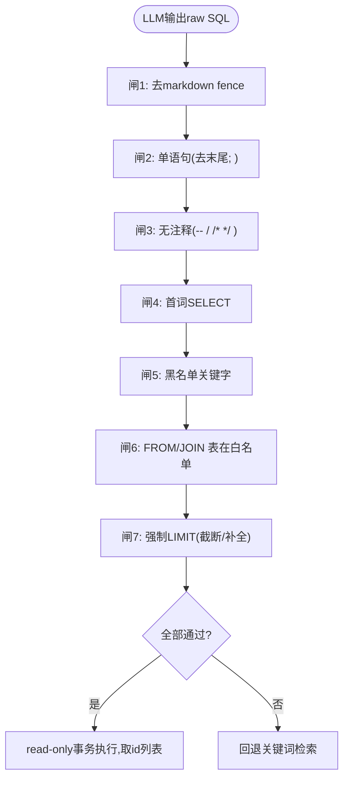
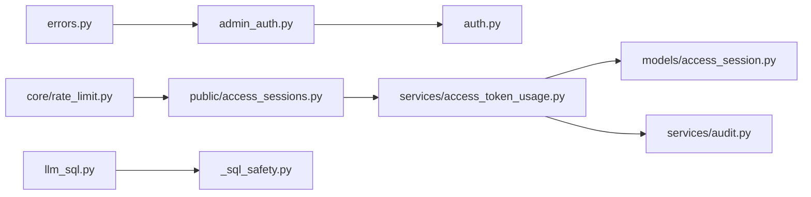

# 安全审计与监控

<cite>
**本文引用的文件**   
- [backend/app/services/audit.py](file://backend/app/services/audit.py)
- [backend/app/api/auth.py](file://backend/app/api/auth.py)
- [backend/app/middleware/admin_auth.py](file://backend/app/middleware/admin_auth.py)
- [backend/app/core/errors.py](file://backend/app/core/errors.py)
- [backend/app/models/access_session.py](file://backend/app/models/access_session.py)
- [backend/app/schemas/access_token_usage.py](file://backend/app/schemas/access_token_usage.py)
- [backend/app/api/public/access_sessions.py](file://backend/app/api/public/access_sessions.py)
- [backend/app/api/admin/access_token_usage.py](file://backend/app/api/admin/access_token_usage.py)
- [backend/app/services/access_token_usage.py](file://backend/app/services/access_token_usage.py)
- [backend/app/services/_sql_safety.py](file://backend/app/services/_sql_safety.py)
- [backend/app/services/llm_sql.py](file://backend/app/services/llm_sql.py)
- [backend/app/core/rate_limit.py](file://backend/app/core/rate_limit.py)
- [doc/spec/06-非功能需求.md](file://doc/spec/06-非功能需求.md)
- [doc/test/test-cases-integration.md](file://doc/test/test-cases-integration.md)
</cite>

## 目录
1. [引言](#引言)
2. [项目结构](#项目结构)
3. [核心组件](#核心组件)
4. [架构总览](#架构总览)
5. [详细组件分析](#详细组件分析)
6. [依赖关系分析](#依赖关系分析)
7. [性能与安全指标](#性能与安全指标)
8. [故障排查指南](#故障排查指南)
9. [结论](#结论)
10. [附录](#附录)

## 引言
本指南面向 Learning Hub 的安全审计与监控，聚焦以下目标：
- 安全事件日志记录机制：用户行为追踪、异常访问检测、敏感操作审计
- 安全监控指标定义与采集：认证失败率、访问令牌使用统计、性能异常检测
- 安全告警机制：阈值配置、通知渠道、应急响应流程
- 漏洞扫描与代码安全：依赖包漏洞检查、代码安全分析
- 渗透测试方法与工具：自动化脚本与手动用例
- 合规性检查与审计报告生成最佳实践

## 项目结构
围绕安全审计与监控的关键实现位于后端服务层与管理 API 层，主要涉及：
- 审计日志写入（JSON Lines）
- 管理端鉴权与会话签发
- 访问会话（Access Session）模型与公共/管理接口
- LLM-to-SQL 的 SQL 白名单校验与只读事务执行
- 限流能力（SlowAPI 适配）

图表来源
- [backend/app/middleware/admin_auth.py:1-66](file://backend/app/middleware/admin_auth.py#L1-L66)
- [backend/app/api/auth.py:1-49](file://backend/app/api/auth.py#L1-L49)
- [backend/app/models/access_session.py:1-129](file://backend/app/models/access_session.py#L1-L129)
- [backend/app/api/public/access_sessions.py:1-137](file://backend/app/api/public/access_sessions.py#L1-L137)
- [backend/app/api/admin/access_token_usage.py:1-101](file://backend/app/api/admin/access_token_usage.py#L1-L101)
- [backend/app/services/access_token_usage.py:1-518](file://backend/app/services/access_token_usage.py#L1-L518)
- [backend/app/services/audit.py:1-45](file://backend/app/services/audit.py#L1-L45)
- [backend/app/core/rate_limit.py:1-55](file://backend/app/core/rate_limit.py#L1-L55)
- [backend/app/services/_sql_safety.py:1-220](file://backend/app/services/_sql_safety.py#L1-L220)
- [backend/app/services/llm_sql.py:1-490](file://backend/app/services/llm_sql.py#L1-L490)

章节来源
- [backend/app/services/audit.py:1-45](file://backend/app/services/audit.py#L1-L45)
- [backend/app/api/auth.py:1-49](file://backend/app/api/auth.py#L1-L49)
- [backend/app/middleware/admin_auth.py:1-66](file://backend/app/middleware/admin_auth.py#L1-L66)
- [backend/app/models/access_session.py:1-129](file://backend/app/models/access_session.py#L1-L129)
- [backend/app/api/public/access_sessions.py:1-137](file://backend/app/api/public/access_sessions.py#L1-L137)
- [backend/app/api/admin/access_token_usage.py:1-101](file://backend/app/api/admin/access_token_usage.py#L1-L101)
- [backend/app/services/access_token_usage.py:1-518](file://backend/app/services/access_token_usage.py#L1-L518)
- [backend/app/services/_sql_safety.py:1-220](file://backend/app/services/_sql_safety.py#L1-L220)
- [backend/app/services/llm_sql.py:1-490](file://backend/app/services/llm_sql.py#L1-L490)
- [backend/app/core/rate_limit.py:1-55](file://backend/app/core/rate_limit.py#L1-L55)

## 核心组件
- 审计日志服务：以 JSON Lines 格式追加关键管理操作，失败不阻塞主流程。
- 管理端鉴权：基于 JWT 的管理员会话签发与校验，支持 Cookie 与 Authorization 头。
- 访问会话模型与接口：记录受限课件素材浏览会话，提供公共 start/leave 与管理端分页/聚合查询。
- LLM-to-SQL 安全护栏：7 道闸白名单校验 + 只读事务执行，防止注入与越权。
- 限流能力：SlowAPI 适配，支持 IP/会话维度限流。

章节来源
- [backend/app/services/audit.py:1-45](file://backend/app/services/audit.py#L1-L45)
- [backend/app/middleware/admin_auth.py:1-66](file://backend/app/middleware/admin_auth.py#L1-L66)
- [backend/app/models/access_session.py:1-129](file://backend/app/models/access_session.py#L1-L129)
- [backend/app/api/public/access_sessions.py:1-137](file://backend/app/api/public/access_sessions.py#L1-L137)
- [backend/app/api/admin/access_token_usage.py:1-101](file://backend/app/api/admin/access_token_usage.py#L1-L101)
- [backend/app/services/access_token_usage.py:1-518](file://backend/app/services/access_token_usage.py#L1-L518)
- [backend/app/services/_sql_safety.py:1-220](file://backend/app/services/_sql_safety.py#L1-L220)
- [backend/app/services/llm_sql.py:1-490](file://backend/app/services/llm_sql.py#L1-L490)
- [backend/app/core/rate_limit.py:1-55](file://backend/app/core/rate_limit.py#L1-L55)

## 架构总览
下图展示从请求进入、鉴权、访问会话记录到审计日志落盘的整体链路，以及 LLM 搜索路径的安全护栏。

图表来源
- [backend/app/middleware/admin_auth.py:1-66](file://backend/app/middleware/admin_auth.py#L1-L66)
- [backend/app/api/auth.py:1-49](file://backend/app/api/auth.py#L1-L49)
- [backend/app/api/public/access_sessions.py:1-137](file://backend/app/api/public/access_sessions.py#L1-L137)
- [backend/app/services/access_token_usage.py:1-518](file://backend/app/services/access_token_usage.py#L1-L518)
- [backend/app/services/audit.py:1-45](file://backend/app/services/audit.py#L1-L45)

## 详细组件分析

### 审计日志组件（JSON Lines）
- 职责：记录关键管理操作，包含时间戳、操作人、动作、资源与负载摘要；失败不影响主流程。
- 存储位置：基于 storage_path 上级目录下的 logs/audit.jsonl。
- 适用场景：管理端敏感操作、访问会话写入失败等异常路径。

图表来源
- [backend/app/services/audit.py:1-45](file://backend/app/services/audit.py#L1-L45)

章节来源
- [backend/app/services/audit.py:1-45](file://backend/app/services/audit.py#L1-L45)

### 管理端鉴权与会话
- 登录：校验明文 Admin Token，签发 JWT，写入 HttpOnly Cookie。
- 鉴权中间件：优先 Authorization: Bearer，其次 Cookie LH_ADMIN_SESSION；解析 JWT 并返回管理员主体。
- 错误码：未认证、过期、无效均映射为统一业务错误码。

图表来源
- [backend/app/middleware/admin_auth.py:1-66](file://backend/app/middleware/admin_auth.py#L1-L66)
- [backend/app/api/auth.py:1-49](file://backend/app/api/auth.py#L1-L49)
- [backend/app/core/errors.py:1-144](file://backend/app/core/errors.py#L1-L144)

章节来源
- [backend/app/middleware/admin_auth.py:1-66](file://backend/app/middleware/admin_auth.py#L1-L66)
- [backend/app/api/auth.py:1-49](file://backend/app/api/auth.py#L1-L49)
- [backend/app/core/errors.py:1-144](file://backend/app/core/errors.py#L1-L144)

### 访问会话模型与接口
- 模型：记录 token/courseware/material 关联、起止时间、停留秒数、IP/UA 等，含索引与约束。
- 公共接口：start/leave，带进程内滑动窗口限流降级策略；缺 token 或权限不足按规范返回。
- 管理接口：分页明细与按素材聚合，默认近 7 天区间。

图表来源
- [backend/app/models/access_session.py:1-129](file://backend/app/models/access_session.py#L1-L129)

图表来源
- [backend/app/api/public/access_sessions.py:1-137](file://backend/app/api/public/access_sessions.py#L1-L137)
- [backend/app/services/access_token_usage.py:1-518](file://backend/app/services/access_token_usage.py#L1-L518)
- [backend/app/services/audit.py:1-45](file://backend/app/services/audit.py#L1-L45)

章节来源
- [backend/app/models/access_session.py:1-129](file://backend/app/models/access_session.py#L1-L129)
- [backend/app/api/public/access_sessions.py:1-137](file://backend/app/api/public/access_sessions.py#L1-L137)
- [backend/app/api/admin/access_token_usage.py:1-101](file://backend/app/api/admin/access_token_usage.py#L1-L101)
- [backend/app/services/access_token_usage.py:1-518](file://backend/app/services/access_token_usage.py#L1-L518)
- [backend/app/schemas/access_token_usage.py:1-91](file://backend/app/schemas/access_token_usage.py#L1-L91)

### LLM-to-SQL 安全护栏
- 7 道闸：去 markdown 包裹、单语句、无注释、首词 SELECT、黑名单关键字、白名单表、强制 LIMIT。
- 执行环境：SET TRANSACTION READ ONLY 后执行，仅取 id 列表，避免大字段与 N+1。
- 降级策略：任一闸失败或执行异常 → 回退关键词检索。

图表来源
- [backend/app/services/_sql_safety.py:1-220](file://backend/app/services/_sql_safety.py#L1-L220)
- [backend/app/services/llm_sql.py:1-490](file://backend/app/services/llm_sql.py#L1-L490)

章节来源
- [backend/app/services/_sql_safety.py:1-220](file://backend/app/services/_sql_safety.py#L1-L220)
- [backend/app/services/llm_sql.py:1-490](file://backend/app/services/llm_sql.py#L1-L490)

### 限流能力
- SlowAPI 适配：支持 IP/会话键值，可配置 Redis 或内存存储。
- 应用层兜底：公共访问会话接口内置滑动窗口限流，命中则降级为不记录。

章节来源
- [backend/app/core/rate_limit.py:1-55](file://backend/app/core/rate_limit.py#L1-L55)
- [backend/app/api/public/access_sessions.py:1-137](file://backend/app/api/public/access_sessions.py#L1-L137)

## 依赖关系分析
- 模块耦合：
  - 公共访问会话接口依赖业务服务，业务服务依赖模型与审计服务。
  - 管理端鉴权依赖错误码与配置。
  - LLM 搜索依赖 SQL 白名单校验与只读事务执行。
- 外部依赖：
  - JWT 库用于管理端会话。
  - SlowAPI 用于限流。
  - dashscope SDK 用于 LLM 调用（可选）。

图表来源
- [backend/app/core/errors.py:1-144](file://backend/app/core/errors.py#L1-L144)
- [backend/app/middleware/admin_auth.py:1-66](file://backend/app/middleware/admin_auth.py#L1-L66)
- [backend/app/api/auth.py:1-49](file://backend/app/api/auth.py#L1-L49)
- [backend/app/api/public/access_sessions.py:1-137](file://backend/app/api/public/access_sessions.py#L1-L137)
- [backend/app/services/access_token_usage.py:1-518](file://backend/app/services/access_token_usage.py#L1-L518)
- [backend/app/models/access_session.py:1-129](file://backend/app/models/access_session.py#L1-L129)
- [backend/app/services/audit.py:1-45](file://backend/app/services/audit.py#L1-L45)
- [backend/app/services/llm_sql.py:1-490](file://backend/app/services/llm_sql.py#L1-L490)
- [backend/app/services/_sql_safety.py:1-220](file://backend/app/services/_sql_safety.py#L1-L220)
- [backend/app/core/rate_limit.py:1-55](file://backend/app/core/rate_limit.py#L1-L55)

## 性能与安全指标
- 建议采集指标（结合非功能需求基线）：
  - lh.http.request.duration（P95）后台 CRUD ≤ 300ms
  - lh.http.request.duration.search（P95）≤ 2s（含 LLM 与降级）
  - lh.db.query.duration（P95）≤ 50ms
  - lh.llm.call.duration（P95）≤ 1.5s
  - lh.llm.timeout.rate ≤ 5%（5分钟滑动窗口）
  - lh.material.upload.duration（P95）≤ 60s（200MB）
  - lh.token.unlock.fail_rate ≤ 30%（5分钟滑动窗口）
  - lh.error.5xx.rate ≤ 0.5%
- 认证失败率：
  - 统计 /api/auth/admin 返回 invalid_admin_token/unauthenticated 的比例。
- 访问令牌使用统计：
  - 通过管理端接口获取 totalDurationSeconds、sessionCount、coursewareCount、materialCount 及按素材聚合 viewCount、lastViewedAt。
- 性能异常检测：
  - 对 P95 超阈值的接口触发告警；LLM 超时率超阈触发降级观察。

章节来源
- [doc/spec/06-非功能需求.md:95-136](file://doc/spec/06-非功能需求.md#L95-L136)
- [backend/app/api/admin/access_token_usage.py:1-101](file://backend/app/api/admin/access_token_usage.py#L1-L101)
- [backend/app/schemas/access_token_usage.py:1-91](file://backend/app/schemas/access_token_usage.py#L1-L91)

## 故障排查指南
- 审计日志缺失：
  - 检查 logs/audit.jsonl 是否存在且可写；确认 storage_path 配置正确。
- 访问会话未记录：
  - 确认 token_hash 有效且具备对应课件授权；检查 IP 限流是否命中导致降级；查看 SQLAlchemyError 吞错路径。
- 管理端无法登录：
  - 核对 Admin Token 与 JWT 配置；检查 Cookie 是否被浏览器策略拦截。
- LLM 搜索失败：
  - 查看 7 道闸拒绝原因；确认 read-only 事务执行是否抛错；必要时回退关键词检索。
- 限流误伤：
  - 调整 SlowAPI 存储与 key_func；在网关层补充限流策略。

章节来源
- [backend/app/services/audit.py:1-45](file://backend/app/services/audit.py#L1-L45)
- [backend/app/api/public/access_sessions.py:1-137](file://backend/app/api/public/access_sessions.py#L1-L137)
- [backend/app/middleware/admin_auth.py:1-66](file://backend/app/middleware/admin_auth.py#L1-L66)
- [backend/app/services/_sql_safety.py:1-220](file://backend/app/services/_sql_safety.py#L1-L220)
- [backend/app/services/llm_sql.py:1-490](file://backend/app/services/llm_sql.py#L1-L490)
- [backend/app/core/rate_limit.py:1-55](file://backend/app/core/rate_limit.py#L1-L55)

## 结论
Learning Hub 已具备基础的安全审计与监控能力：管理端鉴权与会话、访问会话记录与聚合、审计日志落盘、LLM-to-SQL 安全护栏与只读执行、限流兜底。建议在生产环境补齐指标采集与告警通道，完善渗透测试与合规审计流程，形成闭环。

## 附录

### 安全事件日志记录机制
- 用户行为追踪：
  - 访问会话记录包含 token/courseware/material、起止时间、停留秒数、IP/UA，便于定位学习者行为。
- 异常访问检测：
  - 鉴权失败、令牌无权访问、会话写入失败等路径均记录审计日志或返回标准错误码。
- 敏感操作审计：
  - 管理端敏感操作可通过审计服务追加记录，确保可追溯。

章节来源
- [backend/app/models/access_session.py:1-129](file://backend/app/models/access_session.py#L1-L129)
- [backend/app/api/public/access_sessions.py:1-137](file://backend/app/api/public/access_sessions.py#L1-L137)
- [backend/app/services/audit.py:1-45](file://backend/app/services/audit.py#L1-L45)
- [backend/app/core/errors.py:1-144](file://backend/app/core/errors.py#L1-L144)

### 安全监控指标定义与收集
- 认证失败率：统计 /api/auth/admin 返回 invalid_admin_token/unauthenticated 的请求占比。
- 访问令牌使用统计：通过管理端接口获取会话总量、总时长、素材聚合视图。
- 性能异常检测：基于 P95 延迟与 LLM 超时率阈值进行告警。

章节来源
- [backend/app/api/auth.py:1-49](file://backend/app/api/auth.py#L1-L49)
- [backend/app/api/admin/access_token_usage.py:1-101](file://backend/app/api/admin/access_token_usage.py#L1-L101)
- [doc/spec/06-非功能需求.md:121-136](file://doc/spec/06-非功能需求.md#L121-L136)

### 安全告警机制实现
- 阈值配置：
  - 参考非功能需求中的指标基线与阈值，结合 Prometheus/Grafana 或云监控平台配置规则。
- 通知渠道：
  - 接入邮件、企业微信、钉钉或短信通道，按严重等级分级通知。
- 应急响应流程：
  - 发现认证失败率飙升 → 核查 Admin Token 泄露与登录入口限流；
  - 访问会话写入失败增多 → 检查数据库连接与磁盘空间；
  - LLM 超时率升高 → 评估外部服务可用性并启用降级。

章节来源
- [doc/spec/06-非功能需求.md:121-136](file://doc/spec/06-非功能需求.md#L121-L136)
- [backend/app/api/public/access_sessions.py:1-137](file://backend/app/api/public/access_sessions.py#L1-L137)
- [backend/app/services/llm_sql.py:1-490](file://backend/app/services/llm_sql.py#L1-L490)

### 安全漏洞扫描工具使用
- 依赖包漏洞检查：
  - 前端：npm audit 或第三方 SCA 工具（如 Snyk、Dependabot）。
  - 后端：pip-audit 或 Safety，纳入 CI 流水线。
- 代码安全分析：
  - Python：Bandit、Semgrep；前端：ESLint security 插件、SonarQube。
- 建议：
  - 将扫描结果作为 PR 门禁，阻断高危漏洞合并。

[本节为通用指导，无需源码引用]

### 渗透测试方法与工具推荐
- 自动化测试脚本：
  - 集成测试用例覆盖 SQL 注入、XSS、CORS、限流等安全基线。
- 手动测试用例：
  - 针对 Token 管理、受限课件访问控制、会话持久化与失效处理进行手工验证。
- 工具推荐：
  - OWASP ZAP、Burp Suite、Nuclei、SQLMap（谨慎使用，仅在授权环境）。

章节来源
- [doc/test/test-cases-integration.md:387-437](file://doc/test/test-cases-integration.md#L387-L437)

### 安全合规性检查与审计报告生成
- 合规要求：
  - 管理员操作记录至少保留 180 天；匿名前台不收集个人身份信息。
- 审计报告生成：
  - 定期导出审计日志（audit.jsonl），结合访问会话聚合数据，生成月度安全报告。
- 最佳实践：
  - 日志脱敏（避免记录敏感字段）、集中化存储、不可篡改归档、最小权限访问。

章节来源
- [doc/spec/06-非功能需求.md:108-112](file://doc/spec/06-非功能需求.md#L108-L112)
- [backend/app/services/audit.py:1-45](file://backend/app/services/audit.py#L1-L45)