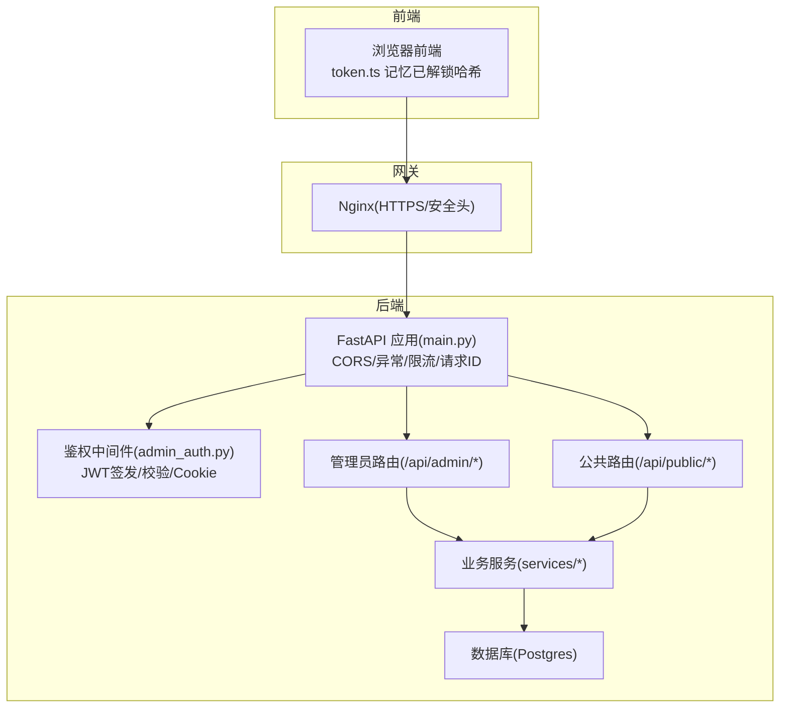
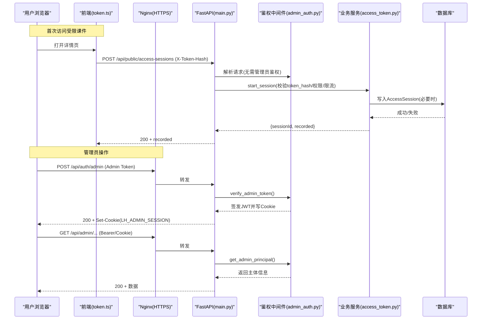
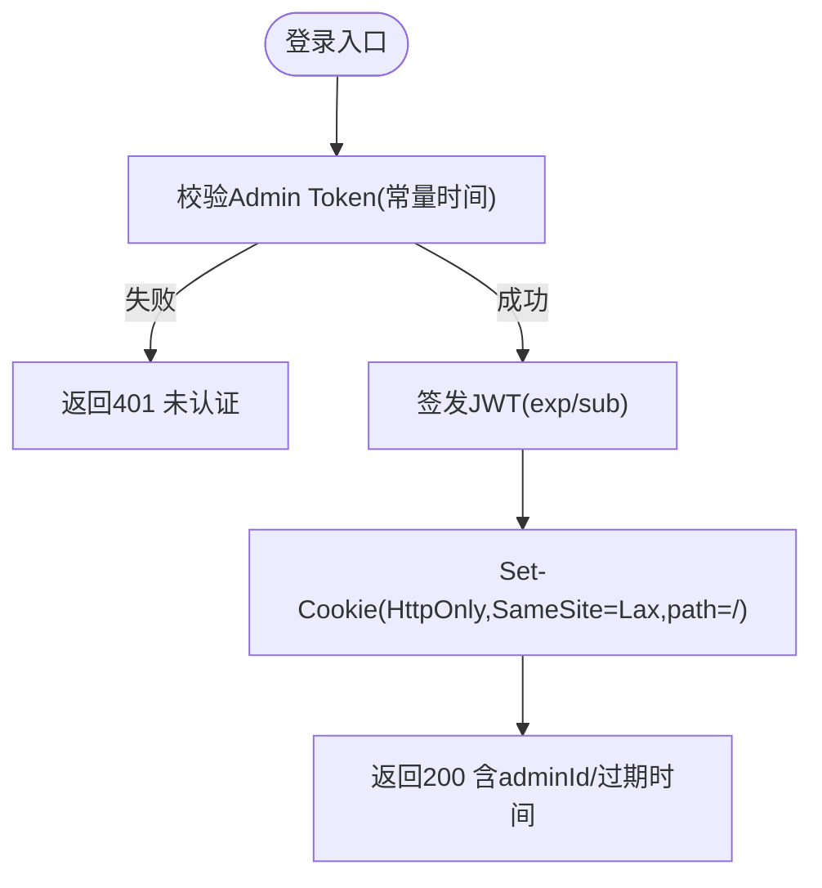
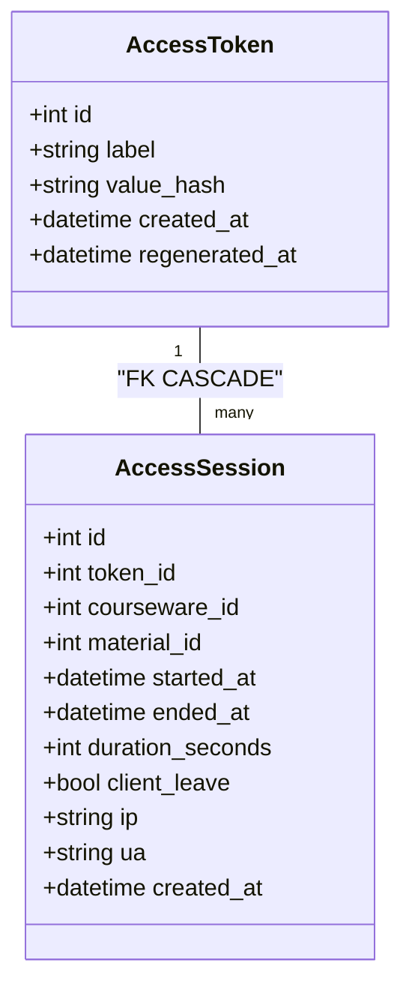
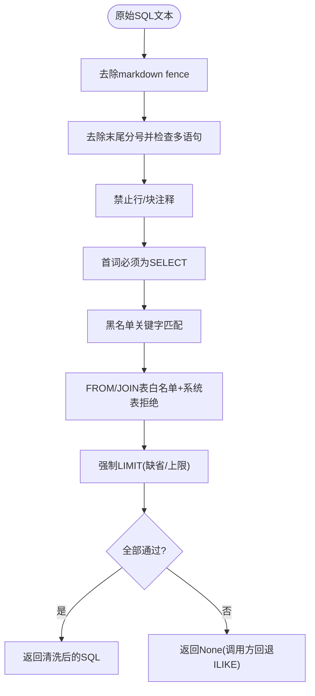
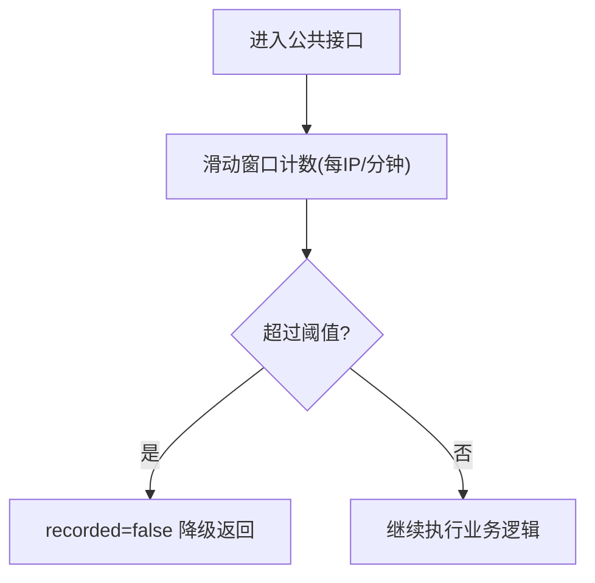
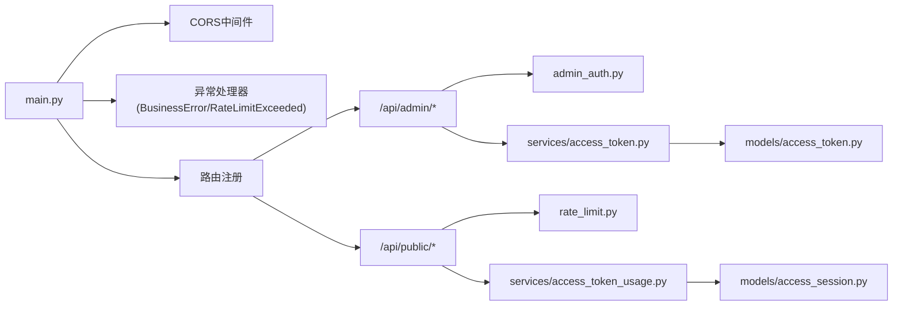

# 安全指南

<cite>
**本文引用的文件**   
- [backend/app/main.py](file://backend/app/main.py)
- [backend/app/api/auth.py](file://backend/app/api/auth.py)
- [backend/app/middleware/admin_auth.py](file://backend/app/middleware/admin_auth.py)
- [backend/app/core/config.py](file://backend/app/core/config.py)
- [backend/app/core/rate_limit.py](file://backend/app/core/rate_limit.py)
- [backend/app/services/_sql_safety.py](file://backend/app/services/_sql_safety.py)
- [backend/app/models/access_token.py](file://backend/app/models/access_token.py)
- [backend/app/models/access_session.py](file://backend/app/models/access_session.py)
- [backend/app/services/access_token.py](file://backend/app/services/access_token.py)
- [backend/app/api/admin/access_tokens.py](file://backend/app/api/admin/access_tokens.py)
- [backend/app/api/public/access_sessions.py](file://backend/app/api/public/access_sessions.py)
- [frontend/src/stores/token.ts](file://frontend/src/stores/token.ts)
- [deploy/ecs/nginx-vhost-https.snippet](file://deploy/ecs/nginx-vhost-https.snippet)
- [deploy/local/docker-compose.yml](file://deploy/local/docker-compose.yml)
</cite>

## 目录
1. [引言](#引言)
2. [项目结构](#项目结构)
3. [核心组件](#核心组件)
4. [架构总览](#架构总览)
5. [详细组件分析](#详细组件分析)
6. [依赖关系分析](#依赖关系分析)
7. [性能与安全权衡](#性能与安全权衡)
8. [故障排查与审计](#故障排查与审计)
9. [结论](#结论)
10. [附录：安全检查清单与SLSA建议](#附录安全检查清单与slsa建议)

## 引言
本指南面向 Learning Hub 的安全开发生命周期，覆盖认证授权、输入输出校验、敏感数据保护、网络安全配置、限流与可观测性、漏洞扫描与渗透测试、事件响应与日志审计等主题。文档以仓库现有实现为依据，提供可落地的最佳实践与检查项，帮助团队在开发、测试与部署各阶段落实安全基线。

## 项目结构
后端采用 FastAPI 分层组织：入口装配中间件与路由；鉴权与权限控制集中在中间件；业务服务封装于 services；模型定义在 models；公共接口与管理员接口分属不同路由前缀。前端通过状态管理持久化已解锁的 token 哈希，配合后端访问会话记录进行资源访问统计。部署层使用 Nginx 统一 HTTPS 出口并设置安全响应头。

图示来源
- [backend/app/main.py:40-116](file://backend/app/main.py#L40-L116)
- [backend/app/middleware/admin_auth.py:1-66](file://backend/app/middleware/admin_auth.py#L1-L66)
- [backend/app/api/admin/access_tokens.py:1-120](file://backend/app/api/admin/access_tokens.py#L1-L120)
- [backend/app/api/public/access_sessions.py:1-137](file://backend/app/api/public/access_sessions.py#L1-L137)
- [deploy/ecs/nginx-vhost-https.snippet:1-42](file://deploy/ecs/nginx-vhost-https.snippet#L1-L42)

章节来源
- [backend/app/main.py:40-116](file://backend/app/main.py#L40-L116)
- [backend/app/core/config.py:1-88](file://backend/app/core/config.py#L1-L88)

## 核心组件
- 认证与授权
  - Admin 登录流程：验证静态管理令牌，签发 JWT，写入 HttpOnly Cookie，支持 Bearer 与 Cookie 双通道读取。
  - 权限控制：通过 Depends(get_admin_principal) 强制管理员身份，未登录或过期返回 401。
- 访问令牌与会话
  - AccessToken：仅存储 value_hash(SHA-256)，明文仅在创建/重新生成时一次性返回。
  - AccessSession：记录受限素材浏览会话起止、停留时长、IP/UA，支持幂等结束与降级策略。
- 输入与SQL安全
  - LLM 生成的 SQL 必须经过“七道闸”白名单校验（去 fence、单语句、无注释、首词 SELECT、黑名单关键字、表白名单、强制 LIMIT）。
- 限流与速率控制
  - SlowAPI 全局 limiter（支持 Redis/内存），按 IP 或会话维度 key；公共访问会话接口内置进程内滑动窗口限流兜底。
- 网络安全
  - CORS 由配置驱动；生产环境通过 Nginx 启用 HTTPS、HSTS、安全响应头，关闭不安全方法。
- 配置与密钥
  - 所有敏感配置从环境变量加载，默认值仅用于本地开发，生产需替换强随机值。

章节来源
- [backend/app/api/auth.py:1-49](file://backend/app/api/auth.py#L1-L49)
- [backend/app/middleware/admin_auth.py:1-66](file://backend/app/middleware/admin_auth.py#L1-L66)
- [backend/app/models/access_token.py:1-34](file://backend/app/models/access_token.py#L1-L34)
- [backend/app/models/access_session.py:1-129](file://backend/app/models/access_session.py#L1-L129)
- [backend/app/services/_sql_safety.py:1-220](file://backend/app/services/_sql_safety.py#L1-L220)
- [backend/app/core/rate_limit.py:1-55](file://backend/app/core/rate_limit.py#L1-L55)
- [backend/app/core/config.py:1-88](file://backend/app/core/config.py#L1-L88)
- [deploy/ecs/nginx-vhost-https.snippet:1-42](file://deploy/ecs/nginx-vhost-https.snippet#L1-L42)

## 架构总览
下图展示一次受保护的访问流程：前端携带已解锁的 token 哈希，后端校验令牌哈希并记录访问会话；管理员操作需先完成登录获取 JWT，后续请求携带 Bearer 或 Cookie 完成鉴权。

图示来源
- [backend/app/api/public/access_sessions.py:65-106](file://backend/app/api/public/access_sessions.py#L65-L106)
- [backend/app/api/auth.py:21-45](file://backend/app/api/auth.py#L21-L45)
- [backend/app/middleware/admin_auth.py:26-55](file://backend/app/middleware/admin_auth.py#L26-L55)
- [backend/app/services/access_token.py:193-205](file://backend/app/services/access_token.py#L193-L205)
- [backend/app/models/access_session.py:56-129](file://backend/app/models/access_session.py#L56-L129)
- [deploy/ecs/nginx-vhost-https.snippet:8-41](file://deploy/ecs/nginx-vhost-https.snippet#L8-L41)

## 详细组件分析

### 认证与授权（Admin）
- 登录
  - 校验静态 Admin Token（常量时间比较），成功后签发 JWT（HS256，含 exp/sub），写入 HttpOnly Cookie（SameSite=Lax，路径为根）。
  - 登出删除 Cookie。
- 鉴权
  - 优先 Authorization: Bearer，其次 Cookie LH_ADMIN_SESSION。
  - 解码 JWT 要求包含 exp 与 sub，过期或无效返回 401。
- 风险与建议
  - 当前 admin_token 默认值仅用于开发，生产必须替换为强随机值并通过环境变量注入。
  - 建议增加登录失败计数与冷却期，防止暴力破解。
  - 建议将 Cookie 同时标记 Secure（仅 HTTPS）并在网关层强制 HSTS。

图示来源
- [backend/app/api/auth.py:21-45](file://backend/app/api/auth.py#L21-L45)
- [backend/app/middleware/admin_auth.py:58-62](file://backend/app/middleware/admin_auth.py#L58-L62)
- [backend/app/middleware/admin_auth.py:45-55](file://backend/app/middleware/admin_auth.py#L45-L55)
- [backend/app/middleware/admin_auth.py:16-42](file://backend/app/middleware/admin_auth.py#L16-L42)

章节来源
- [backend/app/api/auth.py:1-49](file://backend/app/api/auth.py#L1-L49)
- [backend/app/middleware/admin_auth.py:1-66](file://backend/app/middleware/admin_auth.py#L1-L66)
- [backend/app/schemas/auth.py:1-17](file://backend/app/schemas/auth.py#L1-L17)

### 访问令牌与会话（AccessToken/AccessSession）
- 令牌存储
  - 数据库仅保存 value_hash(SHA-256)，明文仅在创建/重新生成时返回一次。
  - label 唯一且长度限制；删除前检查引用与“至少保留一个 active token”约束。
- 会话记录
  - 开始/结束接口对外暴露，基于 X-Token-Hash 或 Cookie 识别持有者。
  - 对受限素材才落库；失败降级不阻塞前台；支持幂等结束。
  - 字段包含 started_at/ended_at/duration_seconds/ip/ua 等，便于审计与分析。
- 前端记忆
  - 已解锁的 courseware -> tokenHash 映射持久化到 localStorage，隐私模式回退内存。

图示来源
- [backend/app/models/access_token.py:13-33](file://backend/app/models/access_token.py#L13-L33)
- [backend/app/models/access_session.py:56-129](file://backend/app/models/access_session.py#L56-L129)

章节来源
- [backend/app/models/access_token.py:1-34](file://backend/app/models/access_token.py#L1-L34)
- [backend/app/models/access_session.py:1-129](file://backend/app/models/access_session.py#L1-L129)
- [backend/app/services/access_token.py:73-139](file://backend/app/services/access_token.py#L73-L139)
- [backend/app/api/public/access_sessions.py:65-137](file://backend/app/api/public/access_sessions.py#L65-L137)
- [frontend/src/stores/token.ts:1-54](file://frontend/src/stores/token.ts#L1-L54)

### 输入验证与SQL安全（LLM→SQL）
- “七道闸”校验流程
  - 去除 markdown fence → 单语句 → 无注释 → 首词 SELECT → 黑名单关键字 → 表白名单 → 强制 LIMIT（缺失则追加，超限截断）。
  - 任一失败返回 None，调用方回退到关键词 ILIKE 搜索。
- 适用场景
  - 自然语言转 SQL 查询，严格限制可访问表集合与操作类型，避免任意执行。

图示来源
- [backend/app/services/_sql_safety.py:91-210](file://backend/app/services/_sql_safety.py#L91-L210)

章节来源
- [backend/app/services/_sql_safety.py:1-220](file://backend/app/services/_sql_safety.py#L1-L220)

### 限流与速率控制
- 全局限流
  - SlowAPI Limiter，支持 Redis 或内存存储；key 函数支持 IP 或会话（从 Bearer 中取子串简化标识）。
- 公共接口兜底
  - 访问会话开始接口内置进程内滑动窗口限流（60/分钟/IP），命中后降级 recorded=false，不阻塞主流程。
- 建议
  - 生产环境务必启用 Redis 作为共享存储，跨 worker 生效。
  - 针对登录与敏感接口单独配置更严格的速率限制。

图示来源
- [backend/app/api/public/access_sessions.py:29-54](file://backend/app/api/public/access_sessions.py#L29-L54)
- [backend/app/core/rate_limit.py:18-51](file://backend/app/core/rate_limit.py#L18-L51)

章节来源
- [backend/app/core/rate_limit.py:1-55](file://backend/app/core/rate_limit.py#L1-L55)
- [backend/app/api/public/access_sessions.py:1-137](file://backend/app/api/public/access_sessions.py#L1-L137)

### 网络安全配置（HTTPS/CORS/安全头）
- HTTPS 强制
  - Nginx 监听 443，启用 HTTP/2，设置证书路径，添加安全响应头（nosniff/X-Frame-Options/X-XSS-Protection），大文件上传超时调优。
- CORS
  - 由 Settings.cors_allow_origins 驱动，允许凭据与指定头部；生产应显式列出可信域名。
- 建议
  - 在网关层开启 HSTS，禁用明文 HTTP 访问（或 301 重定向至 HTTPS）。
  - 限制允许的 HTTP 方法，仅放行必要方法。

章节来源
- [deploy/ecs/nginx-vhost-https.snippet:1-42](file://deploy/ecs/nginx-vhost-https.snippet#L1-L42)
- [backend/app/core/config.py:48-52](file://backend/app/core/config.py#L48-L52)
- [backend/app/main.py:57-65](file://backend/app/main.py#L57-L65)

### 敏感数据处理
- 密码/令牌
  - AccessToken 明文仅创建/重新生成时返回，数据库仅存 SHA-256 摘要；验证使用常量时间比较防时序攻击。
- 传输加密
  - 生产环境强制 HTTPS，前端 Cookie 建议标记 Secure（结合网关 HSTS）。
- 密钥管理
  - JWT_SECRET、ADMIN_TOKEN、数据库凭据均通过环境变量注入，严禁硬编码入代码。

章节来源
- [backend/app/services/access_token.py:32-54](file://backend/app/services/access_token.py#L32-L54)
- [backend/app/services/access_token.py:193-205](file://backend/app/services/access_token.py#L193-L205)
- [backend/app/core/config.py:40-46](file://backend/app/core/config.py#L40-L46)
- [deploy/local/docker-compose.yml:35-45](file://deploy/local/docker-compose.yml#L35-L45)

## 依赖关系分析
- 模块耦合
  - main.py 负责中间件、异常处理、路由注册，低耦合高内聚。
  - admin_auth 被管理员路由通过 Depends 复用，集中管理 JWT 生命周期。
  - access_token 服务被多个管理接口复用，保持单一职责。
- 外部依赖
  - Pydantic/Pydantic Settings 用于配置与请求体校验。
  - PyJWT 用于签名与验签。
  - SlowAPI 用于限流。
  - SQLAlchemy 用于 ORM 与事务。
- 潜在风险
  - 若 CORS 配置过于宽松（如 *），需在生产严格收敛。
  - 若 Redis 不可用，SlowAPI 回退内存模式在多进程下失效，需确保部署一致性。

图示来源
- [backend/app/main.py:40-116](file://backend/app/main.py#L40-L116)
- [backend/app/middleware/admin_auth.py:1-66](file://backend/app/middleware/admin_auth.py#L1-L66)
- [backend/app/core/rate_limit.py:1-55](file://backend/app/core/rate_limit.py#L1-L55)
- [backend/app/services/access_token.py:1-235](file://backend/app/services/access_token.py#L1-L235)
- [backend/app/models/access_token.py:1-34](file://backend/app/models/access_token.py#L1-L34)
- [backend/app/models/access_session.py:1-129](file://backend/app/models/access_session.py#L1-L129)

章节来源
- [backend/app/main.py:40-116](file://backend/app/main.py#L40-L116)
- [backend/app/core/rate_limit.py:1-55](file://backend/app/core/rate_limit.py#L1-L55)

## 性能与安全权衡
- 会话记录降级
  - 限流或 DB 异常时，访问会话接口返回 recorded=false，保证用户体验不受影响，但会牺牲部分可观测性。建议在监控告警中关注此类降级比例。
- 限流粒度
  - 公共接口按 IP 限流，生产建议结合 Redis 做分布式限流；对登录等敏感接口进一步收紧。
- 大文件上传
  - Nginx 调整了上传相关超时与缓冲策略，避免代理层中断长连接；注意磁盘空间与并发限制。

[本节为通用指导，不直接分析具体文件]

## 故障排查与审计
- 请求追踪
  - 全局中间件注入 X-Request-Id，贯穿请求与响应，便于链路追踪与问题定位。
- 错误处理
  - BusinessError 统一包装为 envelope 格式；限流异常返回 429 与友好提示。
- 审计日志
  - 令牌创建/重新生成/删除等操作写入审计日志，便于合规与回溯。
- 建议
  - 将审计日志接入集中式日志平台，建立告警规则（如频繁 401/403、大量 429）。
  - 定期导出访问会话报表，识别异常访问模式。

章节来源
- [backend/app/main.py:70-89](file://backend/app/main.py#L70-L89)
- [backend/app/services/access_token.py:92-138](file://backend/app/services/access_token.py#L92-L138)

## 结论
Learning Hub 在认证授权、令牌与会话管理、SQL 安全、限流与网络安全方面具备良好基础。生产落地需重点关注：强随机密钥与环境变量管理、严格 CORS/HSTS、Redis 分布式限流、完善的审计与告警体系。通过持续的安全测试与渗透评估，可进一步提升整体安全水位。

[本节为总结性内容，不直接分析具体文件]

## 附录：安全检查清单与SLSA建议

- 安全配置检查清单
  - 认证与授权
    - 生产环境替换默认 ADMIN_TOKEN 与 JWT_SECRET 为强随机值
    - 登录失败次数限制与冷却期
    - Cookie 标记 Secure（配合 HSTS）
  - 输入与SQL
    - 所有 LLM 生成的 SQL 必须通过“七道闸”校验
    - 参数化查询与最小权限原则
  - 敏感数据
    - 仅存储哈希，明文一次性返回
    - 传输全链路 HTTPS
  - 网络安全
    - 强制 HTTPS，开启 HSTS
    - CORS 白名单精确收敛
    - 限制 HTTP 方法与大小
  - 限流与可观测性
    - 启用 Redis 分布式限流
    - 统一 X-Request-Id 与审计日志接入集中平台
- 漏洞扫描与渗透测试
  - 代码安全分析：引入静态分析工具（如 Bandit、Semgrep）
  - 依赖漏洞检查：定期运行依赖扫描（如 pip-audit、Dependabot）
  - 渗透测试：覆盖登录爆破、越权访问、SQL 注入、XSS、CSRF、限流绕过等
- 安全开发生命周期（SLSA）建议
  - 需求阶段：明确安全需求与非功能指标（可用性、可观测性）
  - 设计阶段：威胁建模（STRIDE）、最小权限、零信任思路
  - 实现阶段：安全编码规范、代码审查、自动化测试覆盖安全用例
  - 构建与发布：SBOM 生成、签名与完整性校验、制品溯源
  - 运维与监控：灰度发布、快速回滚、实时告警与演练

[本节为通用指导，不直接分析具体文件]