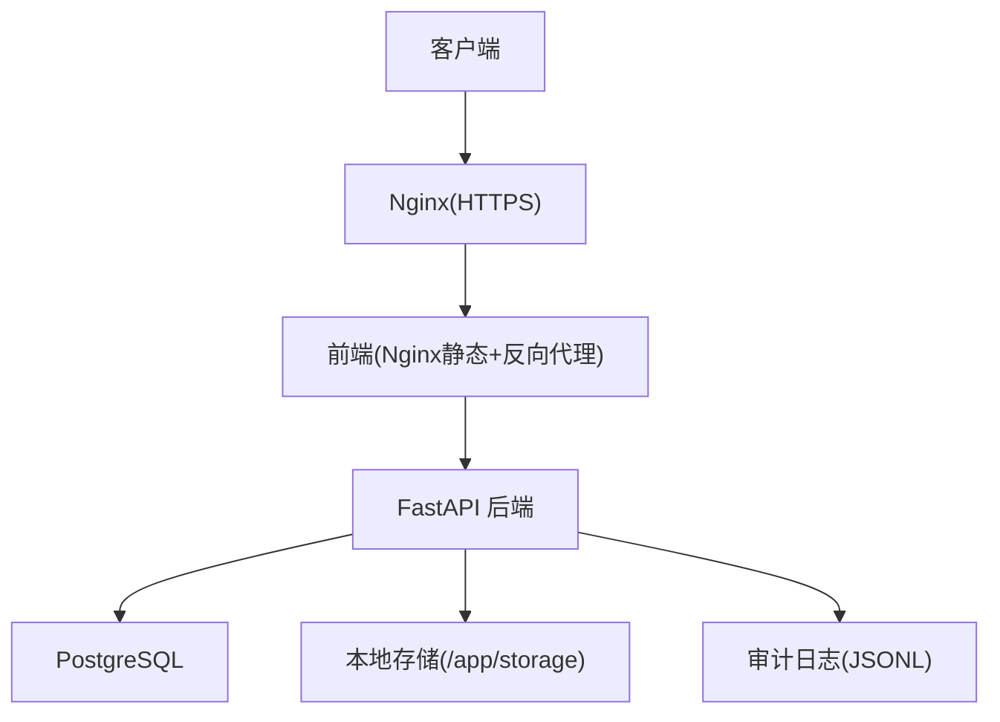
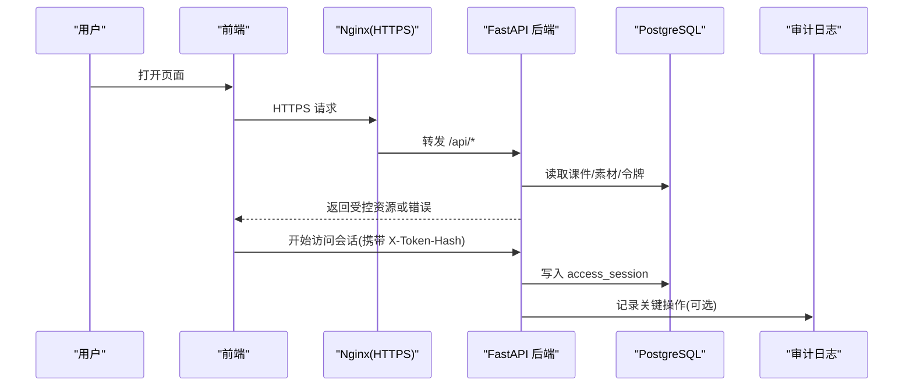
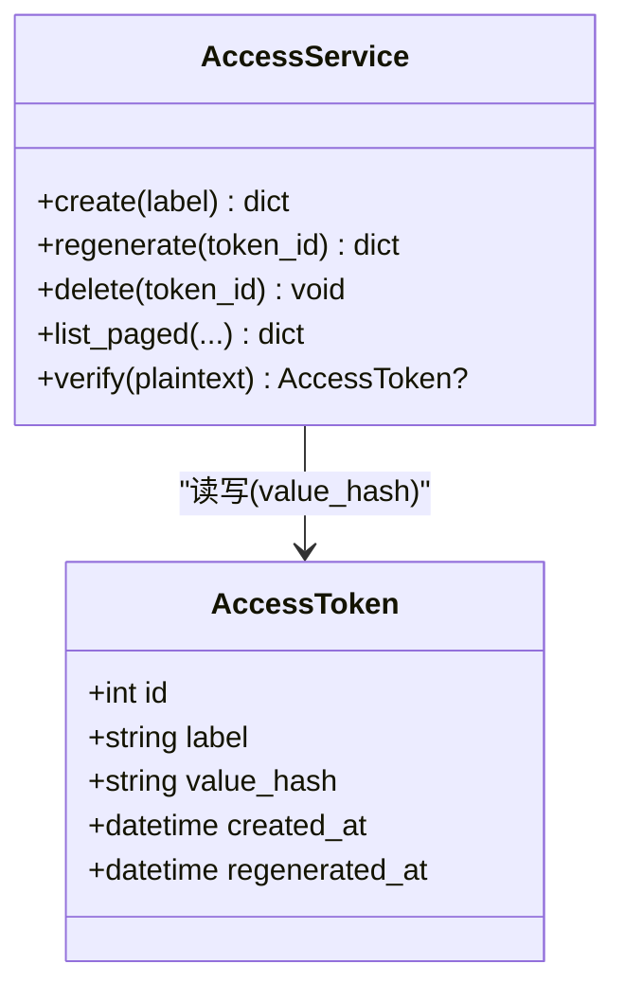
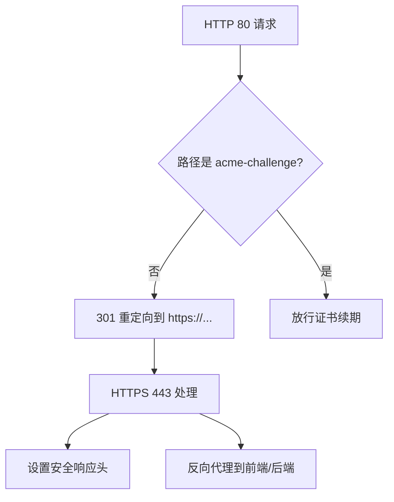
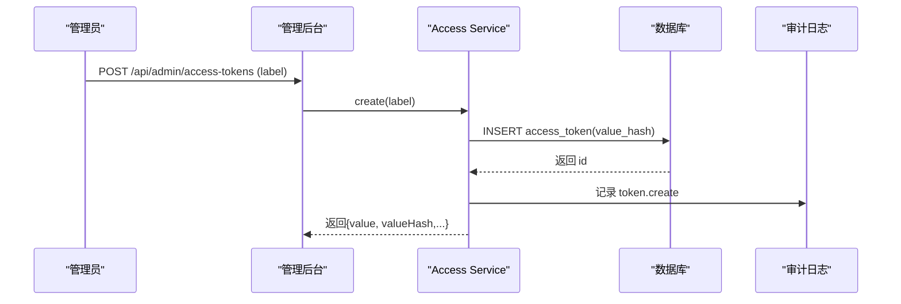
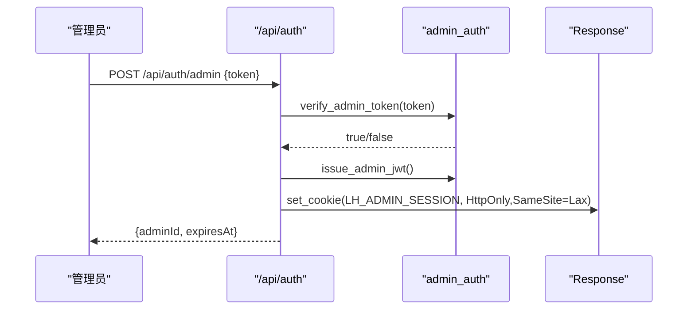
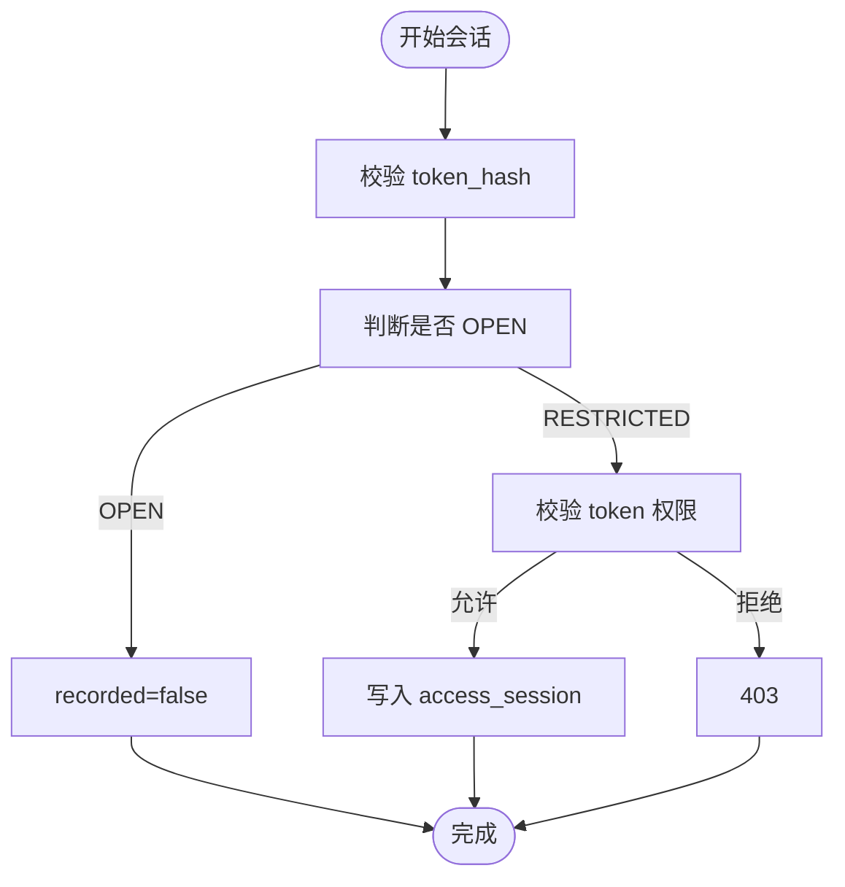
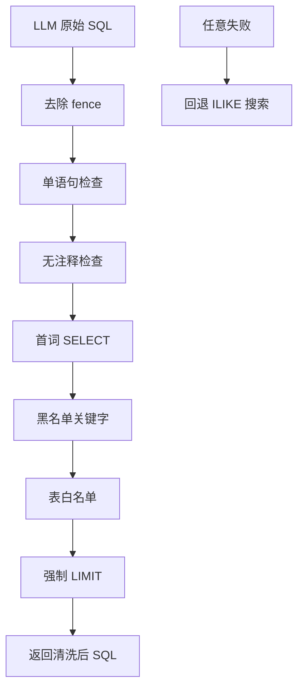
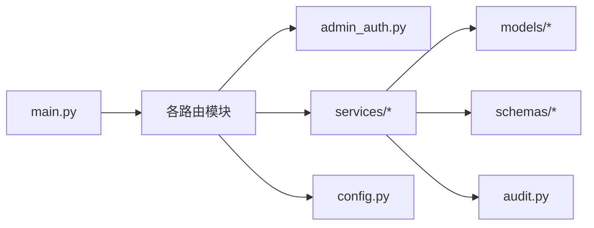

# 数据安全保护

<cite>
**本文引用的文件**   
- [backend/app/main.py](file://backend/app/main.py)
- [backend/app/core/config.py](file://backend/app/core/config.py)
- [backend/app/middleware/admin_auth.py](file://backend/app/middleware/admin_auth.py)
- [backend/app/api/auth.py](file://backend/app/api/auth.py)
- [backend/app/models/access_token.py](file://backend/app/models/access_token.py)
- [backend/app/services/access_token.py](file://backend/app/services/access_token.py)
- [backend/app/api/public/access_sessions.py](file://backend/app/api/public/access_sessions.py)
- [backend/app/models/access_session.py](file://backend/app/models/access_session.py)
- [backend/app/services/access_token_usage.py](file://backend/app/services/access_token_usage.py)
- [backend/app/schemas/access_token_usage.py](file://backend/app/schemas/access_token_usage.py)
- [backend/app/api/admin/access_tokens.py](file://backend/app/api/admin/access_tokens.py)
- [backend/app/api/admin/access_token_usage.py](file://backend/app/api/admin/access_token_usage.py)
- [backend/app/services/audit.py](file://backend/app/services/audit.py)
- [backend/app/services/_sql_safety.py](file://backend/app/services/_sql_safety.py)
- [deploy/ecs/nginx-vhost.snippet](file://deploy/ecs/nginx-vhost.snippet)
- [deploy/ecs/nginx-vhost-https.snippet](file://deploy/ecs/nginx-vhost-https.snippet)
- [deploy/ecs/compose.yml](file://deploy/ecs/compose.yml)
</cite>

## 目录
1. [引言](#引言)
2. [项目结构](#项目结构)
3. [核心组件](#核心组件)
4. [架构总览](#架构总览)
5. [详细组件分析](#详细组件分析)
6. [依赖关系分析](#依赖关系分析)
7. [性能与安全权衡](#性能与安全权衡)
8. [故障排查指南](#故障排查指南)
9. [结论](#结论)
10. [附录：配置与清单](#附录配置与清单)

## 引言
本指南面向 Learning Hub 的数据安全保护，覆盖敏感数据加密存储、传输安全、访问令牌生命周期与防重放、审计日志完整性与脱敏、数据库连接与备份安全，以及数据泄露防护与隐私保护措施。文档基于仓库现有实现进行梳理，并给出可落地的加固建议与最佳实践。

## 项目结构
后端采用 FastAPI 分层架构：路由层（api）、中间件与鉴权（middleware）、领域服务（services）、ORM 模型（models）、配置（core/config）。部署侧通过 Nginx 提供 HTTPS 反代，容器编排使用 Docker Compose。

图示来源
- [backend/app/main.py:40-112](file://backend/app/main.py#L40-L112)
- [deploy/ecs/nginx-vhost.snippet:16-55](file://deploy/ecs/nginx-vhost.snippet#L16-L55)
- [deploy/ecs/compose.yml:27-79](file://deploy/ecs/compose.yml#L27-L79)

章节来源
- [backend/app/main.py:40-112](file://backend/app/main.py#L40-L112)
- [deploy/ecs/nginx-vhost.snippet:16-55](file://deploy/ecs/nginx-vhost.snippet#L16-L55)
- [deploy/ecs/compose.yml:27-79](file://deploy/ecs/compose.yml#L27-L79)

## 核心组件
- 应用入口与全局中间件：注册 CORS、限流异常处理、请求 ID 透传等。
- 配置中心：集中管理数据库、JWT、CORS、时区、存储路径、LLM 开关等。
- 管理员鉴权：Admin Token 校验、签发 JWT、Cookie 安全属性。
- 访问令牌服务：创建/重新生成/删除/列表/验证；仅存哈希值，明文一次性返回。
- 访问会话：公开接口记录 P-VIEWER 访问行为，支持按素材聚合统计。
- SQL 白名单校验：对 LLM 生成的 SELECT 执行七道闸校验，限制表与 LIMIT。
- 审计日志：JSON Lines 追加写入，失败不阻塞主流程。

章节来源
- [backend/app/main.py:40-112](file://backend/app/main.py#L40-L112)
- [backend/app/core/config.py:9-88](file://backend/app/core/config.py#L9-L88)
- [backend/app/middleware/admin_auth.py:16-66](file://backend/app/middleware/admin_auth.py#L16-L66)
- [backend/app/services/access_token.py:73-139](file://backend/app/services/access_token.py#L73-L139)
- [backend/app/api/public/access_sessions.py:65-136](file://backend/app/api/public/access_sessions.py#L65-L136)
- [backend/app/services/_sql_safety.py:165-211](file://backend/app/services/_sql_safety.py#L165-L211)
- [backend/app/services/audit.py:21-45](file://backend/app/services/audit.py#L21-45)

## 架构总览
下图展示从浏览器到后端、数据库与审计的关键链路，突出 HTTPS、令牌传递与会话记录。

图示来源
- [deploy/ecs/nginx-vhost.snippet:16-55](file://deploy/ecs/nginx-vhost.snippet#L16-L55)
- [backend/app/api/public/access_sessions.py:65-136](file://backend/app/api/public/access_sessions.py#L65-L136)
- [backend/app/models/access_session.py:56-129](file://backend/app/models/access_session.py#L56-L129)
- [backend/app/services/audit.py:21-45](file://backend/app/services/audit.py#L21-45)

## 详细组件分析

### 敏感数据存储与密码哈希策略
- 访问令牌存储
  - 数据库仅保存 value_hash（SHA-256），明文仅在创建/重新生成时一次性返回。
  - 列表接口仅返回 value_hash，避免泄露。
- 管理员登录令牌
  - 登录接口使用常量时间比较验证 admin_token，成功后签发短期 JWT 并通过 HttpOnly Cookie 下发。
- 建议
  - 将 SHA-256 升级为带盐的慢哈希（如 bcrypt/argon2）用于长期凭证；当前设计适合一次性随机令牌场景。
  - 为 value_hash 字段建立索引以加速比对。

图示来源
- [backend/app/models/access_token.py:13-34](file://backend/app/models/access_token.py#L13-34)
- [backend/app/services/access_token.py:73-139](file://backend/app/services/access_token.py#L73-L139)

章节来源
- [backend/app/models/access_token.py:13-34](file://backend/app/models/access_token.py#L13-34)
- [backend/app/services/access_token.py:73-139](file://backend/app/services/access_token.py#L73-L139)
- [backend/app/api/admin/access_tokens.py:71-116](file://backend/app/api/admin/access_tokens.py#L71-L116)

### 数据传输安全（HTTPS 强制与头部加固）
- HTTPS 强制
  - Nginx 在 80 端口统一 301 跳转到 443，保留 /.well-known/acme-challenge 供证书续期。
  - 443 启用 http2，设置证书与私钥路径。
- 安全响应头
  - 已添加 X-Content-Type-Options、X-Frame-Options、X-XSS-Protection。
- 上传与大体超时
  - 针对大文件上传调整 client_max_body_size、client_body_timeout、proxy_*_timeout。
- 建议
  - 在生产环境启用 HSTS（Strict-Transport-Security），配合自动续期脚本确保首启即生效。
  - 考虑增加 Referrer-Policy、Permissions-Policy 等现代安全头。

图示来源
- [deploy/ecs/nginx-vhost.snippet:16-55](file://deploy/ecs/nginx-vhost.snippet#L16-L55)
- [deploy/ecs/nginx-vhost-https.snippet:8-41](file://deploy/ecs/nginx-vhost-https.snippet#L8-41)

章节来源
- [deploy/ecs/nginx-vhost.snippet:16-55](file://deploy/ecs/nginx-vhost.snippet#L16-L55)
- [deploy/ecs/nginx-vhost-https.snippet:8-41](file://deploy/ecs/nginx-vhost-https.snippet#L8-41)

### 访问令牌的安全存储与传输机制
- 令牌生成与验证
  - 使用安全随机源生成短令牌，计算 SHA-256 摘要入库；验证时使用常量时间比较。
- 令牌传递
  - 公开接口优先从请求头 X-Token-Hash 获取，其次回退到 Cookie lh_token_hash。
- 生命周期管理
  - 支持重新生成：旧 hash 即刻失效，新明文仅一次返回。
  - 删除前检查引用与“至少保留一个 active token”约束。
- 防重放与幂等
  - 访问会话结束接口要求 token_hash 与 session.token_id 对应 hash 一致，防止越权结束他人会话。
  - 会话结束为幂等：不存在视为成功。
- 建议
  - 引入 nonce/timestamp/signature 组合或短期一次性会话 ID 增强防重放能力。
  - 对 X-Token-Hash 做速率限制与来源校验（已在进程内实现每分钟上限）。

图示来源
- [backend/app/services/access_token.py:73-139](file://backend/app/services/access_token.py#L73-L139)
- [backend/app/api/admin/access_tokens.py:71-77](file://backend/app/api/admin/access_tokens.py#L71-77)
- [backend/app/services/audit.py:21-45](file://backend/app/services/audit.py#L21-45)

章节来源
- [backend/app/services/access_token.py:73-139](file://backend/app/services/access_token.py#L73-L139)
- [backend/app/api/public/access_sessions.py:57-136](file://backend/app/api/public/access_sessions.py#L57-136)
- [backend/app/services/access_token_usage.py:128-171](file://backend/app/services/access_token_usage.py#L128-L171)

### 管理员认证与 Cookie 安全
- 登录流程
  - 校验 admin_token（常量时间比较），签发短期 JWT，写入 HttpOnly、SameSite=Lax 的 Cookie。
- 鉴权中间件
  - 支持 Authorization: Bearer 与 Cookie 两种提取方式；过期/无效返回未认证错误。
- 建议
  - 生产环境务必更换默认 jwt_secret 与 admin_token，并使用强随机值。
  - 结合服务端黑名单/撤销机制（如 Redis）实现即时登出。

图示来源
- [backend/app/api/auth.py:21-45](file://backend/app/api/auth.py#L21-45)
- [backend/app/middleware/admin_auth.py:45-66](file://backend/app/middleware/admin_auth.py#L45-66)

章节来源
- [backend/app/api/auth.py:21-45](file://backend/app/api/auth.py#L21-45)
- [backend/app/middleware/admin_auth.py:16-66](file://backend/app/middleware/admin_auth.py#L16-66)

### 访问会话与审计日志
- 访问会话
  - 公开接口 start/leave 记录 P-VIEWER 浏览行为；OPEN 课件不记录；RESTRICTED 需 token 授权。
  - 时长校正：客户端 duration 与服务端差值超过阈值则采用服务端时间。
- 审计日志
  - JSON Lines 格式追加写入 storage_path/logs/audit.jsonl；失败不影响主流程。
- 建议
  - 对审计日志进行完整性保护（如定期签名/上链/不可变存储）。
  - 对包含 IP/UA 的日志进行脱敏或最小化采集策略。

图示来源
- [backend/app/api/public/access_sessions.py:65-136](file://backend/app/api/public/access_sessions.py#L65-L136)
- [backend/app/services/access_token_usage.py:64-125](file://backend/app/services/access_token_usage.py#L64-L125)
- [backend/app/models/access_session.py:56-129](file://backend/app/models/access_session.py#L56-L129)
- [backend/app/services/audit.py:21-45](file://backend/app/services/audit.py#L21-45)

章节来源
- [backend/app/api/public/access_sessions.py:65-136](file://backend/app/api/public/access_sessions.py#L65-L136)
- [backend/app/services/access_token_usage.py:64-171](file://backend/app/services/access_token_usage.py#L64-L171)
- [backend/app/models/access_session.py:56-129](file://backend/app/models/access_session.py#L56-L129)
- [backend/app/services/audit.py:21-45](file://backend/app/services/audit.py#L21-45)

### SQL 注入防护（LLM 生成查询）
- 七道闸校验
  - 去 markdown fence → 单语句 → 无注释 → 首词 SELECT → 黑名单关键字 → 表白名单 → 强制 LIMIT。
- 效果
  - 任一闸失败则丢弃 LLM 输出，调用方回退到关键词搜索。
- 建议
  - 持续维护 ALLOWED_TABLES 与 BLACKLIST_KEYWORDS，定期审计变更。
  - 对最终执行的 SQL 增加只读账号与最小权限原则。

图示来源
- [backend/app/services/_sql_safety.py:165-211](file://backend/app/services/_sql_safety.py#L165-L211)

章节来源
- [backend/app/services/_sql_safety.py:165-211](file://backend/app/services/_sql_safety.py#L165-L211)

## 依赖关系分析
- 模块耦合
  - api 层依赖 middleware 鉴权与 services 业务逻辑；services 依赖 models 与 schemas；main 装配路由与中间件。
- 外部依赖
  - Nginx 作为入口提供 HTTPS 与反代；Docker Compose 编排服务与网络。
- 潜在风险
  - 多进程下进程内限流不跨 worker，需在上游 Nginx 补充限流。
  - 审计日志写入失败静默吞错，需监控磁盘空间与 I/O。

图示来源
- [backend/app/main.py:40-112](file://backend/app/main.py#L40-L112)
- [backend/app/middleware/admin_auth.py:16-66](file://backend/app/middleware/admin_auth.py#L16-66)
- [backend/app/services/access_token.py:73-139](file://backend/app/services/access_token.py#L73-L139)
- [backend/app/services/audit.py:21-45](file://backend/app/services/audit.py#L21-45)
- [backend/app/core/config.py:9-88](file://backend/app/core/config.py#L9-L88)

章节来源
- [backend/app/main.py:40-112](file://backend/app/main.py#L40-L112)
- [backend/app/core/config.py:9-88](file://backend/app/core/config.py#L9-L88)

## 性能与安全权衡
- 令牌验证
  - 全量遍历 token 并逐条常量时间比较，适用于少量活跃令牌；若规模增长，建议引入哈希索引与批量预取。
- 会话记录
  - 公开接口对 DB 异常降级为不记录，保证前台体验；需关注审计与指标缺失问题。
- 限流
  - 进程内滑动窗口简单有效，但多副本需结合 Nginx 限流。

[本节为通用指导，无需源码引用]

## 故障排查指南
- 登录失败
  - 检查 admin_token 与 jwt_secret 是否正确配置；确认 Cookie 域与 SameSite 策略。
- 令牌无效
  - 确认 X-Token-Hash 或 Cookie lh_token_hash 是否随请求发送；核对 token 未被重新生成或删除。
- 访问被拒
  - 检查 token 是否被目标课件关联且课件处于 RESTRICTED 模式。
- 审计日志缺失
  - 检查 storage_path 所在卷挂载与磁盘空间；确认 logs 目录存在且可写。

章节来源
- [backend/app/api/auth.py:21-45](file://backend/app/api/auth.py#L21-45)
- [backend/app/api/public/access_sessions.py:65-136](file://backend/app/api/public/access_sessions.py#L65-L136)
- [backend/app/services/audit.py:21-45](file://backend/app/services/audit.py#L21-45)

## 结论
Learning Hub 在当前实现中已具备较完善的安全基线：HTTPS 强制、令牌哈希存储、JWT 短期会话、访问会话记录与基础审计、SQL 白名单校验等。建议在后续迭代中强化以下方面：
- 升级凭证哈希算法（bcrypt/argon2）
- 启用 HSTS 与现代安全头
- 引入令牌撤销/黑名单与防重放机制
- 审计日志完整性保护与脱敏策略
- 数据库连接加密与最小权限账户

[本节为总结性内容，无需源码引用]

## 附录：配置与清单
- 环境变量与配置项
  - 数据库：DATABASE_HOST/PORT/USER/PASSWORD/NAME 或 DATABASE_URL
  - 管理员：ADMIN_TOKEN
  - JWT：JWT_SECRET/JWT_ALGORITHM/JWT_TTL_HOURS
  - CORS：CORS_ALLOW_ORIGINS
  - 存储：STORAGE_PATH
  - 日志：LOG_LEVEL
- 部署要点
  - Nginx 证书路径、http2、安全头、超时参数
  - Compose 中 volumes 与 networks 映射，确保 /app/storage 持久化

章节来源
- [backend/app/core/config.py:19-88](file://backend/app/core/config.py#L19-L88)
- [deploy/ecs/nginx-vhost.snippet:16-55](file://deploy/ecs/nginx-vhost.snippet#L16-L55)
- [deploy/ecs/compose.yml:27-79](file://deploy/ecs/compose.yml#L27-L79)