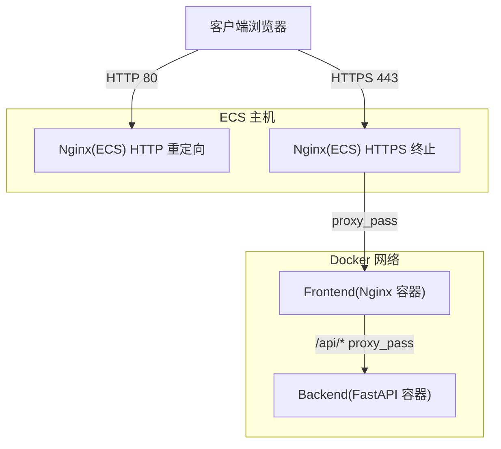
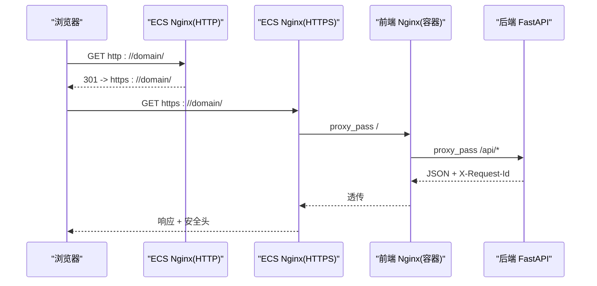
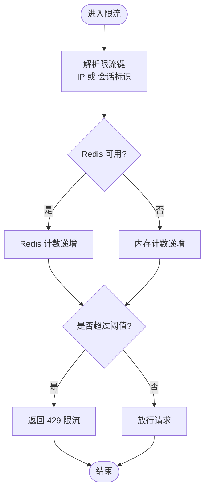
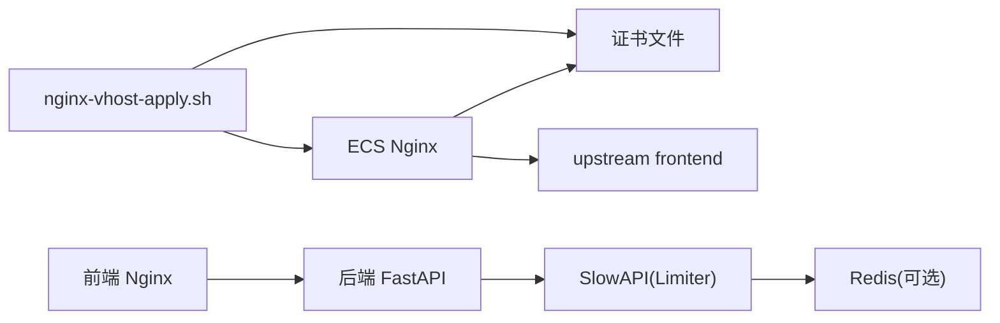

# 网络安全配置

<cite>
**本文引用的文件**   
- [nginx-vhost-http.snippet](file://deploy/ecs/nginx-vhost-http.snippet)
- [nginx-vhost-https.snippet](file://deploy/ecs/nginx-vhost-https.snippet)
- [nginx-vhost-apply.sh](file://deploy/ecs/nginx-vhost-apply.sh)
- [frontend nginx.conf](file://frontend/nginx.conf)
- [backend main.py](file://backend/app/main.py)
- [backend config.py](file://backend/app/core/config.py)
- [backend rate_limit.py](file://backend/app/core/rate_limit.py)
- [access_sessions.py](file://backend/app/api/public/access_sessions.py)
- [test_stream.py](file://deploy/local/tests/test_stream.py)
- [docker-compose.yml（本地）](file://deploy/local/docker-compose.yml)
</cite>

## 目录
1. [简介](#简介)
2. [项目结构](#项目结构)
3. [核心组件](#核心组件)
4. [架构总览](#架构总览)
5. [详细组件分析](#详细组件分析)
6. [依赖关系分析](#依赖关系分析)
7. [性能与安全考量](#性能与安全考量)
8. [故障排查指南](#故障排查指南)
9. [结论](#结论)
10. [附录](#附录)

## 简介
本指南面向 Learning Hub 的生产与部署运维人员，聚焦网络安全配置，覆盖以下主题：
- Nginx 反向代理安全：HTTPS 强制跳转、SSL 证书管理、安全响应头
- CORS 跨域策略：域名白名单与方法限制
- 请求频率限制：SlowAPI 集成与限流策略
- DDoS 防护：IP 黑名单、请求速率控制、连接数限制
- Docker 容器网络：端口暴露最小化与网络隔离
- CDN 集成与边缘计算安全防护最佳实践

## 项目结构
本项目在部署层提供两套 Nginx 配置片段与脚本，用于 ECS 环境的两阶段证书申请与 HTTPS 上线；前端容器内置 Nginx 作为静态资源与 API 反代入口；后端 FastAPI 应用负责业务逻辑、CORS 与限流。

图示来源
- [nginx-vhost-http.snippet:1-12](file://deploy/ecs/nginx-vhost-http.snippet#L1-L12)
- [nginx-vhost-https.snippet:1-42](file://deploy/ecs/nginx-vhost-https.snippet#L1-L42)
- [frontend nginx.conf:1-56](file://frontend/nginx.conf#L1-L56)
- [backend main.py:1-116](file://backend/app/main.py#L1-L116)

章节来源
- [nginx-vhost-http.snippet:1-12](file://deploy/ecs/nginx-vhost-http.snippet#L1-L12)
- [nginx-vhost-https.snippet:1-42](file://deploy/ecs/nginx-vhost-https.snippet#L1-L42)
- [frontend nginx.conf:1-56](file://frontend/nginx.conf#L1-L56)
- [backend main.py:1-116](file://backend/app/main.py#L1-L116)

## 核心组件
- Nginx 反向代理（ECS 与前端容器）
- FastAPI 应用（CORS、限流、错误处理）
- SlowAPI 限流器（支持 IP/会话键）
- 部署脚本（证书申请与 vhost 注入）
- Docker Compose（服务编排与端口映射）

章节来源
- [nginx-vhost-http.snippet:1-12](file://deploy/ecs/nginx-vhost-http.snippet#L1-L12)
- [nginx-vhost-https.snippet:1-42](file://deploy/ecs/nginx-vhost-https.snippet#L1-L42)
- [nginx-vhost-apply.sh:81-122](file://deploy/ecs/nginx-vhost-apply.sh#L81-L122)
- [frontend nginx.conf:1-56](file://frontend/nginx.conf#L1-L56)
- [backend main.py:1-116](file://backend/app/main.py#L1-L116)
- [backend rate_limit.py:1-55](file://backend/app/core/rate_limit.py#L1-L55)
- [docker-compose.yml（本地）:44-73](file://deploy/local/docker-compose.yml#L44-L73)

## 架构总览
下图展示了从浏览器到后端的完整链路，以及关键的安全控制点：
- 入口层：ECS Nginx 负责 80→443 强制跳转、TLS 终止、安全头
- 应用层：前端 Nginx 提供静态资源与 /api 反代；后端 FastAPI 提供 CORS、限流、鉴权
- 存储层：数据库与对象存储（不在本图展开）

图示来源
- [nginx-vhost-http.snippet:1-12](file://deploy/ecs/nginx-vhost-http.snippet#L1-L12)
- [nginx-vhost-https.snippet:1-42](file://deploy/ecs/nginx-vhost-https.snippet#L1-L42)
- [frontend nginx.conf:1-56](file://frontend/nginx.conf#L1-L56)
- [backend main.py:1-116](file://backend/app/main.py#L1-L116)

## 详细组件分析

### Nginx 反向代理安全配置
- HTTPS 强制跳转
  - ECS Nginx 监听 80 端口，对非 ACME 验证路径返回 301 跳转到 HTTPS，确保生产流量仅走加密通道。
  - 参考实现位置：[nginx-vhost-http.snippet:1-12](file://deploy/ecs/nginx-vhost-http.snippet#L1-L12)
- SSL 证书管理
  - 两阶段脚本：phase1 插入 HTTP server 并执行 certbot webroot 申请证书；phase2 校验容器内证书挂载并插入 HTTPS server block。
  - 参考实现位置：
    - [nginx-vhost-apply.sh:81-122](file://deploy/ecs/nginx-vhost-apply.sh#L81-L122)
    - [nginx-vhost-https.snippet:1-42](file://deploy/ecs/nginx-vhost-https.snippet#L1-L42)
- 安全响应头
  - 在 HTTPS server 中设置 X-Content-Type-Options、X-Frame-Options、X-XSS-Protection 等基础安全头。
  - 参考实现位置：[nginx-vhost-https.snippet:16-18](file://deploy/ecs/nginx-vhost-https.snippet#L16-L18)
- 大文件上传与超时
  - 调整 client_max_body_size、client_body_timeout、proxy_send/read/connect_timeout，避免长时上传被中断。
  - 参考实现位置：
    - [nginx-vhost-https.snippet:22-40](file://deploy/ecs/nginx-vhost-https.snippet#L22-L40)
    - [frontend nginx.conf:10-14](file://frontend/nginx.conf#L10-L14)
- 前端 Nginx 的反代与缓存
  - /api 路径反代至后端；静态资源设置长期缓存；PDF.js worker 显式 MIME 类型。
  - 参考实现位置：[frontend nginx.conf:25-54](file://frontend/nginx.conf#L25-L54)

章节来源
- [nginx-vhost-http.snippet:1-12](file://deploy/ecs/nginx-vhost-http.snippet#L1-L12)
- [nginx-vhost-https.snippet:1-42](file://deploy/ecs/nginx-vhost-https.snippet#L1-L42)
- [nginx-vhost-apply.sh:81-122](file://deploy/ecs/nginx-vhost-apply.sh#L81-L122)
- [frontend nginx.conf:1-56](file://frontend/nginx.conf#L1-L56)

### CORS 跨域策略配置
- 后端 FastAPI 启用 CORSMiddleware，允许来源由环境变量 cors_allow_origins 解析为列表；默认允许 *（开发），生产建议改为精确白名单。
- 允许携带凭据，允许方法与头部使用通配（生产建议收敛）。
- 暴露 X-Request-Id 以便前端追踪。
- 参考实现位置：
  - [backend main.py:57-65](file://backend/app/main.py#L57-L65)
  - [backend config.py:48-50](file://backend/app/core/config.py#L48-L50)
  - [backend config.py:75-77](file://backend/app/core/config.py#L75-L77)

建议
- 生产将 cors_allow_origins 设置为受信任域名列表（逗号分隔），并限定 allow_methods 与 allow_headers 为必要集合。
- 若需严格模式，可结合网关层或 WAF 进一步校验 Origin。

章节来源
- [backend main.py:57-65](file://backend/app/main.py#L57-L65)
- [backend config.py:48-50](file://backend/app/core/config.py#L48-L50)
- [backend config.py:75-77](file://backend/app/core/config.py#L75-L77)

### 请求频率限制（SlowAPI）
- 全局 Limiter 初始化，优先 Redis 存储，否则内存模式。
- 自定义 key_func 支持按 IP 或会话标识（基于 Authorization 头中的 JWT sub 片段）进行限流。
- 路由装饰器 rate_limit(spec, key="ip") 用于接口级限流。
- 参考实现位置：
  - [backend rate_limit.py:1-55](file://backend/app/core/rate_limit.py#L1-55)
  - [backend main.py:67-68](file://backend/app/main.py#L67-L68)
- 应用层兜底限流（访问会话）
  - access_sessions 模块实现滑动窗口 IP 限流，防止滥用。
  - 参考实现位置：[access_sessions.py:35-54](file://backend/app/api/public/access_sessions.py#L35-L54)
- 测试用例验证
  - 针对 /stream 接口的限流行为有端到端测试，期望出现 429。
  - 参考实现位置：[test_stream.py:147-165](file://deploy/local/tests/test_stream.py#L147-L165)

流程图：SlowAPI 限流决策

图示来源
- [backend rate_limit.py:40-51](file://backend/app/core/rate_limit.py#L40-L51)
- [backend main.py:84-89](file://backend/app/main.py#L84-L89)

章节来源
- [backend rate_limit.py:1-55](file://backend/app/core/rate_limit.py#L1-55)
- [backend main.py:67-89](file://backend/app/main.py#L67-L89)
- [access_sessions.py:35-54](file://backend/app/api/public/access_sessions.py#L35-L54)
- [test_stream.py:147-165](file://deploy/local/tests/test_stream.py#L147-L165)

### DDoS 防护措施
- IP 黑名单
  - 当前仓库未包含 IP 黑名单实现。建议在 Nginx 层通过 geo/map 或第三方模块（如 ngx_http_geoip_module）维护黑名单，或在云 WAF/CDN 侧集中管控。
- 请求速率控制
  - 已在后端通过 SlowAPI 实现接口级限流，并在关键路径（如访问会话）增加应用层滑动窗口限流。
  - 参考实现位置：
    - [backend rate_limit.py:1-55](file://backend/app/core/rate_limit.py#L1-55)
    - [access_sessions.py:35-54](file://backend/app/api/public/access_sessions.py#L35-L54)
- 连接数限制
  - 当前仓库未包含连接数限制配置。建议在 Nginx 层设置 limit_conn_zone 与 limit_conn，并结合系统内核参数（如 net.core.somaxconn）调优。
- 其他建议
  - 在 ECS 安全组仅开放 80/443，屏蔽不必要端口。
  - 结合云厂商的 DDoS 高防与 WAF 能力，实现更全面的防护。

章节来源
- [backend rate_limit.py:1-55](file://backend/app/core/rate_limit.py#L1-55)
- [access_sessions.py:35-54](file://backend/app/api/public/access_sessions.py#L35-L54)

### Docker 容器网络安全配置
- 端口暴露最小化
  - 本地开发 compose 将后端 8000 与前端 80 映射到宿主机，生产应仅暴露 80/443 给公网，内部服务间通过 Docker 网络通信。
  - 参考实现位置：[docker-compose.yml（本地）:44-73](file://deploy/local/docker-compose.yml#L44-L73)
- 网络隔离
  - 使用 Docker 网络将后端与数据库隔离于私有网段，不直接对外暴露。
  - 健康检查通过 curl 探测前端 Nginx 与后端健康接口，确保反代链路正常。
  - 参考实现位置：[docker-compose.yml（本地）:64-69](file://deploy/local/docker-compose.yml#L64-L69)

章节来源
- [docker-compose.yml（本地）:44-73](file://deploy/local/docker-compose.yml#L44-L73)

### CDN 集成与边缘计算安全防护最佳实践
- 证书与回源
  - 使用自有域名证书或托管证书，开启 SNI；回源协议选择 HTTPS，并校验证书有效性。
- 安全头与缓存
  - 在边缘层统一添加安全头（如 HSTS、X-Content-Type-Options、X-Frame-Options、Referrer-Policy、Content-Security-Policy），并对静态资源启用强缓存。
- 访问控制
  - 启用 Referer 校验与防盗链；对敏感路径启用签名 URL 或临时令牌。
- 速率与连接限制
  - 在 CDN/WAF 层实施 IP 级与路径级速率限制、并发连接限制，拦截异常扫描与暴力破解。
- 日志与审计
  - 开启访问日志与威胁告警，结合 SIEM 进行联动处置。
- 边缘计算
  - 将鉴权前置、WAF 规则、Bot 管理置于边缘节点，降低源站压力。

本节为通用实践说明，不涉及具体代码文件引用。

## 依赖关系分析
- Nginx（ECS）依赖证书文件与上游 upstream 定义，负责 TLS 终止与安全头注入。
- 前端 Nginx 依赖后端 FastAPI 服务名解析，负责静态资源与 /api 反代。
- FastAPI 依赖 SlowAPI 与 Redis（可选），负责 CORS 与限流。
- 部署脚本依赖 certbot 与 docker 命令，负责证书申请与 vhost 注入。

图示来源
- [nginx-vhost-https.snippet:1-42](file://deploy/ecs/nginx-vhost-https.snippet#L1-L42)
- [frontend nginx.conf:1-56](file://frontend/nginx.conf#L1-L56)
- [backend rate_limit.py:1-55](file://backend/app/core/rate_limit.py#L1-55)
- [nginx-vhost-apply.sh:81-122](file://deploy/ecs/nginx-vhost-apply.sh#L81-L122)

章节来源
- [nginx-vhost-https.snippet:1-42](file://deploy/ecs/nginx-vhost-https.snippet#L1-L42)
- [frontend nginx.conf:1-56](file://frontend/nginx.conf#L1-L56)
- [backend rate_limit.py:1-55](file://backend/app/core/rate_limit.py#L1-55)
- [nginx-vhost-apply.sh:81-122](file://deploy/ecs/nginx-vhost-apply.sh#L81-L122)

## 性能与安全考量
- 大文件上传
  - 合理提升 client_max_body_size 与各类超时，避免长连接被中断。
  - 参考实现位置：
    - [nginx-vhost-https.snippet:22-40](file://deploy/ecs/nginx-vhost-https.snippet#L22-L40)
    - [frontend nginx.conf:10-14](file://frontend/nginx.conf#L10-L14)
- 静态资源缓存
  - 对 JS/CSS/图片等设置长期缓存与 immutable，减少带宽与服务器压力。
  - 参考实现位置：[frontend nginx.conf:44-48](file://frontend/nginx.conf#L44-L48)
- 限流与降级
  - 通过 SlowAPI 与滑动窗口双重保护，保障关键路径不被滥用。
  - 参考实现位置：
    - [backend rate_limit.py:1-55](file://backend/app/core/rate_limit.py#L1-55)
    - [access_sessions.py:35-54](file://backend/app/api/public/access_sessions.py#L35-L54)

## 故障排查指南
- HTTPS 无法访问或证书无效
  - 检查 phase1 证书申请是否成功，确认容器内证书路径存在且可读。
  - 参考实现位置：[nginx-vhost-apply.sh:88-98](file://deploy/ecs/nginx-vhost-apply.sh#L88-L98)
- 429 限流频繁触发
  - 核对 SlowAPI 的 key_func 与 Redis 连通性；必要时放宽阈值或优化业务逻辑。
  - 参考实现位置：
    - [backend rate_limit.py:40-51](file://backend/app/core/rate_limit.py#L40-L51)
    - [backend main.py:84-89](file://backend/app/main.py#L84-L89)
- CORS 预检失败
  - 检查 cors_allow_origins 是否为空或包含目标域名；确认 allow_credentials/methods/headers 配置。
  - 参考实现位置：
    - [backend main.py:57-65](file://backend/app/main.py#L57-L65)
    - [backend config.py:48-50](file://backend/app/core/config.py#L48-L50)
- 大文件上传中断
  - 检查 client_max_body_size 与各类超时是否匹配文件大小与网络条件。
  - 参考实现位置：
    - [nginx-vhost-https.snippet:22-40](file://deploy/ecs/nginx-vhost-https.snippet#L22-L40)
    - [frontend nginx.conf:10-14](file://frontend/nginx.conf#L10-L14)

章节来源
- [nginx-vhost-apply.sh:88-98](file://deploy/ecs/nginx-vhost-apply.sh#L88-L98)
- [backend rate_limit.py:40-51](file://backend/app/core/rate_limit.py#L40-L51)
- [backend main.py:84-89](file://backend/app/main.py#L84-L89)
- [backend main.py:57-65](file://backend/app/main.py#L57-L65)
- [backend config.py:48-50](file://backend/app/core/config.py#L48-L50)
- [nginx-vhost-https.snippet:22-40](file://deploy/ecs/nginx-vhost-https.snippet#L22-L40)
- [frontend nginx.conf:10-14](file://frontend/nginx.conf#L10-L14)

## 结论
Learning Hub 在生产环境中已具备基础的网络安全能力：HTTPS 强制跳转、TLS 终止、基础安全头、CORS 白名单、SlowAPI 限流与应用层兜底限流。建议进一步完善 IP 黑名单、连接数限制与 WAF/CDN 集成，形成多层纵深防御体系。

## 附录
- 术语
  - 反向代理：位于客户端与后端服务之间，转发请求并可能进行安全策略处理。
  - 限流：在单位时间内限制请求数量，防止滥用与过载。
  - CORS：跨域资源共享，控制浏览器跨域访问权限。
- 相关规范与验收
  - 生产环境强制 HTTPS 的验收用例与预期行为见集成测试文档。
  - 参考实现位置：[集成测试用例（节选）:439-447](file://doc/test/test-cases-integration.md#L439-L447)

章节来源
- [doc/test/test-cases-integration.md:439-447](file://doc/test/test-cases-integration.md#L439-L447)