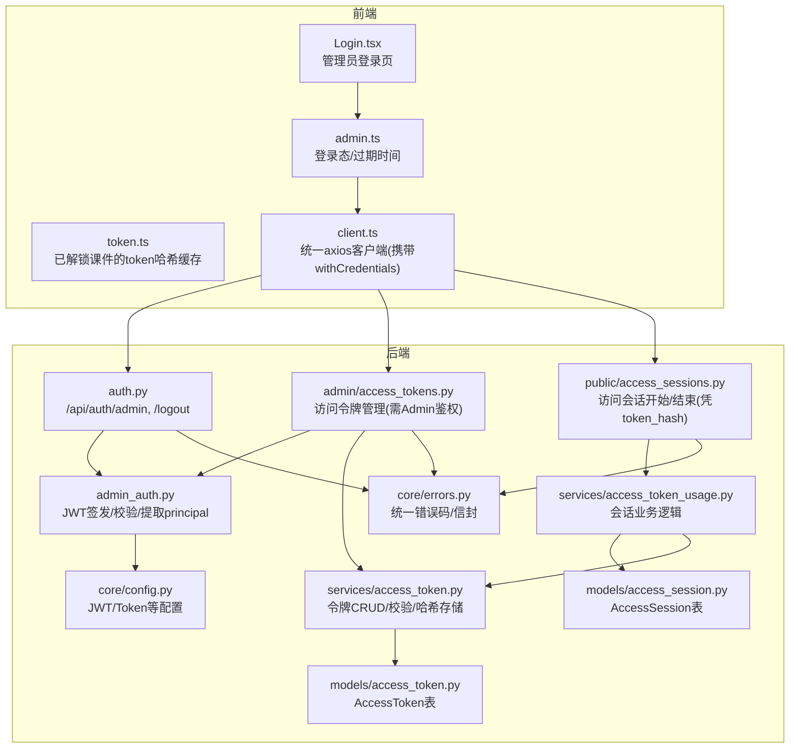
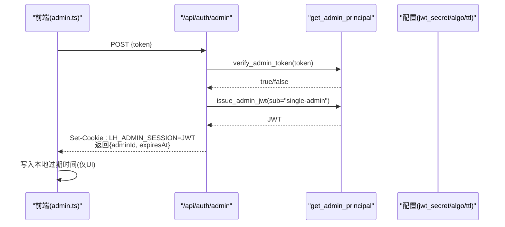
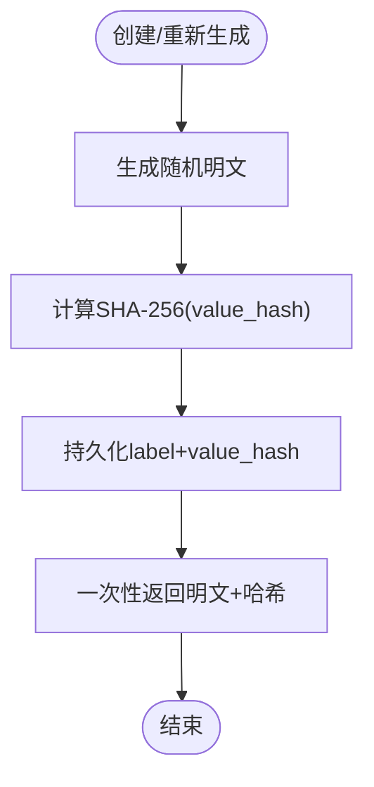
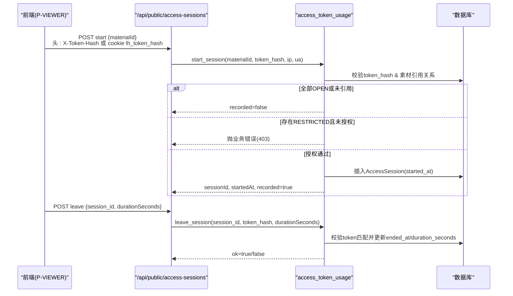
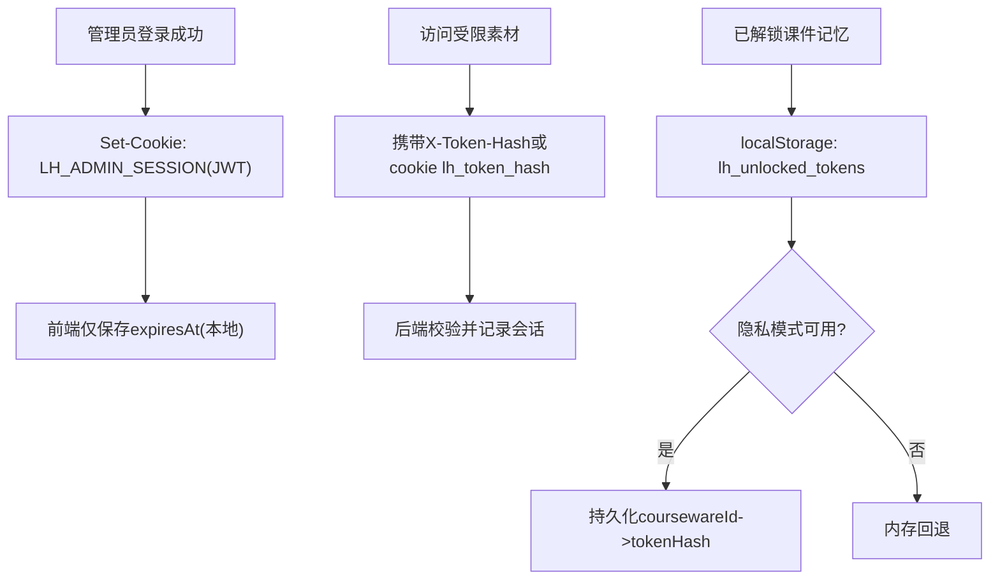
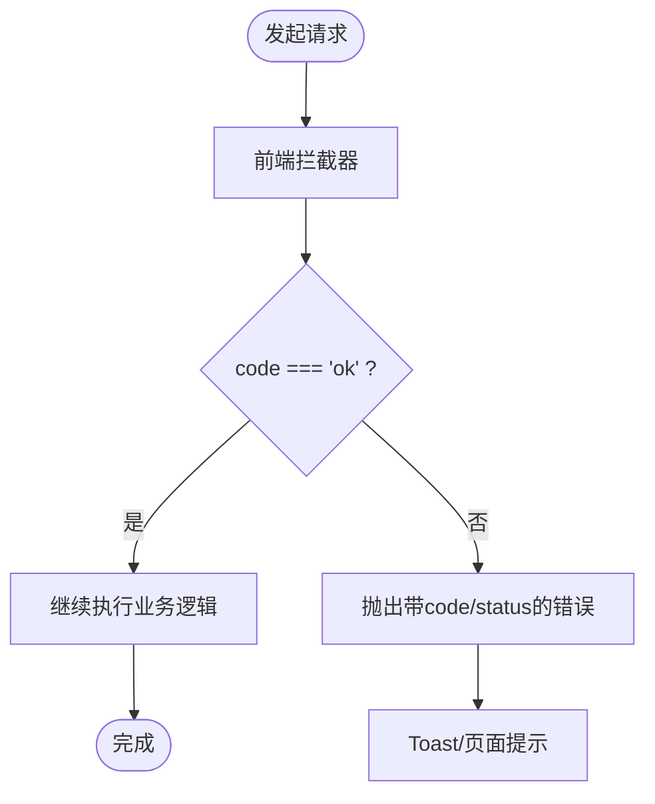
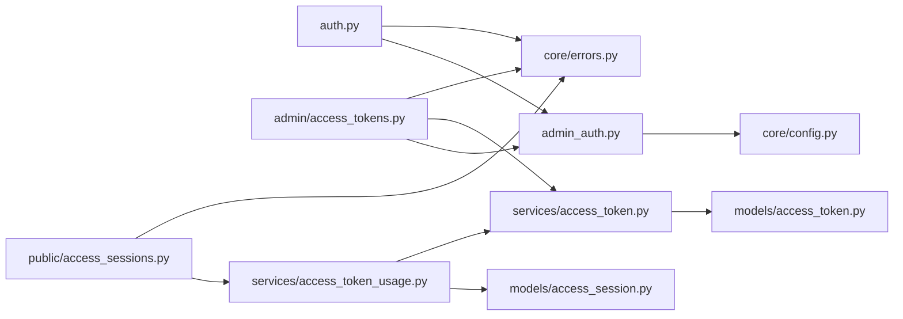

# 认证与授权

<cite>
**本文引用的文件**
- [backend/app/api/auth.py](file://backend/app/api/auth.py)
- [backend/app/middleware/admin_auth.py](file://backend/app/middleware/admin_auth.py)
- [backend/app/core/config.py](file://backend/app/core/config.py)
- [backend/app/core/errors.py](file://backend/app/core/errors.py)
- [backend/app/models/access_token.py](file://backend/app/models/access_token.py)
- [backend/app/services/access_token.py](file://backend/app/services/access_token.py)
- [backend/app/api/admin/access_tokens.py](file://backend/app/api/admin/access_tokens.py)
- [backend/app/schemas/access_token.py](file://backend/app/schemas/access_token.py)
- [backend/app/models/access_session.py](file://backend/app/models/access_session.py)
- [backend/app/api/public/access_sessions.py](file://backend/app/api/public/access_sessions.py)
- [backend/app/services/access_token_usage.py](file://backend/app/services/access_token_usage.py)
- [frontend/src/stores/token.ts](file://frontend/src/stores/token.ts)
- [frontend/src/stores/admin.ts](file://frontend/src/stores/admin.ts)
- [frontend/src/pages/admin/Login.tsx](file://frontend/src/pages/admin/Login.tsx)
- [frontend/src/api/client.ts](file://frontend/src/api/client.ts)
</cite>

## 目录
1. [简介](#简介)
2. [项目结构](#项目结构)
3. [核心组件](#核心组件)
4. [架构总览](#架构总览)
5. [详细组件分析](#详细组件分析)
6. [依赖关系分析](#依赖关系分析)
7. [性能与安全考量](#性能与安全考量)
8. [故障排查指南](#故障排查指南)
9. [结论](#结论)
10. [附录](#附录)

## 简介
本文件系统性梳理 Learning Hub 的认证与授权机制，覆盖以下关键主题：
- 管理员认证中间件与 JWT 签发、验证流程（含 Cookie 注入）
- 访问令牌系统的设计与实现（生成、权限控制、会话管理）
- 前端 Token 存储策略与安全考虑（Cookie 与 LocalStorage 的使用场景）
- 认证失败的错误处理与用户友好的登录状态管理
- 多角色权限控制的现状与扩展建议

## 项目结构
后端采用 FastAPI 分层组织：路由层（api）、鉴权中间件（middleware）、领域服务（services）、数据模型（models）、配置与错误码（core）。前端基于 React + Zustand 管理登录态与已解锁课件的 token 哈希缓存。



图表来源
- [backend/app/api/auth.py:1-49](file://backend/app/api/auth.py#L1-L49)
- [backend/app/middleware/admin_auth.py:1-66](file://backend/app/middleware/admin_auth.py#L1-L66)
- [backend/app/api/admin/access_tokens.py:1-120](file://backend/app/api/admin/access_tokens.py#L1-L120)
- [backend/app/services/access_token.py:1-235](file://backend/app/services/access_token.py#L1-L235)
- [backend/app/models/access_token.py:1-34](file://backend/app/models/access_token.py#L1-L34)
- [backend/app/api/public/access_sessions.py:1-137](file://backend/app/api/public/access_sessions.py#L1-L137)
- [backend/app/services/access_token_usage.py:1-518](file://backend/app/services/access_token_usage.py#L1-L518)
- [backend/app/models/access_session.py:1-129](file://backend/app/models/access_session.py#L1-L129)
- [backend/app/core/config.py:1-88](file://backend/app/core/config.py#L1-L88)
- [backend/app/core/errors.py:1-144](file://backend/app/core/errors.py#L1-L144)
- [frontend/src/stores/admin.ts:1-71](file://frontend/src/stores/admin.ts#L1-L71)
- [frontend/src/stores/token.ts:1-54](file://frontend/src/stores/token.ts#L1-L54)
- [frontend/src/pages/admin/Login.tsx:1-72](file://frontend/src/pages/admin/Login.tsx#L1-L72)
- [frontend/src/api/client.ts:1-52](file://frontend/src/api/client.ts#L1-L52)

章节来源
- [backend/app/api/auth.py:1-49](file://backend/app/api/auth.py#L1-L49)
- [backend/app/middleware/admin_auth.py:1-66](file://backend/app/middleware/admin_auth.py#L1-L66)
- [backend/app/api/admin/access_tokens.py:1-120](file://backend/app/api/admin/access_tokens.py#L1-L120)
- [backend/app/services/access_token.py:1-235](file://backend/app/services/access_token.py#L1-L235)
- [backend/app/models/access_token.py:1-34](file://backend/app/models/access_token.py#L1-L34)
- [backend/app/api/public/access_sessions.py:1-137](file://backend/app/api/public/access_sessions.py#L1-L137)
- [backend/app/services/access_token_usage.py:1-518](file://backend/app/services/access_token_usage.py#L1-L518)
- [backend/app/models/access_session.py:1-129](file://backend/app/models/access_session.py#L1-L129)
- [backend/app/core/config.py:1-88](file://backend/app/core/config.py#L1-L88)
- [backend/app/core/errors.py:1-144](file://backend/app/core/errors.py#L1-L144)
- [frontend/src/stores/admin.ts:1-71](file://frontend/src/stores/admin.ts#L1-L71)
- [frontend/src/stores/token.ts:1-54](file://frontend/src/stores/token.ts#L1-L54)
- [frontend/src/pages/admin/Login.tsx:1-72](file://frontend/src/pages/admin/Login.tsx#L1-L72)
- [frontend/src/api/client.ts:1-52](file://frontend/src/api/client.ts#L1-L52)

## 核心组件
- 管理员认证与JWT
  - 登录接口：校验“管理令牌”，签发短期 JWT，并通过 HttpOnly Cookie 下发；登出删除 Cookie。
  - 鉴权中间件：从 Authorization 或 Cookie 中提取 JWT，解码并校验 exp/sub，失败返回未认证错误。
- 访问令牌系统
  - 仅存 value_hash(SHA-256)，明文仅在创建/重新生成时一次性返回。
  - 提供创建、重新生成、删除、分页查询、按哈希查找、常量时间比对等能力。
- 访问会话与权限控制
  - 公共接口凭 token_hash 开启/结束访问会话；若素材被 RESTRICTED 课件引用且 token 未授权则拒绝。
  - 会话记录包含起止时间、停留时长、IP/UA 等，支持聚合统计。
- 前端状态与存储
  - 管理员登录态：通过 Cookie 维持，本地仅保存过期时间用于 UI 展示。
  - 已解锁课件：将 coursewareId -> tokenHash 持久化到 localStorage，隐私模式回退内存。

章节来源
- [backend/app/api/auth.py:1-49](file://backend/app/api/auth.py#L1-L49)
- [backend/app/middleware/admin_auth.py:1-66](file://backend/app/middleware/admin_auth.py#L1-L66)
- [backend/app/services/access_token.py:1-235](file://backend/app/services/access_token.py#L1-L235)
- [backend/app/models/access_token.py:1-34](file://backend/app/models/access_token.py#L1-L34)
- [backend/app/api/public/access_sessions.py:1-137](file://backend/app/api/public/access_sessions.py#L1-L137)
- [backend/app/services/access_token_usage.py:1-518](file://backend/app/services/access_token_usage.py#L1-L518)
- [backend/app/models/access_session.py:1-129](file://backend/app/models/access_session.py#L1-L129)
- [frontend/src/stores/admin.ts:1-71](file://frontend/src/stores/admin.ts#L1-L71)
- [frontend/src/stores/token.ts:1-54](file://frontend/src/stores/token.ts#L1-L54)

## 架构总览
下图展示了管理员登录、受保护资源访问以及受限课件访问的整体流程。

```mermaid
sequenceDiagram
participant U as "浏览器"
participant FE as "前端(admin.ts/client.ts)"
participant Auth as "后端 /api/auth"
participant Admin as "后端 /api/admin/*"
participant Pub as "后端 /api/public/*"
participant DB as "数据库"
U->>FE : 打开管理员登录页
FE->>Auth : POST /api/auth/admin {token}
Auth-->>FE : Set-Cookie : LH_ADMIN_SESSION=JWT; 返回{adminId, expiresAt}
FE->>FE : 写入本地过期时间(仅UI)
U->>Admin : 请求受保护接口(自动携带Cookie)
Admin->>Admin : 解析Authorization/Cookie中的JWT并校验
Admin-->>U : 成功响应或401/403
U->>Pub : 访问受限素材(携带X-Token-Hash或cookie lh_token_hash)
Pub->>DB : 校验token_hash并判断是否RESTRICTED
Pub-->>U : 允许/拒绝并记录会话
```

图表来源
- [backend/app/api/auth.py:1-49](file://backend/app/api/auth.py#L1-L49)
- [backend/app/middleware/admin_auth.py:1-66](file://backend/app/middleware/admin_auth.py#L1-L66)
- [backend/app/api/admin/access_tokens.py:1-120](file://backend/app/api/admin/access_tokens.py#L1-L120)
- [backend/app/api/public/access_sessions.py:1-137](file://backend/app/api/public/access_sessions.py#L1-L137)
- [backend/app/services/access_token_usage.py:1-518](file://backend/app/services/access_token_usage.py#L1-L518)
- [frontend/src/stores/admin.ts:1-71](file://frontend/src/stores/admin.ts#L1-L71)
- [frontend/src/api/client.ts:1-52](file://frontend/src/api/client.ts#L1-L52)

## 详细组件分析

### 管理员认证与JWT流程
- 登录
  - 使用“管理令牌”调用 /api/auth/admin，成功后签发 JWT 并通过 HttpOnly Cookie 下发，同时返回 expiresAt。
- 鉴权中间件
  - get_admin_principal 优先从 Authorization: Bearer 提取，其次从 Cookie LH_ADMIN_SESSION 提取；解码后要求存在 exp 和 sub，否则抛出未认证错误。
- 登出
  - /api/auth/logout 删除 Cookie，前端清理本地过期时间。



图表来源
- [backend/app/api/auth.py:1-49](file://backend/app/api/auth.py#L1-L49)
- [backend/app/middleware/admin_auth.py:1-66](file://backend/app/middleware/admin_auth.py#L1-L66)
- [backend/app/core/config.py:1-88](file://backend/app/core/config.py#L1-L88)
- [frontend/src/stores/admin.ts:1-71](file://frontend/src/stores/admin.ts#L1-L71)

章节来源
- [backend/app/api/auth.py:1-49](file://backend/app/api/auth.py#L1-L49)
- [backend/app/middleware/admin_auth.py:1-66](file://backend/app/middleware/admin_auth.py#L1-L66)
- [backend/app/core/config.py:1-88](file://backend/app/core/config.py#L1-L88)
- [frontend/src/stores/admin.ts:1-71](file://frontend/src/stores/admin.ts#L1-L71)
- [frontend/src/pages/admin/Login.tsx:1-72](file://frontend/src/pages/admin/Login.tsx#L1-L72)

### 访问令牌系统设计与实现
- 数据模型
  - AccessToken 仅存储 label 与 value_hash(SHA-256)，不持久化明文。
- 服务层
  - create/regenerate/delete/list_paged/verify/get_by_hash 等，遵循标签唯一、至少保留一个 active token、删除前检查引用等业务规则。
  - verify 使用常量时间比较避免时序攻击。
- 管理API
  - 列表/详情/创建/重新生成/删除均需要管理员鉴权；创建/重新生成一次性返回明文与哈希。



图表来源
- [backend/app/services/access_token.py:1-235](file://backend/app/services/access_token.py#L1-L235)
- [backend/app/models/access_token.py:1-34](file://backend/app/models/access_token.py#L1-L34)
- [backend/app/api/admin/access_tokens.py:1-120](file://backend/app/api/admin/access_tokens.py#L1-L120)
- [backend/app/schemas/access_token.py:1-53](file://backend/app/schemas/access_token.py#L1-L53)

章节来源
- [backend/app/services/access_token.py:1-235](file://backend/app/services/access_token.py#L1-L235)
- [backend/app/models/access_token.py:1-34](file://backend/app/models/access_token.py#L1-L34)
- [backend/app/api/admin/access_tokens.py:1-120](file://backend/app/api/admin/access_tokens.py#L1-L120)
- [backend/app/schemas/access_token.py:1-53](file://backend/app/schemas/access_token.py#L1-L53)

### 访问会话与权限控制
- 权限判定
  - 若素材被任意 RESTRICTED 课件引用，则必须持有该课件绑定的 token_hash 才能访问；全部为 OPEN 则无需记录。
- 会话记录
  - start：记录 started_at、ip、ua 等；leave：幂等结束，支持服务端时间校正（偏差阈值）。
- 限流与降级
  - 进程内滑动窗口限流（每 IP 每分钟），命中则降级为不记录但不阻塞主流程；DB 异常也吞错降级。



图表来源
- [backend/app/api/public/access_sessions.py:1-137](file://backend/app/api/public/access_sessions.py#L1-L137)
- [backend/app/services/access_token_usage.py:1-518](file://backend/app/services/access_token_usage.py#L1-L518)
- [backend/app/models/access_session.py:1-129](file://backend/app/models/access_session.py#L1-L129)

章节来源
- [backend/app/api/public/access_sessions.py:1-137](file://backend/app/api/public/access_sessions.py#L1-L137)
- [backend/app/services/access_token_usage.py:1-518](file://backend/app/services/access_token_usage.py#L1-L518)
- [backend/app/models/access_session.py:1-129](file://backend/app/models/access_session.py#L1-L129)

### 前端Token存储策略与安全考虑
- 管理员会话
  - 后端通过 HttpOnly Cookie 下发 JWT，前端不直接持有 token；本地仅保存 expiresAt 用于 UI 展示与过期判断。
  - 登出时调用 /api/auth/logout 删除 Cookie，并清理本地过期时间。
- 受限课件访问
  - 前端在访问受限素材时将 token_hash 以 X-Token-Hash 头或 cookie lh_token_hash 传递，避免暴露明文 token。
- 已解锁课件记忆
  - 使用 zustand + localStorage 缓存 coursewareId -> tokenHash，隐私模式下回退内存，刷新页面可恢复。



图表来源
- [backend/app/api/auth.py:1-49](file://backend/app/api/auth.py#L1-L49)
- [backend/app/api/public/access_sessions.py:1-137](file://backend/app/api/public/access_sessions.py#L1-L137)
- [frontend/src/stores/admin.ts:1-71](file://frontend/src/stores/admin.ts#L1-L71)
- [frontend/src/stores/token.ts:1-54](file://frontend/src/stores/token.ts#L1-L54)
- [frontend/src/api/client.ts:1-52](file://frontend/src/api/client.ts#L1-L52)

章节来源
- [backend/app/api/auth.py:1-49](file://backend/app/api/auth.py#L1-L49)
- [backend/app/api/public/access_sessions.py:1-137](file://backend/app/api/public/access_sessions.py#L1-L137)
- [frontend/src/stores/admin.ts:1-71](file://frontend/src/stores/admin.ts#L1-L71)
- [frontend/src/stores/token.ts:1-54](file://frontend/src/stores/token.ts#L1-L54)
- [frontend/src/api/client.ts:1-52](file://frontend/src/api/client.ts#L1-L52)

### 错误处理与登录状态管理
- 统一错误码
  - BusinessError 将 code/message/data 封装进 HTTPException.detail，由全局处理器包装为信封响应；常见码包括 unauthenticated、forbidden、invalid_token、courseware_acl_locked 等。
- 前端拦截器
  - client.ts 对业务非 ok 响应抛出带 code/status 的错误对象，供上层统一捕获与提示。
- 登录态管理
  - admin.ts 在登录成功后设置 loading/session，并在登出时清理本地状态；Login.tsx 根据错误信息展示友好提示。



图表来源
- [backend/app/core/errors.py:1-144](file://backend/app/core/errors.py#L1-L144)
- [frontend/src/api/client.ts:1-52](file://frontend/src/api/client.ts#L1-L52)
- [frontend/src/pages/admin/Login.tsx:1-72](file://frontend/src/pages/admin/Login.tsx#L1-L72)

章节来源
- [backend/app/core/errors.py:1-144](file://backend/app/core/errors.py#L1-L144)
- [frontend/src/api/client.ts:1-52](file://frontend/src/api/client.ts#L1-L52)
- [frontend/src/pages/admin/Login.tsx:1-72](file://frontend/src/pages/admin/Login.tsx#L1-L72)

### 多角色权限控制的最佳实践与扩展方法
- 现状
  - 当前管理员身份固定为 single-admin，JWT 中仅携带 sub/iat/exp，无细粒度角色字段。
- 建议扩展
  - 在 JWT payload 中增加 roles/permissions 字段，结合中间件进行基于角色的访问控制（RBAC）。
  - 针对受限课件的 ACL 可扩展为更细粒度的资源级权限（如按课程/素材维度）。
  - 引入刷新令牌（Refresh Token）机制，分离短期访问令牌与长期刷新令牌，提升安全性与用户体验。

[本节为概念性内容，不直接分析具体文件]

## 依赖关系分析
- 模块耦合
  - auth 路由依赖 admin_auth 中间件与配置；admin 路由依赖 admin_auth 中间件与 access_token 服务；public 会话接口依赖 access_token_usage 服务与模型。
- 外部依赖
  - PyJWT 用于 JWT 编解码；SQLAlchemy ORM 用于数据访问；Pydantic Settings 用于配置加载。
- 潜在循环
  - services 与 models 之间单向依赖，未见循环导入风险。



图表来源
- [backend/app/api/auth.py:1-49](file://backend/app/api/auth.py#L1-L49)
- [backend/app/middleware/admin_auth.py:1-66](file://backend/app/middleware/admin_auth.py#L1-L66)
- [backend/app/api/admin/access_tokens.py:1-120](file://backend/app/api/admin/access_tokens.py#L1-L120)
- [backend/app/services/access_token.py:1-235](file://backend/app/services/access_token.py#L1-L235)
- [backend/app/models/access_token.py:1-34](file://backend/app/models/access_token.py#L1-L34)
- [backend/app/api/public/access_sessions.py:1-137](file://backend/app/api/public/access_sessions.py#L1-L137)
- [backend/app/services/access_token_usage.py:1-518](file://backend/app/services/access_token_usage.py#L1-L518)
- [backend/app/models/access_session.py:1-129](file://backend/app/models/access_session.py#L1-L129)
- [backend/app/core/config.py:1-88](file://backend/app/core/config.py#L1-L88)
- [backend/app/core/errors.py:1-144](file://backend/app/core/errors.py#L1-L144)

章节来源
- [backend/app/api/auth.py:1-49](file://backend/app/api/auth.py#L1-L49)
- [backend/app/middleware/admin_auth.py:1-66](file://backend/app/middleware/admin_auth.py#L1-L66)
- [backend/app/api/admin/access_tokens.py:1-120](file://backend/app/api/admin/access_tokens.py#L1-L120)
- [backend/app/services/access_token.py:1-235](file://backend/app/services/access_token.py#L1-L235)
- [backend/app/models/access_token.py:1-34](file://backend/app/models/access_token.py#L1-L34)
- [backend/app/api/public/access_sessions.py:1-137](file://backend/app/api/public/access_sessions.py#L1-L137)
- [backend/app/services/access_token_usage.py:1-518](file://backend/app/services/access_token_usage.py#L1-L518)
- [backend/app/models/access_session.py:1-129](file://backend/app/models/access_session.py#L1-L129)
- [backend/app/core/config.py:1-88](file://backend/app/core/config.py#L1-L88)
- [backend/app/core/errors.py:1-144](file://backend/app/core/errors.py#L1-L144)

## 性能与安全考量
- 性能
  - 访问令牌校验为常量时间比较，避免时序攻击；会话记录在 DB 异常时降级为不记录，确保前台体验不受影响。
  - 进程内滑动窗口限流降低高频请求压力，必要时可在网关层叠加限流。
- 安全
  - 管理员会话使用 HttpOnly Cookie，减少 XSS 窃取风险；JWT TTL 短（默认 8h），配合登出删除 Cookie。
  - 访问令牌明文不入库，仅存 SHA-256；创建/重新生成时一次性返回明文，后续不再暴露。
  - 前端不直接持有管理员 JWT，仅保存过期时间用于 UI；受限素材访问使用 token_hash 而非明文。

[本节为通用指导，不直接分析具体文件]

## 故障排查指南
- 常见问题
  - 未登录/会话失效：检查 Cookie LH_ADMIN_SESSION 是否存在且未过期；确认中间件是否正确解析 Authorization/Cookie。
  - 令牌无效：确认传入的 token_hash 是否与数据库中 value_hash 一致；检查是否被重新生成导致旧值失效。
  - 无权访问：确认目标素材是否被 RESTRICTED 课件引用，且当前 token_hash 是否在授权集合中。
  - 限流命中：短时间内频繁调用 public 会话接口可能触发限流，适当降低频率或扩容部署。
- 定位手段
  - 查看前端拦截器抛出的 code/status，对照错误码映射快速定位问题类型。
  - 关注服务端日志与审计记录（如 token.create/regenerate/delete、access_session.start_failed/leave_failed）。

章节来源
- [backend/app/core/errors.py:1-144](file://backend/app/core/errors.py#L1-L144)
- [backend/app/api/public/access_sessions.py:1-137](file://backend/app/api/public/access_sessions.py#L1-L137)
- [backend/app/services/access_token_usage.py:1-518](file://backend/app/services/access_token_usage.py#L1-L518)

## 结论
Learning Hub 的认证与授权体系围绕“管理员 JWT + 访问令牌哈希”的双轨设计展开：管理员通过短期 JWT 的 HttpOnly Cookie 进行受控访问；受限课件通过 token_hash 进行细粒度 ACL 控制，并结合访问会话记录与分析。整体方案兼顾安全性与可用性，具备进一步扩展 RBAC 与 Refresh Token 的基础。

[本节为总结性内容，不直接分析具体文件]

## 附录
- 关键配置项
  - jwt_secret/jwt_algorithm/jwt_ttl_hours：JWT 签名算法与有效期。
  - admin_token：管理员初始令牌（生产环境务必替换）。
- 参考路径
  - 管理员登录与登出：[backend/app/api/auth.py](file://backend/app/api/auth.py)
  - 管理员鉴权中间件：[backend/app/middleware/admin_auth.py](file://backend/app/middleware/admin_auth.py)
  - 访问令牌服务与模型：[backend/app/services/access_token.py](file://backend/app/services/access_token.py), [backend/app/models/access_token.py](file://backend/app/models/access_token.py)
  - 访问会话服务与模型：[backend/app/services/access_token_usage.py](file://backend/app/services/access_token_usage.py), [backend/app/models/access_session.py](file://backend/app/models/access_session.py)
  - 前端登录态与已解锁缓存：[frontend/src/stores/admin.ts](file://frontend/src/stores/admin.ts), [frontend/src/stores/token.ts](file://frontend/src/stores/token.ts)