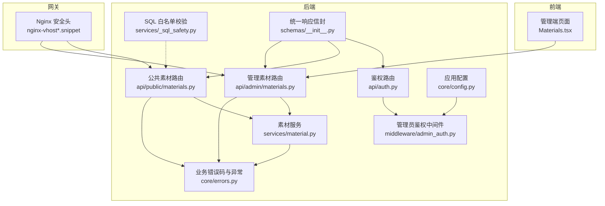
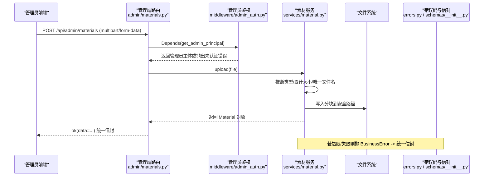
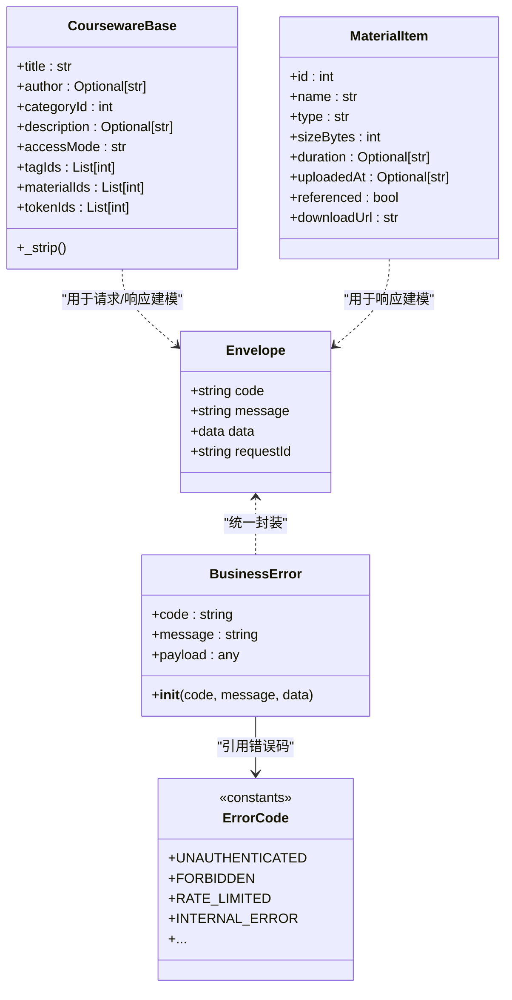
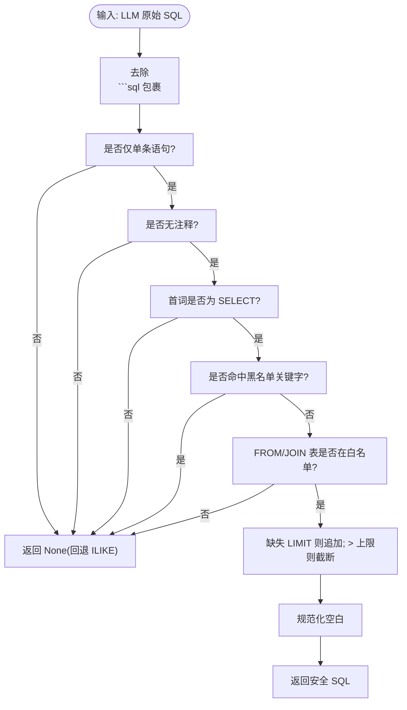
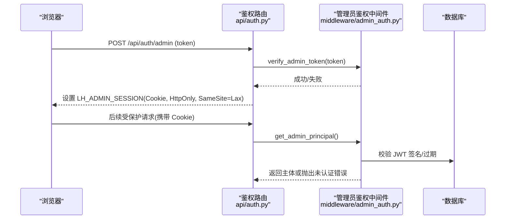
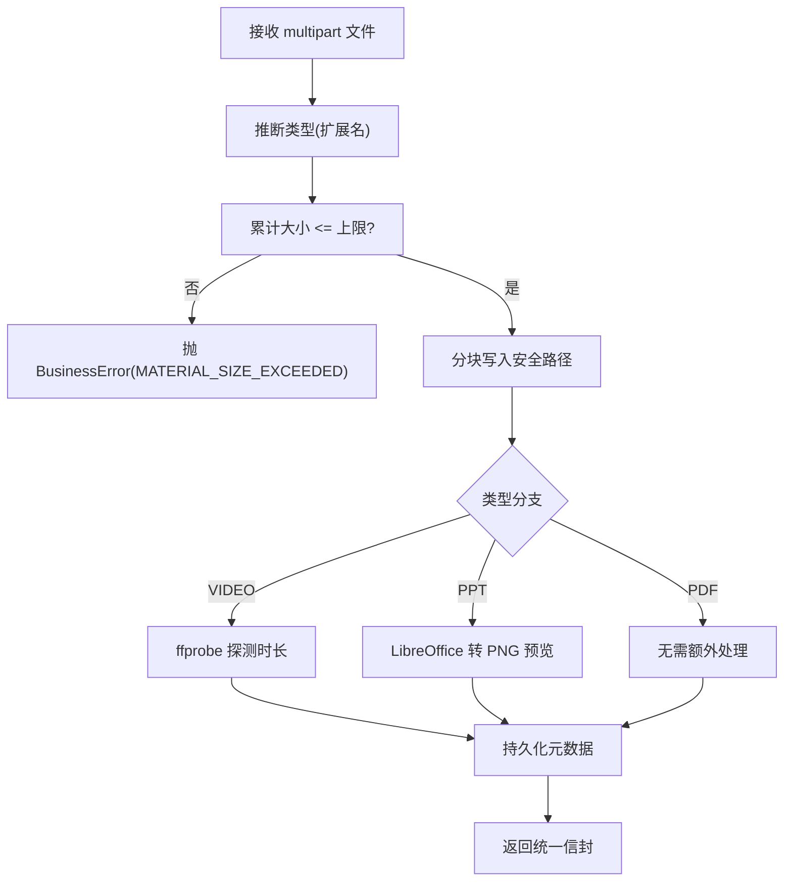
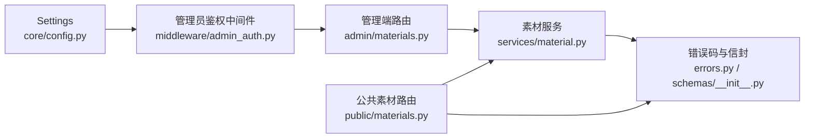

# 输入验证与输出编码

<cite>
**本文引用的文件**   
- [backend/app/schemas/__init__.py](file://backend/app/schemas/__init__.py)
- [backend/app/core/errors.py](file://backend/app/core/errors.py)
- [backend/app/middleware/admin_auth.py](file://backend/app/middleware/admin_auth.py)
- [backend/app/api/auth.py](file://backend/app/api/auth.py)
- [backend/app/services/_sql_safety.py](file://backend/app/services/_sql_safety.py)
- [backend/app/services/material.py](file://backend/app/services/material.py)
- [backend/app/api/public/materials.py](file://backend/app/api/public/materials.py)
- [backend/app/api/admin/materials.py](file://backend/app/api/admin/materials.py)
- [backend/app/core/config.py](file://backend/app/core/config.py)
- [deploy/ecs/nginx-vhost.snippet](file://deploy/ecs/nginx-vhost.snippet)
- [deploy/ecs/nginx-vhost-https.snippet](file://deploy/ecs/nginx-vhost-https.snippet)
- [frontend/src/pages/admin/Materials.tsx](file://frontend/src/pages/admin/Materials.tsx)
</cite>

## 目录
1. [简介](#简介)
2. [项目结构](#项目结构)
3. [核心组件](#核心组件)
4. [架构总览](#架构总览)
5. [详细组件分析](#详细组件分析)
6. [依赖关系分析](#依赖关系分析)
7. [性能考量](#性能考量)
8. [故障排查指南](#故障排查指南)
9. [结论](#结论)
10. [附录](#附录)

## 简介
本指南聚焦 Learning Hub 的输入验证与输出编码安全，覆盖以下主题：
- Pydantic 模型校验（数据类型、业务规则、自定义校验器）
- SQL 注入防护（参数化查询、ORM 最佳实践、LLM 生成 SQL 的安全闸）
- XSS 防护（前端输出编码、Nginx 安全响应头）
- CSRF 防护机制与请求签名（基于 Cookie + SameSite + HttpOnly 的组合策略）
- 文件上传安全（格式检查、大小限制、恶意文件检测建议）
- API 接口级输入验证策略与错误响应规范化

## 项目结构
后端采用 FastAPI + SQLAlchemy ORM，统一响应信封由 Pydantic 模型承载；安全相关能力分布在中间件、服务层与网关配置中。前端在管理端提供上传交互并做基础的前置校验。



图表来源
- [backend/app/api/auth.py:1-49](file://backend/app/api/auth.py#L1-L49)
- [backend/app/api/public/materials.py:1-224](file://backend/app/api/public/materials.py#L1-L224)
- [backend/app/api/admin/materials.py:1-74](file://backend/app/api/admin/materials.py#L1-L74)
- [backend/app/services/material.py:1-234](file://backend/app/services/material.py#L1-L234)
- [backend/app/services/_sql_safety.py:1-220](file://backend/app/services/_sql_safety.py#L1-L220)
- [backend/app/middleware/admin_auth.py:1-66](file://backend/app/middleware/admin_auth.py#L1-L66)
- [backend/app/core/errors.py:1-144](file://backend/app/core/errors.py#L1-L144)
- [backend/app/schemas/__init__.py:1-65](file://backend/app/schemas/__init__.py#L1-L65)
- [backend/app/core/config.py:1-88](file://backend/app/core/config.py#L1-L88)
- [deploy/ecs/nginx-vhost.snippet:1-40](file://deploy/ecs/nginx-vhost.snippet#L1-L40)
- [deploy/ecs/nginx-vhost-https.snippet:1-20](file://deploy/ecs/nginx-vhost-https.snippet#L1-L20)
- [frontend/src/pages/admin/Materials.tsx:1-149](file://frontend/src/pages/admin/Materials.tsx#L1-L149)

章节来源
- [backend/app/api/auth.py:1-49](file://backend/app/api/auth.py#L1-L49)
- [backend/app/api/public/materials.py:1-224](file://backend/app/api/public/materials.py#L1-L224)
- [backend/app/api/admin/materials.py:1-74](file://backend/app/api/admin/materials.py#L1-L74)
- [backend/app/services/material.py:1-234](file://backend/app/services/material.py#L1-L234)
- [backend/app/services/_sql_safety.py:1-220](file://backend/app/services/_sql_safety.py#L1-L220)
- [backend/app/middleware/admin_auth.py:1-66](file://backend/app/middleware/admin_auth.py#L1-L66)
- [backend/app/core/errors.py:1-144](file://backend/app/core/errors.py#L1-L144)
- [backend/app/schemas/__init__.py:1-65](file://backend/app/schemas/__init__.py#L1-L65)
- [backend/app/core/config.py:1-88](file://backend/app/core/config.py#L1-L88)
- [deploy/ecs/nginx-vhost.snippet:1-40](file://deploy/ecs/nginx-vhost.snippet#L1-L40)
- [deploy/ecs/nginx-vhost-https.snippet:1-20](file://deploy/ecs/nginx-vhost-https.snippet#L1-L20)
- [frontend/src/pages/admin/Materials.tsx:1-149](file://frontend/src/pages/admin/Materials.tsx#L1-L149)

## 核心组件
- 统一响应信封与错误码映射：通过 Pydantic 模型与错误码常量集中管理，保证所有接口返回一致的 JSON 结构。
- 管理员鉴权中间件：从请求中提取 Bearer Token 或 Cookie，校验 JWT 并返回主体信息。
- 素材上传与访问控制：在服务层进行大小限制、类型推断、存储路径安全处理，并在公开接口执行 ACL 校验。
- SQL 白名单校验：对 LLM 生成的 SELECT 语句执行“七道闸”清洗与约束，防止注入与越权访问。
- 网关安全头：Nginx 设置 X-Content-Type-Options、X-Frame-Options、X-XSS-Protection 等响应头，降低 XSS 风险。

章节来源
- [backend/app/schemas/__init__.py:1-65](file://backend/app/schemas/__init__.py#L1-L65)
- [backend/app/core/errors.py:1-144](file://backend/app/core/errors.py#L1-L144)
- [backend/app/middleware/admin_auth.py:1-66](file://backend/app/middleware/admin_auth.py#L1-L66)
- [backend/app/services/material.py:1-234](file://backend/app/services/material.py#L1-L234)
- [backend/app/services/_sql_safety.py:1-220](file://backend/app/services/_sql_safety.py#L1-L220)
- [deploy/ecs/nginx-vhost.snippet:1-40](file://deploy/ecs/nginx-vhost.snippet#L1-L40)
- [deploy/ecs/nginx-vhost-https.snippet:1-20](file://deploy/ecs/nginx-vhost-https.snippet#L1-L20)

## 架构总览
下图展示一次受保护的素材上传流程，体现输入验证、权限校验、存储安全与错误响应规范化的协作。



图表来源
- [backend/app/api/admin/materials.py:1-74](file://backend/app/api/admin/materials.py#L1-L74)
- [backend/app/middleware/admin_auth.py:1-66](file://backend/app/middleware/admin_auth.py#L1-L66)
- [backend/app/services/material.py:1-234](file://backend/app/services/material.py#L1-L234)
- [backend/app/core/errors.py:1-144](file://backend/app/core/errors.py#L1-L144)
- [backend/app/schemas/__init__.py:1-65](file://backend/app/schemas/__init__.py#L1-L65)

## 详细组件分析

### Pydantic 模型验证与业务规则
- 统一响应信封 Envelope 与构造器 ok/fail 确保所有响应具备 code/message/data/requestId 字段，便于前端一致化处理。
- 业务错误码 ErrorCode 集中定义，BusinessError 将业务码映射为 HTTP 状态码，并通过 detail 携带 code/message/data，最终被全局处理器包装为信封。
- 课件 Schema 使用 model_validator 对 title/author 进行 strip 清理，避免前后端空白差异导致的业务不一致。
- 素材 Schema 明确字段类型与可选性，配合前端渲染与校验。



图表来源
- [backend/app/schemas/__init__.py:1-65](file://backend/app/schemas/__init__.py#L1-L65)
- [backend/app/core/errors.py:1-144](file://backend/app/core/errors.py#L1-L144)
- [backend/app/schemas/courseware.py:1-120](file://backend/app/schemas/courseware.py#L1-L120)
- [backend/app/schemas/material.py:1-28](file://backend/app/schemas/material.py#L1-L28)

章节来源
- [backend/app/schemas/__init__.py:1-65](file://backend/app/schemas/__init__.py#L1-L65)
- [backend/app/core/errors.py:1-144](file://backend/app/core/errors.py#L1-L144)
- [backend/app/schemas/courseware.py:1-120](file://backend/app/schemas/courseware.py#L1-L120)
- [backend/app/schemas/material.py:1-28](file://backend/app/schemas/material.py#L1-L28)

### SQL 注入防护与 ORM 最佳实践
- 白名单校验模块对 LLM 生成的原始 SQL 执行“七道闸”：去 markdown fence、单语句、无注释、首词 SELECT、黑名单关键字、表白名单、强制 LIMIT。任一失败即回退到关键词 ILIKE。
- 表名白名单仅允许业务表，拒绝系统表前缀与 schema-qualified 形式；LIMIT 上限硬约束，防止大结果集攻击。
- 其他查询路径使用 SQLAlchemy ORM 与参数化条件，避免字符串拼接。



图表来源
- [backend/app/services/_sql_safety.py:1-220](file://backend/app/services/_sql_safety.py#L1-L220)

章节来源
- [backend/app/services/_sql_safety.py:1-220](file://backend/app/services/_sql_safety.py#L1-L220)

### XSS 防护与输出编码
- 网关层设置安全响应头：
  - X-Content-Type-Options: nosniff
  - X-Frame-Options: DENY
  - X-XSS-Protection: 1; mode=block
- 前端侧应避免直接插入用户可控 HTML；当前实现以 React 渲染为主，默认转义文本内容。
- 对于动态生成的文件名或描述，建议在服务端进行白名单或净化后再入库，并在前端严格作为文本显示。

章节来源
- [deploy/ecs/nginx-vhost.snippet:1-40](file://deploy/ecs/nginx-vhost.snippet#L1-L40)
- [deploy/ecs/nginx-vhost-https.snippet:1-20](file://deploy/ecs/nginx-vhost-https.snippet#L1-L20)

### CSRF 防护机制与请求签名
- 管理员登录成功后签发 JWT，并以 HttpOnly + SameSite=Lax 的 Cookie 方式下发，减少跨站读取与伪造风险。
- 后续请求通过中间件解析 Cookie/Bearer Token 并校验 JWT 有效期与签名，未通过则返回未认证错误。
- 建议：
  - 对写操作优先使用同源表单或带 SameSite=Lax/Strict 的 Cookie。
  - 如需跨域调用，应结合自定义请求头与服务器端 Origin/Referer 校验，或使用一次性令牌（nonce）+ 时间戳签名。



图表来源
- [backend/app/api/auth.py:1-49](file://backend/app/api/auth.py#L1-L49)
- [backend/app/middleware/admin_auth.py:1-66](file://backend/app/middleware/admin_auth.py#L1-L66)

章节来源
- [backend/app/api/auth.py:1-49](file://backend/app/api/auth.py#L1-L49)
- [backend/app/middleware/admin_auth.py:1-66](file://backend/app/middleware/admin_auth.py#L1-L66)

### 文件上传安全验证
- 前端：
  - accept 限定扩展名（MP4/PDF/PPT/PPTX），并提供文件大小提示与友好错误文案。
- 后端：
  - 在服务层按分块读取并累计大小，超过阈值立即中断并清理半文件，返回统一错误码。
  - 使用唯一安全文件名（时间戳 + 随机串 + 原文件名基名），避免路径穿越。
  - 根据扩展名推断类型，VIDEO 探测时长，PPT 异步转换为预览图片。
  - 删除前检查引用关系，防止误删。
- 建议增强：
  - 增加 MIME 类型二次校验与魔数检测。
  - 引入病毒扫描（如 ClamAV）与沙箱预览。
  - 对 PPT/PDF 转换过程增加超时与资源限制。



图表来源
- [backend/app/services/material.py:1-234](file://backend/app/services/material.py#L1-L234)
- [backend/app/api/admin/materials.py:1-74](file://backend/app/api/admin/materials.py#L1-L74)
- [frontend/src/pages/admin/Materials.tsx:1-149](file://frontend/src/pages/admin/Materials.tsx#L1-L149)

章节来源
- [backend/app/services/material.py:1-234](file://backend/app/services/material.py#L1-L234)
- [backend/app/api/admin/materials.py:1-74](file://backend/app/api/admin/materials.py#L1-L74)
- [frontend/src/pages/admin/Materials.tsx:1-149](file://frontend/src/pages/admin/Materials.tsx#L1-L149)

### API 接口级输入验证策略与错误响应规范化
- 路由参数与 Query 使用 FastAPI 内置校验（范围、必填、枚举等）。
- 请求体使用 Pydantic 模型，集中定义字段约束与后置清理逻辑。
- 业务异常通过 BusinessError 抛出，错误码与 HTTP 状态码一一对应，并由统一信封封装返回。
- 限流：公开接口使用装饰器限速，避免滥用。

```mermaid
classDiagram
class RateLimitDecorator {
+limit("60/minute")
}
class PublicMaterialRouter {
+get("/{material_id}/stream")
+get("/{material_id}/image/{page_no}")
+get("/{material_id}")
}
class AdminMaterialRouter {
+post("")
+get("")
+delete("/{material_id}")
}
PublicMaterialRouter --> RateLimitDecorator : "装饰限速"
AdminMaterialRouter --> RateLimitDecorator : "可按需装饰"
```

图表来源
- [backend/app/api/public/materials.py:1-224](file://backend/app/api/public/materials.py#L1-L224)
- [backend/app/api/admin/materials.py:1-74](file://backend/app/api/admin/materials.py#L1-L74)

章节来源
- [backend/app/api/public/materials.py:1-224](file://backend/app/api/public/materials.py#L1-L224)
- [backend/app/api/admin/materials.py:1-74](file://backend/app/api/admin/materials.py#L1-L74)
- [backend/app/core/errors.py:1-144](file://backend/app/core/errors.py#L1-L144)
- [backend/app/schemas/__init__.py:1-65](file://backend/app/schemas/__init__.py#L1-L65)

## 依赖关系分析
- 鉴权依赖：管理员路由通过 Depends(get_admin_principal) 强制校验，未通过则返回未认证错误。
- 错误处理依赖：各路由与服务层抛出 BusinessError，统一由错误码映射与信封封装。
- 配置依赖：JWT 算法、TTL、CORS 白名单等来自 Settings，影响鉴权与跨域行为。
- 外部工具依赖：视频时长探测使用 ffprobe，PPT 转换使用 LibreOffice，均应在容器内安装并设置超时。



图表来源
- [backend/app/core/config.py:1-88](file://backend/app/core/config.py#L1-L88)
- [backend/app/middleware/admin_auth.py:1-66](file://backend/app/middleware/admin_auth.py#L1-L66)
- [backend/app/api/admin/materials.py:1-74](file://backend/app/api/admin/materials.py#L1-L74)
- [backend/app/api/public/materials.py:1-224](file://backend/app/api/public/materials.py#L1-L224)
- [backend/app/services/material.py:1-234](file://backend/app/services/material.py#L1-L234)
- [backend/app/core/errors.py:1-144](file://backend/app/core/errors.py#L1-L144)
- [backend/app/schemas/__init__.py:1-65](file://backend/app/schemas/__init__.py#L1-L65)

章节来源
- [backend/app/core/config.py:1-88](file://backend/app/core/config.py#L1-L88)
- [backend/app/middleware/admin_auth.py:1-66](file://backend/app/middleware/admin_auth.py#L1-L66)
- [backend/app/api/admin/materials.py:1-74](file://backend/app/api/admin/materials.py#L1-L74)
- [backend/app/api/public/materials.py:1-224](file://backend/app/api/public/materials.py#L1-L224)
- [backend/app/services/material.py:1-234](file://backend/app/services/material.py#L1-L234)
- [backend/app/core/errors.py:1-144](file://backend/app/core/errors.py#L1-L144)
- [backend/app/schemas/__init__.py:1-65](file://backend/app/schemas/__init__.py#L1-L65)

## 性能考量
- 上传分块写入：避免一次性加载大文件到内存，降低峰值内存占用。
- 外部工具超时：ffprobe 与 PPT 转换均设置超时，防止阻塞主线程。
- 限流：公开接口限速，防止滥用导致资源耗尽。
- 存储路径分层：按年月创建子目录，避免单目录文件过多导致 I/O 退化。

[本节为通用指导，不直接分析具体文件]

## 故障排查指南
- 上传失败：
  - 检查文件大小是否超过上限，确认前端提示与后端错误码一致。
  - 查看存储目录权限与磁盘空间。
  - 确认外部工具（ffprobe、LibreOffice）已安装且可执行。
- 鉴权失败：
  - 检查 Cookie 是否包含 LH_ADMIN_SESSION，且未被浏览器拦截（SameSite/HttpOnly）。
  - 核对 JWT 密钥与算法配置，确认未过期。
- 公开接口 401/403：
  - 检查是否携带正确的解锁令牌哈希（Header/Cookie），以及该 token 是否仍有效。
- 限流触发：
  - 观察 429 响应，适当放宽限流策略或优化客户端重试间隔。

章节来源
- [backend/app/services/material.py:1-234](file://backend/app/services/material.py#L1-L234)
- [backend/app/middleware/admin_auth.py:1-66](file://backend/app/middleware/admin_auth.py#L1-L66)
- [backend/app/api/public/materials.py:1-224](file://backend/app/api/public/materials.py#L1-L224)
- [backend/app/core/errors.py:1-144](file://backend/app/core/errors.py#L1-L144)

## 结论
Learning Hub 在输入验证与输出编码方面形成了多层防护体系：
- 前端与后端双重校验，Pydantic 模型与业务错误码保障一致性。
- SQL 注入通过白名单与“七道闸”严格约束，ORM 查询避免拼接。
- 网关安全头与前端渲染模式共同降低 XSS 风险。
- 基于 Cookie + SameSite + HttpOnly 的 CSRF 防护，结合 JWT 校验提升安全性。
- 上传流程具备大小限制、类型推断与安全命名，建议进一步引入魔数校验与病毒扫描。
- 统一的错误响应信封与限流策略提升可观测性与可用性。

[本节为总结性内容，不直接分析具体文件]

## 附录
- CORS 配置：通过 Settings 中的 cors_allow_origins 控制允许的源列表。
- 时区与时间：统一使用 ISO-8601 字符串，便于前端解析与展示。
- 部署建议：生产环境启用 HTTPS，Nginx 添加安全响应头，并限制 client_max_body_size 与超时参数。

章节来源
- [backend/app/core/config.py:1-88](file://backend/app/core/config.py#L1-L88)
- [deploy/ecs/nginx-vhost.snippet:1-40](file://deploy/ecs/nginx-vhost.snippet#L1-L40)
- [deploy/ecs/nginx-vhost-https.snippet:1-20](file://deploy/ecs/nginx-vhost-https.snippet#L1-L20)