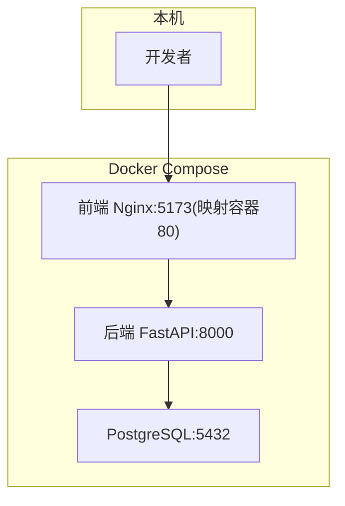
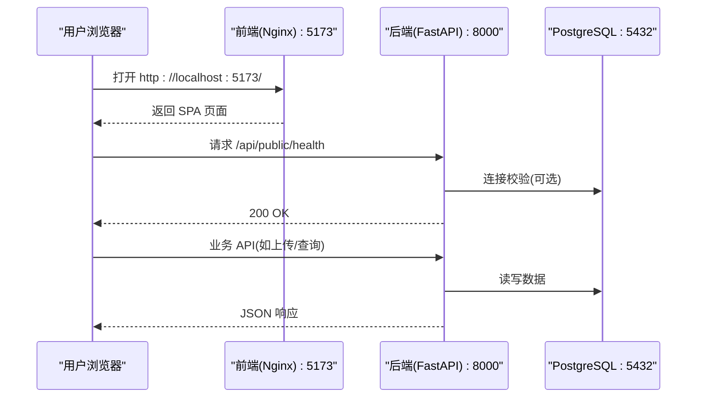
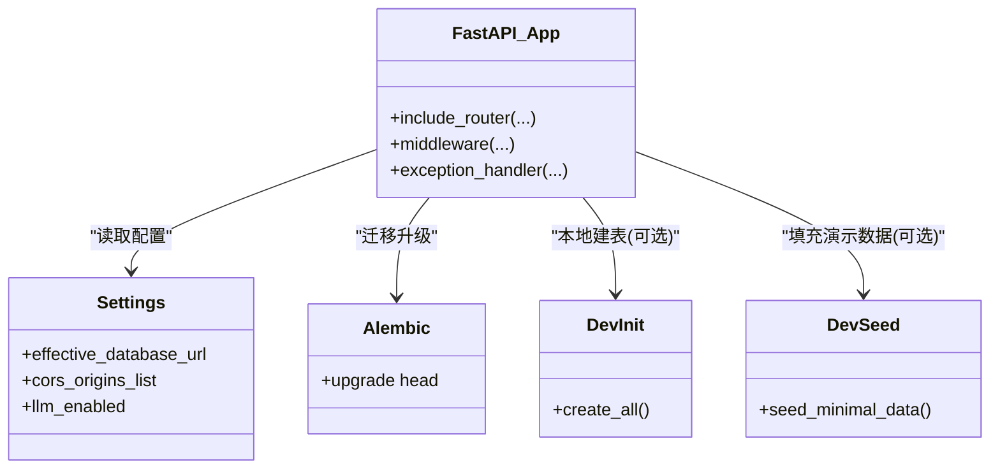
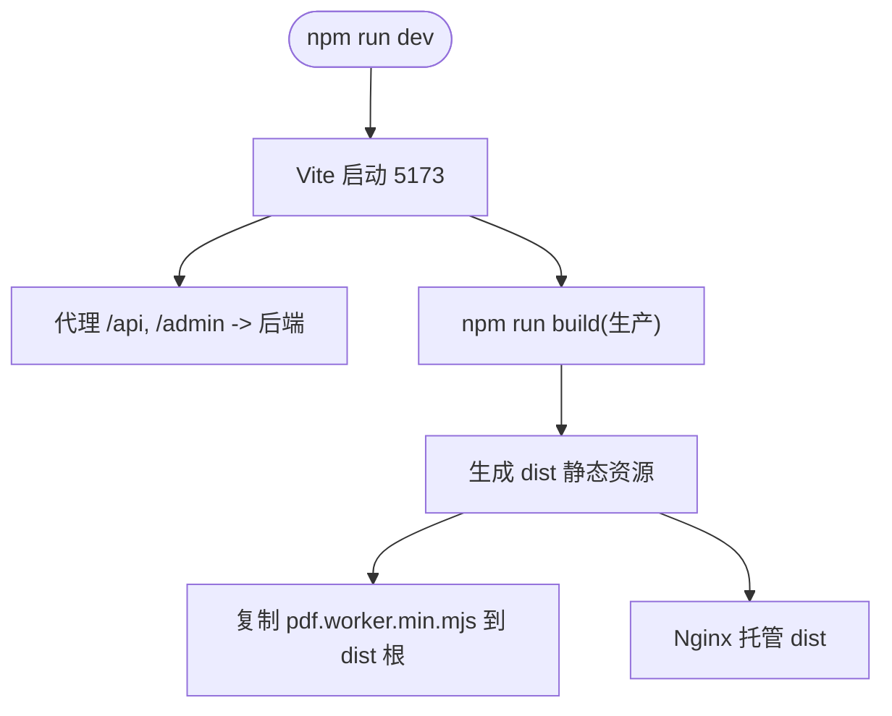
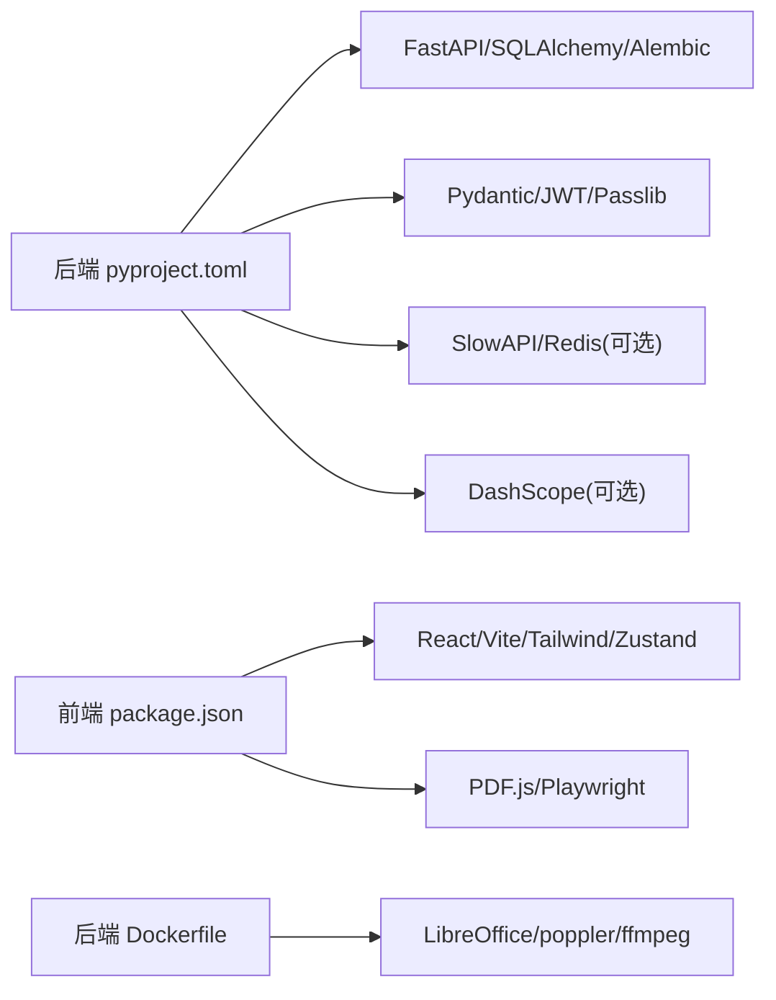

# 快速开始

<cite>
**本文引用的文件**   
- [docker-compose.yml](file://deploy/local/docker-compose.yml)
- [README.md](file://deploy/local/README.md)
- [Dockerfile（后端）](file://backend/Dockerfile)
- [Dockerfile（前端）](file://frontend/Dockerfile)
- [pyproject.toml](file://backend/pyproject.toml)
- [package.json（前端）](file://frontend/package.json)
- [main.py](file://backend/app/main.py)
- [config.py](file://backend/app/core/config.py)
- [.env.example](file://backend/.env.example)
- [alembic.ini](file://backend/alembic.ini)
- [dev_init.py](file://backend/dev_init.py)
- [dev_seed.py](file://backend/dev_seed.py)
- [vite.config.ts](file://frontend/vite.config.ts)
</cite>

## 目录
1. [简介](#简介)
2. [项目结构](#项目结构)
3. [核心组件](#核心组件)
4. [架构总览](#架构总览)
5. [详细组件分析](#详细组件分析)
6. [依赖关系分析](#依赖关系分析)
7. [性能与可用性建议](#性能与可用性建议)
8. [故障排查指南](#故障排查指南)
9. [结论](#结论)
10. [附录：第一个功能实现示例](#附录第一个功能实现示例)

## 简介
本指南面向首次接触 Learning Hub 的开发者，目标是在最短时间内完成本地开发环境搭建并运行完整系统。你将通过 Docker Compose 一键启动数据库、后端与前端服务，完成数据库初始化与种子数据填充，随后即可在浏览器中访问前台首页与管理后台，并完成“创建课件/上传素材”等基础操作。

## 项目结构
Learning Hub 采用前后端分离架构：
- 后端：FastAPI + SQLAlchemy + Alembic，提供 REST API，使用 PostgreSQL 持久化，支持 PPT/PDF/视频预览与 AI 搜索（可选）。
- 前端：Vite + React + Tailwind，构建后由 Nginx 静态托管，并通过反向代理访问后端 API。
- 部署：通过 docker-compose 编排三容器（Postgres、Backend、Frontend），卷挂载用于数据与素材持久化。

图示来源
- [docker-compose.yml:1-74](file://deploy/local/docker-compose.yml#L1-L74)
- [Dockerfile（后端）:1-85](file://backend/Dockerfile#L1-L85)
- [Dockerfile（前端）:1-23](file://frontend/Dockerfile#L1-L23)

章节来源
- [docker-compose.yml:1-74](file://deploy/local/docker-compose.yml#L1-L74)
- [README.md:1-50](file://deploy/local/README.md#L1-L50)

## 核心组件
- 后端应用入口与路由装配：统一注册健康检查、公开接口、管理接口、限流与错误处理。
- 配置中心：集中从环境变量加载数据库、CORS、JWT、存储路径、PPT 转换、LLM 开关等。
- 数据库迁移：Alembic 管理表结构演进；本地可用脚本一次性建表与填充演示数据。
- 前端构建与运行：Vite 开发服务器或 Nginx 静态托管，PDF.js worker 打包到 dist。

章节来源
- [main.py:1-116](file://backend/app/main.py#L1-L116)
- [config.py:1-88](file://backend/app/core/config.py#L1-L88)
- [alembic.ini:1-40](file://backend/alembic.ini#L1-L40)
- [dev_init.py:1-45](file://backend/dev_init.py#L1-L45)
- [dev_seed.py:1-214](file://backend/dev_seed.py#L1-L214)
- [vite.config.ts:1-39](file://frontend/vite.config.ts#L1-L39)

## 架构总览
下图展示了本地开发时各容器的交互关系与端口映射。

图示来源
- [docker-compose.yml:23-68](file://deploy/local/docker-compose.yml#L23-L68)
- [main.py:92-112](file://backend/app/main.py#L92-L112)

## 详细组件分析

### 后端服务（FastAPI）
- 应用创建与中间件：CORS、请求 ID、限流异常、业务异常统一封装。
- 路由注册：公开接口（健康检查、课件、素材、访问会话）、认证与管理接口。
- 配置加载：Settings 类从 .env 与环境变量读取，自动拼接数据库连接串。
- 依赖安装：Dockerfile 内固定 Python 包版本，并安装 LibreOffice、poppler、ffmpeg 等系统依赖以支持多媒体预览。

图示来源
- [main.py:40-112](file://backend/app/main.py#L40-L112)
- [config.py:9-88](file://backend/app/core/config.py#L9-L88)
- [alembic.ini:1-40](file://backend/alembic.ini#L1-L40)
- [dev_init.py:14-44](file://backend/dev_init.py#L14-L44)
- [dev_seed.py:35-214](file://backend/dev_seed.py#L35-L214)
- [Dockerfile（后端）:33-64](file://backend/Dockerfile#L33-L64)

章节来源
- [main.py:1-116](file://backend/app/main.py#L1-L116)
- [config.py:1-88](file://backend/app/core/config.py#L1-L88)
- [Dockerfile（后端）:1-85](file://backend/Dockerfile#L1-L85)

### 前端服务（Vite + Nginx）
- 开发模式：Vite 监听 5173，并将 /api 与 /admin 代理至本地后端（默认 18765，可按需调整）。
- 构建产物：dist 包含所有静态资源，PDF.js worker 被复制到 dist 根目录供运行时加载。
- 容器运行：Nginx 暴露 80，docker-compose 将宿主 5173 映射到容器 80。

图示来源
- [vite.config.ts:19-31](file://frontend/vite.config.ts#L19-L31)
- [Dockerfile（前端）:11-18](file://frontend/Dockerfile#L11-L18)
- [package.json（前端）:6-13](file://frontend/package.json#L6-L13)

章节来源
- [vite.config.ts:1-39](file://frontend/vite.config.ts#L1-L39)
- [Dockerfile（前端）:1-23](file://frontend/Dockerfile#L1-L23)
- [package.json（前端）:1-40](file://frontend/package.json#L1-L40)

## 依赖关系分析
- 后端依赖：FastAPI、SQLAlchemy、Alembic、psycopg2、Pydantic、JOSN、Passlib、SlowAPI、Redis（可选）、DashScope（可选）。
- 前端依赖：React、Vue 无关（仅示例数据）、Tailwind、Zustand、Axios、PDF.js、Playwright（E2E）。
- 系统依赖（后端镜像）：LibreOffice、poppler-utils、ffmpeg、字体等。

图示来源
- [pyproject.toml:8-25](file://backend/pyproject.toml#L8-L25)
- [package.json（前端）:14-38](file://frontend/package.json#L14-L38)
- [Dockerfile（后端）:33-40](file://backend/Dockerfile#L33-L40)

章节来源
- [pyproject.toml:1-47](file://backend/pyproject.toml#L1-L47)
- [package.json（前端）:1-40](file://frontend/package.json#L1-L40)
- [Dockerfile（后端）:1-85](file://backend/Dockerfile#L1-L85)

## 性能与可用性建议
- 数据库连接：优先使用 DATABASE_URL 覆盖，便于切换测试库或 SQLite（本地一次性场景）。
- 跨域策略：开发阶段允许 *，生产务必收紧 CORS 白名单。
- 限流与缓存：可启用 Redis 作为 SlowAPI 后端，避免内存限流重启丢失。
- 预览转换：LibreOffice 与 poppler 转换耗时较长，建议合理设置超时与重试策略。
- 前端构建：PDF.js worker 必须存在于 dist 根目录，否则 PDF/PPT 渲染失败。

[本节为通用建议，不直接分析具体文件]

## 故障排查指南
- 前端 unhealthy（容器健康检查失败）
  - 现象：容器状态 healthy 但无法访问。
  - 原因：Alpine wget 默认 IPv6 导致 localhost 解析异常。
  - 解决：已在 docker-compose 中覆盖 healthcheck，改用 curl 探测 127.0.0.1 与 /api/public/health。
- PDF.js worker 缺失
  - 现象：控制台报 fake worker，PDF/PPT 渲染失败。
  - 解决：确保构建产物中包含 pdf.worker.min.mjs；容器镜像已内置拷贝逻辑。
- LLM 搜索不可用
  - 现象：AI 智能搜索徽标显示降级。
  - 解决：确认 .env 中 DASHSCOPE_API_KEY 已配置且非空；未配置则自动降级关键词搜索。
- 数据库连接失败
  - 现象：后端启动报错或健康检查失败。
  - 解决：核对 .env 中的 DATABASE_* 或 DATABASE_URL；确保 Postgres 容器 healthy。
- 权限与凭据
  - 现象：管理后台登录失败。
  - 解决：核对 ADMIN_TOKEN 与前端传入值一致；默认值为 shleeyuan（可通过环境变量覆盖）。

章节来源
- [docker-compose.yml:61-68](file://deploy/local/docker-compose.yml#L61-L68)
- [Dockerfile（前端）:11-18](file://frontend/Dockerfile#L11-L18)
- [.env.example:43-47](file://backend/.env.example#L43-L47)
- [config.py:19-38](file://backend/app/core/config.py#L19-L38)

## 结论
通过 Docker Compose 一键拉起三容器，配合 Alembic 迁移与种子脚本，可在 30 分钟内完成 Learning Hub 的本地开发与体验。后续可根据需要开启 LLM 搜索、接入 Redis 限流、调整预览转换参数等。

[本节为总结性内容，不直接分析具体文件]

## 附录：第一个功能实现示例

以下示例帮助你在 30 分钟内完成“创建课件并上传素材”的基础闭环。

### 一、环境与前置条件
- 操作系统：Windows/macOS/Linux
- 软件要求：
  - Docker Desktop（含 Docker Compose v2）
  - Node.js 20+（仅本地开发前端时使用）
  - Python 3.11+（仅本地直跑后端时使用）

### 二、一键启动（推荐）
1. 进入 deploy 目录并启动服务
   - 命令参考：见 [README.md:13-20](file://deploy/local/README.md#L13-L20)
2. 验证健康检查
   - 后端：http://localhost:8000/api/public/health
   - 前端：http://localhost:5173/
3. 首次初始化数据库
   - 命令参考：见 [README.md:38-43](file://deploy/local/README.md#L38-L43)

章节来源
- [README.md:13-43](file://deploy/local/README.md#L13-L43)
- [docker-compose.yml:1-74](file://deploy/local/docker-compose.yml#L1-L74)

### 三、本地直跑（可选）
- 后端
  - 复制环境变量模板：复制 [.env.example:1-51](file://backend/.env.example#L1-L51) 为 backend/.env 并填写必要项（如 DASHSCOPE_API_KEY）。
  - 初始化表结构：执行 [dev_init.py:14-44](file://backend/dev_init.py#L14-L44)。
  - 运行服务：参考 [pyproject.toml:8-25](file://backend/pyproject.toml#L8-L25) 依赖，使用 uvicorn 启动 main.py 中的 app。
- 前端
  - 安装依赖与启动：参考 [package.json（前端）:6-13](file://frontend/package.json#L6-L13)、[vite.config.ts:19-31](file://frontend/vite.config.ts#L19-L31)。

章节来源
- [.env.example:1-51](file://backend/.env.example#L1-L51)
- [dev_init.py:14-44](file://backend/dev_init.py#L14-L44)
- [pyproject.toml:8-25](file://backend/pyproject.toml#L8-L25)
- [package.json（前端）:6-13](file://frontend/package.json#L6-L13)
- [vite.config.ts:19-31](file://frontend/vite.config.ts#L19-L31)

### 四、填充演示数据（可选）
- 目的：快速获得分类、标签、素材与课件样例，便于浏览与解锁流程验证。
- 执行：参考 [dev_seed.py:35-214](file://backend/dev_seed.py#L35-L214) 输出信息，获取受限课件 ID 与 Token。

章节来源
- [dev_seed.py:35-214](file://backend/dev_seed.py#L35-L214)

### 五、第一个功能：创建一个课件并上传素材
- 步骤概览
  1. 登录管理后台：http://localhost:5173/admin，输入管理员令牌（默认见 [config.py:40-46](file://backend/app/core/config.py#L40-L46) 或 [README.md:45-49](file://deploy/local/README.md#L45-L49)）。
  2. 新建分类与标签（若已有可跳过）。
  3. 上传素材：选择 PDF/PPT/MP4 文件，等待转换（PPT 会转 PDF，时间取决于文件大小）。
  4. 新建课件：选择分类、标签，关联已上传素材，保存。
  5. 前台查看：访问 http://localhost:5173/?view=detail&id=<课件ID>，点击在线浏览进行预览。
- 关键说明
  - 预览能力依赖 LibreOffice 与 poppler，详见 [Dockerfile（后端）:33-40](file://backend/Dockerfile#L33-L40)。
  - 若未配置 LLM，搜索将降级为关键词匹配，不影响课件与素材管理。

章节来源
- [config.py:40-46](file://backend/app/core/config.py#L40-L46)
- [README.md:45-49](file://deploy/local/README.md#L45-L49)
- [Dockerfile（后端）:33-40](file://backend/Dockerfile#L33-L40)

### 六、常见问题速查
- 前端无法访问 /api
  - 检查 vite.config.ts 的代理 target 是否指向正确的后端地址。
- 容器 healthy 但页面空白
  - 检查 frontend 健康检查是否覆盖为 curl 127.0.0.1，见 [docker-compose.yml:61-68](file://deploy/local/docker-compose.yml#L61-L68)。
- 数据库迁移失败
  - 确认 alembic.ini 的连接串与 .env 一致，见 [alembic.ini:1-6](file://backend/alembic.ini#L1-L6)。
- 预览失败或 404
  - 确认 pdf.worker.min.mjs 存在，见 [Dockerfile（前端）:11-18](file://frontend/Dockerfile#L11-L18)。
- LLM 搜索不可用
  - 检查 .env 中 DASHSCOPE_API_KEY 是否配置，见 [.env.example:43-47](file://backend/.env.example#L43-L47)。

章节来源
- [vite.config.ts:22-31](file://frontend/vite.config.ts#L22-L31)
- [docker-compose.yml:61-68](file://deploy/local/docker-compose.yml#L61-L68)
- [alembic.ini:1-6](file://backend/alembic.ini#L1-L6)
- [Dockerfile（前端）:11-18](file://frontend/Dockerfile#L11-L18)
- [.env.example:43-47](file://backend/.env.example#L43-L47)