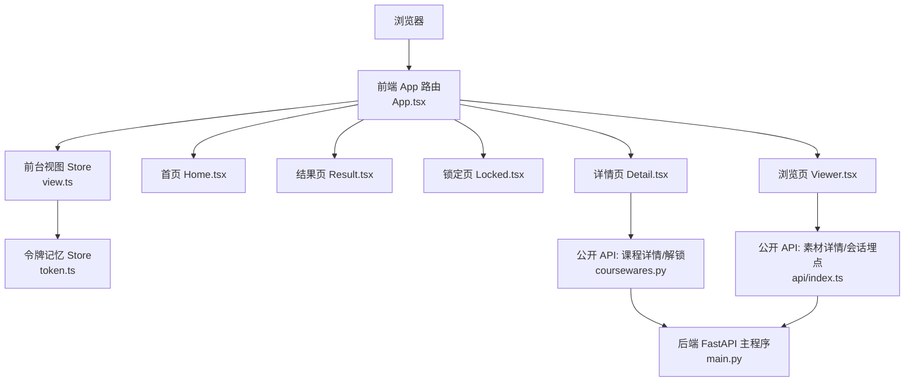
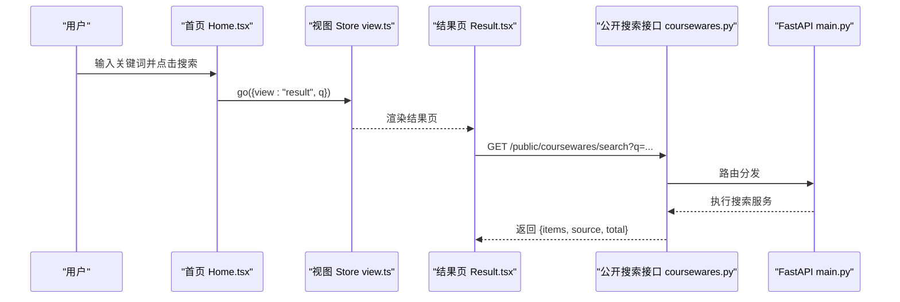
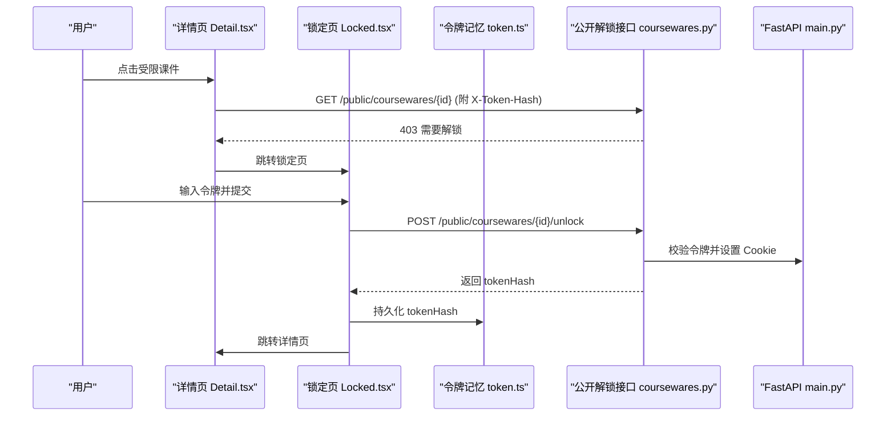
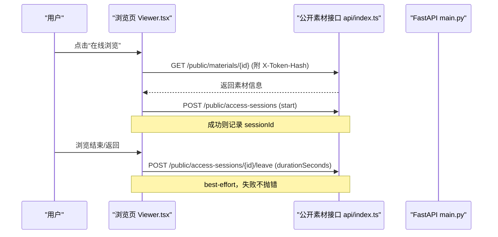
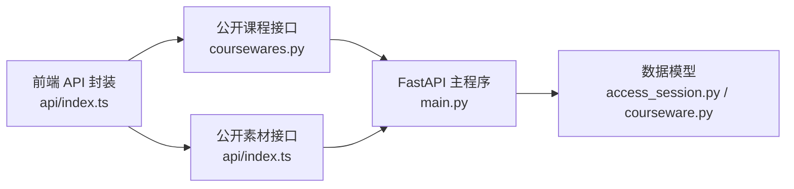

# 学习者使用手册

<cite>
**本文引用的文件**   
- [doc/MANUAL.md](file://doc/MANUAL.md)
- [backend/app/main.py](file://backend/app/main.py)
- [backend/pyproject.toml](file://backend/pyproject.toml)
- [frontend/src/App.tsx](file://frontend/src/App.tsx)
- [frontend/src/pages/public/Home.tsx](file://frontend/src/pages/public/Home.tsx)
- [frontend/src/pages/public/Detail.tsx](file://frontend/src/pages/public/Detail.tsx)
- [frontend/src/pages/public/Locked.tsx](file://frontend/src/pages/public/Locked.tsx)
- [frontend/src/pages/public/Viewer.tsx](file://frontend/src/pages/public/Viewer.tsx)
- [frontend/src/stores/view.ts](file://frontend/src/stores/view.ts)
- [frontend/src/stores/token.ts](file://frontend/src/stores/token.ts)
- [frontend/src/api/index.ts](file://frontend/src/api/index.ts)
- [backend/app/api/public/coursewares.py](file://backend/app/api/public/coursewares.py)
- [backend/app/models/access_session.py](file://backend/app/models/access_session.py)
- [backend/app/models/courseware.py](file://backend/app/models/courseware.py)
- [doc/spec/05-数据模型.md](file://doc/spec/05-数据模型.md)
</cite>

## 目录
1. [简介](#简介)
2. [快速上手](#快速上手)
3. [搜索课件](#搜索课件)
4. [查看课件详情](#查看课件详情)
5. [受限课件与访问令牌](#受限课件与访问令牌)
6. [在线浏览素材](#在线浏览素材)
7. [导航与返回](#导航与返回)
8. [常见问题 FAQ](#常见问题-faq)
9. [浏览器与设备要求](#浏览器与设备要求)
10. [获取帮助](#获取帮助)
11. [附录：页面速查表](#附录页面速查表)

## 简介
Learning Hub 是企业内部的学习资料检索与阅读平台。你可以通过自然语言或关键词快速找到课件，在线浏览视频、PDF、PPT，并在获得访问令牌后解锁受保护的内部资料。整个过程无需注册账号，只要可访问内部网即可使用。

本手册面向普通学习者（前台用户），聚焦“搜索—详情—解锁—浏览”的完整学习路径，不包含后台管理与部署运维内容。

章节来源
- [doc/MANUAL.md:1-36](file://doc/MANUAL.md#L1-L36)

## 快速上手
- 在浏览器中打开公司提供的 Learning Hub 地址。
- 首页只有一个标题和搜索框，输入你想学的内容，点击“搜索”或按回车。
- 在结果列表点击课件标题进入详情页，再选择“在线浏览”开始学习。

章节来源
- [doc/MANUAL.md:39-72](file://doc/MANUAL.md#L39-L72)

## 搜索课件
- 支持自然语言与关键词两种输入方式，建议 2~15 字命中率更高。
- 搜索结果页会显示命中数量、分类路径、是否受限等提示。
- 若出现“降级中”，表示语义搜索暂时不可用，系统已回退到传统关键词检索，功能正常。

章节来源
- [doc/MANUAL.md:74-143](file://doc/MANUAL.md#L74-L143)

## 查看课件详情
- 点击无锁标的课件标题进入详情页，展示作者、分类、标签、简介与素材列表。
- 每个素材提供“在线浏览”入口；v1.2 起前台不再提供“下载到本地”。
- v1.5 起，素材按管理员设定的顺序升序展示，多于一个素材时会提示“由管理员设定的学习顺序”。

章节来源
- [doc/MANUAL.md:145-184]
- [frontend/src/pages/public/Detail.tsx:1-188](file://frontend/src/pages/public/Detail.tsx#L1-L188)

## 受限课件与访问令牌
- 受限课件在列表中带有锁标，首次点击会进入锁定页，需要输入访问令牌。
- 令牌由讲师或运营线下发放，是一串数字与大写字母组成的字符。
- 输入令牌成功后，系统会在浏览器记住该课件的解锁状态，后续刷新或再次访问无需重复输入。
- 若令牌无效或已失效，请检查拼写并联系管理员重新获取。

章节来源
- [doc/MANUAL.md:185-254]

## 在线浏览素材
- 视频：原生播放器控件，支持播放/暂停、进度拖动、全屏；默认不自动播放。
- PDF：连续滚动阅读，顶部工具条支持缩放与返回，右下角气泡显示当前页码。
- PPT：幻灯片式阅读，暗色背景，底部控制条支持翻页与全屏，键盘左右键切换。
- 所有浏览页顶栏统一包含“返回”、“文件名”、“下载到本地”（兜底）、“返回首页”。

章节来源
- [doc/MANUAL.md:256-344]

## 导航与返回
- 不同页面间的返回逻辑清晰：从详情页可返回搜索结果并保留关键词；从素材浏览页可返回详情页或首页。
- 单页应用支持浏览器前进/后退按钮，但优先建议使用页面内“返回”按钮以获得一致体验。
- 关闭浏览器后，搜索结果不会保存；访问令牌在同一浏览器、同一域下短期复用。

章节来源
- [doc/MANUAL.md:345-375]

## 常见问题 FAQ
- 搜索无结果：尝试更宽泛的关键词或相近词，或联系管理员补充课件。
- 令牌无效/已失效：检查大小写与空格，确认是否为最新令牌且归属该课件。
- PPT 预览生成慢：首次转换需等待一段时间，可稍后再试或下载原始文件。
- 老版本浏览器直接下载 PDF：升级浏览器或使用“下载到本地”兜底。
- 视频卡顿：网络带宽不足或多人同时观看，建议错峰或下载后观看。
- 移动端可用但桌面端体验更佳。
- 学习进度不记录：当前版本仅用于统计令牌使用情况，不记录个人学习时长。

章节来源
- [doc/MANUAL.md:377-444]

## 浏览器与设备要求
- 推荐 Chrome/Edge/Firefox/Safari 较新版本，老版本会被降级到“下载到本地”。
- 桌面优先，≥1280px 最佳；小屏 ≥768px 可正常阅读。
- 必须 HTTPS，上行带宽建议 ≥2 Mbps。
- 纯 Web 应用，无需安装任何插件。

章节来源
- [doc/MANUAL.md:447-475]

## 获取帮助
- 在公司内部遇到问题，请联系管理员/资料运营、讲师/部门接口人或 IT 支持。
- 自助排查顺序：刷新页面 → 换浏览器 → 清缓存 → 下载到本地兜底 → 带截图反馈。
- 欢迎反馈功能不便、文案困惑与新需求，手册将随版本更新。

章节来源
- [doc/MANUAL.md:478-505]

## 附录：页面速查表
- 首页（空态）：输入关键词、点搜索
- 搜索结果页：查看结果、点课件进入详情、清空全部
- 课件详情页：查看内容、点素材在线浏览、返回搜索
- 受限课件锁定页：输入令牌、解锁、返回搜索
- 素材浏览页（视频/PDF/PPT）：播放/翻页/全屏、下载兜底
- 通用错误页：查看错误原因、返回

章节来源
- [doc/MANUAL.md:508-520]

---

## 架构概览（学习者视角）
下图展示了学习者在前台的主要交互流程与关键组件关系，包括路由、视图状态、令牌记忆与公开 API 调用。

图表来源
- [frontend/src/App.tsx:1-110](file://frontend/src/App.tsx#L1-L110)
- [frontend/src/stores/view.ts:1-127](file://frontend/src/stores/view.ts#L1-L127)
- [frontend/src/stores/token.ts:1-54](file://frontend/src/stores/token.ts#L1-L54)
- [frontend/src/pages/public/Home.tsx:1-55](file://frontend/src/pages/public/Home.tsx#L1-L55)
- [frontend/src/pages/public/Detail.tsx:1-188](file://frontend/src/pages/public/Detail.tsx#L1-L188)
- [frontend/src/pages/public/Locked.tsx:1-113](file://frontend/src/pages/public/Locked.tsx#L1-L113)
- [frontend/src/pages/public/Viewer.tsx:1-170](file://frontend/src/pages/public/Viewer.tsx#L1-L170)
- [frontend/src/api/index.ts:1-443](file://frontend/src/api/index.ts#L1-L443)
- [backend/app/api/public/coursewares.py:1-133](file://backend/app/api/public/coursewares.py#L1-L133)
- [backend/app/main.py:1-116](file://backend/app/main.py#L1-L116)

章节来源
- [frontend/src/App.tsx:1-110](file://frontend/src/App.tsx#L1-L110)
- [backend/app/main.py:1-116](file://backend/app/main.py#L1-L116)

## 核心流程详解

### 搜索与结果
- 用户在首页输入关键词并提交，前端跳转到结果视图并携带查询参数。
- 结果页调用公开搜索接口，返回命中课件列表与来源标识（语义或关键词）。

图表来源
- [frontend/src/pages/public/Home.tsx:1-55](file://frontend/src/pages/public/Home.tsx#L1-L55)
- [frontend/src/stores/view.ts:1-127](file://frontend/src/stores/view.ts#L1-L127)
- [backend/app/api/public/coursewares.py:1-133](file://backend/app/api/public/coursewares.py#L1-L133)
- [backend/app/main.py:1-116](file://backend/app/main.py#L1-L116)

章节来源
- [frontend/src/pages/public/Home.tsx:1-55](file://frontend/src/pages/public/Home.tsx#L1-L55)
- [frontend/src/stores/view.ts:1-127](file://frontend/src/stores/view.ts#L1-L127)
- [backend/app/api/public/coursewares.py:1-133](file://backend/app/api/public/coursewares.py#L1-L133)

### 解锁受限课件
- 点击受限课件时，若未记忆令牌哈希，前端跳转至锁定页。
- 在锁定页输入明文令牌，调用解锁接口，成功后写入令牌哈希并跳转详情页。

图表来源
- [frontend/src/pages/public/Detail.tsx:1-188](file://frontend/src/pages/public/Detail.tsx#L1-L188)
- [frontend/src/pages/public/Locked.tsx:1-113](file://frontend/src/pages/public/Locked.tsx#L1-L113)
- [frontend/src/stores/token.ts:1-54](file://frontend/src/stores/token.ts#L1-L54)
- [backend/app/api/public/coursewares.py:1-133](file://backend/app/api/public/coursewares.py#L1-L133)

章节来源
- [frontend/src/pages/public/Detail.tsx:1-188](file://frontend/src/pages/public/Detail.tsx#L1-L188)
- [frontend/src/pages/public/Locked.tsx:1-113](file://frontend/src/pages/public/Locked.tsx#L1-L113)
- [frontend/src/stores/token.ts:1-54](file://frontend/src/stores/token.ts#L1-L54)
- [backend/app/api/public/coursewares.py:1-133](file://backend/app/api/public/coursewares.py#L1-L133)

### 在线浏览与访问会话埋点
- 进入浏览页后，前端请求素材详情并按类型渲染播放器/阅读器。
- 加载成功后发起“开始会话”埋点；离开时上报停留时长，失败静默处理。

图表来源
- [frontend/src/pages/public/Viewer.tsx:1-170](file://frontend/src/pages/public/Viewer.tsx#L1-L170)
- [frontend/src/api/index.ts:1-443](file://frontend/src/api/index.ts#L1-L443)
- [backend/app/main.py:1-116](file://backend/app/main.py#L1-L116)

章节来源
- [frontend/src/pages/public/Viewer.tsx:1-170](file://frontend/src/pages/public/Viewer.tsx#L1-L170)
- [frontend/src/api/index.ts:1-443](file://frontend/src/api/index.ts#L1-L443)

## 依赖分析（学习者相关）
- 前端通过统一的 API 客户端封装调用公开接口，并在请求头中注入已记忆的令牌哈希，避免依赖 Cookie 写入时机。
- 后端 FastAPI 主程序装配中间件、CORS、限流与异常处理，并注册公开与管理路由。
- 数据模型定义了课件、素材、令牌与会话等实体及其关系，支撑前台权限与浏览行为记录。

图表来源
- [frontend/src/api/index.ts:1-443](file://frontend/src/api/index.ts#L1-L443)
- [backend/app/api/public/coursewares.py:1-133](file://backend/app/api/public/coursewares.py#L1-L133)
- [backend/app/main.py:1-116](file://backend/app/main.py#L1-L116)
- [backend/app/models/access_session.py:1-129](file://backend/app/models/access_session.py#L1-L129)
- [backend/app/models/courseware.py:1-74](file://backend/app/models/courseware.py#L1-L74)

章节来源
- [frontend/src/api/index.ts:1-443](file://frontend/src/api/index.ts#L1-L443)
- [backend/app/api/public/coursewares.py:1-133](file://backend/app/api/public/coursewares.py#L1-L133)
- [backend/app/main.py:1-116](file://backend/app/main.py#L1-L116)
- [backend/app/models/access_session.py:1-129](file://backend/app/models/access_session.py#L1-L129)
- [backend/app/models/courseware.py:1-74](file://backend/app/models/courseware.py#L1-L74)

## 性能与体验要点
- 搜索接口具备超时保护与降级策略，确保在网络或服务波动时仍可返回基础结果。
- 素材浏览采用按需加载与流式读取，提升首屏速度与交互流畅度。
- 访问会话埋点为 best-effort，不影响浏览体验。

[本节为通用指导，不直接分析具体文件]

## 故障排查指南
- 搜索失败：检查网络后重试，或更换关键词。
- 解锁失败：确认令牌正确且未过期，必要时联系管理员重新生成。
- 预览加载失败：返回详情页重试，或切换到“下载到本地”兜底。
- 浏览器不支持在线预览：升级浏览器或使用本地应用打开。

章节来源
- [doc/MANUAL.md:377-444](file://doc/MANUAL.md#L377-L444)

## 结论
Learning Hub 以极简的前台体验为核心，围绕“搜索—详情—解锁—浏览”构建高效学习路径。通过访问令牌机制保障内部资料安全，配合在线预览与便捷导航，让学习者快速上手、专注学习。

[本节为总结性内容，不直接分析具体文件]

## 附录：技术参考（可选）
- 项目依赖与运行时环境定义见后端配置。
- 数据模型与业务规则详见规格文档。

章节来源
- [backend/pyproject.toml:1-47](file://backend/pyproject.toml#L1-L47)
- [doc/spec/05-数据模型.md:1-291](file://doc/spec/05-数据模型.md#L1-L291)