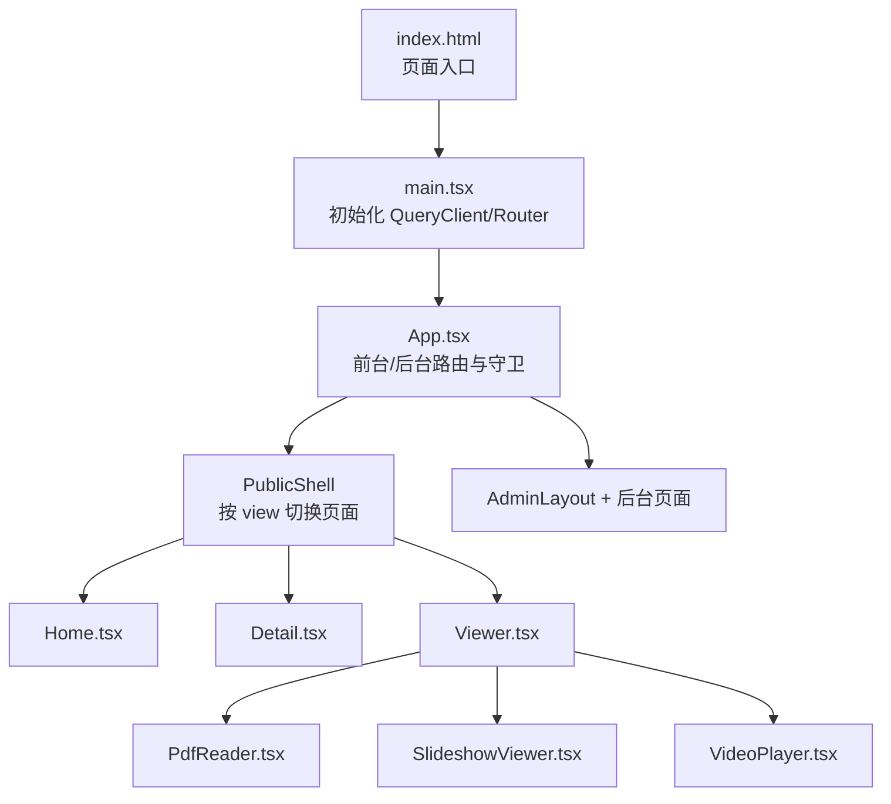
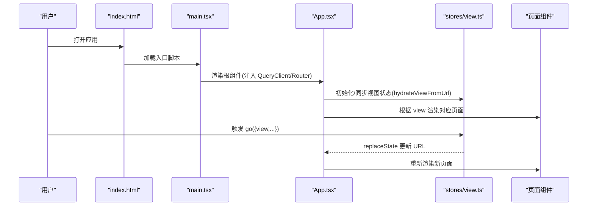
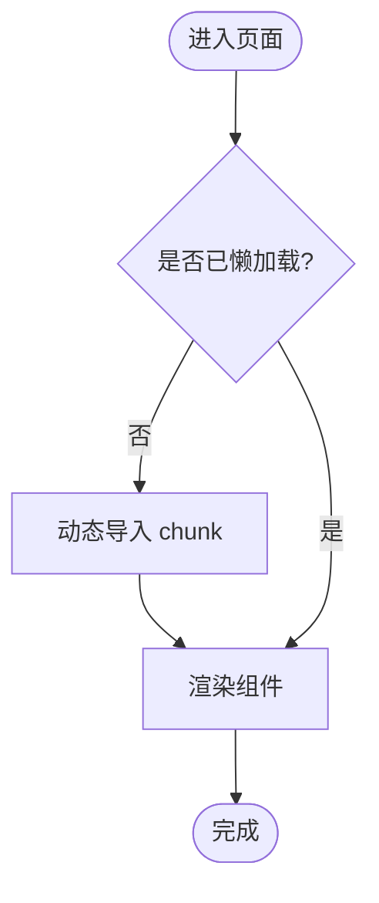
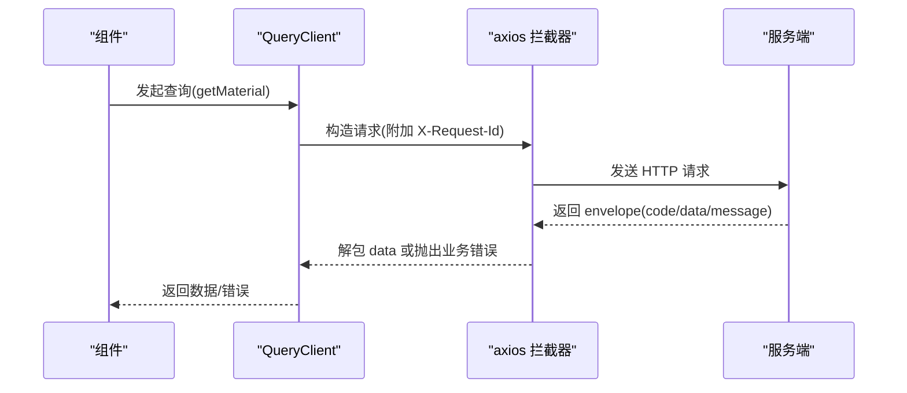
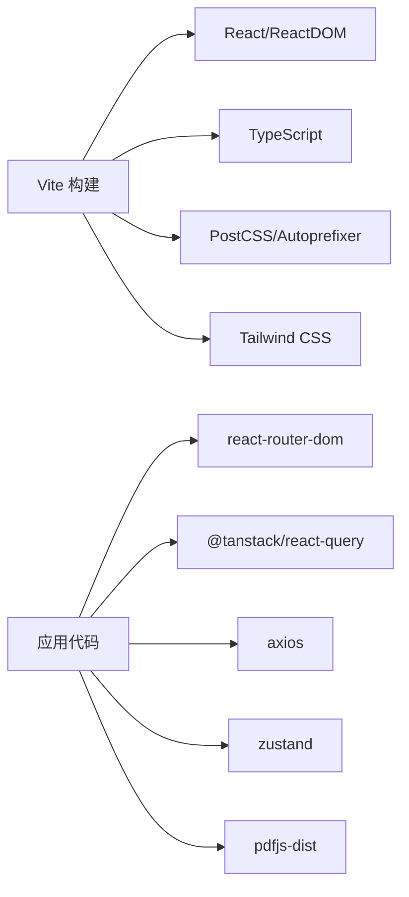

# 前端性能优化

<cite>
**本文引用的文件**   
- [frontend/package.json](file://frontend/package.json)
- [frontend/vite.config.ts](file://frontend/vite.config.ts)
- [frontend/index.html](file://frontend/index.html)
- [frontend/src/main.tsx](file://frontend/src/main.tsx)
- [frontend/src/App.tsx](file://frontend/src/App.tsx)
- [frontend/src/pages/public/Home.tsx](file://frontend/src/pages/public/Home.tsx)
- [frontend/src/pages/public/Detail.tsx](file://frontend/src/pages/public/Detail.tsx)
- [frontend/src/pages/public/Viewer.tsx](file://frontend/src/pages/public/Viewer.tsx)
- [frontend/src/api/client.ts](file://frontend/src/api/client.ts)
- [frontend/src/stores/view.ts](file://frontend/src/stores/view.ts)
- [frontend/tailwind.config.js](file://frontend/tailwind.config.js)
- [frontend/postcss.config.js](file://frontend/postcss.config.js)
- [frontend/scripts/copy-pdfjs-worker.mjs](file://frontend/scripts/copy-pdfjs-worker.mjs)
</cite>

## 目录
1. [引言](#引言)
2. [项目结构](#项目结构)
3. [核心组件](#核心组件)
4. [架构总览](#架构总览)
5. [详细组件分析](#详细组件分析)
6. [依赖分析](#依赖分析)
7. [性能考虑](#性能考虑)
8. [故障排查指南](#故障排查指南)
9. [结论](#结论)
10. [附录](#附录)

## 引言
本指南面向 Learning Hub 前端（Vite + React + Tailwind）的性能优化，覆盖代码分割与懒加载、资源优化、浏览器缓存策略、渲染性能优化、网络请求优化、Bundle 分析与体积优化，以及移动端与 PWA 集成建议。文档基于仓库现有实现进行梳理，并给出可落地的优化方案与实施路径。

## 项目结构
Learning Hub 前端采用 Vite 构建，React 作为 UI 框架，Tailwind CSS 提供样式，Zustand 管理前台视图状态，TanStack Query 管理数据请求，react-router-dom 负责路由。入口为 index.html，主应用由 main.tsx 初始化，App.tsx 定义前台与后台路由。

图表来源
- [frontend/index.html:1-14](file://frontend/index.html#L1-L14)
- [frontend/src/main.tsx:1-26](file://frontend/src/main.tsx#L1-L26)
- [frontend/src/App.tsx:1-110](file://frontend/src/App.tsx#L1-L110)
- [frontend/src/pages/public/Home.tsx:1-55](file://frontend/src/pages/public/Home.tsx#L1-L55)
- [frontend/src/pages/public/Detail.tsx:1-188](file://frontend/src/pages/public/Detail.tsx#L1-L188)
- [frontend/src/pages/public/Viewer.tsx:1-170](file://frontend/src/pages/public/Viewer.tsx#L1-L170)

章节来源
- [frontend/index.html:1-14](file://frontend/index.html#L1-L14)
- [frontend/src/main.tsx:1-26](file://frontend/src/main.tsx#L1-L26)
- [frontend/src/App.tsx:1-110](file://frontend/src/App.tsx#L1-L110)

## 核心组件
- 构建与开发配置：vite.config.ts 定义了别名、依赖预构建排除、worker 格式、开发代理与生产构建目标；package.json 提供脚本与依赖声明。
- 应用初始化：main.tsx 创建 QueryClient 并注入到 React 树，设置默认查询策略（如重试次数、聚焦时不自动重拉取）。
- 路由与页面：App.tsx 将前台单 URL 多视图与后台子路由组合；前台通过 store/view 的 view 参数切换页面。
- 视图状态：stores/view.ts 维护 view/q/id/coursewareId，并与 URL 双向同步，处理 popstate 与 replaceState。
- API 客户端：api/client.ts 统一 axios 实例，附加 X-Request-Id，统一业务码校验与错误包装。
- 资源与样式：tailwind.config.js 与 postcss.config.js 控制样式生成与裁剪；scripts/copy-pdfjs-worker.mjs 在构建后复制 PDF.js worker 到 dist。

章节来源
- [frontend/vite.config.ts:1-39](file://frontend/vite.config.ts#L1-L39)
- [frontend/package.json:1-40](file://frontend/package.json#L1-L40)
- [frontend/src/main.tsx:1-26](file://frontend/src/main.tsx#L1-L26)
- [frontend/src/App.tsx:1-110](file://frontend/src/App.tsx#L1-L110)
- [frontend/src/stores/view.ts:1-127](file://frontend/src/stores/view.ts#L1-L127)
- [frontend/src/api/client.ts:1-52](file://frontend/src/api/client.ts#L1-L52)
- [frontend/tailwind.config.js:1-21](file://frontend/tailwind.config.js#L1-L21)
- [frontend/postcss.config.js:1-7](file://frontend/postcss.config.js#L1-L7)
- [frontend/scripts/copy-pdfjs-worker.mjs:1-30](file://frontend/scripts/copy-pdfjs-worker.mjs#L1-L30)

## 架构总览
下图展示了从页面入口到具体页面的调用链与关键模块关系，便于理解当前路由与状态同步机制。

图表来源
- [frontend/index.html:1-14](file://frontend/index.html#L1-L14)
- [frontend/src/main.tsx:1-26](file://frontend/src/main.tsx#L1-L26)
- [frontend/src/App.tsx:1-110](file://frontend/src/App.tsx#L1-L110)
- [frontend/src/stores/view.ts:1-127](file://frontend/src/stores/view.ts#L1-L127)

## 详细组件分析

### 代码分割与懒加载策略
现状
- 前台使用单 URL + store/view 切换页面，所有页面在当前包中直接 import，未做路由级或组件级懒加载。
- 后台路由集中注册，同样未拆分。

建议与落地步骤
- 路由级代码分割
  - 将前台页面与后台页面改为动态导入，结合 Suspense 展示加载态，减少首屏体积。
  - 参考路径：[App.tsx:1-110](file://frontend/src/App.tsx#L1-L110) 中的路由注册处，将静态 import 替换为 React.lazy + Suspense。
- 组件级按需加载
  - 对重型组件（如 PDF/PPT/视频播放器）在 Viewer 内部按需 lazy 加载，避免非当前类型时的冗余代码。
  - 参考路径：[Viewer.tsx:1-170](file://frontend/src/pages/public/Viewer.tsx#L1-L170) 的类型分发逻辑。
- 第三方库延迟引入
  - pdfjs-dist 已在 vite.config.ts 中排除预构建，建议在需要时再动态 import，进一步降低启动开销。
  - 参考路径：[vite.config.ts:12-18](file://frontend/vite.config.ts#L12-L18)。

章节来源
- [frontend/src/App.tsx:1-110](file://frontend/src/App.tsx#L1-L110)
- [frontend/src/pages/public/Viewer.tsx:1-170](file://frontend/src/pages/public/Viewer.tsx#L1-L170)
- [frontend/vite.config.ts:12-18](file://frontend/vite.config.ts#L12-L18)

### 资源优化技术
图片与媒体
- 使用现代格式（WebP/AVIF），按需尺寸与分辨率，配合 loading="lazy" 与 sizes 属性。
- 视频优先使用流式播放与分片加载，避免整段下载。

CSS 优化与 Tree Shaking
- Tailwind 已通过 content 配置扫描源码，仅生成使用的类名，天然支持 Tree Shaking。
- PostCSS 启用 autoprefixer，确保兼容性同时最小化输出。
- 参考路径：
  - [tailwind.config.js:1-21](file://frontend/tailwind.config.js#L1-L21)
  - [postcss.config.js:1-7](file://frontend/postcss.config.js#L1-L7)

JavaScript 压缩与混淆
- Vite 生产构建默认启用 Terser 压缩与 ESBuild 优化，可通过 build.minify 与 sourcemap 控制。
- 参考路径：[vite.config.ts:33-37](file://frontend/vite.config.ts#L33-L37)。

PDF.js Worker 处理
- 构建后脚本将 worker 复制到 dist 根目录，便于 Nginx 静态服务。
- 参考路径：
  - [scripts/copy-pdfjs-worker.mjs:1-30](file://frontend/scripts/copy-pdfjs-worker.mjs#L1-L30)
  - [vite.config.ts:16-18](file://frontend/vite.config.ts#L16-L18)

章节来源
- [frontend/tailwind.config.js:1-21](file://frontend/tailwind.config.js#L1-L21)
- [frontend/postcss.config.js:1-7](file://frontend/postcss.config.js#L1-L7)
- [frontend/vite.config.ts:33-37](file://frontend/vite.config.ts#L33-L37)
- [frontend/scripts/copy-pdfjs-worker.mjs:1-30](file://frontend/scripts/copy-pdfjs-worker.mjs#L1-L30)

### 浏览器缓存策略
HTTP 缓存头
- 建议为静态资源（JS/CSS/图片）设置强缓存（Cache-Control: immutable）并带内容指纹文件名；HTML 设置较短缓存或 no-cache。
- 可在 Nginx 层针对 /dist/* 与字体/图片等路径分别配置。

Service Worker 与 IndexedDB
- 可引入 Workbox 或轻量 SW 实现离线缓存与资源预取；IndexedDB 适合存储大对象（如 PDF 分页缓存、视频片段）。
- 当前仓库未包含 SW 实现，可按需引入并在构建阶段注入。

章节来源
- [frontend/vite.config.ts:33-37](file://frontend/vite.config.ts#L33-L37)

### 渲染性能优化
React.memo 与 useMemo/useCallback
- 对频繁渲染且 props 稳定的组件（如 Logo、Toast）使用 React.memo 包裹，避免无谓重渲染。
- 对计算密集型派生数据使用 useMemo，事件处理器使用 useCallback 稳定引用。
- 参考路径：
  - [src/components/Logo.tsx:1-76](file://frontend/src/components/Logo.tsx#L1-L76)
  - [src/pages/public/Detail.tsx:62-66](file://frontend/src/pages/public/Detail.tsx#L62-L66)

虚拟列表
- 素材列表较长时，建议使用虚拟滚动（如 react-window 或自定义实现）以减少 DOM 节点数量。
- 参考路径：[src/pages/public/Detail.tsx:149-181](file://frontend/src/pages/public/Detail.tsx#L149-L181)

重渲染优化
- 合理拆分组件边界，避免父组件状态变化导致无关子组件重渲染。
- 使用 Zustand 选择器精确订阅，减少全局状态变更带来的波及。
- 参考路径：[src/stores/view.ts:58-97](file://frontend/src/stores/view.ts#L58-L97)

章节来源
- [frontend/src/components/Logo.tsx:1-76](file://frontend/src/components/Logo.tsx#L1-L76)
- [frontend/src/pages/public/Detail.tsx:62-66](file://frontend/src/pages/public/Detail.tsx#L62-L66)
- [frontend/src/pages/public/Detail.tsx:149-181](file://frontend/src/pages/public/Detail.tsx#L149-L181)
- [frontend/src/stores/view.ts:58-97](file://frontend/src/stores/view.ts#L58-L97)

### 网络请求优化
请求合并与去抖
- 对高频输入（搜索）增加防抖；对同一资源的并发请求进行合并，避免重复网络开销。
- 可结合 TanStack Query 的 queryKey 与 staleTime/garbageCollection 策略。

缓存策略
- 利用 QueryClient 的默认选项与 per-query 配置，对热点数据设置较长的 staleTime。
- 参考路径：[src/main.tsx:8-15](file://frontend/src/main.tsx#L8-L15)。

错误重试与降级
- 当前默认 retry=0，可根据接口幂等性开启有限重试；对网络异常提供友好提示与重试按钮。
- 参考路径：
  - [src/main.tsx:8-15](file://frontend/src/main.tsx#L8-L15)
  - [src/api/client.ts:25-49](file://frontend/src/api/client.ts#L25-L49)

访问会话埋点
- Viewer 在素材加载成功后发起 start，卸载时 leave，失败静默处理，避免阻塞主流程。
- 参考路径：[src/pages/public/Viewer.tsx:57-106](file://frontend/src/pages/public/Viewer.tsx#L57-L106)。

图表来源
- [frontend/src/main.tsx:8-15](file://frontend/src/main.tsx#L8-L15)
- [frontend/src/api/client.ts:13-49](file://frontend/src/api/client.ts#L13-L49)
- [frontend/src/pages/public/Viewer.tsx:57-106](file://frontend/src/pages/public/Viewer.tsx#L57-L106)

章节来源
- [frontend/src/main.tsx:8-15](file://frontend/src/main.tsx#L8-L15)
- [frontend/src/api/client.ts:13-49](file://frontend/src/api/client.ts#L13-L49)
- [frontend/src/pages/public/Viewer.tsx:57-106](file://frontend/src/pages/public/Viewer.tsx#L57-L106)

### Bundle 分析与优化
- 使用 Vite 内置分析插件（如 rollup-plugin-visualizer）或外部工具（webpack-bundle-analyzer 兼容模式）分析产物体积与依赖占比。
- 识别大依赖（pdfjs-dist、react-router 等），评估是否可替换为更轻量的实现或按需引入。
- 调整 optimizeDeps.exclude 与 build.target，平衡兼容性与体积。
- 参考路径：
  - [vite.config.ts:12-18](file://frontend/vite.config.ts#L12-L18)
  - [vite.config.ts:33-37](file://frontend/vite.config.ts#L33-L37)
  - [package.json:14-38](file://frontend/package.json#L14-L38)

章节来源
- [frontend/vite.config.ts:12-18](file://frontend/vite.config.ts#L12-L18)
- [frontend/vite.config.ts:33-37](file://frontend/vite.config.ts#L33-L37)
- [frontend/package.json:14-38](file://frontend/package.json#L14-L38)

### 移动端性能优化与 PWA 集成
- 移动端优化要点
  - 首屏关键资源内联或预加载，非关键资源延迟加载。
  - 图片响应式与懒加载，视频使用自适应码率。
  - 减少布局抖动，避免强制同步布局。
- PWA 特性
  - 添加 manifest.json 与 Service Worker，实现离线可用与安装能力。
  - 使用 Workbox 自动化缓存策略（静态资源强缓存、API 弱缓存）。
  - 当前仓库未包含 PWA 配置，可按需引入并在构建阶段注入。

章节来源
- [frontend/index.html:1-14](file://frontend/index.html#L1-L14)

## 依赖分析
当前主要依赖包括 React 生态、TanStack Query、Axios、Tailwind、Zustand、React Router 与 PDF.js。构建工具链为 Vite + TypeScript + PostCSS + Autoprefixer。

图表来源
- [frontend/package.json:14-38](file://frontend/package.json#L14-L38)
- [frontend/vite.config.ts:1-11](file://frontend/vite.config.ts#L1-L11)
- [frontend/postcss.config.js:1-7](file://frontend/postcss.config.js#L1-L7)
- [frontend/tailwind.config.js:1-21](file://frontend/tailwind.config.js#L1-L21)

章节来源
- [frontend/package.json:14-38](file://frontend/package.json#L14-L38)
- [frontend/vite.config.ts:1-11](file://frontend/vite.config.ts#L1-L11)
- [frontend/postcss.config.js:1-7](file://frontend/postcss.config.js#L1-L7)
- [frontend/tailwind.config.js:1-21](file://frontend/tailwind.config.js#L1-L21)

## 性能考虑
- 首屏体积：通过路由级与组件级懒加载显著降低初始包体。
- 渲染效率：合理使用 memo/memoized 值与虚拟列表，减少不必要的重渲染。
- 网络开销：利用 QueryClient 缓存与请求合并，降低重复请求。
- 构建产物：保持 Tailwind 的 Tree Shaking，谨慎引入大依赖，必要时替换或按需加载。
- 缓存策略：静态资源强缓存 + 内容指纹，HTML 短缓存或 no-cache。

## 故障排查指南
- 构建后 PDF.js worker 缺失
  - 现象：预览 PDF 报错或无法加载。
  - 排查：确认构建脚本执行成功，检查 dist 根目录是否存在 pdf.worker.min.mjs。
  - 参考路径：[scripts/copy-pdfjs-worker.mjs:17-27](file://frontend/scripts/copy-pdfjs-worker.mjs#L17-L27)。
- 受限课件鉴权失败
  - 现象：403 或 code=courseware_locked。
  - 排查：确认调用方是否正确传入 X-Token-Hash 头；查看 api/client.ts 的错误包装逻辑。
  - 参考路径：[src/api/client.ts:25-49](file://frontend/src/api/client.ts#L25-L49)、[src/pages/public/Detail.tsx:33-50](file://frontend/src/pages/public/Detail.tsx#L33-L50)。
- 视图跳转异常
  - 现象：返回首页需点击多次或跳转到错误页面。
  - 排查：检查 stores/view.ts 的 go 方法中对 home 语义的清理逻辑与 URL 同步。
  - 参考路径：[src/stores/view.ts:71-96](file://frontend/src/stores/view.ts#L71-L96)。

章节来源
- [frontend/scripts/copy-pdfjs-worker.mjs:17-27](file://frontend/scripts/copy-pdfjs-worker.mjs#L17-L27)
- [frontend/src/api/client.ts:25-49](file://frontend/src/api/client.ts#L25-L49)
- [frontend/src/pages/public/Detail.tsx:33-50](file://frontend/src/pages/public/Detail.tsx#L33-L50)
- [frontend/src/stores/view.ts:71-96](file://frontend/src/stores/view.ts#L71-L96)

## 结论
通过对代码分割、资源优化、缓存策略、渲染与网络层面的系统性优化，Learning Hub 前端的启动速度、交互流畅度与稳定性均可显著提升。建议优先落地路由级懒加载与 Viewer 组件级懒加载，并结合 QueryClient 缓存与静态资源强缓存策略，快速获得可观的收益。后续可逐步引入 PWA 与更精细的 Bundle 分析，持续迭代优化。

## 附录
- 相关配置文件与入口文件路径索引
  - 构建与脚本：[vite.config.ts:1-39](file://frontend/vite.config.ts#L1-L39)、[package.json:1-40](file://frontend/package.json#L1-L40)、[scripts/copy-pdfjs-worker.mjs:1-30](file://frontend/scripts/copy-pdfjs-worker.mjs#L1-L30)
  - 应用入口与路由：[index.html:1-14](file://frontend/index.html#L1-L14)、[main.tsx:1-26](file://frontend/src/main.tsx#L1-L26)、[App.tsx:1-110](file://frontend/src/App.tsx#L1-L110)
  - 页面与组件：[Home.tsx:1-55](file://frontend/src/pages/public/Home.tsx#L1-L55)、[Detail.tsx:1-188](file://frontend/src/pages/public/Detail.tsx#L1-L188)、[Viewer.tsx:1-170](file://frontend/src/pages/public/Viewer.tsx#L1-L170)、[Logo.tsx:1-76](file://frontend/src/components/Logo.tsx#L1-L76)
  - 状态与网络：[stores/view.ts:1-127](file://frontend/src/stores/view.ts#L1-L127)、[api/client.ts:1-52](file://frontend/src/api/client.ts#L1-L52)
  - 样式与构建：[tailwind.config.js:1-21](file://frontend/tailwind.config.js#L1-L21)、[postcss.config.js:1-7](file://frontend/postcss.config.js#L1-L7)